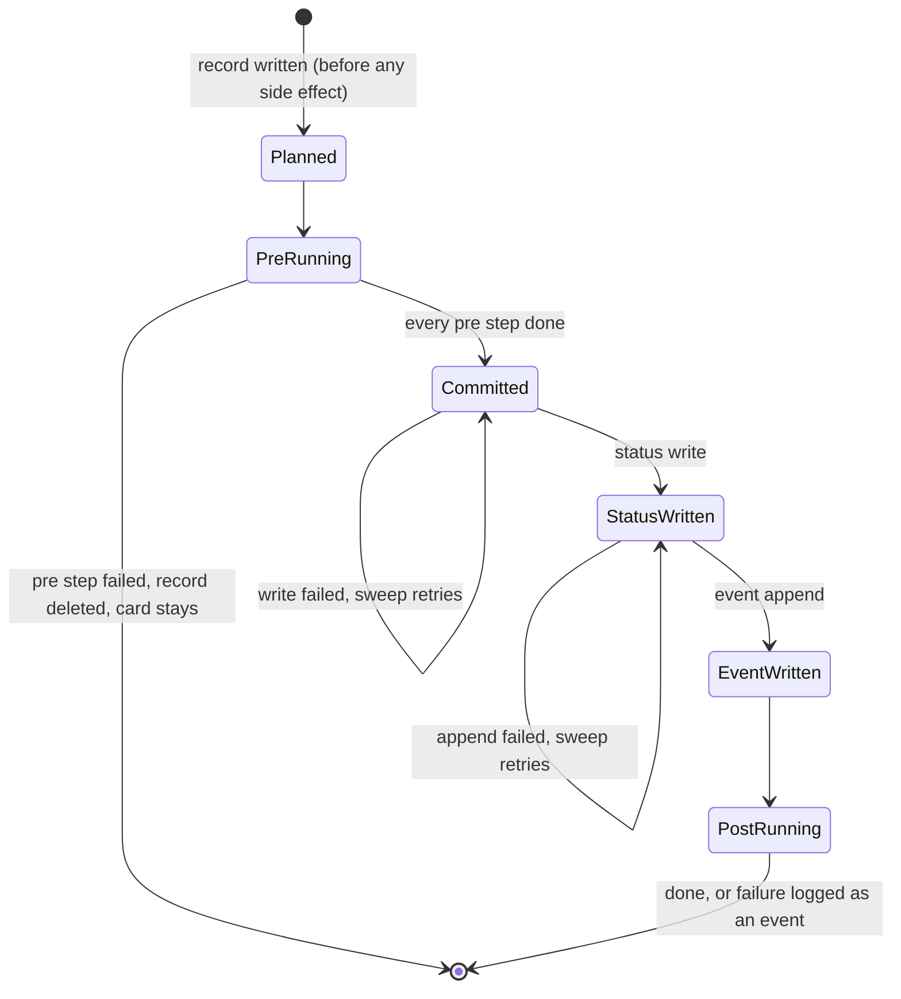
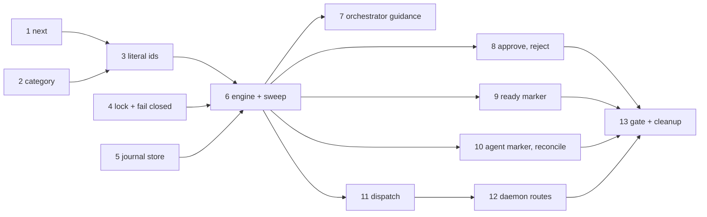

# Status transitions: one path

Every status change Shelbi makes goes through one function, in the daemon, with a durable record of what has already run. Any-to-any moves stay. This plan is for review; nothing here is implemented.

Line numbers are against origin/main at d7c08787 (2026-11-05), which includes #2191. The source audit is [[implicit-state-machines]] and its area doc `Research/implicit-state-machines/task-lifecycle.md`. The design it extends is [[workflows]].

## Needs your call

Three decisions change behavior users can see. Each has a default the tasks below assume. Everything else is under "Decided unless you object".

1. **Should a hand move fire a non-merge edge's actions?** Today it doesn't. `shelbi issue move --to canceled` on the shipped `task` workflow leaves the PR open and the branch alive, even though that edge declares `[close_pr, delete_branch]`. A test pins this (`edge_without_a_merge_fires_no_actions_from_either_surface`, `transition_move_tests.rs:459`). **Default: keep it**, make it an explicit policy in the owner, and file the canceled edge as a separate issue. Fixing it here would mix a behavior change into a refactor.
2. **When the merge landed but the status write failed, does the caller see success?** **Default: yes, with a warning.** The merge is real and the daemon now owns finishing the move, so a retry can't help. `shelbi issue move` exits 0 and prints that the status write is pending. The other choice is a non-zero exit, which would make the orchestrator's Zen flow treat a landed merge as a failed one.
3. **Should a bare `shelbi issue edit` on the file backend stop being a raw file edit?** It lets a user rewrite `column:` and `assigned_to:` with no event and no actions, while the GitHub editor refuses those keys. **Default: use the same planned editor on both backends.** This takes away a power-user shortcut. Keeping it means the "one owner" claim has a documented exception.

## Context

### What the audit found, and what it undercounted

The audit describes two move implementations. There are more. Every line below writes a status today:

| # | Path | Where | Order | Keys on | Daemon lock + ExpectedState |
|---|---|---|---|---|---|
| 1 | `move_issue_with` (CLI `issue move`, app board, orchestrator agent) | `transition_move.rs:300` | cut, gated merge, write, event (rollback on failure), zen record, detach, rest | literal `in-progress` for the cut, categories for detach | yes (via `apply_move`) |
| 2 | `approve_review_task` | `review_ui.rs:371` | gated merge, write, event (`let _ =`), rest in a thread | declared order (`forward_status`) | yes |
| 3 | `reject_review` | `review_ui.rs:535` | atomic body + write + unassign, event (`let _ =`) | first Ready status, else literal `todo` | yes |
| 4 | `apply_start` | `mutate/start.rs:180` | write, assign, launch, event, zen record; rollback on launch failure | agent-owned active, else `in-progress`, else first Active | yes |
| 5 | `issue resume` | `shelbi-cli issue.rs:1142` | write, assign, launch, event; rollback only if it moved | literal `in-progress`, never checked against the workflow | **no, in-process** |
| 6 | `workspace stop` release | `shelbi-cli workspace.rs:686` | write + unassign, event | literal `in-progress` to literal `todo` | **no, in-process** |
| 7 | Poller ready marker, review edge | `poller.rs:3073, 3122` | all actions + `run:`, write, event (warn only), detach | literal `in-progress` guard, then categories | **no lock, no check** |
| 8 | Poller ready marker, merge edge | `poller.rs:3004, 3122, 3156` | detach, merge, own merge event, write, event, rest (skip `[Merge]`) | same | **no lock, no check** |
| 9 | Poller agent transition marker | `poller.rs:3525, 3550` | **write first**, event, all actions including merge, best-effort | declared edges | **no lock, no check** |
| 10 | Zen GitHub-merge reconcile | `zen.rs:1514` | write, event, rest (skip `[Merge]`) | `Column::category` | **no lock, no check** |
| 11 | Rollbacks | `issue.rs:1026`, `start.rs:411`, `transition_move.rs:419` | compensating write | literal `in-progress` guard in two | inherits |
| 12 | `issue rm` on GitHub | `issue.rs:1412`, `github_store.rs` `delete` | closes as `not_planned`, no event | n/a | **no, in-process** |
| 13 | Raw `$EDITOR`, file backend | `issue.rs:1345` | rewrites the file | n/a | **no** |

Not in that table because they are not status writes, but relevant:

- **Zen has only one direct write (#10).** Zen promote and Zen landing are the orchestrator agent running `shelbi issue move --reason orchestrator:zen-promote` / `orchestrator:zen-merge pr=<n>`, so they already take path 1. Heartbeat recovery does too.
- **External moves are observed, not made.** A GitHub label edit reaches `plan_issue_reconcile` (`poller.rs:882`), which only appends an event.
- **`shelbi action apply-transition` runs actions and writes no status.** It stays plumbing.
- `release_task_to_todo` (`shelbi-state lib.rs:3597`) and `IssueStore::cancel` have no production callers. `reject_review_task` has only its test.

### Problems the audit didn't list

- **A custom primary active status can't hand off.** The ready-marker guard is `tf.task.column == Column::in_progress()` (`poller.rs:2871`). A worker dispatched into `design` writes its marker, the poller takes the "stale marker" arm, logs `not-in-progress`, and clears the marker. The card is stuck. The audit refuted this on the premise that `issue start` always lands in `in-progress`, but `start.rs:160` lands in `dispatch_destination_status`, which falls back to the first Active status. No test covers it.
- **`issue resume` can write an undeclared status.** It always targets `Column::in_progress()`. On a workflow with no such id, or for a card in a gate, it moves the card somewhere the workflow doesn't declare or yanks it out of the gate.
- **The per-issue lock doesn't cover the poller.** `issue_locks` lives in the CLI daemon's `ControlState` (`daemon/control.rs:140`). Paths 7 to 10 never take it, so a ready handoff and a board drag on the same card can interleave a merge with a move. The file store's `lock_tasks` only covers each single write.
- **More behavior runs on `Column::category` than the audit's two sites.** See the table under "Category" below. The worst are terminal routing (`is_terminal_status`, `is_terminal_column`), which treats a custom done status as open, and quiescence (`poller.rs:1521`, `wake.rs:2895`), which treats any custom active card as idle backlog.
- **The stored-status resolver exists three times** (`shelbi-app board.rs:84`, `zen.rs:14978`, `poller.rs:3339`).
- **Shared cleanup already misses paths.** Open PR #2192 adds `zen_flow::forget` to `move_issue_with` only, so a Reject doesn't reach it. This is the drift pattern recurring while we plan.

### What "double-merge" actually means here

`actions::merge` is already idempotent (`AlreadyMerged`, `AlreadyIntegrated`, `actions.rs:640-680`), so re-running it doesn't integrate twice. Idempotence alone doesn't fix this, for four reasons:

1. **Nothing retries.** A card with a merged PR sits in review until a human acts. Zen reconcile can rescue it only on a PR workflow whose forward status is literally `done`, on a 15-minute cadence.
2. **The rollback causes the strand.** When the event append fails, `move_issue_with` moves the card back after the merge has landed (`transition_move.rs:419`).
3. **Retries re-run the rest of the edge.** A `[push_branch, merge]` retry re-pushes after merge, and a stale tracking ref can resurrect a branch GitHub auto-deleted. Skip lists of a literal `[Merge]` (`poller.rs:3156`, `zen.rs:1527`) do the same after the move.
4. **`run:` and `ready:` aren't idempotent.** On the ready-marker path they re-fire every tick when the status write fails after the edge ran, and GitHub 403 windows are a known recurring condition on this hub.

## Design

### 1. One owner: `transition::cross`

`crates/shelbi-orchestrator/src/transition_move.rs` becomes the only place that crosses an edge. It has a pure planner and an engine:

```rust
/// Pure. Table-tested for every intent against stock and custom workflows.
pub fn plan_crossing(workflow: &Workflow, issue: &Issue, intent: &Intent) -> Result<Plan, Refused>;

pub struct Plan {
    from: String, to: String,
    pre: Vec<Step>,        // must all succeed before the status write
    write: StatusWrite,    // Plain | Unassign | Assign{ws, branch} | RejectWithFeedback{reason, date}
    event: EventShape,     // Plain | ActionsSkipped | GithubMergeReconcile{pr, sha} | Dispatched{agent}
    post: Vec<Step>,       // best-effort, after the write
}

pub enum Step { CutBranch, Action(TransitionAction), Commands, Detach, FinishEffects }

/// The engine. Needs the issue's lock, by type.
pub fn cross(
    guard: &IssueGuard,
    store: &dyn IssueStore,
    runner: &dyn TransitionRunner,
    req: &CrossRequest<'_>,
    warn: &mut dyn FnMut(MoveWarning),
) -> Result<CrossOutcome, MoveError>;

/// For the one caller with work between the write and the commit.
pub fn begin(...) -> Result<Crossing, MoveError>;
impl Crossing { fn commit(self) -> Result<CrossOutcome, MoveError>; fn abort(self, why: &str) -> Result<(), MoveError>; }
```

`cross` is `begin` followed by `commit`. Only dispatch uses them separately, because the launch happens between them. `abort` is refused once an irreversible step has run.

`move_issue` stays as a thin wrapper that builds `Intent::Move`, so the CLI and board keep their exact messages. It always runs in the daemon process.

`FinishEffects` is the shared cleanup that keeps getting missed per path: the Zen demotion record and `zen_flow::forget` when it lands.

### 2. Every path routes through it

| Today | Becomes | Runs in |
|---|---|---|
| CLI `issue move`, app board move, orchestrator agent | `Intent::Move { to, skip_actions }`, unchanged route | daemon `apply_move` |
| Zen promote, Zen landing, heartbeat recovery | Same. They are `issue move` calls from the orchestrator agent | daemon `apply_move` |
| Review Approve | `Intent::Approve`. Delete the move half of `approve_review_task` | daemon `apply_approve` |
| Review Reject | `Intent::Reject { reason }`, with the store's atomic `reject_review` as the write | daemon `apply_reject` |
| `issue start` | `Intent::Dispatch`, via `begin` + launch + `commit` or `abort` | daemon `apply_start` |
| `issue resume` | New `MutationKind::Resume`, then `Intent::Resume` via `begin`/`commit`/`abort` | daemon |
| `workspace stop` | New `MutationKind::Release`, then `Intent::Release`. The park half uses `Unassign` | daemon |
| Poller ready marker, both edge shapes | `Intent::Handoff`, after the poller's preflight (verify, rebase, push) | daemon poller, try-lock |
| Poller agent transition marker | `Intent::AgentVerdict { target }` | daemon poller, try-lock |
| Zen GitHub-merge reconcile | `Intent::ExternalMerge { pr, sha }` | daemon poller, try-lock |
| `issue rm` | New `MutationKind::Remove`. Refused while a committed crossing is open | daemon |
| `issue prio` | Existing `MutationKind::Prioritize` | daemon |
| Raw `$EDITOR` | Planned editor on both backends (see "Needs your call") | daemon `Edit` |
| GitHub label edit | Not a crossing. Still observed by `plan_issue_reconcile` | daemon poller |
| `action apply-transition` | Not a crossing. Stays plumbing, documented as writing no status | CLI |

The poller's preflight stays in the poller because it needs the worker's machine and worktree. Its pane kill stays there too, after `cross` returns.

### 3. What each intent does

The differences between today's paths become one table in `plan_crossing`, so a difference is a choice someone can read:

| Intent | Target | Legality | Actions | `assigned_to` |
|---|---|---|---|---|
| `Move` | explicit, resolved against the workflow | any declared | merge edge: gated. Other edges: none (the pinned contract) | keep |
| `Approve` | `next(from, Approve)` | any declared | same as `Move` | keep (`close_review_window` reads it) |
| `Reject` | `next(from, Reject)`, else stock `todo` | any declared | none | clear |
| `Handoff` | `next(from, Handoff)` | declared | merge edge: gated. Other edges: all before the write | keep |
| `AgentVerdict` | target id, or `next(from, GateReject)` for `reject`/`bounce` | declared edge only when `transitions:` exists | merge edge: gated. Other edges: all after the write, best-effort | clear |
| `ExternalMerge` | `next(from, Approve)`, must be Done category | any declared | prefix + merge recorded as done externally, rest after | keep |
| `Dispatch`, `Resume` | `next(from, Dispatch)` | any declared | none | set |
| `Release` | primary active: `next(from, Reject)`. Gate: stays put | any declared | none | clear |

Side-effect rules shared by every intent, keyed on the workflow and never on a literal id:

- **Branch cut:** crossing into `primary_active_status()` from anything else. `Dispatch` and `Resume` already manage their own branch, so they skip it.
- **Detach:** crossing Active to Handoff with an assignee, after the write. On a merge edge, detach goes after the merge and before `delete_branch`. Only `delete_branch` needs the branch free, and detaching before a merge that then fails leaves later ticks rebasing a detached HEAD, which the audit flagged.
- **Pre-merge prefix:** computed once from the edge's `merge` position, recorded per step. This replaces every literal `[Merge]` skip list.
- **Owner and parked marker:** the status and owner change in one write step, so a failure can't leave them half done. Today `apply_start` moves and then calls `set_fields`, and a failed `set_fields` returns before any rollback, leaving an unowned active card. `Dispatch` also clears the parked marker. Unloading a review card writes the parked marker before clearing the owner, so a partial failure leaves it parked and still owned rather than unowned and auto-reloaded.

Agent markers on a merge edge are now gated like every other path. This fixes the one remaining move-before-merge: an agent writing `done` on `review -> done [push_branch, merge]` could read done with nothing merged.

### 4. Resumable moves: the transition journal

One record per open crossing, at `<project_dir>/transitions/<issue-id>.json`, written atomically by tmp + rename. This is the same shape and location as `zen-flow/<task>.json` from #2192. It is hub-local, so it works for both backends and adds nothing to a GitHub issue. Closed crossings are deleted, because `events.log` is the history.

```json
{
  "v": 1,
  "issue": "fix-login",
  "workflow": "task",
  "from": "review",
  "to": "done",
  "intent": "approve",
  "reason": "user:review",
  "phase": "committed",
  "event": { "shape": "plain" },
  "pre":  [ { "step": "push_branch", "state": "done", "at": "..." },
            { "step": "merge", "state": "done", "at": "...", "pr": 2192, "sha": "abc123", "head": "def456" } ],
  "post": [ { "step": "delete_branch", "state": "pending" } ],
  "attempts": 2,
  "started_at": "...", "updated_at": "..."
}
```

The record is written **before the first side effect** and rewritten after every step. A step that may be interrupted is marked `started` first, so a crash leaves evidence.



**The rule that makes it safe: `Committed` is the point of no return.** Before it, a failed attempt deletes the record and the next attempt plans from scratch. That matters: if a merge fails on a conflict, the worker pushes a fix and the user approves again, the `push_branch` prefix must run again. A record that remembered it would land a stale head. After `Committed`, the crossing only rolls forward and never re-runs a recorded step.

| Failure | Today | With the journal |
|---|---|---|
| Prefix or merge fails | `merge status=failed`, card stays | Same. Record deleted |
| Crash during merge | Card stays in review, unknown whether it merged | Sweep sees `merge: started` and asks `runner.merge_landed` (read-only). Landed: commit and roll forward. Not landed: delete the record and log it, never merge late on a stale approval. Probe failed: keep the record and retry |
| Status write fails after merge (403) | Error, card stays, retry re-runs prefix + merge | Record at `Committed`. Caller gets success with a warning. Sweep retries only the write |
| Event append fails after write | Rolled back to review with the PR merged | Rolls forward. Event stays pending, sweep retries |
| Crash between write and event | Event lost, a GitHub board may log it as an external move | Sweep appends the event. `recorded_target` also consults the journal, so reconcile doesn't log a duplicate |
| Post step fails | `tracing::warn` on most paths | `transition status=cleanup-failed` event. Not retried, record closes |
| Crash or daemon exit during post | Cleanup never runs | Sweep finishes it |
| Approve again while pending | Re-runs merge | Resumes the record |
| Different target while committed | n/a | Refused, naming the pending target. `--skip-transition-actions` closes the record and logs it |
| Card moved out-of-band while committed | n/a | Sweep doesn't overwrite it. Logs `status=superseded` and closes |

**Why this can't double-merge.** A `merge` recorded done is never run again. The only way to reach it twice is a crash after the merge landed and before the record was written, and that goes through the read-only probe. The `merge_landed` probe reuses the stale-PR guards from Zen reconcile (`zen.rs:1370-1395`), so a reused branch's old merged PR doesn't read as this merge.

**Why this can't strand a card.** `resume_open_transitions(project)` runs on boot and on the poller's supervisor tick, beside `maybe_github_reconcile`, under the same `is_online` gate. It takes the issue try-lock and backs off per record up to 5 minutes. It never gives up. After 15 minutes it logs `transition status=stuck` once an hour, so the orchestrator and user can see it, and `shelbi issue show` prints the pending crossing.

**Other paths respect an open record.** Dispatch, Zen promote, the Zen probe, review load, and the pane supervisor's relaunch skip a card with a committed crossing. Zen reconcile resumes the record instead of moving the card.

**Event lines.** Existing move lines keep their shape, so the Activity feed and orchestrator rules don't change. New lines are `transition project=<p> task=<id> status=resumed|stuck|superseded|cleanup-failed ...`. They must carry `project=`, because `events tail --project` drops lines without it. In the feed they use `SystemKind::Other`, because a new variant would break an older remote client's decode.

**Approve's reply.** It still returns before cleanup. The post steps are in the journal, so the background thread can do them and a daemon exit can't lose them. This pairs with #2190.

### 5. One next-status rule

`shelbi-core workflow.rs` gets one entry point:

```rust
pub enum NextIntent { Dispatch, Handoff, GatePass, GateReject, Approve, Reject }
pub struct Next<'w> { pub to: &'w Status, pub edge: Option<&'w Transition> }
impl Workflow { pub fn next(&self, from: &str, intent: NextIntent) -> Option<Next<'_>>; }
```

| Intent | Rule | Replaces |
|---|---|---|
| `Dispatch` | Stay if `from` is an agent-owned Active, else `primary_active_status()` | `start_destination_status` + `dispatch_destination_status`, two copies of each (`issue.rs:829, 856`, `start.rs:682, 695`) |
| `Handoff` | Unique agent gate edge, else first Handoff status, else first outgoing merge edge | Inline block at `poller.rs:2911-2933` |
| `GatePass`, `GateReject` | Bodies of today's `gate_pass_status`, `gate_reject_status` | Those helpers become private |
| `Approve` | First outgoing merge edge, else first outgoing edge to a later non-Archived status, else `forward_status` skipping Archived | `forward_status` at `review_ui.rs:381`, `zen.rs:1438` |
| `Reject` | First Ready status | `ready_status` at `review_ui.rs:550` |

`Approve` is the one rule that changes. Today, inserting a status between `review` and `done` makes Approve land on it and skip the `review -> done` merge edge. A real `review -> qa -> done` chain still lands on `qa`, because that is the only outgoing edge. On the shipped workflows the answer is unchanged, and a test pins that.

`fires_merge_bar` keeps its two semantics. That is documented back-compat and doesn't choose a target.

### 6. Category: only the workflow decides

Stored ids can be undeclared (legacy, or a status removed later), so this needs an explicit answer:

```rust
pub enum StatusResolution<'w> {
    Declared(&'w Status),
    /// A stock id the workflow renamed: `review` found as a Handoff `qa`.
    Renamed(&'w Status),
    Undeclared,
}
impl Workflow { pub fn resolve_stored(&self, column: &Column) -> StatusResolution<'_>; }

impl Column {
    /// None for a custom id, instead of pretending it's Backlog.
    pub fn stock_category(&self) -> Option<StatusCategory>;
    /// Header colors and old event lines only. Named so it can't be mistaken.
    pub fn display_category(&self) -> StatusCategory;
}
```

`Column::category` is deleted, so the compiler lists every call site. Code with no workflow in hand asks `ProjectStatuses` (`load_project_statuses`), which is what `event_log.rs:1894` already does, loaded once per pass.

| Site | What it decides | Fix |
|---|---|---|
| `zen.rs:1440` | Terminal, for GitHub reconcile. A custom done status never reconciles | `next(from, Approve).to.category` |
| `zen.rs:1196, 14922` | Handoff, when the workflow failed to load | Catalog, else skip the card |
| `board.rs:89`, `zen.rs:14983`, `poller.rs:3344` | Which status a stored id means | All three become `resolve_stored` |
| `board.rs:89` for `Undeclared` | Bucket for an unknown id | Keeps its Backlog bucket, now explicit |
| `poller.rs:910` | Whether a new card is an adoption. A custom Ready card wakes nobody | Catalog |
| `poller.rs:1521`, `wake.rs:2895` | Quiescence and heartbeat backoff. A custom Active card reads idle | Catalog |
| `add_edit.rs:88` | Whether a new card wakes the orchestrator | Catalog |
| `add_edit.rs:446` | Whether the card is Active | `resolve_stored` |
| `lifecycle.rs:92` | `depends_on` base branch. A custom done dep blocks | Catalog |
| `issue.rs:426`, `issue_store.rs:453` | Open index vs closed history. A custom done status counts as open | Catalog, parameter on `is_terminal_column` |
| `status.rs:247` | Which review cards get the missing-PR warning | Catalog |

Left on `display_category`: `kanban.rs:3139`, `activity.rs`, `activity_labels.rs:76`, `palette_search.rs:233`, `task_properties.rs:225`, `view.rs:681, 1062, 1107`, `board_state.rs:870`, `status.rs:661`, and the `event_log.rs:1905` fallback. A scan test holds this allowlist (task 13).

The same bug family, with literal ids instead of the fallback, gets fixed alongside: `Issue::is_blocked` (`model.rs:2417`, literal `done`), the `actions.rs:535, 753, 821, 1797` done checks, and the `poller.rs:2871, 2902` handoff guard. #2191 already removed most of the `in-progress` and `review` literals from slot occupancy. The review-slot literals that remain (`load.rs:300, 509`, `review_session.rs:88, 221`, `poller.rs:5573`) belong to the review slot machine, and this plan leaves them.

### 7. Concurrency: one lock, and failed reads refuse

- **Lock.** `issue_locks` moves to `shelbi_orchestrator::transition`, exposed as `lock_issue(project, id) -> IssueGuard` and `try_lock_issue`. `cross` takes `&IssueGuard`, so the compiler enforces it. The control socket's `run_job` keeps holding its guard through `apply`. The poller uses `try_lock` and skips to its next tick, so a 30-second merge never blocks a tick. Config keys (`config:<name>`) keep sharing the same map.
- **ExpectedState.** Everything user-driven now goes through `run_job`, including the new `Resume`, `Release`, and `Remove` kinds. The poller and Zen pass no expectation, since they re-read under the lock.
- **Fail closed.** `mutate_client.rs:32` (`current_state(...).ok()`) and `exec_daemon.rs:407` (`read_expected`) turn a failed read into "no check". They become errors. A failed read during an outage used to let a mutation proceed unchecked, and the write was likely to fail too.

### Out of scope

- Workspace slot occupancy, which #2191 landed as `BoardOccupancy`.
- The review slot serving lifecycle.
- Enforcing declared edges on humans. Any-to-any stays by design ([[workflows]] section 11).
- Firing non-merge edges on hand moves (see "Needs your call").
- A "pending" badge on the board. It would need a parity row and both clients. `issue show` and events cover it for now.
- Dispatch attempt ids, the `DispatchStatus` enum, and generation checks inside `deploy_and_spawn`. Those are launch internals from the audit's dispatch machine, and the plan only changes the status writes around them. They should be filed on their own.
- Folding the ready marker's deferred, refused, and push-blocked sidecars into one record. They describe the preflight, which stays in the poller. That is a tidy-up once task 9 lands.

## Decided unless you object

- **Journal over relying on idempotence alone**, for the four reasons under "What double-merge actually means". The audit offered either. The primitives stay idempotent; that is what covers the crash window.
- **An event-append failure rolls forward, always**, not just after a merge. `MoveError::EventAppend` goes away. Two behaviors for one failure is how the rollback bug happened, and a pending event still reaches the orchestrator once the log recovers.
- **`run:` and `ready:` are at-least-once across a crash, and exactly once otherwise.** A `started` command re-runs after a daemon crash. Skipping it could leave a review server never started, and today's behavior re-fires on every tick anyway.
- **A canceled dependency keeps blocking; a custom Done dependency stops blocking.** `is_blocked` compares to the literal `done`, so both block today. `lifecycle.rs:92` already documents that an Archived dep can never complete, so only the Done half changes.
- **Agent markers on merge edges are gated, not refused.** Refusing would break any workflow that lets a gate land work.
- **`workspace stop` on a gate card clears the owner and keeps the status,** so the active-gate pass can re-dispatch it. Sending it to `todo` would undo the gate's progress. Today it stays assigned to a dead pane.
- **A single scan test, not a type-level token, enforces the one-owner rule.** A token would have to cross from `shelbi-state` into the orchestrator and every test store. `shelbi-tui/tests/no_color_literals.rs` is the existing pattern.

## Rollout

Each task leaves `main` green and can merge alone. Tasks 1 to 5 change no move sequencing. Task 6 is the keystone.



**Land these open PRs first.** They all change the functions below, and rebasing them over this work would be worse than the other way round:

- #2192 `zen-merge-pins-head` adds `zen_flow` and the `forget` call in `move_issue_with`, which task 6 moves to `FinishEffects`.
- #2193 `gate-verdict-dropped-on-read-error` rewrites the read in `maybe_apply_transition`, which task 10 builds on.
- #2185 `supervisor-clean-exit-restarts` adds `KillReason` to pane kills in `start.rs` and `review_ui.rs`.
- #2190 `daemon-shutdown-drains-jobs` touches `mutate_client.rs`, which task 4 changes.

**Checks for every task:** `cargo build --workspace`, `cargo clippy --workspace --all-targets -- -D warnings`, and the affected crate's tests. Tasks 2, 3, and any that touch `shelbi-app` or `shelbi-state` also run the desktop checks from `desktop/` and `cargo check --workspace --locked`. In a worker pane, run move tests with `env -u SHELBI_HUB_SOCK -u SHELBI_HUB_ADDR -u SHELBI_CONTROL_SOCK`, or the daemon version guard fails them confusingly.

---

### Task 1: `Workflow::next` replaces the next-status helpers

Size S. No dependencies.

Add `Workflow::next(from, NextIntent)` as specified in Design 5 and move each caller onto it: dispatch in the CLI and `start.rs`, the handoff block in the poller, gate verbs, Approve, Reject, and `auto_reconcile_target`. Delete all four `start_destination_status` / `dispatch_destination_status` copies.

- [ ] One dispatch-target rule, in `shelbi-core`. `grep start_destination_status` finds nothing
- [ ] Table test: every `NextIntent` against `default_workflow()`, `task_workflow()`, `subtask_workflow()`, a gate chain, a custom primary active, and no `transitions:` block
- [ ] Test: `review -> qa -> done` Approve lands on `qa`
- [ ] Test: a status declared between `review` and `done`, with a `review -> done [merge]` edge, Approve lands on `done`
- [ ] Test: Approve from a `done` status never returns `canceled`
- [ ] Shipped workflows resolve exactly as today

### Task 2: Remove `Column::category`, make category workflow-resolved

Size M. No dependencies. Runs the desktop checks.

Add `Workflow::resolve_stored` and `StatusResolution`, delete `Column::category` in favor of `stock_category` and `display_category`, and fix every row of the table in Design 6. Add a `ProjectStatuses` helper for code with no workflow in hand.

- [ ] `Column::category` no longer exists
- [ ] The three stored-status resolvers are gone, replaced by `resolve_stored`
- [ ] Test: a custom done id (`shipped`) auto-reconciles after a GitHub merge
- [ ] Test: a custom active card keeps the board non-quiescent
- [ ] Test: a card created in a custom ready status wakes the orchestrator, and a first-seen custom ready card emits an adoption
- [ ] Test: `issue list --status shipped` reads closed history
- [ ] Test: a `shipped` dependency doesn't block and doesn't become a base branch
- [ ] Test: an undeclared id still lands in the Backlog bucket on the board, explicitly
- [ ] Doc comment on `display_category` says it must not drive behavior

### Task 3: Key lifecycle side effects on the workflow, not literal ids

Size M. Depends on 1, 2.

Fix the ready-marker guard and `from_status` (`poller.rs:2871, 2902`), the branch cut (`transition_move.rs:357`), `Issue::is_blocked` and its callers, and the `actions.rs` done checks.

- [ ] Test: a worker dispatched into a custom primary active status hands off through its marker. Today this drops the marker as `not-in-progress`
- [ ] Test: a manual move into a custom primary active status cuts the branch
- [ ] Test: a move into a non-primary gate doesn't cut a branch
- [ ] Test: `is_blocked` treats a custom Done status as satisfied
- [ ] Remaining `Column::in_progress()` and `Column::review()` uses outside tests are listed in the PR body, each with the task or machine that owns it

### Task 4: One per-issue lock, and failed reads refuse

Size S. Depends on #2190.

Move `issue_locks` to `shelbi_orchestrator::transition` with `lock_issue` and `try_lock_issue`. `ControlState::issue_lock` delegates. Make `mutate_client.rs:32` and `exec_daemon::read_expected` return errors. No poller changes yet.

- [ ] Test: guards from the control path and the orchestrator contend on the same key
- [ ] Test: a failed state read fails the mutation before any request is sent, in both the CLI and the app executor
- [ ] Test: a missing issue still reports `<deleted>` and reads as stale
- [ ] Doc comment on `execute_mutation_expecting` no longer implies `None` is normal for existing issues

### Task 5: Transition journal store

Size S. No dependencies.

Add `shelbi_state::transitions` with the record type, atomic read, write, list, and delete. No callers yet. Model it on `zen_flow`.

- [ ] Record round-trips, with an unknown `v` left in place and logged, never deleted
- [ ] Atomic write leaves no partial file when interrupted
- [ ] Tests use `crate::test_lock::LOCK` and an isolated `SHELBI_HOME`

### Task 6: The engine, with `move_issue` on top, and the resume sweep

Size L. Depends on 3, 4, 5.

Add `plan_crossing`, `cross`, `begin`, `commit`, `abort`, and `resume_open_transitions`. Rebuild `move_issue_with` on them. Add `runner.merge_landed`. Replace `MoveError::EventAppend` with roll-forward. Add `MoveOutcome.pending`. Wire the sweep into the poller and daemon boot. Have `recorded_target` consult the journal. Add `pending` to `issue show`.

This is the first task that changes the failure behavior. Approve and the poller keep their own paths until tasks 8 to 10, and those paths ignore the journal in the meantime.

- [ ] Each row of the failure table in Design 4 has a test, driven through `StubRunner` and a store stub that fails on demand
- [ ] Test: status write fails after a merge. `gated_merge` ran once, the reply is success with a warning, and the next sweep writes the status without touching the runner's merge
- [ ] Test: event append fails after a merge. The card stays at the target, and the sweep appends the event exactly once
- [ ] Test: crash with `merge: started` and a landed PR rolls forward. With no landed PR, the record is deleted and nothing merges
- [ ] Test: a stale merged PR on a reused branch doesn't read as landed
- [ ] Test: Approve-equivalent retry resumes. A different target is refused by name. `skip_transition_actions` closes the record
- [ ] Test: a failed pre step deletes the record, and the next attempt re-runs the prefix
- [ ] `edge_without_a_merge_fires_no_actions_from_either_surface` still passes unchanged
- [ ] `resume`, `stuck`, `superseded`, and `cleanup-failed` lines all carry `project=`
- [ ] Sweep is a no-op when offline. A sweep with no open records does no file reads beyond listing the directory

### Task 7: Orchestrator guidance for pending crossings

Size S. Depends on 6.

Tell the orchestrator what `transition status=stuck` means: the merge landed and the status write is retrying, so don't re-merge or re-move, and tell the user if it persists. Editing `default_orchestrator.md.template` only reaches new projects, so pair it with a `NeedsJudgment` sniffer in `config_upgrade.rs`. This is prose a user may have customized, so it must not auto-heal.

- [ ] Template updated
- [ ] `NeedsJudgment` sniffer fires on a project whose orchestrator instructions lack the guidance, and stays quiet on one that has it
- [ ] The Zen prose ("do not run `zen pr-merge`") still reads correctly against the new behavior

### Task 8: Approve and Reject go through the owner

Size M. Depends on 6.

`apply_approve` calls `cross(Intent::Approve)`. Post steps run in the existing background thread from the journal. Delete the move half of `approve_review_task`, `AcceptCleanup`, and `PostMerge`. `apply_reject` calls `cross(Intent::Reject)`, with `RejectWithFeedback` as the write. The GitHub store's reject is a feedback PATCH followed by a move, so a retry must not append the feedback twice: skip the append when the same dated section is already in the body, and correct the trait doc that claims atomicity. Delete `reject_review_task` in `shelbi-state` if only its test still calls it.

- [ ] Test: Approve runs the same runner calls in the same order as `move_issue` on the same edge
- [ ] Test: Approve with a failing event append behaves like task 6's row
- [ ] Test: on the file backend, Reject's feedback, status, and unassign still land in one write, and its event is appended or left pending
- [ ] Test: on the GitHub store, a failed move followed by a retry leaves one feedback section
- [ ] Test: Reject on a card with a committed crossing is refused with the pending target
- [ ] Test: Reject clears the Zen flow (the gap in #2192)
- [ ] The reply to Approve still doesn't wait for `delete_branch` or `run:`
- [ ] TUI and desktop Approve and Reject smoke tests pass (`every_registry_command_runs_from_the_palette`, `desktop/src/app_smoke.rs`)

### Task 9: The ready marker goes through the owner

Size L. Depends on 6 and #2185.

Keep the marker reads, deferral, refusal sidecars, preflight, and pane kill in `maybe_apply_ready_handoff`. Replace steps 8 to 10 of the saga (edge actions, status write, remaining actions, detach) with `cross(Intent::Handoff)` under `try_lock_issue`.

The marker clears and the pane closes only after the status write lands. While a committed crossing is open, a tick skips verify, rebase, and push and goes straight to `cross`, which resumes the record. Rebasing there would rewrite a branch whose PR the edge already opened, or one that already merged.

- [ ] Test: status write fails on a review edge. The next tick doesn't re-run `open_pr` or `run:`, and the sweep finishes the move
- [ ] Test: a tick with a committed crossing runs no rebase or push, keeps the marker and the pane, and the supervisor doesn't relaunch the card
- [ ] Test: a failed `open_pr` leaves the card, the marker, and a `handoff-action-failed` line, as today
- [ ] Test: a merge edge detaches after the merge and before `delete_branch`
- [ ] Test: a failed merge leaves the worktree attached, and the next tick rebases a real branch
- [ ] Test: `[push_branch, merge]` doesn't re-run `push_branch` after the merge
- [ ] Merge event `base=` honors the edge's `target:`
- [ ] Test: a busy lock skips the tick and keeps the marker
- [ ] `no-merge-action` no longer appears in a `status=ok` line
- [ ] Existing `poller.rs` handoff tests pass with only call-site changes

### Task 10: Agent markers and Zen reconcile go through the owner

Size M. Depends on 6 and #2193.

`maybe_apply_transition` calls `cross(Intent::AgentVerdict)`. `decide_transition`'s checks move into `plan_crossing`, keeping the same refusal reasons. `apply_github_merge_reconcile` calls `cross(Intent::ExternalMerge)`.

- [ ] Test: an agent writing `done` on a merge edge merges before the write. A failed merge leaves the card in place and keeps the marker
- [ ] Test: a bounce edge with `close_pr` still fires it after the move
- [ ] Test: on the GitHub store, a failure between the move and the overlay clear is finished by the sweep, leaving no stale owner
- [ ] Refusal reasons (`no-active-status`, `unknown-target-status`, `edge-not-in-workflow`, `target-is-current-status`) are unchanged on `events.log`
- [ ] Test: reconcile on `[push_branch, merge, delete_branch]` runs only `delete_branch`
- [ ] Test: reconcile finding an open crossing resumes it instead of moving the card
- [ ] Reconcile events keep their `pr=` and `sha=` tokens

### Task 11: Dispatch goes through the owner

Size M. Depends on 6.

`apply_start` calls `begin(Intent::Dispatch)`, launches, then `commit` or `abort`. The prior `assigned_to` and `branch` go in the record so a crash between writes can be compensated. Add `IssueStore::dispatch(id, to, workspace, branch)` behind `StatusWrite::Assign`: it moves, assigns, and clears the parked marker as one write on the file backend, and on GitHub orders the steps so a failure is visible to recovery. On a crash, the sweep appends the pending event only, because the supervisor already owns relaunching an assigned card with no session.

- [ ] Test: a launch failure restores status, owner, and branch, with no `in-progress` literal in the rollback
- [ ] Test: a failed owner write can't leave an unowned active card
- [ ] Test: dispatching a parked card clears the marker, and a failure to clear it is reported rather than ignored
- [ ] Test: a launch timeout still rolls back and tears down
- [ ] Test: a custom primary active dispatch and its rollback work
- [ ] Test: a card in an agent gate stays in the gate on dispatch
- [ ] `abort` is refused once an irreversible step has run
- [ ] The dispatch event's `_agent=` segment is unchanged

### Task 12: Remaining in-process mutations go through the daemon

Size M. Depends on 11. Bumps `CONTROL_PROTOCOL_VERSION` to 9.

Add `MutationKind::Resume`, `Release`, and `Remove`. Move `resume` from the CLI into `mutate/`, deleting the CLI's `rollback_start` and its unconditional reassign. `workspace stop` sends one `Release` or `Unassign` per card, then kills the pane. `prio` sends `Prioritize`. A bare `issue edit` uses the planned editor on both backends (subject to "Needs your call"). `LibraryPersister` becomes `cfg(test)`, since the shell always injects `ExecutorMovePersister`.

These are CLI verbs with no new `CommandKind`, so there is no parity row. Check the exhaustive `MutationKind` matches, including `verb()` and the relay.

- [ ] Test: a stale `resume`, `rm`, `prio`, and `stop` are each refused by ExpectedState
- [ ] Test: a failed resume of an already-active card onto another workspace leaves `assigned_to` as it was (the audit's leak)
- [ ] Test: resume on a custom workflow lands in the workflow's status, never an undeclared `in-progress`
- [ ] Test: `workspace stop` sends a primary active card to the workflow's ready status, and a gate card keeps its status and loses its owner
- [ ] Test: `issue rm` on a card with a committed crossing is refused
- [ ] Test: on both backends, a failure while parking leaves the card parked and still owned
- [ ] Test: `issue edit` with no flags refuses a `column:` change on the file backend
- [ ] An older daemon gets the normal out-of-date message, not a decode failure
- [ ] `shelbi-cli` no longer calls `.move_status(`, `.move_status_and_unassign(`, or `.delete(` on a store, outside tests

### Task 13: Enforce one owner, and clean up

Size S. Depends on 8, 9, 10, 12.

Add a scan test in the style of `shelbi-tui/tests/no_color_literals.rs` that fails on `.move_status(`, `.move_status_and_unassign(`, `.reject_review(`, or `.cancel(` on a store, or `append_task_event` for a move, outside `transition_move.rs` and `shelbi-state`. A second scan holds the `display_category` allowlist. Delete `release_task_to_todo`, `IssueStore::cancel` if still unused, `execute_transition_reporting`, and stale comments (`transition.rs:113, 276` and `zen.rs:1500` claim a second merge fails). Make `execute_merge_action` private to `run_gated_merge`. Update the `transition_move.rs` module docs, `Engineering/architecture.md`, and the workflows doc in `site/` to describe the path and the retry behavior.

- [ ] The scan fails on a planted direct `move_status` and on a planted `display_category` outside the allowlist
- [ ] Each `shelbi-state` test-only entry point left behind has a reason
- [ ] No em dashes in the site copy
- [ ] The docs state that hand moves fire only merge edges, wherever "Needs your call" lands

## Results to check after rollout

- No `merge status=ok` line without a matching move or `transition status=` line within one sweep.
- `transitions/` is empty on an idle hub.
- On a 403 window, cards with landed merges reach their target when the window ends, with no human action.