# Implicit state machines: config

Part of the [implicit state machine audit](../implicit-state-machines.md). Audit of origin/main at b93c57c4, 2026-11-05. 16 machines in this area, most pressing first.


## Agent / workflow editor draft, save, conflict and leave lifecycle

**Verdict:** Needs further thought. Two reachable user-facing defects come from the implicit busy handling: edits made during an in-flight save are lost, and Save in the leave prompt during a save navigates away without the new text. There is also live TUI/desktop drift (desktop hides re-read errors). The machine is copied across 2 cores and 4 client pages, and conflict detection depends on parsing an error string. The design question is whether to block input while busy or carry edits made mid-save, and whether to unify the editor core.

**Verified concerns:** 4 medium, 3 low

**Key files:**
- `crates/shelbi-app/src/settings/workflow_editor.rs:496-566, 814-834, 960-1190`
- `crates/shelbi-app/src/settings/agent_editor.rs:281-320, 870-960`
- `crates/shelbi-app/src/settings.rs:363-430 (LeaveGuard)`
- `crates/shelbi-tui/src/shell/settings/agent_editor.rs:840-1065 (and workflow_editor.rs:1252-1420)`
- `desktop/src/views/workflow_editor.rs:338-395, 620-735, 1434-1447 (and desktop/src/views/agent_editor.rs:405-435, 745-765)`

### What it is
Each Settings ▸ Agent or Workflow editor holds a **draft** over a loaded model and runs it through edit, save, conflict, discard and leave. The domain half lives in `shelbi-app` (`EditorState` in `settings/workflow_editor.rs`, `AgentEditorState` in `settings/agent_editor.rs`, plus the shared `LeaveGuard` in `settings.rs:363-430`). Each client wraps it in its own loading and reload shell: TUI `shell/settings/{agent,workflow}_editor.rs` and desktop `views/{agent,workflow}_editor.rs`. The disk half is `config_write::Plan` (hash checks, then ordered ops, no rollback), built by `AgentsConfig::save_plan` / `WorkflowConfig::save_plan`.

### How state is stored
- Core: `draft_dirty: bool`, `busy: bool` (shared by saves and duplicate/delete jobs), `stale: bool`, `errors`, `notice`, `guard: LeaveGuard { prompt, after_save }`.
- `stale` = `error_string.starts_with("Changed on ")`. The typed `Conflict`/`ChangedOn` error is first flattened to a string by `message()` and `title_case`.
- Client: `state: Option<_>` + `load_error: Option<String>` (None/None = Loading), `reload_on_return: bool`, and on the TUI side `Job` tickets plus a single `pending` slot.
- Disk: agent renames are park-then-target (`.renaming-<name>`), and `run()` stops at the first failure.

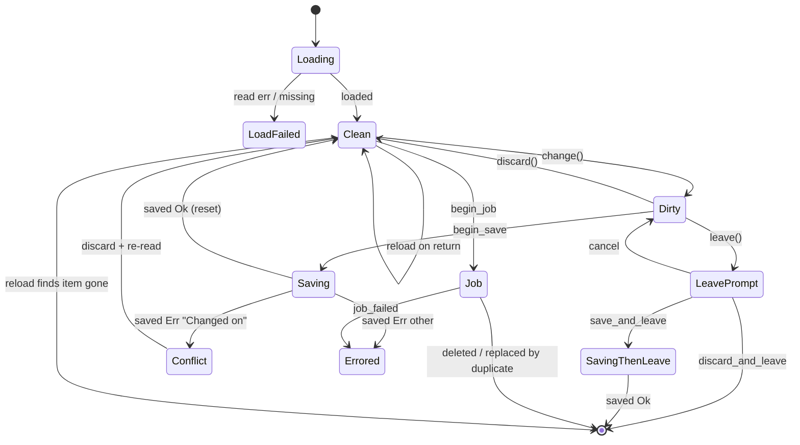

### Verified concerns
1. **Edits during an in-flight save are lost (medium).** `change()` (`shelbi-app workflow_editor.rs:814`) has no busy guard, and clients only disable the Save and Discard buttons (TUI `agent_editor.rs:1599-1600`, desktop `workflow_editor.rs:1502-1508`). `saved(Ok)` rebuilds the state from the saved config (`:1095`, `:1111-1118`; agent `:886`). Remote saves widen the window.
2. **Save in the leave prompt while a save runs (medium).** `save_and_leave` arms `after_save`, then `begin_save` returns `None` at the busy check (`:969-971`) without `forget_save`. The earlier save landing then navigates away, and the new texts were never applied. `leave()` does not check busy, so the prompt can open mid-save.
3. **Desktop hides re-read errors (medium, parity drift).** `read_again` writes `load_error` while `state` is Some (desktop `workflow_editor.rs:646`, `agent_editor.rs:429`), and render shows it only when `state` is None (`:1436-1445`, `:751-760`). The TUI uses `state.job_failed(..)` and does show it (`agent_editor.rs:1000-1003`). After a conflict Discard on desktop, a failed re-read silently leaves the old base in place.
4. **Conflict is detected by parsing a string (low).** `stale = e.starts_with("Changed on ")` at `workflow_editor.rs:1102` and `agent_editor.rs:894` depends on thiserror text in `workflow_config.rs:161-166` plus `title_case`. A non-conflict failure also resets `stale` to false.
5. **Duplication (medium, structural).** The two shelbi-app cores repeat the save/discard/leave/job code, and the four client pages each re-implement Loading/LoadFailed, the dirty||busy reload guard and reload_on_return. Item 3 is the first sign of drift.
6. **Parked rename is unrecoverable (low).** `agents_config.rs:1219-1231` runs all park renames, then all target renames. `run()` has no rollback (`config_write.rs:328-367`). The loaders skip dot directories (`agents_config.rs:409`, `agent_workspaces.rs:581`), so an interrupted rename hides the agent, and nothing references `.renaming-` again.
7. **project_git race on desktop (low).** The read lands only if `state` is Some (`desktop workflow_editor.rs:346-358`), so the async `load()` path can drop it and leave the Git placeholders at their defaults.

### Refuted
- The window-less `leave()` drop of Duplicate/EditYaml is unreachable: only Back takes that path.
- The single `pending` slot is always drained right away.
- The `reload_on_return` latch on a failed open is harmless.
- `is_dirty()` returning true on a plan error fails safe.
- The `typing`/`editing` double-Some case is prevented by every entry point.

### Recommendation
Build one generic `EditorCore` with an explicit `Phase` enum (`Clean | Dirty | Saving{then} | Job | Conflict{host}`) and a typed save error kind instead of `(Field, String)`. Pick a rule for input during Saving: either refuse it or rebase it onto the saved config. Make `save_and_leave` refuse while busy. Give clients a shared `LoadPhase` with a visible reload error so desktop and TUI cannot drift. Add detection and restore for leftover `.renaming-*` agent dirs.


### Verified concerns

- **medium**: Edits typed while a save is in flight are silently discarded when the save lands. change() does not check busy. No client blocks field input while busy (only the Save and Discard buttons are disabled). saved(Ok) calls reset() or *self = new(saved.config), which throws away any draft changes made after the SaveJob was snapshotted. This matters most for remote (far-daemon) saves, which take noticeable time.
  - Evidence: shelbi-app workflow_editor.rs:814 change() has no busy guard; :1095 reset(saved.config) and :1111-1118 rebuild EditorState; agent_editor.rs:886 *self = AgentEditorState::new(saved.config). TUI agent_editor.rs:1599-1600 and desktop workflow_editor.rs:1502-1508 only disable the buttons.
- **medium**: Pressing Save in the leave prompt while a save is already running sets guard.after_save, then begin_save returns None at the busy check without calling forget_save. When the earlier save lands Ok, the editor navigates away. The texts handed to save_and_leave were never applied, so the latest typing is lost without a prompt.
  - Evidence: workflow_editor.rs:1163-1166 save_and_leave = guard.save(); begin_save(texts). :969-971 returns None on busy before the forget_save at :988. :1094 guard.saved(true) returns then. leave() (1142) does not check busy, so the prompt can open mid-save.
- **medium**: Desktop parity drift: a failed re-read (after Edit YAML/Edit file, or after Discard on a conflict) is invisible. read_again sets load_error while state is Some, but render shows load_error only when state is None, and nothing clears it. The TUI handles the same case with state.job_failed(...), which shows the error. After a conflict Discard on desktop, a read failure leaves the user editing the old base with no sign of it.
  - Evidence: desktop/src/views/workflow_editor.rs:646 and desktop/src/views/agent_editor.rs:429 set this.load_error inside the Some(state) branch; render at workflow_editor.rs:1436-1445 and agent_editor.rs:751-760 reads load_error only on None. TUI agent_editor.rs:1000-1003 uses state.job_failed.
- **medium**: The machine is duplicated twice over. The shelbi-app workflow and agent EditorStates repeat busy/stale/saved/discard/reloaded/leave/save_and_leave/begin_job nearly line for line (only LeaveGuard is shared). Each of the four client pages (TUI and desktop × agent and workflow) re-implements Loading/LoadFailed as Option+Option, read_again or landed with the dirty||busy guard, and reload_on_return. The desktop/TUI error-handling drift above is the first sign that fixes are not landing everywhere.
  - Evidence: shelbi-app workflow_editor.rs:1082-1184 vs agent_editor.rs:874-945; TUI agent_editor.rs:966-1061 vs workflow_editor.rs:1321+; desktop workflow_editor.rs:620-650 vs agent_editor.rs:405-435.
- **low**: The conflict state is recovered by parsing a string. ConfigError::Conflict/ChangedOn and AgentError::Conflict/ChangedOn are typed, but run_save maps them to (Field, String) via message() and title_case. EditorState then re-derives stale with starts_with("Changed on "). Rewording the thiserror message or title_case silently breaks the conflict modal and the reload-on-discard. The same check is copied in both cores. A later non-conflict failure also overwrites stale back to false while the disk still differs, though the next save re-detects it.
  - Evidence: shelbi-state workflow_config.rs:161-166 #[error("changed on disk…")]/#[error("changed on {host}…")]; shelbi-app workflow_editor.rs:500-536 message(); :1102 and agent_editor.rs:894 `self.stale = e.starts_with("Changed on ")`.
- **low**: An agent rename that stops partway leaves the agent parked in a hidden .renaming-<name> directory. Both loaders skip dot directories, so the agent disappears from Settings and from dispatch, and no code recovers it. All park renames run before all target renames, and run() has no rollback. A leftover non-empty .renaming-X also makes a later rename of X fail (rename onto a non-empty dir), after the RemoveDir ops in the same plan have already run.
  - Evidence: shelbi-state agents_config.rs:1219-1231 (park, then target, as separate Op::Rename); config_write.rs:328-367 run() stops at the first failure ('the steps before it stay done', :179); agents_config.rs:409 and agent_workspaces.rs:581 skip names starting with '.'; grep finds no other reference to '.renaming-'.
- **low**: Desktop workflow editor project_git race. The project_git read is applied only if state is Some. When the workflow config loads asynchronously and project_git finishes first, the value is dropped. show() carries project_git over only from a previous state, so the Git field placeholders stay at their defaults.
  - Evidence: desktop/src/views/workflow_editor.rs:346-358 (if let Some(state) = this.state.as_mut()), :343 load() async path, :384-389 show() copies git only from the prior state.


### Concerns that did not hold up

- Desktop leave() without a Window drops Leave::Duplicate/EditYaml: the only window-less caller is the keyboard Back path with Leave::Back (desktop workflow_editor.rs:715). Duplicate and EditYaml are always passed with Some(window) (:1592, :1598). The drop arm is unreachable today. It is a latent smell, not a bug.
- TUI single pending slot overwrites a Work and strands its Job: every begin site (start_save, go Duplicate, delete, reload) returns EditorAction::Work at once, so the shell takes it before another begin can happen. begin_save and begin_job also refuse while busy. Latent only.
- reload_on_return latched even when opening the editor fails: the only effect is one extra re-read on the next activation, which is skipped if the draft is dirty or busy. Harmless.
- is_dirty() is true when plan() errors (agents_config.rs:831-833, workflow_config.rs:582-584): the result is a leave prompt, and Save surfaces the plan error through run_save. That is the safe direction, not a defect.
- check_and_run is check-then-act with no lock: the window is tiny, the daemon is the only writer for remote plans, and a racing hand edit there is outside any reasonable guarantee. Noted, not a live risk.
- Typing and editing both Some in the TUI key-handling modes: every entry point clears the other (leave, click, show/sync). Precedence order is consistent, so this is untidy but not reachable as a bug.


**Recommendation:** Pull the shared lifecycle into one generic EditorCore<M: Model> in shelbi-app with an explicit enum Phase { Clean, Dirty, Saving{then: Option<Leave>}, Job, Conflict } and typed outcomes. SaveOutcome should carry an ErrorKind { Conflict{host}, Invalid, Io } instead of (Field, String), so stale comes from the type rather than starts_with. Decide the rule for edits during Saving: either change() refuses while busy (and clients grey out the fields), or saved(Ok) rebases the draft edits made since the snapshot onto the saved config. Have save_and_leave refuse or queue while busy instead of arming after_save. Give clients one LoadPhase enum (Loading | Failed(msg) | Ready(state)) plus a ReloadError that render shows over Ready, so desktop and TUI stop re-implementing it differently. For AgentsConfig renames, have the loader or Settings detect leftover .renaming-* dirs and offer to restore them, or validate in check() that no park dir exists.


## tmux -> session-backend workspace cutover migration

**Verdict:** Needs further thought. The machine is small and uses an explicit enum. The problem is the third, implicit state (no entry): its meaning contradicts itself across the two crates, and the real gate resolves it as dispatchable. Combined with best-effort writes and a pass that only the TUI ever runs, the guarantee that the new backend never races a surviving tmux agent holds only if the TUI opened the project and the write succeeded. Migrated can also fall back to Pending on a transient SSH failure. Because this is cutover scaffolding meant for deletion (rt-cutover-delete), the main design question is whether to harden it or retire it.

**Verified concerns:** 4 medium, 3 low

**Key files:**
- `crates/shelbi-orchestrator/src/migration.rs:145-356`
- `crates/shelbi-state/src/migration.rs:1-113`
- `crates/shelbi-tui/src/lib.rs:149-258`
- `crates/shelbi-orchestrator/src/pool_admin.rs:854-864`
- `crates/shelbi-orchestrator/src/workspace.rs:2555,2831`

### What it is
This tracks the Phase 6 cutover (`rt-cutover-migration`). Before the session-process backend starts an agent in a worktree, the worktree must be proven free of a surviving legacy tmux agent. Each workspace gets a `MigrationState` (`Pending` | `Migrated`) in the project's `state.json` (`State.workspace_migration`, `crates/shelbi-state/src/lib.rs:1689`). A **missing key** acts as a third, implicit state. A project-level open gate also refuses to open while the local `shelbi-<p>` / `_shelbi-<p>` session is live.

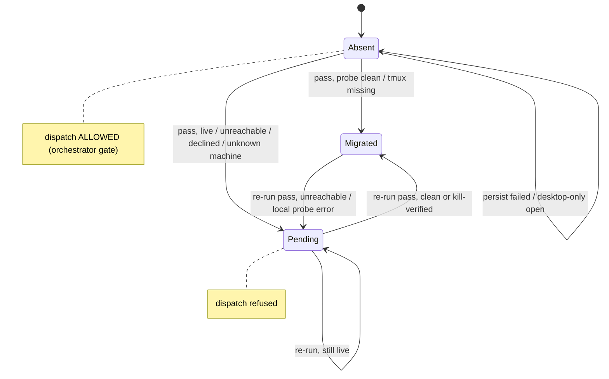

### How it is stored
- The enum lives in `crates/shelbi-state/src/migration.rs:39-64`. The setter `set_workspace_migration_state` (`:86-94`) is a plain unguarded insert.
- The detail token (`unreachable`, `kill-verified`, ...) is not persisted. It goes only to events.log through `append_migration_event`.
- Gates: `ensure_project_openable_with` (`crates/shelbi-orchestrator/src/migration.rs:150-171`) and `ensure_workspace_dispatchable` (`:342-356`, called from `workspace.rs:2555`, `workspace.rs:2831` and `mutate/start.rs:121`).
- Writer: `run_migration_pass_with` (`:215-305`), invoked only from `shelbi-tui/src/lib.rs:228` inside `run_main`.

### Verified concerns
1. **Absent means opposite things in the two crates (medium).** The `shelbi-state` docs (`migration.rs:20-22`) and `workspace_migrated()` (`:109-113`, `unwrap_or(false)`) say absent means refuse. The real gate (`orchestrator migration.rs:336-346`) says absent means dispatch. `workspace_migrated` has no non-test callers.
2. **A failed write is unsafe, and the comment claims the reverse (medium).** `persist_and_log` (`orchestrator migration.rs:323-327`) discards the result of the state write and says the fallback is "pending by default". In fact the fallback is no entry, which means dispatchable. A first-pass failure while a remote tmux agent is still live leaves that worktree open to a second agent.
3. **TUI-only enforcement (medium).** The open gate and the pass run only in `shelbi_tui::run_main` (`lib.rs:156,166`). The desktop app (`desktop/src`) and the daemon never call them. A desktop-only open produces no entries, so every workspace counts as dispatchable.
4. **Migrated is not terminal (medium).** Every TUI open re-probes every workspace (`:222-226`). A remote that is unreachable at that moment goes back to `Pending(unreachable)` (`:276`) and stays blocked until the next TUI open, even after the machine is back.
5. **Opposite fallbacks for an unanswerable local probe (low).** The gate uses `unwrap_or(false)` (`:158-159`) and the pass uses `unwrap_or(true)` (`:252-253`). The project opens, but every local workspace is recorded Pending, and "reopen" repeats the same result while the probe keeps failing.
6. **Open-time cost that never goes away (low).** The pass runs synchronously before the first frame and makes serial 10 s SSH probes per remote (`PROBE_DEADLINE`, `:42`), even long after everything is Migrated.
7. **No pruning (low).** Rename copies without deleting the old key (`pool_admin.rs:856-864`). Remove leaves the entry, so a reused name can inherit a stale Pending.

### Refuted
- A non-interactive consent prompt does not kill silently: a non-terminal stdin declines (`tui lib.rs:200-210`).
- Kills cannot hit a session with a similar name: all targets use the exact `=<name>` form (`:77-79`).

### Recommendation
First decide whether to retire it. The module landed 2026-10-12 as scaffolding for `rt-cutover-delete`, and deleting it may be cheaper than hardening it. If it stays:
- Skip re-probing Migrated workspaces and guard the setter against Migrated -> Pending.
- Give absent one meaning. Either record `workspace add` workspaces as Migrated and make absent refuse, or keep absent as dispatchable and fix both docs and the `persist_and_log` comment. Delete `workspace_migrated()`.
- Move the gate and the pass to a path the desktop and the daemon also use.
- Use one failure policy for local probes in both the gate and the pass.
- Prune entries on remove and rename.


### Verified concerns

- **medium**: The two crates give opposite meanings to an absent entry. The shelbi-state module docs and workspace_migrated() say absent means NOT dispatchable (refuse). The orchestrator's ensure_workspace_dispatchable, the only gate actually used, says absent IS dispatchable. workspace_migrated() is called only from tests, and its doc contract has drifted from the real gate.
  - Evidence: shelbi-state/src/migration.rs:20-22 ('the dispatch gate treats that as not-yet-migrated (refuse)') and :109-113 (unwrap_or(false)) versus shelbi-orchestrator/src/migration.rs:336-346 (only Some(Pending) refuses). grep finds no non-test caller of workspace_migrated.
- **medium**: A failed state write leaves the workspace dispatchable, which is the unsafe direction, even though the comment claims the opposite. If the first pass finds a live remote shelbi-w-<ws> (or a declined kill) and the state write fails, there is no entry, so dispatch is allowed onto a worktree a tmux agent may still hold.
  - Evidence: migration.rs:323-327: `let _ = set_workspace_migration_state(...)` with the comment 'leaves the workspace at its prior recorded state (pending by default), which is the safe direction'. migration.rs:342-356 treats None as dispatchable.
- **medium**: Only the TUI runs the open gate and the migration pass. The desktop app and the daemon never call ensure_project_openable or run_migration_pass. A project opened only from the desktop has no entries, so every workspace counts as dispatchable, including a remote whose legacy shelbi-w-<ws> session survived. The safety guarantee therefore depends on which front end opened the project.
  - Evidence: grep finds callers only in shelbi-tui/src/lib.rs:156 and :228 (run_main). desktop/src has no references to the migration module.
- **medium**: Every re-run re-probes Migrated workspaces and can move them back to Pending. If a remote machine is briefly unreachable at TUI open, or a kill recheck fails, a workspace already proven clean goes back to Pending. Dispatch stays blocked until the next TUI open, even after the machine comes back. Nothing makes Migrated a terminal state, and the setter allows any transition.
  - Evidence: migration.rs:222-226 runs migrate_one_workspace for every workspace with no check of the prior state. migration.rs:276 maps Err to pending(unreachable). shelbi-state migration.rs:86-94 inserts without a guard.
- **low**: The open gate and the pass handle the same failed local probe in opposite ways. The gate treats an error as absent, so the project opens. The pass treats it as live, so every local workspace is recorded Pending(local-session-live). The project opens but no local workspace can be dispatched, and the suggested fix ('reopen') repeats the same result while the probe keeps failing.
  - Evidence: migration.rs:158-159 uses unwrap_or(false). migration.rs:252-253 uses unwrap_or(true).
- **low**: The pass runs synchronously on every TUI open, long after cutover, and probes each remote serially with a 10 s deadline. Several unreachable machines add N×10 s before the first frame, which is a startup-latency cost of scaffolding that never retires itself.
  - Evidence: PROBE_DEADLINE = 10 s (migration.rs:42). run_open_migration_pass is called before shell::run (tui lib.rs:166).
- **low**: Entries are never pruned. Removing a workspace leaves its key, and a rename copies the state without deleting the old key. A workspace later re-added under a name whose stale entry is Pending is refused dispatch until the next TUI open re-probes it.
  - Evidence: pool_admin.rs:856-864 (copy only). remove_workspace (pool_admin.rs:370) never touches workspace_migration.


### Concerns that did not hold up

- The claim that the persist-failure comment is merely imprecise is understated. It is wrong about the safe direction because of the absent-is-dispatchable rule, so it is kept as a verified concern rather than refuted.
- The claim that the TUI pass prompts for consent non-interactively does not hold. A non-terminal stdin declines and leaves the workspace Pending (tui lib.rs:200-210), which is safe.
- The claim that the kill could hit the wrong session does not hold. All queries and kills use the exact '=<name>' tmux target (migration.rs:77-79).


**Recommendation:** First decide whether the cutover window has closed. The module landed 2026-10-12 and is labelled scaffolding for rt-cutover-delete. If it has closed, delete the module, the state.json map and the gates rather than invest in them. If it has to stay a while: (1) make Migrated terminal. Skip re-probing any workspace already Migrated, and have the setter refuse Migrated -> Pending, except through an explicit reset. This also removes most of the per-open SSH latency. (2) Write down what an absent entry means in one place and make the two crates' docs agree. Delete the unused workspace_migrated(). Either record new workspaces as Migrated at `workspace add` time (so absent truly means never evaluated, and the gate can refuse it) or keep absent-is-dispatchable and fix the persist_and_log comment. (3) Run ensure_project_openable plus the pass from a path every front end goes through (daemon project start or a shared open helper), not only shelbi-tui run_main, so the desktop gets the same gate. (4) Use one failure policy for an unanswerable local probe in both the gate and the pass. (5) Prune entries on remove and rename.


## Keybinding config: capture, override layers, keys.yaml writes, zen_toggle migration

**Verdict:** Needs further thought. The shared capture/conflict/saving core is sound. Three things around it still need a decision. (1) The TUI has a real ordering bug: a load that lands after a save reverts the live keymaps to the pre-save file. (2) The override-layer edit semantics are a product question nobody has decided: a project page silently edits and clears the global `defaults` layer. (3) The legacy zen_toggle migration is a two-phase machine split across the read path and config upgrade. The two phases disagree about None and null, and the read path writes unlocked. Menu binding growth is a smaller but real leak driven by ordinary availability flips.

**Verified concerns:** 3 medium, 4 low

**Key files:**
- `crates/shelbi-app/src/settings/keybindings.rs:160-340`
- `crates/shelbi-tui/src/shell/keybindings.rs:240-330`
- `crates/shelbi-state/src/keymap/edit.rs:49-167`
- `crates/shelbi-state/src/keymap/loader.rs:361-391,463-483,876-1300`
- `desktop/src/menus/mod.rs:10-30,224-257`

### What the machine is

There are four related lifecycles around keyboard bindings:

1. **The Keybindings page** (TUI and desktop share `KeybindingsState`): Idle, Capturing, Conflict, Saving and Idle, plus the client-side Loading, ReloadQueued (TUI) and SearchEditing states.
2. **Override layers** in `~/.shelbi/keys.yaml`: Builtin, `defaults.<mode>.<action>`, `projects.<name>.<mode>.<action>`, an empty list (unbind), or null (fall through). The layer is never stored. `override_scope` derives it from YAML paths.
3. **Legacy zen_toggle migration** from `config.yaml::keymap.zen_toggle` to `keys.yaml::defaults.global.zen_toggle`. It runs in two phases: a read-path migration inside `load_keymaps`, and a write-back heal from `config upgrade`.
4. **Desktop menu key equivalents**: append-only gpui bindings versioned by `MenuBar.generation`.

```mermaid
stateDiagram-v2
    [*] --> Idle
    Idle --> Loading: begin_load (TUI) / page new (desktop)
    Loading --> Idle: loaded(text)
    Idle --> Capturing: start_capture (refused while Saving)
    Capturing --> Conflict: chord held by other action
    Conflict --> Saving: same chord again
    Capturing --> Saving: finish() -> KeyOutcome::Save
    Capturing --> Idle: Esc / already bound / click off / page switch
    Idle --> Saving: remove / reset / reset_all
    Saving --> Idle: saved(result)
    Saving --> Loading: reload_after_save (TUI)
    note right of Loading: a load started before a save\ncan land after it and revert it
```

### How it is stored
- `KeybindingsState { text, keymaps, capture: Option, conflict: Option, saving: bool }`: `crates/shelbi-app/src/settings/keybindings.rs:160-340`. This core is coherent and guarded.
- TUI wrapper `KeysPage { load: Job, reload_after_save, editing, error }`: `crates/shelbi-tui/src/shell/keybindings.rs:139-330`.
- Desktop `KeybindingsPage { picker_open, error }` with detached spawned load and save tasks: `desktop/src/views/keybindings.rs:60-200`.
- Layer edits: `crates/shelbi-state/src/keymap/edit.rs:49-167`. They are line-preserving edits, checked against the structural result, and written through an unlocked `update_keys_file` read-modify-write.
- Legacy migration: `crates/shelbi-state/src/keymap/loader.rs:361-391, 463-483, 876-1300`.

### Verified concerns
1. **A late load reverts a save (TUI, medium).** `begin_load` defers only behind a save (`shell/keybindings.rs:251-261`). Captures are not blocked while a load runs (`start_capture`, shared `:221-228`). `loaded()` replaces state whenever the text differs (`:263-290`) and returns true, which becomes `ApplyKeymaps` (`settings.rs:1326-1331`). Result: the live keymaps fall back to the pre-save file while disk has the edit. The desktop's initial load has the same race (`views/keybindings.rs:118-145`), but there it only affects what the page shows.
2. **Project page edits the global layer (medium, design).** `set_chords` with no existing override writes `defaults` (`edit.rs:82-83`). `clear` and the "equals builtins" path remove `defaults` *and* the project entry (`edit.rs:79-93`), and `clear_all` does this for every action. Both clients always pass a project, so a reset on project A changes project B.
3. **Menu binding sets grow (medium).** `install()` filters shortcuts by `item.enabled` (`menus/mod.rs:231-236`), and enablement follows command availability (`tree.rs:405-412`). Any availability flip therefore appends a full binding set that gpui cannot remove (`mod.rs:238-249`).
4. **Legacy None is ignored at load but honored by heal (low).** `legacy_zen_toggle_chord` returns None for `ZenToggleChord::None` (`loader.rs:876-885`), so alt-z stays live. Heal writes `zen_toggle: []` (`loader.rs:1006-1012`).
5. **Three readings of null (low).** The migration and shim treat a null `defaults.global.zen_toggle` as set (`loader.rs:1230-1232, 432-437`). The merge and `override_scope` treat null as fall-through (`edit.rs:56-58`). A legacy ctrl-g is dropped, and heal strips it as SafeNoCopy (`loader.rs:1033`).
6. **Writes on the read path (low).** `load_keymaps` runs migrations from about ten call sites, rewriting keys.yaml through serde (comments lost, `loader.rs:1240-1248`) and all of config.yaml (`loader.rs:1155-1160`). Nothing locks these against `update_keys_file` (`edit.rs:157-167`). This matters only during the one-time legacy window.
7. **Stale code and docs (low).** The migration comment relies on `zen_probe::ensure_zen_keymap`, which no longer exists (`loader.rs:1148-1152`). `Keymaps::zen_toggle_chord` (`loader.rs:105-110`) has no callers.

### Refuted
- **Desktop capture left armed after leaving Settings.** Leaving the route drops the view and its keystroke-intercept subscription, and page switches call `cancel_capture` (`settings.rs:893-897`).
- **TUI capture and editing flags conflicting.** `capture()` clears `editing`, and capture keys are routed first.
- **The glyph showing an unbound chord.** `zen_toggle_chord` is unused.

### Recommendation
1. Add a save epoch, or a single page-phase enum, to `KeybindingsState` so stale loads are dropped in both clients.
2. Decide the scope model (an explicit "this project / all projects" choice, or global-only), and make `clear` touch only the edited layer.
3. Make `load_keymaps` read-only for the legacy field: forward None as an unbind, and leave all writes to the config-upgrade heal. Share one helper for null semantics.
4. Bind menu shortcuts from the full set regardless of `enabled`, so generations bump only on real keys.yaml changes.


### Verified concerns

- **medium**: A load that is already running can land after a save and revert the saved binding in the TUI's live keymaps, while disk keeps the edit. begin_load defers itself while a save is out, but nothing stops a save from starting while a load is running, and loaded() does not check whether a save is out or happened in between.
  - Evidence: crates/shelbi-tui/src/shell/keybindings.rs:251-261 (begin_load guards only on saving), 263-290 (loaded() calls state.load(old_text) whenever text != state.text() and returns true), settings.rs:1326-1331 turns true into SettingsAction::ApplyKeymaps, so the shell adopts the stale keymaps. start_capture (shelbi-app keybindings.rs:221-228) refuses only while saving, not while loading. The desktop has the same shape: its initial load is a detached spawn and show() is unconditional (desktop/src/views/keybindings.rs:118-145), so a capture made before the first read lands can be overwritten in the page, though the window's keymaps keep the Saved ones.
- **medium**: Project scope leaks into defaults. Resetting an action, setting it back to the built-in chords, or Reset all on one project's page also deletes the `defaults` entry, which changes the binding for every other project. A first edit made from a project page lands in `defaults`, so it is global too. Both clients always pass Some(project), so the user cannot tell whether a given edit is project-scoped or global.
  - Evidence: crates/shelbi-state/src/keymap/edit.rs:79-80 (set_chords equal to builtins -> clear), 82-83 (no existing override -> Scope::Defaults), 88-93 (clear removes Defaults, then Project), 99-105 (clear_all). desktop/src/views/keybindings.rs:93 constructs the state with Some(project); the TUI passes client.project().
- **medium**: Menu key-binding sets grow without bound. The shortcut list compared in install() is filtered by item.enabled, so ordinary changes in which commands are available, not just keys.yaml edits, append a full new binding set that gpui can never remove. Going A->B->A appends three sets.
  - Evidence: desktop/src/menus/mod.rs:231-249: shortcuts filtered by `item.enabled`, and `bar.shortcuts != shortcuts` bumps the generation and calls cx.bind_keys. tree.rs:405-412: enabled = available.contains(id), with the shortcut set only when enabled. app.rs:1743-1755 sync_menus runs on model changes. The module doc (mod.rs:18-20) presents this as happening per new set of shortcuts and does not mention enablement flips.
- **low**: The load-time migration and the heal disagree on the legacy 'no hotkey' choice. A legacy config.yaml `zen_toggle: none` is neither migrated nor forwarded at load time, so the built-in alt-z is live. The heal path writes an explicit unbind. Until the user runs config upgrade, a user who disabled the hotkey has alt-z active.
  - Evidence: crates/shelbi-state/src/keymap/loader.rs:876-885 legacy_zen_toggle_chord returns None for ZenToggleChord::None, so both migrate (1143-1146) and the compat shim (470-483) do nothing. preserve_legacy_zen_toggle_for_heal (loader.rs:1006-1012) maps None -> ZenToggleValue::Unbind.
- **low**: A YAML null at keys.yaml defaults.global.zen_toggle counts as 'set' for the legacy migration and compat shim, but for the merge it means 'fall through'. A legacy non-default chord is then dropped and the built-in alt-z wins. The heal maps it to SafeNoCopy and strips config.yaml, so the chord is lost for good.
  - Evidence: loader.rs:1280-1300 keys_yml_defaults_zen_toggle returns Some(Null) (its own doc says null falls through), splice -> Conflict (1230-1232) -> heal SafeNoCopy (1033) -> strip. loader.rs:432-437 zen_overridden_in_defaults uses contains_key, so the shim also refuses to forward. edit.rs:56-58 override_scope treats null as not set, a third interpretation.
- **low**: Migrations write files on the read path, with unlocked read-modify-write. load_keymaps(run_migrations=true) is called from many TUI panes, CLI commands and the shared settings reader. It can rename keys.yml, rewrite keys.yaml through serde (dropping the comments edit.rs works to keep) and rewrite all of config.yaml through save_user_config. Nothing serializes these against the Settings save path (update_keys_file, edit.rs:157-167), which is also unlocked.
  - Evidence: loader.rs:308-310, 373-391, 1155-1160 (load_user_config().unwrap_or_default() then save_user_config), 1240-1248 (serde_yaml::to_string). Callers: shelbi-tui shell/mod.rs:1552, handlers/kanban.rs:304,871, handlers/activity.rs:86, activity.rs:136, overlays.rs:982, shelbi-cli config.rs:327,499, shelbi-app settings/keybindings.rs:520, source/remote.rs:405. The race only matters during the one-time window while a legacy field is present, so the practical risk is low.
- **low**: There is stale, misleading documentation around the migration. migrate_legacy_zen_toggle's comment relies on zen_probe::ensure_zen_keymap, which no longer exists. Keymaps::zen_toggle_chord, which returns a legacy fallback for non-preset chords, has no callers outside loader.rs.
  - Evidence: loader.rs:1148-1152 references zen_probe::ensure_zen_keymap; grep finds no zen_probe module. loader.rs:105-110 zen_toggle_chord: no external callers.


### Concerns that did not hold up

- Desktop capture left armed after leaving Settings (desktop-4#12). Leaving Settings replaces Route::Settings (app.rs:4546-4570 -> set_route, 2599-2604), which drops the SettingsView and its KeybindingsPage. That drops the intercept_keystrokes Subscription held in _subscriptions. Switching pages calls cancel_capture (settings.rs:893-897), and Esc goes through the intercept to key(), which cancels. I found no path that leaves an armed capture alive off-screen.
- TUI Capturing and SearchEditing not being mutually exclusive. capture() clears editing (tui keybindings.rs:373-374), holds_keys routes every key to the page while either is set, and capture keys are handled before the search branch. Two flags, but no reachable illegal combination that changes behavior.
- zen_toggle_chord showing a chord that is not bound. The method has no callers outside loader.rs, so nothing renders it.
- The single shared error slot overwriting messages. True, but it is by design: the newest failure is the one shown, and every success path clears it. Not a correctness issue.


**Recommendation:** 1. Sequence loads against saves in KeybindingsState itself, so both clients get the fix. Keep a monotonically increasing save epoch: when a load starts, it records the epoch, and loaded()/load() drops any result whose epoch is older than the last save. Alternatively, refuse start_capture/remove/reset while a load is running, the way begin_load already defers behind a save. Make the page phase one enum (Idle | Loading{ticket, epoch} | Saving{reload_queued}) instead of saving + Job + reload_after_save.
2. Decide the scope model with the user. Either make the page explicitly scoped (a 'This project / All projects' toggle, with set_chords/clear acting on that one layer only), or make the page global-only and drop the project argument from edits. In both cases clear() should touch only the layer the user is editing.
3. Retire the read-path migration. With zen_probe gone, nothing writes the legacy field any more. Have load_keymaps only read it (forward None as an explicit unbind to match heal) and leave every write to the config-upgrade heal. Unify the null semantics in one helper used by edit.rs and loader.rs.
4. Build menu bindings from the full shortcut set regardless of enablement (enablement already gates through MenuUnavailable in entry()), so the generation bumps only on real keys.yaml changes. Optionally key the generation by the shortcut set so returning to an earlier set reuses its bindings.


## Project scaffold and registration completeness

**Verdict:** Needs further thought. There is a real design split. The wizard's "publish registration last, atomically" model is correct and documented, but the engine (used by CLI init, the TUI and the desktop app) and pick-up publish first. Partial failures are reachable and leave discoverable broken projects that only one of four UIs can resume, and pick-up retries mint duplicate aliases. The three hand-copied step lists have already drifted.

**Verified concerns:** 3 medium, 3 low

**Key files:**
- `crates/shelbi-orchestrator/src/project_create.rs:361-474 (Attempt, validate_request, registration_is_for)`
- `crates/shelbi-orchestrator/src/project_create.rs:950-1150 (scaffold_project_with, scaffold_config, scaffold_workflows)`
- `crates/shelbi-cli/src/commands/init.rs:600-820, 891-905 (run_pick_up, next_available_alias)`
- `crates/shelbi-cli/src/wizard.rs:395-425, 535-650 (create, persist_plan)`
- `crates/shelbi-tui/src/shell/mod.rs:3781-3820 and crates/shelbi-tui/src/launch/mod.rs:275-300 (TUI add-project callers, no retry)`

### What it is
Three code paths turn a folder into a registered Shelbi project. Progress through scaffolding is never stored. It is inferred from which files exist, and the only discoverability signal is the registration YAML (`projects/<id>.yaml` or `projects/<id>/local.yaml`).

| Path | Callers | Registration published | Lost race / existing reg |
|---|---|---|---|
| `project_create::scaffold_project_with` | `shelbi init`, TUI shell overlay, TUI launch screen, desktop Add Project | **first** (Config stage, project_create.rs:1053-1081) | continues into it (1043-1093) |
| `init::run_pick_up` | `shelbi init --pick-up` | **first** (init.rs:712-740) | bails |
| `wizard::persist_plan` | bare `shelbi` onboarding, `init -y` | **last**, hard-link no-clobber (wizard.rs:609-613) | bails (wizard.rs:597-602) |

```mermaid
stateDiagram-v2
    [*] --> Unregistered
    Unregistered --> Undiscoverable: wizard writes files
    Undiscoverable --> Complete: publish registration (wizard)
    Unregistered --> RegisteredPartial: publish registration (engine / pick-up)
    RegisteredPartial --> Complete: remaining stages succeed
    RegisteredPartial --> RegisteredPartial: stage fails
    RegisteredPartial --> Complete: desktop Try Again (Attempt::Retry) / CLI init re-run
    RegisteredPartial --> DuplicateAlias: pick-up retry -> name-2
    CommittedUnregistered --> RegisteredPartial: init --pick-up
```

### Verified concerns
1. **Commit point inconsistent (medium).** The engine and pick-up publish the registration before the fallible steps. In-repo mode publishes `local.yaml` (project_create.rs:1053-1060) before `write_in_repo_shared` (1088-1090), so a failure in between leaves a registration whose split config doesn't load.
2. **Only desktop can retry (medium).** `Attempt::Retry` is set only at `add_project_wizard.rs:954`. Both TUI callers (`shell/mod.rs:3783`, `launch/mod.rs:281`) use `validate_add_project` and are rejected with "a project already lives at" after a partial failure.
3. **Pick-up retry duplicates aliases (medium).** `next_available_alias` (init.rs:891-905) checks names only, never the existing registration's repo root.
4. **Engine adopts a foreign registration (low).** The collision check runs outside the lock (project_create.rs:420). Under the lock, an existing or lost-race registration is treated as resume, not as a clash.
5. **Step lists drifted (low).** project_create.rs:1100-1149, init.rs:743-795 and wizard.rs:560-579 differ: commit guard, welcome task, `materialize_default_agents` and ordering.
6. **`init -y` "already configured" ignores completeness (low).** init.rs:258-264.

### Refuted
- Wizard hint/greeting latches armed before publish: deliberate, under both locks with a re-check, effectively harmless.
- git init before persist: consented, and preflighted first.

### Recommendation
Use one shared scaffold-files helper, and publish the registration last (atomically) on every path, writing the in-repo shared half before `local.yaml`. Then a partial project is undiscoverable and retry is just running again, which removes the need for `Attempt::Retry` and `registration_is_for`. Treat existing or lost-race registrations as clashes under the lock. Make pick-up resume an alias already bound to the same repo root.


### Verified concerns

- **medium**: The three creation pipelines disagree on the commit point. The wizard treats the registration as the last, atomic commit point. The engine and pick-up publish it first and then run many fallible steps. A failure leaves a discoverable, half-built project that daemon, TUI and desktop discovery will load. In-repo mode is worst: local.yaml is published before the committed shared half is written, so the project fails to load until a retry.
  - Evidence: wizard.rs:603-613 publishes last ('registration is the commit point'). project_create.rs:1053-1060 publishes local.yaml, then write_in_repo_shared at 1088-1090, then the Agents and Workflows stages at 962-973. init.rs:712-740 publishes, then runs 743-795 with ?.
- **medium**: Only the desktop wizard can resume a partial project. The TUI overlay, the TUI launch screen and the palette all validate with New semantics. After a failed TUI create, resubmitting the same name is rejected ('a project already lives at ...'), and nothing on disk marks the registration incomplete. The user is stuck unless they run CLI init (which adopts an existing registration) or wait for the config-upgrade sniffers to heal it.
  - Evidence: add_project_wizard.rs:954 is the only Attempt::Retry. tui shell/mod.rs:3783 and launch/mod.rs:281 call validate_add_project, which is validate_request(..., None) and rejects on collides (project_create.rs:420, 441-443).
- **medium**: A pick-up retry after a partial failure creates a second alias for the same repo (<name>-2) instead of resuming. next_available_alias checks only name collision, never whether the existing registration already points at this repo_root.
  - Evidence: init.rs:672-678 calls next_available_alias(canonical), and init.rs:891-905 loops on project_name_collides only. Steps after registration (init.rs:743-795) can each fail with ?.
- **low**: The engine silently adopts a registration it did not create. The collision check runs in validate_request before the scaffold lock is taken. scaffold_config re-reads registration_exists under the lock but treats 'exists' as 'resume'. When write_new_project_registration loses a race (returns false), it notes 'already exists' and continues. A concurrent creator of the same slug therefore gets in-repo shared, agents and workflows written into the winner's project, and the TUI reports Created. The wizard and pick-up bail in the same situation, so this is drift between the copies.
  - Evidence: project_create.rs:1008-1010 takes the lock and then checks has_project_registration with no clash check. Lines 1043-1051 and the else-branches at 1063-1068 and 1080-1081 continue. Compare wizard.rs:597-602 (re-check, then bail) and init.rs:713-718 (bail).
- **low**: The scaffold step lists are hand-copied three times and have already drifted. The wizard calls materialize_default_agents before self_heal. Pick-up skips the commit-guard install and the welcome task and orders statuses before workflow. Only the engine has stage reporting. Adding a new scaffold file means editing three places.
  - Evidence: project_create.rs:1100-1149 vs init.rs:743-795 vs wizard.rs:560-579
- **low**: init -y reports 'already configured' for any resolvable project, even a Registered+partial one, so it never completes the scaffold.
  - Evidence: init.rs:258-264 returns Ok on resolve_project_for_cwd(...).is_some().


### Concerns that did not hold up

- Wizard latches armed before the commit point leave hints for a nonexistent project: the ordering is deliberate (wizard.rs:595-596 comment). It runs under both the scaffold and dashboard locks after a re-check for collisions, so a collision from another locked creator can't happen there. Only a non-AlreadyExists IO error on hard_link leaves the latches armed. Even then, a first_run_hint carried into the next successful create is the intended effect, and the greeting is keyed by name and consumed only if that project is later created. Negligible.
- git init before persist_plan leaves a repo initialized on failure: true, but the user explicitly consented to git init, preflight_persistence (wizard.rs:401) runs first to catch most failures, and an initialized empty repo is harmless. Not a state-machine defect.
- First run inferred from home.exists() in main.rs: this was outside the files under review, and the hint is now an explicit arm_first_run_hint latch set at registration time, so the banner heuristic is a cosmetic separate issue.
- The scaffold lock 'only serializes scaffolds': true, but within the wizard path readers can't see anything until the registration exists, so it is sufficient there. The reader exposure is real only because of the engine and pick-up ordering, captured above.


**Recommendation:** Use one scaffold routine and one commit point. Move the step list into a single shared helper, e.g. shelbi_state::scaffold_project_files(id, opts), called by all three paths. Make the registration publish the final step everywhere, as the wizard already does. For in-repo mode, write the shared half before publishing local.yaml. With that in place, a partial project is undiscoverable by construction, retry is just "run again", and Attempt::Retry and registration_is_for can likely be deleted. Under the lock, treat an existing registration or a lost publish race as a clash, with an explicit resume path only for CLI init's "complete a half-init" case. In pick-up, before suffixing, check whether an existing alias already points at this repo_root and resume it. If registering first must stay, write an explicit incomplete marker (e.g. scaffold: incomplete in local state) that discovery skips and every UI's Retry clears.


## Settings list pages: save queues, draft rows, unsequenced loads

**Verdict:** Needs further thought. The same save-queue machine is hand-written twice in shelbi-app and wrapped differently four times (TUI and desktop, Agents and Workflows). The copies have already drifted. TUI Workflows drops queued saves on a project switch where Agents drains them, and only one model guards stale loads and completions. Separately, desktop config.yaml writes race each other with no lock or sequence number. Most other issues are mitigated by the content-hash conflict check, so none of this is urgent, but the drift and the race should be discussed.

**Verified concerns:** 2 medium, 5 low

**Key files:**
- `crates/shelbi-app/src/settings/agents.rs:263-390`
- `crates/shelbi-app/src/settings/workflows.rs:157-387`
- `crates/shelbi-tui/src/shell/settings.rs:1204-1292`
- `crates/shelbi-tui/src/shell/settings/workflows.rs:230-353`
- `desktop/src/views/settings.rs:917-970,1238-1294,1530-1572`

### What the machine is

Two Settings list pages, **Agents** and **Workflows**, each keep a page model in `shelbi-app` (`AgentsState`, `WorkflowsState`) that serializes config saves:

- `config: Option<_>` is `None` until the first load lands.
- `saving: bool` plus `queue: VecDeque<Edit>`: one save is in flight and later edits wait behind it.
- `pub draft`, `pub confirm`, `pub editing_shared` are modal state the clients write directly.

The TUI wraps these models with `Job<()>` tickets, `Modal`, `editor`, `menu`, `pending`, `select_after`/`select_on_load` and a `retired` list. The desktop wraps them with `shared_input`, `menu`, `reload` and `reload_on_return`, and has **no** load tickets. The desktop General page (`desktop/src/views/settings.rs`) has a related machine: a `loaded` latch plus a `SaveStatus` shared by two independent write pipelines.

```mermaid
stateDiagram-v2
    [*] --> Unloaded
    Unloaded --> Idle: loaded(Ok)
    Unloaded --> LoadFailed: loaded(Err)
    LoadFailed --> Idle: loaded(Ok)
    Idle --> Saving: request(edit)
    Saving --> SavingQueued: request(edit)
    SavingQueued --> SavingQueued: request(edit)
    SavingQueued --> Saving: committed (pop next, even after failure)
    Saving --> Idle: committed (queue empty)
    Idle --> Idle: loaded(Ok)
    Saving --> Saving: loaded (Workflows ignores; Agents relies on client guard)
    Saving --> Retired: TUI project switch (Agents only)
    Retired --> [*]: queue drained
    Saving --> [*]: TUI project switch (Workflows: queue dropped)
```

The modal sub-machine (Browsing, Menu, Confirm, Draft, SharedEditor) is split between page and model, and each opener clears the others by hand.

### Verified concerns

1. **TUI project switch: the two pages disagree (medium).** `replace_agents` (`crates/shelbi-tui/src/shell/settings.rs:1207-1215`) keeps a saving `AgentsState` in `retired`, keeps running its queue and reports errors (1229-1245). On Workflows, `project_changed` (`crates/shelbi-tui/src/shell/settings/workflows.rs:239-248`) sets `state = None`, `save.reset()` and `pending = None`. Queued edits vanish with no message, and the in-flight save's result is dropped as stale (306-310).
2. **Desktop config.yaml lost-update race (medium).** `write()` (`desktop/src/views/settings.rs:1268-1294`) and `write_tool()` (1536-1560) each spawn a background `update_user_config` / `Change::write`. That function is an unlocked read-patch-`atomic_write` (`crates/shelbi-state/src/user_config.rs:749-779`). Overlapping writes can land out of order, and `SaveStatus` reflects whichever lands last. The TUI writes the same file, also without a lock.
3. **Model guards have drifted (low).** `WorkflowsState::loaded` refuses while saving and `committed` ignores a completion when `!saving` (`crates/shelbi-app/src/settings/workflows.rs:287-290, 357-360`). `AgentsState` does neither (`crates/shelbi-app/src/settings/agents.rs:307-318, 366-389`), so desktop and TUI each re-check `saving()` by hand (`desktop/src/views/agents.rs:141-145`, `crates/shelbi-tui/src/shell/settings/agents.rs:293-295`).
4. **Unsequenced loads (low).** Desktop loads have no ticket at all (`desktop/src/views/agents.rs:136-150`, `desktop/src/views/workflows.rs:190-205`). Nowhere are loads ordered against saves. A read that started before a save can install the pre-save model. The content-hash check in `crates/shelbi-state/src/config_write.rs:295-325` turns this into a spurious "Changed on disk" on the next edit, not data loss.
5. **Draft closes on any create success (low).** `agents.rs:377-380` and `workflows.rs:371-376` clear `draft` without checking that it is the same draft that was submitted.
6. **Modal double-encoding (low).** `page.editor`/`shared_input` and `state.editing_shared`, and `Modal::Draft` and `state.draft`, are reconciled by hand (`crates/shelbi-tui/src/shell/settings/agents.rs:317-323, 360-376, 476-505`; `crates/shelbi-tui/src/shell/settings/workflows.rs:319-323`). Mode precedence is duplicated between `captures()` and `handle_key` (`crates/shelbi-tui/src/shell/settings/agents.rs:371-376` and 584-595).
7. **String-typed conflict detection in the editors (low).** `crates/shelbi-app/src/settings/agent_editor.rs:894` and `crates/shelbi-app/src/settings/workflow_editor.rs:1102` use `e.starts_with("Changed on ")`, even though `crates/shelbi-app/src/settings/store.rs:177-191` has typed `Conflict`/`ChangedOn` variants.

### Refuted

- **`committed()` stuck via `config.clone()?`.** Not reachable: `config` is always `Some` while a save is in flight.
- **Stale load or failed-save queue causing data loss.** Prevented by the hash-checked write plan and the reload on failure. Edits are intent-level and re-validate.
- **The `loaded` latch blocking saves.** This is deliberate protection against overwriting an unreadable config.yaml.

### Recommendation

Extract one generic save-queue machine in `shelbi-app` that owns load and save generations, the queue, and a single `Modal` enum (Draft, Confirm, SharedEditor, Menu). Give it `begin_load`, `loaded(ticket)`, `request`, `committed(ticket)` and `retire`, so stale results are rejected in one place, and make Agents and Workflows instantiate it. Pick one project-switch policy (drain). Serialize desktop config.yaml writes and add a lock or hash check to `update_user_config`. Pass a typed conflict variant through to the editors.


### Verified concerns

- **medium**: The TUI handles a project switch during a save differently on the two pages. Agents keeps the old state as 'retired' and drains its queue. Workflows discards the state, so edits queued behind the in-flight save are silently lost, and that save's result (including any error) is dropped by the reset ticket.
  - Evidence: crates/shelbi-tui/src/shell/settings.rs:1207-1215 (replace_agents pushes saving state to retired), 1229-1245 (retired commits continue and report errors); crates/shelbi-tui/src/shell/settings/workflows.rs:239-248 (project_changed: state=None, save.reset(), pending=None), 306-310 (committed drops a stale ticket)
- **medium**: Desktop General writes config.yaml with unsequenced, unlocked read-modify-writes. Overlapping writes (a slider drag firing several saves, or a General save racing a tool-picker save) can land out of order. An older snapshot or a stale re-read can then revert a newer value, and SaveStatus shows whichever write landed last. The TUI writes the same file with no cross-process lock either.
  - Evidence: desktop/src/views/settings.rs:1268-1294 (write spawns update_user_config per save), 1536-1560 (write_tool spawns change.write() independently), 1564-1570 (tool_saved overwrites self.state); crates/shelbi-state/src/user_config.rs:749-779 (read_to_string, patch, atomic_write with no lock or version check)
- **low**: The shared model's guards have drifted. WorkflowsState.loaded() refuses loads while saving and committed() ignores completions when !saving. AgentsState has neither guard, so each client (desktop and TUI) re-implements the 'drop load while saving' check by hand, and a stale completion would be accepted by AgentsState.
  - Evidence: crates/shelbi-app/src/settings/workflows.rs:287-290, 357-360 vs crates/shelbi-app/src/settings/agents.rs:307-318, 366-389; guards duplicated at desktop/src/views/agents.rs:141-145, desktop/src/views/workflows.rs:195-199 (redundant there), crates/shelbi-tui/src/shell/settings/agents.rs:293-295
- **low**: Loads carry no sequence number on desktop, and none relative to saves anywhere. A read that starts before a save and lands after it commits passes the saving==false check and installs the pre-save model. The optimistic hash check in config_write prevents data loss: the next edit gets a spurious 'Changed on disk' refusal and a reload. The UI briefly shows stale rows.
  - Evidence: desktop/src/views/agents.rs:136-150 and desktop/src/views/workflows.rs:190-205 (no ticket; only a saving() check at landing); TUI tickets only order loads against other loads (shell/settings/agents.rs:286-296); crates/shelbi-state/src/config_write.rs:295-325 (hash check catches the stale model)
- **low**: Any successful create commit closes whatever draft is open. If the user submits one new row and opens another before the first save lands, the second draft and its typed text are closed.
  - Evidence: crates/shelbi-app/src/settings/agents.rs:377-380 and workflows.rs:371-376 set draft=None on any Create/Duplicate/AddStatus success, with no check that it is the same draft; desktop open_draft (desktop/src/views/agents.rs:234-243) can reopen draft during the save
- **low**: Each modal is stored twice, once on the page and once in the model, and kept in sync by hand. Shared editor: page.editor/shared_input plus state.editing_shared. Draft: Modal::Draft plus state.draft. The menu lives on the page while confirm and draft live in the model, so 'one modal at a time' depends on every opener clearing the others. Mode precedence is duplicated between captures() and handle_key.
  - Evidence: crates/shelbi-tui/src/shell/settings/agents.rs:317-323 (close the editor by reading the model flag), 360-376 (close_editor clears both; captures order), 476-505 (open_draft/open_editor set both), 584-595 (handle_key if-chain); desktop/src/views/agents.rs:221-223, 275-300; crates/shelbi-tui/src/shell/settings/workflows.rs:319-323
- **low**: Conflict detection in the per-agent and per-workflow editors is string-typed. The typed WriteFailure::Changed / AgentError::Conflict is flattened to text, and the editors then use starts_with("Changed on ") to set stale. Rewording the message would silently break the conflict path.
  - Evidence: crates/shelbi-app/src/settings/agent_editor.rs:894; crates/shelbi-app/src/settings/workflow_editor.rs:1102; crates/shelbi-app/src/settings/store.rs:177-191 (typed variants exist)


### Concerns that did not hold up

- AgentsState.committed() leaving saving stuck via `self.config.clone()?`: not reachable. request() only starts a save when config is Some, and loaded() never sets config to None, so config is always Some once a save is in flight.
- A stale load overwriting a fresh save on disk (lost write): refuted as data loss. commit() plans with content hashes, and config_write::check refuses with Changed, then the model is reloaded. The only effect is a spurious conflict message and briefly stale rows.
- Queued edits running after a failed save against 'a model the user didn't intend': mostly harmless. commit() reloads the model from the store on failure, and Edits are intent-level (Create X, Delete X) that re-validate in apply(), so a dependent edit gets its own refusal rather than corrupting anything.
- The Workflows model dropping a reload that lands mid-save loses hand edits: the save's own Committed carries a freshly saved or re-read model, and a hand edit made between the read and the save would trip the hash check. Nothing is silently lost.
- The desktop 'loaded' latch blocking saves after a failed read is deliberate: it avoids overwriting a config.yaml the app couldn't parse, and the read error is shown. There is no retry path, but this is not a bug.
- Job::begin replacing Done(T) with Running and dropping the shown data: these pages keep their data in WorkflowsState/AgentsState and use Job<()> only as a ticket, so the reload doesn't blank the table.


**Recommendation:** Extract one generic SaveQueue<M, E> (or ListPageMachine) in shelbi-app that owns config, saving, queue, the load/save generations and draft/confirm/editor as one Modal enum. It would expose begin_load() -> Ticket, loaded(ticket, r) (refusing while saving or when superseded), request(e), committed(ticket, done) and retire(). AgentsState and WorkflowsState become thin instantiations, and both TUI and desktop pass tickets through, so stale loads and completions are rejected in one place. Also make the draft-close check that the committed edit belongs to the open draft. Make project-switch behaviour a single policy (drain, like Agents) for both pages. For config.yaml, serialize desktop writes through one queue and take a file lock or hash check in update_user_config, as config_write already does for project files. Separately, carry a typed conflict variant into the editors instead of matching on "Changed on ".


## Machine readiness check/install and the verified-binary record

**Verdict:** Needs further thought. The form-level machine is explicit and mostly correct. The persisted record's lifecycle has real gaps that reach dispatch. A frozen `compatible` bool survives hub upgrades, and the dispatch gate ignores host binding on a global name-keyed store. There is also a smaller lost-record path (close during install) and a TUI/desktop Stop-check parity drift.

**Verified concerns:** 2 medium, 5 low

**Key files:**
- `crates/shelbi-app/src/settings/machine_check.rs:380-520, 640-880`
- `desktop/src/views/machine_form.rs:160-200, 320-420, 555-575`
- `crates/shelbi-tui/src/shell/settings/workspaces.rs:705-745`
- `crates/shelbi-orchestrator/src/remote_session.rs:393-440`
- `crates/shelbi-orchestrator/src/machine_readiness.rs:540-555, 750-830`

### What it is
This lifecycle covers the **Test connection / Install CLI** run in the Add/Configure machine form, which the TUI and desktop share through `shelbi_app::settings::machine_check::ReadinessForm`. It also covers the **verified-binary record** (`MachineRecord` in `$SHELBI_HOME/machines.json`) that dispatch later reads.

### States and storage
- `Check` enum (explicit), in machine_check.rs: `NotChecked`, `Checking{run,key,intent}` and `Done{key,outcome}`. `runs` is a counter.
- Install is `Checking{intent: InstallCli}`. It cannot be stopped, it survives edits, and it is special-cased in `set`, `test_intent`, `stop_check`, `panel` and `stages`.
- `CheckStop(Arc<Mutex<StopState{closed, running}>>)` is a cross-thread mirror of the in-flight run. Clients keep it in step by hand through `start`, `finish`, `stop_unless(form.running())` and `close`.
- `MachineRecord{path, version, compatible, source, checked_at, host}` is keyed by machine name. Three paths write it: CLI `record_for`/`setup`, `save_verified_record`, and the forms' `record_verified`.

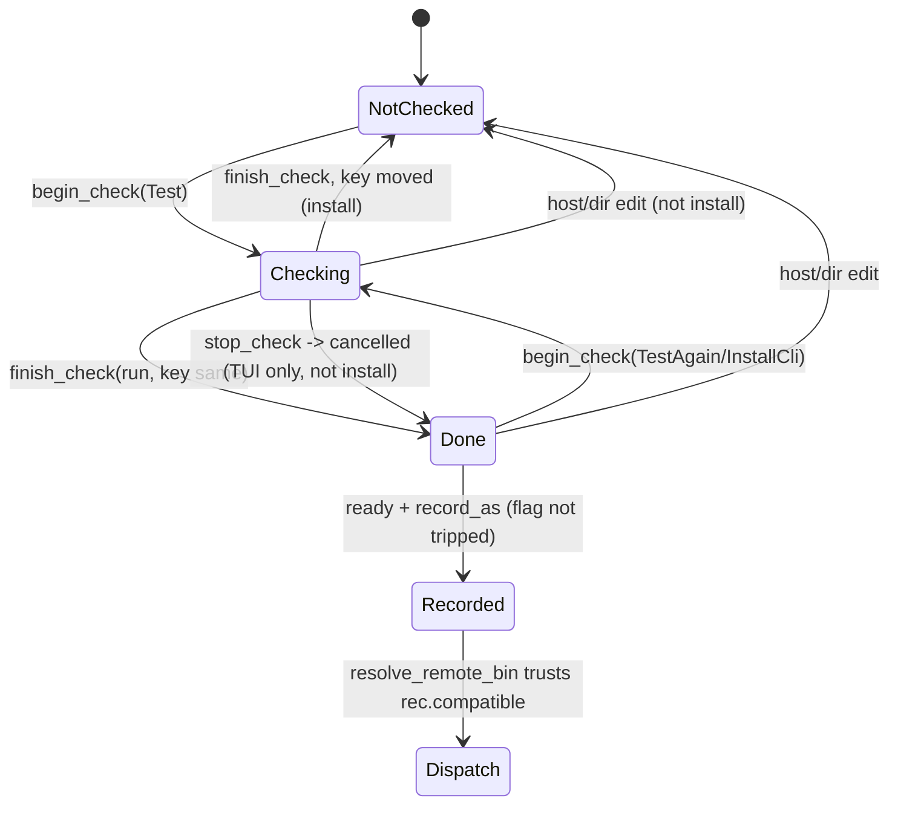

### Verified concerns
1. **Stale `compatible` at dispatch (medium).** In `remote_session.rs:398-400`, `Some(rec) if rec.compatible => Ok(rec.path)` never re-checks `rec.version` against the current hub. After a hub minor bump, every existing record still passes the gate.
2. **Dispatch ignores the record's host (medium).** `resolve_remote_bin` does not call `is_for_host`, but `relay_bin_for_host` (remote_session.rs:428) does. The `MachineRecord.host` doc says readers that know the host must skip foreign records. The store is global and keyed by a per-project name, so same-named machines in different projects collide.
3. **Close during install loses the record (low).** `CheckStop::close` (machine_check.rs:504-510) trips the install's flag. The install runs on (no cancel, machine_readiness.rs:818-821), but both the desktop (`machine_form.rs:402-409`) and `ReadinessService::run` (machine_check.rs:415-424) skip the record when the flag is set. The desktop comment promises the opposite.
4. **TUI/desktop parity (low).** The TUI has Stop check (`shelbi-tui/.../machine_form.rs:85,165,346`). The desktop disables Test while checking (`desktop/.../machine_form.rs:561-565`) and never calls `stop_check`.
5. **Duplicated record gate (low).** The desktop takes `live.check` and re-implements the record and stopped logic in its view instead of using `ReadinessService::run`.
6. **Hand-synced dual run tracking (low).** Correctness depends on every client path calling `stop_unless` after a form mutation. Both clients currently do (desktop :195, TUI workspaces.rs:717).
7. **Far check not cancellable far side (low, intentional).** `far.rs:61-64` documents this.

### Refuted
- `folder_picked` missing `stop_stale_check`: Browse is local-only, and a local form never checks.
- `CheckStop.start` overwriting an untripped run: `begin_check`'s guard and the clients' `stop_unless` calls make this unreachable today.
- Install having no Cancelled state: this is by design.

### Recommendation
- Re-derive compatibility at dispatch and require a host match there. Consider re-keying records.
- Split Install into its own state or job so that close does not drop its record.
- Have the form's transitions return the CheckStop effects, or own the latch, instead of relying on clients to sync it. Make the desktop use `ReadinessService::run`.
- Add Stop check to the desktop, or correct the TUI comment if Stop is meant to be TUI-only.


### Verified concerns

- **medium**: Dispatch trusts a frozen `compatible` bool. After a hub upgrade to a new major.minor, an old record still reads compatible=true, so dispatch launches an incompatible remote binary instead of failing loudly.
  - Evidence: remote_session.rs:398-400 `Some(rec) if rec.compatible => Ok(rec.path)`, with no re-classify of rec.version against hub_version(). machine_state.rs:45 documents compatible as 'judged ... at resolve time'. The rule is major.minor (machine.rs:250-257). Callers: workspace_session.rs:199,335 and workspace.rs:3163.
- **medium**: The dispatch gate ignores the record's host, though records are host-bound for exactly this reason. Records live in one global machines.json keyed by a per-project machine name. A same-named machine in another project, or a host edited outside the form, can hand dispatch another host's path.
  - Evidence: resolve_remote_bin (remote_session.rs:398) never calls rec.is_for_host(). relay_bin_for_host (remote_session.rs:428) does, and the MachineRecord.host doc (machine_state.rs:52-56) says readers that know the host must ignore records from another host. workspace_session.rs:157 has `host` in hand at dispatch.
- **low**: Closing the form during Install CLI drops the record of a successful install. close() trips the run's flag. The install ignores the flag and finishes, but the record step sees `stopped` and skips the write. This contradicts the desktop comment, which says the record is written 'even if the form closed'.
  - Evidence: machine_check.rs:504-510 close trips the running flag even for an install. machine_readiness.rs:818-821 connects for the install with None, so it runs on. desktop machine_form.rs:396-410: `if !stopped.load(..)` gates record_request.record. ReadinessService::run (machine_check.rs:415-424, used by TUI workspaces.rs:2548) does the same.
- **low**: TUI/desktop parity drift: the TUI offers 'Stop check' while a check runs, but the desktop disables the Test button and never calls stop_check. A desktop user can only stop a check by closing the dialog. The TUI comment says it works 'as the desktop's'.
  - Evidence: TUI machine_form.rs:85-87, 163-166 call form.stop_check(), and :340-346 render 'Stop check'. desktop machine_form.rs:561-565 renders disabled_button while Checking, and there is no stop_check call anywhere in desktop/src.
- **low**: The record-after-check logic is duplicated. The TUI uses ReadinessService::run. The desktop takes only `.check` and re-implements the stopped-gate and record in its view. They are equivalent today but can drift.
  - Evidence: desktop machine_form.rs:103-106 (readiness: live.check) and :402-409 vs machine_check.rs:415-424.
- **low**: The in-flight run is tracked twice, once in Check::Checking.run and again in CheckStop.running. Every client action path must call stop_unless(form.running()) after mutating the form, so the latch's correctness depends on client discipline. Install is folded into Checking and needs InstallCli special cases in set/test_intent/stop_check/panel/stages.
  - Evidence: machine_check.rs:640-664 (doc tells client to stop), 651-656, 680-686, 745, 763, 796. desktop machine_form.rs:194-195, 358-360. TUI workspaces.rs:717.
- **low**: A far (remote-window) check cannot be cancelled on the far hub. The client returns cancelled at once, but the far SSH check runs to READINESS_DEADLINE. This is intentional and documented, and the result is dropped with no record.
  - Evidence: orchestrator far.rs:61-64 passes a fresh AtomicBool(false). shelbi-app far.rs:225-246 polls a local flag only. The behavior is documented at far.rs:226-230.


### Concerns that did not hold up

- folder_picked calls state.set without stop_stale_check (desktop machine_form.rs:448-458). Harmless: Browse is offered only on the local machine's form (shelbi-app machine_form.rs:475, test at :781). begin_check refuses for !remote(), so no check can be running to orphan.
- CheckStop.start overwrites a running entry without tripping it (machine_check.rs:476-481). Not reachable today: begin_check refuses while Checking. Every path that leaves Checking without an answer (edit, stop_check) is followed by stop_unless in both clients (desktop :195, TUI workspaces.rs:717), so start only runs once `running` is cleared or already tripped.
- 'install has no Cancelled state' is a deliberate design choice, not a bug. It is documented at machine_readiness.rs:526-528 and machine_check.rs:504-505, and the UI hides Stop for installs (TUI test :2671).
- Three writers with different compatible rules. The CLI status writer recording compatible=false is truthful (it reflects a fresh probe), and the form writers only record ready outcomes. The real problem is that readers trust a stale bool and ignore host (kept above), not that the writers disagree.
- The far wait loop has no deadline. It relies on far_request's transport timeout, and the far check is itself bounded by READINESS_DEADLINE, so it cannot hang forever.


**Recommendation:** 1) Record lifecycle: make resolve_remote_bin re-derive compatibility from rec.version against the current hub_version(). Treat `compatible` as a cache only, or drop it. Also require rec.is_for_host(machine.host) at dispatch. Consider keying records by (project, machine) or by host. 2) Give the install its own lifecycle: either `Check::Installing{run,key}` as a separate variant, or an `Installing` job outside Check. Then close() need not trip an install's flag, and the 'record even if closed' contract holds. 3) Fold CheckStop into the form, or have begin_check/finish_check/set/stop_check return the CheckStop effect, so clients stop hand-syncing it. Have the desktop use ReadinessService::run instead of re-implementing the record gate. 4) Add Stop check to the desktop, or fix the TUI comment if it is deliberately TUI-only.


## Workspaces settings page: load lifecycle and workspace form/remove dialog

**Verdict:** Needs further thought. The TUI can route a pool result to the wrong layer: hidden() drops the busy form but keeps its run ticket current, and nothing stops a new layer from opening meanwhile. A reachable sequence closes an unrelated form, loses its draft, or shows another request's error on it. The desktop dialog is safe because each dialog owns its job, so the two clients have also drifted, and desktop page loads are unsequenced too.

**Verified concerns:** 2 medium, 3 low

**Key files:**
- `crates/shelbi-tui/src/shell/settings/workspaces.rs:175-207, 300-409, 692-705, 839-886`
- `crates/shelbi-app/src/settings/workspace_form.rs:640-790, 829-975`
- `crates/shelbi-app/src/settings/workspaces.rs:290-395`
- `desktop/src/views/workspaces.rs:140-175, 295-302, 850-860`
- `desktop/src/views/workspace_dialog.rs:84-104, 300-425`

### What it is
The Settings ▸ Workspaces page has two linked lifecycles.

1. **Page read lifecycle.** The shared `Load {Loading, Failed, Loaded}` enum lives in `crates/shelbi-app/src/settings/workspaces.rs:290-395`. Next to it sit an `error: Option<String>` overlay, a `notice`, and a reachability map that the SSH prober fills. Each client wraps it differently:
   - **TUI:** `Job<()>` tickets, `loaded_at` with a 5 s external reload, and `follow`/`follow_machine` cursor latches (`crates/shelbi-tui/src/shell/settings/workspaces.rs:175-207, 300-361, 888-891`).
   - **Desktop:** a `reload` bool consumed in `render()` and an unsequenced `load()` (`desktop/src/views/workspaces.rs:149-175, 850-860`).
2. **Workspace form and Remove dialog.** The shared `WorkspaceForm` holds `{busy, menu, confirm: Option<RemoveConfirm{busy, error}>, errors}` and returns `Action::{Stay, Close, Run, Done}` (`workspace_form.rs:640-975`). Each client hosts it differently:
   - **TUI:** inside `layer: Option<Layer{Form, Confirm, Machine}>`, with one page-wide `run` ticket.
   - **Desktop:** in a `WorkspaceDialog` entity that owns its own job (`desktop/src/views/workspace_dialog.rs:300-425`).

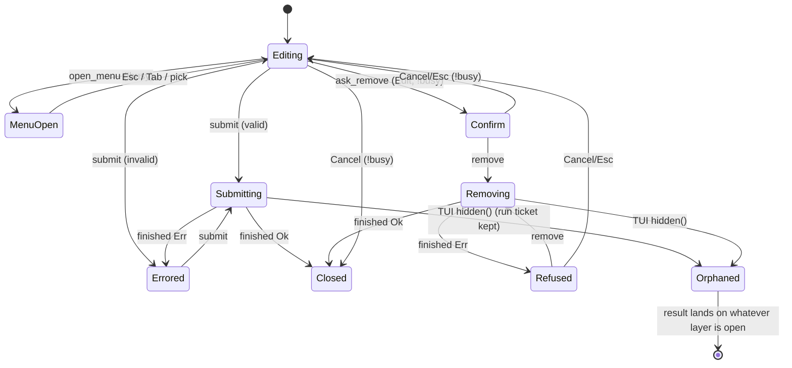

### Verified concerns
- **(medium) TUI misroutes results across layers.**
  - **Cause.** `hidden()` (`tui workspaces.rs:383-389`) drops the layer but not the `run` ticket. Only `project_changed()` (366-379) resets it. `hidden()` runs on every page switch away from Workspaces (`shell/settings.rs:1044`) and on Settings close (`settings.rs:571`). `open()` (527-577) opens a new layer with no in-flight guard. `finished()` (864-886) routes by "whatever layer is up". `WorkspaceForm::finished` (832-850) doesn't check that it was busy.
  - **What goes wrong.** On Ok, the new form closes (`done()` sets `layer = None`) and its draft is lost. On Err, another request's error is painted on it. If a Machine layer is up, an Ok closes the machine form too (870-882).
  - **Repro.** Submit a slow Add, switch to another Settings page and back, then open Edit on another workspace.
- **(low) The desktop page's reads aren't sequenced.** `load()` spawns with no generation, so an older read can overwrite a newer one. The TUI tickets the same reads. This is parity drift.
- **(low) `error` holds two kinds of message.** It carries both reread failures and unrelated notes (`desktop/src/views/settings.rs:688`). Any successful reread or `retry()` silently clears the notes.
- **(low) Lifecycle spread across several fields.** "Failed waits for Retry" in the TUI comes from `index().is_some()` in `reload_due`, not from an explicit state. `mark_stale` leaves the `follow*` latches set.

### Refuted
- **Form vs confirm interleaving inside the shared model.** `ask_remove` and `open_menu` refuse while busy, and a busy confirm can't be cancelled, so a result always reaches the layer that sent it.
- **Desktop `running` vs `busy` drift.** Both are set and cleared at the same points, and each dialog's result goes to its own body.
- **"Loading with no read in flight".** Every `retry()` caller issues a read.

### Recommendation
1. **Give TUI workspace layers an id,** as `MachineLayer` already has, and carry it with the run ticket. A result for a layer that's gone becomes a note. It never becomes a `done()` that clears the current layer. As a cheaper alternative, block `open()` while `run.running()`.
2. **Sequence desktop page reads** with a ticket or generation counter.
3. **Optionally split** `error` into `reread_error` and a transient note.

The shared shelbi-app model itself is fine.


### Verified concerns

- **medium**: TUI: a pool request's result can land on a different, later-opened layer. hidden() drops the busy form but leaves the `run` ticket current, and open() has no in-flight guard. finished() then hands the old result to whatever Form or Confirm is up. On Ok, the new form closes and its draft is lost, the notice and cursor-follow are set from the old outcome, and Ask::Reload follows. On Err, the old Add/Update error is painted on the new form, or rewritten as a removal refusal on a Remove confirm. Workspace forms carry no id, unlike machine forms (m.form.saving() guard).
  - Evidence: crates/shelbi-tui/src/shell/settings/workspaces.rs:383-389 hidden() calls close_layer() but never self.run.reset(), while project_changed() at 366-379 does reset it. shell/settings.rs:1044 calls hidden() on any page switch away from Workspaces, and settings.rs:571 on Settings close. Page open() at 527-577 sets a new layer unconditionally. finished() at 864-878 routes by `match self.layer.as_mut()` after the ticket check passes. WorkspaceForm::finished (workspace_form.rs:832-850) clears busy and returns Done or sets errors with no check that the form was busy. Repro: submit an Add workspace whose service call is slow (worktree creation, a remote machine), switch to another Settings page and back, then open Edit on another workspace before the Add answers.
- **medium**: TUI: an Ok result that lands while a Machine layer is open closes the machine form. finished() turns Ok into Action::Done and done() sets layer=None, so the user's machine draft goes, along with any running check's context. The same hidden() gap makes this reachable.
  - Evidence: crates/shelbi-tui/src/shell/settings/workspaces.rs:870-882: the `Some(Layer::Machine(_)) | None => Ok(outcome) => Action::Done(outcome)` arm, then self.done(outcome) at 839-848, which does self.layer = None.
- **low**: Desktop page reads are unsequenced, unlike the TUI's ticketed Job. load() spawns a read with no generation or ticket. Retry, reload-on-draw and a post-Done reload can overlap, and the last to land wins even when it is the older one. A slow far-hub read could then show a just-removed workspace again until the next reload. TUI/desktop parity drift.
  - Evidence: desktop/src/views/workspaces.rs:149-157 load() spawns and applies through loaded() with no staleness check. WorkspacesState::loaded (shelbi-app workspaces.rs:369) only filters by project name. The TUI wraps the same state in Job tickets (tui workspaces.rs:306-335).
- **low**: The error overlay mixes two meanings. set_error() puts unrelated messages (Machine isn't declared any more, an Edit that couldn't open its file) in the same slot as reread failures, and retry() or any successful reread silently clears them.
  - Evidence: crates/shelbi-app/src/settings/workspaces.rs:354-357 (set_error), 359-364 (retry clears error), 378/384 (Ok clears error). desktop/src/views/settings.rs:688 sets a non-reread error.
- **low**: Load is a three-variant enum, but 'reading' is tracked elsewhere (the TUI's Job, nothing on desktop). Failed waits for Retry only because reload_due checks index().is_some(), not because of an explicit failed state. mark_stale resets the ticket and loaded_at but leaves the follow/follow_machine latches set.
  - Evidence: crates/shelbi-tui/src/shell/settings/workspaces.rs:357-361 (reload_due uses self.index().is_some()), 888-891 (mark_stale), 179-185 (follow latches).


### Concerns that did not hold up

- Inside the shared WorkspaceForm, finished() routing to the open confirm is not a live bug. ask_remove() and open_menu() refuse while form.busy, and a busy confirm can't be cancelled (cancel/dismiss_confirm guard on busy). So the form's job and the confirm's job can't both be out, and the result always reaches the layer that sent it (workspace_form.rs:716-753, 832-835).
- Desktop running vs model busy disagreeing: running is set in run() right after the model set busy and returned Action::Run, and both are cleared in the same callback before finished(). They can't diverge. The callback routes to this dialog's own body through a weak entity handle, so the desktop has no misrouting (workspace_dialog.rs:408-424). The duplication is only redundancy.
- Desktop 'Loading persists with no read in flight' after retry(): the desktop's only retry() caller calls load() right after (desktop workspaces.rs:298-300), and the TUI's begin_load always issues a ticket after retry(). No caller leaves Loading without a read.
- Desktop prober never stopped: a design choice scoped to the page entity's lifetime (the poll loop exits when the entity drops), not a lifecycle bug. Empty targets make it a no-op.
- MachineLayer.started not cleared in paste(): plausible but cosmetic, and it belongs to the machine readiness form's machine rather than this one. The renderer's use of elapsed for a stopped check was not confirmed.


**Recommendation:** Tie each request's result to the layer that sent it. Either give Layer::Form/Confirm an id (as MachineLayer already has) carried in the run ticket or job, so finished() hands the result to that layer only and otherwise falls back to the "form went" note path. Or have hidden() record "request outstanding, no form" and make open() refuse, or queue, while run.running(). Never turn an orphaned Ok into a done() that clears the current layer: set the notice, keep the layer. Then on desktop, put WorkspacesPage::load behind the same ticket/generation guard the TUI uses (a Job or a u64 counter checked in loaded()). Optionally split WorkspacesState.error into reread_error and a transient note. The shared shelbi-app form/confirm model needs no change.


## Workspace pool mutation saga (add / rename / move / remove)

**Verdict:** Needs further thought. The sagas are carefully sequenced and their compensations are sound. The real issue is that remove's guard has drifted from rename's and from the poller's idea of "active". It uses hard-coded core columns, skips the open-assignment check and skips the session check, and then kills the session without asking. Under a custom workflow, a non-force remove can kill a working agent. Separately, a dispatch that queued behind the lock never re-validates that its workspace still exists. Both are cheap to fix but need a decision on what "in use" means.

**Verified concerns:** 2 medium, 2 low

**Key files:**
- `crates/shelbi-orchestrator/src/pool_admin.rs:163-445 (add/update/remove sagas)`
- `crates/shelbi-orchestrator/src/pool_admin.rs:806-866 (check_idle, carry_migration_state)`
- `crates/shelbi-orchestrator/src/pool_admin.rs:947-1036 (LiveOps: active_task hard-coded columns, remove_worktree, kill_session)`
- `crates/shelbi-orchestrator/src/workspace.rs:2548-2596, 2827-2860 (dispatch/resume take lock_workspace with a pre-resolved spec, no re-validation)`
- `crates/shelbi-orchestrator/src/poller.rs:6553-6577 (task_is_active: workflow-category Active)`

### What it is
`crates/shelbi-orchestrator/src/pool_admin.rs` implements add, edit (tags/slot, rename, machine move) and remove of a workspace as hand-written sagas. The CLI and the desktop Settings forms share them through `PoolService`. Each operation:

1. checks the daemon version
2. takes `lock_pool_config`, then `lock_workspace` for every name it touches, and reloads the config
3. validates the request and the `expected` entry
4. probes live state: active task, open assignments, session, `WorktreeState`
5. provisions, saves the config, and retires the old identity, with compensation on failure.

There is no state type. "Where we are" is the program counter, and retries are safe because every step is idempotent (an interrupted rename is adopted, materialize is idempotent, removing a missing worktree is a no-op).

```mermaid
stateDiagram-v2
    [*] --> Locked: version ok, pool+ws locks, reload, expected ok
    Locked --> IdleVerified: check_idle (rename/move) / active_task only (remove)
    IdleVerified --> Probed: WorktreeState old/new
    Probed --> Refused: AtRisk / Unknown / dest occupied
    Probed --> Provisioned: materialize (new machine) / git worktree move / adopt
    Provisioned --> HooksWired: wire (move, add)
    HooksWired --> Compensated: MergeRequired / error -> undo()
    Provisioned --> Saved: rename save
    HooksWired --> Saved: PoolConfig::save
    Saved --> Compensated: save failed -> move back / undo
    Saved --> Retired: remove old worktree (or warn), carry migration state
    Probed --> Torn: remove: kill_session + remove_worktree
    Torn --> Saved: save
    Torn --> PartiallyApplied: save failed (declared, no worktree)
    PartiallyApplied --> Torn: retry
    Retired --> [*]
    Refused --> [*]
    Compensated --> [*]
```

### Verified concerns
- **Medium: remove's "active" check is hard-coded to the core columns.** `LiveOps::active_task` (pool_admin.rs:947-958) checks only `in-progress` and `review`. Custom workflow statuses (for example `coding` or `qa`) are stored under their own ids, so they don't block removal. The poller uses workflow `StatusCategory::Active` (poller.rs:6558-6577).
- **Medium: remove's guard is weaker than rename's.** Non-force remove (pool_admin.rs:394-417) skips `check_idle`, so it never checks `open_assignments` or the session. It then calls `kill_session` unconditionally. With a custom active status, a non-force remove can kill a running agent and `rm -rf` its worktree if the work is committed and pushed. Open tasks stay assigned to a workspace that no longer exists. The module doc (46-48) says it kills an *idle* session, but nothing verifies idleness.
- **Low: dispatch doesn't re-validate after the lock.** `start_workspace_on_task` and `resume_workspace_on_task` (workspace.rs:2556-2596, 2827-2860) resolve the machine, worktree and target from a pre-built spec, then take `lock_workspace`, and never re-check that the workspace is still declared. A start queued behind a remove or rename runs with the stale identity once the lock is released.
- **Low (by design): remove tears down before it saves** (pool_admin.rs:413-441). A save failure leaves the workspace declared with no worktree until the user retries. This is documented and the retry is idempotent.

### Refuted
- The TOCTOU claim that "supervisor/resume don't take lock_workspace" is wrong: both take it, and pool_admin holds it from the check through the save.
- Rename/move are not exposed by the hard-coded columns, because `open_assignments` refuses on any open assigned task.
- Nothing re-materializes an idle declared workspace after a failed remove-save.

### Recommendation
Make one shared, workflow-category-based "workspace in use" predicate for remove, rename/move, machine edits and the poller. Have non-force remove refuse a live agent session and report open assignments. Re-validate that the workspace is still declared right after `lock_workspace` in start and resume. An explicit saga enum isn't needed.


### Verified concerns

- **medium**: Remove's in-use check reads only hard-coded columns. LiveOps::active_task lists only Column::in_progress() and Column::review(). Custom workflows store their own status ids (for example `coding` or `qa`), so a task in a custom Active or Handoff status does not block removal. The poller and lifecycle code decide activity by workflow StatusCategory.
  - Evidence: pool_admin.rs:947-958 iterates `[Column::in_progress(), Column::review()]` with store.list_in_status. Column is a free-form status id (shelbi-core/src/model.rs:2011-2060). poller.rs:6558-6577 task_is_active resolves the workflow and checks StatusCategory::Active.
- **medium**: Non-force remove checks less than rename/move does. It skips check_idle, so it never checks open_assignments or the live session. It kills the session unconditionally, so a running agent in a custom active status is killed and its worktree is rm -rf'd when the worktree is Clean (committed and pushed). Open tasks stay assigned to a workspace that is no longer declared.
  - Evidence: pool_admin.rs:394-417: the non-force guard is active_task plus the worktree probe only, then ops.kill_session. check_idle (806-853) also checks open_assignments and SessionState::Alive but is only called from rename/move (250) and the machine edit (567). The module doc (lines 46-48) says removal 'kills an idle session', but nothing verifies the session is idle.
- **low**: Dispatch and resume take lock_workspace with a StartSpec resolved before the lock and never re-check that the workspace is still declared. A start that queued behind a remove or rename proceeds once the lock is released. Its first step makes sure the worktree exists, so it can re-create a worktree and pane under the old or removed name. The check-under-lock is sound against interleaving mid-sequence, but not against a stale caller waiting on the lock.
  - Evidence: workspace.rs:2556-2589: machine, worktree and target are derived from spec.workspace, then `lock_workspace` at 2589. After the lock there is only a cancel check (2594), with no config reload or declared check. resume is the same at 2854. pool_admin holds lock_workspace across its whole sequence, including save (380-445).
- **low**: Remove kills the session and deletes the worktree before saving the config, unlike the module's 'provision first, write config, then retire' rule. A save failure (for example a conflict with a hand edit) leaves the workspace declared with no worktree and no session until the user retries. This is documented and the retry is idempotent, so it is a narrow, recoverable partial state rather than a bug.
  - Evidence: pool_admin.rs:413-441 (save after kill+remove, error text 'retry to finish removing it from the config'). remove_workspace_worktree (workspace.rs:7319-7347) is best-effort and idempotent on a missing path. Doc comment at 366-370 states the intent.


### Concerns that did not hold up

- 'check_idle is time-of-check and the poller supervisor/resume passes don't take lock_workspace.' Refuted as stated: the supervised restart goes through start_workspace_on_task / resume_workspace_on_task (poller.rs:4828, 5932), and both take lock_workspace (workspace.rs:2589, 2854). pool_admin holds the same lock from check_idle through save, so no relaunch can land between the check and the move or remove. The real residual is the stale pre-resolved spec after the lock is released (kept as a low concern).
- 'Active is hard-coded so a custom active gate doesn't block rename/move.' Only partly true: rename/move also run open_assignments, which refuses on any open task assigned to the workspace, whatever its status. The column hard-coding only matters for remove.
- 'After a failed remove-save the poller supervisor may re-materialize the worktree.' Not supported for the normal path: nothing re-materializes an idle declared workspace (materialize_idle_worktree is only called from pool_admin). A restart needs an active task, which non-force remove refuses (when the status is a core column).


**Recommendation:** Make one shared "workspace in use" predicate that every caller uses: remove, rename/move, machine edits, and ideally the poller. Base it on workflow StatusCategory (Active or Handoff via load_task_workflow, as in poller task_is_active) instead of Column::in_progress/review. Have non-force remove call check_idle, or a remove variant that refuses on a live non-shell session and reports open assignments. In start/resume, after taking lock_workspace, reload the project and confirm the workspace is still declared on the same machine and name, and bail out if not. An explicit saga type isn't needed; the sequencing is readable and the compensations are local.


## System configuration-update protocol (prose-enforced)

**Verdict:** Needs further thought. I found no crash, but the safety contract (no live write without confirming an exact preview, no lost concurrent change) is enforced only by model compliance with prose. The CLI holds no state to back it: no content fingerprints, no preview or confirmation token, no apply command, and no lock against the hub's own config-upgrade writer that edits the same files. Whether Shelbi should own the apply step is a design question worth discussing, not just a cleanup.

**Verified concerns:** 2 medium, 1 low

**Key files:**
- `plugins/update-shelbi-configuration/skills/update-shelbi-configuration/SKILL.md:1-100`
- `crates/shelbi-cli/src/commands/config_surfaces.rs:24-45, 116-215`
- `crates/shelbi-cli/src/commands/config.rs:31-110`
- `crates/shelbi-cli/tests/system_config_workflow_e2e.rs:178-320`
- `crates/shelbi-orchestrator/src/system_plugin.rs:25-128`

**Entity:** one agent-driven change to Shelbi-owned configuration, made through the `update-shelbi-configuration` system skill. The skill is loaded into the orchestrator from the installed plugin copy, or from the embedded copy when the installed one is missing, unreadable or malformed (`system_plugin.rs`).

### States and storage
The lifecycle lives only in `plugins/update-shelbi-configuration/skills/update-shelbi-configuration/SKILL.md` §1-6 and in the agent's memory. The on-disk artifacts are:
- **staged_dir.** Created by `shelbi config inventory` at `$TMPDIR/shelbi-config-<pid>-<nanos>` (`crates/shelbi-cli/src/commands/config_surfaces.rs:116-151, 358`). It holds copies of the live files and `.shelbi-config-inventory.json`.
- **baseline.** A copy of staged_dir that the agent makes itself (SKILL.md:20-23). It is the only basis for the preview diff and for race detection.

The manifest's `InventoryEntry` (`config_surfaces.rs:35-45`) carries no content hash or mtime. The CLI exposes only stateless `inventory` and `lint [--staged]` (`config.rs:31-110`). There is no preview, confirm or apply command.

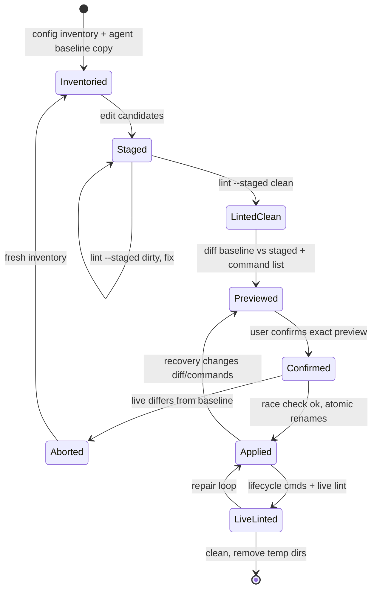

### Verified concerns
1. **No CLI enforcement of confirm, race check or apply (medium).** `ConfigCmd` (`config.rs:31-110`) has no apply/preview/confirm. Applying is the agent copying files. `crates/shelbi-cli/tests/system_config_workflow_e2e.rs:178-320` re-implements the protocol in test code (`Session { confirmed: Option<Preview> }`, `build_preview`), so the tests check a harness that plays the agent rather than a CLI guarantee.
2. **The race check has no CLI basis and no lock (medium).** The inventory stores no fingerprints, so detection depends on the agent's untouched baseline. The check-then-write runs across several files with no lock. The hub's config-upgrade auto-heal (`config upgrade --apply`, and the on-start pass it mirrors, `config.rs:56-84`) writes the same surfaces, so a write landing between the agent's comparison and its rename is silently overwritten.
3. **No temp-dir reaper (low).** Every inventory creates a new temp staging dir. Only internal `lint_live` removes its own (`config_surfaces.rs:153-157`). Abandoned sessions leave full config copies in TMPDIR.

### Refuted or intentional
- **Loading an installed skill whose checksum differs (with a warning) is a documented, deliberate choice** (`system_plugin.rs:25-29, 112-127`). Malformed or missing copies fall back to the embedded copy.
- **Staged lint cannot escape to live paths.** `lint_staged` re-roots entries via `checked_candidate` (`config_surfaces.rs:209-213`).

### Recommendation
Make the guarded half explicit in the CLI:
1. Record a per-entry sha256 (or a missing marker) in the manifest.
2. Add `config preview --staged DIR`, which prints the exact diff, the command list and a digest.
3. Add `config apply --staged DIR --confirm <digest>`. It would recompute and compare the digest, re-hash live paths against the manifest, take the lock the upgrade auto-heal uses, do the atomic renames and report the lifecycle commands still to run.
4. Optionally add `config discard DIR`.

The skill then becomes "inventory, edit, lint, preview, show, apply with the digest". Confirmation becomes a token the CLI checks, and the e2e test checks a real invariant. If you keep the protocol prose-only, at least add the manifest hashes and a shared config-write lock.


### Verified concerns

- **medium**: The CLI does not enforce confirm-before-apply, the race check or the apply. The whole guarded part of the lifecycle (Preview -> Confirm -> RaceCheck -> Apply) is agent behavior. If the model skips the confirmation, the baseline copy or the race comparison, it can write live config directly, and no code path notices.
  - Evidence: config.rs:31-110: ConfigCmd has only Inventory, Lint, Upgrade, ListActions, DumpKeybindings and Check. It has no apply, preview or confirm. SKILL.md:54-80 describes confirm/race-check/apply as agent steps. system_config_workflow_e2e.rs:178-320 has the test play the agent (Session.confirmed: Option<Preview>, build_preview), so the tests check the harness, not a CLI invariant.
- **medium**: Race detection has no CLI-recorded basis. The inventory manifest records only path, scope, format, exists and lifecycle_owned, with no content hash or mtime. The race check therefore depends on the agent having made an untouched byte-for-byte baseline copy. It is also an unlocked check-then-write across several files, while the hub's own config-upgrade auto-heal (`config upgrade --apply` / the on-start pass) can write the same files. Nothing serializes these writers, so a write that lands between the agent's comparison and its rename is lost.
  - Evidence: config_surfaces.rs:35-45: InventoryEntry has no hash field. config_surfaces.rs:116-151: inventory copies files with no fingerprint. SKILL.md:20-23 and 61-72: the baseline and comparison are agent-made. config.rs:56-84: Upgrade --apply writes the same surfaces. No lock is referenced in either path.
- **low**: The staged_dir and baseline temp directories exist only by convention. The CLI creates a fresh `$TMPDIR/shelbi-config-<pid>-<nanos>` on every inventory and never removes it, apart from the internal lint_live path. An abandoned or interrupted session leaves staged copies of every config file in TMPDIR with no reaper.
  - Evidence: config_surfaces.rs:116-119 and 358 (unique_stage_dir in temp_dir); config_surfaces.rs:153-157 (only lint_live removes its own staged_dir); SKILL.md:97-100 (the agent is told to clean up).


### Concerns that did not hold up

- 'An installed skill copy that differs from the embedded checksum is still loaded with only a warning' is accurate but intentional. The doc comment at system_plugin.rs:25-29 says packagers may patch the prose locally and a valid patch must stay usable. Missing, unreadable or malformed copies fall back to the embedded copy (system_plugin.rs:86-110). This is a deliberate trust choice about which prose governs the protocol, not a state-machine defect.
- I checked a related worry, that an agent edit to the staged manifest could point lint at live files. It does not hold: lint_staged treats the supplied staged dir as authoritative and re-roots every entry through checked_candidate(staged, candidate_path) (config_surfaces.rs:209-213), so staged lint cannot read or mutate live paths.


**Recommendation:** Move the guarded half of the lifecycle into the CLI. The cheapest step is to record a sha256 (or a missing marker) per entry in the inventory manifest. A next step would be a `shelbi config preview --staged DIR` command that prints the exact diff and command list plus a preview digest, and a `shelbi config apply --staged DIR --confirm <digest>` command. Apply would recompute the preview, refuse on a digest mismatch, re-hash the live canonical paths against the manifest (the race check), take the same lock the config-upgrade auto-heal path uses, do the atomic renames, and print the lifecycle commands still to run. Ideally it would also expose a `config discard DIR` cleanup. The skill then shrinks to "inventory, edit, lint, preview, show the user, apply with the digest", and the e2e test can check a CLI invariant instead of a harness that plays the agent. If you decide to leave the protocol prose-only, at least add the manifest hashes and a shared config-write lock so the race check isn't left entirely to the agent.


## Settings surface routing and leave-guard / save-then-leave

**Verdict:** Worth tidying. LeaveGuard itself is a clean, tested two-Option machine. The risk lives around it: the leave-after-save completion is copied across four landing handlers, a palette route closes Settings past the guard, and the desktop opens an async agent editor without the TUI's check. Each issue I verified needs a millisecond-scale race or an unusual route (palette over a running save, a create landing after the user navigated away). None corrupts data, so this calls for consolidation rather than a design conversation.

**Verified concerns:** 1 medium, 4 low

**Key files:**
- `crates/shelbi-tui/src/shell/settings.rs:550-566, 620-930, 1005-1060, 1240-1275, 1720-1760`
- `crates/shelbi-app/src/settings.rs:340-433 (LeaveGuard)`
- `crates/shelbi-tui/src/shell/mod.rs:2687-2705, 2982-3015, 3440-3470, 4005-4016`
- `desktop/src/views/settings.rs:367-445, 769-906, 1700-1707`
- `desktop/src/views/agents.rs:217-230; desktop/src/app.rs:4440-4520`

### What it is
Settings is a modal surface in both clients. Inside it a page is shown, a full-view editor (workflow or agent) can cover it, and the TUI adds its own Save / Discard / Cancel prompt for leaving with unsaved edits. A Save chosen from that prompt must land before the leave happens.

**TUI encoding.** The shell holds `settings_return: Option<SettingsReturn>` (mod.rs:1413). `SettingsShell` holds the nav page, region and stop, and `guard: LeaveGuard<Leave>` (shelbi-app settings.rs:363-433), whose two Options are `prompt` and `after_save`. It also holds `save: Job`, and `editor` / `agent_editor` as two Options kept exclusive by convention. The desktop's `SettingsView` holds `page` plus independent `editor`, `agent_editor` and `machine_form` Options (desktop/src/views/settings.rs:367-445). Leave prompts there live inside each editor.

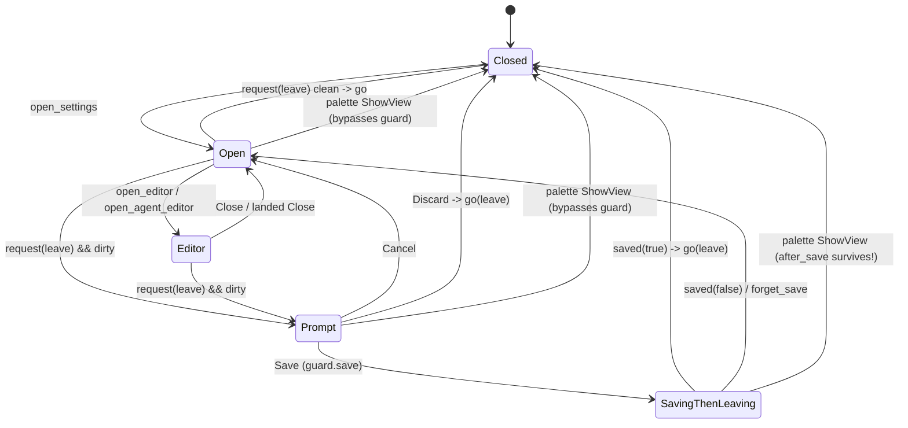

### Verified concerns
1. **Leave-after-save completion is copied across four handlers (medium, tidy).** `agent_landed` (settings.rs:685-702) and `editor_landed` (797-811) each run `settings_save && !busy -> saved(false)` and `Wrote -> saved(true)`. `agents_committed` uses `shared && leaving_after_save` (1254-1260), `saved()` calls `guard.saved(ok)` (920), and `prompt_saving` ORs three sources (891-896). A new save source has to copy this a fifth time.
2. **The palette closes Settings past the guard, and `after_save` outlives the close (low).** The palette chord is matched before Settings routes keys (mod.rs:2702). Picking a view sets `settings_return = None` directly (mod.rs:4005-4016). `open()` later calls `guard.cancel()`, which clears only `prompt` (shelbi-app settings.rs:395-397). A save already running still runs `go(leave)` when it lands, which can close a reopened Settings or switch project after the user has moved on.
3. **Desktop/TUI parity: opening a just-created agent (low).** The desktop emits `AgentsEvent::Edit(created)` whenever the commit lands (agents.rs:227-229). `open_agent_editor` sets `page = Agents` and leaves `editor` alone (settings.rs:809-826), so both editors can coexist; render and `editor_back` pick one by precedence (1702-1707, 799-805). The TUI checks that the page is still Agents, no agent editor is open and no leave happened (tui settings.rs:1262-1268).
4. **Desktop open_settings(Some(page)) while editing (low).** It calls `show_page` with no `editing()` check (app.rs:4442-4446). `show_settings_page` does check (4495-4503). The page changes under the editor and is reset to Workflows when the editor closes.
5. **TUI editor exclusivity is by convention (low).** Openers null each other (settings.rs:633, 668). `dirty`, `editor_busy`, `covers_columns`, `reload_editor` and `project_shown` each check both Options.

### Refuted
- Out-of-order `Written` results: `GeneralForm::editable()` is false while a write is pending (general.rs:482-484), so immediate writes are serialized.
- `KeysSaved` after a project switch: keys saves are serialized by `saving`, and the payload is the global keys.yaml text, re-merged for the shown project.
- "open() drops the leave intent": it keeps `after_save`. The real problem is the reverse (concern 2).

### Recommendation
- Add an `Overlay` enum (None / Workflow / Agent) in both clients.
- Have one `save_landed(source, ok, still_busy)` on the TUI own every `guard.saved` call.
- Clear the whole guard when Settings closes, and send the palette close path through it.
- On the desktop, add the TUI's check before opening a created agent, and skip `show_page` in `open_settings` while editing.


### Verified concerns

- **medium**: The rule "a prompt-started save decides the leave" is copied across four landing handlers, each with its own condition, plus a fifth predicate that combines them (prompt_saving). Each new save source has to repeat the pattern.
  - Evidence: settings.rs:685-702 (agent_landed: `settings_save && !busy` -> saved(false), Wrote -> saved(true)), 797-811 (editor_landed, the same pattern), 1254-1260 (agents_committed: `shared && leaving_after_save`), 920 (saved), 891-896 (prompt_saving ORs save.running, agents saving and editor_busy)
- **low**: Picking a view in the palette closes TUI Settings without going through the LeaveGuard. If a prompt-started save is still running, `after_save` survives the close. reopen's open() calls guard.cancel(), which clears only `prompt`. When the save lands it still runs go(leave): a stale Back can close Settings after it has been reopened, and a stale Leave::Project switches project after the user has moved on. The palette chord is checked before Settings sees the key, so the prompt_saving key block does not stop it.
  - Evidence: mod.rs:2702-2705 (palette opens before settings key routing), mod.rs:4005-4016 (settings_return = None; settings.close(), with no guard check), shelbi-app settings.rs:395-397 (cancel only clears prompt), settings.rs:554 (open -> guard.cancel), settings.rs:920 (saved -> go(leave))
- **low**: TUI/desktop parity drift on opening a just-created agent. The TUI opens the agent editor only if the page is still Agents, no agent editor is open and no leave happened. The desktop emits AgentsEvent::Edit unconditionally when the create commit lands. That can move the user off another page, or set agent_editor while the workflow editor is open (open_agent_editor does not clear editor). The two then coexist: render shows the workflow editor first, and when it closes, the agent editor appears with page = Workflows.
  - Evidence: desktop/src/views/agents.rs:227-229 (emit Edit(created) on async commit), desktop/src/views/settings.rs:809-826 (sets page=Agents and agent_editor, leaves editor), 1702-1707 (render precedence), 799-805 (editor_back precedence) vs crates/shelbi-tui/src/shell/settings.rs:1262-1268 (the TUI's guard)
- **low**: On the desktop, open_settings(Some(page)) while an editor is open calls show_page and changes `page` under the open editor. The request is silently lost: close_editor resets page to Workflows. show_settings_page guards against this, but open_settings does not.
  - Evidence: desktop/src/app.rs:4442-4446 (Route::Settings -> show_page without an editing() check) vs 4495-4503 (show_settings_page returns while editing); settings.rs:858-860
- **low**: TUI editor and agent_editor are mutually exclusive only by convention. Every opener and closer has to null the other, and dirty, editor_busy, covers_columns, reload_editor and project_shown each check both.
  - Evidence: settings.rs:633 and 668 (each opener nulls the other), 576-587 (dirty and editor_busy check both), 608-610, 778-806


### Concerns that did not hold up

- Untagged SettingsMsg::Written (two quick theme or tool writes landing out of order): GeneralForm::editable() is false while `pending` is Some (general.rs:482-484), and every choose_* returns None when !editable(). Immediate writes are therefore serialized, so only one Written can be in flight.
- Untagged SettingsMsg::KeysSaved landing after a project switch: KeybindingsState refuses a new change while `saving` (keybindings.rs:315-397), so saves are serialized. The result is the whole keys.yaml text, which is global with per-project blocks. Loading it into the page after a switch re-merges it for the shown project, so nothing wrong is applied.
- "open() calls guard.cancel(), dropping the leave intent while the save keeps running": the reverse is true. cancel() clears only `prompt` and keeps `after_save`, so the intent is not dropped. It outlives the close, which is the verified palette concern above.
- "Desktop show_page doesn't close an open editor" as a general problem: the sidebar route (show_settings_page) does refuse while editing. Only the open_settings(Some(page)) path slips through, and that is listed above as a low-severity concern.


**Recommendation:** TUI: (1) Replace the two editor Options with `enum Overlay { None, Workflow(WorkflowEditorPage), Agent(AgentEditorPage) }` so exclusivity becomes a type fact. (2) Route every save-landing source through one `fn save_landed(&mut self, src: SaveSource, ok: bool, still_busy: bool) -> SettingsAction` that owns the guard.saved call, so agent_landed, editor_landed, agents_committed and saved() each just report. (3) Make SettingsShell::close() (or open()) clear the whole guard, including after_save, and send the palette-ShowView close path through it, so a stale leave can never fire on a later visit. Desktop: give SettingsView the same `Overlay` enum (editor / agent editor), add the TUI's check before acting on AgentsEvent::Edit(created) (only if page == Agents and no overlay is open), and have open_settings(Some(page)) skip show_page while editing(), as show_settings_page already does.


## Workflow Builder selection, drawing and pointer gesture

**Verdict:** Worth tidying. The Selection enum and the draw sub-machine are explicit, centralized in shelbi-app, and correct. The one reachable defect is positional identity. A transition selection or keyboard ring can silently move to a different transition after a Form-side or cascading removal, mostly on the desktop. It confuses the user but does not corrupt data, because the panel always shows and edits the transition at the index it holds. One shared remap would remove the whole class.

**Verified concerns:** 1 medium, 3 low

**Key files:**
- `crates/shelbi-app/src/settings/workflow_builder.rs:43-50,133-156,279-404,440-494`
- `desktop/src/views/workflow_builder.rs:174-259,320-440,512-517,645-650`
- `desktop/src/views/workflow_editor.rs:535-571`
- `crates/shelbi-tui/src/shell/settings/workflow_editor/builder.rs:98-108,331-560,640-690`
- `crates/shelbi-tui/src/shell/settings/workflow_editor.rs:914-950`

### What it is
The Workflow Builder canvas keeps its interaction state in `shelbi_app::settings::workflow_builder::BuilderState`, which the TUI and the desktop share. The core is an explicit enum:

- `Selection::Status(id)`
- `Selection::Transition { index, added }`
- `Selection::Draw(Draw { from, handle, pointer, over })`, where `pointer.is_some()` means the handle is held and `None` means it is waiting for a click on the destination
- `Selection::New(NewTransition)`, a transition with both ends that is not yet in the draft

Orthogonal fields:

- `back`: the status a transition panel returns to
- `panning`
- `hover`/`hot`
- `focus`/`focus_transition`: the keyboard ring

Each client adds its own layer:

- **Desktop:** `pressed_at` (click-to-deselect candidate), `back_scroll`, `details`, `script`, `menu`
- **TUI:** `narrow`, `panel_open`, `follow`, `details`, `script`

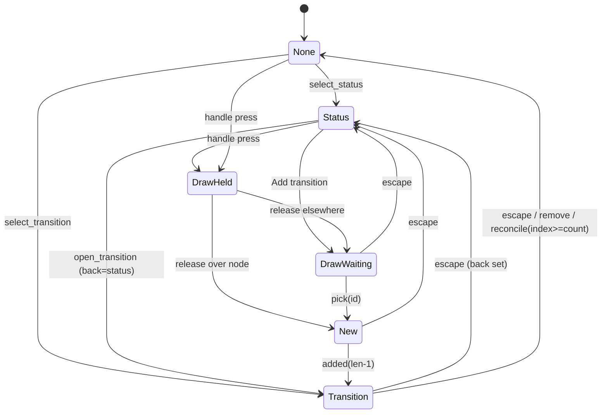

### What is good
The drawing sub-machine is owned by one set of methods: `begin_draw`, `draw_to`, `aim`, `release`, `pick`, `set_from`, `added`, `escape` (crates/shelbi-app/src/settings/workflow_builder.rs:279-376). Both clients call them; neither client hand-mutates `Selection`. The desktop's pointer gesture (desktop/src/views/workflow_builder.rs:174-259) is small. `on_mouse_up_out` (:791-797) clears `pressed_at` and `panning`, so the auditor's stale-press scenario does not hold.

### Verified concerns
1. **Positional identity (medium).** `Selection::Transition{index}`, `focus_transition` and the clients' `details`/`script` are bare indices into `workflow.transitions`.
   - On the desktop, `change()` (desktop/src/views/workflow_editor.rs:536-555) clears `details`/`script` on `RemoveTransition`/`RemoveStatus` but never touches `self.builder`. `set_mode` (:564-571) keeps the builder state.
   - When the Builder renders, `reconcile` keeps the selection if `index < count` (shelbi-app workflow_builder.rs:385).
   - Repro: select transition 1 of 4 in the Builder, switch to Form, remove transition 0, then switch back. The panel now shows the old transition 2.
   - Nothing is corrupted, because the panel always edits what it shows. But the selection's identity changed silently.
   - The TUI mostly self-heals, because `set_view` re-selects from the Form cursor (TUI builder.rs:344-351).
2. **focus_transition after a status removal (low).** `BAct::SelectStatus` (TUI builder.rs:419-423) doesn't clear `focus_transition`, unlike the mouse path (:819-821). After `x` removes that status and cascades its transitions, the ring sits on a different transition, and the next `x` deletes it (:655-662). The ring is visible, which limits the harm.
3. **Duplicated index-shift bookkeeping (low).**
   - The same "Remove* clears details/script" block exists in desktop workflow_editor.rs:539-545 and TUI workflow_editor.rs:918-928.
   - Builder deselection is done separately in desktop workflow_builder.rs:360-363 and TUI builder.rs:499-504.
   - A future index-shifting `Change` (for example a transition reorder) must update all of these.
4. **State mutated from render (low).** The desktop runs `reconcile_builder()` at the top of `render_builder` (desktop workflow_builder.rs:648-649). The TUI's `render_builder` flips `narrow`, the cursor and `panel_open` (TUI builder.rs:903-915). Neither is a live bug, but it is why stale indices get reconciled late and only loosely.

### Refuted
- **Stale `pressed_at`:** handled by `on_mouse_up_out`.
- **Stale `back_scroll`:** it is only applied when `back` was set, and it is recomputed at every point that sets `back`.
- **`begin_draw` setting `back` with no panel showing:** intended. Esc during a drawing returns to the source status.
- **TUI details drift:** every selection path ends in `builder_synced`.

### Recommendation (worth tidying)
Add one remap in shelbi-app, `BuilderState::transitions_changed(Removed(i) | RemovedStatus(..))`. It shifts or drops `Selection::Transition`, `focus_transition` and `back`. Drive it from the shared `EditorState::change` path, or have `change` return the edit, so both clients and both modes get it. Route the clients' `details`/`script` indices through the same helper.

Two smaller fixes go with it:
- Clear `focus_transition` in `select_status`.
- Move the desktop's reconcile out of render to the change, mode and discard sites.

Stable transition ids would be heavier and are not warranted unless transition reordering arrives.


### Verified concerns

- **medium**: Transition selection is positional. On the desktop a removal made in Form mode, or a status removal that cascades transitions, renumbers the transitions, and the Builder's Selection::Transition{index} then silently points at a different transition. reconcile only checks index < count.
  - Evidence: desktop/src/views/workflow_editor.rs:536-555: change() clears details/script on RemoveTransition/RemoveStatus but never touches self.builder. set_mode (:564-571) leaves builder.selection as is. render_builder -> reconcile_builder (desktop workflow_builder.rs:648-649) -> BuilderState::reconcile keeps Transition when `*index < count` (shelbi-app workflow_builder.rs:385). Repro: Builder, select transition 1 of 4. Switch to Form and remove transition 0. Switch back: the panel now shows the old transition 2. Edits stay consistent with what the panel shows, so nothing is corrupted, but the selection's identity changed silently.
- **low**: The TUI keyboard transition ring (focus_transition) survives a status removal that renumbers the transitions, so the ring and the next `x` press land on a different transition.
  - Evidence: BAct::SelectStatus (TUI builder.rs:419-423) does not clear focus_transition, while the mouse path does (:819-821). So the state Status(A) + focus_transition=Some(i) is reachable via `]`, Enter, then a panel status link. `x` removes status A (builder.rs:655-662, :491-498), and reconcile only bounds-checks focus_transition (shelbi-app :401-403). The ring is visible, so the user can see what a second `x` would delete.
- **low**: Index-shift bookkeeping is duplicated per client and per field rather than owned in one place. Each client clears details/script by hand on Remove*. Builder selection is either deselected (Builder path) or left to reconcile (Form path). Any future index-shifting Change (for example a MoveTransition) has to remember all of these.
  - Evidence: desktop workflow_editor.rs:539-545 and TUI workflow_editor.rs:918-928 duplicate the same clear. desktop remove_transition deselects (workflow_builder.rs:360-363). TUI BAct::RemoveTransition deselects and clears focus_transition (builder.rs:499-504). The Change enum is index-keyed throughout (shelbi-app workflow_editor.rs:395-431).
- **low**: The desktop reconciles builder state from inside render, and the TUI flips narrow/cursor/panel inside render_builder, so these state transitions happen at draw time instead of at the change site.
  - Evidence: desktop workflow_builder.rs:648-649 calls self.reconcile_builder() at the top of render_builder. TUI builder.rs:903-915 mutates builder.narrow, the cursor and panel_open while drawing. Neither is a live bug. It is why the stale-index case above only gets reconciled late and loosely.


### Concerns that did not hold up

- Stale pressed_at after a release outside the canvas: the canvas registers on_mouse_up_out, which calls released(None) (desktop workflow_builder.rs:791-797). released() evaluates pressed_at.take() before matching, so a release outside the canvas still clears it. A stale value needs a mouse-up the window never delivers, which a drag that began in the window does not produce in practice.
- back_scroll going stale when reconcile clears builder.back: step_back restores back_scroll only when builder.back was Some (`take().filter(|_| back)`, :423). keep_status_scroll recomputes it at every point that sets back (begin_draw via handle, start_transition, open_transition), so a stale value is never applied.
- begin_draw setting back with no panel showing: this is intended. Esc or ← during a drawing returns to the source status (doc at :276-278), and a drawing does show the New-transition inspector. The ':151-152' doc wording is merely loose.
- The TUI 'selected transition => details == Some(i)' invariant drifting: builder_act always ends in builder_synced (TUI builder.rs:509), the mouse paths call it explicitly (:822, :832), and change() calls it in Builder mode (TUI workflow_editor.rs:945-950). No path was found that changes the selection without re-syncing.
- TUI Form->Builder carrying a stale transition: set_view re-selects from the Form cursor when it is on a transition row (TUI builder.rs:344-351). After a Form removal the TUI usually self-heals. Only the `_ => {}` arm keeps a stale selection, so the clear case is the desktop.


**Recommendation:** Give BuilderState (in shelbi-app) one method, e.g. `transitions_changed(&mut self, ev: TransitionsEdit)` with `Removed(i)` and `RemovedStatus(id, removed_indices)`, that shifts or drops Selection::Transition, focus_transition and back. Call it from the shared EditorState::change path, or return the edit from it, so both clients get it regardless of mode. Have the clients' details/script indices go through the same remap instead of the duplicated `if matches!(RemoveTransition|RemoveStatus) { details = None }` blocks. Optionally clear focus_transition in select_status, and move the desktop's reconcile out of render_builder to the change, set_mode and discard sites. Stable transition ids would be the heavier alternative and are not warranted unless transition reordering is added.


## Global to in-repo project config migration

**Verdict:** Worth tidying. This is a one-shot command the user runs, and it recovers well from crashes. The only real race needs a daemon writing agent files during a gap of a few milliseconds. When it happens, the result is a both-exist state that needs a manual fix, not data loss. The wrong doc comment and the misleading 'restore the global YAML' error are cheap to fix.

**Verified concerns:** 1 medium, 2 low

**Key files:**
- `crates/shelbi-state/src/migrate.rs:160-330 (plan + apply)`
- `crates/shelbi-state/src/migrate.rs:340-470 (movers, load_project_for_migration)`
- `crates/shelbi-state/src/lib.rs:415-424 (config_project_dir mode switch)`
- `crates/shelbi-state/src/lib.rs:1229-1252 (load_project: local.yaml present means in-repo)`
- `crates/shelbi-cli/src/commands/project.rs:88-125 (run_migrate_to_in_repo)`

### What it is
`shelbi project migrate-to-in-repo` moves a project from the global layout to the in-repo split layout. Nothing on disk records which step the migration reached. Each run works it out from which files exist and parse, and `plan_in_repo_migration` (migrate.rs:184) produces an ordered list of `MigrationAction`s. `apply_migration_plan` (migrate.rs:302) then runs them in order. The command can be re-run safely after a failure.

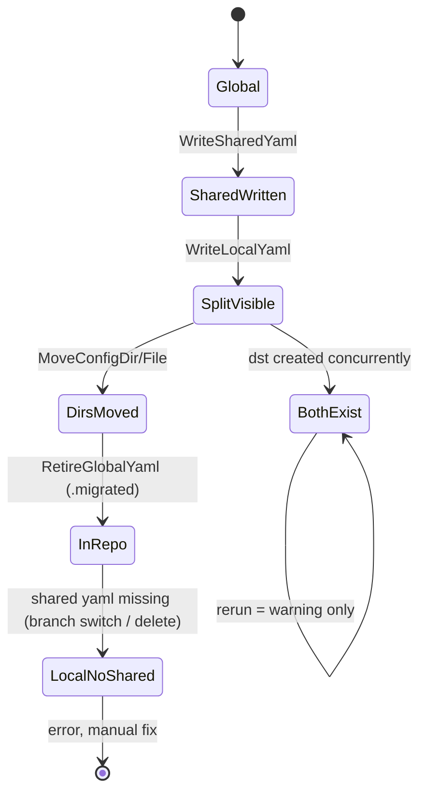

### How it recovers from crashes
- A YAML half counts as done only when it parses together with a freshly generated copy of the other half (migrate.rs:206-223).
- The global YAML is renamed to `.yaml.migrated`, never deleted.
- A cross-device directory move copies into a fixed-name temp sibling, then renames it into place. A leftover temp is deleted on the next run (migrate.rs:389).

### Verified concerns
- **No lock, and the daemon can write mid-migration (medium).** As soon as `local.yaml` exists, `load_project` (lib.rs:1237) and `config_project_dir` (lib.rs:415) treat the project as in-repo. `append_log` and `save_agent` (lib.rs:2956, 2854) run `ensure_dir(agents_dir)`, which creates `<repo>/.shelbi/agents/` and writes into it. If a daemon logs an agent line in the gap before the agents move, the rename fails on the now non-empty destination. Re-runs then only warn (migrate.rs:237), so the user has to fix it by hand. The CLI (project.rs:88-118) neither checks for a running hub nor takes a lock.
- **Doc comment drift (low).** migrate.rs:173-176 says a `local.yaml` with no shared half will be healed. migrate.rs:458-467 returns an error instead, telling the user to restore the global YAML, which the migration itself renamed to `.migrated` and nothing reads.
- **The both-exist state needs a manual fix (low).** The planner only warns, by design.

### Refuted
- Whether loaders see workflows moved but agents not is the wrong question: after WriteLocalYaml they see in-repo mode even before any dir has moved. The real risk is something writing into the destination during that gap.
- Losing the last loadable config: guarded by the parse checks and the rename-instead-of-delete.

### Recommendation
Worth tidying. Refuse to migrate while the hub is running, or hold a project lock during apply. Alternatively, move the config dirs before writing `local.yaml`, since that write is the point where other processes switch layouts (this ordering needs its own review). Fix the comment, and make the local-without-shared error point at `<name>.yaml.migrated`, or fall back to it.


### Verified concerns

- **medium**: No lock and no check for a running hub. Once WriteLocalYaml lands, every other process resolves `agents_dir` to `<repo>/.shelbi/agents/`. `append_log` and `save_agent` call `ensure_dir` on that path and write into it. If a running daemon logs an agent line in the gap before MoveConfigDir(agents), the move's rename onto a non-empty directory fails. The next run reports a both-exist warning, and only a manual fix gets out of it. In the same gap, agent `.md` files are also unreadable at the new path.
  - Evidence: migrate.rs:302-330 apply runs with no lock (it does not take lock_project_scaffold, lib.rs:1121). lib.rs:1237 treats local.yaml as meaning in-repo. lib.rs:415-424 config_project_dir follows config_mode. lib.rs:2956-2958 append_log does ensure_dir(agents_dir) then appends. project.rs:88-118 has no check for a running daemon.
- **low**: A doc comment promises a heal that the code refuses. The comment says a missing shared half is a half-migrated state the migration will heal, but load_project_for_migration returns an error for that state. The error tells the user to 'restore the global YAML', but the migration renamed it to `.yaml.migrated`, and nothing looks for that file.
  - Evidence: migrate.rs:173-176 comment vs migrate.rs:458-467 Err("cannot migrate from this half-broken state"). This state is reachable once the shared half is missing from the checkout, for example after switching to a branch without `.shelbi/project.yaml`.
- **low**: The both-exist state has no automatic way out. Re-running cannot finish the move, so the user has to reconcile the two copies by hand.
  - Evidence: migrate.rs:233-247 only push to warnings. The CLI prints them (project.rs:91-93), and is_noop may report 'Nothing to do'.


### Concerns that did not hold up

- Partway through, another loader sees workflows moved but agents not: this is the wrong framing. After WriteLocalYaml, other processes see in-repo mode even when neither dir has moved. Same-filesystem renames take microseconds, so the real risk is something writing into the destination during that gap (verified above), not a loader reading a mixed layout.
- An interrupted run destroys the last loadable config: refuted. YAML halves count as done only when they parse (migrate.rs:206-223), and RetireGlobalYaml renames instead of deleting.
- An interrupted cross-device copy leaves a half-copied destination: refuted. The copy goes to a fixed-name temp sibling and is renamed into place, and a leftover temp is deleted on the next run (migrate.rs:389-397).


**Recommendation:** 1. Check for a running hub before applying: refuse, or tell the user to stop it. Also take a per-project file lock during apply, and have loaders that write into config dirs respect it. A simpler option is to reorder so MoveConfigDir and MoveConfigFile run before WriteLocalYaml. This works because WriteLocalYaml is the point where other processes switch to the in-repo layout: until it lands, they keep resolving to the state dir, where the dirs then no longer exist. That reordering needs its own review of what readers see in the moment between steps. 2. Fix the comment at migrate.rs:173-176. In the local-without-shared case, either fall back to `<name>.yaml.migrated` as the source or name that file in the error. 3. Optionally, for a both-exist pair, have the planner suggest a merge step when the destination contains only files the daemon created (agent logs).


## Hub default-branch pre-commit guard

**Verdict:** Worth tidying. The state classification is already centralized in one module with explicit outcome enums, and the risky transitions (silent create, clobbering a foreign hook, deleting a foreign hook) are guarded correctly. What's left is drift and hygiene. The docs promise teardown removal that doesn't exist, the temp filename is fixed and can race, and shared or global core.hooksPath isn't handled. None of these is a live correctness bug in the common setup.

**Verified concerns:** 1 medium, 2 low

**Key files:**
- `crates/shelbi-orchestrator/src/githook.rs:35-271`
- `crates/shelbi-orchestrator/src/lib.rs:513-550`
- `crates/shelbi-cli/src/commands/guard.rs:31-140`
- `crates/shelbi-orchestrator/src/project_create.rs:898-921`
- `crates/shelbi-orchestrator/src/workspace.rs:5631-5703`

### What it is
The Shelbi-managed `pre-commit` hook in the hub checkout. It blocks commits on protected branches, but only from Shelbi-managed panes (`SHELBI_MANAGED_CONTEXT=1`, exported at lib.rs:1008 and workspace.rs:5640/5703).

### States and storage
- **Absent**: there is no `pre-commit` in the resolved hooks dir (`git rev-parse --git-path hooks`, which follows `core.hooksPath`).
- **Ours**: the file contains `HOOK_MARKER` (`# shelbi-managed: hub-default-branch-guard`).
- **Foreign**: the file exists without the marker, or can't be read.

No other consent record exists; the file's existence is the opt-in bit. The run-time arming is evaluated inside the script: the managed-context env var, then the bypass env var, then `git symbolic-ref` (a detached HEAD is always allowed).

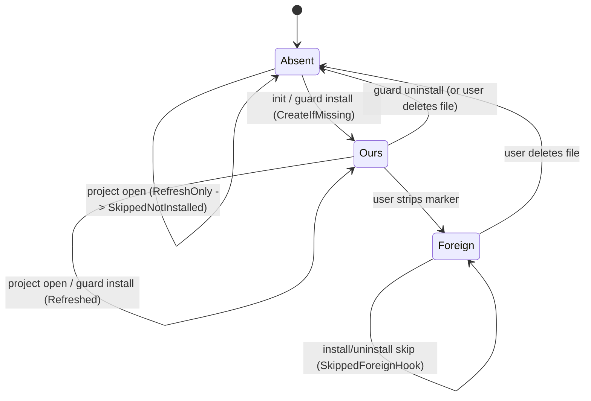

### Transitions (code)
- Create: `install_hub_branch_guard(.., CreateIfMissing)`, called from project_create.rs:911 (scaffold), guard.rs:65 (`guard install`, plus `install_at_init` for the `-y` wizard).
- Refresh: lib.rs:526-549 on every `ensure_dashboard`, with `RefreshOnly`.
- Remove: `uninstall_hub_branch_guard`, called only from guard.rs:41.
- Writes go through a temp file and a rename (githook.rs:232-244).

### Verified concerns
1. **Medium: the teardown promise is unimplemented.** githook.rs:44-45 and :254 say the hook is removed on project teardown, but uninstall's only caller is the `shelbi guard uninstall` CLI. No project-remove or teardown path exists in the CLI or the desktop app. This bears directly on the no-silent-git-hook trust commitment ("removable + clean up on teardown").
2. **Low: a shared or global `core.hooksPath` is not handled.** If several projects or repos resolve to the same hooks dir, every project open rewrites the protected-branch list (last writer wins), and uninstalling from one project removes the guard for all. CreateIfMissing can write into a user-global hooks dir. Messages at lib.rs:533 and guard.rs:105/118 hardcode `.git/hooks/pre-commit`.
3. **Low: the fixed temp name can race.** Concurrent install/refresh calls on the same dir share `.pre-commit.shelbi.tmp` (githook.rs:234). One writer can truncate the file while the other renames it into place, leaving a briefly partial hook, and the loser's chmod or rename fails with ENOENT, which shows up as a warning on project open. The refresh in lib.rs:526 runs before `spawn_orchestrator_locked`, so the project lock doesn't serialize it.

### Refuted
- "Consent only in file existence" is by design and correct. RefreshOnly never creates the file.
- Clobbering a foreign hook: unreadable hooks are treated as foreign on both paths. The read-to-rename TOCTOU window is negligible.
- Squash merges are not blocked: they commit on a detached HEAD, which the hook allows.

### Recommendation
This is worth tidying, not redesigning:
- Add one `hook_state()` classifier shared by install and uninstall.
- Use a unique temp name.
- Either wire a real teardown caller or remove the claim from the docs.
- Print the resolved hook path, and refuse or confirm CreateIfMissing when `core.hooksPath` points outside the repo.


### Verified concerns

- **medium**: The docs promise that Shelbi removes the hook on project teardown, but no teardown code calls the uninstall function. The hook stays until the user runs `shelbi guard uninstall` or deletes it, which is the 'nothing lingers' promise the trust-incident memory is about.
  - Evidence: githook.rs:44-45 says the hook is removed 'on project teardown so nothing lingers', and githook.rs:254 says it 'Backs ... the project-teardown cleanup'. The only callers of uninstall_hub_branch_guard are guard.rs:41 (CLI) and a guard.rs test. No project remove/teardown command exists in shelbi-cli or the desktop app.
- **low**: The hooks dir is resolved with `git rev-parse --git-path hooks`, which follows `core.hooksPath`, including a global one. If several repos or projects share that dir, each project open rewrites the hook with that project's protected-branch list (last opener wins). An uninstall from one project removes the guard for all of them, and CreateIfMissing can write into a user-global hooks dir. The status and warning messages also hardcode `.git/hooks/pre-commit`, which is wrong in that case.
  - Evidence: githook.rs:177-198 (hooks_dir follows core.hooksPath), githook.rs:211-245 (refresh rewrites protected list unconditionally), lib.rs:533 and guard.rs:105,118 print `{work_dir}/.git/hooks/pre-commit`
- **low**: Two install/refresh calls on the same hooks dir at once share the fixed temp name `.pre-commit.shelbi.tmp`. One writer can truncate the file while the other renames it into place, so `pre-commit` is briefly partial. The losing writer's set_permissions or rename then fails with ENOENT. The impact is bounded: on project open it degrades to a warning, the content is usually identical, and a short window of a truncated hook is the exact crash case the write-then-rename comment means to prevent.
  - Evidence: githook.rs:234-244 uses a fixed tmp path. lib.rs:526 runs the refresh before spawn_orchestrator_locked, so the project lock does not cover it.


### Concerns that did not hold up

- 'Consent is recorded nowhere except the file's existence' is true but not a bug. It is the deliberate design: RefreshOnly never creates the file, so a missing file means not opted in or uninstalled, and the user can opt out just by deleting the file. Recording consent elsewhere would create a second source of truth that could drift.
- A user-authored hook could be clobbered. The classify-then-write sequence has a TOCTOU window (a user writing their own hook between the read and the rename), but it is microseconds long on a local, human-paced action. An unreadable or non-UTF8 hook is treated as foreign on both the install and uninstall paths, so Shelbi never overwrites or deletes something it can't identify.
- Squash merges are blocked by the hook. They commit on a detached HEAD, where `git symbolic-ref` fails and the hook exits 0 (githook.rs:146).


**Recommendation:** Keep the file-presence encoding (it is the right single source of truth for consent) but tidy it:
1. Pull the classification into one `fn hook_state(path) -> HookState { Absent, Ours, Foreign }` that both install and uninstall use. Today each has its own slightly different match: uninstall uses the `exists()` guard arm and install doesn't.
2. Use a unique temp name (pid plus a random suffix, or tempfile::NamedTempFile in the same dir) so concurrent refreshes can't truncate each other.
3. Either implement a teardown caller or delete the "removed on project teardown" claims from githook.rs:44-45 and :254. The trust-incident memory says the hook should be cleaned up on teardown, so wiring a real caller is better if a project-remove flow is ever added.
4. Print the real resolved hook path instead of the hardcoded `.git/hooks/pre-commit`. When core.hooksPath points outside the repo, refuse CreateIfMissing (or warn and confirm) so Shelbi never writes into a hooks dir shared across repos.


## Project/user one-shot latches in state.json

**Verdict:** Worth tidying. Each latch is a small two- or three-state bool behind atomic, flock-guarded arm/claim helpers, and the tricky publication races are already handled. I found no high- or medium-severity bug. The verified issues are low impact: the greeting can be lost if the orchestrator dies before its first turn, the migration-hint reset is dead code with stale docs, the onboarded derivation is muddy, and only the TUI claims the first-run hint. They are worth a small cleanup, not a redesign.

**Verified concerns:** 5 low

**Key files:**
- `crates/shelbi-state/src/lib.rs:1636-1678, 1795-1835, 1966-2024, 2673-2695, 2729-2765`
- `crates/shelbi-state/src/orchestrator_setup.rs:83-105`
- `crates/shelbi-orchestrator/src/lib.rs:1040-1090`
- `crates/shelbi-state/src/agent_workspaces.rs:505-560`
- `crates/shelbi-orchestrator/src/project_create.rs:785-805, 1005-1025`

### What it is
Six separate one-shot or two-state bools persisted in `state.json`:

| Latch | File | Armed by | Consumed/cleared by |
|---|---|---|---|
| `contextual_greeting_pending` | per-project | `arm_contextual_greeting` in wizard.rs:608 / project_create.rs:792 (under `lock_dashboard`) | `claim_contextual_greeting` in orchestrator lib.rs:1061, before spawn |
| `first_run_seen` | global (missing field = `true`) | `arm_first_run_hint` (lib.rs:1987), only if first registration **and** the global file is missing | `claim_first_run_hint`, TUI sidebar.rs:1349 only |
| `zen_intro_seen` | global | n/a | `mark_zen_intro_seen` (lib.rs:1972) |
| `claude_md_migration_hinted` | per-project | set on first dispatch with leftover CLAUDE.md (agent_workspaces.rs:525) | reset only by `__zen-orch-start` (dead) |
| `orchestrator_onboarded` | per-project, plus derived | `mark_orchestrator_onboarded` (app onboarding.rs:152) | never cleared; read through the OR in orchestrator_setup.rs:87-97 |
| `open` | per-project | `ensure_dashboard` (orchestrator lib.rs:509) | `quit` (quit.rs:150, 187) only |

All mutations go through `update_state` / `update_global_state`, which take a sibling flock and skip unchanged writes, so arm and claim are atomic and exactly-once.

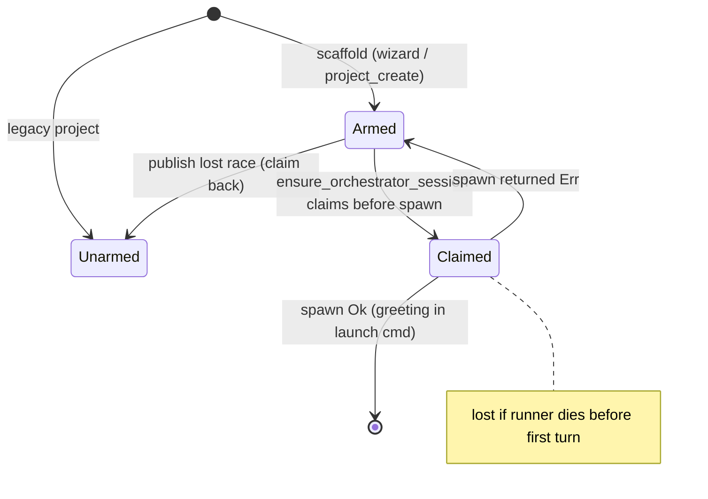

### Verified concerns
1. **Greeting consumed at spawn, not delivery** (low). See `crates/shelbi-orchestrator/src/lib.rs:1060-1087`. The re-arm happens only on spawn `Err`. A runner that crashes before its first turn loses the onboarding opener, and supervision restarts it without the greeting.
2. **Migration-hint reset is dead** (low). `reset_claude_md_migration_hint` is called only from `zen_lifecycle.rs:59` (`__zen-orch-start`), and nothing invokes that subcommand. The hint fires once per project ever. The docs at `lib.rs:1636-1645` and `agent_workspaces.rs:511-514, 548-554` are stale.
3. **"Onboarded" is an OR of four signals plus a fail-open** (low). `orchestrator_setup.rs:87-97` ORs the marker, `open`, the deployed instructions file, and the legacy CLAUDE.md, and treats a read error as onboarded. That makes `open` carry two meanings.
4. **`open` never self-heals** (low, design question). Only an explicit quit clears it (`quit.rs:150,187`). After a crash or reboot the daemon's open set (`list_open_projects`, lib.rs:2753) keeps the pollers alive. This is intentional for supervision, but nothing reconciles it.
5. **First-run hint is TUI-only** (low, parity). `crates/shelbi-app` never claims `first_run_seen`.

### Refuted
- The write-order fragility of `first_run_seen` does not hold in practice. Every global-state writer runs inside a project UI, and the "file exists means do not arm" check is an intentional guard.
- Arm/claim races do not hold: the flock plus `lock_dashboard` plus the claim-back on a lost publish cover them.

### Recommendation
Keep these as bools, since they are independent latches. Fix or remove the dead migration-hint reset and its docs. Consider claiming the greeting at first-turn delivery, or re-arming it on early orchestrator exit. Persist `orchestrator_onboarded` lazily so the OR derivation collapses to one stored bool. Decide what the desktop does with `first_run_seen`, and decide whether a stale `open` flag should be reconciled.


### Verified concerns

- **low**: The contextual greeting is consumed when spawn_orchestrator_session returns Ok, not when the runner's first turn actually receives it. If the orchestrator dies before its first turn (auth failure, runner crash, killed pane), supervision restarts it without the greeting, and the new project's onboarding opener is lost for good.
  - Evidence: crates/shelbi-orchestrator/src/lib.rs:1060-1087: claim happens before spawn, the greeting is baked into the launch command via first_launch_repo (lib.rs:820-828), and re-arm happens only in the `if let Err(error) = b.spawn_orchestrator_session(spec)` branch.
- **low**: The per-session reset of claude_md_migration_hinted is dead. Its only caller is the `__zen-orch-start` subcommand, and nothing in the repo invokes that subcommand any more. The hint therefore fires once per project ever, not once per orchestrator session, and the field docs and fn docs now describe behavior that does not happen.
  - Evidence: agent_workspaces.rs:548-560 (doc says 'Called from __zen-orch-start'); zen_lifecycle.rs:59 is the only caller; grep of the repo for 'orch-start' finds only the clap definition (main.rs:364-365, 570), comments, and poller.rs:349, which is a comment.
- **low**: 'Onboarded' is not stored state. It is an OR of the marker bool, the `open` flag, two file probes (the deployed instructions file and the legacy CLAUDE.md), and a fail-open on unreadable state. Each consumer has to trust this derivation, and the meaning of `open` is now overloaded (daemon poller set plus onboarding proof).
  - Evidence: crates/shelbi-state/src/orchestrator_setup.rs:83-97
- **low**: `open` is an intent flag that only an explicit quit clears. After a crash, reboot, or desktop window close without quit, the project stays in list_open_projects, so the daemon keeps its pollers and the idle exit is held off until someone runs quit. This is deliberate (so supervision can restart a dead orchestrator), but nothing reconciles a stale Open.
  - Evidence: lib.rs:1667-1678 doc; the only Open->Closed writers are quit.rs:150 and quit.rs:187; list_open_projects lib.rs:2753+ feeds the daemon idle-exit and poller manager.
- **low**: TUI/desktop parity: only the TUI sidebar claims first_run_seen. A desktop-only user's armed latch never fires. If they open the TUI later, it shows the 'first run' hint late.
  - Evidence: The only production claimer is claim_first_run_hint at crates/shelbi-tui/src/shell/sidebar.rs:1349; there are no references in crates/shelbi-app.


### Concerns that did not hold up

- 'first_run_seen arming depends on write order, and an earlier global write (sidebar width, zen intro) permanently prevents arming': the only global-state writers (set_sidebar_width, toggle_sidebar_machine_collapsed, mark_zen_intro_seen, claim_first_run_hint) all run inside a project UI, so in practice the file cannot exist before the first project is registered. Refusing to arm when the file exists is a deliberate second guard (lib.rs:1980-1986) that stops a re-scaffold from turning onboarding back on. The real gap is the desktop parity issue listed above, not the ordering.
- Races between arm and claim: every arm/claim runs inside update_state/update_global_state under a sibling flock (lib.rs:2663-2672, 1959-1969). Greeting arming is also serialized with dashboard launch by lock_dashboard (wizard.rs:593, project_create.rs:784), and a losing publisher claims the greeting back (project_create.rs:796-799). Claims are exactly-once.
- 'Unreadable state counting as onboarded' is a bug: this fail-open is intentional and documented (orchestrator_setup.rs:83-86), so a corrupt state.json never sends an existing project back through onboarding.


**Recommendation:** Keep the bools, since a single enum would be overkill for independent one-shot latches. Tidy four things: (1) Either restore the migration-hint reset at orchestrator spawn (ensure_orchestrator_session) or drop the reset and the per-session wording and call it once per project; also delete or unhide the orphaned `__zen-orch-start` path. (2) Move the greeting claim to delivery, for example have the orchestrator's launch wrapper claim it when the runner starts its first turn, or re-arm when the orchestrator exits before a first-turn marker. (3) Make orchestrator_onboarded write the marker lazily the first time any implicit signal is seen, so the derivation shrinks to one stored bool over time and `open` stops doing double duty. (4) Decide whether the desktop should claim or clear first_run_seen, and add a stale-open reconcile (for example, clear open when no orchestrator has been seen alive for N minutes and no client is attached) or explicitly document that open=true after a crash is intended.


## Config-upgrade finding lifecycle

**Verdict:** Worth tidying. The real state is derived from file content every time and is correct. The orchestrator channel is live detection plus events.log, and it holds up. The leftover hub-global snapshot file is written, clobbered, and deleted by single-project passes, but nothing reads it, and its doc comments (config_upgrade.rs:30, :55) say the opposite. That invites a future reader to depend on a broken channel. The unlocked heal write is a narrow, low-probability lost-update risk, not a demonstrated bug.

**Verified concerns:** 2 low

**Key files:**
- `crates/shelbi-cli/src/commands/config_upgrade.rs:49-58, 141-170, 247-350`
- `crates/shelbi-cli/src/commands/config_upgrade_apply.rs:120-185, 283-300, 1215-1222`
- `crates/shelbi-cli/src/commands/config.rs:217-297`
- `crates/shelbi-cli/src/commands/reload.rs:82-92`
- `crates/shelbi-state/src/default_orchestrator.md.template:311-323, 583-590`

### What it is
A config deprecation finding has no stored lifecycle. Each call runs `detect()` (config_upgrade.rs:195-226), which sniffs every live Shelbi-owned config surface and classifies each hit as `AutoHeal` or `NeedsJudgment`. Each finding gets a content-hash id (`finding_id`, config_upgrade.rs:2941). "Where a finding is" is therefore a pure function of the files on disk. That part is sound.

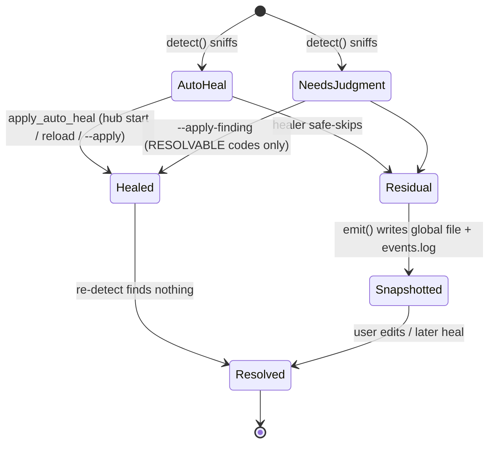

### Transitions
- **Hub start**: serve.rs:255 calls `run_startup_pass`, which runs `run_and_emit(all projects)`: detect, apply, re-detect, then `emit`.
- **`shelbi reload`**: reload.rs:91 calls `run_for_project`, which runs `run_and_emit([one project])` with the same steps, scoped to one project plus the global surfaces.
- **`shelbi config upgrade --apply`**: config.rs:269-286 detects, applies, and re-detects. It never calls `emit`.
- **`--apply-finding <id>`**: config_upgrade_apply.rs:139-185 re-detects fresh and matches the id. It promotes the finding to AutoHeal only for `RESOLVABLE_NEEDS_JUDGMENT` (currently only `ZEN_DANGER_PATHS_CONFLICT`). It never calls `emit`.
- **Surfacing**: the orchestrator runs `shelbi config upgrade --needs-judgment --format json` at bootstrap (default_orchestrator.md.template:317). That command detects **live** (config.rs:248-266). Mid-session, the orchestrator reacts to `project=<you> config-upgrade needs_judgment=N` lines on events.log.

### Verified concerns
1. **Vestigial, misdocumented snapshot file (low).** `emit()` writes or removes the hub-global `~/.shelbi/config-upgrade-findings.json` (config_upgrade.rs:322-337). A single-project reload therefore clobbers or deletes other projects' entries. The auditor was right about the mechanics, but the only reader is `#[cfg(test)] load_findings` (config_upgrade.rs:144-171). The module docs at config_upgrade.rs:30 and :55 still say the orchestrator ingests the file at boot. The real channel is live detection. The snapshot is dead weight that contradicts its own documentation, and a future feature (desktop or TUI badge, `status` output) could plausibly start reading it and inherit the clobbering.
2. **Unlocked heal read-modify-write (low).** For example, `heal_registration` (config_upgrade_apply.rs:283-297) reads the file, rewrites it, and calls `write_atomic` (config_upgrade_apply.rs:1217-1222, fixed tmp name `.<file>.configupgrade.tmp`). The daemon's SaveConfig path serializes only in-process (control.rs:797-799) and uses check-then-write (`WriteError::Changed`, config_write.rs:289-324). That check catches a heal that finished before the save was planned. It does not catch a save that lands inside the heal's read-to-rename window, so the heal overwrites the save without detection. The window is tiny, and the hub-start heal precedes client serving. The realistic exposure is `shelbi reload` or a manual `config upgrade --apply` while the desktop Settings view is saving.

### Refuted
- "`--apply-finding` leaves stale entries in the snapshot": true but harmless, because nothing reads the snapshot. config.rs:248-258 documents a deliberate move to live detection, not a workaround.
- "A reload hides other projects' findings from their orchestrators": orchestrators never read the file.

### Recommendation
Delete the snapshot file, or make it per-project under `~/.shelbi/projects/<name>/`. Make events.log plus live `detect()` the documented channel and fix the module docs. Optionally, give heals the same check-then-write that `config_write` uses, by comparing the on-disk text to what was read just before the rename, or route them through `config_write::apply`. Also use a unique temp name.


### Verified concerns

- **low**: The hub-global snapshot file is a vestigial channel. Its docs say the orchestrator ingests it at boot, but nothing in production reads it. A single-project reload also overwrites or deletes it with only that project's view, so its contents are not reliable even for a human reading it.
  - Evidence: config_upgrade.rs:30 and :55 say the orchestrator ingests FINDINGS_FILE at boot, but load_findings is #[cfg(test)] (config_upgrade.rs:144-171). A repo-wide grep finds no other reader of config-upgrade-findings.json or findings_path. The orchestrator template (default_orchestrator.md.template:317) runs `shelbi config upgrade --needs-judgment`, which calls detect() live (config.rs:259-266). reload.rs:91 calls run_for_project, which runs run_and_emit(&[one project]) and then emit(), and emit() removes or overwrites the single global file (config_upgrade.rs:322-337).
- **low**: Auto-heal does an unlocked read-modify-write of the config file. A desktop or TUI SaveConfig that lands between the heal's read and its rename is silently overwritten. SaveConfig's compare-and-swap catches a heal that happened before the save, but not a save that happens during a heal. Concurrent CLI heals also share one fixed temp file name.
  - Evidence: heal_registration (config_upgrade_apply.rs:283-297) does read_to_string, then rewrite, then write_atomic, with no lock and no base check. write_atomic uses the fixed tmp name `.<name>.configupgrade.tmp` (config_upgrade_apply.rs:1217-1222). SaveConfig serializes only inside the daemon, through state.issue_lock(project, "config:<surface>") (daemon/control.rs:797-799), and relies on config_write::apply's check-then-write (WriteError::Changed, config_write.rs:289-324). The window is milliseconds, and the hub-start heal runs before the daemon serves clients.


### Concerns that did not hold up

- `--apply-finding` and `--apply` leave the snapshot listing resolved findings: true of the file, but it has no impact. Nothing reads the snapshot. The orchestrator and `--needs-judgment` both detect live (config.rs:248-266), and apply_single_finding re-detects before matching the id (config_upgrade_apply.rs:139-146). It is not a workaround for a live channel. The channel was moved to live detection on purpose.
- A reload of a clean project hiding other projects' findings from their orchestrators: refuted for the same reason. Each orchestrator reads live at bootstrap and on its own `project=<you> config-upgrade` events.log line. It never reads the shared file.


**Recommendation:** Remove the snapshot file and keep events.log plus live detect() as the only channel: delete the FINDINGS_FILE write and remove from emit(), drop load_findings, and fix the module docs. If a persisted record is wanted, key it per project (`~/.shelbi/projects/<name>/config-upgrade-findings.json`) so a single-project pass can only touch its own entry. Optionally, close the lost-update window by having write_atomic check that the file still matches the text the heal read before the rename (the same check-then-write config_write uses), or by routing heals through config_write::apply. Give the temp file a unique name (pid or random suffix).


## Default agent provenance and divergence notice latch

**Verdict:** Fine as is. The states are captured by an explicit enum and one pure classifier. Every mutation runs inside one locked update_state in self_heal_bundled_agents, and the badge and CLI reuse the same classifier. The verified issues are a docstring that overstates the latch's precision, a missing latch-clear in materialize, and an unused first_notice field. Together they affect only whether one informational CLI line uses its long or short wording. None is a correctness risk.

**Verified concerns:** 3 low

**Key files:**
- `crates/shelbi-state/src/agent_workspaces.rs:624-730 (content_hash, AgentDivergence, classify_agent_divergence, agent_divergence)`
- `crates/shelbi-state/src/agent_workspaces.rs:761-1043 (AgentMaterializeOutcome, materialize_default_agents, self_heal_bundled_agents)`
- `crates/shelbi-state/src/lib.rs:1612-1635 (notified_diverged_agents, deployed_agent_defaults)`
- `crates/shelbi-orchestrator/src/project_create.rs:862-896 (the only consumer of first_notice)`
- `crates/shelbi-state/src/agents_config.rs:758-777 (Provenance badge reuses classify_agent_divergence)`

### Entity
Each shipped default agent's `agents/<name>/instructions.md` (orchestrator, developer, review, qa, security, adversarial).

### How state is stored
- **`State::deployed_agent_defaults`** (`crates/shelbi-state/src/lib.rs:1620-1635`) maps an agent name to the FNV-1a hash of the bundled body last written to disk. This is the provenance record.
- **`State::notified_diverged_agents`** (`lib.rs:1612-1619`) is a set of agent names whose customization has already been announced. This is the notice latch.
- The on-disk bytes are the third input.
- `AgentDivergence` (`agent_workspaces.rs:649-667`) is an explicit enum computed by the pure fn `classify_agent_divergence` (683-697): compiled-default match wins, then a provenance-hash match means PristineStale, and anything else is Customized.

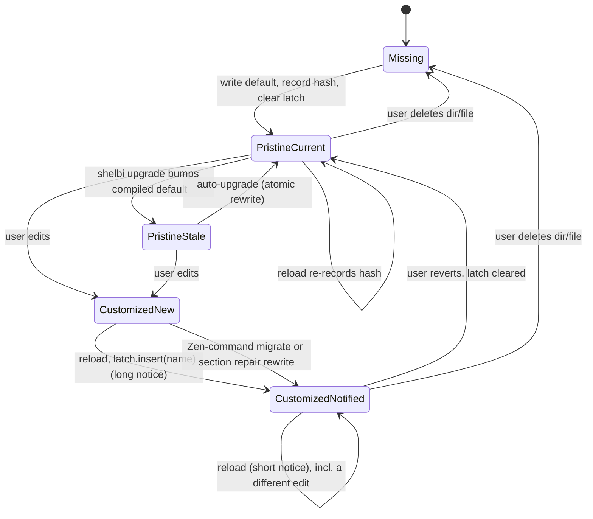

### Transition owners
- `self_heal_bundled_agents` (`agent_workspaces.rs:882-1043`) is the main owner. It runs inside one `update_state` lock and uses `atomic_write` for every rewrite. Callers: `shelbi reload` (reload.rs:136-140), `shelbi init` (init.rs:747), and the wizard (wizard.rs:570).
- `materialize_default_agents` (815-849) only creates missing dirs and records their hash. It does not touch the latch.
- Read-only consumers: `agent_divergence` (CLI `agent list`, 706-730) and `AgentsConfig::provenance` (agents_config.rs:758-777, Settings Agents badge in the TUI and desktop). Both call the same classifier.
- The latch's only effect is in `render_agent_materialize_outcome` (project_create.rs:874-885), where it picks between a long and a short "preserved" line. That line prints on every pass either way.

### Verified concerns (all low)
1. **The latch is keyed by name, not content** (agent_workspaces.rs:1007-1009). A second, different customization keeps the short wording. The fn docstring (861-864) says "the first time the current divergent content is seen". The field doc in lib.rs states the real per-episode behavior.
2. **`materialize_default_agents` does not clear the latch** on create (837-845), unlike self-heal (904, 948). In practice the next self-heal sees PristineCurrent and clears it, and the wizard runs self-heal right after materialize.
3. **`first_notice` is unused** on `MigratedZenCommands` and `RepairedRequiredSections` (project_create.rs:887-894).

### Refuted
- The Provenance badge is not a re-implementation. It reuses `classify_agent_divergence` with the same state map and adds manifest and skills checks.
- The changelog template (PRIOR_CHANGELOG_TEMPLATES byte-compare) and the shared preamble (existence-only) are different artifacts with their own documented policies. Unifying them is a design question, not drift in this machine.
- No lost-update race: all bookkeeping runs under the `update_state` lock. Crash truncation is guarded by `atomic_write`.

### Recommendation
Fine as-is. Optional tidies:
- Fix the docstring at 861-864.
- Add `notified_diverged_agents.remove` in materialize.
- Drop or use `first_notice` on the rewrite variants.

If per-content notices ever matter, change the latch to `BTreeMap<name, divergent_hash>`.


### Verified concerns

- **low**: The latch is keyed by agent name, not content. Once a prompt is customized, a later different customization never gets the 'first notice' wording again until the file returns to pristine. The self_heal_default_agents docstring says the notice fires 'the first time the current divergent content is seen', which overstates it. The State field doc (lib.rs:1612-1618, 're-aligning with the default clears the agent's entry so a future edit re-notifies') describes the real behavior.
  - Evidence: agent_workspaces.rs:1007-1009 `state.notified_diverged_agents.insert(agent.name.to_string())`, with no content hash stored. Docstring at agent_workspaces.rs:861-864. Impact is cosmetic: project_create.rs:874-885 prints a 'preserved' line on EVERY pass, and the latch only switches between a long and a short wording.
- **low**: materialize_default_agents records provenance for recreated agents but does not clear notified_diverged_agents, unlike every self-heal create path. A stale latch can survive a recreate.
  - Evidence: agent_workspaces.rs:837-845 inserts into deployed_agent_defaults only. Self-heal clears the latch at 904 and 948. The stale latch only matters if the user customizes the recreated file before any reload or init self-heal pass sees it as PristineCurrent. wizard.rs:565-570 runs self_heal right after materialize, which clears it. The only effect is the shorter notice wording.
- **low**: first_notice is computed for MigratedZenCommands and RepairedRequiredSections but ignored by the renderer. Repairs and migrations announce themselves on every pass that rewrites the file. That is arguably correct because the file changed, but the field is dead.
  - Evidence: project_create.rs:887-894 matches `{ agent, .. }` and `{ agent, sections, .. }`, discarding first_notice.


### Concerns that did not hold up

- 'The AgentsConfig Provenance badge re-implements provenance separately': refuted. agents_config.rs:762-766 calls crate::classify_agent_divergence with the same deployed_agent_defaults map (read at agents_config.rs:597-599). On top of that it also requires the manifest and skills to match the shipped ones, a deliberate superset rather than a drifted copy. The CLI `agent list` marker goes through the same agent_divergence/classify path.
- 'The provenance pattern drifts across changelog (PRIOR_CHANGELOG_TEMPLATES byte-compare) and shared preamble (existence-only)': these are separate artifacts with separate, documented upgrade policies (changelog.rs:49, 83-90), not the same machine with drifted transition logic. Whether all shipped-default files should share one provenance mechanism is a reasonable design question, but it is not a defect in this machine.
- Race / lost update: self-heal runs the whole classify+write+bookkeeping inside one update_state lock (agent_workspaces.rs:886-890), and materialize does its single state write under the same lock. No cross-process lost-update risk on these keys was found.
- Crash leaving a truncated file misread as Customized: guarded. All rewrites use atomic_write (tmp + rename), per the F8 comment at agent_workspaces.rs:933-938.


**Recommendation:** Leave the structure alone. Optional one-line tidies: (1) change the self_heal_default_agents docstring (agent_workspaces.rs:861-864) to say the notice fires once per divergence episode, keyed by agent name and reset when the file returns to pristine, matching lib.rs:1612-1618. (2) Add `state.notified_diverged_agents.remove(agent.name)` in materialize_default_agents' update_state block (agent_workspaces.rs:839-844) so every create path behaves the same. (3) Either drop first_notice from the Migrated/Repaired variants or use it in the renderer. If per-content notices are ever wanted, store the hash of the divergent content in place of the bare name (BTreeMap<name, hash>). A codebase-wide 'shipped default provenance' helper covering the changelog template and preamble is a separate design conversation, not a fix for this machine.
