# Implicit state machines: daemon/process

Part of the [implicit state machine audit](../implicit-state-machines.md). Audit of origin/main at b93c57c4, 2026-11-05. 15 machines in this area, most pressing first.


## Daemon lost-login-session detection and recovery

**Verdict:** Needs further thought. The recovery path, which is the point of the feature, very likely fails in practice. The successor loses the non-blocking bind flock while the old daemon drains for up to 3s. The documented GaveUp escalation is dead code in production. The state is spread across three representations written best-effort, so they can disagree in ways that are hard to see.

**Verified concerns:** 1 high, 2 medium, 2 low

**Key files:**
- `crates/shelbi-cli/src/commands/daemon/session_health.rs:127-195 (on_lost/on_recovered), 309-354 (startup seed + loop)`
- `crates/shelbi-core/src/session_health.rs:115-171 (SessionHealthTracker)`
- `crates/shelbi-state/src/session_lost.rs:27-103 (RecoveryState + marker IO)`
- `crates/shelbi-cli/src/commands/daemon/serve.rs:227-260, 506-560, 714-737 (bind flock, drain, teardown)`
- `crates/shelbi-orchestrator/src/session_guard.rs:1-36 (spawn gate)`

### What it is

On macOS, the hub daemon runs a background monitor that checks whether it still lives in a GUI (Aqua) login session. If it loses the session (because the user logged out and back in), every agent it spawns gets a broken environment: no DNS, no user lookups, and a stale SSH agent. The monitor debounces the signal, blocks spawning, writes a marker that the TUI, desktop app, `shelbi status` and `shelbi doctor` show as a banner, and tries to recover by re-execing itself via `launchctl asuser <uid> <exe> daemon`.

### How the state is stored

| Piece | Where | Lifetime |
|---|---|---|
| `SessionHealthTracker {consecutive_lost, declared_lost}` | `crates/shelbi-core/src/session_health.rs:115-171` | in memory, one daemon |
| `daemon-session-lost.json {reason, detected_at, recovery: not-attempted\|attempted\|gave-up}` | `crates/shelbi-state/src/session_lost.rs:27-103` | durable, carries across daemon generations |
| `SPAWN_BLOCKED: AtomicBool` | `crates/shelbi-orchestrator/src/session_guard.rs:19-36` | in memory, one daemon |
| `daemon session-lost / session-recovery-* / session-recovered` events | events.log | append-only |

Every marker write and the clear are best-effort (`let _ =`).

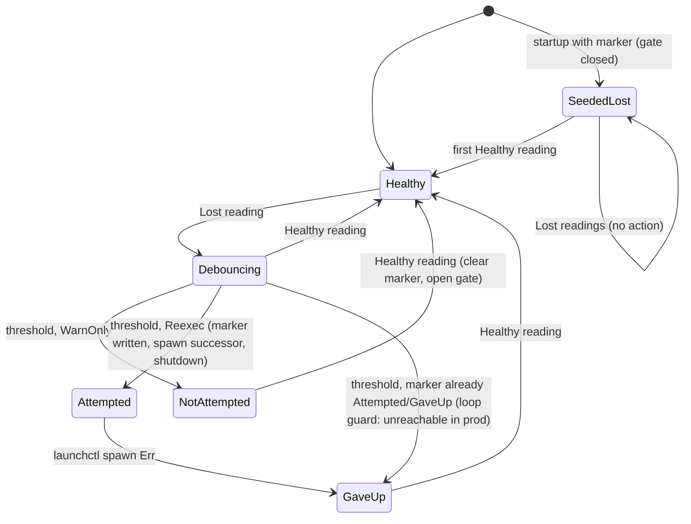

### Transitions (code)
- Debounce: `observe` at core `session_health.rs:149-170`. `BecameLost` fires once, at the threshold.
- `on_lost`, cli `daemon/session_health.rs:136-188`: logs the event and calls `block_spawning`. If the marker already says Attempted or GaveUp, it writes GaveUp (the loop guard). In WarnOnly mode it writes NotAttempted. In Reexec mode it writes Attempted, then calls `reexec_in_gui_session` and then `shutdown()`; if the spawn fails it writes GaveUp.
- `on_recovered`, `:190-194`: calls `allow_spawning` and clears the marker.
- Startup, `:319-327`: if any marker exists, it calls `block_spawning` and `seed_declared_lost`.

### Verified concerns

1. **The re-exec loses the bind-lock race (high).** The successor is spawned at `:169`, before the old daemon has stopped. The old daemon keeps `_bind_lock` (`serve.rs:247`) until `run_foreground` returns. That happens only after the accept loop exits and the drain waits up to 3s for live clients (`serve.rs:147, 553-556`). Attached TUIs count as live clients. The successor's `acquire_bind_lock` is `LOCK_EX|LOCK_NB` and exits at once with "another shelbi daemon holds…" (`serve.rs:726-734`). Likely outcome: no daemon runs and the marker is stuck at Attempted. The next client then auto-starts a daemon from its own session context, which may also be orphaned. No test covers a real successor.
2. **The GaveUp escalation is dead in production (medium).** `RecoveryState::Attempted`'s doc (`session_lost.rs:33-35`) promises a successor that is still lost will escalate. But the successor seeds `declared_lost` (`:326`), so `observe` returns `None` for every Lost reading (core `:162-167`), and `on_lost` never runs. The marker stays `attempted` forever and no `session-recovery-gave-up` event is logged. The loop-guard test (`:569-595`) uses an unseeded tracker, so it passes without matching production.
3. **Three representations, no owner, best-effort writes (medium).** A failed Attempted write means the successor is not seeded and can re-exec again. A failed clear leaves the banner up while spawning is allowed. The next start then blocks spawns again.
4. **A stale marker blocks spawns after reopen (low).** The banner says "`shelbi quit` and reopen". The fresh daemon closes the gate, then sleeps the full 30s `CHECK_INTERVAL` before its first probe, and dispatches in that window are refused (`orchestrator workspace.rs:3012`). The module doc's "cleared on … a clean reopen" (`session_lost.rs:7`) isn't implemented.
5. **The marker can outlive the monitor (low).** With `SHELBI_DISABLE_SESSION_HEALTH` set or a non-default root, the monitor never runs (`:295-312`), so an existing marker is never cleared. Startup seeding also ignores the marker's `recovery` value, so a NotAttempted marker from a WarnOnly daemon stops a Reexec-mode daemon from ever trying recovery.

### Refuted
- Cross-OS marker sync: not realistic, since the marker sits under the local root.
- Desktop/TUI banner parity: both render `session_lost` (`desktop/src/app.rs:5523`, `shell/mod.rs:5766`).
- Re-exec loop: impossible, though only because of the seeding.

### Recommendation
- **Fix the handoff.** Either release the listener and flock before spawning the successor, or give the successor a bounded retry or `--takeover` wait on the lock. Add an integration-style test that spawns a real successor.
- **Give the lifecycle one owner.** Fold the three pieces into a single `SessionLostState` plus one `apply(event)` that writes the marker, flips the gate and logs the event together.
- **Make startup reconcile read the marker's `RecoveryState`.** A seeded Attempted marker should escalate to GaveUp on the first confirmed still-lost reading, instead of staying silent.
- **Probe immediately at startup when a marker exists.**


### Verified concerns

- **high**: The re-exec recovery races its own predecessor for the bind lock. The fresh daemon is spawned before the old one has released hub.sock.lock, and acquire_bind_lock is non-blocking, so the successor usually exits at once. The result is no daemon (until some client auto-starts one from whatever session it is in) and a marker stuck at Attempted.
  - Evidence: daemon/session_health.rs:169-176 spawns `launchctl asuser <uid> <exe> daemon` and only then calls shutdown(), which sets stop and self-connects. The old daemon keeps `_bind_lock` until run_foreground returns (serve.rs:247, 351-362). That happens only after serve() has left the accept loop and waited up to SHUTDOWN_DRAIN_TIMEOUT=3s for live clients (serve.rs:147, 553-556). A TUI subscriber connection is a live client. The successor's acquire_bind_lock uses LOCK_EX|LOCK_NB and returns an error immediately (serve.rs:726-734). No test drives a real successor.
- **medium**: The documented Attempted->GaveUp escalation is unreachable in production. A successor daemon that finds an Attempted marker seeds the tracker as declared_lost, so further Lost readings never produce BecameLost and on_lost (the only GaveUp writer) never runs. The marker stays Attempted forever and `session-recovery-gave-up` is never logged. No loop happens, but only because of the seeding, not the guard. The loop-guard test uses an unseeded tracker, which production never builds.
  - Evidence: session_lost.rs:33-35 documents the escalation. daemon/session_health.rs:324-327 seeds when any marker exists. core session_health.rs:162-167 returns None once declared_lost. The test a_pre_existing_attempt_marker_is_not_re_execed (daemon/session_health.rs:569-595) uses SessionHealthTracker::new(1) with no seed.
- **medium**: One lifecycle is split across three independently written representations with no owner. The tracker's declared_lost, the on-disk RecoveryState and the SPAWN_BLOCKED gate are each updated by separate calls, and every marker write and clear is best-effort. A failed Attempted write leaves the successor unseeded and able to re-exec again. A failed clear on recovery leaves the banner up while the gate is open. The next daemon start then re-seeds lost and blocks spawns until its first tick.
  - Evidence: daemon/session_health.rs:137-138, 147, 157, 165, 179, 191-192 all use `let _ =`. block_spawning is called at :138 and again at :325, separately from the marker.
- **low**: A stale marker blocks spawns for up to one full check interval after a clean reopen, and nothing else clears it. The banner tells the user to `shelbi quit` and reopen, but the new daemon sees the marker, closes the spawn gate, and sleeps the full 30s before its first probe. Dispatches in that window are refused. The module doc says the marker is cleared on 'a clean reopen', but on_recovered is the only code that clears it.
  - Evidence: session_lost.rs:7-8 (doc), daemon/session_health.rs:324-326 (seed + block), :343-347 (sleep before the first tick), :217 (CHECK_INTERVAL 30s), orchestrator workspace.rs:3012 (spawn refused while blocked).
- **low**: The marker can outlive the monitor that would clear it. With SHELBI_DISABLE_SESSION_HEALTH set, or under a non-default root, the monitor never spawns, so an existing marker is never cleared and the banner stays up indefinitely. A NotAttempted marker left by a WarnOnly daemon also makes a later Reexec-mode daemon seed lost and never attempt recovery.
  - Evidence: daemon/session_health.rs:295-312 returns before the seed/clear logic. The seed at :324-327 ignores the marker's recovery value.


### Concerns that did not hold up

- A marker synced to another OS never clears: the marker lives under the local shelbi root, and it is written only by the macOS daemon, so there is no realistic sync path. The real stuck-marker case is the disabled/non-default-root case above.
- TUI/desktop parity drift for the banner: desktop renders model.session_lost as a red notice (desktop/src/app.rs:5523), as documented in desktop/docs/parity.md:416. Both read the same sidebar_model field (shelbi-orchestrator sidebar_model.rs:53).
- Re-exec loop risk: the seeding makes a loop impossible, even though the loop guard itself is dead code.


**Recommendation:** Make the successor handshake explicit. Either have the old daemon release the bind lock (drop the listener and lock) before spawning, or have the re-exec'd daemon retry acquire_bind_lock with a bounded wait (for example a `--takeover` flag that polls for about 5s). Add a test that drives a real successor. Put the lifecycle behind one owner: a small `SessionLostState` enum {Healthy, Debouncing(n), Lost{recovery}} plus one transition function that does the marker write, the gate flip and the event together, and that takes the marker's RecoveryState into account at startup. For example, seeding from an Attempted marker should mean that the first still-lost reading after a grace period escalates to GaveUp, instead of treating seeded as already reported. Do the first probe at startup when a marker exists, rather than sleeping a full interval with spawns blocked. Fix the module doc's 'clean reopen' claim, or implement that clear.


## Hub daemon process lifecycle and liveness probing

**Verdict:** Needs further thought. The drain covers only the hub socket. Shutdown paths that run routinely (`daemon restart` after a rebuild, QuitShelbi, re-exec) can kill in-flight control-socket mutations such as merges partway through, because nothing tracks those jobs. Separately, the probe that takes the bind lock can make a daemon that is starting up exit, and the desktop then shows its start-failure screen. Both come from the lifecycle being implicit: shutdown is copied in four places, and no single owner knows what is still in flight.

**Verified concerns:** 1 high, 1 medium, 4 low

**Key files:**
- `crates/shelbi-state/src/daemon_lifecycle.rs:44-78, 179-272, 368-409`
- `crates/shelbi-cli/src/commands/daemon/serve.rs:227-363, 440-560, 713-795`
- `crates/shelbi-cli/src/commands/daemon/control.rs:97-116, 355-530`
- `crates/shelbi-session/src/daemon_watchdog.rs:58-180`
- `crates/shelbi-cli/src/commands/daemon/lifecycle.rs:218-321`

### What it is
The hub daemon (`shelbi daemon`) starts on demand and exits when idle. No type records its lifecycle. Each process reconstructs it from:
- **flock** on `<hub.sock>.lock`, held by the daemon for its whole life (`serve.rs:713-735`)
- **socket probes**: a hello on hub.sock returns Hello, NoHello or NotRunning (`socket_answers`, `daemon_lifecycle.rs:81-83`)
- **pid record** `shelbi.pid` with a start-time identity check (used by `stop_daemon`)
- inside the daemon, a shared `Arc<AtomicBool> stop`, an `AtomicUsize live` that counts **hub** handlers only, and a `seen_first` bool in the signal thread

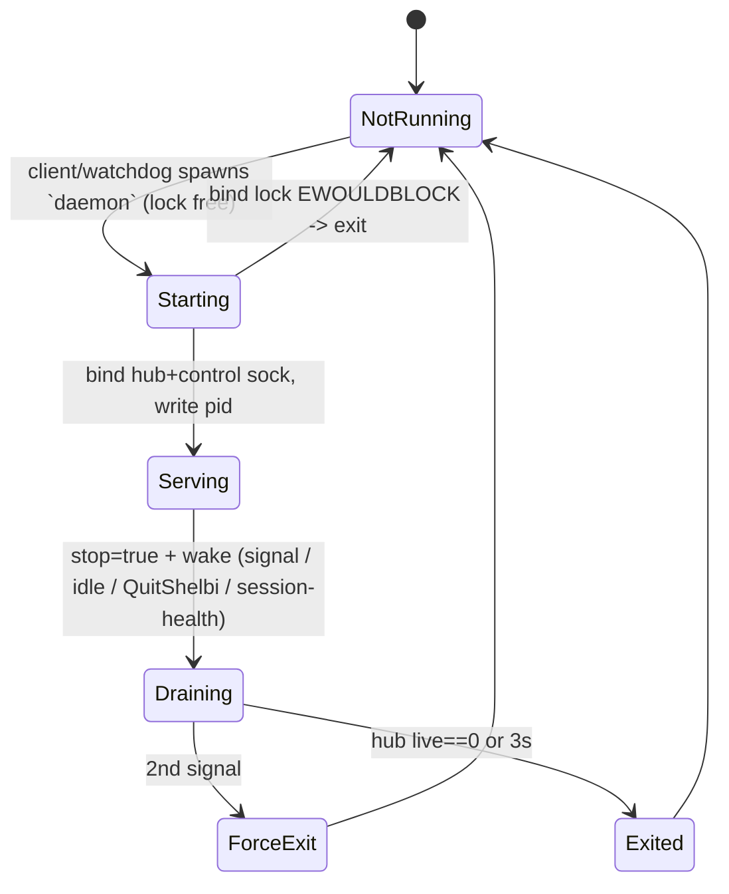

### Verified concerns
1. **Shutdown kills in-flight control jobs (high).** Mutate, WriteState, SaveConfig, ReviewSession, WorkspaceSession and AppRequest each run on an untracked `thread::spawn` (`control.rs:452-458, 506-529`). `serve()` drains only `live` (`serve.rs:543-560`), then `run_foreground` removes the sockets and returns (`serve.rs:355-362`), and the process exits. The comment at `control.rs:358-360` says these jobs "keep running to completion past this returning", but they only run until the process exits. Consequence: `shelbi daemon restart` (SIGTERM), a QuitShelbi from another client, or a session-health re-exec during a `task move` merge can stop the merge partway through. The idle monitor is unlikely to trigger this, because it fires only when no project is open.
2. **The probe takes the real bind lock (medium).** `daemon_lock_held` does `flock(LOCK_EX|LOCK_NB)` then `LOCK_UN` (`daemon_lifecycle.rs:67-73`). A daemon reaching `acquire_bind_lock` (no retry, `serve.rs:726-734`) in that microsecond window exits. Its spawner then sees the child exit while the lock is free and the socket is silent, and returns `DaemonStartError::Exited` (`daemon_lifecycle.rs:249-257`), which surfaces as the desktop's "failed to start" screen. Probers include every session's watchdog (every 15-25s), route, quit, status and the stop loop. LOCK_SH would not fix it, since a shared lock also blocks LOCK_EX. The fix is to retry EWOULDBLOCK briefly on the acquire side.
3. **Shutdown request copied four times (low):** `serve.rs:467-469`, `serve.rs:783-787`, `control.rs:107-110`, `session_health.rs:333-336`. No reason is recorded, and fixing (1) means touching all four.
4. **`stop_daemon` always returns Stopped (low):** after SIGKILL plus a 2s grace it does not re-check (`daemon_lifecycle.rs:392-408`). `restart` then accepts any answering socket, NoHello included (`lifecycle.rs:262-266`).
5. **Watchdog zombies and no backoff (low):** `let _ = cmd.spawn();` (`daemon_watchdog.rs:178`) with no reaper in shelbi-session. A daemon crash-looping at startup gets a helper from every session every 15-25s.
6. **Client views of Starting drift apart (low):** quit treats lock-free as NothingOpen (`quit.rs:97-99`, `119-121`) even if state.json still marks projects open after a crash. There are two identical 10s/100ms connect loops (`quit.rs:143-160`, `mutate_client.rs:60-76`). `status` prints "running / listening: no" without naming the state.

### Not issues
- Concurrent spawns from two clients are documented as harmless: the bind lock dedupes and the waiter keeps waiting while the winner holds the lock.
- route.rs treating "lock held" as Running is deliberate, so the launch screen is not shown over a daemon about to answer (`route.rs:91-94`).

### Recommendation
Use a single `DaemonLifecycle` owner with `request_shutdown(reason)`, a control-job counter (a LiveGuard like the hub handlers use) included in the drain, and rejection of new mutations once Draining. Retry `acquire_bind_lock` on EWOULDBLOCK for about 200ms. Have `stop_daemon` re-verify before reporting Stopped. Have the watchdog reap its helper and back off. Add a shared `daemon_status()` enum (NotRunning/Starting/Ready/Wedged) and one connect-retry helper for route, quit, status and mutate.


### Verified concerns

- **high**: Shutdown waits only for hub-socket handlers. Control-socket jobs (Mutate, i.e. issue moves and merges; WriteState; SaveConfig; ReviewSession; WorkspaceSession; AppRequest) run on detached threads that nothing tracks. When run_foreground returns, the process exits and those jobs die partway through. A `shelbi daemon restart` or `daemon stop` (SIGTERM), a QuitShelbi from another client, or a session-health re-exec during a merge can therefore leave git or board state half-applied. The control serve() doc says these jobs 'keep running to completion past this returning', but that is only true until the process exits a few lines later.
  - Evidence: control.rs:452-458, 506-529 use thread::spawn(run_job/run_state_write/run_save_config/...) with no counter. control.rs:358-360 doc claim. serve.rs:543-560 drains only `live` (hub handlers). serve.rs:355-362 removes the sockets and returns, and daemon.rs:58 returns from main. daemon_is_idle (serve.rs:440-443) checks only open projects and quit_in_flight, not in-flight jobs.
- **medium**: The 'is a daemon running' probe takes the daemon's real exclusive lock. daemon_lock_held() does flock(LOCK_EX|LOCK_NB) and then LOCK_UN. A daemon whose acquire_bind_lock runs inside that window gets EWOULDBLOCK and exits with 'another shelbi daemon holds …'. Its spawner's wait_for_socket then sees the child exit while the lock is free and the socket is silent, and returns DaemonStartError::Exited, which the desktop shows as its 'daemon failed to start' screen. Probes run frequently: one watchdog per session every 15-25s, the route probe, quit, status, the stop loop. The window is microseconds, so this is rare but reachable. Note that LOCK_SH would not fix it, because a shared lock also blocks LOCK_EX. The fix belongs on the acquire side: retry briefly on EWOULDBLOCK.
  - Evidence: daemon_lifecycle.rs:67-73 (exclusive probe lock then unlock); serve.rs:726-734 (LOCK_EX|LOCK_NB, no retry, hard error); daemon_lifecycle.rs:249-257 (child exit + !daemon_lock_held + !socket_answers => Exited); daemon_watchdog.rs:79 (periodic prober).
- **low**: The 'request shutdown' transition is copied in four places as `stop.store(true)` followed by a wake connect. There is no single shutdown function and no record of why the daemon stopped. Adding the job-drain fix above means changing every one of these sites, or introducing one owner.
  - Evidence: serve.rs:467-469 (idle), serve.rs:783-787 (signal), control.rs:107-110 (QuitShelbi), session_health.rs:333-336 (re-exec).
- **low**: stop_daemon returns Stopped{pid} unconditionally after SIGKILL and a 2s grace, even if the process is still alive or still holds the lock. restart then calls ensure_daemon_running. If the old daemon still answers, socket_answers counts that (including NoHello) as up, so restart prints success against the old binary.
  - Evidence: daemon_lifecycle.rs:392-408 (no re-check before Ok(Stopped)); lifecycle.rs:241-276 (restart verifies only probe != NotRunning); daemon_lifecycle.rs:81-83 (socket_answers includes NoHello).
- **low**: The per-session watchdog drops the Child from `cmd.spawn()` without waiting. setsid does not reparent the child, and the session process installs no SIGCHLD reaper, so each `__ensure-daemon` helper stays a zombie of the long-lived session process. The watchdog also has no backoff or in-flight guard: if the daemon crash-loops at startup, every session of an open project spawns a helper (which spawns a daemon and waits 10s) every 15-25s indefinitely.
  - Evidence: daemon_watchdog.rs:178 `let _ = cmd.spawn();`; daemon_watchdog.rs:66-70 fixed interval+jitter loop with no state; no SIGCHLD/waitpid in crates/shelbi-session/src.
- **low**: Clients have inconsistent views of Starting. `shelbi quit` decides NothingOpen from the lock alone, so after a daemon crash it reports nothing open even when state.json still marks projects open and their sessions are running, until a watchdog restarts the daemon. The 10s/100ms control-connect retry loop is duplicated in quit.rs and mutate_client.rs. `daemon status` prints 'running' with 'listening: no' for a starting or wedged daemon without naming that state.
  - Evidence: quit.rs:97-99, 119-121 (daemon_running = daemon_lock_held); quit.rs:143-160 vs mutate_client.rs:60-76 (identical loops); lifecycle.rs:281-293.


### Concerns that did not hold up

- The concurrent ensure_daemon_running spawn race (two clients each spawn a daemon) is documented as intentional and harmless (daemon_lifecycle.rs:186-189). The loser exits on the bind lock, and wait_for_socket keeps waiting because the winner holds the lock. This is an optimization gap, not a bug.
- route.rs counting a lock-held, non-answering daemon as Running is deliberate. The doc comment (route.rs:91-94) says it avoids showing the launch screen over a daemon that is about to answer. A wedged daemon is misrouted, but that is a rare design trade-off, not an accidental collapse.
- restart treating NoHello as success is consistent with socket_answers() everywhere else. It only matters when SIGKILL did not take effect, so it is folded into the stop_daemon-unconditional concern rather than listed separately.
- The idle monitor killing a merge is unlikely: it fires only when no project is open, and a mutation on an open project keeps that project open. The real job-kill exposure comes from SIGTERM (stop/restart), QuitShelbi and session-health re-exec.


**Recommendation:** Give the daemon one lifecycle owner: a `DaemonLifecycle { state: Serving|Draining{reason}|Exiting, jobs: AtomicUsize }` with a single `request_shutdown(reason)` that every stop source calls instead of `stop.store` + connect. Count control jobs with the same LiveGuard pattern used for hub handlers and include them in the drain, with a longer deadline for jobs or a refusal to start new mutations once Draining. Optionally reject new Mutate requests while Draining so clients retry against the next daemon. Make acquire_bind_lock retry EWOULDBLOCK for about 200ms so a momentary probe cannot kill a startup (or have probers stop taking the lock). Make stop_daemon re-check after the grace period and return an error or StillAlive instead of Stopped. Have the watchdog reap its helper (`spawn` then wait on a thread) and back off after repeated failed starts. Consider one shared `daemon_status() -> NotRunning|Starting|Ready|Wedged` used by route, quit and status, plus one shared connect-with-retry helper.


## events.log generations, rotation and follow readers

**Verdict:** Needs further thought. The rotation protocol is sound. Its liveness, though, depends on every registered project's cursor moving forward. That is already broken on this hub: rotation has been frozen for two months with events.log over its limit and growing, and every whole-file reader gets slower as it grows. Retention policy is a design question that needs a decision: should idle or abandoned consumers be allowed to pin history forever?

**Verified concerns:** 1 high, 1 medium, 2 low

**Key files:**
- `crates/shelbi-state/src/event_log.rs:290-630 (index, journal, migration, recover_event_log_rotation, load_event_log_index)`
- `crates/shelbi-state/src/event_log.rs:3126-3420 (append_event_line gate, prior_generation_is_needed, maybe_rotate_events_log)`
- `crates/shelbi-state/src/event_log.rs:840-1060 (cursor, hwm, the two read_or_initialize_event_cursor variants)`
- `crates/shelbi-state/src/event_log.rs:1396-1458, 2351-2410, 2727-2744 (readers that open files by path)`
- `crates/shelbi-cli/src/commands/events.rs:80-184 (tail and follow_from)`

### What it is
The hub-global `~/.shelbi/events.log` is append-only. Offsets into it are logical and stay monotonic across rotations: `current_base` is the logical offset of byte 0 of the current file, and `previous_base` is the same for `events.log.1`. Every append (`append_event_line`, event_log.rs:3126) takes `events.log.lock`, loads the index (which runs crash recovery and the one-time legacy migration), possibly rotates, then appends with O_APPEND.

The phase is never stored as a value. It is inferred from which sidecar files exist (`index.json`, `rotation.json`, `migration.json`, `.1`) and from dev/ino/size comparisons.

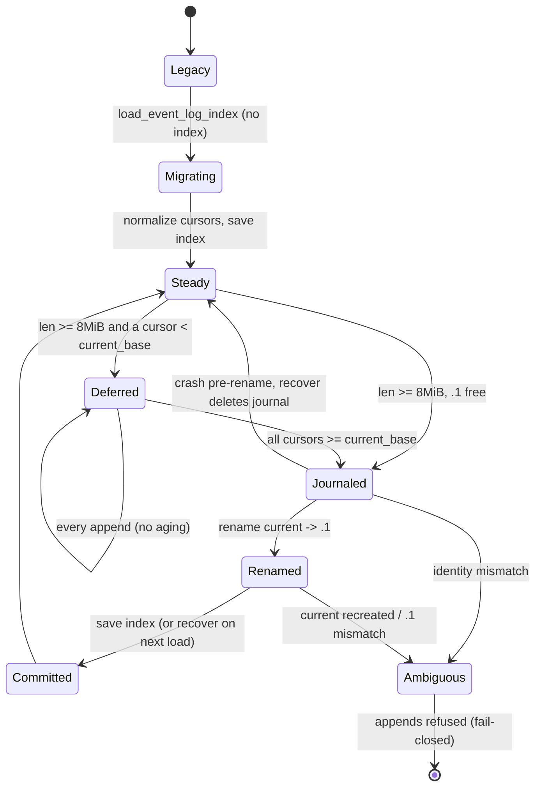

### Verified concerns
1. **Rotation is stuck in practice (high).** `prior_generation_is_needed` (event_log.rs:3307-3341) blocks rotation whenever any `projects/*/event-cursor` is below `current_base`, and a malformed cursor also blocks it. Nothing deletes or ages out cursors, and there is no project-remove path that deletes the project dir. On this hub, `events.log.index.json` was last written Sep 4 (`previous_base` 8388867, `current_base` 16777595). `events.log` is 10M, over the 8 MiB limit. hexsnap, prbadge, tys and website have `event-cursor = 0`, which is below even `previous_base`, so data those readers would need is already partly gone, yet they still pin `.1`. The comment at :3361 ("may temporarily exceed the soft size bound") assumes consumers keep advancing, and that does not hold.
2. **Readers outside the index (medium).** `message_delivery_status` (:1396) and `recent_dispatch_active`/`read_events_tail` (:2351, :2400) read only the current file. `zen_lifecycle.rs:212` is a copy of `read_events_tail`. `last_pushed_tip_from_events` (:2727) reads `.1` and then current with no lock, so a rotation between the two reads hides the just-rotated generation. `events tail` (events.rs:91) and the activity views read the whole file. Rename is atomic, so none of these see a torn file. They differ in how they treat generations, and with rotation stuck, the whole-file reads keep getting slower.
3. **Duplicated cursor-init (low).** event_log.rs:970-1005 and 1007-1050 run the same sequence and differ only in how they take locks.
4. **Follower gap at rotation (low).** `follow_from` (events.rs:150-182) reopens the path every 250 ms and resets to 0 only when the file shrinks. Lines appended to the old inode after its last poll are lost, and the pending fragment is dropped. There is no dev/ino check.

### Refuted
- "Half-moved state": rename is atomic. The real issue is a missed generation, not a torn read.
- "AfterRename stalls every producer until some later recovery": the very next append re-runs `recover_event_log_rotation` under the lock and commits when `.1` matches the journal (event_log.rs:556-586). Appends stay stuck only in a truly ambiguous layout, and that is deliberate fail-closed behavior.
- I traced the journal, migration and malformed-journal recovery paths and found no reachable illegal state.

### Recommendation
- Add a liveness policy for retention: count only registered, recently acked cursors (or ignore cursors below `previous_base`). Add a hard ceiling past which rotation proceeds and logs consumer data loss. Show deferral and the blocking projects in `shelbi doctor`.
- Add one generation-aware reader API in shelbi-state (tail bytes or scan back to T across `.1` and current, with the index snapshot taken under the lock), route the ad-hoc readers through it, and delete the duplicate `read_events_tail`.
- Merge the two cursor-init functions into one.
- In the follower, keep the file handle open and compare dev/ino each tick. When the inode changes, drain the old handle to EOF before switching.


### Verified concerns

- **high**: Rotation has been blocked on this hub since Sep 4, and nothing will unblock it. prior_generation_is_needed treats any project cursor below current_base as a reason to keep .1. Nothing deletes or ages out a project's event-cursor, and no project-remove path deletes ~/.shelbi/projects/<name>. One idle or never-drained project therefore stops rotation for every project. A cursor already below previous_base still counts, even though that data is partly gone already.
  - Evidence: event_log.rs:3335 `if cursor < current_base { return Ok(true) }`. event_log.rs:3364-3369 defers rotation. On the live hub, events.log.index.json = {previous_base: 8388867, current_base: 16777595} with mtime Sep 4. events.log is 10M, over the 8 MiB limit. hexsnap, prbadge, tys and website each have event-cursor = 0.
- **medium**: Readers outside the index each handle generations their own way. message_delivery_status, recent_dispatch_active and zen_lifecycle read only the current file. last_pushed_tip_from_events reads .1 and then current without the lock, so a rotation between the two reads hides the generation that just moved to .1. tail and status read the whole file. With rotation stuck, these whole-file reads keep getting slower. read_events_tail also exists twice, once in event_log.rs and once in zen_lifecycle.rs.
  - Evidence: event_log.rs:1396-1404 (fs::read_to_string of the current file only), 2727-2744 (loop over [.1, current], no lock), 2400 vs zen_lifecycle.rs:212 (duplicate tail reader), events.rs:91 (fs::read of the whole log)
- **low**: read_or_initialize_event_cursor and read_or_initialize_event_cursor_deadline repeat the same establish, init and hwm-repair sequence line for line. They differ only in how they take locks, so a fix to one can miss the other.
  - Evidence: event_log.rs:970-1005 vs 1007-1050
- **low**: The tail -f follower loses events at rotation. It reopens the path every 250 ms and detects rotation only by len < offset. Lines appended to the old file between its last poll and the rename are never read, because it restarts the new file at 0. A partial line in `pending` is dropped too. There is no dev/ino check. The other failure mode needs 8 MiB of new data within one poll, which is not realistic.
  - Evidence: events.rs:150-171: open(path) on each tick, `if len < offset { offset = 0; pending.clear(); }`


### Concerns that did not hold up

- 'Readers can see a half-moved state': rename is atomic, and each reader opens one inode. The real issue is a missed generation (last_pushed_tip) or a reader that reads only the current file by design (message_delivery_status says so in its doc comment). It is not a torn view.
- 'AfterRename makes every append fail until some later recovery': every append calls load_event_log_index under the lock first, which runs recover_event_log_rotation. When current is missing and .1 matches the journaled inode, the very next append commits the index and proceeds (event_log.rs:556-586). Appends stay stuck only in a truly ambiguous layout, which is a deliberate fail-closed choice.
- Journal and migration crash-recovery logic: I traced every path (pre-rename, post-rename before index save, post-commit before journal delete, malformed journal). Each path is either recovered or refused. I found no reachable illegal state.


**Recommendation:** 1) Give the retention rule an explicit liveness policy. Count a cursor only if its project is registered (its <name>.yaml exists) and it was acked recently (e.g. the cursor mtime is within N days). As an alternative, ignore cursors already below previous_base. In either case, add a hard ceiling (e.g. 4x max_bytes) beyond which rotation proceeds and logs that the consumer lost data. Report the deferral and the blocking projects in `shelbi doctor`. 2) Put one generation-aware reader API in shelbi-state (tail N bytes or scan back to T across .1 and current, taking the index snapshot under the lock), and route message_delivery_status, last_pushed_tip_from_events, recent_dispatch_active, zen_lifecycle, status, the activity views and the events tail snapshot through it. Delete the duplicate read_events_tail. 3) Merge the two cursor-init functions into one generic over the lock-acquire strategy. 4) In follow_from, keep the File handle open and compare dev/ino with the path each tick. When they change, drain the old handle to EOF before switching. Optionally, follow by logical offset using the index.


## Project quit composition and job cancellation generations

**Verdict:** Needs further thought. There is a live correctness bug: remote sessions survive both Quit project and Quit Shelbi. The cause is a step-ordering problem between the open flag and host discovery that the fake-backed tests cannot see. On top of that, the cancel registry has no "project quitting" state, a narrow relaunch race leaves an agent running after a quit, and two components independently own the quit barrier while documenting contradictory orderings.

**Verified concerns:** 1 high, 1 medium, 1 low

**Key files:**
- `crates/shelbi-orchestrator/src/quit.rs:140-267`
- `crates/shelbi-orchestrator/src/cancel.rs:103-272`
- `crates/shelbi-cli/src/commands/daemon/poller.rs:53-110`
- `crates/shelbi-orchestrator/src/poller.rs:280-360,4719-4800,4854-4900`
- `crates/shelbi-orchestrator/src/workspace.rs:2582-2600`

### What it is
Two cooperating machines handle teardown in the session-backend runtime.

**Quit composition** (`crates/shelbi-orchestrator/src/quit.rs`). The order of steps is load-bearing, and it is encoded only as statement order in `quit_project_inner` (140-169) and `quit_shelbi_with` (181-208):
1. `QuitInFlight::enter()` increments a process-global `AtomicUsize`. The daemon idle monitor reads this (`shelbi-cli/src/commands/daemon/serve.rs:442`).
2. `set_project_open(false)` runs and a `closed` event is logged. This step must come first so that session watchdogs don't resurrect the daemon (`shelbi-session/src/daemon_watchdog.rs:80`).
3. The orchestrator handoff is requested (production only).
4. Live sessions are killed (filtered by `belongs_to_project`).
5. `cancel::quit_project(p).wait()` trips every live job flag and polls `live_job_count` until it reaches 0 or `SHELBI_QUIT_BARRIER_MS` (default 10s) elapses.

**Job cancellation registry** (`crates/shelbi-orchestrator/src/cancel.rs`). A process-global `Mutex<Registry>` maps project to `{id -> LiveJob{workspace, kind, flag}}`. A job's "generation" is the identity of its `Arc<AtomicBool>`. `bump_workspace` trips Launch jobs for one workspace, `quit_project` trips all jobs for a project, and a later `register` gets a fresh flag. No project-level phase is stored anywhere.

**A second barrier owner.** The daemon poller manager (`shelbi-cli/src/commands/daemon/poller.rs:68-96`) reconciles every 2s. When a running project is no longer open, it calls `cancel::quit_project`, drops the `WorkspacePoller`, and waits on its own barrier, concurrently with step 5.

```mermaid
stateDiagram-v2
    [*] --> Open
    Open --> QuitInFlight: QuitInFlight::enter
    QuitInFlight --> Closed: set_project_open(false)
    Closed --> HandoffRequested: request_orchestrator_handoff
    HandoffRequested --> SessionsKilled: kill sessions (hosts from list_open_projects!)
    SessionsKilled --> BarrierDraining: cancel::quit_project trips flags
    BarrierDraining --> Drained: live_job_count == 0
    BarrierDraining --> TimedOut: bound elapsed
    Drained --> [*]
    TimedOut --> [*]
    note right of Closed: poller manager reconcile (<=2s) also trips + drains
```

### Verified concerns
- **High: remote sessions are never swept.** `remote_hosts_of_open_projects()` (quit.rs:249-267) reads `list_open_projects()` *after* step 2 has cleared the quitting project's flag. `BackendSessions::live_names` (223) and `kill` (237) therefore skip that project's SSH machines, and `quit_shelbi` (which closes every project first) sweeps no remote host at all. The session backend is now the only backend (`session_backend.rs:336-338`), and it does support remote list and kill (`session_process_backend.rs:488-489, 517-518`). Remote agent sessions keep running after "quit". The unit tests use `FakeSessions`, so they can't catch this.
- **Medium: a supervisor can relaunch mid-quit, and the relaunch escapes cancellation.** Kills (step 4) happen before the flags are tripped (step 5). The supervisor checks `job.is_cancelled()` only at the top of its loop (`orchestrator/src/poller.rs:290`), orchestrator supervision hard-codes `intentional_shutdown:false` (4884-4888), and `SupervisionState::decide` restarts on the first dead tick (`shelbi-app/src/supervision.rs:126-180`). No supervisor checks the open flag. A workspace redispatch registers a fresh `JobKind::Launch` guard (`workspace.rs:2582`), and `register` (cancel.rs:178-196) has no closed or quitting check, so the launch runs. The window is the gap before the poller manager's 2s tick catches up, which is small when the handoff is fast or fails, but nothing structurally prevents it.
- **Low: two barrier owners with drifted docs.** cancel.rs:34-37 and 216-219 say the barrier drains *before* the project is marked closed. quit.rs does the opposite, on purpose. quit.rs and the poller manager both trip and drain the same project without coordinating.

### Refuted
- Daemon idle-exit mid-quit: fixed by `QuitInFlight` (#1742). Ordering is correct (quit.rs:83-90, serve.rs:442).
- "No generation counter" is by design. Launch paths check their guard at each side-effect point (workspace.rs:2594, 2764, 2856, 2928). Diagnosability is the only cost.
- Poll threads can't re-register mid-quit, because the manager only starts pollers for open projects.

### Recommendation
1. Snapshot the hosts to sweep **before** clearing the open flag, and pass them through the `Sessions` seam (`live_names(&hosts)`, `kill(name, &hosts)`). Add a fake-backed test asserting that a quitting project's SSH host is swept.
2. Add an explicit per-project phase to the registry (`Live | Quitting`) set by a `begin_quit` call before step 2. `register()` hands out pre-tripped guards while the project is `Quitting`, and opening the project resets the phase. This makes "closed means nothing new runs" structural rather than a matter of timing.
3. Pick one owner for the barrier (quit.rs or the poller manager reconcile), and correct the cancel.rs doc ordering. Optionally gate supervisor `Restart` on the project being open or Live.


### Verified concerns

- **high**: Quitting never kills the quitting project's remote (SSH) sessions, and Quit Shelbi kills no remote session at all. The open flag is cleared first, and only afterwards is the list of remote hosts built from the projects that are still open.
  - Evidence: quit.rs:150 / 187 call set_project_open(false) before step 3. BackendSessions::live_names (quit.rs:223) and kill (quit.rs:237) both iterate remote_hosts_of_open_projects(), which reads list_open_projects() (quit.rs:251). The quitting project is no longer in that list, so its machines are skipped unless another open project shares the host. After quit_shelbi closes everything, the list is empty. The session backend is now the only backend (session_backend.rs:336-338), and it supports remote listing and killing (session_process_backend.rs:488-489, 517-518), so the sessions are reachable but never asked for. The quit.rs tests use FakeSessions, so they cannot catch this. The code comment at quit.rs:220-222 even says 'a closed project should have no live sessions', which is backwards for the project being closed.
- **medium**: A supervisor can relaunch a session in the gap between the kill and the job cancellation. The relaunched launch registers a fresh job that quit_project never tripped, because register() has no 'project quitting' state.
  - Evidence: quit.rs kills sessions (157-163) before calling cancel::quit_project (166). The poller manager only notices the closed flag on its 2s tick (shelbi-cli daemon/poller.rs:26, 68-96), so a fast or failed handoff leaves the supervisor thread running. The supervisor checks job.is_cancelled() only at the top of each loop iteration (orchestrator poller.rs:290). maybe_supervise_orchestrator always passes intentional_shutdown:false (poller.rs:4884-4888) and never checks is_project_open. SupervisionState::decide returns Restart on the first dead tick of a previously-alive pane that has work (shelbi-app supervision.rs:126-180). The workspace path's redispatch_workspace reaches a launch that calls cancel::register(..., JobKind::Launch) with a fresh flag (workspace.rs:2582), and register (cancel.rs:178-196) accepts it even though the project is quitting. The barrier then waits on it, or times out at 10s, and the relaunched agent session outlives a 'closed' project. The window is narrow, roughly 0-2s, but nothing structural prevents it.
- **low**: The quit barrier has two owners that run concurrently and are not coordinated. Their documentation also contradicts the ordering the code actually uses.
  - Evidence: Both quit.rs:166/200 and shelbi-cli daemon/poller.rs:85-89 call cancel::quit_project for the same project after the open flag clears, and each waits on its own barrier. cancel.rs:34-37 and 216-219 say the barrier is waited on 'before the caller marks the project closed', but quit.rs marks the project closed first (step 1), which the watchdog contract requires. So 'closed' does not mean 'drained' as the cancel.rs module doc claims. The idle-exit guard (serve.rs:442) only covers quits started through quit.rs, not the reconcile-side drain.


### Concerns that did not hold up

- 'Generation semantics are implicit in flag identity, so a stale launch can't be told from a current one': this is accurate as a description, but it is deliberate (cancel.rs:103-106), and every launch path checks its own guard (workspace.rs:2594, 2764, 2856, 2928). No bug comes from the lack of a counter beyond the missing 'project quitting' state already listed. Logging and diagnosability are the only cost.
- 'Jobs registered during wait() are not cancelled' as a separate issue: this is the same root cause as the supervisor-relaunch concern (register has no closed-project check), not an independent defect. Plain poll-thread re-registration mid-quit cannot happen, because the poller manager only starts pollers for open projects (shelbi-cli daemon/poller.rs:101-109).
- Daemon exiting mid-quit: refuted. QuitInFlight is taken before the open flag clears and the idle monitor checks quit_in_flight() after reading the open set (quit.rs:83-90, serve.rs:442), which is the fix from #1742.


**Recommendation:** 1) Collect the set of hosts to sweep (the project's own SSH machines, or for Quit Shelbi every open project's machines) before calling set_project_open(false). Pass that snapshot into Sessions::live_names(hosts) and kill(name, hosts) instead of re-reading list_open_projects(), and add a test whose fake asserts which hosts are swept. 2) Give the cancel registry an explicit per-project phase, enum ProjectPhase { Live, Quitting }. A begin_quit(project) call, made before the open flag clears, trips current flags and sets Quitting. register() then returns an already-tripped guard while the project is Quitting, and a reopen clears the phase. This closes the relaunch race no matter how the poller ticks line up, and it gives the barrier one owner. 3) Have the poller manager's reconcile defer to the quit.rs composition (or the reverse), so only one path drains the barrier, and fix the cancel.rs doc ordering. Optionally have the supervisors check is_project_open (or the registry phase) before choosing Restart.


## State reconstructed by scanning events.log lines

**Verdict:** Needs further thought. None of the scattered folds is wrong on its own, and the rotation edge cases are rare. But the design treats "the log is bounded and rotates" as a premise, and on this hub that premise is false: four idle projects with cursor 0 have pinned rotation since September. So the hub-lock-held full scans in the poller reconcile and the 500 ms full-file polling in `message --wait` grow without limit. The real design question is whether these four derived facts belong in small state files written at the moment they happen, rather than in log folds. The token-vocabulary drift (pane-not-alive shows Gray) shows the stringly contract has already drifted once.

**Verified concerns:** 2 medium, 3 low

**Key files:**
- `crates/shelbi-state/src/event_log.rs:720-760 (latest_task_transition_targets), 1330-1455 (message delivery fold), 2290-2410 (recent_dispatch_active + 64 KiB tail), 2697-2760 (push provenance)`
- `crates/shelbi-state/src/event_log.rs:3170-3230, 3228 (prior_generation_is_needed / maybe_rotate_events_log; 8 MiB soft cap)`
- `crates/shelbi-orchestrator/src/poller.rs:1130-1150, 4228-4250, 5095-5110, 5320-5330, 5685-5695, 5755-5830`
- `crates/shelbi-app/src/activity.rs:1241-1410 (parse_event_line), 1843 (parse_kv), 2395-2420 and 2555-2575 (status-token tones)`
- `crates/shelbi-cli/src/commands/message.rs:53, 133, 320-350 (wait_for_delivery polls every 500 ms)`

### What it is
Shelbi answers four lifecycle questions by **folding the hub-global `~/.shelbi/events.log`** instead of reading stored state:

| Question | Function | Scope read | Consumer |
|---|---|---|---|
| Was message X read by the worker? | `message_delivery_status` (event_log.rs:1396) | whole live file | `shelbi message status` / `--wait` (message.rs:133, 331; polls every 500 ms) |
| Is a dispatch bringing up slot W right now? | `recent_dispatch_active` (event_log.rs:2351) | last 64 KiB of live file, 60 s window | stranded-resume sweeps and the active-gate guard (poller.rs:5107, 5325, 5763, 5827) |
| Did the hub itself move task T to column C? | `latest_task_transition_targets` (event_log.rs:732) | whole current generation, **under the hub-global log lock** | issue reconcile (poller.rs:1143) |
| What tip did Shelbi last push to branch B? | `last_pushed_tip_from_events` (event_log.rs:2727) | `.1` + live file, no lock | force-push provenance fallback (poller.rs:4246) |

The Activity feed (TUI and desktop share `shelbi-app/src/activity.rs`) re-parses the same lines and maps `status=` strings to tones and verbs.

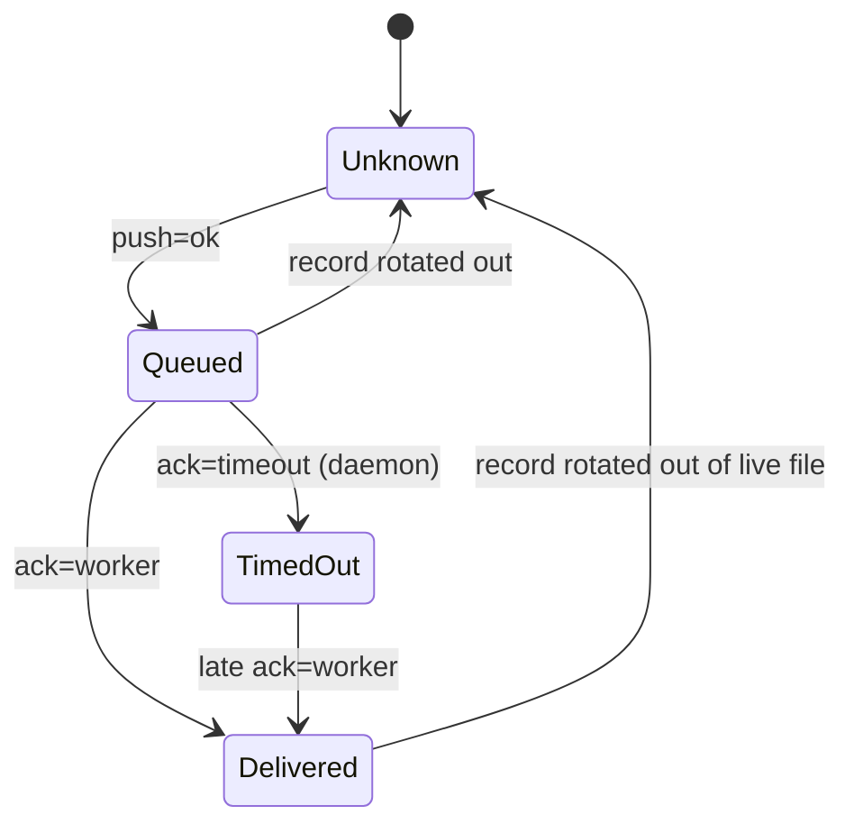

### Encoding
Flat `key=value` lines, with no schema type. There are at least five tokenizers: `event_field` (event_log.rs:3428, first token wins, no quote support), the message fold's own loop (1415-1430), `transition_target`'s `split(" -> ")` (757), `starts_with("dispatch ")` / `("push ")` gates, and the app's `parse_event_line` + `parse_kv` (activity.rs:1241, 1843; parse_kv honors quotes). The producers have real enums (`PushOutcome::status_token` workspace.rs:1458, `HandoffOutcome::event_token` handoff.rs:84) that are flattened to strings.

### Verified concerns
1. **Rotation is pinned forever by idle projects (medium).** `maybe_rotate_events_log` defers rotation while any `projects/*/event-cursor` is below `current_base`. On this hub, hexsnap, prbadge, tys and website hold cursor `0` (since 2026-09-08). The index has `current_base=16777595`, `events.log` is 10 MB against the 8 MiB cap, and the last rotation was 2026-09-04. The log now grows without limit.
2. **Full-generation scans, one of them under the global lock (medium).** `latest_task_transition_targets` → `read_event_log_from(current_base)` takes `events.log.lock` (event_log.rs:703) and reads the whole generation on every reconcile sweep that has an upsert, which blocks every append meanwhile. `message --wait` re-reads the whole live file every 500 ms. Both costs grow with finding 1.
3. **Rotation blind spots (low).** Each query has a different scope. Right after a rotation, the hub forgets its own moves (it double-reconciles them as external), Delivered regresses to Unknown, and a `dispatch status=message-channel` written just before the rotation is invisible to the 64 KiB tail, so a stranded-resume sweep can relaunch on top of a live launch. The comments call rotation too rare to matter, and today it effectively never happens.
4. **Token drift already present (low).** `HandoffOutcome::PaneNotAlive` → `pane-not-alive` is missing from `handoff_status_tone` (activity.rs:2568), so it renders Gray (calmer than `timeout`). No cross-crate test checks the vocabulary.
5. **No shared schema (low).** The tokenizers differ on quoting and first-vs-last match. They are safe today only because `sanitize_field`/`sanitize_reason` fold whitespace and no producer quotes values.

### Refuted
- 64 KiB tail too small for 60 s: on the live hub it covers about 3.5 h.
- CI pending shown as failed: zen.rs:1131-1139 only emits success/failure.
- PaneDeath missing status: always a formatted bool, and only parsed when the `pane_alive=` token is present.
- Cross-project push provenance: the consumer requires origin's sha to equal the recorded one, so a mismatch is harmless.
- Unlocked .1+live read racing a rotation: fails safe (no force push, so the handoff shows as blocked).

### Recommendation
- Unpin rotation: ignore or clamp cursors of projects with no live follower, or cursors older than N days. Coordinate with the event-cursor machine.
- Persist the derived facts where they happen: per-message delivery records, a per-project hub-moves map with a TTL, and a per-slot dispatch-in-flight stamp. Keep the log as the audit trail. Push provenance already has a primary sidecar.
- Put one shared event-record type (to_line / from_line) in shelbi-state for both producers and activity.rs. Give status tokens enums with FromStr so new variants break the build instead of falling to Gray.
- Quick fix: add `pane-not-alive` to `handoff_status_tone`, plus a test that walks every producer token through the consumer tone functions.


### Verified concerns

- **medium**: A project whose event cursor never moves blocks log rotation permanently, so the live events.log grows without limit and every whole-generation fold here gets slower.
  - Evidence: event_log.rs maybe_rotate_events_log defers rotation whenever prior_generation_is_needed reports any projects/*/event-cursor below current_base. On this hub hexsnap, prbadge, tys and website all hold cursor `0` (written 2026-09-08) and index current_base=16777595. events.log is 10 MB against the 8 MiB EVENTS_LOG_MAX_BYTES (event_log.rs:3228). The last rotation was 2026-09-04. The root cause sits in the cursor/rotation machine, but this machine pays for it.
- **medium**: Derived-state queries read the whole current generation, and one does it while holding the hub-global log lock that every append needs.
  - Evidence: latest_task_transition_targets calls read_event_log_from(current_base) (event_log.rs:733), which takes acquire_file_lock(events.log.lock) (event_log.rs:703) and reads every byte. The poller calls it on each issue-reconcile sweep that has an upsert (poller.rs:1143). message_delivery_status does fs::read_to_string of the full live file (event_log.rs:1397) every 500 ms while `shelbi message --wait` runs (message.rs:53, 331). Because rotation is pinned, both costs keep growing.
- **low**: Rotation blind spots: each query's scope differs, so a rotation makes the hub forget its own recent moves, regresses Delivered to Unknown, and drops the dispatch in-flight guard.
  - Evidence: latest_task_transition_targets reads only current_base (event_log.rs:733): right after a rotation the map is empty, and poller.rs:1143 reconciles the hub's own moves as external. message_delivery_status reads only the live file (event_log.rs:1396). read_events_tail reads only the live file (event_log.rs:2400), so a `dispatch status=message-channel` written moments before a rotation is invisible and the stranded-resume sweeps (poller.rs:5325, 5763, 5827) lose their race guard. Each comment says rotation is too rare to matter. That holds today because rotation almost never happens, but the window is real.
- **low**: Producer enums are flattened to strings and re-matched as literals on the consumer side. One verified drift already exists.
  - Evidence: HandoffOutcome::PaneNotAlive emits `pane-not-alive` (orchestrator handoff.rs:88). activity.rs handoff_status_tone (2568-2574) does not list it, so a handoff that failed because the pane was dead renders neutral Gray, quieter than `timeout`/`send-failed` (Yellow). PushOutcome `no-remote` and `up-to-date` (workspace.rs:1458-1465) also fall to the Gray default (probably intended). No test checks producer tokens against consumer arms across crates.
- **low**: No shared schema: at least five ad-hoc tokenizers with slightly different semantics.
  - Evidence: event_field (event_log.rs:3428) takes the first whitespace token with the prefix and ignores quotes. parse_kv (activity.rs:1843) honors quoted values. The message fold (event_log.rs:1415-1430) has its own loop. transition_target splits on " -> " (event_log.rs:757). The dispatch and push readers gate on body.starts_with. The sanitize_field/sanitize_reason folding means nobody emits quotes today, so no live divergence was found. A future producer that quotes a value, or a renamed key, would break consumers one at a time without any warning.


### Concerns that did not hold up

- The 64 KiB tail being too small for the 60s DISPATCH_CONFIRM_GRACE on a busy hub: measured on the live hub, the last 64 KiB covers about 3.5 hours (12:34 to 16:02 UTC, with chartme and shelbi chatter). Overflowing it within 60 s would need roughly 1 KiB/s of events. Not a realistic risk now; the only real gap is the rotation edge (listed above).
- CI rows rendering pending/running as a red 'failed': zen.rs:1131-1139 only ever emits conclusion=success or conclusion=failure; pending and timeout verdicts `continue` without writing a line. The binary treatment in activity.rs:2406 is correct for what is actually produced.
- PaneDeath treating a missing status as 'pane died': append_workspace_pane_event formats `pane_alive={alive}` from a bool (event_log.rs:2617), and parse_event_line only builds a PaneDeath when the `pane_alive=` token is present (activity.rs:1395), so the status is always the literal true/false.
- Push provenance shared across projects because push lines carry no project=: the consumer (poller.rs:4241-4249) treats the log tip only as permission to force when origin's current sha starts with that recorded sha. A tip from a different repo cannot match another repo's origin except by a 7-hex prefix collision. If two projects share a repo, the sha really was pushed by Shelbi. No unsafe force follows.
- last_pushed_tip_from_events racing a rotation without the lock: a rotation between the .1 read and the live-file read can at worst miss the tip. That fails safe: there is no provenance, so no force push, and the handoff surfaces as blocked for a human. It cannot cause a wrong force.


**Recommendation:** 1) Fix the rotation pin first. Ignore cursors for projects with no running orchestrator/follower, or cursors not written for N days, or clamp a 0 or stale cursor to the earliest retained offset. That belongs with the event-cursor machine, but it is the main risk here. 2) Store the derived facts directly instead of folding the log: a per-message delivery record (msgs/<id>.json updated on push/ack, which the daemon already tracks in memory), a per-project hub-moves map persisted on append_task_event (with a TTL), and a per-(project,workspace) dispatch-in-flight stamp with a timestamp. The log stays the audit trail, not the source of truth. Push provenance already has a primary sidecar, so the log fallback can stay. 3) Put event serialization in one shared crate type (an enum of event records with to_line and from_line) that both shelbi-state producers and shelbi-app activity parse through. Give the status tokens real enums with Display/FromStr, so a new HandoffOutcome or PushOutcome variant fails to compile in activity.rs instead of falling to Gray. 4) Short term: add `pane-not-alive` to handoff_status_tone, and add a cross-crate test that iterates every producer event_token/status_token and asserts the activity tone function does not take the default arm unintentionally.


## Session-runtime reload sequence (`shelbi reload`)

**Verdict:** Needs further thought. There is a real race between processes. Replacing the orchestrator means SIGTERM with no wait, followed by an idempotent "ensure alive". That can no-op against the still-alive old session, the reload falsely reports success, and the daemon supervisor does the actual relaunch as a "crash". The daemon restart has a similar silent no-op path. The step order itself is deliberate and tested. The weak point is that each step's real outcome (Stopped/NotRunning/Err, Started/AlreadyRunning) is thrown away.

**Verified concerns:** 2 medium, 1 low

**Key files:**
- `crates/shelbi-cli/src/commands/reload_session.rs:59-125`
- `crates/shelbi-cli/src/commands/reload.rs:53-111`
- `crates/shelbi-state/src/daemon_lifecycle.rs:157-196, 359-409`
- `crates/shelbi-orchestrator/src/lib.rs:438-560, 1038-1088`
- `crates/shelbi-orchestrator/src/session_process_backend.rs:210-243, 479-497`

### What it is
`shelbi reload` on the session runtime (`reload.rs::run_all` -> `reload_session::run`) works through a fixed sequence of steps against external process state. The step order (handoff -> signal clients -> restart daemon -> replace orchestrator) is deliberate, documented, and unit-tested through the `ReloadOps` seam. The weakness is that each step's real outcome is discarded, and `ReloadReport` hard-codes `true` for every step (reload_session.rs:69-74).

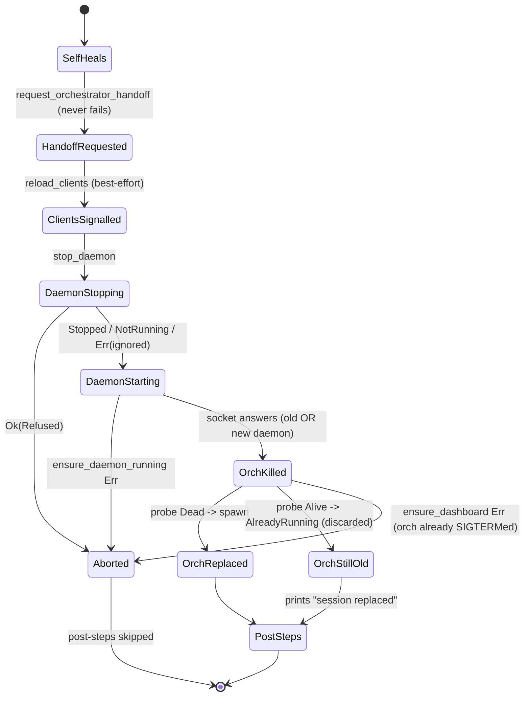

### Where the state really lives
- The daemon: pid file, single-instance lock, hub socket (`daemon_lifecycle.rs`).
- The orchestrator: session host lock and socket for logical name `<project>/orch` (`session_process_backend.rs:81`).
- Handoff: `agents/orchestrator/handoff.md`. The outcome reaches the user only as `format!("{outcome:?}")`.
- Clients: a daemon `broadcast_all(Reexec)` (`daemon/control.rs:479-485`), with the TUI-side flag in `shell/mod.rs:445,818-866`.

### Verified concerns
1. **Medium: the orchestrator kill doesn't wait, so "replace" can be a no-op.** `kill_window` (reload_session.rs:120) sends a Kill frame; the session host just calls `killpg(SIGTERM)` (shelbi-session transport.rs:554) and exits only after the child is reaped. `ensure_dashboard` runs straight after, and `ensure_orchestrator_session` (orchestrator lib.rs:1053) returns `AlreadyRunning` while the probe still sees a usable socket. reload_session.rs:123 discards that status, and reload.rs:103 prints "✓ orch session replaced". The old orchestrator then exits, and the daemon supervisor relaunches it as a crash, counting toward backoff. The handoff probably still gets ingested by that relaunch, but this is an accident of supervision, not a property of reload.
2. **Medium: the daemon restart can silently not restart.** reload_session.rs:109 bails only on `Ok(Refused)`. An `Err` from `stop_daemon` (pid-record read, daemon_lifecycle.rs:366/371) is dropped. `stop_daemon` also returns `Stopped` when the SIGKILL grace loop ends with the process still there (392-408). `ensure_daemon_running_with` returns Ok if *any* daemon answers (183-185), so the old binary can survive while reload prints "daemon restarted on the current binary".
3. **Low: partial progress is unrepresentable.** A step 3 or 4 `Err` exits `run_all` at reload.rs:98, after clients were signalled and possibly after the orchestrator was SIGTERMed. It also skips the materialize-outcome printing and `self_heal_workspace_settings_template` (reload.rs:104-110). Supervision eventually restores a dead orchestrator, so nothing stays stuck, but the user isn't told what happened.

### Refuted or downgraded
- Re-exec before the daemon restart is intentional (only the live daemon can broadcast). Re-execed TUIs use race-safe `ensure_daemon_running` and lock-serialized `ensure_dashboard`, and their listener re-probes the version on disconnect. At worst this is transient noise.
- The kill and respawn names match (`<project>/orch`), so the problem is purely timing.

### Recommendation
Change `ReloadReport` to carry real per-step outcomes (`HandoffOutcome`, `StopOutcome` plus start result, `BootstrapStatus`) and render the output from them. Make `replace_orchestrator_session` kill, then wait until Dead with a deadline and escalation, under `lock_dashboard`, and treat a post-kill `AlreadyRunning` as an error. Make `restart_daemon` propagate a `stop_daemon` Err and confirm the answering daemon is a new pid on the current version. Always run the post-steps, then surface the error.


### Verified concerns

- **medium**: The orchestrator kill does not wait for the process to exit, so the respawn can report AlreadyRunning against the dying session, and reload still prints 'session replaced'. The old orchestrator then exits with nobody replacing it. Recovery depends on the daemon supervisor (supervise_restart_orchestrator), which treats it as a crash and counts it toward crash-loop/backoff.
  - Evidence: reload_session.rs:120 `let _ = backend.kill_window(...)` -> session_process_backend.rs:487-496 sends Kill over the socket; transport.rs:554 just calls killpg(SIGTERM), and the host exits only after the child is reaped. orchestrator lib.rs:1053 `if b.probe(...).is_alive() { return Ok(BootstrapStatus::AlreadyRunning) }`, and probe (session_process_backend.rs:239-242) returns Alive while the host socket is usable. reload_session.rs:123 `.map(|_| ())` discards the status, and reload.rs:103 prints '✓ orch session replaced' unconditionally.
- **medium**: A stop_daemon Err is ignored, and ensure_daemon_running returns Ok whenever any daemon answers the socket. If the pid-record read fails, or stop_daemon times out and the old daemon still answers, reload reports 'daemon restarted on the current binary' while the old binary keeps running.
  - Evidence: reload_session.rs:109 matches only `Ok(Refused)`. stop_daemon can return Err from read_daemon_pid_record()? or daemon_pid_file_path()? (daemon_lifecycle.rs:366,371), and it returns Stopped{pid} even after the SIGKILL grace loop ends with the process still present (daemon_lifecycle.rs:392-408). ensure_daemon_running_with returns Ok at line 183 when socket_answers() is true.
- **low**: Partial progress can't be represented. ReloadReport's bools are always true, and an Err at step 3 or 4 aborts run_all. The user doesn't learn which side effects already happened (clients signalled; orchestrator possibly killed), and the materialize outcomes and the workspace-settings template self-heal are skipped.
  - Evidence: reload_session.rs:69-74 hard-codes true. reload.rs:98 `?` returns before lines 104-110 (print outcomes, self_heal_workspace_settings_template). If ensure_dashboard fails after the kill at reload_session.rs:120, no orchestrator is left until the supervisor relaunches one.


### Concerns that did not hold up

- 'Clients re-exec before the daemon restarts and may reconnect to the dying daemon or find none.' Mostly benign. The order is deliberate, because only the live daemon can broadcast Reexec. A re-execed TUI's bootstrap calls ensure_daemon_running, which is race-safe through the single-instance lock, and ensure_dashboard, which is serialized by lock_dashboard. Its push listener (shell/mod.rs:818-866) reconnects after the drop and re-execs again on a version mismatch. The worst case is a redundant spawn or a transient 'could not start the hub daemon' warning, not a stuck client.
- The kill target name and the respawn probe name agree: `<project>/orch` and `shelbi-<project>` both resolve to logical name `<project>/orch` (session_process_backend.rs:81). The kill is a real race, not a name mismatch.
- 'A failed respawn leaves no orchestrator and nothing marks it.' Partly refuted. The project stays marked open, and the daemon poller's orchestrator supervision (poller.rs ~4860-4950, relaunch_orchestrator_session) relaunches a dead orchestrator and writes supervision status. The gap is in reporting, not a permanent stuck state.


**Recommendation:** Keep the fixed step order, but have each step return its real outcome and make the report a per-step result type. For example: `enum StepResult { Done, Skipped(reason), Failed(err) }`, or carry `handoff: HandoffOutcome`, `daemon: StopOutcome + start result`, and `orch: BootstrapStatus`. Print from that instead of hard-coded checkmarks. Two concrete fixes: (1) replace_orchestrator_session should kill and then wait until probe() is Dead, with a deadline and a SIGKILL/SIGHUP escalation, holding lock_dashboard so the supervisor or a re-execed TUI can't race in. Treat AlreadyRunning after the kill as an error, or retry it. (2) restart_daemon should propagate a stop_daemon Err and verify the new daemon's pid/version differs from the old one (daemon_version_status or hello.pid) before reporting 'restarted'. Run the materialize/template post-steps even when a reload step fails, then return the error.


## Zen Mode toggle (Off/Paused/On) and first-run intro

**Verdict:** Needs further thought. The enum is explicit and the writer is atomic. But the only client-facing transition is a relative flip computed against state the user didn't see, so a reachable race (stale intro or stale UI vs CLI/crash-recovery/another client, or a duplicated request) can turn auto-merge ON against the user's intent. That is the unsafe direction for a feature that merges without review. The fix is small, but deciding whether to keep a toggle at all, and how Paused should behave around crashes, is worth a short conversation.

**Verified concerns:** 1 medium, 4 low

**Key files:**
- `crates/shelbi-state/src/lib.rs:1710-1776 (ZenModeState), 2491-2508 (crash recovery), 2700-2716 (set_zen_mode), 2814-2836 (toggle_zen_mode)`
- `crates/shelbi-app/src/zen.rs:1-87 (intro gate, toggle, apply_intro)`
- `crates/shelbi-orchestrator/src/state_write.rs:20-40 (StateWrite::ToggleZen handler)`
- `crates/shelbi-cli/src/commands/zen_lifecycle.rs:51-83 (orch_start crash-recovery event)`
- `crates/shelbi-tui/src/shell/mod.rs:4165-4187 (toggle_zen / apply_zen_intro)`

### What it is
Per-project **Zen Mode** is an explicit enum `ZenModeState { Off, Paused, On }` stored as a lowercase string in `<project>/state.json::zen_mode` (`crates/shelbi-state/src/lib.rs:1710-1776`; legacy `true/false` still deserializes). A global one-way latch, `~/.shelbi/state.json::zen_intro_seen`, gates a first-run "Turn Zen Mode on" intro popover (`crates/shelbi-app/src/zen.rs:22-70`, overlay in `crates/shelbi-tui/src/shell/mod.rs:4165-4187`).

The enum is explicit. Its transitions are not: three writers each decide the target on their own.

| Writer | Kind | Event line |
|---|---|---|
| `set_zen_mode` (lib.rs:2706), used by `shelbi zen on/off/pause` | absolute set, accepts any target incl. no-op | `project=P mode=zen prev -> new reason=user:cli` |
| `toggle_zen_mode` (lib.rs:2824), used by TUI hotkey and by `StateWrite::ToggleZen` (state_write.rs:32) from palette/desktop/remote | relative: On->Off, Off/Paused->On | `mode=zen ...` |
| `zen_check_crash_recovery` (lib.rs:2491-2508), called from `orch_start` (zen_lifecycle.rs:62) | direct field write On->Off if heartbeat <1h | caller writes `project=P zen=off reason=crash-recovery` |

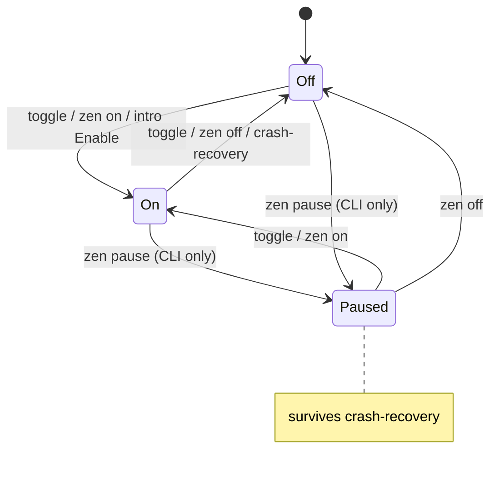

### Verified concerns
1. **Relative toggle on a stale view (medium).** Clients can only send `ToggleZen`. The intro shows because Zen read as Off when it opened (`zen.rs:29-37`), and Confirm then sends a toggle (`zen.rs:57-70` -> `:42-53`). If Zen went On in the meantime (CLI, another window), *Enable turns it Off*. The dangerous mirror case: crash recovery or the CLI sets Off, a window still shows On, the user hits the toggle meaning "off", and **auto-merge turns On**. A duplicated or retried request cancels itself. The writer is atomic (the read and flip share one `update_state`); the bug is in the client's intent.
2. **Crash-recovery edge uses a separate path and vocabulary (low).** `lib.rs:2502` writes the field directly. `zen_lifecycle.rs:66` logs `zen=off reason=crash-recovery`. The activity feed parses only `mode=zen ` (`shelbi-app/src/activity.rs:1603`), so this On->Off never shows in the feed. Only `shelbi status` (`status.rs:781`) looks for it.
3. **Paused is not demoted on crash (low/design).** `lib.rs:2497` only checks `== On`, so in-flight Zen-track tasks of a Paused project can still auto-merge right after a detected crash.
4. **Event hygiene (low).** No-op `off -> off` lines get logged. Events are appended after the flock is released, so concurrent writers can log out of order (`lib.rs:2708-2715`, `2826-2835`).
5. **Intro latch (low).** A failed `mark_zen_intro_seen` is discarded (`zen.rs:64`), and the latch is written off-thread, so the intro may re-show.

### Refuted
- The two "effective Zen" predicates (`zen_applies` in cli zen.rs:653, `zen_disabled` in orchestrator zen.rs:14427) answer different questions (counting in-flight vs promotion eligibility) and agree whenever promotion runs.
- The local vs remote intro read paths: `intro_due` has no caller outside `should_show_intro`.

### Recommendation
Swap `StateWrite::ToggleZen` for `SetZen { target, expected, source }` with compare-and-set semantics. The intro sends `target=On, expected=Off`, and the hotkey sends the inverse of the displayed mode. Funnel crash recovery through one transition helper that emits the canonical `mode=zen` line (keep or migrate the `shelbi status` matcher). Skip no-op events. Decide whether Paused should also drop to Off after a crash.


### Verified concerns

- **medium**: The client write is a relative flip (ToggleZen), not a set-to-target, so the effect depends on server state the user never saw. The intro is gated on an Off read at open time, then Confirm sends a toggle. If Zen went On elsewhere while the popover was open, 'Enable Zen' turns it Off. The reverse is also possible: a stale UI shows On after crash recovery, the user presses toggle meaning 'off', and auto-merge turns ON. A duplicated or retried control request also cancels itself.
  - Evidence: shelbi-app/src/zen.rs:29-37 (intro_due reads mode once), :42-53 (toggle sends StateWrite::ToggleZen), :57-70 (apply_intro -> toggle on confirm); state_write.rs:32 maps ToggleZen to toggle_zen_mode; lib.rs:2827-2831 flips relative to the current disk value
- **low**: Crash recovery writes zen_mode directly instead of going through set_zen_mode, and its caller logs a different line shape. The activity feed parses only `mode=zen` and never renders the crash-recovery On->Off edge. Only `shelbi status` looks for `zen=off reason=crash-recovery`. Two vocabularies describe the same transition.
  - Evidence: lib.rs:2502 `state.zen_mode = ZenModeState::Off` with no append_zen_mode_event; zen_lifecycle.rs:66 `append_project_event(project, "zen=off", "crash-recovery")`; shelbi-app/src/activity.rs:1603 matches only `mode=zen `; shelbi-cli status.rs:781 matches `zen=off`
- **low**: Paused survives a crash. Recovery only demotes On, so a Paused project keeps letting in-flight Zen-track tasks auto-merge right after a detected orchestrator crash. This may be intended, but nothing documents it.
  - Evidence: lib.rs:2497 `should_disable = recent && state.zen_mode == ZenModeState::On`; Paused semantics at lib.rs:1714-1716
- **low**: set_zen_mode logs a transition line even when prev == target (e.g. `off -> off`). Both writers append the event after update_state releases the flock, so with concurrent writers the log order can differ from the order the writes landed in.
  - Evidence: lib.rs:2708-2715 and 2826-2835: append_zen_mode_event called unconditionally, outside the update_state closure
- **low**: A failed mark_zen_intro_seen is silently dropped, and the seen write runs on a worker thread. The intro can then re-show (cosmetic).
  - Evidence: shelbi-app/src/zen.rs:64 `let _ = shelbi_state::mark_zen_intro_seen();`; shelbi-tui shell/mod.rs:4182-4187 spawn_quiet_job


### Concerns that did not hold up

- 'Two resolvers for per-task effective Zen with different semantics': they answer different questions. zen_applies (shelbi-cli zen.rs:653-659) counts in-flight tasks on the Zen track for a given mode. zen_disabled (shelbi-orchestrator zen.rs:14427) is a backlog-candidate eligibility filter used only by the promotion scan, which runs only when the mode allows promotion. Under On the two agree (inherit = applies, explicit false = excluded). There is no drift, just two small call-site predicates.
- 'toggle_zen_mode races between read and write': the read and flip happen in one update_state critical section (lib.rs:2824-2836). The race is at the client intent level (stale view + relative op), not inside the writer.
- 'should_show_intro reads local state while remote windows pass the source's read via intro_due': nothing outside zen.rs calls intro_due. The only caller is should_show_intro, used by the TUI shell with link=None, so no remote/local dual path is live today.
- 'Toggle from Paused is decided by the daemon, out of sight of the client': it is documented and deterministic (Paused -> On, lib.rs:2814-2818). Only the CLI can land on Paused, by design.


**Recommendation:** Replace StateWrite::ToggleZen with StateWrite::SetZen { target, expected: Option<ZenModeState>, source } (compare-and-set: refuse or no-op when the current mode != expected). Clients compute the target from the mode they displayed, the intro's Enable sends target=On, and the hotkey sends the inverse of what the sidebar shows. Route crash recovery through the same transition helper so it emits the canonical `mode=zen on -> off reason=crash-recovery` line (keep the old shape for `shelbi status` for one release, or update its matcher). Have set_zen_mode skip the event when prev == target, and append it inside the lock or with the write's ordering. Decide explicitly whether crash recovery should also demote Paused to Off.


## Single-consumer event follower registry

**Verdict:** Needs further thought. The machine itself is small and its ownership logic is sound (lock-serialized claim, conditional release, supersede polling). But it has a reachable illegal state, StaleOwner whose pid now names an unrelated process, and the transition out of it is destructive: it SIGTERMs a same-user process. Followers are often killed with SIGKILL and around reboots, so the stale-pid window is common. The fix already exists in the same crate for the daemon PID file. This is a short conversation plus a small patch, not a redesign.

**Verified concerns:** 1 medium, 1 low

**Key files:**
- `crates/shelbi-state/src/event_log.rs:1078-1202 (registry, process_is_alive, signal_terminate, claim/owner/release)`
- `crates/shelbi-cli/src/commands/orchestrator.rs:245-336 (run_feed claim/release, feed_superseded)`
- `crates/shelbi-state/src/ssh_control.rs:240-341 (existing process_start_time + recorded_daemon_is_same_process identity check to reuse)`

### What it is
For each project, a last-writer-wins registry makes sure only one *consuming* `shelbi orchestrator events next --follow` process drains the delivery queue. Two consumers would split batches between them and starve the live drain, which is the bug this was built for.

### Storage
- `<project_dir>/event-follower`: a decimal PID, written with `atomic_write`.
- `<project_dir>/event-follower.lock`: a file lock held around claim and release.
- Liveness is `kill(pid,0)`; `EPERM` counts as alive (`event_log.rs:1109-1119`).
- Each follower polls `event_follower_owner` every `FEED_POLL` tick without the lock (`orchestrator.rs:334-336`).

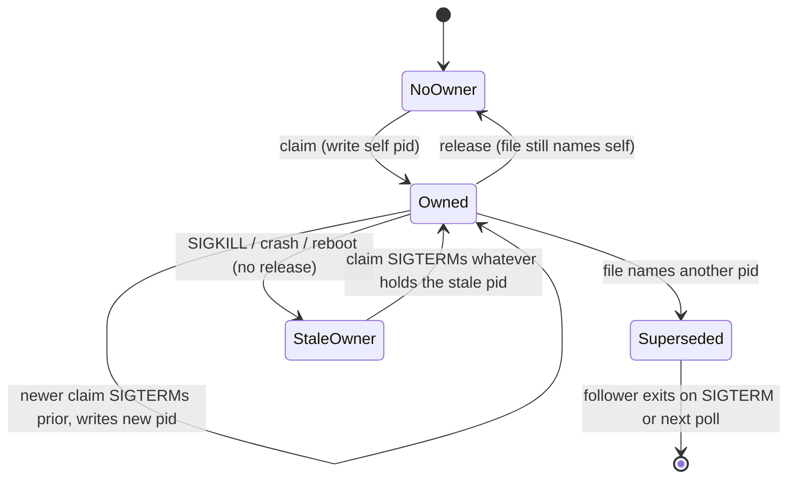

### Transitions
- **claim** (`event_log.rs:1161-1172`): take the lock, read the prior pid. If it differs from self and `kill(pid,0)` says it is alive, send `SIGTERM`. Then write the self pid.
- **supersede** (`orchestrator.rs:334-336`): `feed_superseded` is true when the owner is `Some(other)`. A missing or garbled file deliberately fails open and does not count as a supersede.
- **release** (`event_log.rs:1186-1200`, called at `orchestrator.rs:264`): remove the file only if it still names self.
- **abrupt death**: the file is left naming a dead pid. That is **StaleOwner**.

### Verified concern: PID reuse SIGTERMs an unrelated process (medium)
`event_log.rs:1165-1169` signals any live process at the recorded pid. Nothing checks the process's identity.

Followers often die without releasing, for example when Monitor tears them down, the worker or daemon is killed, or the machine sleeps or reboots. Once the pid is recycled, the next orchestrator start SIGTERMs whatever same-user process holds it: a session host, an agent or tmux.

`ssh_control.rs:332-341` (`recorded_daemon_is_same_process`) already guards the daemon PID file with a start-time match for exactly this reason. `process_start_time` exists for macOS and Linux at `ssh_control.rs:248-298`.

### Verified concern: no cleanup on abrupt exit (low)
Release only runs after `feed_loop` returns. SIGKILL and power loss leave the stale pid behind indefinitely, which is what keeps the reuse window open.

### Refuted
- **EPERM:** it does not widen the risk. A process that returns EPERM to `kill(pid,0)` also returns EPERM to SIGTERM, so nothing is killed.
- **Garbled file and co-consumption:** writes are atomic and made under the lock, so this cannot happen in normal operation. The fail-open behavior is intended.
- **Unlocked owner reads:** these cost at most one extra tick.

### Recommendation
1. Record `pid` together with its start-time.
2. Move `process_start_time` and the strict same-process check into a shared helper.
3. In the claim, signal only a provably identical process.

The SIGTERM is an accelerator, not a requirement. A real prior follower already exits on its next supersede poll, so skipping the kill whenever identity is uncertain is safe.


### Verified concerns

- **medium**: A claim can SIGTERM an unrelated process through PID reuse. The registry stores only a bare pid. After a follower dies without releasing (SIGKILL from a Monitor teardown, a worker/daemon kill, a crash or a reboot), the next claim signals any live process that now holds that pid. The only liveness test is kill(pid,0), with no start-time or command identity check. Because the target must be signalable, the victim is a process owned by the same user: a session host, an agent, an editor or a tmux server. After a reboot PIDs restart from low numbers, so reuse is fairly likely. The same codebase already solved this for the daemon PID file but did not apply the fix here.
  - Evidence: event_log.rs:1165-1169: `if prior != self_pid && process_is_alive(prior) { signal_terminate(prior); }`. process_is_alive (1109-1119) is kill(pid,0). Compare ssh_control.rs:332-341 recorded_daemon_is_same_process, which requires a start-time match before signalling, documented as 'signalling it would kill the wrong thing'.
- **low**: Release depends on a clean exit. The registry is never cleaned when a follower dies abruptly, so a stale pid can sit there indefinitely, possibly across reboots, until the next claim acts on it. This window is what makes the PID-reuse misfire reachable.
  - Evidence: orchestrator.rs:264 calls release_event_follower only after feed_loop returns. SIGTERM, SIGHUP and SIGINT are routed to a clean exit (orchestrator.rs:249-254), but SIGKILL and power loss skip it. Nothing else clears event-follower.


### Concerns that did not hold up

- 'EPERM counts as alive makes the misfire more likely' does not hold up. A process that returns EPERM to kill(pid,0) (another user's, or root's) also returns EPERM to the SIGTERM, so signal_terminate is a no-op there. The real exposure is limited to same-user processes.
- 'A garbled file reads as no owner, so two followers co-consume' is mostly theoretical. The file is only written through atomic_write (temp file plus rename) under the lock, so a torn or garbled read cannot happen in normal operation. A missing or garbled registry also makes feed_superseded return false by design (orchestrator.rs:327-336), and the next claim restores single ownership. This is an accepted fail-open, not a reachable bug.
- Unlocked owner reads in feed_superseded are fine. A stale read costs at most one extra tick, and the SIGTERM already ends the prior follower promptly.


**Recommendation:** Store an identity next to the pid, either as `pid start_time` or a small JSON record like DaemonPidRecord. Make process_start_time / recorded_*_is_same_process in ssh_control.rs a shared pub(crate) helper. In claim_event_follower, signal the prior pid only when it is provably the same process: its start-time is readable and matches. A legacy file with only a pid could fall back to also checking that the process command is shelbi, or simply skip the kill. Skipping is safe because a real prior follower still self-exits on its next feed_superseded poll once the file names the new owner. That means the SIGTERM could be dropped entirely, at the cost of up to one FEED_POLL of overlap. Optionally wrap the file format in a tiny FollowerRecord type with read/claim/release as its only mutators.


## Orchestrator liveness heartbeat and Zen crash auto-disable (dead path)

**Verdict:** Worth tidying. No live correctness bug in the machine itself, because it never runs. The cost is about 300 lines of dead hooks, state fields and renderers, a misleading poller comment, a bootstrap prompt step that makes every orchestrator scan for a line that cannot appear, a frozen 'orchestrator alive' line for upgraded installs, and a migration-hint reset that silently stopped. The one real question is a single policy decision: should a crash relaunch force Zen Off? Answering it decides between deleting the machine and moving it into the supervisor. It does not need a deeper redesign.

**Verified concerns:** 2 medium, 3 low

**Key files:**
- `crates/shelbi-cli/src/commands/zen_lifecycle.rs:37-180`
- `crates/shelbi-state/src/lib.rs:1557-1607, 2440-2610`
- `crates/shelbi-orchestrator/src/lib.rs:730-742, 970-990`
- `crates/shelbi-orchestrator/src/poller.rs:347-350, 4860-4925`
- `crates/shelbi-cli/src/commands/status.rs:717-790 and crates/shelbi-cli/src/commands/zen.rs:534-547`

### What it was

Under the tmux-pane orchestrator, a wrapper script drove a small crash-detection machine through four hidden CLI hooks:

| Hook | Effect |
|---|---|
| `__zen-orch-start` | `zen_check_crash_recovery`: if `zen_orchestrator_alive_at` (on disk `zen_last_crashed_at`) is set and less than 1h old and Zen is On, force Zen Off and emit `zen=off reason=crash-recovery`. Always clears the timestamp. Also resets the CLAUDE.md migration-hint latch. |
| `__zen-heartbeat` (every 60s) | `alive_at = now` |
| `__zen-orch-exit` | `alive_at = None` (graceful) |
| `__orch-record-exit <reason>` | If the reason is not `exit:0`/`signal:SIGTERM` and `alive_at` is set, write `crashes/<stamp>.md` and set `orchestrator_last_crash_record/_crashed_at` |

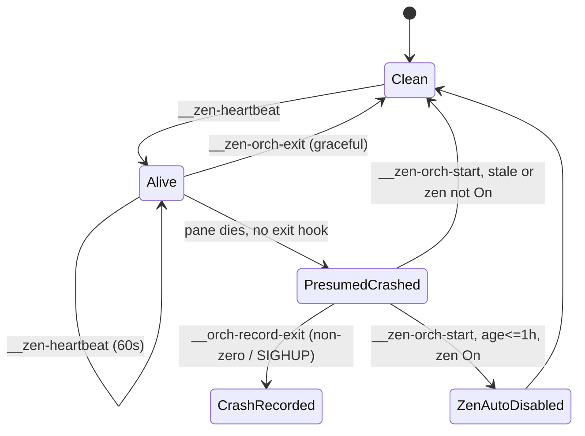

### What it is now

**Nothing drives it.** A grep finds the hooks only in their clap definitions (`crates/shelbi-cli/src/main.rs:364-393`). `orchestrator_session_spec` (`crates/shelbi-orchestrator/src/lib.rs:982-986`) says the heartbeat, traps and record hook "are not reproduced here", deferring them to daemon supervision. The supervisor's crash relaunch (`poller.rs:4895-4911`) only appends a `restart crash` supervision event and leaves `zen_mode` alone. The public docs (`site/content/docs/concepts/zen-mode.mdx:95-107`) already say a crash does not turn Zen off.

### Verified leftovers

- `poller.rs:348-349`: the comment claims Zen stays off via `__zen-orch-start`. False.
- `orchestrator/src/lib.rs:738-739`: every bootstrap prompt asks the agent to scan for `zen=off reason=crash-recovery`, which current builds never write.
- `zen.rs:545-547`, `status.rs:746`: print "orchestrator alive" whenever the field is set. Only dead hooks clear it, so a value left by an older build stays frozen forever.
- `zen_lifecycle.rs:58` / `agent_workspaces.rs:551-557`: the migration-hint latch reset only ran from `orch_start`, so the hint is now once-ever, not once-per-session.
- Dead internals: `zen_lifecycle.rs` (most of it), `shelbi-state/src/lib.rs:2440-2510, 2546-2580`, `has_recent_crash_event` in `status.rs`, and their tests.

### Refuted / moot

Auditors flagged a SIGTERM disagreement between the record path and the auto-disable path, a 1h window, Paused not auto-disabling, and crash recovery bypassing `set_zen_mode`. All are accurate readings of the code, but none can happen while the path is dead. The status-render misreading of the heartbeat is already fixed (`orchestrator_crash_display_time`).

### Recommendation

Decide one thing: **after a crash relaunch, should Zen go Off?**
- **No** (current documented behavior): delete the hooks, the heartbeat field (clear it via a config-upgrade sniffer), the crash-recovery functions, the bootstrap scan and the stale comment. Move the migration-hint reset to session spawn.
- **Yes**: put it in the supervisor's relaunch-after-crash branch. It already knows for certain that this was a crash. Use `set_zen_mode(Off)` so the normal transition line is written, and build the crash record from the session's `final.txt`. Don't bring back heartbeat-timestamp inference.

Verdict: **worth-tidying**. There is no live bug in the machine itself, only dead code, misleading guidance and one small policy decision.


### Verified concerns

- **medium**: The whole machine is orphaned. Nothing invokes the four hidden hooks, so heartbeat, graceful clear, crash detection, Zen auto-disable and crash records never run.
  - Evidence: A repo-wide grep for `__zen-orch-start|__zen-heartbeat|__zen-orch-exit|__orch-record-exit` finds only the clap definitions (crates/shelbi-cli/src/main.rs:364-393), the dispatch at main.rs:570, doc comments and docs/removing-tmux notes. crates/shelbi-orchestrator/src/lib.rs:982-986 says the heartbeat, signal traps and __orch-record-exit 'are not reproduced here'. zen_heartbeat, zen_clear_crash, zen_check_crash_recovery and record_orchestrator_crash have no non-test callers outside zen_lifecycle.rs.
- **medium**: Behavior change with a safety angle. Under the tmux wrapper, a crashed Zen orchestrator came back with Zen Off. Under the session supervisor it comes back with Zen still On and resumes auto-promote and auto-merge with no human checkpoint. The docs now state this, but it was never decided as a design choice: it fell out of the tmux removal (lib.rs:982-986 defers it to 'Phase 3 rt-daemon-poller').
  - Evidence: poller.rs:4895-4911: the relaunch success path calls append_supervision_event(restart, crash) only. zen-mode.mdx:97-100: 'Zen Mode is not currently auto-disabled when the orchestrator crashes.'
- **low**: Stale comment and stale agent instruction. The poller says Zen stays off after a relaunch via __zen-orch-start, and every orchestrator bootstrap prompt tells the agent to scan events.log for a `zen=off reason=crash-recovery` line that current builds never write.
  - Evidence: poller.rs:348-349 ('Zen stays off after the restart via its own `__zen-orch-start` crash-recovery step'). orchestrator lib.rs:738-739 (orch_bootstrap_prompt_base). The supervisor's crash relaunch path (poller.rs:4895-4911) only writes a supervision `restart crash` event and leaves zen_mode alone. site/content/docs/concepts/zen-mode.mdx:95-107 already admits the line is no longer written and the bootstrap scan is vestigial.
- **low**: A leftover heartbeat is never cleared. If state.json was last written by an older build while the orchestrator was alive, zen_orchestrator_alive_at stays set forever: zen_clear_crash and zen_check_crash_recovery are the only writers and neither runs. So `shelbi zen status` / `shelbi status` keep printing a frozen 'orchestrator alive: <old timestamp>' line.
  - Evidence: zen.rs:545-547 and status.rs:746 (via ZenSnapshot) print it whenever the field is Some. lib.rs:2480 and 2500 are the only lines that set it to None, and both sit behind dead hooks.
- **low**: A side effect of orch_start also died. The per-session CLAUDE.md migration-hint latch reset ran only from __zen-orch-start, so the latch now never resets. The hint fires once per project ever, not once per orchestrator session as documented.
  - Evidence: zen_lifecycle.rs:58 calls reset_claude_md_migration_hint. agent_workspaces.rs:551-557 documents it as 'Called from `__zen-orch-start` so each new orchestrator session starts with a clean slate'. The only callers in non-test code are inside orch_start.


### Concerns that did not hold up

- 'SIGTERM discriminator disagreement' (record_if_crash ignores signal:SIGTERM while zen_check_crash_recovery uses only the marker, zen_lifecycle.rs:140 vs lib.rs:2494). The code really does disagree, contradicting the 'can never disagree' doc at zen_lifecycle.rs:121-122. It is unreachable now, though, because neither path runs. It only matters if the machine is revived.
- 'A 1h wall-clock window lets a late restart count as NoCrash' (lib.rs:2443). True by design, but dead, and the session supervisor relaunches within seconds anyway.
- 'Paused is not auto-disabled' (lib.rs:2499 only checks On). Accurate, but moot since the path never runs.
- 'Crash recovery bypasses set_zen_mode, so no mode=zen transition line is written.' Accurate but moot. The dedicated crash-recovery line was the intended signal.
- 'The heartbeat field named zen_last_crashed_at on disk caused a status-render bug.' Already fixed: zen.rs:536-544 and orchestrator_crash_display_time (lib.rs:2587-2600) use the real crash fields and ignore the heartbeat.
- 'capture_pane_tail is a stub' (zen_lifecycle.rs:177-180). True, but it is just one more piece of the dead path, not a separate defect.


**Recommendation:** Make one decision, then either delete or re-home the machine. (a) Delete: remove the four hidden commands, zen_heartbeat / zen_clear_crash / zen_check_crash_recovery / ZEN_CRASH_RECOVERY_WINDOW_SECS, record_if_crash / capture_pane_tail, and the zen_orchestrator_alive_at field (keep serde-tolerant reading, or clear it in a config_upgrade sniffer so the stale 'orchestrator alive' line goes away). Keep the orchestrator_last_crash_* display only if something still writes it. Drop the crash-recovery scan from orch_bootstrap_prompt_base and fix the poller.rs:349 comment. Move reset_claude_md_migration_hint to the session-spawn path (or drop the hint). (b) Re-home: if Zen should drop to Off after a crash, do it in one place, the supervisor's relaunch-after-crash branch (poller.rs:4895-4911). That code already knows authoritatively that this was a crash, so no heartbeat inference is needed. Call set_zen_mode(Off, reason=crash-recovery) so the standard `mode=zen on -> off` line is written, write the crash record there from the session's final.txt, and update zen-mode.mdx. Either way the heartbeat-timestamp inference should not come back: the daemon supervisor already holds the real state of the session (running, exited, relaunched).


## Control-socket connection protocol and client process lifecycle

**Verdict:** Worth tidying. The most-cited risks (mutation loops missing pushes, a stale client skipping Hello, two producers of Failed, lost detaches) don't hold: mutation connections never subscribe, and every real client says hello through ControlClient::over. What remains is drift between the TUI and desktop reconnect loops (the TUI has no pause and can spin), leaked desktop hello threads, redundant desktop watch loops, and two-flag re-exec plumbing. These are robustness and clarity issues, not correctness bugs.

**Verified concerns:** 1 medium, 5 low

**Key files:**
- `crates/shelbi-cli/src/commands/daemon/control.rs:232-323, 392-544`
- `crates/shelbi-client/src/control.rs:60-160, 400-432`
- `crates/shelbi-tui/src/shell/mod.rs:440-500, 690-735, 789-891`
- `desktop/src/platform/control.rs:60-260`
- `desktop/src/refresh.rs:440-475`

### What it is
Every `control.sock` connection goes through a lifecycle that is never written down in one place. The daemon accepts the connection, the client says hello (optional as far as the daemon is concerned), and the connection can then subscribe to pushes. If it announced a `ClientInfo` it becomes an attached UI client. It can be pushed a `Detach` and is finally reaped on EOF. On the client side, the TUI and the desktop app each wrap this in their own background loops that turn `Reexec`/`Detach` pushes and version mismatches into process-level outcomes: re-exec, quit, or relaunch-required.

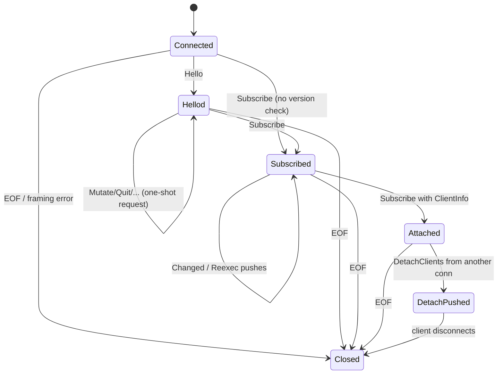

### How it is stored
- **Daemon** (`crates/shelbi-cli/src/commands/daemon/control.rs:392-544`): a local `client_version: Option<String>` (406), membership in `Inner.subscribers` / `Inner.clients` (141-148), and the writer-thread channel. Any `ClientMsg` is legal at any point.
- **TUI** (`crates/shelbi-tui/src/shell/mod.rs`): the listener thread sets a local `reexec: Arc<AtomicBool>` (445) or `DetachSignal` (789-815). The main loop copies them into `should_reexec`/`should_quit` (486-498). On exit both re-exec and detach are computed (713-714). Re-exec carries the view in `SHELBI_REEXEC_VIEW`.
- **Desktop** (`desktop/src/platform/control.rs`): a one-shot `relaunch: Mutex<Option<RelaunchNotice>>` latch, the `watch_loop` (167-218), and a separate `ControlWatcher::run` in `desktop/src/refresh.rs:458-475` used only for `Changed` notes.

### Verified concerns
1. **TUI reconnect has no pause (medium).** After the subscription drops and the version still matches, `spawn_reexec_listener` goes straight back to connect+subscribe (`shell/mod.rs:846-858`). Desktop pauses 2s in the same spot (`platform/control.rs:216`). A daemon that accepts and immediately closes makes the TUI thread spin.
2. **Desktop hello leaks threads (low).** `hello()` abandons its connect thread after the 5s timeout (`platform/control.rs:245-256`). `watch_loop` retries every 2s, so a wedged daemon piles up blocked threads and fds.
3. **Desktop has overlapping watchers (low).** `ControlWatcher::run` (1s, no timeout, no version check, info-less subscribe that also gets `Reexec` and ignores it) runs alongside `watch_loop`. Each `Bootstrap::spawn_as` reaching Ready adds another `watch_as` thread (`bootstrap.rs:433`) with no stop handle. Windows opened before `Shell.ready` exists each call `start_bootstrap` (`app.rs:1327-1329`), as do `launch.rs:79` and `cli_setup.rs:132`.
4. **Hello is not enforced (low, latent).** A first frame other than Hello skips the out-of-date `Reexec` (`daemon/control.rs:443`). Today only `ControlClient::over` writes Hello (`shelbi-client/src/control.rs:79`) and it always does, so nothing reaches this.
5. **Re-exec state is split across two flags (low).** Re-exec and detach are made exclusive only by the listener returning after setting either one; nothing in the types rules out both.
6. **The detach count means "signalled" (low).** `detach_clients` counts sends (`daemon/control.rs:283-300`), and `shelbi detach` reports them as "Detached N".

### Refuted
- **"mutate_done ignores Reexec/Detach":** mutation connections never subscribe, so they never receive those pushes.
- **"Lost detach while reconnecting":** a disconnected client is not in the registry, so the detach never targets it.
- **"Two producers of Failed":** the relay answers only frames it refused and never forwarded.
- **QuitProject inline, unbounded issue_locks, listener without a stop flag:** all harmless as written.

### Recommendation
Give the daemon a per-connection `ConnPhase` enum that rejects anything before Hello. Factor one `watch_daemon` helper into shelbi-client that owns hello-timeout, backoff, version check and push decoding. The TUI listener, desktop `watch_loop` and desktop `ControlWatcher` all use it, which fixes the TUI spin and collapses the desktop's two loops. In the TUI, replace the reexec/detach flags with a single set-once `ExitIntent`. Use a socket read timeout for the desktop hello instead of an abandoned thread.


### Verified concerns

- **medium**: The TUI push listener has no pause on a dropped subscription. If the daemon version still matches, it loops straight back to connect_control+subscribe_as. A daemon that accepts and then closes (shutting down, wedged accept loop) makes the thread spin. The desktop watch_loop sleeps RECONNECT_PAUSE (2s) in the same spot, so the two clients have drifted apart.
  - Evidence: crates/shelbi-tui/src/shell/mod.rs:846 `Ok(None) | Err(_) => break`, then 849-858 checks the version and falls back to the top of `loop` with no sleep. Compare desktop/src/platform/control.rs:216 `std::thread::sleep(RECONNECT_PAUSE)` after the inner loop.
- **low**: Desktop hello() abandons its connect thread on timeout. watch_loop retries every 2s, so a daemon that accepts but never answers the hello leaves another blocked thread (and fd) behind on each retry.
  - Evidence: desktop/src/platform/control.rs:245-256: spawns `shelbi-desktop-hello`, `recv_timeout(HELLO_TIMEOUT)`; the doc says 'A timed-out attempt's thread is left to finish on its own'. watch_loop at 186-192 sleeps RECONNECT_PAUSE and calls hello again.
- **low**: Desktop runs two independent reconnect loops against the same control socket with different policies. ControlWatcher::run reconnects every 1s with no hello timeout and no version check, and never stops. Its subscribe() is info-less, so it also receives Reexec pushes and ignores them. watch_loop reconnects every 2s with a 5s hello timeout and the relaunch latch. Every Bootstrap::spawn_as that reaches Ready also starts another watch_as thread with no stop handle. Windows opened before Shell.ready is set each call start_bootstrap and can register duplicate attached-client connections under the same client_id.
  - Evidence: desktop/src/refresh.rs:458-475 (`ControlClient::connect(...).and_then(|c| c.subscribe())`, sleep 1s). desktop/src/platform/bootstrap.rs:433 `ready.control.watch_as(...)`. desktop/src/app.rs:1306/1327-1329 `None => this.start_bootstrap(cx)`, plus launch.rs:79 and views/cli_setup.rs:132 as further spawn_as entry points.
- **low**: The daemon does not require a Hello. A Subscribe or Mutate sent before any Hello gets no out-of-date Reexec check, because client_version is None. Today every in-tree producer goes through ControlClient::over, which always says hello first, and the relay forwards Hello. So this is a protocol gap with no reachable bug, but nothing enforces it.
  - Evidence: crates/shelbi-cli/src/commands/daemon/control.rs:406 `let mut client_version: Option<String> = None;`, 443 `if let Some(cv) = client_version.as_ref().filter(|_| !remote)`. crates/shelbi-client/src/control.rs:79 is the only Hello writer.
- **low**: TUI re-exec is encoded twice: a local AtomicBool written by the listener, and ShellState.should_reexec plus should_quit, bridged each tick. The exit path computes both re-exec and detach and acts on both. Only the listener's structure keeps them exclusive (it returns after setting either one), and the types do not guarantee it.
  - Evidence: crates/shelbi-tui/src/shell/mod.rs:445 (local reexec), 486-491 (bridge), 495-498 (detach -> should_quit), 713-714 (both computed), 828-845 (listener returns after either).
- **low**: `shelbi detach` reports how many Detach messages were sent, not how many clients actually left. A client that ignores the push is still counted as 'Detached'.
  - Evidence: crates/shelbi-cli/src/commands/daemon/control.rs:283-300 counts `tx.send` attempts. crates/shelbi-cli/src/commands/detach.rs:43/57 reports `Detached(n)`.


### Concerns that did not hold up

- mutate_done dropping Reexec/Detach pushes: a mutation connection never sends Subscribe, so it is never in the `subscribers` or `clients` maps. broadcast_all and detach_clients only target those maps, so a mutation connection cannot receive Reexec or Detach. Ignoring other ServerMsgs there loses nothing (shelbi-cli daemon/control.rs:232-234, 283-322).
- A Detach lost while the TUI subscription is reconnecting: while it is disconnected, the client is not in the `clients` registry, so `shelbi detach` neither targets it nor counts it. Nothing is lost silently, and the next `shelbi detach` sees it once it re-registers.
- Relay-generated Failed as a second producer with different semantics: ControlLink::accept answers only frames it refused and never forwards those frames, so the daemon never sees that request_id. Only one producer exists per request (crates/shelbi-client/src/relay/services.rs:258-275).
- QuitProject running inline on the reader thread: the requesting client blocks on that same request (ControlClient::lifecycle), and other clients have their own handler threads. Serializing that one connection has no visible effect.
- issue_locks growing without bound: the code documents this as one entry per distinct issue or config surface touched in the daemon's lifetime. The growth is bounded in practice and the entries are small.
- The TUI listener having no stop flag: the process exits (or execs) right after the main loop ends, so the thread does not outlive anything that matters.


**Recommendation:** 1. On the daemon, add a per-connection `enum ConnPhase { AwaitingHello, Ready { client_version }, Subscribed { attached: bool } }` and refuse any frame other than Hello in AwaitingHello. 2. In shelbi-client, add one shared helper such as `shelbi_client::watch_daemon(info, policy) -> Receiver<WatchEvent>` (WatchEvent = Changed | OutOfDate | Detach) that owns hello-with-timeout, backoff and the version check. The TUI listener, desktop watch_loop and desktop ControlWatcher would all use it, so the pause and timeout policy lives in one place. That fixes the TUI spin and lets desktop drop one of its two loops. 3. In the TUI, replace the reexec AtomicBool, should_reexec and DetachSignal with one `ExitIntent { Quit, Reexec(View), Detach(String) }` that the listener sets once (for example a OnceLock), so re-exec and detach cannot both be set. 4. Give the desktop hello a socket read timeout (set_read_timeout on the UnixStream) instead of a thread it abandons.


## Orchestrator event cursor, high-water mark and durable feed claim/ack

**Verdict:** Worth tidying. The forward-only hwm makes the multi-writer, non-atomic design self-correcting, so no event-loss or replay bug survived verification. What remains: four call sites that each restate the legal cursor moves, a garbled-cursor wedge that has a ready repair source (the hwm) but no repair path, and an expired-cursor behavior that differs between drain and the feed. All three are cheap to fix by centralizing cursor moves in shelbi-state.

**Verified concerns:** 1 medium, 5 low

**Key files:**
- `crates/shelbi-cli/src/commands/orchestrator.rs:343-501 (feed_loop_with, InflightBatch, feed_should_scan)`
- `crates/shelbi-cli/src/commands/orchestrator.rs:751-781 (ack_delivery)`
- `crates/shelbi-cli/src/commands/orchestrator.rs:890-915 (drain_persisted, read/write_persisted_cursor)`
- `crates/shelbi-state/src/event_log.rs:870-1096 (hwm, reconcile/repair, read_or_initialize_event_cursor[_deadline], write_event_cursor)`
- `crates/shelbi-state/src/event_log.rs:3315-3335 (rotation gate on cursor files)`

### What it is
Each project has a durable **applied cursor** (`~/.shelbi/projects/<p>/event-cursor`) and a forward-only **acked high-water mark** (`event-cursor.hwm`), both guarded by `event-cursor.lock`. The consuming feed (`shelbi orchestrator events next --follow`) holds at most one **in-flight batch** in memory. It redelivers that batch after a 90s visibility timeout and quarantines it once the redelivery cap is passed. A PID registry (`event-follower`) keeps it to one consuming follower per project.

### States and storage
| Layer | Encoding | States |
|---|---|---|
| Durable cursor | u64 text file + hwm file | Missing, Trusted, Rewound (healed on read), Expired, Garbled |
| Feed | `Option<InflightBatch{cursor, emitted, redeliveries}>` | NoInflight, Inflight, Redelivering, Quarantined, Resynchronized |
| Feed process | `FeedOutcome` + JSON notice | Terminated, Superseded, Expired, Failed |

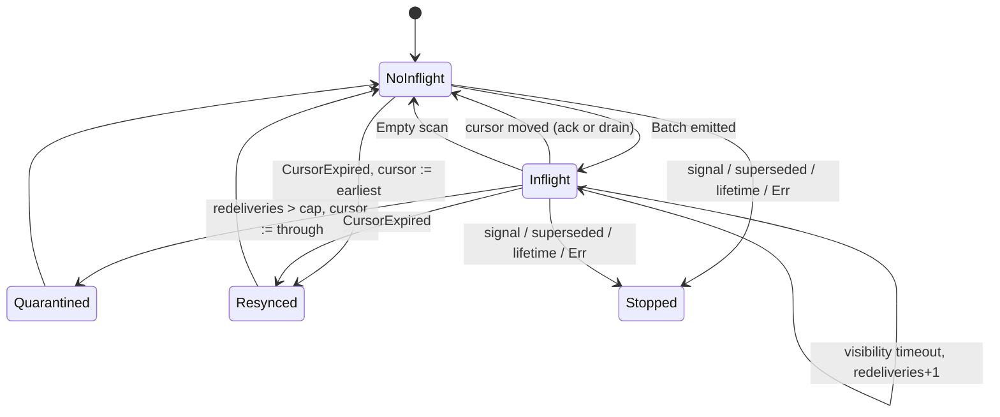

### Cursor writers (no single owner)
- `ack_delivery`: range-checked (orchestrator.rs:751-768)
- feed quarantine: force-advance to `through` (orchestrator.rs:413)
- feed resync: force-advance to `earliest` (orchestrator.rs:443)
- `drain_persisted`: writes whatever drain reached (orchestrator.rs:896)

All four go through `write_event_cursor` (event_log.rs:1052-1096). It writes unconditionally and then bumps the hwm under the same lock. Every read reconciles a cursor below the hwm up to it (event_log.rs:934-952). That safety net is why the races the auditors flagged are benign.

### Verified concerns
1. **Garbled cursor wedges the feed and rotation (medium).** Reads hard-error (event_log.rs:982-984, 1029-1031). The feed fails on every relaunch, and rotation defers (event_log.rs:3326-3330), so events.log grows. No path repairs it, even though the hwm is available. A garbled hwm, by contrast, is tolerated.
2. **Four writers, no owner of legal moves (low).** Correctness depends on the hwm heal, not on validating each move.
3. **Non-atomic ack (low).** The read at orchestrator.rs:758 and the write at :763 take the lock separately. An interleaved drain makes ack rewind the cursor briefly, the hwm heals it, and a misleading warning is logged.
4. **Drain vs feed parity on an expired cursor (low).** The feed fast-forwards with a notice. `events drain` and `--cursor N` hard-error (event_log.rs:701-711).
5. **Quarantine is recorded only on stdout (low).** The skipped range is not written durably anywhere.
6. *Adjacent:* the Zen crash-recovery line `zen=off reason=crash-recovery` (zen_lifecycle.rs:67) classifies as a generic `event`, not `zen_mode_transition` (orchestrator.rs:1122). The zen.rs:14-19 doc describes a different shape.

### Refuted
- A quarantine or resync interleaving with ack cannot corrupt the position: same target, or healed by the hwm.
- `drain --cursor 0` cannot durably rewind: it writes a position at the head, and the hwm guards it anyway.
- Drain during an in-flight batch delivers those events through drain, which is the source of truth. They are not lost.
- The hwm blocking a deliberate rewind is intentional, and stateless replay via `drain --cursor N` still works.

### Recommendation
Centralize the moves in `advance_event_cursor(project, CursorMove::{Ack, Quarantine, Resync, DrainTo})`, which reads, validates, writes and bumps the hwm under a single lock. Make quarantine and resync durable (an events.log line). Self-heal a garbled cursor to `max(hwm, current_base)`. Give drain the same expired-cursor fast-forward as the feed. Keep `InflightBatch` and `feed_should_scan` as they are, since they are already small, pure and tested.


### Verified concerns

- **medium**: A garbled event-cursor file wedges the project and nothing repairs it. Every read hard-errors, so the --follow feed exits with a Failed notice, and every relaunch fails the same way. Rotation is also blocked, so the hub-global events.log grows without bound. A usable recovery value already exists (the hwm, or the current base), yet the read path does not use it. A garbled hwm, by contrast, is tolerated as None.
  - Evidence: event_log.rs:982-984 and 1029-1031 map a parse failure to Error::Other("invalid event cursor"). feed_loop_with:375-378 propagates it with ?, and run_feed:270-277 emits Failed. event_log.rs:3326-3330 returns true (defer rotation) on a malformed cursor. event_log.rs:880-891 treats a garbled hwm as None. atomic_write makes a garbled file unlikely but not impossible (manual edit, disk fault).
- **low**: Three writers with different semantics move the same durable cursor, and nothing owns the legal moves. Ack is range-checked. Quarantine and resync force-advance. Drain writes whatever position it reached, with no range check. Each call site restates its own rules, and legality is enforced only after the fact by the hwm heal.
  - Evidence: orchestrator.rs:763 (ack), 413 (quarantine), 443 (resync) and 896 (drain) all call write_persisted_cursor -> shelbi_state::write_event_cursor, which writes any value unconditionally (event_log.rs:1052-1096).
- **low**: ack_delivery's compare-and-advance is not atomic. The read and the write take the cursor lock separately, so a drain that lands in between can be followed by ack writing a lower 'through'. The damage is bounded: the cursor is briefly rewound, the hwm (already bumped by the drain) heals it on the next read, and that read logs a spurious 'cursor is behind the acked high-water mark' warning. No events are lost or replayed.
  - Evidence: orchestrator.rs:758 read_persisted_cursor (lock taken and dropped in read_or_initialize_event_cursor, event_log.rs:973), then orchestrator.rs:763 write_persisted_cursor (lock re-taken, event_log.rs:1056). The heal is at event_log.rs:934-952.
- **low**: Parity drift between drain and the feed on an expired cursor. The --follow feed self-heals a cursor that fell past retention (resync notice plus fast-forward). `events drain`, and an explicit `--cursor N` replay below the earliest retained offset, instead hard-error with 'predates earliest retained cursor', and the user has to recover by hand.
  - Evidence: read_event_log_from (event_log.rs:701-711) maps FeedRead::CursorExpired to Err, used by drain_once at orchestrator.rs:838-840. The feed handles the same case at orchestrator.rs:433-446.
- **low**: Quarantine moves the cursor past real events with no ack. The only record is one stdout JSON notice on the feed stream, so a consumer that misses the line (restart, or a truncated pane capture) loses those events silently. This is by design (an anti-wedge measure), but nothing durable is written (no events.log line, no state key).
  - Evidence: orchestrator.rs:409-415: write_persisted_cursor(project, through) then emit_notice(quarantine_notice(...)), and inflight = None.
- **low**: Side finding on event classification, adjacent to this machine. The Zen crash-recovery line `zen=off reason=crash-recovery` has no `mode=zen`/`->`, so event_kind classifies it as a generic event, not zen_mode_transition. The zen.rs module doc still describes a future `mode=zen <prev> -> <new> reason=system:crash-recovery` shape.
  - Evidence: zen_lifecycle.rs:67 append_project_event(project, "zen=off", "crash-recovery"). orchestrator.rs:1122-1124 needs mode==zen && from.is_some(). zen.rs:14-19 doc.


### Concerns that did not hold up

- Concern: the non-atomic ack can race quarantine or resync and corrupt the position. Refuted as a correctness bug. Quarantine writes the same 'through' that ack would, and resync only fires on an expired cursor, where ack's write is lower and gets healed. write_event_cursor always bumps the forward-only hwm under the lock, and every read reconciles the cursor up to it (event_log.rs:934-952). The worst outcome is a transient rewind plus a warning log.
- Concern: `drain` with `--cursor 0` rewrites the persisted position. drain_persisted writes the position drain_once reached, which is the last complete line at or near the head, so it is never behind the old cursor. Any lower write would be healed by the hwm anyway. A replay therefore re-reads but cannot rewind durable state (orchestrator.rs:890-897).
- Concern: a drain while a --follow batch is in flight silently 'acks' it and loses it. The drain consumer receives those events in its own output, and the code comments name the periodic drain as the source of truth, with the feed only an accelerator (orchestrator.rs:240-243). The follower sees cursor != inflight.cursor and moves on (orchestrator.rs:497). A later ack of the old delivery id returns already-acked. The events are delivered once, not lost.
- Concern: the hwm blocks deliberate rewind or replay. This is intentional (the doc at event_log.rs:863-871 says it guards against stale-index rewinds), and replay is still possible statelessly via `drain --cursor N`. It is a design choice, not a defect. The note: a hand-edited rewind of event-cursor is silently undone.


**Recommendation:** Make one function in shelbi-state own every move: advance_event_cursor(project, CursorMove) -> Result<CursorMoveOutcome>, with CursorMove::{Ack{from,through}, Quarantine{from,through}, Resync{to}, DrainTo{to}}. It takes the cursor lock once, reads, validates, writes the cursor, and bumps the hwm in that single critical section. Ack's gap and already-acked checks move inside it, which makes ack atomic and removes the spurious rewind warnings. Have Quarantine and Resync also append a durable events.log line (for example `project=<p> feed=quarantined from=.. through=..`), so a skip is recorded beyond stdout. On a garbled cursor, repair forward to max(hwm, current_base) with a warning, as the rewound case already does, so the feed and rotation recover by themselves. Give drain the same CursorExpired fast-forward plus notice that the feed has, or reuse feed_scan. Leave the in-memory InflightBatch as it is. It is small, single-owner, and already factored into a tested pure function (feed_should_scan).


## Heartbeat and external-issue reconcile cadence (poller supervisor tick)

**Verdict:** Worth tidying. There is no live correctness bug. The heartbeat cannot starve, and the reconcile gap is a documented tradeoff. But the heartbeat carries a debounce mechanism (window_start, last_log_mtime, external_event_since, plus about 40 lines of comments) that production never triggers. Its doc promises reset-on-event behavior that does not happen, and its test pins a state that cannot occur. Separately, two schedulers hand-roll the same seed / due / offline-skip / back-off machine. Collapsing them into one Cadence type would delete code and remove a misleading invariant. The restart gap is worth a short conversation, but it is a design choice rather than a defect.

**Verified concerns:** 1 medium, 4 low

**Key files:**
- `crates/shelbi-orchestrator/src/poller.rs:637-677 (HeartbeatSchedule)`
- `crates/shelbi-orchestrator/src/poller.rs:783-803, 955-973 (IssueReconcileSchedule, backoff_interval)`
- `crates/shelbi-orchestrator/src/poller.rs:1061-1165 (maybe_reconcile_issues)`
- `crates/shelbi-orchestrator/src/poller.rs:1167-1350, 1445-1455 (maybe_emit_heartbeat, external_event_since)`
- `crates/shelbi-orchestrator/src/poller.rs:11185-11225 (debounce test that hand-builds an unreachable state)`

### What it is
The poller's project-wide supervisor tick (`run_poller_loop`, poller.rs:214+) runs two adaptive-cadence schedulers each 5s tick:

- **Heartbeat** (`HeartbeatSchedule`, poller.rs:637; `maybe_emit_heartbeat`, poller.rs:1204). It emits a `heartbeat zen_eligible=.. idle_workspaces=..` line. The interval is `standard` while work is in flight and doubles up to `max` (default 300s) while the board is quiescent.
- **External-issue reconcile** (`IssueReconcileSchedule`, poller.rs:788; `maybe_reconcile_issues`, poller.rs:1061). On the GitHub backend it polls `poll_changes` from an in-memory cursor and turns tracker edits into `events.log` transitions, adoptions and comments. It borrows the heartbeat's standard/max and back-off.

Both are `Option<Instant>`-clock state machines held in loop locals. Neither is persisted.

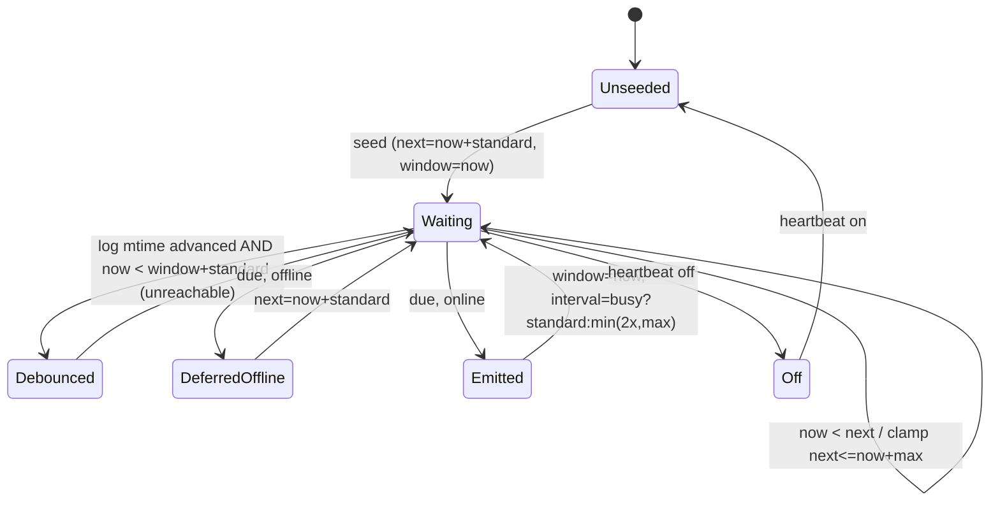

### Main finding: the debounce never fires
Every assignment to `next_attempt` keeps `next_attempt >= window_start + standard`:
- seed (1227): `now+standard`, window `now`
- emit (1348): `now+interval`, interval >= standard, window `now`
- debounce (1266): `min(deadline, ..)` <= deadline
- offline (1288-1294): `now+standard`
- clamp (1240): `now+max`

So by the time `now >= next_attempt`, `now >= deadline` already holds. The `if now < deadline` skip at poller.rs:1262 never runs, and an observed event changes nothing; the code falls through to emit. The doc block at 1173-1186 ("reset on any real event... snap the cadence back to standard") describes behavior that does not happen. The test `maybe_emit_heartbeat_debounces_against_recent_activity` (11185) passes only because it hand-sets `next_attempt = now` right after seeding. The `unwrap_or(now - current_interval)` "legacy schema" fallbacks (1260, 1285) are also unreachable, since the struct is never persisted.

The auditor's worry that the poller's own writes (and, since `events.log` is the global `~/.shelbi/events.log`, other projects' writes) defer the heartbeat is correct about the signal but has no effect today. It would start to matter only if someone made the debounce reachable without also scoping the signal.

### Duplication
The back-off is inlined in the heartbeat (1343-1347) and lives separately in `backoff_interval` (967) for reconcile. The "due? offline → don't burn cadence" scaffolding is repeated in `maybe_poll_ci` (709), `maybe_github_reconcile` (748) and `maybe_reconcile_issues` (1089).

### Reconcile restart gap
`seeded=false` on every poller start (1107) snapshots the board as the baseline and emits nothing. Comments, external moves and actionable adoptions made while the hub was down are dropped silently. This is documented (274-280) as the plan-D3 tradeoff, and Zen heartbeats' `zen_eligible` partly backstops it. Nothing logs that the gap occurred, though. Persisting only the cursor (not content) would close the gap without violating D3.

### Recommendation
Introduce one `AdaptiveCadence` type that owns next_due, interval, the offline skip and the back-off, and drive the heartbeat and issue-reconcile from it (CI and GitHub-merge clocks too, with a fixed interval). Decide whether reset-on-event is wanted. If not, delete `window_start`, `last_log_mtime`, `external_event_since` and the misleading test. If it is, make it reachable and project-scoped. Optionally persist the reconcile cursor under `~/.shelbi/projects/<name>/`, or emit a re-seed notice.


### Verified concerns

- **medium**: The heartbeat's reset-on-event debounce is dead code in production. Every write to next_attempt keeps next_attempt >= window_start + standard. Seed: next=now+standard with window=now. Emit: next=now+interval with interval>=standard and window=now. Debounce: next=deadline. Offline: next=now+standard. Clamp: next=now+max. So when the attempt comes due, now >= deadline, the `now < deadline` branch never runs, and the code falls through to emit. As a result, the documented 'any real event snaps the cadence back to standard' never happens; back-off is driven only by board_is_quiescent. The only test for it passes because it hand-sets next_attempt=now right after seeding, which is a state production cannot reach.
  - Evidence: poller.rs:1219-1229 seed; 1257-1269 debounce guarded by `if now < deadline`; 1280-1295 offline; 1340-1349 emit; test poller.rs:11204-11210 forces `hb.next_attempt = Some(Instant::now())`
- **low**: The external-event signal reads the mtime of the GLOBAL ~/.shelbi/events.log. That file is shared by every project and by this poller's own non-heartbeat writes, so if the debounce were ever made reachable, any project's activity would defer every other project's heartbeat. Today the debounce is unreachable, so this has no effect, but it is a hazard for anyone who 'fixes' the debounce.
  - Evidence: events_log_mtime poller.rs:1541-1544 -> shelbi_state::events_log_path() = shelbi_home()/events.log (shelbi-state/src/event_log.rs:289-292); external_event_since poller.rs:1445
- **low**: The back-off arithmetic is written twice. The heartbeat inlines `current_interval.saturating_mul(2).min(max).max(standard)`, and the reconcile sweep calls backoff_interval, whose doc says it 'mirrors exactly'. The two match today but have no shared owner, and the clock/seed/offline-skip scaffolding around them is also duplicated across the two schedulers plus maybe_poll_ci and maybe_github_reconcile.
  - Evidence: poller.rs:1343-1347 vs poller.rs:960-973; similar offline-don't-burn-cadence blocks at 709-712, 748-751, 1089-1092
- **low**: The reconcile baseline (cursor + seen_status) lives only in memory. On every poller restart it re-seeds by snapshotting the board and emits nothing, so three kinds of edits made while the hub was down are permanently dropped: comments, external close/reopen moves, and cards adopted into an actionable status. Nothing records that a gap happened. The code documents this as an accepted tradeoff. It is partly offset by Zen heartbeats carrying zen_eligible, but not when Zen is off, and comments are never recovered.
  - Evidence: poller.rs:274-280 comment; seed path poller.rs:1107-1125; seed_issue_reconcile poller.rs:945-953
- **low**: window_start's `unwrap_or(now - current_interval)` 'legacy schema' fallback is unreachable. The schedule is never persisted, and window_start is always Some once next_attempt is Some. Instant minus Duration can also panic near boot on some platforms if this path ever became reachable.
  - Evidence: poller.rs:1260, 1285; HeartbeatSchedule is a local at poller.rs:224, never deserialized


### Concerns that did not hold up

- Auditor concern: the poller's own same-tick appends (supervision, dialog, push, reconcile events) count as 'external events' and defer the heartbeat. The mtime check does treat them that way, but the deferral cannot happen: the debounce branch is unreachable in production (see concern 1). These writes therefore have no effect on heartbeat timing. The real issue is dead code and a doc/behavior mismatch, not over-deferral.
- Risk of a heartbeat starving on a busy board: refuted. Because next_attempt >= window_start+standard always holds, the heartbeat fires at least every `interval` (<= max, default 300s, model.rs:425) while online.


**Recommendation:** Extract one `AdaptiveCadence { next_due: Option<Instant>, interval: Duration }` with `poll(now, online) -> Due|Wait|Offline` and `after_run(quiescent, standard, max)`. Use it for the heartbeat and the issue-reconcile sweep, and optionally for the CI and GitHub-merge clocks with a fixed interval. Decide explicitly whether reset-on-event is wanted. If it is not, delete window_start, last_log_mtime, external_event_since and the debounce test, and fix the doc comment. If it is, make it reachable (for example, a real event sets next_due=now+standard when that is sooner), and scope the signal to this project's own lines instead of the global log mtime. For the reconcile gap, consider persisting only the poll cursor (not content, so plan D3 still holds) under ~/.shelbi/projects/<name>/, or at least log/emit a 'reconcile re-seeded; edits since <ts> not replayed' notice on seed.


## Client/daemon version handshake, skew gate and binary upgrade

**Verdict:** Worth tidying. The handshake core is already explicit and correct: two enums, one pure classifier, one guard, and the TUI, poller, app and CLI all go through it, so there is no parity drift. The real fragility is in the upgrade script: a non-atomic in-place overwrite that is unsigned for a while, and liveness detection by grepping status text. Add the stale supervisor wording and the open-ended compat shim. Each item is small and fixable in isolation, and none breaks the gate's correctness.

**Verified concerns:** 1 medium, 3 low

**Key files:**
- `crates/shelbi-state/src/hub_version.rs:121-263`
- `crates/shelbi-cli/src/commands/hub_version.rs:39-158`
- `crates/shelbi-cli/src/commands/daemon/lifecycle.rs:238-319`
- `scripts/install.sh:114-176`
- `crates/shelbi-state/src/daemon_lifecycle.rs:155-210`

### What it is
Shelbi checks whether the client binary and the long-lived hub daemon are compatible, and uses the answer to gate mutations and to upgrade the daemon. There are three layers:

1. **Handshake (shelbi-state, explicit).** `probe_daemon_hello` (`crates/shelbi-state/src/hub_version.rs:153-169`) connects to the hub socket, half-closes the write side (an empty connection is the hello request), and reads one bounded line with a 1s timeout. The result is a `DaemonProbe` with three values: `NotRunning`, `NoHello` or `Hello`. The pure `classify_daemon_version` (`173-195`) maps it to a `DaemonVersionStatus`: `NotRunning`, `Match` or `Mismatch`. `NoHello` counts as a mismatch, and so does a protocol or exact-version difference. `ensure_daemon_matches_for_mutation` (`206-214`) is the non-interactive guard used by the TUI kanban, the orchestrator poller/lifecycle, app zen and others.
2. **CLI skew gate (implicit offer sub-machine).** `crates/shelbi-cli/src/commands/hub_version.rs:54-139`. On a mismatch it decides to offer a restart: `busy_workspaces()==0`, then `SHELBI_YES=1`, else a TTY confirm, else decline. An accepted offer runs `daemon restart` and polls up to 10s for `Match`. Otherwise it bails with the remedy. Read-only commands only warn.
3. **Upgrade (`scripts/install.sh`, implicit).** The script builds, copies over the installed binary in place, swaps the plugin bundle, re-signs on macOS, then greps `daemon status` output and restarts a running daemon.

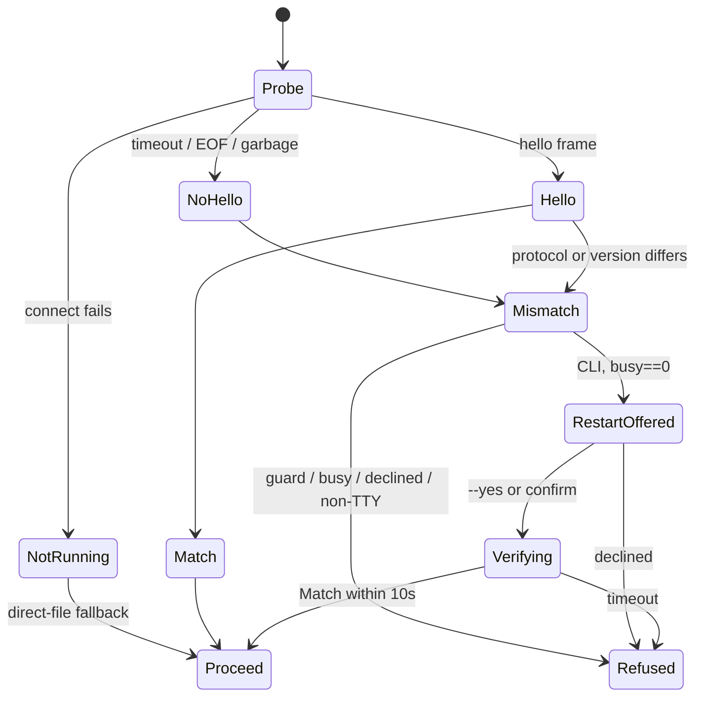

### Verified concerns
- **Non-atomic binary swap (medium).** `scripts/install.sh:119` uses `cp` over the live path, which rewrites the same inode. The macOS re-sign comes later, at `140-144`, after the plugin staging at `121-138`. In between, the installed binary has an invalid signature, so any exec (an on-demand daemon spawn via `current_exe`, see `daemon_lifecycle.rs:162`, a worker `shelbi` call, or the desktop CLI check) gets `Killed: 9`. The running old daemon is also executing from a rewritten file, and a SIGKILL on page-in is plausible.
- **Stringly liveness (low).** `install.sh:156-159` greps `shelbi daemon: running`, printed at `lifecycle.rs:291`. A wording change silently skips the restart.
- **Stale supervisor guidance (low).** `cli hub_version.rs:39-43, 63-66` still talk about launchd/systemd relaunch. Restart is now a direct stop+spawn that retires units (`lifecycle.rs:238-276`).
- **Unbounded compat shim (low).** `read_daemon_ack` (`state hub_version.rs:231-263`) still tolerates the interim server-first daemon, with no removal marker.

### Refuted
- **NotRunning TOCTOU.** Spawned daemons exec the installed path (`current_exe`), so they run the same binary as the client. Old long-lived clients re-probe and see Mismatch.
- **Per-mutation probe cost.** It is instant for a healthy daemon. The 1s timeout only hits NoHello, which refuses anyway.
- **busy_workspaces counts all projects.** This is intentional and errs toward safety.

### Recommendation
Do the install with a temp copy, then sign, then `mv -f` (an atomic inode swap), and swap the plugin dir with a rename as well. Add a machine-readable `daemon status` (exit code or `--json`) for the script to key off. Fix the supervisor wording. Put a sunset note on the server-first ack compat. The enum and classifier core can stay as they are.


### Verified concerns

- **medium**: install.sh replaces the binary in place, so nothing is swapped atomically. Until the re-sign runs (after the plugin install), the installed binary carries an invalid signature on macOS. Any exec in that window gets 'Killed: 9': an on-demand daemon spawn, which uses current_exe and so this path, a worker's `shelbi` call, or the desktop app's CLI check. The still-running old daemon is also executing from a file that was just rewritten, and an in-place overwrite of a running signed Mach-O can get that process SIGKILLed on page-in.
  - Evidence: scripts/install.sh:119 `cp target/release/shelbi "$INSTALL_PATH"` (truncates the same inode); the re-sign only happens at install.sh:140-144, after plugin staging at 121-138; the daemon restart is at 166. The header comment at 7-11 documents the Killed: 9 failure. The spawn path uses current_exe (daemon_lifecycle.rs:162).
- **low**: install.sh reads daemon liveness as a string. `daemon status` always exits 0, so the script greps the human-readable line. If that wording changes, every upgrade silently falls into the 'on-demand' branch and leaves a stale-binary daemon serving, which is exactly what this step exists to prevent.
  - Evidence: install.sh:156-159 matches `shelbi daemon: running`. The text comes from lifecycle.rs:291 println. There is no exit code or --json form to key off instead.
- **low**: The CLI gate's refusal text and constant docs still describe launchd/systemd relaunching the daemon 'in about a second'. Restart is now a direct stop+spawn with no supervisor, and leftover units are actively retired. Users with busy workspaces get guidance about a lifecycle that no longer exists.
  - Evidence: cli hub_version.rs:39-43 (RESTART_VERIFY_TIMEOUT doc) and 63-66 (busy_note) versus lifecycle.rs:238-276 (restart retires units, then ensure_daemon_running)
- **low**: read_daemon_ack keeps compat for a 'briefly-shipped server-first' daemon generation with no removal marker or version bound. That is a third daemon generation every client must still recognize indefinitely.
  - Evidence: state hub_version.rs:231-263: the loop reads up to 2 lines and skips a leading hello frame


### Concerns that did not hold up

- TOCTOU (NotRunning, then a daemon appears before a direct-file write, so old- and new-shape writers coexist): mostly benign. On-demand spawns exec current_exe, which is the installed path, so a newly started daemon runs the same binary the client was built from. Long-lived old-binary processes (TUI, poller) re-probe before each mutation and get Mismatch against a new daemon. The window would need an old binary to spawn the daemon, and that doesn't happen once the file is replaced.
- Re-probing on every mutation costs 1s per call against a confused listener: a well-behaved daemon answers immediately. The 1s timeout only applies to NoHello, which classifies as Mismatch and refuses the mutation anyway, so it is not a recurring latency tax on healthy paths. There is no caching, but none is needed for correctness.
- busy_workspaces counts every registered project, not just open ones: deliberate and documented (cli hub_version.rs:141-145). Over-counting errs toward not auto-restarting, which is the safe direction. Projects that aren't open have no live workers, so this is not wrong in practice.


**Recommendation:** 1) Make install.sh atomic: cp to "$INSTALL_PATH.new.$$", codesign that temp file on Darwin, then `mv -f` over INSTALL_PATH. The rename swaps the inode, so a running daemon keeps its old mapped file and any exec sees either the old or the new signed binary, never an unsigned one. Do the same for the plugin dir with a rename-swap. 2) Give `shelbi daemon status` a machine-readable mode (exit code 3 when not running, or --json with running/version/protocol) and key install.sh off it. 3) Rewrite the busy_note and RESTART_VERIFY_TIMEOUT docs for the on-demand model (e.g. 'restarting drops in-flight daemon connections; pane wrappers fall back to files'). 4) Bound the read_daemon_ack server-first compat with a TODO that names the release after which it can go. The DaemonProbe/DaemonVersionStatus core does not need restructuring.


## Daemon open-project reconcilers (poller / board / idle monitor)

**Verdict:** Worth tidying. The machine is small and correct when reads succeed. The poller lock enforces one poller per project, and teardown is bounded. The one real hazard is that 'unreadable' collapses into 'closed', and in the poller that means quitting the project and cancelling its live jobs. That path needs an I/O or parse failure, so it is rare, but it is destructive. A small explicit tri-state with hold-last-known on error fixes it and also unifies the three error policies.

**Verified concerns:** 1 medium, 3 low

**Key files:**
- `crates/shelbi-cli/src/commands/daemon/poller.rs:54-111`
- `crates/shelbi-cli/src/commands/daemon/board.rs:546-607,669-694`
- `crates/shelbi-cli/src/commands/daemon/serve.rs:324,416-477`
- `crates/shelbi-state/src/lib.rs:2617-2627,2732-2780`
- `crates/shelbi-orchestrator/src/poller.rs:125-195`

### What it is
Three daemon threads keep their own picture of which projects are open. They all read the same persisted record, `State.open` in `~/.shelbi/projects/<p>/state.json`, written by TUI/desktop open and quit through the locked, atomic `update_state`:

| Loop | Cadence | Local projection | On read error |
|---|---|---|---|
| Poller manager (`poller.rs:54-111`) | 2s | `running: HashMap<String, WorkspacePoller>` + per-project poller lock | `unwrap_or_default()` -> empty -> **quit every running project** |
| Board refresher (`board.rs:546-607`) | 2s | `last`, `token_keys`, `paused` maps | empty -> skip refresh, drop tracking |
| Idle monitor (`serve.rs:416-477`) | 15s grace, then 5s | none | `Err` -> never idle |

`list_open_projects()` (`shelbi-state/src/lib.rs:2753`) returns `Err` only when the projects dir scan fails. A single project whose `state.json` cannot be read becomes **closed** (`is_project_open(name).unwrap_or(false)`, lib.rs:2774).

```mermaid
stateDiagram-v2
    [*] --> Closed
    Closed --> OpenNoPoller: open flag seen
    OpenNoPoller --> OpenNoPoller: lock held elsewhere (retry 2s, info log)
    OpenNoPoller --> PollerActive: WorkspacePoller::start active
    PollerActive --> Closing: absent from open set (incl. read error!)
    Closing --> Closed: quit_project barrier drained / 10s timeout
    Closed --> DaemonStop: Ok(empty) && !quit_in_flight (idle monitor)
```

### Verified concerns
1. **Unknown is treated as Closed, and Closed means quit (medium).** At `poller.rs:76-85` every running project missing from the open set gets `cancel::quit_project`, which cancels its poll threads and any in-flight dispatch or launch. A transient `state.json` read failure (EIO or EMFILE, or a parse error) makes the project look missing. The poller restarts next tick, but the cancelled jobs are gone. A failed `read_dir` does this to every project at once. Torn reads are not a cause, because writes are atomic under a flock.
2. **Inconsistent error policy (low).** On the same `Err`, the poller and board treat it as "none open" while the idle monitor treats it as "not idle" (`serve.rs:441-444`, pinned by the test at `serve.rs:2008`). For that tick the daemon stays alive with no pollers. The policy lives in three places.
3. **Inline barrier (low).** `barrier.wait()` runs once per closing project on the manager thread, up to 10s each (`cancel.rs:56`). While it runs, pollers for newly opened projects cannot start.
4. **Open project with no poller only shows in the log (low).** When the lock is held elsewhere, `orchestrator/poller.rs:145-150` logs at info level on every 2s tick. No event is emitted and there is no dedup latch.

### Refuted
- "Retries silently": each failed start does log. What is missing is a user-facing signal and dedup.
- Board ticking a just-closed project: it only rewrites a cache, and `retain()` cleans up on the next tick.
- Daemon going idle between loops: the idle check needs Ok(empty), no quit in flight, and the 15s startup grace.

### Recommendation (worth tidying)
Add `OpenStatus { Open, Closed, Unknown }` and one snapshot function in shelbi-state. Each consumer keeps the last known state on Unknown or Err, and only an observed `Closed` triggers `quit_project`. Optionally track a `Closing` set that is polled across ticks instead of blocking on `barrier.wait()`. Add a per-project latch for the lock-held message, the way board.rs latches `paused`, and emit a single event for it.


### Verified concerns

- **medium**: The open set is two-valued: 'unknown' collapses into 'closed', and in the poller loop 'closed' means quit. If a project's state.json read fails transiently (EIO or EMFILE in a long-lived daemon, or a JSON parse error), the reconcile runs cancel::quit_project for it. That cancels its poll threads and any dispatch or launch in flight. The next tick restarts the poller, but the cancelled launch stays cancelled. If read_dir/projects_dir fails, the same thing happens to every project at once.
  - Evidence: shelbi-state/src/lib.rs:2774 `is_project_open(name).unwrap_or(false)`; lib.rs:2759 read_dir error -> Err; poller.rs:69 `list_open_projects().unwrap_or_default()`; poller.rs:76-85 closing = running keys not in open -> quit_project(project)
- **low**: The three consumers handle the same read error in opposite ways. For a whole-scan Err, the poller stops every poller and the board stops refreshing, while the idle monitor treats Err as never idle and keeps the daemon alive. The result is a live daemon doing no work for that tick. It is transient and self-heals on the next good read, but the policy is spread across three call sites with no shared helper.
  - Evidence: poller.rs:69 and board.rs:693 unwrap_or_default (empty); serve.rs:441-444 `open_projects.map(|v| v.is_empty()).unwrap_or(false)`, test at serve.rs:2008 asserts Err is never idle
- **low**: The quit barrier runs inline on the single manager thread, once per closing project in turn. While one wedged project drains, poller starts for newly opened projects wait up to 10s each (SHELBI_QUIT_BARRIER_MS).
  - Evidence: poller.rs:79-96 loop over closing with barrier.wait(); cancel.rs:56 DEFAULT_QUIT_BARRIER_MS = 10_000
- **low**: When the poller lock is held elsewhere (for example a stale sidebar), the project shows as open but has no daemon poller. The only sign is an info-level log line repeated every 2s. No event or status surface tells the user, and nothing deduplicates the log.
  - Evidence: poller.rs:102-109 drops inert handle each tick; orchestrator poller.rs:145-150 tracing::info! on every Ok(None)


### Concerns that did not hold up

- 'Failed poller starts retry silently': not quite. Each failed start logs (info when the lock is held elsewhere, warn on a lock error). The real gap is that nothing reaches the user, and the log repeats every tick.
- 'Board manager may still tick a project the poller already closed': harmless. Board refresh only rewrites the board index cache. retain() stops tracking the project on the next tick, and refreshing a just-closed project once more has no lifecycle effect.
- 'Daemon could go idle between the reconcilers': the idle check needs Ok(empty) AND no quit_in_flight, plus a 15s startup grace, and stopping drops the pollers cleanly. Being idle means no project is open, so the other loops have nothing to do anyway.
- 'A torn or partial state.json read causes the flip': refuted. Writes go through update_state -> atomic_write under a file lock (lib.rs:2636-2672), and readers never see half a file. Only real I/O or parse failures trigger concern 1.


**Recommendation:** Add one snapshot type in shelbi-state, e.g. `enum OpenStatus { Open, Closed, Unknown }` per project, plus a `list_open_projects_snapshot() -> Result<BTreeMap<String, OpenStatus>>` that reports Unknown instead of folding read errors into Closed. Each consumer then applies the same rule: on Unknown or a whole-scan Err, keep the last known state. The poller does not quit, the board skips the tick, and the idle monitor is not idle. Only an observed Closed triggers quit_project. Optionally, run the quit barrier off the manager thread, or poll it non-blockingly across ticks with a Closing set. Also deduplicate the 'lock held elsewhere' log with a per-project latch, the way board.rs already latches its `paused` set, and emit a single event so a project that is open but has no poller is visible.


## Event emit transport fallback (socket vs direct append)

**Verdict:** Fine as is. The machine is stateless and runs once per call. Both transports end in the same atomic O_APPEND write, and duplicate-over-loss is a documented, deliberate at-least-once choice that a thread-per-connection daemon makes hard to reach. The only real wart is the four inline copies of the EPERM fallback, a small helper reuse rather than a state-machine problem.

**Verified concerns:** 2 low

**Key files:**
- `crates/shelbi-state/src/event_log.rs:3002-3126 (emit_event_body, try_emit_via_socket, constants)`
- `crates/shelbi-state/src/event_log.rs:1604-1616, 1645-1785 (direct-first family plus inline copies)`
- `crates/shelbi-state/src/hub_version.rs:231-263 (read_daemon_ack)`
- `crates/shelbi-cli/src/commands/daemon/serve.rs:884-901, 1037-1065 (daemon ack and handle_event)`

**Entity:** one event body on its way into `~/.shelbi/events.log`.

### Two delivery orders
1. **`emit_event_body` tries the socket first** (event_log.rs:3048-3083). Pane-death, orphan-reap, zen lifecycle, ssh-host and config-upgrade events all use it. It refuses newlines, then connects to the hub socket and sends `{"verb":"event","line":..}`. It half-closes the connection and waits up to 2s for `ok\n` (`read_daemon_ack`, hub_version.rs:241). If the error is NotFound, it goes straight to direct append. On any other error it sleeps 500ms and retries once, then falls back to `append_external_event`.
2. **`write_task_event_line` appends directly first** (event_log.rs:1608-1616). Task transition, CI, comment and edit lines use it. It appends to the file and calls `emit_event_body` only on `PermissionDenied`, which only a sandboxed writer hits. The same match appears inline in 4 more functions (around lines 1656, 1703, 1740 and 1779).

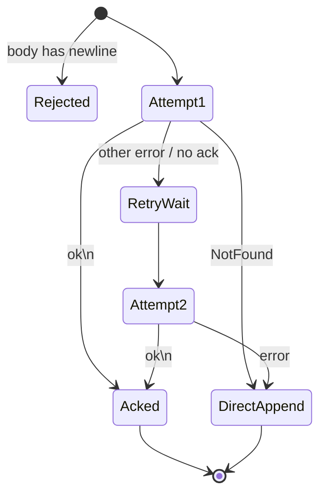

### What checking the code showed
- **Duplicates are real but rare and deliberate.** The daemon appends (serve.rs:1060) before it writes the ack (serve.rs:894). If the ack is lost, the client retries and can append the line 2-3 times. The comments (event_log.rs:3093-3095) choose at-least-once over loss on purpose. The daemon uses one thread per connection (serve.rs:524-530), so a 2s ack miss needs an IO stall or the daemon dying mid-request.
- **The opposite orders are not an integrity problem.** The daemon calls the same `append_external_event`, and both paths are one O_APPEND write of at most PIPE_BUF. Only the authority over timestamp order differs.
- **Message lines are not affected.** `append_message_event` and `append_message_ack_event` write directly and never touch the socket.
- **Small tidy available.** Four inline copies of the EPERM fallback could call `write_task_event_line`.

### Recommendation
Fine as is. Optionally fold the four inline fallbacks into one helper. If duplicates ever matter, add an event id for dedupe rather than an explicit state type.


### Verified concerns

- **low**: A daemon append whose ack is lost causes a duplicate line. The client retries, so a second socket append can follow, or in the worst case a third direct append.
  - Evidence: event_log.rs:3063-3082 retries and then falls back without checking whether attempt 1 landed. serve.rs:1060 appends before the ack is written at 894. The doc at event_log.rs:3093-3095 explicitly accepts duplicates over loss. The daemon spawns a thread per connection (serve.rs:524-530), so a 2s ack miss needs a stalled filesystem or a daemon dying between append and ack.
- **low**: The direct-first-then-socket-on-EPERM tail is copy-pasted inline 4 more times instead of calling write_task_event_line.
  - Evidence: event_log.rs:1656-1660, 1703-1707, 1740-1744 and 1779-1783 repeat the match that write_task_event_line (1608-1616) already provides. The copies are identical today but could drift.


### Concerns that did not hold up

- The opposite preference orders do not break correctness. The daemon's handle_event calls the same append_external_event, a single O_APPEND write of at most PIPE_BUF (serve.rs:1060, event_log.rs:2997-3000). Daemon and direct writes are equally tear-free and interleave whole lines. The "single-writer property" is only about timestamp ordering, not integrity. Direct-first for task lines is deliberate: the hub owns events.log and only sandboxed writers hit EPERM.
- The claim that consumers of message lines see doubled records is wrong. append_message_event and append_message_ack_event (event_log.rs:1338-1365) write directly and never use the socket path, so ack-timeout duplication cannot reach them.
- Doubled task transitions are harmless to latest_task_transition_targets, which takes the latest target. A duplicate identical from->to line produces the same result. The duplicate also requires the low-probability lost-ack path, and task lines only use the socket on EPERM anyway.


**Recommendation:** Leave the transport logic as it is. Optionally, replace the four inline `match append_event_line(..) { Err(e) if is_permission_denied(&e) => emit_event_body(..) }` blocks (event_log.rs ~1656, 1703, 1740, 1779) with calls to write_task_event_line, or rename it to something like append_line_or_socket, so there is one EPERM-fallback site. If duplicates ever start to matter, add an idempotency token (for example a client-generated event id) that the daemon or readers can dedupe on. A state enum is not the fix.
