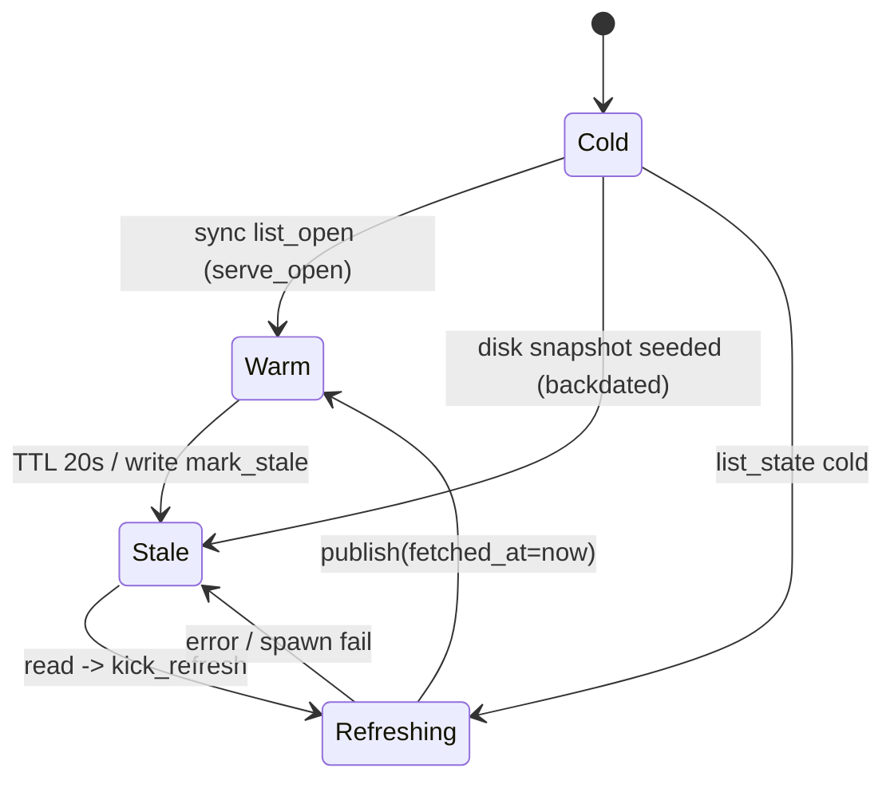
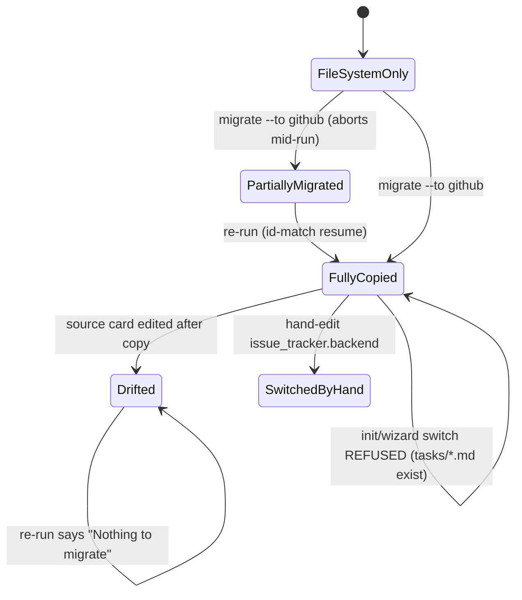
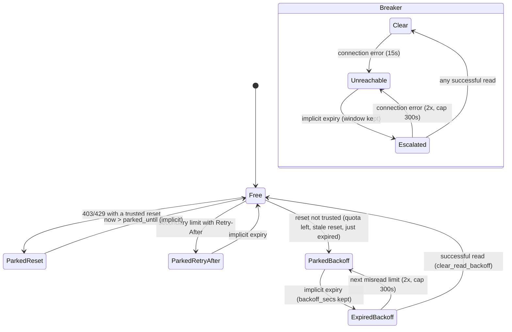
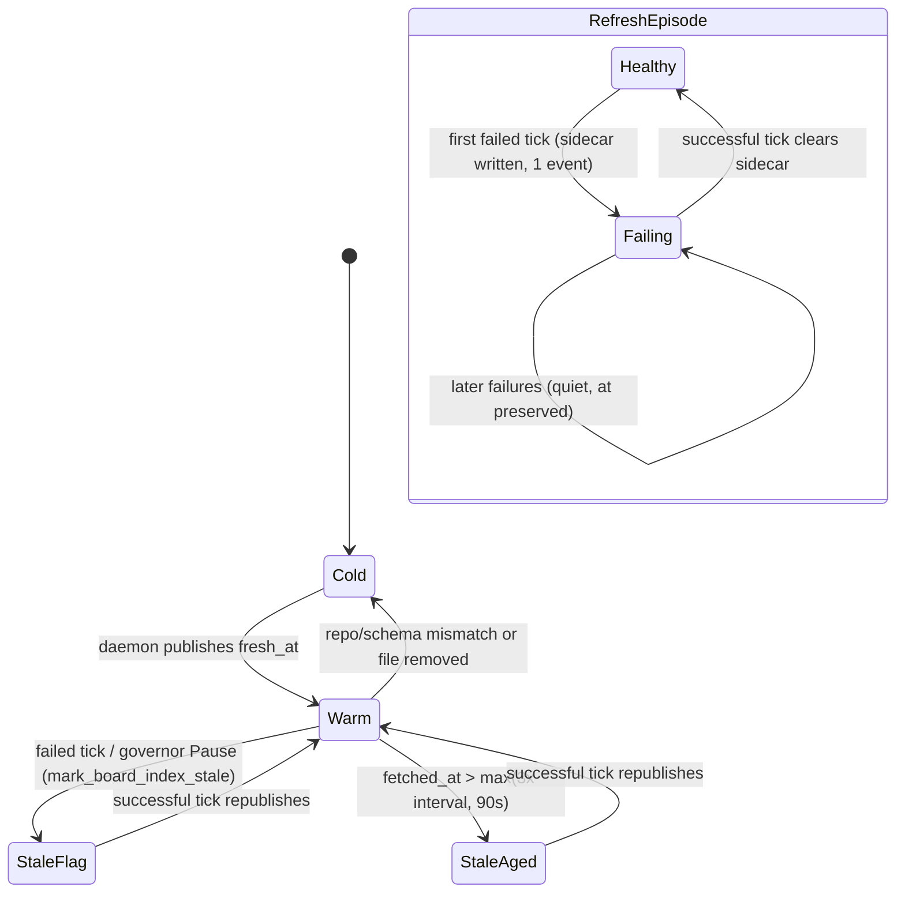
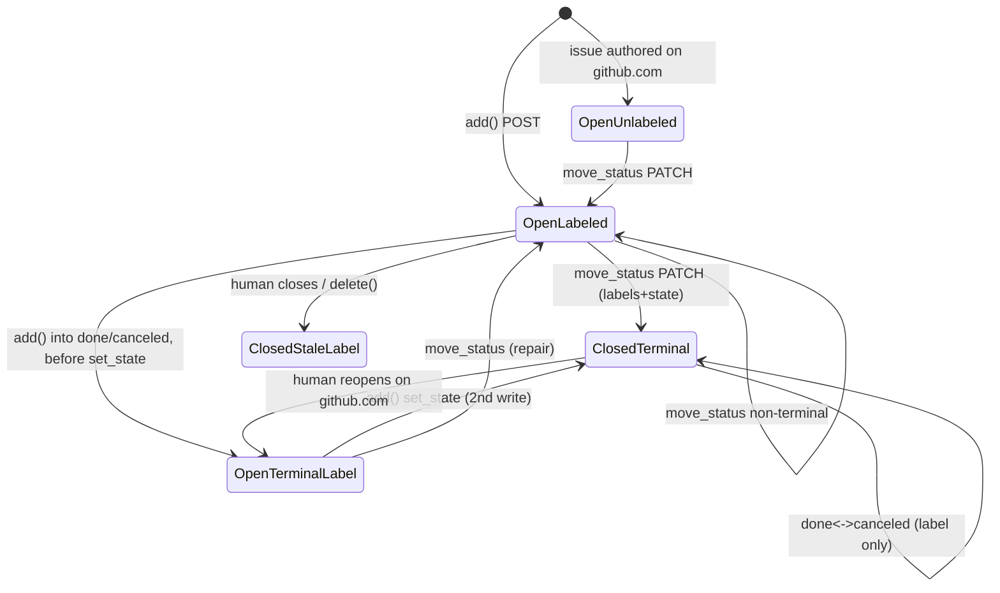
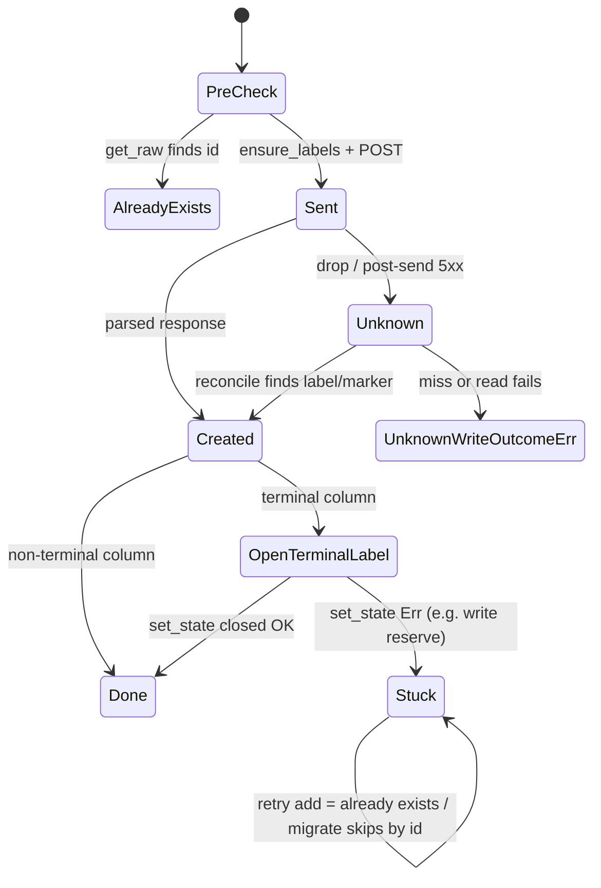
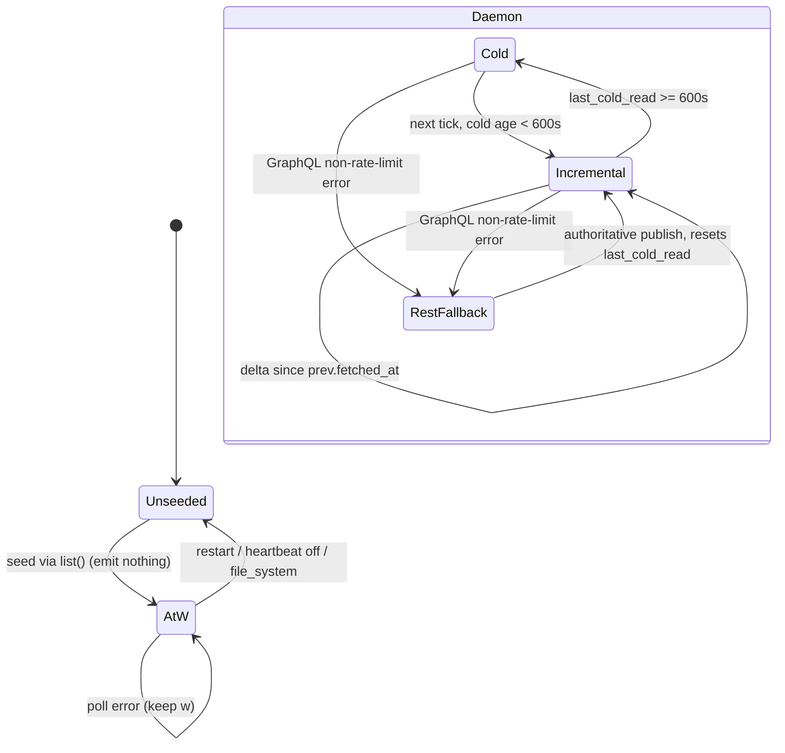

# Implicit state machines: GitHub/board

Part of the [implicit state machine audit](../implicit-state-machines.md). Audit of origin/main at b93c57c4, 2026-11-05. 8 machines in this area, most pressing first.


## Remote board snapshot cache and done-history first-page cache

**Verdict:** Needs further thought. Two real, reachable correctness gaps: the write/refresh race serves a pre-write board as Warm, and a no-daemon CLI prints a snapshot of any age while the doc says it reads live. A design question also sits over this layer. Since the daemon's board-index.json and publish_write became the main render path, this per-process cache mostly serves fallbacks, so it is unclear whether it should be fixed with a generation counter or reduced and folded into the board-index path. Six overlapping caches with different freshness rules (plus stale docs) will keep drifting.

**Verified concerns:** 3 medium, 4 low

**Key files:**
- `crates/shelbi-state/src/issue_cache.rs:1-50 (module contract)`
- `crates/shelbi-state/src/issue_cache.rs:90-187 (Entry, refresh_flag, snapshot, publish, seed_stale_from_disk, mark_stale)`
- `crates/shelbi-state/src/issue_cache.rs:263-455 (serve_open, serve_closed_page, kick_refresh, invalidate, list_state)`
- `crates/shelbi-state/src/done_history.rs:150-235 (lock, patch/remove write-throughs)`
- `crates/shelbi-state/src/board_index.rs:830-866 + crates/shelbi-cli/src/commands/mod.rs:91-108 (fallback callers when there is no daemon)`

### What it is

For a remote (GitHub) project, `CachedIssueStore` (issue_cache.rs) wraps the backend. It serves the **open** board from a process-global in-memory snapshot plus `board-snapshot.json` on disk. It serves the **terminal history** first page from `done-history.json` with a 10-minute TTL.

### States and how they are stored

- `Entry { board, fetched_at: Instant }` sits in a global `Mutex<HashMap>` (issue_cache.rs:90-102). Warm or Stale is **computed** as `fetched_at.elapsed() >= 20s` (127-131). "Mark stale" sets `fetched_at` to now minus the TTL (`mark_stale` 178-187, `seed_stale_from_disk` 157-172).
- RefreshInFlight is a separate per-project `AtomicBool` registry (109-118), single-flighted by `swap` (352-356).
- Readers see `BoardState::{Warm, Stale, Cold}` only via `list_state` (426-455). `list_open` returns a bare `Vec`.
- The disk copy `board-snapshot.json` has no timestamp or version.
- `done-history.json` has its own `fetched_at` and `is_fresh()` (done_history.rs:51, 103). Writes patch it via `publish_write` (github_store.rs:2516-2531).



### Verified concerns

1. **Write/refresh race (medium).** A refresh that started before a write publishes the pre-write board with `fetched_at = now` (issue_cache.rs:368, 143-148). That overwrites the write's backdating (389-391), so the old board reads as **Warm** for 20s. There is no generation check.
2. **A no-daemon CLI prints an arbitrarily old snapshot (medium).** `read_open_board_for_cli` Cold calls `list_open` (commands/mod.rs:104-106), and `serve_open` returns the disk snapshot unconditionally (270-275) with no "stale" note. The module doc (16-20) promises one-shots never print stale data.
3. **board-snapshot.json is last-writer-wins (low)** across processes (136-139, 211-215). An older refresh can overwrite a newer one.
4. **Done-history splice tracks only additions (low).** A card reopened during the fetch (and so removed by `remove_done_history_issue`) is re-added from the fetched page (317-333) and stays for up to 10 minutes. A re-completion patched during the fetch is likewise replaced by the page's copy.
5. **REST fallback page cached as the first page (low).** The whole closed sweep with `next_cursor: None` (github_store.rs:983-997) is persisted for 10 minutes.
6. **Doc drift (low).** issue_cache.rs:33-35 says writes kick a refresh, but they don't (389-391). github_store.rs:49-57 says "no content cache, nothing mirrored to disk", but `publish_write`, ISSUE_CACHE (4423) and ID_NUMBER_CACHE (4382) all exist.
7. **Six overlapping board caches, each with its own freshness rule (design, medium).** When the daemon is up, this in-process snapshot is reached mostly through fallbacks (board_index.rs:843, the CLI Cold path) and orchestrator `wake.rs:2891`.

### Refuted

- The poisoned-lock throwaway flag cannot realistically trigger and degrades gracefully.
- A disk seed cannot overwrite a completed refresh (161-163).
- Spawn failure does not leave the in-flight flag stuck (383-385).
- Publish failure re-fetching on every read is only a cost issue.

### Recommendation

Decide whether the per-process open snapshot still earns its place next to the daemon's `board-index.json`.

- **If it stays:** add a per-project generation that `mark_stale` bumps and `publish` checks (store the data but leave it stale when a write happened mid-refresh). Embed `fetched_at` in `board-snapshot.json` so CLI one-shots can label or reject old snapshots and writers can do newer-wins. Give done-history a removal tombstone or write sequence so the splice respects reopens.
- **If it goes:** no-daemon CLI paths read live and the cache is limited to TUI processes.

Either way, fix the two module docs.


### Verified concerns

- **medium**: Write/refresh race: a refresh thread that started before a write publishes its pre-write board with fetched_at=now. That wipes out the write's mark_stale, so the old board is served as Warm for the full 20s TTL. No generation counter or 'dirty since refresh started' bit exists.
  - Evidence: issue_cache.rs:368 publish(&project, board, ...) -> 143-148 inserts Entry{fetched_at: Instant::now()} unconditionally. invalidate() at 389-391 only moves fetched_at back. Nothing compares the refresh's start time with the time of the write.
- **medium**: A CLI one-shot with no daemon prints board-snapshot.json however old it is, and without a staleness note. The module doc says list() 'never prints stale data'. The refresh it kicks dies when the process exits.
  - Evidence: commands/mod.rs:104-106 Cold -> issue_store_for().list_open() -> issue_cache.rs:270-275 serve_open returns the disk board after seed_stale_from_disk+kick_refresh. Doc at 16-20 claims a cold process reads live. The 'note: the board index is stale' message at mod.rs:95-99 only fires for the board-index Stale path.
- **medium**: Six overlapping copies describe the same board, each with its own freshness rule: the in-memory Entry (20s), board-snapshot.json (none), daemon board-index.json, done-history.json (10 min), ISSUE_CACHE (ETag), and ID_NUMBER caches (positive plus a 10-minute miss TTL). When the daemon is up, the in-process open snapshot is mostly reached only through fallbacks (board_index.rs:843, the CLI Cold path) and list_open callers such as orchestrator wake.rs:2891.
  - Evidence: board_index.rs:830-866 drops to resolve_issue_store().list_state() only when the daemon socket does not answer. wake.rs:2889-2891 calls list_open on the cached store.
- **low**: board-snapshot.json is last-writer-wins across processes and has no fetched_at or version, so a slow refresh in one process can overwrite a newer snapshot another process has just published.
  - Evidence: issue_cache.rs:136-139 write_snapshot_to_disk is called unconditionally before the memory insert. 211-215 does an atomic_write with no compare step.
- **low**: Done-history reconciliation brings back a card that was reopened during the fetch. If the id was in the pre-fetch file and in the fetched page, remove_done_history_issue's removal is undone. The same splice also drops a re-completion patched during the fetch in favor of the page's copy.
  - Evidence: issue_cache.rs:317-333 keeps only ids absent from both snapshot_ids and page_ids. Removals are not tracked. history=DoneHistory::from_page(&page) re-adds the reopened id, and it stays for up to 10 minutes. The window is one GraphQL page fetch.
- **low**: A REST-fallback closed page (the whole closed sweep, next_cursor None) is cached as the first page for 10 minutes. The cached page can be hundreds of issues, and 'load more' disappears.
  - Evidence: github_store.rs:983-997 returns the full list_with_state("closed") with next_cursor None. issue_cache.rs:316 DoneHistory::from_page persists it unchanged.
- **low**: Doc drift: the module doc says writes 'mark the snapshot stale and kick a refresh', but invalidate() only marks stale. The github_store.rs module doc says 'No content cache, nothing is mirrored to disk', yet publish_write patches board-index.json and done-history.json, and there are process-global ISSUE_CACHE (ETag) and ID_NUMBER caches.
  - Evidence: issue_cache.rs:33-35 vs 383-391. github_store.rs:49-57 vs 2516-2531, 4382, 4423.


### Concerns that did not hold up

- Poisoned refresh-flag lock degrades single-flight: technically true (issue_cache.rs:112-116), but the critical section is one HashMap entry() and clone, which cannot realistically panic. The fallback is deliberate (a duplicate refresh, never a wedged flag). Not worth acting on.
- Done-history publish failure re-fetches on every read: true, but update_done_history only fails on a lock or IO error. The degradation is a cost issue, not a correctness one, and is documented as best-effort (issue_cache.rs:337-338).
- Seed from disk clobbering a completed refresh: guarded. seed_stale_from_disk is a no-op when an entry already exists (161-163).
- Spawn failure leaving the in-flight flag stuck: guarded. The flag is cleared on spawn error (383-385), and the thread clears it on both arms (373).


**Recommendation:** First decide whether the per-process open snapshot is still needed now that board-index.json exists. If it stays, make the lifecycle explicit: add a per-project generation counter that mark_stale bumps. kick_refresh captures the generation at start, and publish() only sets fetched_at=now when the generation is unchanged (otherwise it stores the data but leaves it stale). Store a fetched_at (wall clock) inside board-snapshot.json so a CLI one-shot can refuse or label a snapshot older than N seconds, and readers can do a newer-wins compare before writing. For done-history, record removals as well as additions (a tombstone set, or a write sequence number in the file) so the splice can drop ids removed mid-fetch. Fix the two module docs. If the snapshot does not earn its place, have no-daemon CLI paths read live and limit the cache to TUI processes.


## Issue-tracker backend switch and migration

**Verdict:** Needs further thought. Nothing in the code owns the cutover. Copying, freezing the source, switching the backend, and retiring the source are separate steps with no recorded state. As a result the documented path (migrate, then switch) is blocked by Shelbi's own guard whenever the switch goes through init, and edits made during or after the run are silently lost. Who should own the cutover is a design question, not just a cleanup.

**Verified concerns:** 3 medium, 1 low

**Key files:**
- `crates/shelbi-cli/src/commands/issue_store.rs:99-216`
- `crates/shelbi-state/src/issue_migrate.rs:69-180`
- `crates/shelbi-cli/src/issue_tracker_setup.rs:355-388`
- `crates/shelbi-cli/src/wizard.rs:356-362`
- `crates/shelbi-cli/src/commands/init.rs:470-491`

### Entity
A project's issue backend (`file_system` or `github`), and the one-off job of copying the board from one backend to the other.

### How state is stored
- `issue_tracker.backend` in project.yaml. The user changes it by hand; neither migrate nor any other command writes it.
- Migration progress is never saved. Each run works it out again with `plan_issue_migration` (`crates/shelbi-state/src/issue_migrate.rs:69-91`): it lists both sides and splits the cards into `to_migrate` and `already_present` by id.
- The guard against stranding a board (`crates/shelbi-cli/src/issue_tracker_setup.rs:355-388`) checks one thing: whether any `*.md` file exists under `tasks/`.



### Verified concerns
1. **The migration ends without a switch, and the guard blocks the switch for good** (medium). `issue_store.rs:99-216` never writes the backend and never retires the source files. `ensure_board_not_stranded` (`issue_tracker_setup.rs:362-370`) refuses whenever `.md` files exist, and its message tells the user to migrate again, which then prints "Nothing to migrate". The docs (`site/content/docs/cli/issue.mdx`, `concepts/github-issues.mdx`) say to "switch the project's issue_tracker.backend once the migration completes" but name no command. In practice the only working path is editing project.yaml by hand, which skips the guard entirely.
2. **On disk, "migrated" and "stranded" look the same** (medium). There is no stamp or archive, so the guard cannot tell a migrated board from one that was abandoned.
3. **The source stays live, and edits made after a card is copied are lost silently** (medium). The plan is a snapshot taken once (`issue_store.rs:112`). Pacing defaults to 7.5s per create, so a few hundred cards take more than an hour, and a write requires the daemon to be running (`ensure_daemon_matches_for_mutation`, line 138). A column move or body edit to a card that was already copied is never carried over. The id-only match (`issue_migrate.rs:76-84`) then reports that the target is complete.
4. **The guard covers only one direction and one entry point** (low). A `file_system` target always passes (`issue_tracker_setup.rs:360-362`), and the guard is only wired into `wizard.rs:362` and `init.rs:490`.

### Concerns that did not hold up
- Resuming after a partial run does not create duplicates: the id match plus dependency ordering only creates what is missing.
- A dry run is never blocked by the daemon version check, because the check sits only on the write path.

### Recommendation
Give the cutover one owner: freeze the source, then copy until the plan is empty, then check fields for drift, then write the backend, then archive the source or stamp it with `migrated_to`. Change the guard to accept the stamp, or an empty plan, instead of checking whether any `.md` file exists. The smallest useful fix is to have `ensure_board_not_stranded` run `plan_issue_migration` and allow the switch when nothing remains to copy.


### Verified concerns

- **medium**: Migration never ends with a switch. `init` and the wizard keep refusing the switch to github even after every card has been copied, and the error tells the user to migrate again. Running migrate again only prints 'Nothing to migrate'. The only ways out are editing project.yaml by hand or deleting the source files.
  - Evidence: issue_store.rs:99-216 never writes `issue_tracker` and never moves or deletes the tasks/*.md files. issue_tracker_setup.rs:362-370 refuses whenever `file_system_board_has_issues` finds any `.md` file (379-388). It does not ask whether those ids are already on the target. Docs (cli/issue.mdx, concepts/github-issues.mdx) tell the user to 'switch the project's issue_tracker.backend once the migration completes' and point to no command.
- **medium**: On disk, 'migrated' and 'stranded' look the same. There is no marker, archive, or completion stamp, so the guard cannot tell a board that was migrated from one that was abandoned. A board that was migrated and then switched by hand still has its live-looking tasks/*.md files.
  - Evidence: Nothing is persisted: plan_issue_migration (issue_migrate.rs:69-91) is the only record of progress, and the guard (issue_tracker_setup.rs:379-388) only checks whether files exist.
- **medium**: The source board stays live during a paced run and after it. The id match then treats any copied card as finished, so a column move, body edit, or dependency change made to a source card after it was copied never reaches the target. Running migrate again reports nothing to do. With the 7.5s default pacing, a board of a few hundred cards takes more than an hour, and the daemon must be running for a write (ensure_daemon_matches_for_mutation), so the poller and workers can move cards during the run.
  - Evidence: issue_store.rs:136-160 paces creates from a plan snapshot taken once at line 112. issue_migrate.rs:76-84 decides 'already present' by id alone and never compares fields. Nothing locks or freezes the source.
- **low**: The guard covers only one direction and one entry point. Migrating `--to file_system` and then leaving GitHub has no guard, and editing `issue_tracker.backend` by hand skips the guard completely.
  - Evidence: issue_tracker_setup.rs:360-362 returns Ok for a file_system target. The guard is called only from wizard.rs:362 and init.rs:490.


### Concerns that did not hold up

- The worry that a partial migration duplicates cards on resume does not hold. The id match (issue_migrate.rs:76-84) together with ordering creates by dependency means a re-run creates only the missing ids, and PartialMigration keeps the cards already created.
- The worry that a dry run could be blocked by an upgrade in progress does not hold. The daemon version check sits only on the write path (issue_store.rs:136-138).


**Recommendation:** Make the migration own the cutover. Add a `--switch` option, or a final step, that runs inside one command: (1) take a lock or freeze the source board so the daemon and CLI refuse moves to it; (2) run plan and apply until the plan is empty; (3) as a final check, compare fields (column, body, deps) as well as ids, and copy over any drift; (4) write `issue_tracker.backend`; (5) archive the source by renaming tasks/ to tasks.migrated-<ts>/, or write a `migrated_to: github@<ts>` stamp. Then change `ensure_board_not_stranded` to return Ok when the stamp is present, or when the plan against the target is empty, instead of checking whether any .md file exists. If the lock is too heavy, the minimum fix is to have the guard run `plan_issue_migration` and allow the switch when nothing remains to copy.


## GitHub read governor: rate-limit park, unreachable breaker, gh retry loop

**Verdict:** Needs further thought. The read-side machine is careful, well-tested and essentially correct. The design gap is that the governor's knowledge (rate-limit parks and the unreachable breaker) is not applied to writes. Under the production policy, a write sleeps through an uncapped server reset hint and retries for minutes against a network the breaker already knows is down. That can wedge CLI commands, transitions or daemon threads, and it is a policy question worth discussing: should writes consult the breaker and the REST park, and what should their maximum wait be? The rest is tidying: the stderr round-trip, a dead legacy park(), lock-failure collapsing into 'already parked', and redundant locking on the hot path.

**Verified concerns:** 2 medium, 5 low

**Key files:**
- `crates/shelbi-state/src/gh_budget.rs:110-180 (BudgetTier, UnreachableState, RateLimitState)`
- `crates/shelbi-state/src/gh_budget.rs:290-642 (park_verdict, BudgetLock, park, plan_rate_limit_park, park_rate_limited, clear_*, park_unreachable, record)`
- `crates/shelbi-state/src/github_store.rs:3536-3740 (read_park_short_circuit, on_read_result, record_budget_park, record_read_unreachable)`
- `crates/shelbi-state/src/github_store.rs:340-372, 2722-2817, 3840-3870 (policy routing, write reserve, synthetic park errors)`
- `crates/shelbi-state/src/gh_retry.rs:113-125, 209-263, 371-503 (production policy, run loop, classify, parse_wait_hint)`

### What it is
One JSON file per GitHub token, `<shelbi-root>/gh-budget/<hash>.json` (`RateLimitState`), shared by every Shelbi process on the hub (daemon, panes, CLI, desktop). It holds:

- **three budget tiers** (`graphql`, `rest`, `search`). Each `BudgetTier` has four optional fields: `remaining`, `reset_at`, `parked_until` and `backoff_secs`.
- **a connection breaker**, `UnreachableState { parked_until, window_secs }`.

The state of each part comes from those optional fields plus the current time. Expiry is implicit: a park ends when `now` passes `parked_until`, and nothing rewrites the file. Every write takes a process `Mutex` and then a sibling flock (`BudgetLock`).

On top of the file, each `gh` call runs a retry loop (`gh_retry::RetryPolicy::run`). Its outcome comes from the HTTP status line when there is one, and from substring matching otherwise.



### Transitions (single driver: `github_store::on_read_result`, github_store.rs:3564-3670)
- **Parking a tier:** a rate-limited read goes to `record_budget_park` (github_store.rs:3672), then `park_rate_limited` (gh_budget.rs:502). `plan_rate_limit_park` (gh_budget.rs:444) chooses Reset, RetryAfter or Backoff. One `board rate-limited` events.log line is written, but only when the tier actually moves from free to parked.
- **Parking the breaker:** a connection error goes to `park_unreachable` (gh_budget.rs:582). The window is anchored to `observed_now`, the clock read after the call returns.
- **On success:** `record` stores the GraphQL `rateLimit`, `clear_unreachable` resets the breaker, and `clear_read_backoff` resets the tier's backoff (github_store.rs:3606-3616).
- **While parked:** `read_park_short_circuit` (github_store.rs:3536) returns a synthetic `Error::Command` and does not spawn `gh`. The breaker is checked first.
- **Daemon governor:** `tick_plan` (gh_budget.rs:~719) turns the graphql tier into Refresh or Pause.

### Verified concerns
1. **Medium: write retries use an uncapped server hint.** `parse_wait_hint` turns `x-ratelimit-reset` into a sleep (gh_retry.rs:497-500). `run` uses that hint verbatim (gh_retry.rs:255). The cap at :228-232 applies only to the reads policy. The result is that a mutation on an exhausted primary budget can sleep for up to about an hour. `check_write_reserve` (github_store.rs:2790) refuses first only when REST `remaining` has been recorded, and fails open otherwise.
2. **Medium: writes ignore the breaker.** The write branch (github_store.rs:358-372) and `api_send` (:2722) never call `unreachable_parked_until`. On a dead network, each mutation runs 10 attempts with 2-90s backoff, about 3-7 minutes, while reads already fail fast.
3. **Low: park state round-trips through stderr text.** Parked reads build stderr strings (github_store.rs:3846-3869, which also interpolate the project name) that must match the substring rules in `classify` (gh_retry.rs:389-422).
4. **Low: a lock failure looks like "already parked".** On `BudgetLock::Failed` the park functions return `None` (gh_budget.rs:509, 583). Nothing is persisted and nothing is logged, so every reader keeps calling `gh`.
5. **Low: the breaker window survives expiry.** `window_secs` is kept after a park expires (gh_budget.rs:592-596), so a later outage with no success in between starts at the old window, not 15s. The 300s cap bounds this.
6. **Low: dead legacy `park()`.** `park()` (gh_budget.rs:366) is called only from a test and skips the backoff logic.
7. **Low: repeated lock and file traffic.** Each successful read takes the mutex plus flock and reads the file two or three times.

### Refuted
- `record()` overwriting `reset_at`: the values are authoritative and `parked_until` is untouched.
- Clearing the breaker on success from any tier: this is the correct connectivity semantics.
- A far-future park that can't be fixed: parks are bounded by a reset GitHub actually reported.
- The governor being inert in test builds: this is a test-isolation choice.
- "9 hour-long sleeps": once the window resets, the next attempt normally succeeds.

### Recommendation
- **One admission gate for reads and writes:** add `admit(key, budget, Read|Write, now)` returning a typed `Parked { reason, until }` instead of synthetic stderr. Writes would fail fast when the breaker is parked.
- **Cap production waits:** limit the production and creates hint at about 90-120s, then return a typed "rate-limited until X" error.
- **One success hook:** a single `on_success(key, budget, rate_limit)` with one lock and one write.
- **Tri-state park result:** return `Transitioned`, `AlreadyParked` or `LockFailed`, and log `LockFailed` at warn.
- **Delete the legacy `park()`.**

The read-side planning (`plan_rate_limit_park`) is solid and well-tested, so leave it as is.


### Verified concerns

- **medium**: Write and production-policy retries use a server wait hint verbatim, with no cap. parse_wait_hint turns x-ratelimit-reset into a delta that can approach an hour. On a primary-exhausted mutation (a 403 with x-ratelimit-remaining: 0 under --include), the thread sleeps until the reset. Only the reads policy fails fast on a hint longer than max_delay.
  - Evidence: gh_retry.rs:255 `let wait = hint.unwrap_or_else(...)` and the sleep. The cap at gh_retry.rs:228-232 applies only when hintless_rate_limit_is_terminal, which is true for reads() only (production sets false at :121). parse_wait_hint at gh_retry.rs:497-500 converts x-ratelimit-reset into a wait. check_write_reserve (github_store.rs:2790-2799) fails open when REST remaining was never recorded, so it does not always refuse first.
- **medium**: Mutations bypass the unreachable breaker. While reads are parked because the network is down, each write still spawns gh under the production policy: up to 10 attempts with 2s..90s jittered backoff, which is several minutes per mutation, instead of failing fast against the known-dead network.
  - Evidence: The write branch in github_store.rs:358-372 calls write_policy.run(...) directly, and api_send (github_store.rs:2732) checks only check_write_reserve. Nothing calls unreachable_parked_until outside read_park_short_circuit (grep: github_store.rs:3543 plus tests). Disposition::Connection maps to a Transient retry at gh_retry.rs:245-247.
- **low**: Park state round-trips through human-readable stderr. A parked read builds a synthetic Error::Command whose wording ('rate limit', 'x-ratelimit-reset: N', 'error connecting to') must match gh_retry's substring classifier. Rewording either side silently changes the classification. A project name containing 'timeout' or 'rate limit' also lands in the haystack.
  - Evidence: rate_limited_park_error and unreachable_park_error at github_store.rs:3846-3869 interpolate `{project}` into stderr. classify falls back to substrings when no HTTP/ line is present (gh_retry.rs:389-422).
- **low**: If the flock cannot be acquired (BudgetLock::Failed), park_rate_limited and park_unreachable return None, the same value they return for 'already parked'. Nothing is persisted and no events.log line is written, so every reader keeps calling gh. The caller cannot distinguish the two cases.
  - Evidence: gh_budget.rs:509-511 and 583-586 return None on Failed. record_budget_park returns silently on None (github_store.rs:3680-3682). This is only reachable on a lock I/O error, so it is rare.
- **low**: The unreachable window_secs survives expiry until the next success. A later outage that follows with no successful read in between escalates from the old window instead of starting at 15s, which contradicts the doc comment's claim that each outage starts short.
  - Evidence: gh_budget.rs:592-596 doubles from state.unreachable.window_secs whenever it is Some. Only clear_unreachable (gh_budget.rs:607-619) resets it. The 300s cap bounds the effect.
- **low**: There are two park entry points. The legacy `pub fn park` has no production caller (it is used only in a test at gh_budget.rs:969). It never sets backoff_secs or chooses Backoff mode, so a future caller would skip the escalation logic.
  - Evidence: gh_budget.rs:366-385. The only grep hit outside the definition is gh_budget.rs:969 (test).
- **low**: Every successful governed read takes the process mutex plus the file flock twice and reads the JSON twice (clear_unreachable, then clear_read_backoff), plus a third time for record() on GraphQL. That is lock and file traffic on the hot path across every hub process.
  - Evidence: github_store.rs:3606-3616 calls record, clear_unreachable and clear_read_backoff in sequence. Each one locks and calls read_state (gh_budget.rs:542-554, 607-619, 624-642).


### Concerns that did not hold up

- record() overwriting reset_at breaks the never-earlier invariant: record only writes values from a successful response's rateLimit or headers, which are authoritative for the current window. The invariant exists to keep a short fallback guess from replacing a known reset during a park, and record never touches parked_until.
- Any successful read on any tier clearing the token-wide breaker is wrong: the breaker models connectivity, and one success on any tier proves api.github.com is reachable. This is the intended semantics.
- A far-future park can only be fixed by waiting: effective = max(prev reset_at, reset) uses per-tier values that GitHub reported, so a park lasts at most until a real reset (at most about an hour). There is no 'resume now' CLI, but there is also no path that records a fabricated far-future reset.
- The governor being inert in test builds unless a test opts in: this is a test-isolation design choice (the gate is always true in shipped builds, github_store.rs:212-237), not a state-machine defect.
- Retry loop could block for about 9 hour-long sleeps: once a primary-limit wait reaches the reset, the window refills, so the next attempt normally succeeds. The realistic worst case is one sleep of about an hour, not nine (the uncapped hint is still kept as a concern).


**Recommendation:** Keep the per-token file, but give the governor one entry point used by both reads and writes. (1) Add a governor::admit(key, budget, kind: Read|Write, now) that checks the unreachable breaker and the tier park and returns a typed Parked { reason, until } instead of a synthetic stderr string. Writes would fail fast on the breaker (or retry briefly) and refuse when the REST tier is parked. (2) Cap the hint in production/creates at a configurable max (for example 90-120s), then fail with a typed 'rate-limited until X' error rather than sleeping until reset. (3) Replace the separate clear_unreachable + clear_read_backoff + record calls with one on_success(key, budget, rate_limit) that does a single lock and write. (4) Return a tri-state from park (Transitioned / AlreadyParked / LockFailed) so a lock failure is logged at warn and can fall back to an in-process park. (5) Delete the legacy park(). Optionally decay window_secs once the breaker has been expired for longer than the cap, so a new outage starts short.


## Board index freshness (Warm/Stale/Cold) and daemon refresh governor

**Verdict:** Needs further thought. The freshness derivation is mostly correct and the governor is reasonably contained. However, Cold has no single meaning: the restart gate's "unreadable counts as busy" contract is broken by into_issues(), so a Cold index permits a daemon restart offer with zero busy workspaces. Other consumers each pick their own Cold policy, and read_board and read_board_report disagree on a missing index. That is a safety-relevant design question, not just tidying.

**Verified concerns:** 2 medium, 4 low

**Key files:**
- `crates/shelbi-state/src/board_index.rs:266-345 (refresh-error episode sidecar)`
- `crates/shelbi-state/src/board_index.rs:532-623 (read_board, board_state_from_index, staleness threshold)`
- `crates/shelbi-state/src/board_index.rs:780-866 (read_board_report / remote_board_report, the second derivation plus cache fallback)`
- `crates/shelbi-cli/src/commands/daemon/board.rs:100-205, 546-657 (tick handling, episode latch, governor loop, token-key memo)`
- `crates/shelbi-cli/src/commands/hub_version.rs:54-62, 141-157 and crates/shelbi-cli/src/commands/status.rs:684-704 (Cold counted as zero busy in the restart gate)`

### What it is
For each remote-backend project, the hub daemon publishes `board-index.json`. Every reader (poller, TUI, desktop, CLI status/doctor/issue, Zen scan) judges how fresh it is. The lifecycle is spread across three places:

- **Index fields on disk:** `stale`, `fetched_at`, `interval_secs`, `last_cold_read`, `repo`/`schema_version` identity, `rest_fallback`.
- **A sidecar file on disk:** `board-refresh-error.json`. Its presence is the latch for an ongoing failure episode, and `at` records when the episode started.
- **Daemon memory:** the manager loop's `last`, `token_keys` and `paused` maps.

`BoardState::{Warm, Stale, Cold}` is an explicit enum, but it is derived at read time, in two places.



### Transitions (where they live)
- Publish: `BoardIndex::fresh_at` (board_index.rs:214-246), called by `refresh_with_store`.
- Stale flag: `mark_board_index_stale` (board_index.rs:918-951). It does nothing when there is no index yet, and skips the rewrite when nothing would change. It is called from a failed tick (daemon/board.rs:148-151) and from a governor Pause (daemon/board.rs:583-596).
- Aged stale: `fetched_at_is_stale` / `index_stale_threshold` (board_index.rs:608-623).
- Episode latch: `record_board_refresh_error` returns true on a new episode (board_index.rs:308-321). `report_refresh_failure` emits one events.log line per episode (daemon/board.rs:163-183), and a successful tick clears the sidecar (186-190).
- Governor: the `refresh_manager_loop` Refresh/Pause plan comes from the GraphQL budget tier (daemon/board.rs:546-605). The cold-read schedule is set by `cold_read_watermark` (380-396).

### Verified concerns
1. **[medium] Cold counts as zero busy in the hub auto-restart gate.** The contract comment at `hub_version.rs:141-145` says an unreadable board counts as busy. But `workspace_idle_busy` (status.rs:684-704) calls `read_board(..).into_issues()`, and `into_issues` maps Cold to `Vec::new()` (issue_store.rs:472-476). With no index published yet, or after a repo/schema identity change, `busy == 0`. `ensure_daemon_matches_for_mutation` then offers a restart with no busy note (hub_version.rs:58-60). This is mitigated by the need for acceptance (or `--yes`) and by the supervisor relaunching the daemon, but the stated safety property does not hold.
2. **[medium] No shared policy for Cold.** `workspace_occupied_by` treats Cold as dispatchable, on purpose and documented (issue.rs:440-459). `category_counts` shows Cold as all zeros with no marker (status.rs:649-675). The restart gate treats Cold as idle. `into_issues()` makes the lossy collapse the default.
3. **[low] Two derivations that already differ.** `board_state_from_index` (board_index.rs:583-599) and `remote_board_report` (801-829) repeat the interval fallback and stale test. On a missing index, `read_board` returns plain Cold, while `read_board_report` probes the daemon socket and serves the per-process cache downgraded to Stale (831-866).
4. **[low] A token-resolution failure is cached forever.** `token_key_for` (daemon/board.rs:645-655) stores `None` and never retries while the project stays open. A keychain stall on the first tick leaves the governor on the index-derived tier (631-642), which has `parked_until: None`.
5. **[low] Manual refresh-board has different failure semantics.** `refresh_now` (daemon/board.rs:113-116) neither records nor clears the sidecar and does not mark stale. Only governed ticks go through `handle_tick_result`.
6. **[low] Two failure encodings.** The stale flag and the sidecar can disagree: a pause sets stale with no sidecar, and a failure before the first publish writes a sidecar while stale-marking does nothing. status/doctor read the sidecar and banners read freshness.

### Refuted
- Sidecar read-modify-write race: there is only one recorder, on the single manager thread.
- File rewritten every 2s while paused: `mark_board_index_stale` short-circuits when nothing changed (board_index.rs:928-936).
- CacheFallback authorizing destructive actions: a cache hit is always downgraded to Stale in one place.
- Single-threaded manager: intentional and documented, not a state defect.

### Recommendation
- **Cold handling:** make Cold a decision callers must make. Rename or remove `into_issues`, and have safety readers (the restart gate first) treat Cold as unknown, meaning busy or an error.
- **One derivation:** have `read_board` and `read_board_report` share a single function, and decide whether `read_board` should get the cache fallback.
- **Daemon side:** use one per-project `RefreshStatus { Healthy, Failing{since}, Paused{until} }` owner that writes both the sidecar and the stale flag. Route manual `refresh-board` through the same result handler.
- **Token memo:** give the token-key memo a TTL instead of a permanent `None`.


### Verified concerns

- **medium**: Cold is silently zero busy in the hub auto-restart safety gate. busy_workspaces documents that an unreadable board counts as busy so the hub never auto-restarts, but workspace_idle_busy goes through read_board().into_issues(), where Cold becomes an empty Vec. So when no index exists (the daemon has not published yet, or the repo/schema changed), busy == 0 and the gate offers a restart with no busy warning even though workers may be active.
  - Evidence: hub_version.rs:141-157 (contract comment; only Err returns busy>=1); hub_version.rs:58-60 (busy==0 && accepted, then restart); status.rs:688-692 (read_board().into_issues()); issue_store.rs:472-476 (Cold => Vec::new())
- **medium**: Each consumer chooses its own degradation for Cold, with no shared policy. workspace_occupied_by deliberately treats Cold as dispatchable. category_counts shows Cold as all-zero counts with no 'unavailable' marker. The restart gate treats it as idle (above). into_issues() makes the lossy mapping easy to do by accident.
  - Evidence: issue.rs:440-459 (documented Cold => Ok(None)); status.rs:649-675 (category_counts via into_issues); issue_store.rs:472-477
- **low**: Warm/Stale/Cold is derived twice, and the two paths already differ. board_state_from_index and remote_board_report each repeat the interval_secs fallback and the stale check. They also disagree on a missing index: read_board returns Cold outright, while read_board_report probes the daemon socket and falls back to the per-process cache, downgraded to Stale. A caller's view of the same file therefore depends on which entry point it used.
  - Evidence: board_index.rs:583-599 vs 801-829 (same stale logic duplicated); board_index.rs:532-548 (read_board: no cache fallback) vs 831-866 (report: daemon probe + cache fallback)
- **low**: token_key_for memoizes a token-resolution failure as None for as long as the project stays open. One keychain stall on the first tick, a known real-world failure mode, therefore pins the governor to the board-index fallback tier for the rest of the session. That tier has parked_until: None, so the governor cannot see a parked token. Nothing retries until the project closes or the daemon restarts.
  - Evidence: daemon/board.rs:645-655 (insert None, never evicted except on close via retain at 602); daemon/board.rs:631-642 (fallback tier, parked_until: None)
- **low**: A manual refresh-board and a governor tick enter Refreshing with different failure semantics. A failed refresh_now never records the episode sidecar or marks the index stale; the error goes only to the socket caller. A successful manual refresh also leaves a stale error sidecar in place until the next governed tick succeeds.
  - Evidence: daemon/board.rs:113-116 (refresh_now returns raw Result) vs 128-151 (tick -> handle_tick_result records/clears)
- **low**: Failure is split across two encodings, the index stale flag and the error sidecar, and they mean different things. A governor pause sets stale with no sidecar. A failure on a project with no index yet writes the sidecar while mark_board_index_stale does nothing. status/doctor read the sidecar while banners read stale/freshness, so the two can show different pictures. This is coherent by design, but nothing names the combined states.
  - Evidence: daemon/board.rs:148-151, 586-588; board_index.rs:924-927 (no-op when no index); status.rs:359, doctor.rs:87 (sidecar readers)


### Concerns that did not hold up

- Concurrent recorders race on record_board_refresh_error (read-then-write with no lock). The only caller is report_refresh_failure on the single shelbi-board-refresh-mgr thread; manual refresh-board never records. With one daemon per hub, two recorders cannot run at once, so the episode `at` cannot be lost in practice.
- The governor rewrites the index every 2s while paused. mark_board_index_stale returns without writing when the index is already stale and the budget numbers are unchanged (board_index.rs:928-936). Each tick only takes the lock and reads the file.
- CacheFallback could authorize destructive actions because the type does not enforce the rule. remote_board_report always downgrades a cache hit to Stale (board_index.rs:842-853), so only a daemon-published index can produce Warm. This is a convention that callers match on Warm, but it is applied in one place and is correct today.
- Single-threaded manager stalls all projects. This is real but intentional and documented in the code (daemon/board.rs:72-80). It is a throughput limit, not a state-machine defect.
- Stale doc on open_remote_projects (board.rs:668, 'live tmux session'). This is only a comment inaccuracy with no behavioral effect.


**Recommendation:** Make Cold a decision every caller has to make. Options: remove or rename BoardState::into_issues to something like into_issues_or_empty, and give callers a method such as `issues_or(policy)`, or have safety callers match on Cold explicitly. Fix workspace_idle_busy/busy_workspaces now so Cold returns Err or counts as busy. Merge board_state_from_index and remote_board_report into one function, `derive_state(idx, cfg) -> (BoardState, stale, age)`, and either give read_board the same missing-index fallback or document why it differs. On the daemon side, add a small per-project RefreshStatus { Healthy, Failing{since}, Paused{until} } owned by the manager. It would be the single writer of both the sidecar and the stale flag, and manual refresh-board would go through the same handle_tick_result path. Finally, stop memoizing token-resolution failure permanently: cache None with a TTL or retry with backoff.


## GitHub issue status interpretation (state x status label)

**Verdict:** Needs further thought. The read-side interpreter is clean and total. The write side still has one non-atomic transition, add() into a terminal column. It creates a transient state that can be observed from another process (the daemon), and if the second write fails that state persists. The daemon reads it as a human reopen and emits a false event. issue_migrate exercises this path in bulk.

**Verified concerns:** 2 medium, 2 low

**Key files:**
- `crates/shelbi-state/src/github_store.rs:4800-4892 (status_label, reopened_terminal, column)`
- `crates/shelbi-state/src/github_store.rs:1113-1229 (add: POST then set_state)`
- `crates/shelbi-state/src/github_store.rs:1309-1440 (move_status single verified PATCH)`
- `crates/shelbi-cli/src/commands/daemon/board.rs:289-304,367,519-531 (reopened dedup + event)`
- `crates/shelbi-state/src/issue_migrate.rs:153-176 (bulk add, including terminal cards)`

### What it is
A GitHub-backed card has no stored "column". The column is **derived on every read** from two independent remote fields:
- GitHub `state` (`open`/`closed`) plus `state_reason` (`completed`/`not_planned`)
- exactly one `shelbi:status/<id>` label

`GhIssue::column` (crates/shelbi-state/src/github_store.rs:4868-4892) is the single interpreter. A second derived signal, `reopened_terminal` (4815-4825), flags the open + terminal-label shape. The daemon dedups it against the previous open index and emits `board reopened issue=<id> status=<terminal>` (crates/shelbi-cli/src/commands/daemon/board.rs:289-304, 367, 528).



Read mapping:
| state | label | column |
|---|---|---|
| open | non-terminal | that column |
| open | none | workflow initial status |
| open | terminal | **backlog** + reported "reopened" |
| closed | terminal | that terminal (label wins) |
| closed | non-terminal / none | `terminal_from_reason(state_reason)` |

### Writers
- `move_status` (1309-1440): one PATCH of labels+state+state_reason, with the response checked. It skips only when both axes already match. The comment at 1347-1351 says it was designed to stop leaving an issue "open carrying a terminal label".
- `add` (1113-1229): POST, which creates an open issue carrying the status label, then `set_state(closed, reason)?` when the column is terminal. **Two writes.**
- `delete` (1615-1633): `set_state(closed, not_planned)`. It leaves the label alone and calls no `publish_write`.

### Verified concerns
1. **False 'reopened' from add() into a terminal column (medium).** Between the POST and the close, the issue is open with a `done`/`canceled` label. A daemon read during that window, or a failed `set_state`, puts the card in backlog and emits `board reopened`. The id is new, so the prev_board dedup (board.rs:299-304) never suppresses it. `issue_migrate::apply_issue_migration` (issue_migrate.rs:153-176) calls `add` for every source card, done/canceled included, with pacing sleeps, so a migration with history opens many windows while the daemon ticks.
2. **The half-created card is awkward to recover (medium).** `add` returns Err after the POST landed. A retry of add is refused by the "already exists" pre-check, and a migration re-run skips the id. Only an explicit `issue move <id> done` repairs it (the both-axes skip at 1335-1337 lets it through).
3. **delete() does not publish to board-index (low).** The open card lingers in board-index.json until the next daemon tick. issue_cache.rs:557-561 only invalidates memory.
4. **Terminal to terminal leaves the label as the only record (low).** GitHub keeps the old state_reason (1362-1369). If a human strips the label, the card reads back as the wrong terminal.

### Refuted
- "No legality enforcement": the store is deliberately any-to-any. Workflow guards belong upstream.
- Read-side ambiguity: `column` is total, and `reopened_terminal` agrees with it. The daemon's dedup gaps are documented (board.rs:294-298) and benign.

### Recommendation
Pull the PATCH-and-verify core of `move_status` out into one helper that applies label + state + reason together, and route every write through it. For `add` into a terminal column, POST with the initial non-terminal label (or none), then make the terminal transition in that single PATCH. Any intermediate state is then an honest non-terminal card, never a fake reopen. Have `delete` publish its result too. Optionally, report a reopen only when the issue has actually been closed before.


### Verified concerns

- **medium**: Creating into a terminal column takes two writes. Between them the issue exists as open + terminal label, which is exactly the shape the reader treats as a human reopen. If the daemon reads the board during that window, or if set_state fails (add returns Err after the POST has landed), the card shows in backlog and the daemon emits a false 'board reopened issue=<id> status=done' event. The card is new, so it is never on prev_board and the dedup does not suppress it. move_status was redesigned to remove this exact two-write shape; add was not.
  - Evidence: github_store.rs:1176-1180 POSTs with the status label (the issue is open). 1226-1229 then calls `self.set_state(created.number, "closed", ...)?` separately. 4885-4891 reads open+terminal as backlog. 4815-4825 marks it reopened. board.rs:299-304 filters only on presence in prev_board. issue_migrate.rs:167 calls add() once per source card, done/canceled cards included, with pacing sleeps between them, so a bulk migration of a board with history opens many such windows while the daemon is ticking.
- **medium**: After a failed set_state in add, the error says nothing about the half-created issue. A plain retry of add is refused by the create-exclusive pre-check ('already exists'). The only way to repair it is an explicit `issue move <id> done`. That works, because move_status's skip compares both axes. For issue_migrate, the result is a PartialMigration whose re-run skips the id (it is matched by id), so the card stays open in backlog with a done label.
  - Evidence: github_store.rs:1228 `?` propagates the error after the POST succeeded. The comment at 1189-1191 says a manual retry hits the 'already exists' pre-check. move_status at 1335-1337 would repair it. issue_migrate.rs:146-151 resumes by id match.
- **low**: delete() never publishes into the board index. An open card stays in board-index.json until the next daemon tick, while move_status and the assign path call publish_write. The cache wrapper only invalidates its in-memory snapshot.
  - Evidence: github_store.rs:1615-1633 has no publish_write. issue_cache.rs:557-561 only calls self.invalidate(). Compare move_status at 1426-1428.
- **low**: After a done -> canceled move (or the reverse), the label is the only record of which terminal the card is in, because GitHub keeps the old state_reason. If a human strips the status label, the card reads back as the wrong terminal.
  - Evidence: github_store.rs:1362-1369 says this explicitly and skips the state_reason check. 4893 maps closed+no label to terminal_from_reason(state_reason).


### Concerns that did not hold up

- 'Status legality is not enforced here': this is not a defect of this machine. The store is a storage/interpretation layer, and IssueStore::move_status is deliberately any-to-any. Workflow transition guards belong to the workflow layer. It is a layering choice, not a scattered-transition bug.
- No ambiguity in the read side: GhIssue::column is a single total function over (state, label), and reopened_terminal agrees with it exactly (it fires only on the open+terminal arm). The daemon's documented dedup gaps (an already-open card that gets a terminal label, and a cold read with no index) are acknowledged in board.rs:294-298 and are benign re-announces, not illegal states.


**Recommendation:** Make every write go through one 'apply (label, state, reason) atomically' helper, the PATCH-and-verify core of move_status, so no write path can produce open + terminal label. For add into a terminal column: POST with the workflow's initial (non-terminal) status label, or with no status label, then apply the terminal label and the close in the single verified PATCH. A crash between the two writes then leaves an honest initial-column card, not a fake reopen, and a retry through move_status repairs it. Have delete publish its post-write issue too (publish_write, or drop it from the index). Optionally, let the reopen detector also require that the issue was actually closed at some point, so a just-created card is never reported as reopened.


## Replay-unsafe create (issue/comment POST with unknown outcome)

**Verdict:** Needs further thought. The unknown-outcome core is well designed and correct. The terminal-create path, however, has a reachable illegal state (open issue with a terminal label) that its own retry and migration-resume logic treat as success. It misfiles done or canceled cards into backlog and reports them as human reopens. The write-reserve refusal makes this likely during a large migration.

**Verified concerns:** 1 medium, 1 low

**Key files:**
- `crates/shelbi-state/src/github_store.rs:1117-1282 (add_with_assignees: precheck, POST, reconcile, terminal close)`
- `crates/shelbi-state/src/github_store.rs:4868-4892 (GhIssue::column: open + terminal label -> backlog) and 4815-4824 (reopened_terminal)`
- `crates/shelbi-state/src/issue_migrate.rs:69-90,154-176 (plan keyed on id only; apply aborts on first add error)`
- `crates/shelbi-state/src/github_store.rs:2722-2748,2790-2814 (api_send single argv builder; write-reserve refusal)`
- `crates/shelbi-state/src/github_store.rs:2932-2979 (is_mutating_gh / is_replay_unsafe_create)`

### What it is
One request that creates a GitHub issue (`add_with_assignees`) or comment (`add_comment`). These POSTs are *replay-unsafe*: if the connection drops after the request is sent, or a 5xx comes back, GitHub may already have committed the write. `GitHubStore::new` therefore sends them through `RetryPolicy::creates()` (github_store.rs:359-360). That policy turns the ambiguous outcome into `Error::UnknownWriteOutcome` and does not retry. The caller then makes one reconcile read: the `shelbi:id/<id>` label lookup for issues, or a hidden per-call `<!-- shelbi:comment/<hex> -->` marker for comments.

### States and storage
- PreCheck → LabelsEnsured → Sent → Created | UnknownOutcome → Reconciled-Found | UnknownWriteOutcome error
- For a terminal-column create there is an extra hidden state: **CreatedOpen-TerminalLabel** (POST done, close PATCH pending) → CreatedClosed.
- No local record of state exists. The only trace of the intermediate state is on GitHub (`state=open` plus `shelbi:status/done`).



### Verified concern: the half-done terminal create is never repaired (medium)
- `github_store.rs:1227-1229`: when the column is terminal, `set_state(created.number, "closed", ...)?` runs **after** the POST has succeeded, so an error there returns `Err` from `add` while the issue exists.
- That close goes through `api_send`, and `check_write_reserve` (2790-2814) refuses the request up front when REST remaining < reserve. The create has just spent a request, so in a bulk `issue migrate` of a board with many done cards, the close is the request likeliest to hit the floor.
- `GhIssue::column` (4879-4886) reads an open issue with a terminal label as **backlog**. `refresh_board` also adds it to `reopened` (877, 915), so the daemon reports a human reopen that never happened.
- Nothing repairs the card. `issue add` again returns "already exists" (1122-1127). `plan_issue_migration` (issue_migrate.rs:73-84) matches on id only, so it counts the card as `already_present`. The "re-run resumes exactly where it left off" claim (96-98, 151-153) is false for this card, and the card is also missing from `PartialMigration.created`.

### Concerns that did not hold up
- **Lagging index causes a duplicate:** the fallback is the REST issues-list endpoint, not search. Route 1 (cache or index) is empty for a new id. A manual retry comes later and also runs into the ambiguous-label hard error (1946-1960). The risk is negligible.
- **Unenforced argv convention:** every write is built by `api_send` (2736-2748), which always places the path right after `-X <method>`. All other `-X` sites are GET.
- **Duplicate comments:** the random per-call marker plus a paginated raw-comment scan (2704-2713) reliably recognizes the comment's own post.

### Recommendation
Keep the unknown-outcome design. Then fix the terminal case in one of these ways:
1. Have the post-create close retry under the write policy, possibly exempt from the reserve floor because it finishes a write already started. On final failure, return a typed `CreatedButNotClosed { number }`.
2. Make migration resume compare terminal-ness as well as id, and close a target card that is open while its source column is done or canceled.
3. Have `add`'s create-exclusive pre-check close an existing open-with-terminal-label issue when the spec is terminal, instead of erroring.

Option 2 or 3 also self-heals cards that are already stuck.


### Verified concerns

- **medium**: A terminal-column create can stop half-done: the POST landed but the close did not. The result is an open issue with a done/canceled label. It reads as backlog, gets reported as a human reopen, and nothing repairs it. `issue add` retry ('already exists') and `issue migrate` resume (id-only match) both skip it.
  - Evidence: github_store.rs:1227-1229 runs set_state(...)? after the POST already succeeded, so any error there returns Err from add while the issue exists. The close goes through api_send, whose check_write_reserve (2790-2814) refuses up front once REST remaining < reserve. That is very plausible mid-migration, because the create itself just spent a request. GhIssue::column (4879-4886) maps open+terminal label to Column::backlog(). refresh_board puts it in `reopened` (877, 915), so it is reported as a human reopen. issue_migrate.rs:73-84 skips any id present in to.list(), and apply (164-175) aborts the run on that Err. The re-run then counts the card as already_present. The card lands in backlog permanently and shows up as a spurious reopen.
- **low**: An `add` that returns Err after a successful POST does not tell the caller that the issue exists. The caller sees a generic failure and cannot tell it from 'nothing created'.
  - Evidence: github_store.rs:1228 propagates set_state's error unchanged (for example the write-reserve Error::Other) after remember_number has already run. In PartialMigration (issue_migrate.rs:100-107) that card is in neither `created` nor marked as created, so the 'resume exactly where it left off' doc claim at 96-98 / 151-153 is false for this card.


### Concerns that did not hold up

- Lagging index makes reconcile miss, and a manual retry then duplicates the issue: mostly refuted. get_raw's fallback (1930-1934) is the REST GET repos/<r>/issues?labels=..., the issues list endpoint, not the eventually-consistent search API. Route 1 (cached or published index number) is empty for a brand-new id, so it cannot return stale data. A miss would need replica lag on the list endpoint during one immediate read. The suggested manual retry comes later, and the later pre-check also errors hard if two issues carry the label (1946-1960). There is a small theoretical window, but nothing to act on.
- Retry disposition depends on an unenforced argv convention: refuted in practice. Every mutation goes through one builder, api_send (2736-2748), which always emits [api, --include, -H, ver, -X, METHOD, path, -f ...], so the path always sits right after -X <method>. The other -X sites (579, 630, 2232, 2687, 2903, 3885) are all GET. A future write that bypasses api_send could misroute, but that is a code-review matter, not a live risk. The doc comment at 2953-2956 already states the invariant.
- Comment unknown-outcome could duplicate: refuted. The per-call random marker (comment_marker) plus find_raw_comment_with_marker over all raw comments (2704-2713, paginated) reliably recognizes the comment's own post, and the marker is stripped on read-back.


**Recommendation:** Leave the create policy and the reconcile logic as they are. Pick one of these fixes for the terminal case. (a) Make the post-create close part of the create's own outcome: retry it under the write policy, and if it still fails return a typed error such as Error::CreatedButNotClosed{number}. The CLI and PartialMigration can then report the card as created-needs-close. (b) Make migration resume match on (id, terminal-ness), not id alone. A target card that is open while its source column is done or canceled gets a set_state close instead of a skip. (c) Have add's 'already exists' pre-check repair the state: if the existing issue is open with a terminal label and the spec is terminal, close it instead of erroring. Option (b) or (c) self-heals cards already stuck this way. Also consider exempting the close that follows a create from the write-reserve floor, since it completes a write that is already half done.


## Change-poll watermark cursor and daemon cold/incremental board read

**Verdict:** Needs further thought. The strict `>` filter on whole-second timestamps is a reachable lost update. It can drop an external move into a ready lane, so auto-dispatch never fires, and it can drop a comment for good. The reason given for the filter (duplicate suppression) does not hold, because upsert reconciliation is already idempotent. The daemon side has a smaller, self-healing variant. Both fixes are small, but they should be decided together, with one shared rule for comparing watermarks.

**Verified concerns:** 1 medium, 1 low

**Key files:**
- `crates/shelbi-state/src/github_store.rs:1700-1766 (poll_changes strict > filter)`
- `crates/shelbi-state/src/issue_store.rs:320-350, 1017-1043 (Cursor, filesystem poll_changes)`
- `crates/shelbi-orchestrator/src/poller.rs:782-802, 836-948, 1059-1162 (schedule, plan_issue_reconcile, seed, maybe_reconcile_issues)`
- `crates/shelbi-cli/src/commands/daemon/board.rs:211-330, 387-396 (refresh_with_store, cold_read_watermark)`
- `crates/shelbi-state/src/github_store.rs:798-942, 2007-2037 (refresh_board, fallback episode)`

### What it is
There are two related watermark machines over GitHub's `updated_at`:

1. **Orchestrator issue-reconcile cursor** (`poll_changes`). This turns external GitHub edits (moves, closes, comments) into `events.log` transitions.
2. **Daemon board-index refresh**. This publishes `board-index.json` using cold full reads, incremental deltas and a REST fallback.



### Storage
- `Cursor{watermark: Option<DateTime>}` (`crates/shelbi-state/src/issue_store.rs:325-350`). The poller holds it **in memory only**, in `IssueReconcileSchedule` (`crates/shelbi-orchestrator/src/poller.rs:787-802`), next to `seen_status`, `seeded` and the cadence fields. It is re-seeded on every restart, and edits made during downtime are deliberately not reconciled (poller.rs:1104-1106).
- The daemon re-derives its mode each tick from the persisted `board-index.json` fields `fetched_at` and `last_cold_read` (`crates/shelbi-cli/src/commands/daemon/board.rs:229-280, 387-396`). The REST-fallback episode exists only as a process-global set used to de-duplicate log lines (`github_store.rs:2007-2037`).

### Verified concerns
1. **Same-second lost update (medium).** `github_store.rs:1715` queries `since=w`, which GitHub treats as inclusive, but `:1733` keeps only `updated_at > w`.
   - Any edit made in the same second as the current high-water mark, after the poll that set it, is silently dropped.
   - Comments go with it, because comment detection only walks `touched` issues (`:1745-1761`).
   - The seed (`poller.rs:940-947`) has the same window.
   - Consequences:
     - A human's move into a ready lane emits no Transition or Adopted event, so auto-dispatch never sees the card.
     - `seen_status` stays stale until some later edit to that issue.
     - A comment is lost for good.
   - The comment at :1716-1719 justifies the strict filter only as duplicate suppression. That is unnecessary: `plan_issue_reconcile` (poller.rs:877-925) is idempotent for upserts.
2. **Daemon delta watermark resolution and skew (low, self-healing).**
   - `fetched_at = Utc::now()` has fractional seconds, is read from the local clock, and is stamped before the read (board.rs:258-263).
   - It becomes the next tick's `filterBy: { since }`, which is compared against GitHub's whole-second `updatedAt` (github_store.rs:2141, 4057).
   - An edit that lands during the read in the same second (or within any clock skew) falls below the next `since`.
   - The next cold read repairs it within `COLD_READ_INTERVAL = 600s` (board.rs:53).

### Refuted
- **Pairing of `since` and `previous`.** Both come from the same prior index at the single caller (board.rs:229-253). The publish is then three-way merged under the lock.
- **REST fallback leaving the board dependent on a stale `previous`.** The fallback is authoritative: it is published wholesale and resets `last_cold_read` (board.rs:271-280). On GHES it simply takes a full REST read every tick.
- **"Persisted by the caller".** Incorrect: the cursor lives in memory only.

### Recommendation
- Use an inclusive comparison with de-duplication. Either store a boundary set of `(id, updated_at)` (or comment ids) reported at exactly `w`, or overlap by 1 second, rely on the idempotent upsert reconcile, and add a comment-id de-dup set.
- In the daemon, floor `fetched_at` to whole seconds and subtract a small skew margin before using it as `since`. The delta merge is idempotent.
- Leave the lifecycle structure as it is. Seed/steady/reset and cold/incremental/REST are each derived in one place and are contained.


### Verified concerns

- **medium**: Same-second lost update in poll_changes: an issue edited in the same whole second as the current watermark, but after the poll that set it, is never reported. That holds for both a GitHub move and a new comment, because a comment surfaces only when its issue's updated_at advances past w.
  - Evidence: github_store.rs:1715 sends `since=w` (inclusive on GitHub), but :1733 keeps only `updated_at > w`. Comment detection at :1745-1761 iterates only `touched`, which inherits that filter. The comment at :1716-1719 justifies the strict filter only as duplicate suppression. The seed at poller.rs:940-947 sets w = max updated_at from list() and has the same window. Effect: a missed external move into a ready lane emits no Transition/Adopted event, so auto-dispatch never sees it (the failure poller.rs:850-856 describes). seen_status keeps the stale column until a later edit to that same issue, which could be never. A missed comment is lost for good. The window is narrow (the poll must run inside the second of the latest edit) but reachable, for example when Shelbi's own multi-call move lands next to a human edit.
- **low**: The daemon delta watermark is a local-clock, sub-second timestamp, compared against GitHub's whole-second updatedAt. An edit that lands while the read is in flight, in the same second as fetched_at, gets an updatedAt below the next tick's `since`, so the delta never returns it. Clock skew (local ahead of GitHub) widens this window. It self-heals at the next cold read, at most 10 minutes later.
  - Evidence: board.rs:263 sets `fetched_at = Utc::now().to_rfc3339()` (fractional seconds) before the read, and :236/:393-395 reuse it as the next `since`. github_store.rs:2141 passes it to `filterBy: { since }` (:4057). The 'stamp before the read so nothing is skipped' rationale (board.rs:258-262) assumes timestamps of equal resolution on one clock. COLD_READ_INTERVAL=600s (board.rs:53) bounds the staleness, and the authoritative cold read repairs it.


### Concerns that did not hold up

- 'since/previous pairing is not encoded; correctness depends on the daemon passing the right previous board': there is exactly one production caller (board.rs:264), and it derives both `since` and `prev_board` from the same `previous` index (board.rs:229-253). The result is then three-way merged against the index re-read under the lock, so a write-through that lands mid-read survives.
- 'After a REST-fallback tick the board relies on whatever previous the caller held': a REST fallback is treated as authoritative (board.rs:271), published wholesale, and it resets last_cold_read. The next delta therefore folds onto a complete REST board. Missing numbers are merged onto the fresh index's map (merge_index_numbers), so earlier numbers survive. A GHES host that rejects the delta just takes a full REST read every tick: it costs more but stays correct.
- The auditor said the cursor is 'persisted by the caller' (orchestrator heartbeat). It is not persisted: it lives only in the in-memory IssueReconcileSchedule and is re-seeded on restart. Edits made while the hub is down are deliberately not reconciled (poller.rs:1104-1106 documents the tradeoff). That is a documented design choice, not a drift bug.
- Duplicate-suppression worry if the filter became inclusive: plan_issue_reconcile (poller.rs:877-925) is already idempotent for upserts, because it diffs against seen_status and an unchanged column emits nothing. So `>=` (or a 1-second overlap) would only risk duplicate Comment events, which a comment-id set can de-duplicate.


**Recommendation:** Make the watermark comparison inclusive with a de-dup set, in one place. Give Cursor a `boundary: HashSet<(id, updated_at)>` (or a seen-comment-id set) of everything already reported at exactly w. Query `since=w`, keep `updated_at >= w` minus the boundary set, and recompute the boundary for the new w. Simpler still: overlap by 1 second (`since = w - 1s`, `>=`) and rely on the idempotent upsert reconcile, adding a small comment-id de-dup set for Comment events. On the daemon side, truncate `fetched_at` down to whole seconds and subtract a small skew margin (for example 2 seconds) before using it as `since`. The delta merge is idempotent, so the overlap costs only a few re-fetched nodes. The poller's seed/steady/reset lifecycle and the daemon's cold/incremental/REST selection can stay as they are: each is derived in one function and is contained.


## Keychain token probe cache (gh auth token single-flight TTL)

**Verdict:** Worth tidying. The cache is small, contained in one file, and correct about what it stores. Its states are few and every transition sits within about 80 lines. The real risk is operational rather than a state-machine bug: the probe holds the lock with no Shelbi-side deadline, and there's no negative cache, so a keychain stall (a documented, recurring hub event) gets serialized and multiplied across every caller. A bounded spawn and a short failure cooldown would fix that cheaply. No illegal state is reachable.

**Verified concerns:** 2 medium, 3 low

**Key files:**
- `crates/shelbi-state/src/issue_auth.rs:56-76 (TTL, retry and backoff constants)`
- `crates/shelbi-state/src/issue_auth.rs:200-282 (GhProbeCache, get_or_probe, invalidation)`
- `crates/shelbi-state/src/issue_auth.rs:436-511 (gh_auth_token_once spawn and retry loop)`
- `crates/shelbi-state/src/github_store.rs:2980-3011 (run_gh, invalidate_token_on_401, GH_OP_DEADLINE)`
- `crates/shelbi-cli/src/commands/daemon/board.rs:645-656 (token_key_for memoizes resolution failure)`

**Entity:** the process-wide cache of the `gh auth token` (macOS keychain) result. Every in-process consumer uses it: the daemon, TUI panes, CLI and desktop (all through `resolve_github_token_by_name`). Env vars and `tokens.yml` are read live on every call. Only the keychain step is memoized.

**Storage:** `static GH_PROBE_CACHE: GhProbeCache { inner: Mutex<Option<CachedProbe { token, resolved_at }>> }` (`crates/shelbi-state/src/issue_auth.rs:211-261`). TTL is 30 min (`:64`), with 2 retries at 200/400 ms backoff (`:71-76`). Expiry is computed on read. "Probing" is implicit: it means some thread holds the mutex. Probe results (`GhProbe::{Token, Unavailable, Failed}`) are transient, and only `Token` is stored.

```mermaid
stateDiagram-v2
    [*] --> Empty
    Empty --> Probing: resolve (env miss)
    Expired --> Probing: resolve (env miss)
    Probing --> Cached: GhProbe::Token
    Probing --> Empty: Unavailable / Failed (not stored)
    Cached --> Cached: hit within TTL
    Cached --> Expired: 30 min elapse (implicit)
    Cached --> Empty: 401 / bad credentials
    Expired --> Empty: 401
```

**Transitions:**
- Empty/Expired to Probing on resolve when env misses (`issue_auth.rs:234-241`).
- Probing to Cached only on `Token` (`:242-247`). Failures leave the slot unchanged, so the next caller probes again.
- Cached to Empty on a gh 401 or "bad credentials" (`github_store.rs:2990-2999` calls `issue_auth.rs:272-275`).
- `invalidate_all_cached_tokens` (`:280-282`) is only called from tests. Daemon reload gets a fresh cache by re-exec.

**Verified concerns:**
1. **(medium) The lock is held across a spawn with no deadline.** `get_or_probe` calls `probe()` under the guard (`issue_auth.rs:235-241`). `gh_auth_token_once` uses bare `Command::output()` (`:441`), while every other gh child goes through `run_gh_with_deadline` / `GH_OP_DEADLINE` = 45 s (`github_store.rs:3011-3026`). In practice gh's own keyring give-up (~3-6 s) bounds each attempt, so a stall holds the lock for about 10-19 s. A truly wedged gh would hold it with no limit, blocking every project's resolution.
2. **(medium) No failure cooldown.** Failures are never stored (`:209-211`, `:242`). During a sustained keychain outage, each caller re-runs the whole 3-attempt probe, one after another. Callers resolve per call: `run_gh` (`github_store.rs:2982`), writes (`:369`), `budget_token_key` (`:2779`), and `:3217` / `:3757`. That turns one stall into a queue of them. This matches the recurring "board refresh no-auth-token is a keychain stall" incident class.
3. **(low) The reported elapsed time is the last attempt only** (`:440-458`, `:494-497`), so the operator-facing error understates the stall.
4. **(low) A downstream failure memo never re-resolves.** `daemon/board.rs:645-656` memoizes `None` for each open project, so one stall at startup pins that project's GraphQL budget-tier key lookup until the project closes.
5. **(low) The docs claim a reload invalidation path that isn't wired up** (`:59-63`, `:277-282`).

**Refuted:** The ignored `project` argument on invalidation is correct, because the gh login is process-global. Retries are bounded at 3. A blank token can't be cached. Lock poisoning is handled.

**Recommendation:** Store the outcome as `enum ProbeSlot { Empty, Ok{token, at}, Failed{failure, at} }` with a short failure cooldown. Run the keychain probe through the existing deadline runner with an ~8 s cap. Report cumulative elapsed. Separately, fix `token_key_for` so it stops memoizing failures indefinitely. Verdict: **worth-tidying**. There's no reachable illegal state, but a cheap change would harden it against a known operational failure mode.


### Verified concerns

- **medium**: The keychain probe has no Shelbi-side wall-clock deadline, and it runs while holding the process-global mutex. Every other gh child is bounded by GH_OP_DEADLINE (45 s), but this one is bounded only by gh's own keyring give-up. A stall therefore serializes every token resolution in the process (board reads, writes, budget-key lookups, every project) behind up to about 3 x (gh give-up of ~3-6 s) + 0.6 s of backoff, roughly 10-19 s. If gh itself wedged, the wait has no bound at all.
  - Evidence: issue_auth.rs:235-241 locks, then calls probe() under the guard. issue_auth.rs:441 uses Command::new("gh").args(["auth","token"]).output() with no timeout. Compare github_store.rs:3011-3026, where run_gh_with_deadline enforces GH_OP_DEADLINE.
- **medium**: Failures are never cached, not even briefly. During a sustained keychain outage, every resolution (run_gh per read, once per write op, budget_token_key, the daemon's graphql tier lookup) re-runs the full 3-attempt probe, one after another behind the lock. That multiplies the stall instead of absorbing it. Not caching failures for the full TTL is deliberate and sensible, but nothing short-circuits repeated failures (no negative cache, no cooldown).
  - Evidence: issue_auth.rs:209-211 doc says 'Only a success is cached'. issue_auth.rs:242 stores only on GhProbe::Token. The callers resolve per call: github_store.rs:2982 (run_gh), 369 (writes), 2779 (budget_token_key), 3217, 3757.
- **low**: The elapsed time in GhTokenProbeFailed covers only the last attempt. The operator sees something like '5.9s' after a stall that really lasted around 18 s, plus however long it waited on the lock.
  - Evidence: issue_auth.rs:440-458 times one spawn (started.elapsed()). issue_auth.rs:494-497 overwrites `last` on each retry and fixes up only `attempts`, not elapsed.
- **low**: A consumer outside the cache keeps its own failure memo that never re-resolves. The daemon board manager memoizes a failed resolution (None) for as long as the project stays open. One keychain stall at startup then pins that project's GraphQL budget-tier lookup to the no-key path until the project closes. A successful key is also never refreshed after a token rotation.
  - Evidence: shelbi-cli/src/commands/daemon/board.rs:645-656 does token_keys.insert(project, key) even when the key is None. Entries are dropped only by retain on open projects, at board.rs:603.
- **low**: The docs describe invalidate_all_cached_tokens as the daemon-reload path, but production never calls it. Only tests do. That's harmless, but the documented 'Invalidated on reload' transition doesn't exist in-process.
  - Evidence: issue_auth.rs:59-63 and 277-282 docs. The only callers are github_store.rs:11462 and 11497 (tests).


### Concerns that did not hold up

- 'invalidate_cached_token ignores its project arg, so a 401 on one project drops the shared login for all.' This is intended and correct. The cache holds the single process-wide gh keychain login (issue_auth.rs:200-207, 268-275), so there's nothing per-project to drop. In the worst case the 401 came from a project resolving via env or tokens.yml, which costs one extra keychain re-probe and nothing more.
- A blank-token Token being cached: gh_auth_token_once maps empty stdout to Unavailable (issue_auth.rs:446-450), so the cache only ever holds a non-empty token.
- 'Unbounded retries': the retry loop is bounded at GH_PROBE_RETRIES=2 (3 attempts, issue_auth.rs:71, 490). Only the single spawn is unbounded, and that's covered by the first verified concern.
- Mutex poisoning stranding the cache: both lock sites use unwrap_or_else(|e| e.into_inner()) (issue_auth.rs:235, 257).


**Recommendation:** Keep the single-slot design and make the probe outcome a stored enum: enum ProbeSlot { Empty, Ok{token, at}, Failed{failure, at} }. Serve Failed for a short cooldown (around 10-30 s) so that callers fail fast to tokens.yml or a typed error instead of each re-running the 3-attempt probe. Run gh_auth_token_once through the existing run_gh_raw/run_gh_with_deadline machinery with a small deadline (about 8 s) so the lock hold has a hard bound. Report cumulative elapsed in GhProbeFailure. Separately, make board.rs token_key_for stop memoizing None indefinitely (re-resolve on a timer or only memoize successes), and either wire invalidate_all_cached_tokens into a real path or correct its docs.
