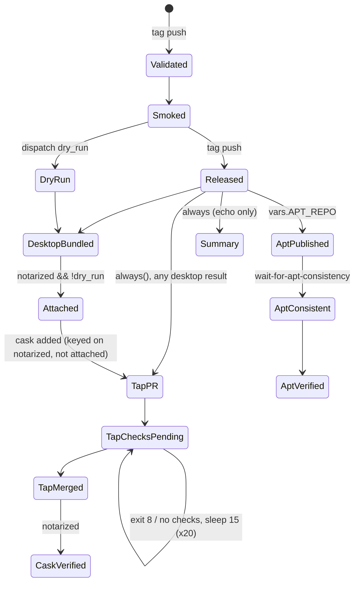
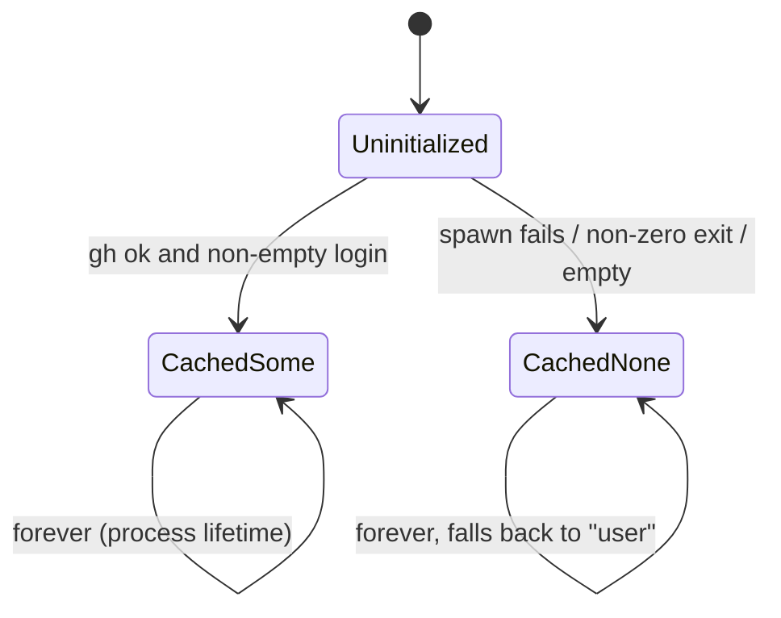
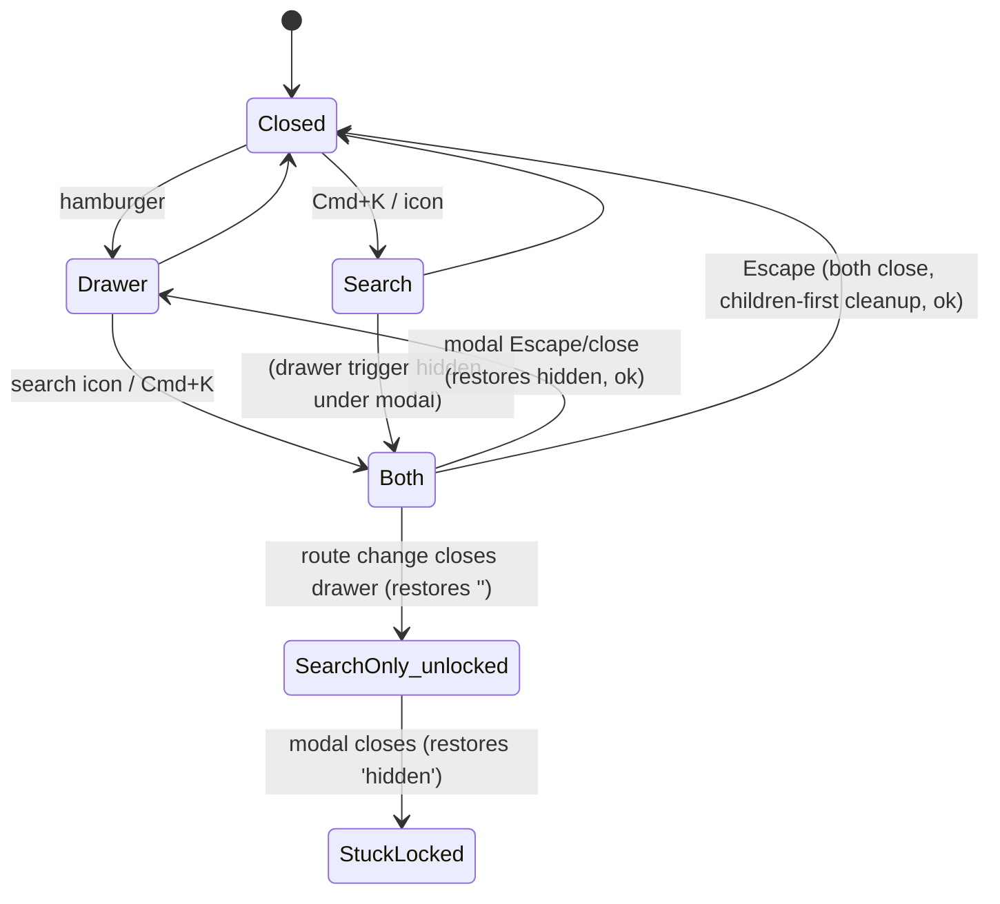
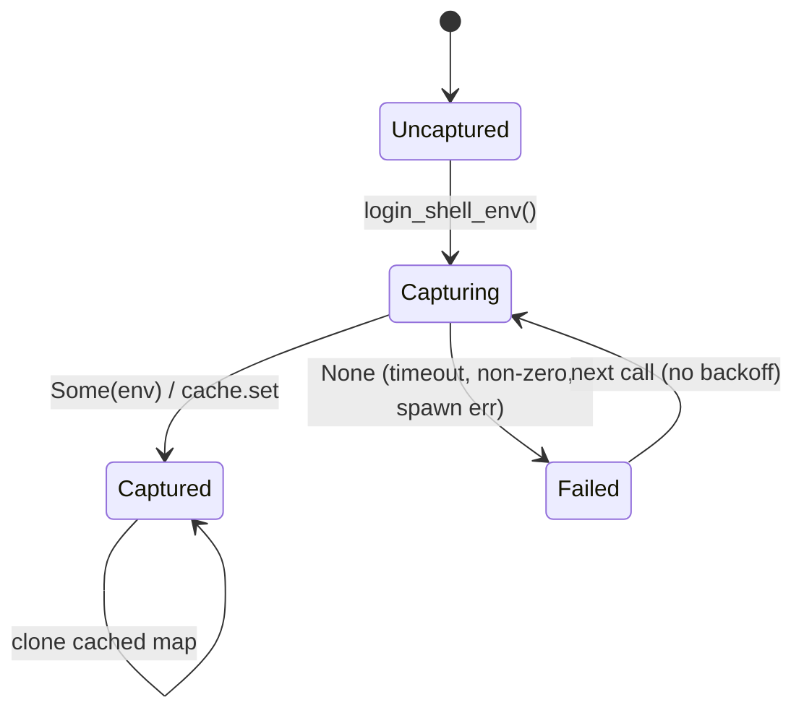
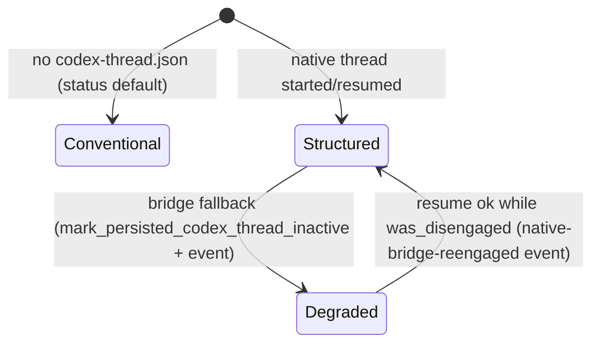
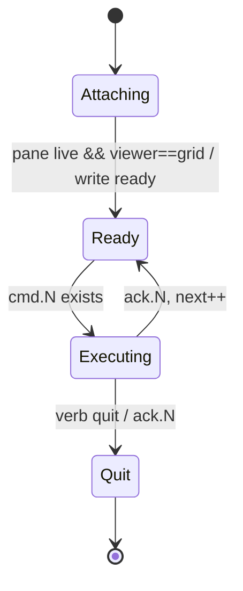

# Implicit state machines: other

Part of the [implicit state machine audit](../implicit-state-machines.md). Audit of origin/main at b93c57c4, 2026-11-05. 6 machines in this area, most pressing first.


## Release pipeline and desktop signing/notarization outcome

**Verdict:** Needs further thought. The release path has real, reachable drift. The second, hand-maintained APT workflow lacks the edge-consistency wait that the main path added after a real failure, and it may run without the environment that holds its secrets. The cask and verify gates key on 'notarized' rather than 'attached', so a failed upload can block the formula PR, which the job's own comment says must not happen. Each of these is small to fix, but they come from one design gap: the stage outcomes are strings re-derived across jobs and workflows instead of one shared definition.

**Verified concerns:** 3 medium, 4 low

**Key files:**
- `.github/workflows/release.yml:223-352 (desktop-release)`
- `.github/workflows/release.yml:354-500 (homebrew-pr)`
- `.github/workflows/release.yml:502-721 (apt-publish, verify jobs, downstream summary)`
- `.github/workflows/release-apt.yml:55-157`
- `desktop/scripts/bundle.sh:112-238`

### What the machine is

A release tag `vX.Y.Z` moves through a GitHub Actions job graph. Each job's state is a `needs.<job>.result` string (`success`, `skipped`, `failure`) plus string outputs: `dry_run`, `sign`, `notarized`, `updated`, `pr_url`. Inside the desktop job, `desktop/scripts/bundle.sh` has a small machine of its own: `signed` goes from `unsigned` to `adhoc` or `developer-id`, and `notarized` goes from `false` to `true`. bundle.sh emits both through `bundle-result.env` and `GITHUB_OUTPUT`. The jobs downstream of `release.yml` re-derive their gates from those strings. The APT half of the pipeline also exists as a separate manual workflow, `release-apt.yml`.



bundle.sh, in brief: `has_identity` decides `developer-id` or `adhoc` (bundle.sh:135-152). Notary credentials come from NOTARY_PROFILE, or NOTARY_KEY_ID + ISSUER + PATH/P8 (161-176). Notarization runs only when the app is `developer-id` signed: `submit --wait`, then `Accepted`, staple, validate, and spctl. Any other status fails (185-204). `REQUIRE_NOTARIZATION=1` with no notarization fails (206-208).

### Verified concerns

1. **The APT path is duplicated and the copies have drifted (medium).** `release-apt.yml:131-151` still uses only the 5x15s `apt-get update` loop. `release.yml:598-612` explains that this loop was insufficient against the Vercel edge (new InRelease, stale Packages.gz) and added `wait-for-apt-consistency.sh`. The backfill never got that fix.
2. **The backfill may run without its secrets (medium, PLAUSIBLE).** `release.yml:507` runs apt-publish in `environment: release-downstream`, and docs/release.md:104-106 and :400-402 say the APT secrets live there. `release-apt.yml`'s publish job declares no environment. If the secrets are environment-scoped, the backfill sees empty GPG and token values and falls back to `<owner>/shelbi-apt` for APT_REPO (`release-apt.yml:18`). docs/release-apt.md:73 says the secrets are repository-level, so the docs disagree with each other. This needs a check of the live repository settings.
3. **The cask is keyed on `notarized`, not on the zip being attached (medium).** bundle.sh writes `notarized=true` (bundle.sh:231) before the upload-artifact and `gh release upload` steps (release.yml:323-348). If either step fails, `homebrew-pr` still runs under `always()` (release.yml:361), enters the cask step (`if: notarized == 'true'`, :405), and fails downloading an asset that was never attached (:411-414). The formula PR then never opens, which contradicts the comment at :356-357. `desktop-verify-install` (:646) uses the same key.
4. **A tap re-run after a merge fails (low).** The merge at `release.yml:500` uses `--delete-branch`. A "re-run all jobs" rebuilds the branch from tap main, which already holds this version, so the unconditional `git commit` at :441 exits 1. APT guards the same case at :581.
5. **There is no terminal "shipped" state (low).** `downstream-publication` (release.yml:688-721) doesn't depend on either verify job and always succeeds. It also prints "artifacts ... are published" without checking `needs.release.result`. A missing signing secret produces only a warning (:283), so a fully green run can still ship no desktop app.
6. **The "no checks reported" state is stringly typed (low).** It is detected by exit code 8 or by grepping gh's message (release.yml:487-495).
7. **bundle.sh uses inconsistent names (low).** `signed` starts as `unsigned` but always ends as `adhoc` or `developer-id`. The summary prints "UNSIGNED" for adhoc builds (bundle.sh:135, 151, 233-237).

### Refuted

- **Signing intent decided twice (secret presence in the workflow vs a keychain identity match in bundle.sh).** A mismatch fails closed through REQUIRE_NOTARIZATION (bundle.sh:206-207), with a hint about SIGN_IDENTITY.
- **Tap re-run while the PR is still open.** This works: the commit has a real diff, the push succeeds, and the PR is reused (release.yml:444-463).

### Recommendation

- Extract the APT publish and verify steps into one `workflow_call` reusable workflow, used by both release.yml and release-apt.yml. It should carry `environment: release-downstream` and the consistency wait.
- Have desktop-release output `attached=true` from the attach step. Gate the cask step and the verify job on `desktop-release.result == 'success' && attached == 'true'`.
- Add a no-op guard to the tap commit and skip PR creation and merge when nothing changed.
- Optionally make the final job a real gate over every stage, including both verify jobs, so that green means shipped.
- Tidy bundle.sh's vocabulary.

None of these changes needs a redesign. Together they keep the stage outcomes as one shared definition instead of strings re-derived in each job.


### Verified concerns

- **medium**: The APT publish and verify path exists twice and the copies have drifted. The manual backfill's verify-install still uses only the 5x15s apt-get update loop that release.yml's own comment calls insufficient, because the Vercel edge can serve a new InRelease alongside a stale Packages.gz. It never calls wait-for-apt-consistency.sh.
  - Evidence: release-apt.yml:131-151 has only the `for attempt in 1 2 3 4 5` loop. release.yml:598-612 adds wait-for-apt-consistency.sh with --timeout 300 before the same loop, and its comment says the old loop 'gave up before the edge converged'.
- **medium**: release-apt.yml's publish job declares no `environment:`, while release.yml runs apt-publish in `release-downstream`. docs/release.md says the APT secrets live in that environment. If they are environment-scoped, the manual backfill sees empty APT_GPG_PRIVATE_KEY, APT_REPO_TOKEN and vars.APT_REPO (so it falls back to <owner>/shelbi-apt) and cannot sign or push. The docs disagree on where the secrets live: docs/release-apt.md:71-77 says repository-level. PLAUSIBLE: it depends on the live repository settings, which I could not see.
  - Evidence: release.yml:507 `environment: release-downstream`. release-apt.yml:55-61 has no environment and the secrets sit in job-level env. release-apt.yml:18 falls back to `format('{0}/shelbi-apt', ...)`. docs/release.md:104-106 and :400-402 vs docs/release-apt.md:73.
- **medium**: The cask update and desktop-verify-install read needs.desktop-release.outputs.notarized, not whether the zip was attached or whether desktop-release succeeded. bundle.sh writes notarized=true to GITHUB_OUTPUT before the upload-artifact and `gh release upload` steps run. If either of those steps fails, homebrew-pr (which runs under always()) still enters the cask step and fails on `gh release download` of a sha256 that was never attached. The job then fails before the formula PR opens, which contradicts the comment that desktop failure must not hold back the formula.
  - Evidence: bundle.sh:231 writes outputs, then release.yml:323-348 runs the upload-artifact and attach steps. release.yml:356-357 comment, :361 always(), :405 `if: needs.desktop-release.outputs.notarized == 'true'`, :411-414 download, :646 same key for verify.
- **low**: The tap PR step is not idempotent once the PR has merged. On a 're-run all jobs' after a successful merge, the formula (and cask) on tap main already match this version. `git commit` with nothing staged exits 1 under the default `bash -e`, so the job fails even though the tap is in its terminal state. APT has an explicit no-op guard for this case; the tap step does not.
  - Evidence: release.yml:436-441 (checkout -B, add, unconditional `git commit`) vs release.yml:581 `git diff --cached --quiet && exit 0`. The merge at :500 uses --delete-branch, so a re-run always rebuilds from main.
- **low**: There is no terminal 'fully shipped' state. downstream-publication depends on neither apt-verify-install nor desktop-verify-install, always succeeds, and says 'GitHub Release artifacts ... are published' without checking needs.release.result. A green run can also mean the desktop app was skipped as unsigned, because a missing secret produces only a warning.
  - Evidence: release.yml:688-721 (needs: release, homebrew-pr, apt-publish, desktop-release; echo only). release.yml:283 only warns when secrets are missing.
- **low**: The 'no checks reported yet' state is detected through gh's exit code 8 or by grepping its human-readable message. The match is stringly typed and can break across gh versions.
  - Evidence: release.yml:487-495
- **low**: bundle.sh uses three names for two outcomes. `signed` starts as 'unsigned' but is always overwritten to 'adhoc' or 'developer-id'. The summary prints 'UNSIGNED' for adhoc, and the env file and outputs report 'adhoc'.
  - Evidence: bundle.sh:135, :151, :233-237


### Concerns that did not hold up

- 'Signing intent is decided twice and can mismatch' is not a correctness risk. release.yml passes notary credentials and REQUIRE_NOTARIZATION=1 only when sign=true (release.yml:316-320). bundle.sh:206-207 then fails loudly if the keychain identity did not match, and the error message names SIGN_IDENTITY. The mismatch fails closed. The no-secrets case is green and unsigned by design, with a warning annotation.
- A tap PR re-run while the PR is still open (for example, after the tap CI went red and was fixed) is handled. The branch is rebuilt from main, the commit has a real diff, the force-with-lease push succeeds, and gh pr create falls back to reusing the open PR (release.yml:444-463). Only the post-merge re-run fails.


**Recommendation:** 1) Collapse the APT path into one reusable workflow (`workflow_call`) or composite action that takes a tag. release.yml and release-apt.yml would both call it, with `environment: release-downstream` and wait-for-apt-consistency.sh in one place. 2) Have the attach step emit `attached=true` as a desktop-release output, and gate the cask step and desktop-verify-install on `needs.desktop-release.result == 'success' && outputs.attached == 'true'` instead of `notarized`. 3) Make the tap commit idempotent, as APT is: `git diff --cached --quiet && { echo 'tap already at version'; exit 0; }`, and skip PR creation and merge in that case. 4) Optionally turn downstream-publication into a real final gate: have it need the verify jobs and fail unless each stage is success, or skipped for a declared reason. 5) In bundle.sh, normalize the vocabulary (unsigned|adhoc|developer-id is fine, but print 'AD-HOC SIGNED' in the summary) and document the result-env contract next to the release.yml consumers.


## GitHub login negative-cache latch for branch naming

**Verdict:** Needs further thought. Small machine, but it has a real and reachable failure. The long-lived daemon makes the failure state permanent, and the wrong branch name it produces is persisted onto issues and pushed. A better identity source (the board index viewer_login) already exists and goes unused.

**Verified concerns:** 1 medium, 2 low

**Key files:**
- `crates/shelbi-orchestrator/src/branch.rs:15-131`
- `crates/shelbi-orchestrator/src/lifecycle.rs:321-354`
- `crates/shelbi-orchestrator/src/mutate/start.rs:138-190`
- `crates/shelbi-state/src/github_store.rs:2363-2387`

### What it is
`crates/shelbi-orchestrator/src/branch.rs` resolves the login used for `{{github_user}}` in a `git.branch` template, and for the default `<prefix>/<id>` when no `branch_prefix` is configured. It does this once per process:

```rust
static GITHUB_LOGIN: OnceLock<Option<String>> = OnceLock::new();   // branch.rs:17
fn github_login() -> Option<String> {                               // branch.rs:113
    GITHUB_LOGIN.get_or_init(|| { /* gh api user --jq .login */ ... }).clone()
}
```



### Why it matters
- **The daemon cuts and persists branches.** On dispatch (`mutate/start.rs:140-153`, run in the daemon under the per-issue lock), `lifecycle::ensure_branch_for_in_progress` (`lifecycle.rs:321-354`) computes the name, cuts it on the hub and writes `branch:` onto the issue. If the daemon latched `None`, every task dispatched for the rest of the daemon's life gets `user/<id>`, and that name is permanent.
- **Realistic triggers.** Each of these has happened in this repo's operations: `gh` missing from the launchd PATH (spawn fails, so `None`), a GitHub 403 rate-limit window, and the macOS keychain stall that makes `gh` report no token. Any one of them at the daemon's first branch resolution poisons it until the daemon restarts.
- **Brief cross-process disagreement.** Before persistence, the CLI, TUI and desktop sidebar (`sidebar_model.rs:300`, `machines_model.rs:70`, `shelbi-tui/src/app.rs:1482`) and the zen scan (`zen.rs:1200`, `1472`) can show or compare `<login>/<id>` while the daemon creates `user/<id>`. After persistence, `task.branch` wins (`branch.rs:35-38`), so this heals itself.
- **A second identity source exists.** `github_store::resolve_viewer_login` (`shelbi-state/src/github_store.rs:2373-2386`) prefers the daemon-maintained board index `viewer_login`. `branch.rs` doesn't use it.

### Not affected
Projects that set `git.branch_prefix`, or a workflow `git:` block without `{{github_user}}`, never call `login()` (the lazy `or_else` at `branch.rs:97-98`).

### Recommendation
1. Cache success only, and retry on failure (optionally with a short TTL so an account switch is picked up).
2. Route all login lookups through one helper: board index `viewer_login`, then `gh api user`.
3. Consider making `ensure_branch_for_in_progress` refuse to persist the `user` fallback when the name depends on the login, so a transient failure gives a visible, retryable dispatch error instead of a permanently misnamed branch.


### Verified concerns

- **medium**: A single gh failure in the daemon latches None for the daemon's lifetime, so every branch the daemon cuts afterwards is named `user/<id>`. ensure_branch_for_in_progress then writes that name onto the issue, so the wrong name is permanent and every later reader agrees with it.
  - Evidence: branch.rs:113-131: get_or_init caches `None` on any failure, including spawn failure (`.output().ok()?`). lifecycle.rs:334-347 computes the branch, runs cut_branch_on_hub, then store.set_fields(branch: Some(branch)). mutate/start.rs:140-153 calls this on dispatch, which runs under the daemon's per-issue lock (start.rs:167-170 comment). Plausible triggers, all seen in this repo's operations history: gh missing from the launchd PATH, a GitHub 403 rate-limit window, and the macOS keychain stall.
- **low**: Different processes can disagree about the name of a not-yet-started task's branch. A CLI, TUI or desktop process that resolved the login shows `<login>/<id>` (sidebar_model, machines_model, tui app, zen scan), while the latched daemon cuts `user/<id>`. The disagreement only lasts until task.branch is persisted, because an explicit branch wins at branch.rs:35-38.
  - Evidence: Callers without a persisted branch: sidebar_model.rs:300, machines_model.rs:70, shelbi-tui app.rs:1482, zen.rs:1200/1472, and the poller re-derivations (poller.rs:3691, 4825, 5929), which fall back to the login only when task.branch is unset.
- **low**: There are two independent sources for the same identity. github_store.resolve_viewer_login prefers the board index's viewer_login, which the daemon keeps up to date, and falls back to a live `gh api user` read. branch.rs ignores the board index and keeps its own sticky cache, so the two can disagree, for example when an issue is assigned to `jlong` but its branch is `user/…`.
  - Evidence: github_store.rs:2373-2386 compared with branch.rs:113-131.


### Concerns that did not hold up

- Divergence that lasts after start: refuted. Once ensure_branch_for_in_progress persists `branch:` (lifecycle.rs:337-348), branch_name_for_task returns task.branch first (branch.rs:35-38), so every process agrees afterwards. The divergence is limited to names computed before persistence. The persisted name can still be wrong, and that is the medium concern above.
- Projects that set git.branch_prefix (or a workflow git block without {{github_user}}) never call login() on the prefix path, because `config_prefix.or_else(login)` is lazy (branch.rs:97-98). They are unaffected.
- A gh call that hangs forever inside the OnceLock is not a concern. gh's own keyring and network timeouts bound it, and concurrent callers only wait on that one in-flight call.


**Recommendation:** Stop caching failure. Cache only Some(login) (for example OnceLock<String>, or a Mutex<Option<(String, Instant)>> with a TTL), and on None re-try gh at the next call. Better still, resolve the login through one shared helper that prefers the board index viewer_login (the same source github_store::resolve_viewer_login uses) and falls back to gh. Separately, decide whether ensure_branch_for_in_progress should refuse to cut and persist a `user/<id>` fallback branch when the template or prefix depends on the login, rather than silently persisting it. Failing the dispatch with a clear error (or deferring it) is better than a permanently misnamed branch.


## Site client-side UI state (theme / client / code-tab preferences, overlay scroll lock)

**Verdict:** Needs further thought. There is a live, if uncommon, bug that breaks the whole site: unguarded localStorage in ThemeToggle crashes every page when storage is blocked, and the site has no error boundary to catch it. There is also a real (rare) way to get a stuck scroll lock. Both are cheap to fix. The design question is small but worth deciding: should the three preference stores share one guarded store helper with one sync policy?

**Verified concerns:** 1 medium, 2 low

**Key files:**
- `site/components/ThemeToggle.tsx:30-78`
- `site/components/Header.tsx:60-160,190-270`
- `site/components/DocsSearch.tsx:139-240,330-356`
- `site/components/ClientPreference.tsx:30-72`
- `site/lib/code-tabs-store.ts:27-75`

### What it is
Client-only UI state on shelbi.dev (the `site/` Next.js app). There are two groups of state:

1. **Reader preferences**: theme (light/dark/system), client variant (TUI/Desktop), and code-tab group choice. Each has its own store:
   - **Theme**: localStorage `theme`, the `html.dark` class, and `useState(preference, dark, mounted)` in `ThemeToggle`. The React state duplicates the truth. There is no cross-tab sync and no storage guard.
   - **Client**: localStorage `shelbi-client`, the `<html data-client>` attribute (the source of truth), a custom change event, and `useSyncExternalStore`. Guarded writes, cross-tab sync.
   - **Code tabs**: a module-level `Map`, `shelbi:codetabs:<group>` keys, and a storage listener. Guarded, hydrates lazily on first subscribe.
2. **Overlays**: the mobile drawer (Header) and the Cmd+K search modal (DocsSearch). Each one independently snapshots and restores `document.body.style.overflow`.



### Verified concerns
- **Medium: an unguarded localStorage call can crash the whole site.** `site/components/ThemeToggle.tsx:36` and `:71` call `localStorage` with no try/catch. When storage is blocked (cookies disabled, or a sandboxed frame), the access throws `SecurityError` inside a mount effect. There is no `app/error.tsx` or `global-error.tsx`, and ThemeToggle sits in the shared Header (`Header.tsx:226`), so every page shows Next's "Application error" screen. The boot script (`app/layout.tsx:55`), `ClientPreference.tsx:57-62` and `code-tabs-store.ts:29-33,70-71` all guard this access.
- **Low: the three stores have drifted apart.** Only theme lacks cross-tab sync and keeps a duplicate React-state copy (`ThemeToggle.tsx:31-33`). Changing the theme in one tab leaves other tabs stale.
- **Low: the scroll lock can get stuck when the overlays close out of order.** `Header.tsx:134-138` and `DocsSearch.tsx:235-239` each restore their own snapshot. The drawer backdrop starts at `top-9`, so the header search icon (`Header.tsx:192`) can still be tapped while the drawer is open. Back/forward navigation with both open closes only the drawer (`Header.tsx:80-83`), which unlocks the page under the modal. When the modal then closes, it restores `hidden`, and the page can't scroll until the drawer is cycled.

### Refuted
- Escape closing both overlays in one keypress is safe. React runs the deleted SearchModal subtree's cleanups before the parent Header's effect cleanup, so the end state is `''`.
- Choosing a result calls `onClose()` before `router.push`, so the overlays close in LIFO order.
- The SSR default and the boot script agree (dark), so there is no hydration mismatch.

### Recommendation
Fix the ThemeToggle guard now. Move theme onto the client-preference pattern: the DOM as truth, `useSyncExternalStore`, a guarded write, and a `storage` listener. Then consider one shared `createPreferenceStore` helper. Replace the two overflow snapshots with a ref-counted `useScrollLock` hook, and optionally close the search modal on a route change.


### Verified concerns

- **medium**: ThemeToggle reads and writes localStorage with no guard. In a browser that blocks site storage, the localStorage accessor throws SecurityError inside a useEffect. The site has no app/error.tsx or global-error.tsx, so React/Next turns this into an uncaught client exception, and Next shows its 'Application error' screen on every page, because ThemeToggle sits in the shared Header. The reporter's claim that the toggle 'renders only its placeholder' understates this. The boot script and the other two stores all wrap storage access in try/catch.
  - Evidence: site/components/ThemeToggle.tsx:36 `localStorage.getItem("theme")` and :71 `localStorage.setItem("theme", pref)` have no try/catch. Compare site/app/layout.tsx:55 (try/catch), site/components/ClientPreference.tsx:57-62 (try/catch), site/lib/code-tabs-store.ts:29-33,70-71 (try/catch). `find site/app -name error.tsx -o -name global-error.tsx` returns nothing. Header renders <ThemeToggle/> at Header.tsx:226.
- **low**: Theme is the only preference with no cross-tab sync, and it keeps a duplicate copy of its truth in React state (preference/dark) instead of reading the DOM like the client store does. Changing the theme in one tab leaves other open tabs on the old theme with a stale checkmark. The three stores have drifted apart: each has its own hydrate, guard and sync rules for the same kind of state.
  - Evidence: ThemeToggle.tsx:31-33 useState copies, with no 'storage' listener anywhere in the file. ClientPreference.tsx:41-46 and code-tabs-store.ts:38-47 do listen for 'storage'.
- **low**: The body scroll lock has two owners, and each snapshots prevOverflow independently. If the drawer closes while the search modal is still open, the drawer restores '' (unlocking the page under the modal). When the modal later closes, it restores its own snapshot 'hidden', and the page stays unscrollable until the drawer opens and closes again. Here is how to reach it: on mobile, open the drawer, then tap the search icon. That works because the drawer backdrop starts at top-9, so the header bar stays tappable. Then use browser back/forward (a swipe gesture). The pathname change closes the drawer during render (Header.tsx:80-83), but nothing closes the modal on a route change.
  - Evidence: Header.tsx:134-138 and DocsSearch.tsx:235-239 both run `prevOverflow = body.style.overflow; body.style.overflow = 'hidden'; return () => body.style.overflow = prevOverflow`. The drawer backdrop is `fixed top-9` (Header.tsx ~258), so the header search trigger (Header.tsx:192) stays reachable. Only the drawer closes on a route change.


### Concerns that did not hold up

- Escape closing both overlays in one tick does NOT leave the page locked. The modal's React onKeyDown does not stop propagation, so Header's window listener also closes the drawer, and both state updates commit together. DocsSearch renders inside Header (Header.tsx:192), and React runs passive cleanups children-first: the deleted SearchModal subtree restores 'hidden', then Header's own effect cleanup restores ''. The end state is correct.
- Choosing a search result while the drawer is open is also safe. go() calls onClose() before router.push, so the modal unmounts (restoring 'hidden') before the pathname change closes the drawer (restoring ''). That is LIFO order.
- The theme's SSR default and the boot script agree (missing or invalid value -> dark in both layout.tsx:55 and ThemeToggle.tsx:37-40), so there is no hydration mismatch in the normal path.


**Recommendation:** (1) Quick bug fix: wrap ThemeToggle's localStorage get/set in try/catch, or better, move theme onto the same pattern as client-preference: html.dark as the source of truth, read via useSyncExternalStore, a guarded write, and a 'storage' listener for cross-tab sync. That removes the duplicate useState copy and the `mounted` latch. (2) Pull out one small `createPreferenceStore(key, parse, apply)` helper that the theme, client and code-tab stores all use. It would own the guarded read/write, the storage-event sync and the SSR snapshot. (3) Replace the two ad-hoc overflow snapshots with a single ref-counted `useScrollLock(active)` hook: lock when the count goes 0->1, unlock when it goes 1->0. That makes the close order irrelevant. Optionally close the search modal on a pathname change, as the drawer already does.


## Login-shell environment capture cache

**Verdict:** Worth tidying. The machine is small and contained, and it works correctly: success is latched, a failure falls back to a non-empty env and retries later, and the 10s deadline means a capture can never hang. Both the no-cache-on-failure choice and the OnceLock latch are deliberate and documented. What is left is a cost and robustness gap: a persistent failure re-pays up to 10s on every call, and concurrent first callers run duplicate captures. The SSH_AUTH_SOCK concern belongs to the session-health machinery, not this cache.

**Verified concerns:** 1 medium, 2 low

**Key files:**
- `crates/shelbi-core/src/login_env.rs:23-89 (cache + resolve policy)`
- `crates/shelbi-core/src/login_env.rs:126-217 (bounded capture, setsid, deadline)`
- `crates/shelbi-cli/src/commands/daemon/serve.rs:263,371-393 (daemon overlays capture onto its own env at startup)`
- `crates/shelbi-session/src/spawn.rs:115-125 and crates/shelbi-session/src/session.rs:497-503 (two-level use: spawner then session process)`
- `crates/shelbi-cli/src/commands/daemon/session_health.rs:1-30,283-287 (the real SSH_AUTH_SOCK staleness handling)`

**Entity:** the interactive login-shell environment (`$SHELL -l -i -c env`) captured once per process and used by:
- the daemon, which overlays it onto its own env at startup;
- the session spawner, which builds each child's env from it;
- the `__session` process, which builds its agent's env from it;
- orchestrator tool launches, the review diff-command builder, and daemon_watchdog's ensure-daemon env.

**Storage:** `static CACHE: OnceLock<BTreeMap<String,String>>` (`crates/shelbi-core/src/login_env.rs:30`). Only a successful capture is stored. A failure exists only as a returned `fallback_env()` (the launcher's own `std::env::vars()`) plus a `tracing::warn!`.



**Transitions** (`login_env.rs:66-89`, capture in `126-217`):
- Uncaptured -> Capturing on any call while the cache is empty.
- Capturing -> Captured when the capture returns Some. `cache.set` uses first-writer-wins; racers' sets are no-ops.
- Capturing -> Failed on spawn error, non-zero exit, the 10s deadline kill, or the stdout read grace expiring.
- Failed is not remembered, so the next call is Uncaptured again.

**Verified concerns**
1. *No failure memo, no backoff* (medium). When capture keeps failing, every call re-pays up to 10s: `spawn.rs:118`, `orchestrator/tools.rs:176`, and `state/tools.rs:518` (which `review_ui.rs:304` and `orchestrator/tools.rs:150` reach). This is deliberate (`rt-login-env-capture-empty-path`, `login_env.rs:23-29`), but nothing bounds how often it repeats.
2. *Concurrent first calls duplicate the capture* (low). The code uses get, then capture, then set, not `get_or_init`, so N parallel callers start N interactive shells.
3. *Double capture per session* (low). `spawn.rs:117-118` passes `session_child_env()` to the `__session` process, and `session.rs:500-503` calls it again inside that fresh process (empty OnceLock). That is a second shell of up to 10s before the agent starts.

**Refuted:** "the OnceLock latch keeps SSH_AUTH_SOCK stale." The daemon copies the capture into its own env (`serve.rs:371-375`), so a re-captured shell would inherit the same stale socket unless the rc sets it. Staleness is a property of the long-lived process. The daemon's session-health monitor handles it: it detects the lost Aqua session and re-execs the daemon (`crates/shelbi-cli/src/commands/daemon/session_health.rs:1-30, 283-287`).

**Recommendation (tidy):** replace the OnceLock with `Mutex<CaptureState>` (`Uncaptured | Captured(Arc<Env>) | Failed{at, attempts}`) and one transition function that does two things. It single-flights the capture. During a backoff window after a failure, it returns the fallback right away. Optionally, mark the env handed to `__session` as already resolved so the session process skips its own capture. Keep SSH_AUTH_SOCK freshness out of this cache. If live agent-socket tracking is wanted, that is a separate design question for the spawner or session_health.


### Verified concerns

- **medium**: Failures leave no record and there is no backoff. If the capture keeps failing (a wedged rc, a headless host), every caller pays up to CAPTURE_TIMEOUT (10s) again: each daemon session spawn, each orchestrator tool launch, and each review diff-command build that resolves PATH dirs.
  - Evidence: login_env.rs:80-87 returns fallback_env() without touching CACHE, and the comment at login_env.rs:23-29 says this is deliberate (rt-login-env-capture-empty-path). Callers that hit it repeatedly: spawn.rs:118 via session_child_env, orchestrator/tools.rs:176 (spawn_watched), state/tools.rs:518 login_path_dirs (called from review_ui.rs:304 and orchestrator/tools.rs:150).
- **low**: Concurrent first calls each spawn their own interactive login shell, because the code uses get-then-set rather than get_or_init. N parallel spawns at startup run N captures.
  - Evidence: login_env.rs:70-78: cache.get() miss, then capture(), then cache.set(); the comment acknowledges that racers' sets are no-ops. This is benign for correctness and only wastes effort.
- **low**: Each session costs a second full capture. The `shelbi __session` process is a fresh process with an empty OnceLock, so it re-runs the interactive login shell (up to 10s) before it spawns the agent, even though the spawner already passed it a captured env.
  - Evidence: spawn.rs:117-118 passes session_child_env() into the session process; session.rs:500-503 then calls session_child_env() again inside that new process.


### Concerns that did not hold up

- The OnceLock latch is not what keeps SSH_AUTH_SOCK stale. At startup the daemon copies the capture into its own environment with set_var (serve.rs:371-375), and a re-run login shell inherits the daemon's stale SSH_AUTH_SOCK unless the user's rc sets it. Clearing the cache would therefore usually re-capture the same dead path. Staleness comes from the long-lived process's inherited env, and the codebase already handles it in a dedicated place: the session-health monitor detects GUI-session loss and re-execs the daemon (daemon/session_health.rs:1-30, 283-287). A fresh process gets a fresh OnceLock anyway, so this cache does not add to the problem.


**Recommendation:** Turn the OnceLock into a small explicit cache state, for example `Mutex<CaptureState>` with `enum CaptureState { Uncaptured, Captured(Arc<Env>), Failed { at: Instant, attempts: u32 } }`. Add one transition function that (a) single-flights the capture so concurrent callers wait on one shell instead of each starting their own, and (b) returns the fallback immediately for a short backoff window after a failure (for example 30-60s, growing with attempts) instead of re-running the 10s capture. Optionally, pass the spawner's capture to the `__session` process so it does not re-capture, for example with a marker env var meaning "env already resolved". Do not add time-based invalidation of a successful capture to chase SSH_AUTH_SOCK. If live ssh-agent tracking is wanted, that is a separate decision for session_health or the spawner (resolve SSH_AUTH_SOCK at each spawn), not for this cache.


## Agent integration tier (structured / conventional / degraded)

**Verdict:** Worth tidying. This is an observability-only label, and the module docs say nothing branches on it. The one real runtime transition (the Codex bridge engaging or disengaging) is stored durably and worked out by one function. The concern as reported mostly does not hold up. What is left is small drift: an unused CapabilityLadder that already disagrees with the workspace list, a Generic orchestrator that reports conventional, and duplicate fallback events. None of these causes a correctness problem, but each could mislead someone diagnosing a transport downgrade.

**Verified concerns:** 3 low

**Key files:**
- `crates/shelbi-core/src/integration.rs:1-68`
- `crates/shelbi-orchestrator/src/wake.rs:470-490, 1995-2030, 2192-2260`
- `crates/shelbi-cli/src/commands/workspace.rs:300-326, 426-500`
- `crates/shelbi-cli/src/commands/status.rs:512-545`
- `crates/shelbi-core/src/model.rs:1792-1825`

### What it is
`IntegrationMode` (`crates/shelbi-core/src/integration.rs:26`) labels the transport tier Shelbi has with an agent pane: **structured** (Codex native app-server bridge), **conventional** (verified tmux submission plus OSC pane-title hooks) or **degraded** (polling only). The module docs say plainly that it is observability-only: nothing in the scheduler branches on it.

### How it is stored and derived
- **Orchestrator (the only tier that changes at runtime):** stored durably in `codex-thread.json` as `native_active: bool` plus `native_inactive_reason`. `CodexIntegrationHealth::mode()` (`wake.rs:2192`) maps true to Structured and false to Degraded. When the file is missing, `status.rs:528` prints Conventional.
- **Workspaces:** static. `workspace_integration_modes` (`cli/commands/workspace.rs:300`) takes the project's default runner kind: Claude/Codex give Conventional, Generic or no runner gives Degraded. Every workspace gets the same value (the "uniform fleet" assumption).
- **Event log:** `append_integration_event` writes `integration wake=.. messages=.. reason=..` lines (`shelbi-state/src/event_log.rs:1958`).
- **CapabilityLadder** (`model.rs:1798`): a separate per-axis tier table for each runner kind. Production code never reads it; only tests do.



### Verified concerns (all low)
1. **The ladder and the workspace list disagree.** For Codex, `model.rs:1810-1816` says message_delivery is Degraded, but `workspace.rs:320-326` reports Codex as Conventional. The ladder has no production caller (`shelbi-agent/src/lib.rs:111` is called only from tests), so it has already drifted.
2. **The orchestrator default ignores runner kind.** `status.rs:526-530` returns Conventional whenever there is no Codex thread file, so a Generic orchestrator runner shows conventional while a Generic workspace shows degraded.
3. **Duplicate fallback events.** `wake.rs:476-490` appends a degraded integration event on every standalone fallback, but the state write at `wake.rs:2252` is idempotent. Re-engaging, by contrast, is correctly gated on `was_disengaged` (`wake.rs:2004-2026`).

### Concerns that did not hold up
- "No stored tier": the orchestrator tier is stored (`native_active`), and workspace tiers do not change at runtime, so there is nothing to store.
- The `unwrap_or(Conventional)` at `workspace.rs:498` can only be reached through the test-only `render_list` helper with an empty map. The production `list` fills the map for every workspace.
- There is no TUI/desktop parity issue because neither surface shows the tier.

### Recommendation
Worth tidying, but this is not a correctness risk. Add one `IntegrationMode::for_runner(RunnerKind)` (or `CapabilityLadder::overall()`) used by both the workspace list and the status line when no bridge exists. Either delete CapabilityLadder or make it the source of truth, and decide whether Codex message delivery counts as degraded. Emit the fallback event only on a real true->false change of `native_active`.


### Verified concerns

- **low**: Two tier descriptions for the same runner disagree. CapabilityLadder says a Codex runner's message_delivery is Degraded, but `workspace list` reports Codex workspaces as plain Conventional. Production code never calls the ladder (only tests do), so it has already drifted from what users see.
  - Evidence: model.rs:1810-1816 (Codex message_delivery: Degraded); workspace.rs:320-326 (Codex -> Conventional); the only caller is shelbi-agent/src/lib.rs:111-113, which is itself called only from model.rs tests at 5488-5496
- **low**: The orchestrator line defaults to Conventional whenever there is no codex-thread.json, without checking the orchestrator's runner kind. A Generic orchestrator runner shows `integration=conventional`, while the same runner on a workspace shows `degraded`.
  - Evidence: status.rs:526-530 returns IntegrationMode::Conventional when health is None; workspace.rs:325 maps Generic -> Degraded
- **low**: The fallback integration event is appended on every fallback, even though the state write is idempotent (it only writes when native_active or the reason changes). Repeated standalone launches can log repeated 'degraded' events that are not real transitions.
  - Evidence: wake.rs:476-490 appends unconditionally; wake.rs:2252 guards only the state write


### Concerns that did not hold up

- 'No stored current tier': partly false. For the orchestrator, the only place a tier can change at runtime, the tier is stored durably as native_active plus native_inactive_reason in codex-thread.json, and mode() is one pure function over it. Workspace tiers are static functions of the runner kind, so there is no state to store.
- 'Missing map entry -> Conventional (workspace.rs:498) conflicts with missing runner -> Degraded (workspace.rs:308)': the empty-map path can only be reached through the test-only `render_list` helper. The production `list` builds the map for every p.workspaces entry (workspace.rs:237, 300-314), so in practice the Conventional fallback never applies.
- TUI/desktop parity drift: neither the TUI nor desktop surfaces the integration tier (grep finds nothing), so there is nothing to drift.


**Recommendation:** Put the decision in one place. Add `IntegrationMode::for_runner(kind)` (or a `CapabilityLadder::overall()`) in shelbi-core, and have both workspace.rs:320 and the status.rs None branch call it, so the orchestrator without a bridge uses its runner kind instead of a hard-coded Conventional. Then either delete CapabilityLadder or make `workspace list` derive from it, and settle whether Codex is conventional or degraded for message delivery. Finally, gate the fallback append on an actual native_active true->false change, the same way the re-engage event is gated on was_disengaged. Do not add a stored tier field.


## Bench harness marker-file protocols

**Verdict:** Fine as is. These are test and benchmark harness handshakes with a fixed, linear sequence and per-number filenames. Nothing ships to users, and the claimed desync and loop-never-finishes issues don't hold. The one real gap, a timed-out dump being diffed as stale, is a one-line script fix, not a state-machine design problem.

**Verified concerns:** 3 low

**Key files:**
- `desktop/src/bench/feed.rs:19-64`
- `desktop/src/bench/client.rs:105-162`
- `desktop/scripts/multiclient-check.sh:143-158,238-308`
- `desktop/src/bench/mod.rs:205-230,575-590,650-713,885-895`

The desktop bench tooling contains two small marker-file handshakes.

**1. Feeder go/done (bench-term harness ↔ `--bench-feed` session process)**
- **Encoding:** `<sandbox>/go-<name>` and `go-<name>.done`. For the Direct source, an `AtomicBool done` replaces the file.
- **Steps:**
  1. `spawn_feeder` removes any stale go and .done files, then spawns the feeder with `--repeat N` or `--loop` (`desktop/src/bench/mod.rs:213-226`).
  2. The feeder polls for the go file every 5ms (`feed.rs:35-37`).
  3. The harness writes go (`mod.rs:653`).
  4. The feeder streams the file N times, writes `.done`, and sleeps forever (`feed.rs:42-63`).
  5. The harness loop (`mod.rs:656-673`) ends when the feeder is finished and the pane has been quiet, or with `timed_out = true` after 90s. The timeout is recorded in the report (`report.rs:135`).
- **Notes:** `--loop` is used only by the many-workspaces case (`mod.rs:891`), which never waits on `.done`. The measured Session case always passes `Some(repeat)` (`mod.rs:583`).

**2. Bench client control dir (`multiclient-check.sh` ↔ `--bench-client`)**
- **Startup:** the client writes `ready` once the pane is live and its viewer equals the requested grid (`client.rs:107-119`).
- **Commands:** the script writes `cmd.N` atomically via tmp+mv (`sh:149-151`). The client handles commands strictly in order: it runs the verb, waits 50ms, then writes `ack.N` (`client.rs:121-160`).
- **Shutdown:** `quit` writes its ack and then quits.
- **Script side:** the script waits up to 10s per ack. If the client process dies, it exits 1. If the ack never arrives, it only echoes a message and returns 1.



**Verified concerns (all low):**
- `multiclient-check.sh:274`: `desktop dump` is called and its return code is ignored. After an ack timeout, lines 275-285 diff the previous round's `desktop-grid.txt`/`desktop-view.txt`, and the timeout is never counted as a failure. The same applies to `type_in desktop` (line 240/251).
- `client.rs:155,140-148`: an unknown verb, or a `dump` with a path missing, still gets acked as success.
- `feed.rs:35-37`: the go-wait has no timeout. This only matters if the harness crashes before writing go.

**Refuted:**
- Sequence desync and misattributed acks: filenames carry the number, and the client works through them strictly in order.
- "--loop never writes .done, so the case can only time out": the only `--loop` case doesn't wait on `.done`.
- "Timeouts are ignored": true only for the shell script. The Rust harness reports them.

**Recommendation:** fine as is. If anything, make `desktop()` call `fail` on timeout, and `rm -f` the dump files before each dump.


### Verified concerns

- **low**: The script ignores a desktop command that times out. When `desktop dump` gets no ack, the round goes on and diffs desktop-grid.txt/desktop-view.txt left from the previous round, or a file still being written. That can produce a stale pass or a misleading failure, and the timeout itself is not added to `failures`. `type_in desktop` drops the return code the same way.
  - Evidence: multiclient-check.sh:274 calls `desktop dump ...` without checking its status, and lines 275-285 then read the files. The `desktop()` function returns 1 on timeout (line 157) but never calls fail(). type_in at line 240 (`desktop type ... && desktop key enter`) is also unchecked at line 251. The script runs with `set -uo pipefail` and no -e (line 35).
- **low**: The client acks an unknown verb, or a `dump` missing its paths, as if it succeeded. A typo in the script therefore looks like a working step.
  - Evidence: client.rs:155 only does eprintln! for an unknown verb and then falls through to the ack at line 159. The dump arm at lines 140-148 skips silently when either path is missing.
- **low**: The feeder busy-polls the go file every 5ms with no timeout. If the harness dies between spawn and go, the session process lives until the sandbox is torn down.
  - Evidence: feed.rs:35-37 is `while !go.exists() { sleep(5ms) }`. The harness writes go unconditionally right after setup (mod.rs:653), so this only matters on harness crash.


### Concerns that did not hold up

- 'With repeat None the feeder never writes .done, so a Session case can only end at CASE_TIMEOUT.' The measured Session streaming case always passes Some(repeat) (mod.rs:583). Only the many-workspaces case uses None/--loop (mod.rs:891), and that case does not wait on a .done file.
- 'Timeouts are ignored' (on the Rust side). A harness CASE_TIMEOUT sets timed_out, which goes into the result (mod.rs:670,713) and shows as ', TIMED OUT' in the report (report.rs:135). Only the shell script drops its timeouts.
- 'Sequence numbers can desync, so acks get attributed to the wrong command.' Commands carry their number in the filename (cmd.N/ack.N) and the client handles them strictly in order, one at a time. If the script gives up on N and writes N+1, the client finishes N, writes ack.N, then takes N+1 and writes ack.N+1. The script waits for ack.N+1 by name, so misattribution can't happen. The only effect is that N's leftover time comes out of N+1's 10s budget.


**Recommendation:** Leave the protocol as it is. Optionally tighten the script: make `desktop()` call `fail` on timeout, or check `desktop dump ... || { fail "round N: dump timed out"; continue; }`, and `rm -f` desktop-grid.txt/desktop-view.txt before each dump so stale files can't be compared. Optionally have the client write `ack.N` with an error body, or exit non-zero, for an unknown verb or a malformed dump. Adding an enum or transition function here would cost more than it saves.
