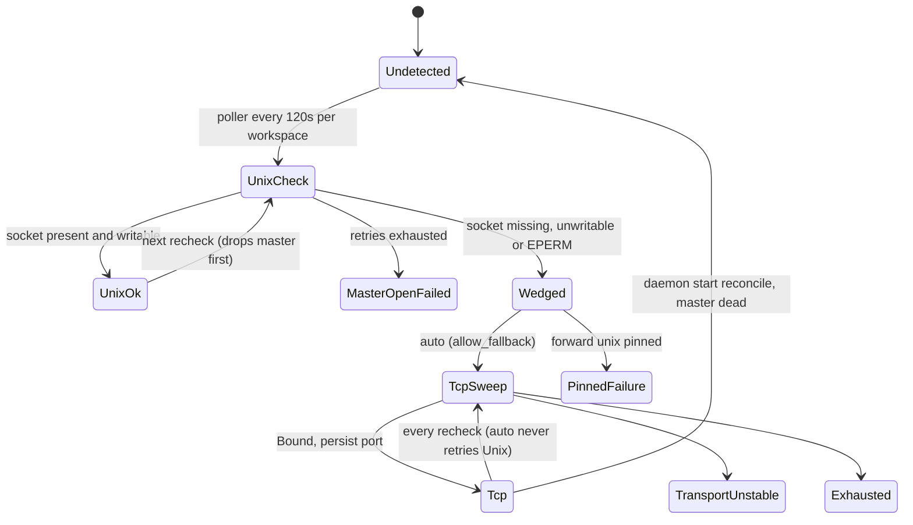
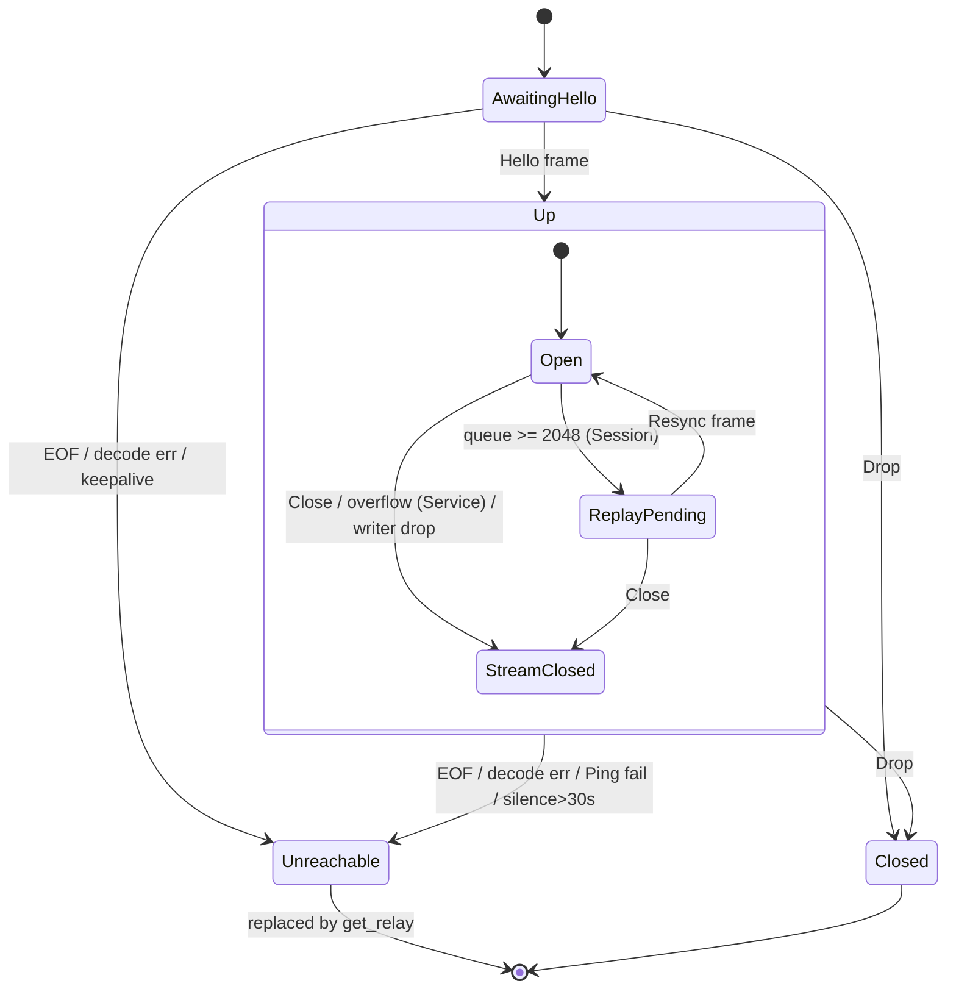
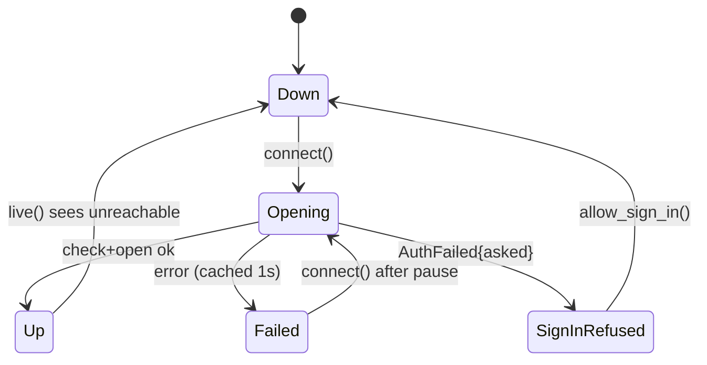
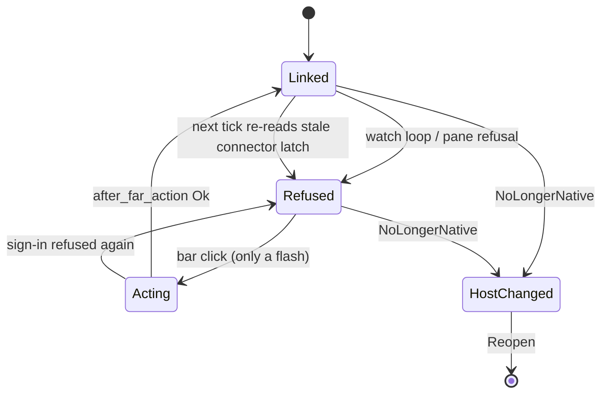
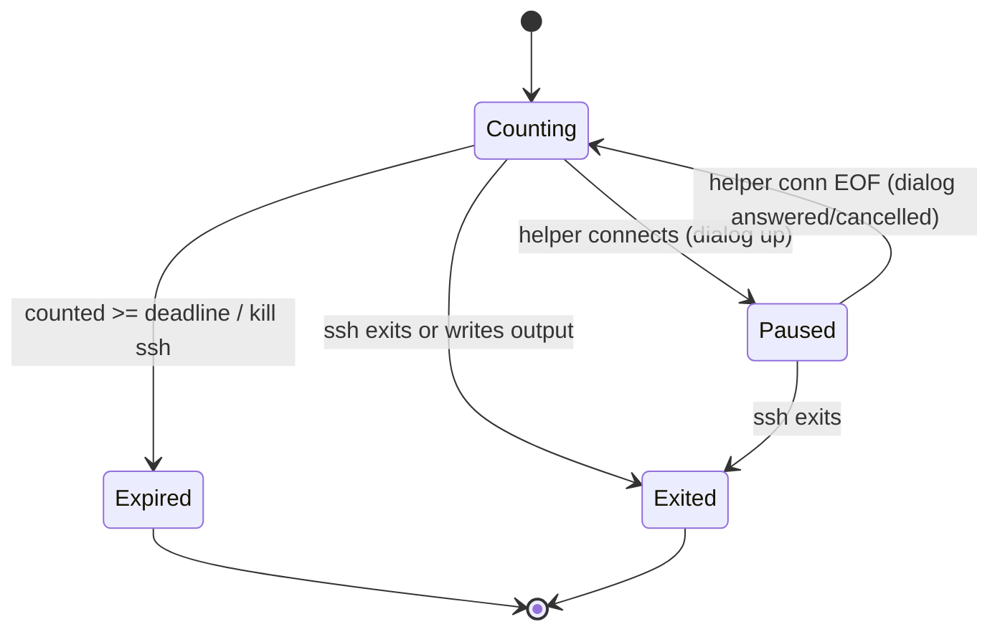

# Implicit state machines: remote/SSH

Part of the [implicit state machine audit](../implicit-state-machines.md). Audit of origin/main at b93c57c4, 2026-11-05. 4 machines in this area, most pressing first.

## SSH reverse-forward mode, ControlMaster lifecycle and per-host state files

**Verdict:** Needs further thought. The recheck is destructive: it unconditionally runs `ssh -O exit` on a healthy shared master every 120s per workspace. That is a live robustness bug, and it is probably a hidden source of the mux 'Broken pipe' and transport failures that run_resilient and the relay reconnect were built to absorb. The pinned-unix plus stale-Tcp mismatch is a reachable illegal combination that wedges permanently. Both come from the mode being read in three places with different rules: argv builder, ensure, and worker endpoint.

**Verified concerns:** 1 high, 1 medium, 2 low

**Key files:**
- `crates/shelbi-ssh/src/lib.rs:1340-1415 (ensure_unix_forward, unconditional drop_master)`
- `crates/shelbi-ssh/src/lib.rs:1573-1830 (ensure_tcp_forward, ensure_reverse_forward mode/pin decision)`
- `crates/shelbi-ssh/src/lib.rs:270-305, 1152-1172 (forward_spec_for_host ignores the pin; the Unix master reopen uses it)`
- `crates/shelbi-state/src/ssh_control.rs:528-651 (HostForward, save_host_forward unlocked RMW, reconcile, remote_hub_endpoint)`
- `crates/shelbi-orchestrator/src/poller.rs:95-102, 580-595 (per-workspace 120s recheck)`

### What it is
For each remote SSH host, the hub keeps a ControlMaster that carries a `-R` reverse forward of `hub.sock`, so remote workers can reach the hub. The forward is either **Unix** (the default landing socket) or **Tcp** (`127.0.0.1:<port>`). Tcp is the fallback for the Tailscale-SSH root-owned-socket wedge.

### How the state is stored
- `$SHELBI_HOME/forward-modes.json`: `{host: {mode, port?}}` (ssh_control.rs:528-579). It is read on **every** ssh argv build (`forward_spec_for_host`, lib.rs:275) and for worker `SHELBI_HUB_ADDR` (`remote_hub_endpoint`, ssh_control.rs:639).
- The YAML `forward:` pin, which **only** `ensure_reverse_forward` reads (lib.rs:1748).
- The external ssh mux socket (master alive or not).
- A process-local health signature map that dedupes events.log lines (lib.rs:1281-1320).
- A per-host flock `master-<host>.lock`, taken by ensure and by mux recovery, but not by ordinary ssh clients.

### Verified concerns
1. **High: the recheck tears down a healthy master.** `ensure_unix_forward` calls `drop_master` (`ssh -O exit`) at lib.rs:1344 and 1351 before probing anything. The TCP path does the same at lib.rs:1619, and again per candidate at lib.rs:1521. The poller runs this per **workspace thread** every 120s (poller.rs:584-594), so a host with N workspaces loses its master about N times every two minutes. `-O exit` ends every multiplexed session: the `shelbi relay` channel (remote_session.rs:143), in-flight polls and git commands. The per-host lock doesn't protect ordinary mux clients. The comment at lib.rs:1345-1347 assumes this runs only when no live master owns the forward. It doesn't, and the old pre-#325 code dropped unconditionally too. This is probably a self-inflicted source of the mux transport failures that `run_resilient` (lib.rs:659) and the relay reconnect absorb.
2. **Medium: a `forward: unix` pin vs a stale Tcp record.** `forward_spec_for_host` ignores the pin, and the Unix repair reopens the master through it (lib.rs:1152-1160). So a host that fell back to Tcp under auto and is later pinned to unix keeps opening a TCP `-R`. Its Unix landing socket never appears, giving `Wedged(landing_socket_missing)` and a pinned failure every cycle, while workers are told `tcp:` by `remote_hub_endpoint`. Nothing clears the record: the pin branch never calls `save_host_forward(None)`, and reconcile keeps it because the master is alive.
3. **Low: unlocked read-modify-write.** `save_host_forward` (ssh_control.rs:563-579) and `save_machine_record` (machine_state.rs:98-112) read, mutate and atomically write the whole map with no lock. Different hosts aren't serialized by the per-host master lock, and the Tcp path rewrites on every successful cycle. A lost entry costs a full Unix-wedge detour plus a wrong worker endpoint until it heals.
4. **Low: the auto Tcp latch is one-way.** Only a daemon-start reconcile with a dead master or a hand edit returns a host to Unix. This is intended, but users can't see it or reset it.

### Refuted
- The per-process health gate duplicating across processes: ensure has a single caller, the daemon poller.
- `Tcp` with `port: None`: no code path writes it, and it self-heals on the next cycle.
- The two pid predicates: the lenient one is private to cleanup, the strict one is the only export used for signalling.

### Recommendation
- One resolver, `effective_forward(host, pin)`, used by the argv builder, ensure and the worker endpoint. A pin wins and clears a contradicting record.
- Probe, then repair: check `master_alive` and the landing socket (or a Tcp connect) first, and drop and reopen only on failure.
- One recheck per **host**, not per workspace thread, using a per-host last-checked stamp under the master lock.
- A flock around forward-modes.json and machines.json writes.
- Optionally, a reset command or a retry-Unix decay for the auto Tcp latch.

### Verified concerns

- **high**: The 'health check' tears down a healthy ControlMaster on every run, which kills every multiplexed session on that host (relay channels, in-flight poll and git commands). No `ssh -O check` or socket probe runs first. The cadence is per workspace thread, so N workspaces on one host give about N teardowns every 120s. The per-host lock serializes ensure against other ensure and mux-recovery calls, but ordinary `run()` and `build_command` clients don't take it, so they get cut mid-flight. The comments at lib.rs:1345-1347 ('We only reach here when no live master owns the forward') and poller.rs:95-101 describe a non-destructive recheck. That assumption has been false since before #325, because the old ensure_reverse_forward also dropped unconditionally.
  - Evidence: lib.rs:1344 and 1351 drop_master(hostname) at the top of ensure_unix_forward. lib.rs:1619 drop_master before the TCP sweep, plus lib.rs:1521 per candidate. poller.rs:584-594 calls ensure_reverse_forward per workspace thread every FORWARD_RECHECK_INTERVAL=120s. remote_session.rs:143 opens a long-lived `shelbi relay` via build_command over the shared master (it reconnects once, remote_session.rs:346-358). lock_ssh_master is taken only at lib.rs:692 and 1742.
- **medium**: A `forward: unix` pin is not honoured by the -R spec builder or the worker endpoint. Both read only the persisted record. Suppose a host fell back to Tcp under auto and the user then pins unix. ensure_unix_forward reopens the master with build_ssh_control_opts, which emits the TCP -R, so the Unix landing socket never appears. The result is Wedged(landing_socket_missing), reported as a pinned failure every cycle, while workers get SHELBI_HUB_ADDR=tcp:... from the stale record. Nothing clears the record: reconcile runs only at daemon start and keeps entries whose master is alive.
  - Evidence: lib.rs:275-283 forward_spec_for_host matches only load_host_forward. lib.rs:1152-1160 build_stream_local_unlink_master_args uses build_ssh_control_opts. lib.rs:1749-1750, under the Some(Unix) pin, never calls save_host_forward(None). ssh_control.rs:639-651 remote_hub_endpoint reads the record only.
- **low**: save_host_forward does a read-modify-write of the whole forward-modes.json with no file lock, though its doc claims concurrent updates for different hosts aren't lost. The per-host master lock doesn't serialize different hosts, and ensure_tcp_forward rewrites the record on every successful 120s cycle, so the race window recurs. A lost Tcp entry sends the next check back through the Unix path (drop, rm, wedge, re-sweep), and workers resolve a Unix endpoint until it heals. save_machine_record has the same pattern across CLI and daemon writers.
  - Evidence: ssh_control.rs:563-579 load, mutate, atomic_write with no lock. lib.rs:1663-1669 saves on every Bound. machine_state.rs:98-112 is the same, with writers in cli machine.rs:96/253, remote_session.rs:894-937 and machine_readiness.rs:549/758.
- **low**: In auto mode, Tcp is a one-way latch. Once Tcp is persisted, auto never retries Unix, even if the host stops being a Tailscale-SSH host. The only way out is a daemon restart while the master happens to be dead, or a manual edit. This is intended ('remember the decision'), but no reset is visible to the user.
  - Evidence: lib.rs:1752-1754 (Some(hf) => (hf.mode, true)) and lib.rs:1751-1752 (Tcp goes straight to ensure_tcp_forward). ssh_control.rs:596-617 reconcile is the only clearer, called once at serve.rs:665.

### Concerns that did not hold up

- The per-process health gate means the daemon, TUI and CLI each emit their own first failure line: ensure_reverse_forward has exactly one production caller (poller.rs:586, in the daemon). The gate map is shared across all workspace threads in that process, so duplicates only appear once after a daemon restart, which is acceptable.
- HostForward{mode: Tcp, port: None} is representable and silently treated as Unix: the only writer (lib.rs:1663-1669) always sets Some(port), so it only arises from a hand edit. Even then ensure_reverse_forward routes it to ensure_tcp_forward, which overwrites it with a bound port on the next cycle. The representable-state point holds, but it is not reachable in practice.
- Two pid liveness predicates with opposite bias are easy to misuse: is_recorded_daemon_alive is private to ssh_control.rs and used only for ControlMaster cleanup. The exported strict recorded_daemon_is_same_process is the only one daemon_lifecycle.rs (for signalling) can reach. The asymmetry is deliberate and documented, and the type visibility already prevents the misuse.

**Recommendation:** Make one function own the per-host forward state: a `resolve_forward(host, configured) -> EffectiveForward {Unix | Tcp(port)}` used by forward_spec_for_host, ensure_reverse_forward and remote_hub_endpoint alike, so a pin always wins and clears a contradicting record. Split the recheck into probe-then-repair: run master_alive plus a landing-socket check (or, for Tcp, a loopback connect) first, and drop and reopen only when that fails. Run the check per host, not per workspace thread, for example with a per-host last-checked stamp under the master lock. Take a flock around forward-modes.json and machines.json read-modify-writes (acquire_file_lock already exists). Optionally, give auto-Tcp a decay or retry-Unix policy, or a `shelbi machine forward reset` command.

## Relay channel and stream lifecycle (transport)

**Verdict:** Needs further thought. The auditors' sharpest concerns (double paste, atomic tearing, id reuse) are refuted. Two things remain that need a deliberate decision. First, there is no per-request deadline anywhere in the stack, so a far side that is alive but stuck blocks callers. Second, the drop-to-replay latch silently discards request replies, which wedges Connection::request. Both are rare, but when they happen the caller hangs with no error, and the fix is a cross-layer design choice rather than a one-line patch.

**Verified concerns:** 2 medium, 4 low

**Key files:**
- `crates/shelbi-client/src/relay.rs:116-230 (Inbound/StreamState/Inner/teardown)`
- `crates/shelbi-client/src/relay.rs:290-410 (list_sessions, peer_version, open_stream, Drop)`
- `crates/shelbi-client/src/relay.rs:602-776 (deliver/replay latch, demux, route, keepalive)`
- `crates/shelbi-client/src/relay.rs:880-1053 + relay/services.rs:446-500 (far-side Links)`
- `crates/shelbi-orchestrator/src/remote_session.rs:296-378 (relay cache, with_channel); crates/shelbi-app/src/source/remote.rs:173-197 (Querier pool)`

### What it is
The relay is a multi-layer transport lifecycle:

1. **Hub `RelayChannel`** (`crates/shelbi-client/src/relay.rs:166-410`). One SSH stdio channel. Its lifecycle lives in `reachable: AtomicBool`, `closed: AtomicBool` and `peer_version: Mutex<Option<u16>>`, plus the waiter collections `pending_list` (FIFO) and `pending_open` (by stream id). Two threads drive it: `demux_loop` (EOF or decode error leads to `teardown(false)`) and `keepalive_loop` (Ping every 10s, unreachable after 30s of silence). `Drop` calls `teardown(current reachable)`.
2. **Hub per-stream `Inbound`** (`relay.rs:116-165, 602-678`). Fields are `queue`, `closed` and `replay_pending`. A Session-kind stream that overflows (2048 frames) clears its queue, injects `Attach{since_seq:None}` and drops every frame until one whose byte 4 is `ExtType::Resync`. A Service-kind stream that overflows closes instead.
3. **Far relay `Links`** (`relay.rs:880-1053`, `relay/services.rs`). A stream is open if it is present in the map. Removal happens in four places (hub Close, accept error, forwarder EOF, shutdown_links), and each sends `Close` only if it was the one that removed the entry.
4. **Orchestrator relay cache** (`crates/shelbi-orchestrator/src/remote_session.rs:267-367`). A global `HashMap<host, Arc<RelayHandle>>`. `with_channel` reconnects once on `RelayUnreachable`.
5. **App Querier pool** (`crates/shelbi-app/src/source/remote.rs:173-197`, `wire.rs:384-433`). Up to 4 idle query streams. Ok or Query errors return the stream to the pool, Link or Protocol errors drop it, and a reused stream that hits a Link error is retried once on a fresh one.

### Verified concerns
- **No per-request deadline (medium).** `list_sessions` (relay.rs:297), `open_stream` (relay.rs:384), `QueryStream::recv` (relay.rs:568) and `Connection::request` (connect.rs:276-280) all block on an unbounded recv. The keepalive can't help, because the far relay's main loop answers Pings (relay.rs:927) whether or not a given stream's handler is making progress. A hung far query handler blocks the RemoteSource caller indefinitely. A second-hop session open is bounded, but only by the nested keepalive plus one retry, which can add up to minutes.
- **ReplayPending swallows replies (medium).** relay.rs:620-630 drops every non-Resync frame, including SnapshotData and InfoData replies. A `request()` in flight across an overflow never gets its reply, and because it waits while holding the `replies` Mutex, every later request on that Connection hangs too. Exited is effectively safe, since the far Close still closes the stream. Overflow is rare: the Connection reader must fall 2048 frames behind, which is plausible if its pong write is blocked behind the shared channel write lock during a network stall.
- **list_sessions leaks a waiter on send failure (low).** relay.rs:293-298 has no cleanup, unlike open_stream (377-381). A later SessionList reply can go to the dead waiter, but keepalive tears the channel down within about 10s.
- **No negative cache per host (low).** Each call against a down host spawns ssh twice (get_relay plus the with_channel retry). `RelayChannel::new` "succeeds" immediately because the Hello write lands in the pipe buffer, so the failure only shows up at list_sessions. ConnectTimeout=5 bounds each attempt.
- **Injected re-attach ignores the client's Detach (low)** (relay.rs:643-650).
- **Duplicate early answers when a reused querier is retried (low)** (remote.rs:180-186). Benign for activity_window.

### Refuted
- **Double paste or enter on retry.** Only `RelayUnreachable` is retried, and it can only arise before the input is written (in list_sessions or open). A failed paste write surfaces as `ClientError::Io`, which is not retried.
- **Torn reachable/closed reads.** `is_reachable()` checks both flags. The other readers deliberately check only `closed`.
- **No-resync connections stuck after overflow.** The relay's reduced-capability connection never attaches, so it never receives output. Attaching paths use `capability::ALL`. snapshot.rs:53 is local-socket only.
- **Stranded Bridge after channel close.** The `shelbi relay` process exits when the serve loop returns.
- **Stream-id reuse.** Hub ids come from a per-channel monotonic counter.
- **kill mapping Relay(_) to Ok.** Documented best-effort behaviour.

### Recommendation
Give every hub-side wait a deadline, and on expiry close the stream rather than leave it half-alive. Make the replay latch reply-aware: either pass reply frames through, or fail in-flight requests when an overflow starts. Collapse `reachable`/`closed` into one atomic state enum with a single teardown transition, and add send-failure cleanup to `list_sessions`. A short per-host backoff in the orchestrator cache is optional. The far-side Link map and the Querier pool are fine as-is.

### Verified concerns

- **medium**: No request has its own deadline. list_sessions, open_stream, QueryStream::recv and Connection::request all block on an unbounded recv. The only bound is the channel's keepalive, which the relay main loop answers independently of whether a given request makes progress. So a far side that is alive but stuck (a query handler that hangs, a slow second-hop open) blocks the caller indefinitely or for multiple keepalive periods.
  - Evidence: relay.rs:297 `rx.recv()` in list_sessions; relay.rs:384 `rx.recv()` in open_stream; relay.rs:568-570 QueryStream::recv -> read_message with no timeout; connect.rs:276-280 request() `rx.recv()`. Pings are answered in the far main loop (relay.rs:927-929), so last_activity stays fresh while the request is stuck. Mitigating factor: the second hop's opener is itself bounded by the nested keepalive plus one retry (session_connect.rs relay_opener -> remote_session::attach -> with_channel).
- **medium**: While a session stream is in ReplayPending, deliver() drops every frame that isn't a Resync, including request replies (SnapshotData/InfoData). If an attached Connection has a request in flight when the inbound queue overflows, its reply is lost. request() then blocks forever while holding the replies lock, so every later request on that Connection blocks too. Lost Exited frames, by contrast, are recovered because the far side's Close still closes the stream.
  - Evidence: relay.rs:620-630 drops all non-Resync frames while replay_pending is set; connect.rs:276-280 waits on rx.recv() under the replies Mutex. Overflow requires 2048 queued frames, meaning the reader thread fell behind the demux. That is rare, but plausible under a stall, e.g. the reader's pong write blocked behind the shared Inner write lock while the ssh stdin pipe is full.
- **low**: list_sessions pushes its waiter before send and does not remove it if send fails, unlike open_stream, which cleans up. After an I/O error on send (while closed is still false), the stale SyncSender sits at the head of pending_list. The next SessionList reply goes to it.
  - Evidence: relay.rs:293-298 has no cleanup on the error path; compare relay.rs:377-381 in open_stream. In practice the window is short: a broken write side makes the next keepalive Ping fail and calls teardown within about 10s.
- **low**: There is no backoff or memo of unreachability per host. Against a down host, every probe/snapshot/title/send call spawns an ssh relay, waits for it to fail, then spawns a second one through the with_channel retry. ConnectTimeout=5 bounds each attempt.
  - Evidence: remote_session.rs:301-324 get_relay always opens a fresh relay when the cached one isn't reachable; remote_session.rs:355-363 retries once. RelayChannel::new succeeds immediately because the Hello write goes into the pipe buffer (relay.rs:262-264), so the failure only appears at list_sessions.
- **low**: The injected re-attach ignores the client's own subscription state. If the Connection sent Detach while overflowed frames were still queued, the relay re-attaches it and output resumes.
  - Evidence: relay.rs:643-650 sends Frame::Attach{since_seq:None} without consulting Connection state.
- **low**: If a reused Querier delivers early answers and then fails with a Link error, the retry on a fresh stream re-invokes `early` for the same query, so the caller sees the early answers twice.
  - Evidence: remote.rs:180-186 passes the same `early` closure to both attempts. Benign for activity_window (remote.rs:302-312), which re-renders.

### Concerns that did not hold up

- Non-idempotent retry double-delivers send_text/send_enter: refuted. with_channel retries only on ClientError::RelayUnreachable. That error can only come from list_sessions/open (closed flag or a dropped waiter) before the paste or input is written. A failure writing the paste itself surfaces as ClientError::Io: RelayStreamWriter maps it to io::Error::other (relay.rs:500-507), and Connection::send passes it on as Io. Io is not retried.
- reachable/closed torn reads: refuted. teardown stores closed first. is_reachable() requires both flags. Every other reader (send, peer_version, keepalive) checks only `closed`, which is the correct flag for those checks. Drop keeping reachable is unobservable once the handle is gone.
- Stuck forever after overflow on a connection without the resync capability: refuted in practice. snapshot.rs:53 uses a local socket, not the relay. The relay's reduced-capability connection (remote_session.rs:377, PASTE+INFO) never attaches, so it receives no output stream and cannot fill 2048 frames. The attaching relay connections use capability::ALL (remote_session.rs:676, app session/remote.rs:280/335).
- Session-service worker holds a Bridge after the channel closes: refuted for production. When the main loop sees EOF, serve_relay_with returns and the `shelbi relay` process exits (shelbi-cli/src/commands/relay.rs:51), taking the worker thread with it.
- Reused stream id overwrites a live Link: not reachable. Hub stream ids come from a per-channel monotonic AtomicU32 starting at 1 (relay.rs:370), and each relay process serves exactly one channel.
- kill/signal/resize mapping ClientError::Relay(_) to Ok is a bug: this is intentional best-effort semantics. 'No live remote session' or a failed socket connect means the session is already gone (documented at remote_session.rs:540-552).

**Recommendation:** (1) Add explicit per-request deadlines to the hub side. Use recv_timeout in list_sessions/open_stream, a read timeout on QueryStream::recv, and a timeout on Connection::request. On expiry, close the stream rather than leaving it half-alive. (2) Make ReplayPending reply-aware. Either let reply-type frames (SnapshotData/InfoData/Exited) through while dropping only Output, or have the overflow fail any in-flight request so its caller gets an error. (3) Fold the channel's two atomics into one AtomicU8 enum (Up/Unreachable/Closed) with a single teardown transition, and give list_sessions the same send-failure cleanup open_stream has. (4) Optional: a short negative-cache/backoff per host in the orchestrator relay cache. The far-side Link map and the Querier pool are fine as-is.

## Remote host link and remote window reconnect/refusal

**Verdict:** Needs further thought. The pieces are each mostly correct, and HostLink's sharing and latching is well reasoned. The problem is that the window-level answer to 'where does this remote window stand' comes from four carriers that are merged by ad-hoc priority logic in one polling loop and written separately by after_far_action. That produces a reachable glitch: a stale per-connector DaemonStopped latch can bring the Start bar back after a successful Start. Add the missing in-flight state for far actions, the missing 'retrying' and 'failed' UI states, and a no-backoff 3s ssh poll, and it is worth a design conversation, not just a tidy.

**Verified concerns:** 2 medium, 4 low

**Key files:**
- `crates/shelbi-app/src/launch/link.rs:229-370`
- `crates/shelbi-app/src/session/reconnect.rs:50-153`
- `crates/shelbi-app/src/session/remote.rs:95-135`
- `desktop/src/app.rs:995-1075,1392-1570`
- `desktop/src/views/session_view.rs:646-780,870-960`

### What it is
A remote window (desktop, native or terminal) talks to its far host over one shared ssh relay channel, `HostLink`, kept in a process-wide registry keyed by host. Each pane has its own reconnect loop, the pane connector keeps a refusal latch, and the native window shows a bar (Start Shelbi / Sign In) or a "host changed, Reopen" screen, recomputed by a 3s watch loop.

### Where the state is stored
| Layer | Carrier | File |
|---|---|---|
| Host | `current: Mutex<Option<Arc<dyn RelayLink>>>`; `opening: Mutex<Option<(Instant, RemoteError)>>` (open lock, 1s failure cache, and sticky sign-in latch in one) | crates/shelbi-app/src/launch/link.rs:247-360 |
| Pane | private `enum Phase { Connected, Waiting{attempt,due}, Trying{attempt} }` + `reason` | crates/shelbi-app/src/session/reconnect.rs:50-153 |
| Pane connector | `refusal: Mutex<Option<RemoteError>>`, which hides sign-in refusals while the link is up | crates/shelbi-app/src/session/remote.rs:95-135 |
| Window | `remote_bar: Option<RemoteBar>`, `remote_changed: Option<SharedString>`, `_remote_watch` task, in-flight shown only as a flash | desktop/src/app.rs:1089-1096, 1392-1570 |
| Terminal window dot | `Connection` derived each render from the SessionView | desktop/src/views/remote_session.rs:313-321 |

### Verified concerns
1. **The Start bar can come back after a successful Start (medium).** `refusal()` only hides *sign-in* refusals once the link is up (remote.rs:100-103). A `DaemonStopped` stays latched until *that connector's* `channel()` succeeds. After Start, `after_far_action` clears `remote_bar` (app.rs:1543). On the next tick `keep_up` returns `Ok(false)` (link already up), and the `_` arm re-reads `RemoteWindow::refused()` (app.rs:1409-1413, 1026-1028), which brings the bar back. Panes that hit DaemonStopped went Failed -> died -> RestartController (session_view.rs:766-778, 884-920) and may be in GaveUp/Leave, so nothing clears the latch. `request_refresh` only pokes the feed (app.rs:4870).
2. **Four carriers, no single owner (medium).** HostLink.opening, pane Phase, the connector latch and remote_bar/remote_changed are merged by the watch loop's priority logic and written separately by `after_far_action`. A non-refusal link-down maps to `None` (app.rs:1016-1022), so the native window shows nothing while retrying.
3. **No in-flight guard on far actions (low).** The bar stays clickable while `start_far_daemon` / `sign_in_to_far_host` run (app.rs:1497-1531, 1563-1569), so a double click runs `start_daemon` twice. `connect()` itself serializes on the opening mutex.
4. **Watch loop retries ssh every 3s with no backoff (low).** `keep_up` runs `link.connect` on every `REMOTE_WATCH` tick while the link is down (app.rs:1002-1010, 1072). `REOPEN_PAUSE` is 1s (link.rs:234), shorter than the poll, so every tick spawns ssh plus reconnect_check against an unreachable host for as long as the window is open.
5. **The terminal window dot has no failed state (low).** `status()` maps Failed/GaveUp/Idle/Empty to `Connecting` (remote_session.rs:313-321). A first-connect failure stays in `Slot::Failed` (session_view.rs:766-777), so the dot stays gray "connecting" while the body shows the error.
6. **ReconnectController edges are convention-only (low).** `unreachable()` does not require `Trying`, and `connected()` covers two exits (re-attached, or reached-but-gone handed to restart). The only production driver (session_view.rs:708-723) uses them correctly.

### Refuted
- *Sticky sign-in latch kills the host for the process lifetime.* `allow_sign_in()` runs every time a remote window opens (remote_session.rs:101) and from the Sign In bar (app.rs:1522).
- *The opening mutex blocks other callers during ssh.* Intentional: callers that arrive mid-open share the one ssh. Reads use `live()` and do not block.
- *Sign-in refusal surfaced as Unreachable makes panes retry forever.* Intentional and cheap: they get the cached error back with no ssh spawned, and they recover on their own after Sign In.
- *The 1s pause makes panes spawn ssh every second.* Panes back off exponentially. Only the window watch loop polls at a fixed rate (concern 4).
- *Test drivers differ in calling `connected()`.* Test-only. SessionView always calls it.

### Recommendation
Make `HostLink` own an explicit `HostState { Down, Opening, Up, Failed{at, err, attempt}, Refused(err) }` with growing backoff, cleared on *any* successful open, and have both panes and windows read it. That retires the per-connector refusal latch. Give the window an explicit `RemoteStatus { Linked, Retrying{attempt}, Refused(bar), Acting(bar), Changed(line) }` with one transition function fed by watch-loop and far-action results. `Acting` disables the button, and `Retrying` gives the link-down state something to show. Add `Failed` to the terminal window's `Connection`. Optionally guard `ReconnectController::unreachable()` on `Trying` and split `connected()` into `attached()` / `handed_off()`.

### Verified concerns

- **medium**: A stale DaemonStopped latch in the pane connector can bring back the Start bar after a successful Start (or after the watch loop itself brings the link back). The latch only clears when that connector's own channel() succeeds. The watch loop's `_` arm (link already up, Ok(false)) re-reads it.
  - Evidence: remote.rs:100-103: refusal() hides only sign-in refusals when the link is up. A DaemonStopped refusal is returned regardless. app.rs:1409-1413: on Ok(false) the loop uses RemoteWindow::refused(), which reads sessions.refusal() (app.rs:1026-1028). after_far_action Ok clears remote_bar (app.rs:1543), and the next tick re-derives Stopped from the latch. Panes that got DaemonStopped go to Failed -> died -> RestartController (session_view.rs:766-778, 884-920), and may reach GaveUp/Leave, after which they never connect again to clear the latch. request_refresh (app.rs:4870) only pokes the feed and does not re-attach panes.
- **medium**: Where a remote window stands is spread across four carriers that are never reconciled in one place: HostLink.opening (failure and sign-in latch), each pane's Phase, each pane connector's refusal latch, and the window's remote_bar/remote_changed. The bar is recomputed by priority logic in the watch loop and overwritten independently by after_far_action. A link-down that is not a refusal shows nothing at the window level, so 'retrying' and 'healthy' look the same in the native window.
  - Evidence: app.rs:1409-1427 (watch-loop derivation), app.rs:1540-1558 (after_far_action writes remote_bar separately), remote.rs:107-133 (connector latch), link.rs:251-252 (opening doubles as the latch), app.rs:1016-1022 (Unreachable -> None, no UI)
- **low**: The remote bar's Start / Sign In has no in-flight guard. The bar stays visible and clickable while the background work runs, so repeated clicks run start_daemon (and allow_sign_in+connect) again.
  - Evidence: app.rs:1497-1531, 1563-1569: remote_bar_action dispatches on the remote_bar it currently shows. start_far_daemon/sign_in_to_far_host only flash a string and leave remote_bar set until after_far_action resolves. The duplicate connect() calls serialize on HostLink.opening and share one channel, so the duplicated side effect is the far start_daemon.
- **low**: The window watch loop retries a down link every 3s forever, with no backoff. REOPEN_PAUSE (1s) is shorter than the poll interval, so it never suppresses these, and each tick runs reconnect_check plus an ssh open against an unreachable host. The panes, by contrast, back off exponentially.
  - Evidence: app.rs:1397-1433: the loop calls keep_up every REMOTE_WATCH=3s (app.rs:1072). keep_up -> link.connect when !is_up (app.rs:1002-1010). link.rs:234 REOPEN_PAUSE=1s, link.rs:333-336.
- **low**: The terminal remote window's titlebar dot has no failed state. A first-connect failure leaves the SessionView in Slot::Failed (act_on_death -> Leave), and status() maps it, along with GaveUp, Idle and Empty, to Connection::Connecting. The body shows the failure notice while the dot stays gray 'connecting'.
  - Evidence: remote_session.rs:313-321 (status: is_reconnecting -> Reconnecting, pane present -> Connected, else Connecting). session_view.rs:766-777: a first-open failure calls act_on_death and leaves Failed showing.
- **low**: ReconnectController.unreachable() and connected() do not guard their source phase. unreachable() always schedules attempt+1 even from Waiting/Connected. connected() means both 're-attached' and 'reached the machine, session gone, hand off to restart'. Today the only driver (session_view.rs) uses them correctly, including a deliberate link_lost+take_due+unreachable sequence for first-connect Unreachable, so this is a convention rather than a live bug.
  - Evidence: reconnect.rs unreachable()/connected() bodies; session_view.rs:708-723 is the only production caller sequence

### Concerns that did not hold up

- Sticky SignInRefused can leave a host dead for the process lifetime: refuted for the desktop. allow_sign_in() runs every time a remote window is opened (remote_session.rs:101) and from the Sign In bar (app.rs:1522), so there is always a user path that clears the latch. The latch is deliberate, so ssh does not re-prompt every few seconds (link.rs:362-366).
- The opening mutex blocks every connect() caller on the host during ssh/askpass: true, but this is the documented design. Callers that arrive mid-open wait and share the one channel (link.rs:321-324, REOPEN_PAUSE doc). Reads go through live() and do not block. allow_sign_in documents that it waits out an open dialog and must run off the UI thread, and both callers run it on the background executor.
- A sign-in refusal mapped to ConnectFailure::Unreachable makes panes back off forever: intentional (remote.rs:121-129). Retries hit the cached HostLink error without spawning ssh, and the panes recover on their own once Sign In succeeds. Cost is negligible.
- Fixed 1s REOPEN_PAUSE makes pane pollers spawn ssh every second: refuted for panes, which use exponential ReconnectController backoff. The real no-backoff poller is the window watch loop (3s), kept above as a separate concern.
- Tests' driver loops differ (one calls reconnect.connected(), the shared helper does not), showing desync risk: test-only. The production driver is SessionView, which calls connected() on every exit from the loop.

**Recommendation:** Make HostLink the single owner of host-level status. Replace `opening: Mutex<Option<(Instant, RemoteError)>>` with an explicit `enum HostState { Down, Opening, Up, Failed{at, err, attempt}, Refused(RemoteError) }`, where Refused covers DaemonStopped, sign-in and NoLongerNative. Expose one `status()` that windows and panes both read, and clear Refused on any successful open, not per connector. Drop RemoteSessionConnector.refusal or make it a view of HostLink. Give the window an explicit `enum RemoteStatus { Linked, Retrying{attempt}, Refused(RemoteBar), Acting(RemoteBar), Changed(line) }` with one transition fn fed by watch-loop results and far-action results. Acting disables the bar button, and Retrying gives the 'link down' state something to show. Move the watch loop's retry cadence onto HostLink's backoff (grow the pause on repeated failures). Add Failed to the terminal window's Connection derivation. ReconnectController can stay as is, though guarding unreachable() on Trying and splitting connected() into attached()/handed_off() would make its contract self-enforcing.

## Askpass prompt-paused deadline

**Verdict:** Fine as is. The machine is two tiny types in one file, plus a helper side that cleans up after itself. The only real property, an unbounded pause, is deliberate for a user-facing modal sign-in, and the user can always cancel from the dialog. The dialog-orphaning concern is handled by the helper's parent-death check.

**Verified concerns:** 1 low

**Key files:**
- `/Users/jlong/Workspaces/shelbi/.shelbi/wt-sm-audit/crates/shelbi-ssh/src/askpass.rs:300-345 (run_helper: holds notify connection, kills dialog when ssh parent goes away)`
- `/Users/jlong/Workspaces/shelbi/.shelbi/wt-sm-audit/crates/shelbi-ssh/src/askpass.rs:400-580 (PromptWatch, AskingClock, wait_for_output, run_until)`
- `/Users/jlong/Workspaces/shelbi/.shelbi/wt-sm-audit/crates/shelbi-app/src/launch/link.rs:84-138 (spawn_asking: wait_for_output with STEP_DEADLINE)`
- `/Users/jlong/Workspaces/shelbi/.shelbi/wt-sm-audit/crates/shelbi-ssh/src/lib.rs:450-466 (sign_in via run_until)`
- `/Users/jlong/Workspaces/shelbi/.shelbi/wt-sm-audit/crates/shelbi-app/src/launch/ssh.rs:385-400 (OpenSsh::run via run_until)`

**Entity:** one user-initiated ssh step (sign-in, a step script, or opening the relay link) with a wall-clock deadline that should not count time the user spends answering a password, passphrase or host-key dialog.

**Encoding (askpass.rs)**
- `PromptWatch` (400-463) is a non-blocking `UnixListener` at `$TMPDIR/shelbi-askpass-<pid>-<n>.sock`, plus `open: Vec<UnixStream>`. `prompting()` accepts any pending connections, then drops each stream whose `read` returns EOF or an error. "Prompting" means at least one stream is still open.
- `AskingClock` (466-489): `counted` accrues `now - last` only on polls where `prompting()` is false.
- Helper side, `run_helper` (300-345): ssh re-execs this binary as `SSH_ASKPASS`. The helper connects to `$SHELBI_ASKPASS_NOTIFY` and holds the connection (`_prompting`) while osascript shows the dialog. It also polls `getppid()` and kills the dialog if ssh goes away.

**Callers:** `shelbi_ssh::sign_in` (lib.rs:463), `OpenSsh::run` (shelbi-app launch/ssh.rs:392) and `RemoteLink::spawn_asking` (launch/link.rs:125, using `wait_for_output` with `STEP_DEADLINE`).

**Concerns checked**
- *Unbounded pause* (holds, low): a dialog left open suspends the deadline forever, which is intended. The dialog always has a Cancel/No button that ends it. Worth one doc sentence, since a caller on a thread that must finish in bounded time would block.
- *Dialog outlives the step on expiry* (refuted): the helper's `getppid()` loop (askpass.rs:328-339) kills osascript within about 100 ms of ssh dying. So killing only the ssh child is enough, and the helper's exit closes its socket connection too.
- *Socket cleanup* (fine): `Drop` removes the socket file. A helper that cannot connect just doesn't pause the clock.

**Recommendation:** fine as is. Optionally document that the pause is unbounded by design, or add a `max_paused` cap to `AskingClock` if a bound is ever wanted.

### Verified concerns

- **low**: The pause has no upper bound. If a dialog is left open (the user walks away), the deadline is suspended indefinitely and the calling step (sign-in, step run, relay link open) blocks until the dialog is answered or cancelled. This is intended: a modal sign-in should not time out under the user. It is still undocumented as a policy, and any caller that runs this on a thread it expects to finish in bounded time would hang. The user can always end it with Cancel/No in the dialog.
  - Evidence: askpass.rs:479-488 adds time to `counted` only when !prompting; no cap on paused time. Doc comments at askpass.rs:500-503 and 538-541 state the exclusion as intended. Callers: lib.rs:463 (sign_in, documented as user-action only), launch/ssh.rs:392, launch/link.rs:125.

### Concerns that did not hold up

- 'On expiry only the ssh child is killed, so an open askpass/osascript dialog can outlive the step.' Refuted. run_helper polls getppid() every 100 ms while the dialog is up. When ssh is killed, the helper is reparented, kills its osascript child and exits (askpass.rs:328-339). The comment there names this exact case ('ssh gave up on us ... take the dialog down'). Process-group kill is unnecessary. The helper's exit also closes its PromptWatch connection.
- Possible leak or stuck socket. Ruled out: PromptWatch removes its socket file on Drop (askpass.rs:458-462). link.rs drops the watch right after the wait (link.rs:126). A helper that cannot connect, for example after the watch was dropped, simply does not pause the clock (connect(...).ok()).

**Recommendation:** Leave it. Optionally add one sentence to the module docs saying a pause is unbounded by design (an open dialog stops the clock until it is answered or cancelled), and that callers must only run these from a user action on a thread that may block. If an upper bound is ever wanted, the change is a `max_paused: Duration` on AskingClock that ends the step and lets the helper's getppid check take the dialog down.
