# Implicit state machines: review/merge

Part of the [implicit state machine audit](../implicit-state-machines.md). Audit of origin/main at b93c57c4, 2026-11-05. 12 machines in this area, most pressing first.


## Zen pinned PR flow (probe -> pr-create -> ci-watch -> land)

**Verdict:** Needs further thought. The pinned-provenance machinery (lease, OID checks, integration_sha) is careful, but the default Zen flow lands through the workflow merge action, which pins nothing. So "CI graded X, X lands" is not guaranteed in the ordinary path. That is a real correctness gap and a design question: which component owns the landing, and should it carry the pin? The prose-only sequencing and the drifted dry-run ladder add to it.

**Verified concerns:** 1 high, 2 medium, 2 low

**Key files:**
- `crates/shelbi-orchestrator/src/zen.rs:120-165 (PinnedPrIdentity), 344-646 (pr_create), 960-1006 (ci_watch), 2035-2264 (pr_merge/land_pr/merge_via_pull_request), 14883-15167 (dry-run ladder)`
- `crates/shelbi-orchestrator/src/actions.rs:609-640, 1191-1210 (workflow merge action: unpinned gh pr merge)`
- `crates/shelbi-cli/src/commands/zen.rs:84-153, 300-475 (exit codes, PinnedIdentityArgs, subcommand dispatch)`
- `crates/shelbi-state/src/default_zenmode.md.template:61-170 (prose sequencing, gates, landing via issue move)`

### What the machine is
A handed-off task under Zen (no review workspace) moves through probe, LLM gate review, PR publish, CI watch and land. **No state value exists anywhere.** Each step is a separate `shelbi zen` process. The orchestrator LLM carries the probe's `PinnedPrIdentity` tuple (`repository, repository_id, base_branch, base_sha, integration_sha, head_sha, published_head_sha?`) into later commands as `--match-*` flags (`crates/shelbi-cli/src/commands/zen.rs:105-153`). Each step works out its position by re-reading remote refs, the PR identity and GraphQL snapshots, then comparing them with the pinned OIDs. Outcomes come back as exit codes (3 probe-could-not-run, 75 transient publish, 1 and 2 overloaded) and stdout lines. Held states exist only as `reason=zen:*` tokens in the event log.

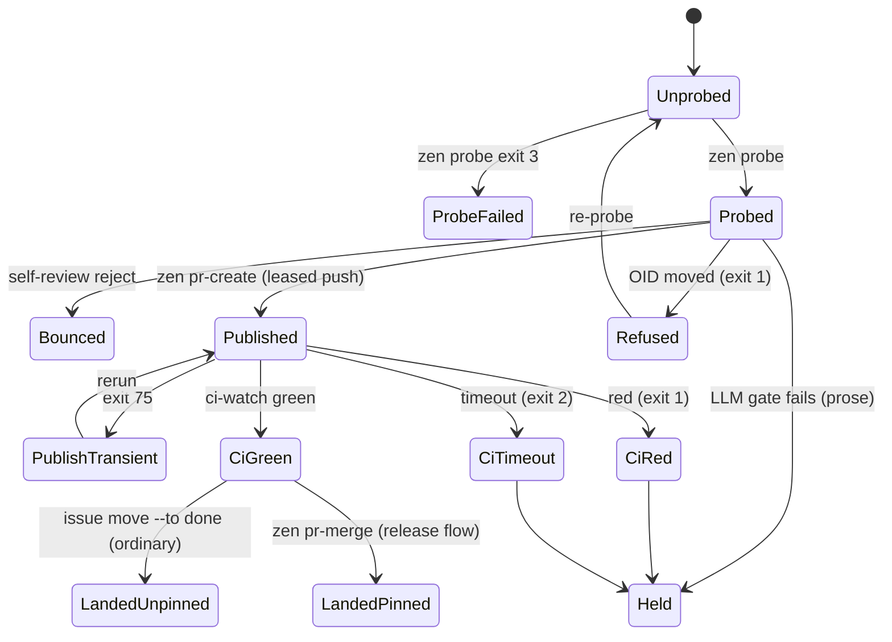

### Verified concerns
1. **High: the default landing is unpinned.** The prompt forbids `zen pr-merge` in the ordinary flow and lands through `issue move --to done` (`default_zenmode.md.template:115-124, 143-153`). The `review -> done` `merge` action calls `merge_via_pr` (`actions.rs:631`), which runs `gh_pr_merge(host, wt, pr, strategy, None, subject, None)` (`actions.rs:1200`) with no `--match-head-commit` and no base-sha check. Compare `merge_via_pull_request`, which pins `Some(&expected.integration_sha)` (`zen.rs:2226-2234`). If the PR head or base moves between ci-watch `green` and the move, an ungraded commit lands. All of `PinnedPrIdentity`'s guarantees apply only to the release-flow path.
2. **Medium: sequencing and identity live only in prose.** `zen.rs:3-6` says no primitive implies the next one. Nothing ties ci-watch to the pr-create it follows, and nothing stops a done move without a green ci-watch. The LLM transcribes 6-7 OIDs by hand.
3. **Medium: the dry-run ladder has drifted from live policy.** `evaluate_probe` (`zen.rs:15078-15166`) uses constants 30/2000 (`14883-14884`) while `zenmode.md` is user-tunable. It adds rebase-conflict and already-merged gates. It has no review-workspace gate (none in `dry_run_tick`, `zen.rs:14970`), and it probes `AsIs` (`15013`) while live Zen uses `RebaseOntoDefault`.
4. **Low: the pr-merge retry after a GitHub squash landing is not idempotent.** The shortcut only matches `current_base == integration_sha` (`zen.rs:2116-2121`). After the `PullRequestMerge` path, base is GitHub's squash commit, so a retry hits "reviewed base moved" (`2122-2128`), and `note_finished` is skipped (`2041-2043`). This affects only the release flow.
5. **Low: exit-code overloading.** pr-create sends every non-transient error out as exit 1, which the prompt reads as "real mismatch" (`cli zen.rs:395-401`). ci-watch Red=1 and Timeout=2 collide with anyhow and clap. Stdout tells them apart, and every case fails closed.

### Refuted
- The scan `unwrap_or_default` in pr-merge is intentional and documented (`cli zen.rs:458-466`).
- Unrecorded partial progress: pr-create re-derives from the remote ref by design (`zen.rs:470-475`).
- `published_head_sha: Option` falls back safely (`zen.rs:139-143`).
- Concurrent base movement fails closed through leases and OID checks. It costs throughput, not correctness.

### Recommendation
Pick one landing owner that carries the pin. Either the workflow `merge` action accepts a pinned identity (head match plus base check), or Zen's done move delegates to the pinned `pr-merge` and the transition recognizes the already-landed result. Replace the LLM-copied tuple with a durable per-task flow record (`Probed -> Published{pr} -> CiGreen -> Landed{sha}`) that the probe writes and each step advances through one transition function. The done move under Zen should require `CiGreen` with the PR head still at `integration_sha`. Give every verdict its own exit code. Make dry-run share the live gate function, including the review-workspace gate and the tunable limits. Fix the pr-merge retry so a MERGED PR whose squash commit has parent `base_sha` and the tree of `integration_sha` counts as Merged.


### Verified concerns

- **high**: In the default flow, the pinned identity is never enforced when the merge actually lands. The prompt says to land by moving the card to done. The review->done `merge` action calls gh pr merge without --match-head-commit and without checking base_sha or integration_sha. If the PR head or base moves between ci-watch=green and the move (a worker push, a human push, a sibling merge), something CI never graded can land. The PinnedPrIdentity doc says integration_sha is 'the only object Zen may lease onto the base ref', but that promise holds only in the release-flow pr-merge path.
  - Evidence: default_zenmode.md.template:115-124,143-153 (land via `issue move --to done`, do NOT run pr-merge); actions.rs:631 merge_via_pr(&host,&wt,pr,strategy); actions.rs:1200 gh_pr_merge(host, wt, pr, strategy, None, subject, None) (no head pin); compare orch zen.rs:2226-2234, which passes Some(&expected.integration_sha)
- **medium**: The ordering of probe -> pr-create -> ci-watch -> land, plus the identity tuple, exists only in LLM prose. No token or handle ties the steps together. The LLM must copy 6-7 OIDs verbatim across three commands, and nothing in code records that a task is mid-flow. Each primitive's OID re-check fails closed, but nothing checks that ci-watch ran against the same pr-create, or ran at all, before the done move.
  - Evidence: orch zen.rs:3-6 ('no primitive implies what the next should do'); cli zen.rs:105-153 PinnedIdentityArgs are plain flags; template:126-142
- **medium**: The dry-run gate ladder is a hard-coded Rust copy of prose policy and has already drifted. It uses constants 30/2000 while the prompt is user-editable ('Edit this file to tune'). It adds rebase-conflict and already-merged gates the prose does not list as numbered gates. It has no review-workspace gate, so it previews 'Merge' for tasks live Zen leaves for a human. It probes AsIs while live Zen probes with RebaseOntoDefault.
  - Evidence: orch zen.rs:14883-14884 consts; 15078-15166 evaluate_probe; 14970 dry_run_tick has no review-workspace check (grep finds none in zen.rs); 15013 RebasePolicy::AsIs vs cli zen.rs:350 RebaseOntoDefault; template:61-72 review-workspace gate, 81-89 four gates, 172-175 'prose is the source of truth'
- **low**: Release flow only: retrying pr-merge after a PullRequestMerge landing is not idempotent. GitHub authored a new squash commit, so current_base is neither integration_sha nor base_sha, and the retry errors with 'reviewed base moved' instead of reporting Merged. pr_record::note_finished is also skipped because of the early `?`.
  - Evidence: orch zen.rs:2116-2128 (idempotent shortcut only recognizes current_base == integration_sha); 2154-2156 PullRequestMerge path; 2263-2268 returns the GitHub-authored merge sha; pr_merge 2041-2043 `land_pr(...)?` precedes note_finished
- **low**: Some exit codes overlap with generic failures. pr-create sends every non-transient error (gh/network/load failures) out as exit 1, and the prompt treats exit 1 as a 'real mismatch -> re-probe'. ci-watch Red=1 and Timeout=2 collide with anyhow and clap codes, although the stdout line tells them apart. These failures fail closed, so this only makes outcomes harder to tell apart.
  - Evidence: cli zen.rs:395-401 (Err(e) => Err(anyhow!(e)) => exit 1); 434-446 (Red exit 1, Timeout exit 2); template:134-137


### Concerns that did not hold up

- pr-merge swallowing the scan error into `next eligible: none` (cli zen.rs:468): this is intentional and documented at 458-466. The merge already succeeded, and the next heartbeat re-scans. Calling it a state-machine bug is wrong.
- 'Partial progress is not recorded' (push succeeded, PR create failed): pr-create is built to be idempotent and to rediscover state from the remote ref == integration_sha (orch zen.rs:470-475). The re-derivation is the design and it is correct.
- published_head_sha: Option as cross-process schema drift: None falls back to the pre-existing acceptance rules (orch zen.rs:139-143), so older prompts keep working. The config_upgrade sniffer is the project's normal way to migrate prompts. Not a correctness risk.
- Concurrent probes/merges moving main under each other: every pinned primitive fails closed with a lease or OID check (orch zen.rs:2122-2128, 411-436). The cost is throughput and re-probe churn, not wrong merges, at least on the pinned path.
- Dry-run fires_bar unwrap_or(true) vs reconcile's default_workflow fallback: this only affects which tasks the preview covers, and the preview is advisory. It is minor and folded into the dry-run drift concern.


**Recommendation:** Decide on one landing path that carries the pin. Two options. (a) The review->done `merge` action accepts an optional pinned identity and passes --match-head-commit and the base check, for example read from a probe record the hub stores. (b) Zen's done move delegates to pr-merge's leased/pinned landing, and the transition recognizes that result as already landed. Then replace the LLM-copied tuple with a durable flow record the probe writes (for example ~/.shelbi/projects/<name>/zen-flow/<task>.json holding {identity, phase: Probed|Published{pr}|CiGreen{pr,at}|Landed{sha}}). Later steps take only `<task-id>` and advance the phase through one transition function, and a done move under Zen refuses unless phase == CiGreen with the current PR head == integration_sha. Use dedicated exit codes for every verdict. Have dry-run evaluate the same Rust gate function that live Zen uses (or parse the limits from zenmode.md) and apply the review-workspace gate. Small fix: make the pr-merge retry treat MERGED PR state (merge commit whose parent is base_sha and whose tree matches integration_sha) as Merged, and call note_finished on that path.


## Review slot serving lifecycle (Pending / Loading / Serving + content sessions)

**Verdict:** Needs further thought. Teardown is gated on "card is still in review", but the only Close caller runs after the card has left review. That leaks editor/diff sessions, and the next review on that slot reuses them and shows the wrong diff. A stale marker from the previous task can also silently drop review_ready for the next task under autoload. Both come from the serving state being smeared across a marker file, status.yaml, liveness and the board column, with no single owner of the slot's lifecycle. There is also an open design question: should a crashed server demote Serving back to Loading?

**Verified concerns:** 1 high, 2 medium, 2 low

**Key files:**
- `crates/shelbi-orchestrator/src/workspace.rs:255-320, 600-668, 818-885, 2600-2625, 2361-2362`
- `crates/shelbi-orchestrator/src/poller.rs:1955-1963, 4600-4642, 5503-5543, 5966-6120, 6180-6260`
- `crates/shelbi-orchestrator/src/review_session.rs:66-110, 204-306, 405-421`
- `crates/shelbi-tui/src/shell/mod.rs:4554-4685`
- `crates/shelbi-orchestrator/src/sidebar_model.rs:72-112, 300-350`

### What it is
A **review slot** is a `review`-tagged workspace that serves one review-column task: an agent pane, an optional dev server whose pgid is recorded, and on-demand editor/diff "content sessions". Whether a task reads **Pending / Loading / Serving** is never stored as one value. It is re-derived from several places:

| Signal | Where | Written by | Cleared by |
|---|---|---|---|
| card column == literal `review` + owner | board index / overlay | load, autoload | decision / bounce |
| `<worktree>/.shelbi/shelbi-review-loaded` (`<task> [url]`) | slot worktree | poller probe, URL-less liveness, or the agent | only the poller orphan reap (`poller.rs:6211`) |
| `WorkspaceState::Serving` in status.yaml + one-shot `review_ready` | hub state | `record_review_serving` (`poller.rs:6082`) | `close_review_window` / reap clear status |
| pane liveness + `review.ready` declared? | runtime / workflow | n/a | n/a |
| content sessions `<project>/review/<slot>/{editor,diff}` | session backend | `ensure_content_session` (daemon) | `close_review`, only while the card is still in review |

Downstream it is re-encoded three more times: `ReviewRow{state, workspace, location}`, `ReviewSlot{state}` (MachinesModel), and `ReviewOpenTarget::{Serving, Queued}` on the wire.

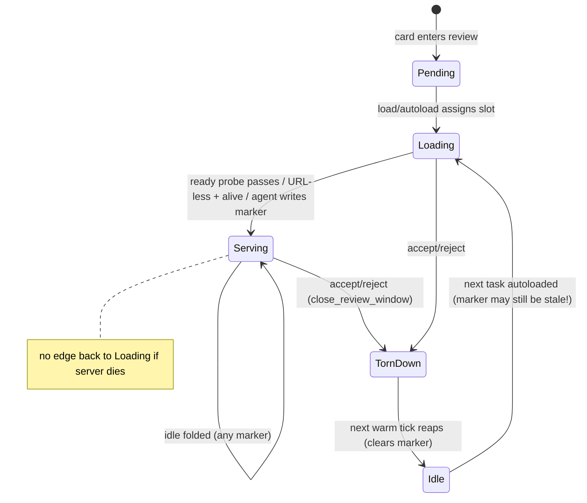

### Verified concerns
1. **Content sessions leak, and the next review reuses them (high).** `on_decision_reply` (`shelbi-tui/src/shell/mod.rs:4643-4652`) calls Close only *after* the decision lands. `close_review` (`review_session.rs:405-410`) returns early because the card is no longer in `Column::review()`. `close_review_window` (`review_ui.rs:491-524`) kills only the agent pane and the server. The `<project>/review/<slot>/diff` session survives with its spawn-time merge-base (`review_ui.rs:295-316`). `ensure_content_session` (`review_session.rs:259-273`) reuses any live session with that name, so the next task on that slot shows the old diff.
2. **A stale marker swallows `review_ready` (medium).** Dispatch does not clear the review-loaded marker, even though its comment says so (`workspace.rs:2605-2625`). `close_review_window` doesn't clear it either. Autoload on the supervisor tick (`poller.rs:360`) can load task B before the per-workspace reap clears A's marker. `review_slot_has_loaded_marker` (`poller.rs:4636`) accepts any id, so B's idle reading folds to Serving (`poller.rs:1960`). When B's probe really passes, `record_review_serving` sees no transition and never emits `review_ready` (`poller.rs:6096-6116`).
3. **No Serving -> Loading edge (medium, design).** Once the marker names the task, the sidebar short-circuits to true (`workspace.rs:650`), and the poller leaves the marker in place on later probe failures (`poller.rs:6008-6030`). A crashed server keeps showing Ready for Review.
4. **Literal `review` column (low).** `review_session.rs:84,217`, `poller.rs:5539`, `sidebar_model.rs:82` and autoload all compare against `Column::review()`, while the transition engine uses workflow categories (`transition_move.rs:515-524`).
5. **Parallel encodings (low).** `ReviewRow` lets you represent Pending with a workspace or Serving with no location (`view.rs:126-147`). `task_session::resolve` (`task_session.rs:71-77`) falls through to the dev workspace on such a row. The only producer builds consistent rows today.

### Refuted
- Inconsistent overlay vs `assigned_to` ownership: GitHubStore `get`/`fetch` folds the overlay into `assigned_to`, so both read the same owner.
- Cross-process spawn race: only the daemon calls `review_session::ensure_content_session`.
- Same-task re-review reading the old marker: the reap clears it on any warm tick while the card is out of review.

### Recommendation
Quick fixes: clear the marker at dispatch and in `close_review_window`. Id-check the marker in the fold. Close content sessions by **slot** (in `close_review_window`, or have the TUI pass the slot), and respawn a content session whose recorded task differs. Longer term: one persisted per-slot `ReviewSlotState {Idle, Loading{task}, Serving{task,url}, Degraded{task}}` with a single poller-owned transition fn, from which the marker, the event, status.yaml and the sidebar `ReviewState` (made data-carrying per variant) are all derived. Decide whether a failed probe after serving should demote, with debounce.


### Verified concerns

- **high**: Editor/diff content sessions are never closed after a review decision, and the next review loaded on the same slot reuses them. The session name is keyed on the slot, not the task, and the diff command bakes in merge-base(base, HEAD) at spawn, so the reviewer sees the previous task's diff.
  - Evidence: shelbi-tui/src/shell/mod.rs:4643-4652: on_decision_reply calls close_review_sessions only after the decision landed, when the card has left review. review_session.rs:405-410: close_review returns Ok(()) early when resolve_review_slot finds the card outside Column::review(), so nothing is killed. review_ui.rs:491-524 (close_review_window, the accept/bounce teardown) kills only the agent pane, plus the server via kill_workspace_pane at workspace.rs:2362, and never the '<project>/review/<slot>/editor|diff' sessions. No other kill_by_name site targets review content names (grep shows only review_session.rs:416). ensure_content_session (review_session.rs:259-273) returns early when a session with that name is live. review_ui.rs:295-316 computes merge_base at spawn and embeds it in the command.
- **medium**: A stale review-loaded marker from the previous task can swallow the next task's review_ready event. The dispatch path does not clear shelbi-review-loaded, and the poller's flap-fold accepts a marker naming any task.
  - Evidence: workspace.rs:2605-2625: the comment says 'Clear any stale review marker', but the code clears only the ready and transition markers. close_review_window (review_ui.rs:491-524) leaves the marker. poller.rs:4636-4640 review_slot_has_loaded_marker matches Ok(Some(_)) with no id check, unlike the sidebar (workspace.rs:647-650, which requires marked == task_id). autoload_review_queue runs on the supervisor tick (poller.rs:360), independently of the per-workspace reap (poller.rs:6211), so task B can load onto the slot before task A's marker is cleared. The cold/Unknown board case also skips the reap. B's idle-at-prompt reading then folds to Serving in status.yaml (poller.rs:1960), and when B's probe really passes, record_review_serving sees prior=Serving, transitioned=false, so emit_review_ready never fires for B (poller.rs:6096-6116). The Zen orchestrator never learns B is ready.
- **medium**: There is no Serving -> Loading edge. If a review dev server crashes after it first served, the row keeps saying Ready for Review, and status.yaml keeps saying serving, until the card leaves review.
  - Evidence: workspace.rs:650-655: review_slot_is_serving returns true as soon as the marker names the task, without re-probing. poller.rs:6008-6030: when the probe fails with a health check declared, the marker is left untouched. poller.rs:1960: the fold keeps idle readings at Serving while the marker exists. The marker is cleared only on the reap path (poller.rs:6225).
- **low**: The whole subsystem keys on the literal Column::review() id, while the rest of the workflow engine uses status categories. A workflow whose review-like handoff status has a different id is never served, autoloaded, closed, or shown in the sidebar's review section.
  - Evidence: review_session.rs:84, 217; poller.rs:5539; sidebar_model.rs:82; load.rs autoload filter (tf.task.column == Column::review()). Contrast transition_move.rs:515-524 is_active_to_handoff, which reads workflow categories. Column::review() is the literal 'review' (shelbi-core model.rs:2036).
- **low**: There are four parallel encodings of the same lifecycle (poller marker + status.yaml, sidebar recompute, ReviewRow/ReviewSlot ReviewState, wire ReviewOpenTarget::{Serving,Queued}). ReviewRow can represent illegal combinations such as Pending with Some(workspace) or Serving with no location. task_session::resolve silently falls back to the dev workspace when a non-Pending row has no workspace.
  - Evidence: shelbi-app view.rs:126-147 (correlated only by doc comments) and view.rs:1253-1270 (ReviewSlot reuses ReviewState; label() maps Pending to 'starting'). task_session.rs:71-77 filters state != Pending, then requires a non-empty workspace. The only producer (sidebar_model.rs:322-347 split_reviews) always builds consistent combinations, so this is latent rather than reachable today, apart from serde-default deserialization across the relay.


### Concerns that did not hold up

- Ownership resolved inconsistently (close_review_window and review_url read tf.task.assigned_to rather than the overlay, so they would miss the slot on GitHub): refuted. GitHubStore::get -> fetch folds the overlay into assigned_to on every path (github_store.rs:2220-2300, crate::get_task_assignment), so both paths read the same owner. The explicit overlay reads in resolve_review_slot and review_layout_state are redundant, not divergent.
- Content-session spawn lock is in-process, so daemon and TUI could spawn duplicates: refuted. review_session::ensure_content_session is called only from the daemon control handler (shelbi-cli daemon/control.rs:686). The TUI and desktop go through ReviewSessionOp over the daemon socket, so a single process owns the lock.
- Re-reviewing the SAME task (bounce, then re-review) reads the old marker as serving: mostly refuted. A bounce moves the card out of review, so every warm tick in between reaches maybe_reap_orphaned_review_slot, which clears the marker. It survives only if every intervening tick read a cold or stale board (Unknown). The general cross-task stale-marker problem (kept above) is the real version of this concern.
- Poller and sidebar disagree on 'serving' for a tick: real but benign. The sidebar's liveness shortcut for URL-less reviews is deliberate (documented at workspace.rs:628-636), and the poller writes the same marker on its next tick. It under-claims or over-claims for at most one interval.


**Recommendation:** Give the review slot one owner keyed on (slot, task). The minimal fixes: (1) clear shelbi-review-loaded in the dispatch preamble (workspace.rs:2605, as its comment already claims) and in close_review_window. (2) Make review_slot_has_loaded_marker compare the id against the assigned task, like the sidebar does. (3) Make close_review key on the slot rather than the card's current column: pass the slot, or have close_review_window also kill the '<project>/review/<slot>/*' content sessions. Also tag content sessions with the task (SpawnSpec.task is already set) and have ensure_content_session respawn when the live session's task differs. The fuller version is a ReviewSlotState enum {Idle, Loading{task}, Serving{task, url}, Degraded{task}} persisted as one record per slot, with a single transition fn in the poller (probe pass/fail, assign, decide, reap), from which the marker, the review_ready event and the sidebar ReviewState are all derived. ReviewRow then carries data per variant (Pending | Loading{workspace} | Serving{workspace, location}). Decide explicitly whether a probe failure after serving should demote to Loading/Degraded, with debounce, instead of being frozen by the fold.


## Zen promote eligibility and user-demotion latch

**Verdict:** Needs further thought. A documented user-facing guarantee (once the user demotes a task, Zen never re-promotes it) is silently broken. The parser drifted from the event writer's format, and a stale-format unit test hides that. Even after fixing the parser, deriving a permanent latch from a rotating, global log is the wrong storage for the state, so this needs a design decision and not just a regex fix.

**Verified concerns:** 1 high, 1 medium, 2 low

**Key files:**
- `crates/shelbi-orchestrator/src/zen.rs:14311-14424 (mechanically_eligible, filter chain)`
- `crates/shelbi-orchestrator/src/zen.rs:14482-14531 (read_demoted_task_ids / parse_user_demotion_line)`
- `crates/shelbi-orchestrator/src/zen.rs:14811-14827 (parser test using the pre-#20 line format)`
- `crates/shelbi-state/src/event_log.rs:1806-1829 (task_event_body writer), 3228 (EVENTS_LOG_MAX_BYTES rotation)`
- `crates/shelbi-orchestrator/src/poller.rs:1300 (heartbeat consumer)`

### What it is
On every heartbeat, `poller.rs:1300` calls `zen::mechanically_eligible`, which builds the board from caches and filters backlog tasks through a chain (`zen.rs:14388-14424`). The filters are: literal `backlog` column, not blocked by deps, not `zen.enabled: false`, not user-demoted, no path overlap with a literal `in-progress` task body, and allowed by the ownership gate (FailClosed when the board index has no viewer login). The orchestrator prompt then applies judgment on top.

The **user-demotion latch** is the only "sticky" state. Nothing stores it. Each tick re-derives it by reading `~/.shelbi/events.log` and matching `todo -> backlog reason=user:` lines (`zen.rs:14485-14531`).

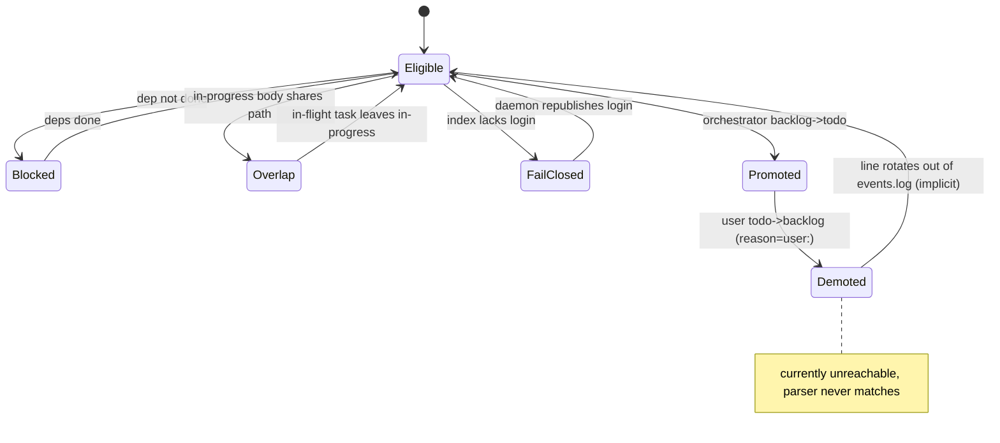

### Verified concerns
1. **The latch is dead (high).** The writer (`shelbi-state/src/event_log.rs:1825`) emits `project=P task=T workflow=W todo -> backlog reason=user:tui ...`. The parser (`zen.rs:14518-14523`) requires the text right after `task=T` to start with ` todo -> backlog `, so the `workflow=` token defeats it every time. Real lines in `~/.shelbi/events.log` (e.g. `task=review-load-retry-loop-when-branch-is-checked-out-in-another-worktree workflow=app todo -> backlog reason=user:tui`) are never seen as demotions. The unit test at `zen.rs:14814-14819` still uses the pre-#20 shape without `workflow=`, so CI stays green. The format changed in `ce344ba6` (#20). Effect: Zen can re-promote tasks the user explicitly pushed back.
2. **Rotation un-latches (medium).** Only the live file is read. Rotation at 8 MiB (`event_log.rs:3228`) moves lines into `events.log.1`, which is never consulted, and a second rotation deletes them. On this machine one of three demotions already lives only in `.1`.
3. **Global, id-only key (low).** `events.log` is hub-global and the parser ignores `project=`, so the same task id in two projects shares the latch.
4. **Literal columns (low).** `Column::in_progress()` and `Column::backlog()` at `zen.rs:14400/14406` miss custom statuses. The dry-run and handoff scans use `StatusCategory`. Custom active statuses do not feed the overlap guard.

### Refuted
- "Unbounded cost": rotation bounds it to roughly 8-10 MB per tick. That is wasteful but bounded.
- FailClosed and path-overlap are intentional, logged, and self-healing.

### Recommendation
Make the demotion explicit, durable, per-task state written at the moment of the user's move: a frontmatter/tracker field such as `zen.enabled: false` (already honored by `zen_disabled`) or a per-project demotions file. Give it a defined reset. If the log-derived approach stays as a stopgap, parse fields by key using the shared `event_field` helpers, scope by project, include `.1`, and fix the stale test fixture. Switch the column filters to `StatusCategory`.


### Verified concerns

- **high**: The user-demotion latch is completely dead. The writer emits `task=<id> workflow=<wf> todo -> backlog reason=user:...`, but the parser requires the text right after the id to start with ` todo -> backlog `. The ` workflow=...` token sits in between, so no real line ever matches. Zen can re-promote a task the user explicitly demoted.
  - Evidence: event_log.rs:1825-1826 formats `project={project} task={task_id} workflow={workflow_name} {from} -> {to} reason=...`. zen.rs:14518-14523 sets rest=after id and then `if !rest.starts_with(" todo -> backlog ") { return None; }`. Live ~/.shelbi/events.log holds lines like `... task=review-load-retry-loop-... workflow=app todo -> backlog reason=user:tui ...`, which this parser rejects. The unit test (zen.rs:14814-14819) uses the old `task=foo todo -> backlog` shape without workflow=, so it still passes. The workflow= field was added in ce344ba6 (#20).
- **medium**: Even with the parser fixed, the latch only lives as long as the live events.log does. Size-based rotation at 8 MB moves lines into events.log.1, which read_demoted_task_ids never reads, and the next rotation drops them entirely. So a 'permanent' demotion silently expires.
  - Evidence: zen.rs:14485-14493 reads only shelbi_state::events_log_path() (~/.shelbi/events.log). event_log.rs:3228 EVENTS_LOG_MAX_BYTES = 8 MiB with a single retained .1 generation. On this machine one of the three user demotions is already only in events.log.1 (2026-08-25 contextstore line).
- **low**: The latch is keyed only by task id across a global log. The parser ignores project=, so a demotion of id X in project A also latches id X in project B.
  - Evidence: events_log_path() = shelbi_home()/events.log (event_log.rs:290-292, global). parse_user_demotion_line extracts only the task= value (zen.rs:14517-14520). Demoted lines on disk span the contextstore and shelbi projects.
- **low**: The scan's column checks use literal stock ids. Tasks in a custom active-category status (e.g. a renamed in-progress gate) are not treated as in-flight for the path-overlap guard, and backlog-category custom statuses are never candidates. Meanwhile dry_run_tick and the handoff scans resolve by StatusCategory, so custom workflows get inconsistent treatment.
  - Evidence: zen.rs:14400 `tf.task.column == Column::in_progress()` and 14406 `== Column::backlog()`, compared with dry_run_tick's category-based iteration documented at zen.rs:14967-14969 and resolve_status_category tests at 15436+. The demotion matcher likewise hard-codes `todo`/`backlog` ids.


### Concerns that did not hold up

- 'The whole event log is read on every heartbeat, so cost grows without bound': rotation at 8 MiB bounds the read, so it is not unbounded. It is still a multi-MB read and line scan per heartbeat (live file is ~10 MB), which is a modest efficiency issue rather than unbounded growth.
- The ownership FailClosed state is intentional, logged (zen.rs:14331-14345), and self-heals when the daemon republishes the index. It is not a defect.
- The path-overlap transient state is by design an asymmetric, conservative heuristic, and the auditor raised no correctness bug in it beyond the literal-column point.


**Recommendation:** Persist the demotion as explicit per-task state instead of re-deriving it from events.log. Either have the user todo->backlog move path set a frontmatter or tracker field (e.g. zen.enabled: false or zen.demoted_at, which zen_disabled already honors), or keep a per-project demotions set under ~/.shelbi/projects/<name>/ written at move time. Give it an explicit reset (e.g. the user re-promotes manually or flips zen.enabled). Short term, fix parse_user_demotion_line to parse key=value fields (task=, reason=, from/to columns, project=) using the shared EventEnvelope/event_field helpers. Update the test fixture to the real line format, scope the latch by project, and read .1 too. While there, switch the in-progress/backlog filters to StatusCategory so they match the dry-run and handoff scans.


## Client review open/load flow (ReviewLoader vs TUI hand-rolled copy)

**Verdict:** Needs further thought. The shared ReviewLoader was written as the TUI's flow 'as data', but the TUI never adopted it. Its hand-rolled copy has drifted on cancel and supersede rules. It also shares one job channel with unrelated work, which silently loses replies, and its navigation guard does not do what its doc claims. That is a reachable TUI/desktop parity problem, and it can pull the user into an unexpected review. Inside the loader, results and failures are not keyed by task, which lets a failure for one review act on another.

**Verified concerns:** 3 medium, 5 low

**Key files:**
- `crates/shelbi-app/src/review.rs:815-991`
- `crates/shelbi-tui/src/shell/mod.rs:4250-4460`
- `crates/shelbi-tui/src/shell/mod.rs:1266-1288, 2020-2062, 2275-2286, 3606-3617`
- `desktop/src/app.rs:5009-5110`
- `desktop/src/app.rs:2300-2310, 2490-2502, 3510-3590, 3778-3790, 4630-4647, 4814-4822`

### What it is
Opening a review task (from a sidebar row, the palette, or a reopen after a project switch) is a multi-step async handshake with the daemon:

1. **Resolve** off the UI thread: is the task serving on a slot, or queued?
2. Serving: **open**. Queued: **ask which free slot** to use, or report *NoSlots* / *Busy*.
3. **Load** onto the chosen slot through the daemon (`ReviewSessionOp::Load`).
4. **Wait** for the daemon's `LayoutEvent::ReviewOpened` (published after the slot's health check), then resolve again and open.

Only a load this client started may open anything. A background `ReviewOpened` (another client, a poller resume, auto-load) must not take over the view.

### Encoding
- **Shared crate** `ReviewLoader { resolving, loading, pending: Option<String> }` returns a `LoadStep` command enum (crates/shelbi-app/src/review.rs:859-991). The three Options are independent and can each name a different task.
- **Desktop** drives the loader (desktop/src/app.rs:5012-5110) and adds `quiet_review: Option<String>` (a latch for reopens after a switch), the `ReviewConfirm` overlay, and a pending placeholder ReviewView shown before the resolve.
- **TUI** does *not* use the loader. It has a hand-rolled copy: `review_opening`, `review_open_pending`, and one `review_rx` receiver slot that it also uses for the editor's `ContentReady` (crates/shelbi-tui/src/shell/mod.rs:1266-1288, 4250-4460).

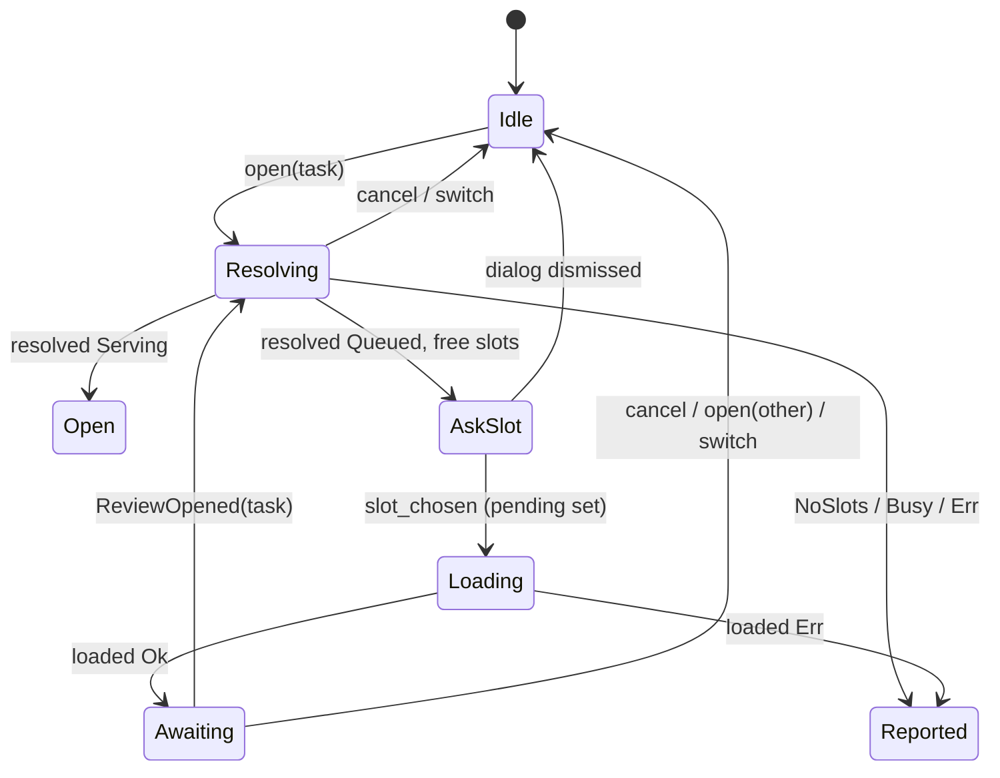

### Verified concerns
1. **TUI/desktop drift (medium).** The loader's doc says it is "the TUI's flow as data", but the TUI never adopted it. Differences in the TUI:
   - `begin_review` does not drop an earlier pending wait (mod.rs:4250-4271).
   - A resolve error clears any pending wait (4288-4291), and so does `build_review_interface` (4319).
   - LoadDone is not keyed by task.
   - Navigating away does not cancel.

   Example: load A, then look at a session or a queued review B. A's `ReviewOpened` arrives and `begin_review(A)` pulls the user into A (4393-4397). The desktop cancels on `leave_review` (app.rs:3585) and on `open(other)`.
2. **The TUI's single `review_rx` slot (medium).** `begin_review` (4263), `start_review_load` (4364) and the editor Ensure (4456) each replace the receiver, and the old worker's `send` fails silently. Effects: a lost `LoadDone(Err)` leaves the status stuck at "loading … onto …" with pending set, and a lost `ContentReady` leaves the editor never bound. The diff wait already has its own channel for exactly this reason.
3. **The TUI's navigation guard does not do what its doc says (medium).** The field doc (1279-1282) promises that a resolve landing after navigation is dropped. But `show()`'s Session and Native arms (2020-2058) never clear `review_opening` or `review_rx`, so a late resolve still builds the interface and steals focus.
4. **`LoadStep::Failed` has no task (low).** On the desktop, the Failed arm (app.rs:5097-5104) always backs out whatever review placeholder is pending, and consumes `quiet_review` without checking which task it names. So a failed load of A can back out B's placeholder, and a stale quiet latch can suppress the error banner for a different review.
5. **`slot_chosen` is unguarded (low).** review.rs:930 overwrites `loading`. With two loads in flight, the first one's failure is dropped (943-945). "One resolve and one load at a time" is enforced only by a doc comment.
6. **No expiry on the pending wait (low)**, in both clients. A missed `ReviewOpened` leaves pending set until a much later one for the same task opens the view in this client.
7. **Ordering trick (low).** The desktop sets `self.overlay = None` before `close_overlay` (app.rs:4824-4825) so the dismiss -> abandon path is skipped.
8. **Editor Ensure error yanks the view (low).** On Err, the desktop falls back to Chat even after the user has moved on (views/review.rs:758-770). This is in the adjacent ReviewView machine.

### Refuted
- Cancelling AskSlot leaks no loader state, and both hosts handle the dismissal.
- The decision banner after a project switch is deliberate, and it belongs to ReviewDecisions.
- The desktop's callbacks without a project check are covered by teardown resetting the loader. The only remaining hole is a task id that collides across projects.

### Recommendation
- Move the TUI onto `ReviewLoader` and delete its two Options. Call `cancel` from `show()`'s Session and Native arms.
- Tag every `ReviewJobMsg` with its task, or give open/load its own channel.
- Make `LoadStep::Failed` carry its task. Move `quiet_review` into the loader as a flag on the open.
- Either reject `slot_chosen` while a load is in flight, or report every load's reply.
- Optionally collapse the three Options into one `Phase` enum and add an expiry on the wait for `ReviewOpened`.


### Verified concerns

- **medium**: The TUI does not use the shared ReviewLoader. Its hand-rolled copy has drifted from the loader's documented rules: opening another task does not drop the earlier pending wait; a resolve failure clears ANY pending wait; LoadDone is not keyed by task; leaving the view does not cancel. Example: in the TUI, load A, then go look at a session or a queued review B. When A's ReviewOpened arrives it calls begin_review(A) and pulls the user into A. The desktop's loader cancels or replaces in the same case.
  - Evidence: grep shows no ReviewLoader in crates/shelbi-tui. The ReviewLoader doc (review.rs:859-866) calls itself 'the TUI's (rt-tui-review-load-queued) flow as data'. The TUI's begin_review (mod.rs:4250-4271) never touches review_open_pending. on_review_resolved Err clears it unconditionally (mod.rs:4288-4291). build_review_interface clears it for any task (mod.rs:4319). on_review_opened -> begin_review (mod.rs:4393-4397).
- **medium**: In the TUI, one review_rx slot carries three unrelated jobs. Starting any job overwrites the receiver, so the in-flight job's reply is silently lost. A lost LoadDone(Err) leaves review_open_pending set and the status stuck at 'loading … onto …'. A lost ContentReady leaves the editor never bound. A lost Resolved leaves review_opening set.
  - Evidence: mod.rs:4263 (begin_review), 4364 (start_review_load) and 4456 (editor Ensure) each do `self.review_rx = Some(rx)`. The worker's `let _ = tx.send(..)` fails silently once the receiver is dropped. poll_review (mod.rs:4402-4426) has one slot.
- **medium**: The TUI's stale-resolve guard does not cover navigation, even though the field doc says it does. A slow resolve that lands after the user clicked a session or a native view still runs build_review_interface, which takes main_view and focus.
  - Evidence: The field doc is at mod.rs:1279-1282 ('lands after the user navigated away … is dropped'). show()'s Session and Native arms (mod.rs:2020-2058) set review=None but never clear review_opening or review_rx. Only switch_project does (mod.rs:2280-2283). on_review_resolved only checks review_opening.take() (mod.rs:4278).
- **low**: On the desktop, LoadStep::Failed(String) carries no task, so the host handles it without knowing which review it belongs to. If load A fails after the user has started opening B, abandon_pending_review backs out B's pending placeholder and shows A's error. Separately, a stale quiet_review latch (a switch-reopened task T that was superseded by the user opening U) gets consumed by U's failure, which suppresses U's error banner.
  - Evidence: app.rs:5097-5104: Failed always calls abandon_pending_review (which leaves whatever review placeholder is pending, app.rs:3534-3540) and `quiet_review.take()` with no task comparison. quiet_review is set at app.rs:2500 and cleared only by open_review (3480), the quiet AskSlot arm (5044), Failed, or teardown (2359). loader.open(U) drops T's resolve without clearing quiet_review.
- **low**: slot_chosen overwrites `loading` without a check. Example: load A, then open queued B and pick a slot before A's daemon load replies. loaded(A, Err) is then dropped because loading==B, so A's failure is never reported. The rule 'one resolve and one load at a time' exists only in a doc comment, and all of resolving/loading/pending can name different tasks at once.
  - Evidence: review.rs:930-933 sets loading/pending unconditionally. review.rs:943-945 drops a reply whose task does not match `loading`. review.rs:864-866 is the doc-comment-only invariant.
- **low**: Neither client gives the pending wait for ReviewOpened a timeout. If the push is missed (subscriber reconnect), pending stays set. A much later ReviewOpened for the same task (a poller resume or auto-load) then opens it in this client, against the rule that a background ReviewOpened never takes the view.
  - Evidence: pending is cleared only by open(other), resolved, loaded(Err), review_opened or cancel (review.rs). The TUI's review_open_pending is the same, with no timer (mod.rs:1288).
- **low**: On the desktop, close_overlay's 'slot prompt dismissed -> abandon' path is skipped on slot choice only through an ordering trick: the code sets self.overlay=None before calling close_overlay, so `closed` is None.
  - Evidence: app.rs:4814-4822 (`self.overlay = None; self.close_overlay(..)`). app.rs:4632 `let closed = self.overlay.take()` and app.rs:4641 the ReviewConfirm check.
- **low**: On the desktop, an editor Ensure failure always falls back to Chat even after the user has moved to another view. Ok is guarded by `still`; Err is not. (This belongs to the adjacent ReviewView content machine.)
  - Evidence: desktop/src/views/review.rs:758-770.


### Concerns that did not hold up

- The 'AskSlot is not represented in the loader, so cancelling the dialog leaks state' concern does not hold. resolved() has already cleared `resolving`, nothing else is set, and both hosts handle dismissal (desktop abandon_pending_review at app.rs:4641; TUI ReviewCancelled at mod.rs:3614). Nothing is left to leak.
- The desktop's decision_refused showing a banner for the previous project's task after a switch is deliberate ('Not this project's any more' comment, app.rs:3729-3734). The A->B->A Ok case with cleared decisions belongs to the ReviewDecisions machine, not to the open/load flow. The review row vanishing still ends it through review_left.
- The concern that desktop Resolve/Load callbacks do not check the project is mostly covered. Teardown replaces the loader with a default one (app.rs:2307-2310), so stale results are dropped unless the same task id is opened again before they land, and then the result is for the same task and the same project in the A->B->A case. The only hole left is a task id that collides across projects. That is negligible.
- 'ReviewOpened -> begin_review costs a second resolve round trip' is a design choice (it re-reads the serving target), not a bug. Its exposure to the shared rx slot is covered by the rx concern above.


**Recommendation:** Have the TUI drive `shelbi_app::ReviewLoader` the way the desktop does: begin_review -> loader.open, Resolved -> loader.resolved(task, ..), LoadDone -> loader.loaded(task, ..), ReviewOpened -> loader.review_opened, and call loader.cancel when show() navigates to a Session or Native view. Delete review_opening and review_open_pending. Tag every ReviewJobMsg with its task, or give the open/load flow its own channel separate from the editor Ensure (as the diff wait already has). In the loader, make LoadStep::Failed carry the task so hosts back out only that task's placeholder and consume quiet_review only for that task. Either reject slot_chosen while another load is in flight, or track loads as a set. Consider a single `enum Phase { Idle, Resolving(t), Loading{t, pending}, Awaiting(t) }` (load replies for other tasks still reported) plus an optional expiry on Awaiting. Fold quiet_review into the loader as a `quiet` flag on the open.


## Review-slot load lifecycle (queue, load, park, backoff, give-up)

**Verdict:** Needs further thought. The claim critical section is well-guarded: every live load path holds the project flock and re-checks under it. The park marker is the weak point. It is a cross-cutting "leave this task alone" flag read by four poller passes (review autoload, review resume, dev resume, active-gate dispatch), yet its lifetime is managed ad hoc. It is set without the review lock, cleared before a launch that may fail, and never cleared by `issue start`, reject, accept or delete. The code comment claims otherwise. A reworked task that was once parked can therefore silently lose dev-pane resume and review autoload. That is a reachable wrong state, and it deserves a design decision about who owns the marker.

**Verified concerns:** 1 medium, 5 low

**Key files:**
- `crates/shelbi-orchestrator/src/load.rs:214-366, 505-797, 873-964`
- `crates/shelbi-state/src/lib.rs:3672-3895 (park marker + failure ledger), 1030-1042 (lock_review_load)`
- `crates/shelbi-orchestrator/src/mutate.rs:395-455 (assign clears park, unassign parks)`
- `crates/shelbi-orchestrator/src/poller.rs:5040-5060, 5340-5360, 5805-5820 (park marker consumers)`
- `crates/shelbi-orchestrator/src/mutate/start.rs:170-195 (issue start assignment that does not clear park)`

### What it is
A review-column card's relationship to a `review`-tagged workspace slot. Nothing in the code names this state directly. It is inferred from four stores:

- the **assignment overlay** (`assigned_to`, authoritative over `board-index.json`)
- a **park marker**: an empty file at `<project_dir>/parked-review/<task-id>` (shelbi-state `lib.rs:3672-3765`)
- a **failure ledger**: `<project_dir>/review-load-failures/<task-id>`, holding `{slot -> {attempts, last_attempt, gave_up}}` (`lib.rs:3767-3895`)
- a **serving marker**, probed on every read (`machines_model.rs:115-119`)

Claims are serialized by the project flock `review-load.lock` (`lib.rs:1039`).

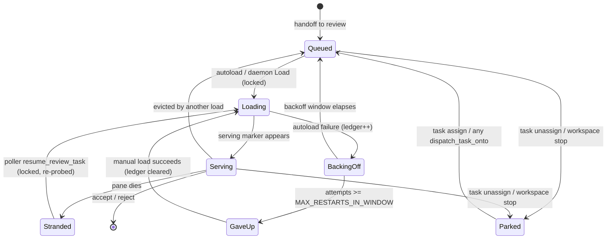

### Transitions (where they live)
- Autoload plan and dispatch: `load.rs:505-655`. The planner is pure at `load.rs:749-797`. Backoff policy is at `load.rs:688-731`.
- Manual load: daemon control `ReviewSessionOp::Load` -> `load_review_task` (`daemon/control.rs:700`, `load.rs:214`).
- Resume: `poller.rs:5340-5420` -> `resume_review_task` (`load.rs:237`).
- Evict: `load.rs:300-361`.
- Park: `mutate.rs:444-450` (`apply_unassign`) and `cli/commands/workspace.rs:566-577` -> `park_review_task` (`lib.rs:3756`) / `GitHubStore::park_review` (`github_store.rs:1648`).
- Un-park: `mutate.rs:430` (`apply_assign`) and `load.rs:923` (`dispatch_task_onto`, run before the launch).
- Ledger clear: `load.rs:963`, only after a successful launch.

### Verified concerns
1. **Medium: the park marker outlives the review stint.** `lib.rs:3683-3690` promises the marker is cleared by "any fresh dispatch/assignment ... reworked-then-re-handed-off task is never wrongly skipped". In fact only `apply_assign` and `dispatch_task_onto` clear it. `issue start` (`mutate/start.rs:183-191`) sets `assigned_to` without touching the marker, and accept, reject and delete never remove it. The marker is read by **four** passes: review autoload (`load.rs:564`), review resume (`poller.rs:5351`), dev-slot resume (`poller.rs:5814`) and agent-active-gate dispatch (`poller.rs:5053`). Scenario: park a review card, reject it, `issue start` it. Its dev pane dies and is never resumed. When it hands off again, it is never auto-loaded.
2. **Low: a failed manual load un-parks.** `dispatch_task_onto` clears park at `load.rs:923` before `start_workspace_on_task`. The rollback (`load.rs:931-949`) restores only `assigned_to`/`branch`, and manual loads write no ledger entry, so the next autoload tick re-grabs the card.
3. **Low: park is not under `lock_review_load`.** A park that lands between the autoload plan and `clear_parked` is erased, and the task loads anyway.
4. **Low: park is not atomic.** `park_review_task` is doc'd as "one locked write" but does a task save, then a marker write (`lib.rs:3762-3763`). The GitHub backend takes no lock at all (`github_store.rs:1653-1655`). A crash in between leaves the card unassigned and unparked.
5. **Low: GaveUp is permanent per (task, slot).** There is no aging (`load.rs:688-691`) and no reset command. Pane supervision has a relaunch marker, but this ledger does not.
6. **Low (tidy): dead parallel code.** The legacy `App` review_job machine (`shelbi-tui/src/app.rs`) is constructed only in its own tests. `load_task_by_id`/`load_task_for_review` have no callers. Serving/Loading/Pending is still derived three times (`app.rs:1447`, `sidebar_model.rs:267`, `machines_model.rs:115`).

### Refuted
- The `load_task_by_id` lock bypass is dead code, not a live race.
- The ledger record/clear race does not happen: both sides run under `lock_review_load`.
- The `review-load` event is not counted as progress, because `count_dispatch_events` filters to `confirmed`/`unverified`.
- The legacy App job timeout and flicker are real in the code but unreachable in production.

### Recommendation
Make the park marker's lifetime explicit, with one owner:
- clear it on leaving the review column and on every assignment, including `issue start`, or scope it to the column it was set in
- clear it only after a successful launch, or restore it on rollback
- take `lock_review_load` when parking

Add an operator reset (or long aging) for the review-load ledger. Delete the dead legacy App, `load_task_by_id` and `load_task_for_review`, so the review sub-state is derived in exactly one model. A full `ReviewSlotState` enum is optional. The real win is a single module that owns the park, ledger and assignment transitions for review slots.


### Verified concerns

- **medium**: Stale park markers outlive the review stint. `issue start` / rework dispatch never clears the marker, though the lib.rs comment says any fresh dispatch does. A task parked in review, then rejected and restarted, keeps its marker. The poller then refuses to resume its dead dev pane, skips it for agent-active-gate dispatch, and the review autoloader skips it after re-handoff, until someone manually loads or assigns it.
  - Evidence: lib.rs:3683-3690 says the marker is 'CLEARED by any fresh dispatch/assignment ... (so a re-served or reworked-then-re-handed-off task is never wrongly skipped)'. But clear_parked is called only at mutate.rs:430 (apply_assign) and load.rs:923 (dispatch_task_onto). mutate/start.rs:183-191 sets assigned_to through set_fields, and neither the fs nor the GitHub set_fields touches the marker. is_task_parked gates the dev-slot resume (poller.rs:5814), active-gate dispatch (poller.rs:5053) and review resume (poller.rs:5351), and parked_review_tasks gates autoload (load.rs:564). Accept, reject and delete never remove the marker either, so the files leak.
- **low**: A failed manual load of a parked task silently un-parks it. clear_parked runs before the launch, and the failure rollback restores only assigned_to and branch. Manual loads also record no failure-ledger entry, so the next autoload tick re-grabs the task the operator had parked.
  - Evidence: load.rs:923 runs `let _ = store.clear_parked(...)` ahead of start_workspace_on_task. The Err arm at load.rs:931-949 restores assigned_to and branch only. note_autoload_failure / record_review_load_failure are called only from autoload_review_queue (load.rs:627-628).
- **low**: Parking is not serialized with the review-load lock. park_review_task / apply_unassign run without lock_review_load, while autoload reads the parked set under the lock and then dispatches. A park that lands between the plan (load.rs:564) and dispatch_task_onto's clear_parked (load.rs:923) is erased, and the task loads anyway.
  - Evidence: lib.rs:3756-3765 takes only lock_tasks. GitHubStore::park_review (github_store.rs:1648-1657) takes no lock. mutate.rs:444-450 holds no review-load lock. Autoload holds lock_review_load (load.rs:510) and clears park inside dispatch (load.rs:923). The window is narrow.
- **low**: park_review_task is documented as 'one locked write' but performs two non-atomic writes: the task save, then the marker. A crash between them leaves the card unassigned and unparked, the state the autoloader re-grabs. The GitHub backend's park does overlay-clear, then marker, with no lock at all.
  - Evidence: lib.rs:3750-3753 doc versus lib.rs:3762-3763 (save_task_unlocked, then set_task_parked); github_store.rs:1653-1655.
- **low**: GaveUp is a per-(task,slot) latch with no aging and no operator reset short of a successful load. Unlike pane supervision, which has a TUI relaunch marker (poller.rs consume_supervision_relaunch), there is no CLI or UI to clear the review-load ledger. With N review slots a durably failing task eventually gives up on all of them and is never auto-loaded again.
  - Evidence: autoload_retry_suppressed returns true on gave_up before any window check (load.rs:688-691). The ledger is cleared only at load.rs:963 after a successful launch. No other caller of clear_review_load_failures_for_task exists.
- **low**: Dead parallel lifecycle code. The legacy tmux sidebar App's review_job/ReviewState machine is constructed only in its own tests. load_task_by_id and load_task_for_review have no callers outside load.rs. Serving/Loading/Pending is still derived independently in three places: app.rs split_review_sections, sidebar_model::split_reviews and machines_model.
  - Evidence: App::new_sidebar is used only in app.rs tests (app.rs:1832,1868). The only re-export is lib.rs:136. A grep for load_task_by_id / load_task_for_review outside load.rs returns nothing. Derivations are at app.rs:1447, sidebar_model.rs:267 and machines_model.rs:115-119.


### Concerns that did not hold up

- load_task_by_id races the autoloader because it skips lock_review_load. It has no production caller (and neither does load_task_for_review). Every live load path goes through load_review_task / load_review_task_evicting / resume_review_task / autoload, and all of them hold the lock. The concern is dead code, not a live race.
- record_review_load_failure's unlocked read-modify-write can resurrect a stale gave_up after a clear. Both the record call (load.rs:628) and the only clear (load.rs:963, inside dispatch_task_onto, which is reachable live only through load_review_task_locked) run while lock_review_load is held, so they are serialized.
- autoload's pre-attempt `review-load` event is miscounted as progress by mutate/start.rs:615. count_dispatch_events is called with statuses [confirmed, unverified] only (start.rs:605-610), so review-load lines are not counted. A paired review-load-failed line follows any failure.
- Legacy App review_job has no timeout, and the Pending flicker after a job clears. Both are real in the code, but App is never constructed in production, so they are not live bugs. They are folded into the dead-code finding instead.
- Loading never times out because Serving is probed per read. That is true of the derived view, but a dead pane is handled by the poller's stranded-slot resume and supervision. A live pane that never reports serving is an agent/health-check concern outside this machine, so this is not a lifecycle bug here.


**Recommendation:** Give the park marker a single owner with explicit lifetime rules. (1) Scope it to a review stint: clear it in the column-transition chokepoint whenever a card leaves the review column, and on any assignment write, either in set_fields when assigned_to is set or in mutate/start.rs. Alternatively, store the column it was parked in and ignore it elsewhere. (2) In dispatch_task_onto, clear park only after start_workspace_on_task succeeds, or restore it in the rollback. (3) Take lock_review_load in park_review (both backends) so park, plan and clear are serialized, and fix the 'one locked write' doc. (4) Add an operator reset for the review-load ledger, or age out gave_up after a long window, mirroring the supervision relaunch marker. (5) Delete the dead legacy App review-load code and load_task_by_id / load_task_for_review, so Serving/Loading/Pending is derived in one model (sidebar_model, shared with machines_model). A ReviewSlotState enum is optional. The real value is one module that owns park, ledger and assignment transitions for review slots.


## Review dev-server process-group record

**Verdict:** Needs further thought. The machine is small, but one of its reachable states (a stale record after a reboot or after an orphaned server dies) feeds an unconditional SIGKILL of whatever same-user process group now has that id. The code's own comment overstates the protection it has. The fix is cheap and the codebase already has an identity pattern for it (ssh_control pid plus start_time).

**Verified concerns:** 1 medium, 3 low

**Key files:**
- `crates/shelbi-orchestrator/src/workspace.rs:2239-2385`
- `crates/shelbi-cli/src/commands/review_serve.rs:1-101`
- `crates/shelbi-state/src/workspace_status.rs:280-326`
- `crates/shelbi-orchestrator/src/workspace.rs:6250-6275`
- `crates/shelbi-state/src/ssh_control.rs:130-260`

**Entity:** the review dev server that a Review agent launches through `shelbi __review-serve`. That wrapper `setsid`s the server so the server's pgid equals its pid, and records the pgid so any teardown can `kill(-pgid)` the whole tree, even after a daemon restart.

**Storage:** `~/.shelbi/workspaces/<ws>/review-serve.pgid` holds a bare `"<pgid>\n"`. Its path reaches the agent as `SHELBI_REVIEW_PGID_FILE`, and only local review dispatches get it (`workspace.rs:6262-6271`, `5650-5656`). Whether the file exists is the whole state, and nothing ties it to a specific process.

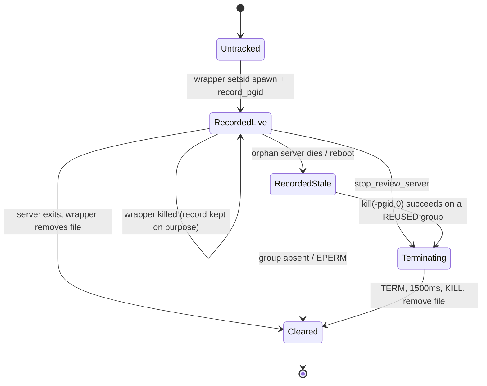

**Transitions:**
- **Record:** `review_serve.rs:68-73`.
- **Clean-exit clear:** `review_serve.rs:75-78`, unconditional `remove_file` at `97-100`.
- **Teardown:** `stop_review_server` / `terminate_process_group` at `workspace.rs:2267-2337`. It runs first in `kill_workspace_pane` (`workspace.rs:2362`), before the slot-alive check at `2371`, and also from `review_session::close_review` (`review_session.rs:420`).

**Verified concerns:**
1. **Signals a reused id (medium).** The guards are only `pgid > 1`, `pgid != getpgrp()`, and `kill(-pgid,0) == 0` (`workspace.rs:2306-2325`). The doc comment at `2257-2259` says the probe "guards against a recycled pid", but it only catches a group that is already gone. After a reboot the file survives, and the reconcile and reaper paths call `kill_workspace_pane` on the dead review slot. That runs `stop_review_server` first, so a same-user launchd agent or shell job that now leads that pgid gets SIGTERM and then SIGKILL. The repo already stores pid plus start_time for identity in `shelbi-state/src/ssh_control.rs:145-260`.
2. **Clear-on-exit doesn't check whose record it is (low).** Two overlapping wrapped launches in one slot: the second overwrites the record, then the first one's exit deletes the second's record (`review_serve.rs:93`, `97-100`), leaving a live server untracked.
3. **Resume is untracked (low).** `review_pgid_file: None` on resume (`workspace.rs:2940-2946`). A resumed agent that re-runs the wrapped serve line gets no record, so that server is orphaned.
4. **Docs still describe tmux/SIGHUP (low).** `review_serve.rs:6-24`, `workspace_status.rs:291`.

**Refuted:**
- Signalling our own group or init is guarded and tested (`workspace.rs:2306`, `12034`).
- The silent record-write failure is a documented, deliberate fallback.
- Keying the record by workspace is by design.

**Recommendation:**
- Record `<pgid> <leader_start_time> <boot_time>` and check it before signalling. On a mismatch, clear the record without signalling.
- Make the wrapper's clear compare-and-delete.
- Decide on purpose what resume should do about tracking.
- Refresh the doc comments.

All of this can stay behind `read_review_serve_pgid` / `clear_review_serve_pgid` in shelbi-state.


### Verified concerns

- **medium**: A stale record has no identity check, so teardown can SIGTERM and then SIGKILL an unrelated process group of the same user that reused the id. The doc comment claims the liveness probe guards against a recycled pid, but it only catches a group that is already gone, not one that has been reused.
  - Evidence: workspace.rs:2311-2337 only checks pgid>1, pgid != own group, and kill(-pgid,0)==0 before TERM then KILL. workspace_status.rs:308-314 parses a bare i32. The record lives in ~/.shelbi, so it survives a reboot, and after a reboot low pids are handed out quickly to same-user launchd agents and shell jobs, each of which leads its own group. kill_workspace_pane calls stop_review_server before checking whether the slot is alive (workspace.rs:2362 vs 2371), so the reconcile and reaper paths that run on a dead review slot after a restart will fire it. A precedent for storing pid plus start_time already exists in shelbi-state/src/ssh_control.rs:145-260.
- **low**: The wrapper's exit cleanup deletes the record no matter whose pgid it holds. If the agent starts a second wrapped server while the first is still running (for example, the first was backgrounded), the first one exiting removes the second one's record and leaves the live server untracked and orphaned on teardown. The second write also overwrites the first record, so the first server is never reaped.
  - Evidence: review_serve.rs:93 does an unconditional fs::write and review_serve.rs:97-100 an unconditional remove_file. There is no compare-before-remove and no per-launch identity. The file is keyed only by workspace (workspace_status.rs:296-299).
- **low**: A resumed review agent is never tracked. Resume passes review_pgid_file: None, so if the resumed agent re-runs the wrapped serve line from its conversation history, record_pgid silently does nothing and that server is orphaned on teardown, which is the original bug coming back.
  - Evidence: workspace.rs:2940-2946 sets review_pgid_file: None on the resume path; review_serve.rs:86-88 returns early when the env var is absent
- **low**: The module docs still describe the tmux pane/SIGHUP topology, but the runtime now uses session processes. This is documentation drift only.
  - Evidence: review_serve.rs:6-11, 22-24 (tmux pane, SIGHUP); workspace_status.rs:291 'not in the tmux session env'


### Concerns that did not hold up

- 'A failed record write cannot be told apart from no server.' This is true but deliberate and harmless: the comment at review_serve.rs:82-84 documents falling back to the old untracked behavior, and the launch must not abort. It is not a state-machine defect.
- 'A stale record from a prior task is reaped by whatever kill_workspace_pane comes next.' Clearing a record on the next teardown is the intended design (survive restarts, reap on any teardown path). The only real danger is signalling a reused id, which is covered by the first concern, not by the per-workspace keying.
- 'Teardown can signal our own group or init.' This is refuted: pgid_is_safe_to_signal (workspace.rs:2306-2308) and the >1 floor in read_review_serve_pgid prevent it, and a test covers it (workspace.rs:12034).


**Recommendation:** Turn the record into a typed identity: `<pgid> <leader_start_time> <boot_time>`, written by the wrapper using the existing process_start_time helper from ssh_control.rs. In terminate_process_group, refuse to signal unless the boot time matches the current boot and, if the leader is still alive, its start time matches. If the leader has died but the group is still alive, accept only when the boot matches and the record's mtime is not older than the group's members. Otherwise treat the record as stale and just clear it. Make clear_pgid_record compare-and-delete (remove only if the file still holds this wrapper's pgid). Decide on purpose whether resume should re-inject SHELBI_REVIEW_PGID_FILE, and refresh the tmux-era doc comments. All of this lives behind read/clear functions in shelbi-state, so the change stays in one place.


## Client review decision in flight and merge gate

**Verdict:** Needs further thought. One reachable bug: in the TUI, a mouse click puts focus into the content session mid-merge, so keystrokes reach the review agent or editor while the gated merge runs. The design also needs a decision. The TUI and desktop each re-implement the landing, refusal and gate-sync logic around a shared store, and the two copies already behave differently: board-driven landing exists only in the desktop, and the cross-project refusal message is wrong only in the TUI.

**Verified concerns:** 1 medium, 3 low

**Key files:**
- `crates/shelbi-app/src/review.rs:498-633 (Decision, DecisionNotice, ReviewDecisions)`
- `crates/shelbi-app/src/review.rs:634-730 (ReviewPanelState merge gate)`
- `crates/shelbi-tui/src/shell/mod.rs:4573-4726 (start_decision, on_decision_reply, decision_refused, sync_review_decision)`
- `crates/shelbi-tui/src/shell/review.rs:391-412, 486-675 (TUI merging mirror, key/mouse gating)`
- `desktop/src/app.rs:3699-3790, 5120-5180 (desktop landing/refusal/sync, run_review_mutation)`

### What it is
A client (TUI or desktop) sends an approve (the gated merge) or a reject to the daemon off the UI thread, and leaves the review view at once. `shelbi_app::review::ReviewDecisions` tracks the decision until it is seen through. If the review is reopened meanwhile, its panel is held in a "merging" gate that makes it inert to everything except Back.

### Encoding
- `ReviewDecisions { notices: Vec<DecisionNotice { task, decision, failure: Option<String> }> }`: `failure == None` means Running and `Some` means Failed (crates/shelbi-app/src/review.rs:557-633).
- The panel gate is a separate bool: `ReviewPanelState.merging` (shelbi-app, used by the desktop) and `ReviewPanel.merging` (TUI). Each host pushes it by hand from `sync_review_decision` (TUI shell/mod.rs:4700-4712; desktop app.rs:3745-3756).
- Replies come over an mpsc channel (TUI, polled each loop tick) or a gpui spawned task (desktop). The desktop also treats a board row disappearing or a `ReviewClosed` event as the decision landing.

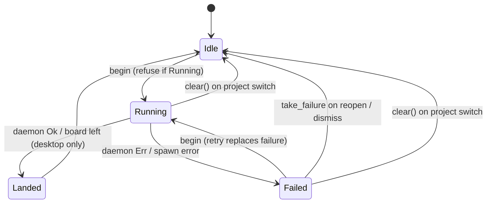

### Verified concerns
1. **TUI mouse leak through the merge gate (medium).** `ReviewInterface::handle_mouse` sets `self.focus` on any left click before it checks `merging` (crates/shelbi-tui/src/shell/review.rs:636-641). A content-area click then forwards mouse bytes to the live session (662-674). After that, `handle_key` dispatches on focus (498-500) to `handle_content_key` (549-576), which has no merging check. So a review reopened mid-merge (sessions are still live, and `sync_review_decision` set merging=true) accepts typing into the agent or editor during the gated merge. That contradicts the inert guarantee that `focus_content`/`focus_panel`/`paste_into_content` enforce (508-547).
2. **Mirrored gate (low).** The panel's `merging` is a copy of `decisions.running(task)`, synced only at reopen and refusal. Second decisions are still blocked by `refuse_second_decision` against the store, but every input guard (around 8 in the TUI, plus the desktop's views/review.rs:1184, 1389) trusts the copy.
3. **Host logic has drifted (low).** The desktop lands a decision when the board says the task left review (app.rs:3702-3706, 3787-3790). The TUI only says "review X closed" (mod.rs:4821-4829) and waits for the reply. For a refusal from a project the user has left, the desktop shows a neutral banner (app.rs:3729-3734). The TUI's project guard covers only the Ok arm (mod.rs:4652), so it writes "Couldn't approve X (open its review to try again)" into the new project's status line (4687-4696).
4. **Stale failures (low).** `landed()` ignores Failed notices (review.rs:596-600). If the task later leaves review anyway, the desktop's "Couldn't approve X" notice with its Reopen button lingers until the user dismisses it (app.rs:5554-5580).

### Refuted
- A second decision cannot get through on a stale panel bool: both hosts check the store first.
- `start_decision` ignoring `begin`'s bool is duplication only, since both run on the UI thread back to back.
- Clearing status_line on `set_merging(true)` is documented and ordered before the failure is applied. The `should_quit` latch is read once, and the interface is dropped right after.

### Recommendation
Move the transition consequences into shelbi-app: `ReviewDecisions::on_reply(..)` and `on_board_left(..)` should return an outcome enum (Landed / Refused{line, here} / Ignored) that both hosts render. Stop mirroring the gate: derive `merging` from the store at input and render time. Immediate TUI fix: check `merging` at the top of `handle_mouse` and in `handle_content_key`.


### Verified concerns

- **medium**: In the TUI, the merge gate does not stop mouse input. A left click on the content area while merging sets focus=Content and forwards the mouse bytes to the live content session. After that, handle_key routes every keystroke to handle_content_key, which never checks merging. So a review reopened mid-merge can be typed into, which the documented 'inert while merging' rule (AC #4) forbids. This is reachable: the review's sessions stay alive until the decision lands, and sync_review_decision sets merging=true on reopen.
  - Evidence: crates/shelbi-tui/src/shell/review.rs:636-641 sets self.focus before any merging check. Lines 662-674 forward mouse bytes to live_pane. Lines 498-500 dispatch on focus. handle_content_key (549-576) has no merging guard. Compare focus_content/focus_panel/paste_into_content (508-547), which do check merging.
- **low**: The gate has two sources of truth. ReviewDecisions.running(task) and the panel's merging bool are kept in step by hand in each host. The panel flips only when the host calls sync_review_decision (or the desktop's direct set_merging(false)). Every input guard reads the panel copy: about 8 checks in the TUI and others in desktop views/review.rs.
  - Evidence: TUI mod.rs:4700-4712 and 4316. Desktop app.rs:3745-3756 and 3738. Guards at shell/review.rs:410, 493, 509, 520, 542, 581, 643 and desktop/src/views/review.rs:1184, 1389.
- **low**: The landing and refusal logic is written twice, once per host, and the copies have drifted. The desktop treats a board ReviewClosed or a missing row as the decision landing (review_left -> landed -> land_decision). The TUI's ReviewClosed just drops the view with 'review X closed' and leaves decisions alone, so landing waits for the daemon reply. On a refusal for a project the user has left, the desktop detects failed()==None and shows a neutral banner. The TUI unconditionally writes '<Couldn't approve X> (open its review to try again)' to the new project's status line, for a task that is not in that project.
  - Evidence: Desktop app.rs:3702-3706, 3787-3790, 3729-3734. TUI mod.rs:4652 guards only the Ok arm, then Err -> decision_refused (4666, 4687-4696), which ignores the None from decisions.failed after clear() at 2281. TUI ReviewClosed: mod.rs:4821-4829.
- **low**: A Failed notice is never reconciled against the board. If the task later leaves review (merged on GitHub, moved by another client, or the daemon errored after the merge actually happened), landed() returns None because the notice is not Running. The stale 'Couldn't approve X' notice with a Reopen button stays in the desktop until the user dismisses it.
  - Evidence: review.rs:596-600 (landed requires failure None). desktop app.rs:3702-3706 falls to review_ended without dismissing. Notices are rendered with Reopen at app.rs:5554-5580.


### Concerns that did not hold up

- 'A missed sync lets a second decision through the panel while one is still running': refuted. Both hosts check refuse_second_decision against ReviewDecisions (the authoritative store) before begin, so a stale panel bool cannot cause a second daemon decision. Only the input gating depends on the mirror.
- 'start_decision ignores begin's bool': true, but harmless. The check and begin run back to back on the UI thread with no await between them, so they cannot diverge. This is duplication only.
- 'set_merging(true) wipes a pending status note': true, but intended (documented 'Starting it clears the status line'), and the failure line is taken after set_merging in sync_review_decision, so it is not lost.
- 'should_quit is a one-way latch nothing resets': contained. It is read once to return ReviewAction::Close, and the interface is dropped right after, so no stale-latch path exists.


**Recommendation:** Make ReviewDecisions own the transitions and their consequences. Give it on_reply(project, task, result) and on_board_left(task) methods that return an outcome enum (Landed(decision) / Refused{line, current_project: bool} / Ignored), so both hosts only render the outcome. Derive the panel gate from the store instead of mirroring it: pass `merging` in at render and input time (e.g. ReviewPanelState::handle(input, merging)), or have the panel hold a read handle. Then no host can forget a sync. In the TUI, fix the immediate bug by checking merging at the top of handle_mouse (before setting focus) and in handle_content_key. Optionally, clear Failed notices when the board shows the task has left review.


## GitHub out-of-band merge reconcile (review -> done)

**Verdict:** Needs further thought. The 'start of current cycle' marker is really 'last write to the task'. A legitimate out-of-band merge followed by any write to the task (very likely on the GitHub backend, where comments bump updated_at) strands the task in review with only an info log, which defeats the purpose of the pass. The forced move without a compare-and-set check, and cleanup failures that are never retried, add smaller risks of a representable bad state.

**Verified concerns:** 1 medium, 2 low

**Key files:**
- `crates/shelbi-orchestrator/src/zen.rs:1219-1544 (github_merge_reconcile, reconcile_candidates_with, auto_reconcile_target, candidates, apply)`
- `crates/shelbi-orchestrator/src/poller.rs:720-775 (maybe_github_reconcile cadence and slot release)`
- `crates/shelbi-state/src/issue_store.rs:696-700 (move_status trait: no expected-from), 960-972 (set_fields bumps updated_at)`
- `crates/shelbi-state/src/lib.rs:3756-3761 (park_review_task bumps updated_at)`
- `crates/shelbi-state/src/pr_status.rs:8-11 (GitHub issue updated_at moves on any write)`

**Entity:** a Handoff-category task (review) whose workflow's forward edge auto-merges into a terminal status, and whose PR was merged on GitHub outside Shelbi.

**How it is stored:** nothing is persisted between ticks. Each pass of `maybe_github_reconcile` (poller.rs:735, cadence `github_reconcile_interval_secs`, 15 min by default, skipped while offline) calls `zen::github_merge_reconcile` (zen.rs:1269). That pass:
1. Selects candidates from the cached board index (`open_board`, zen.rs:14381). A candidate must have a Handoff category, `fires_merge_bar(from)`, a terminal forward status, and a branch that resolves (zen.rs:1448-1497).
2. For each candidate, up to 25 per tick: looks up a merged PR, resolves the branch tip (local, else remote-tracking), and checks whether the tip is contained in the PR head (zen.rs:1277-1293).
3. Applies guard 1 (tip not in PR head, skip), then guard 2 (merged_at < `task.updated_at`, skip), then the apply step (zen.rs:1356-1418).
4. Apply step (zen.rs:1506-1544): `pr_record::note_finished` → `store.move_status(id, done)` → `append_github_merge_reconcile_event` → `execute_transition_except(.., skip=[Merge])`. A cleanup error is only warn-logged.
5. The poller then publishes `LayoutEvent::ReviewClosed` to free the review slot (poller.rs:756-771).

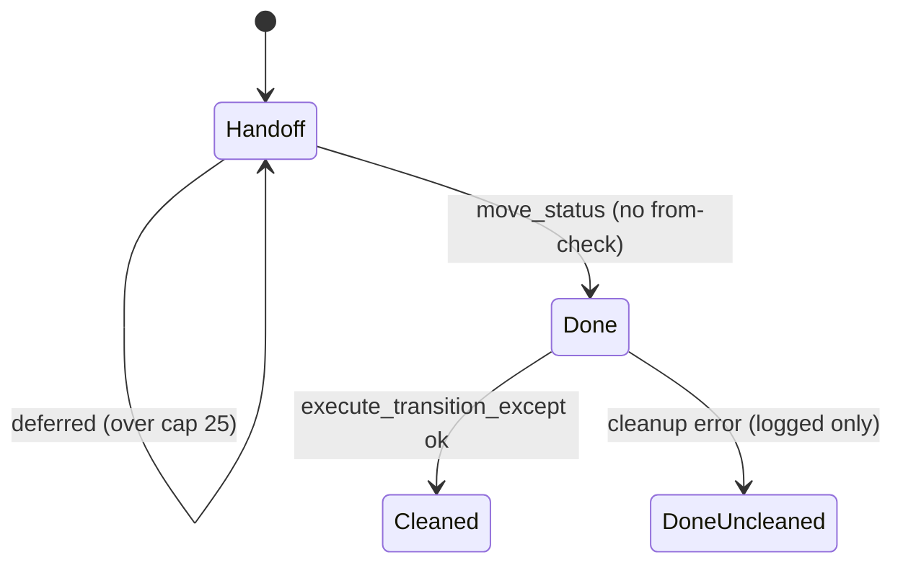

**Verified concerns**

1. **`updated_at` is a weak cycle marker (medium).** Guard 2 (zen.rs:1376-1396) assumes `updated_at` is "at or after the current cycle's dispatch/reopen". But `set_fields` (issue_store.rs:971), `park_review_task` (lib.rs:3761) and, on the GitHub backend, any issue write including comments (pr_status.rs:8-9) move it. Example: a PR merges on GitHub at T, and something writes to the task at T+5 min, before the next 15-min tick. Every later tick then sees `merged_at < updated_at` and skips. The branch tip is usually still present (the local hub branch outlives a GitHub auto-delete), so the escape at zen.rs:1376 does not apply. The task stays in review forever, logged only at info level.
2. **Forced move with no from-check (low).** `IssueStore::move_status` (issue_store.rs:700) takes only a target. Candidates come from the daemon's board index, which can lag. If a user moves the task out of review after the snapshot, the move still lands it in done, and the review->done cleanup (branch delete, run:/ready:) runs against the snapshot's `from_status`.
3. **Cleanup failures are never retried (low).** The move commits first and a cleanup error is only logged (zen.rs:1527-1542). The task is then done, so it never becomes a candidate again, and no marker records the missing cleanup. This ordering matches `approve_review_task`, so it is a project-wide pattern rather than a quirk local to this pass.

**Refuted:** the workflow-load fallback differs from `dry_run_tick` (default_workflow versus `fires_bar=true`), but dry-run is only a preview and the difference has no behavioral consequence.

**Recommendation:** record a handoff marker (sha and/or time) when a task enters handoff and compare against it instead of `updated_at`. Use a compare-and-set move (`expected_from`). Record a cleanup-pending marker or event so a failed cleanup is visible and can be retried. Raise the guard-2 skip on a merged PR to warn or an event so stranded tasks are noticed.


### Verified concerns

- **medium**: Guard 2 treats task.updated_at as the start of the current cycle, but any write to the task after handoff moves it. If the PR merges on GitHub and the task is then written to before the next reconcile tick, the merge looks stale. Examples of such writes: a field edit, park_review_task, or (on the GitHub backend) any comment or label on the issue. The task then stays in review indefinitely. Nothing surfaces this beyond an info log, and only a manual Accept frees it. The window is the reconcile cadence, 15 min by default. resolve_branch_tip falls back to the local hub branch, which usually survives a GitHub auto-delete, so the 'branch gone' escape rarely applies.
  - Evidence: zen.rs:1376-1396 skips when merged_at < cand.task.updated_at. issue_store.rs:971 (set_fields) and lib.rs:3761 (park_review_task) set updated_at = now. pr_status.rs:8-9 says 'A GitHub issue's updated_at moves on any write'. No persisted handoff time exists.
- **low**: The move has no expected-from status. Candidates and their updated_at come from the daemon-owned board index, which can lag. move_status(id, to) returns None only when the task is already at the target. If a user rejects or moves the task out of review after the snapshot, and the old PR is merged with its tip still contained (the worker has not pushed yet), reconcile forces the task to done. It then runs the review->done cleanup (branch delete, run:/ready:) against work in progress.
  - Evidence: issue_store.rs:700 `fn move_status(&self, id, to, reason)` has no from parameter. zen.rs:1452 builds candidates from open_board (board-index.json, see the test at zen.rs:3602-3608). zen.rs:1514 calls move_status unconditionally. zen.rs:1527 passes the snapshot's cand.from_status to cleanup.
- **low**: The move commits before cleanup. A cleanup failure is only warn-logged and leaves no retry marker, and because the task is now done it is never a reconcile candidate again. The result is a task that is done but not cleaned up: branch not deleted, run:/ready: actions not run, and nothing on disk records it.
  - Evidence: zen.rs:1512-1542: move_status, then append event, then `if let Err(e) = execute_transition_except(..) { tracing::warn!(.. 'post-move cleanup failed (move already landed)') }` and return Ok(true). It follows the same ordering as approve_review_task by design.


### Concerns that did not hold up

- The fallback differs from dry_run_tick when the workflow fails to load: reconcile uses default_workflow (zen.rs:1458-1459), while dry-run assumes fires_bar=true (zen.rs:15002-15004). This is true but has no consequence. Dry-run is a probe preview, not a decision path. The default workflow fires the merge bar from review anyway, and a status the default workflow cannot resolve is skipped by resolve_task_status, so reconcile is the more conservative of the two. It does not count as drift between two implementations of one transition.


**Recommendation:** Persist the cycle explicitly: when a task enters a handoff status, record a handoff marker (a handoff_at timestamp and/or the handed-off head sha, or cycle id) in local hub state and compare against it instead of updated_at. With a recorded handoff sha, guard 1 alone could probably answer the staleness question (is the recorded head in the PR head), and guard 2 could be dropped. Make the move a compare-and-set: add an expected-from parameter (move_status_from(id, from, to)) and abort when the live status is no longer cand.from_status. On cleanup failure, write a pending-cleanup marker or emit a cleanup-failed event that a later pass or the TUI can pick up, so 'done but not cleaned up' is visible and can be retried. When guard 2 skips a task whose PR is merged, surface it as a warn or an event rather than info, so a stranded task can be noticed.


## Review content view switch and View Diff wait

**Verdict:** Needs further thought. The shared DiffLoad core is correct and well tested, but the TUI host has a real, reachable bug that the desktop app does not: a stale Editor ensure answer rebinds the pane after the user picked Chat, because the guard only checks View Diff. It also routes the editor answer through a shared slot that other jobs overwrite. Both clients answer the same question ("which view is selected, and is this answer still wanted?") with different logic, and the two answers have already drifted apart.

**Verified concerns:** 1 medium, 2 low

**Key files:**
- `crates/shelbi-app/src/review/diff_load.rs:77-260`
- `crates/shelbi-tui/src/shell/review.rs:103-390`
- `crates/shelbi-tui/src/shell/mod.rs:4395-4466`
- `desktop/src/views/review.rs:734-953`

### What it is

The review interface's content pane is bound to one of three views. **Chat** is the review agent's workspace session. **Editor** is a daemon-spawned role session that needs a `ReviewSessionOp::Ensure` first. **Diff** is View Diff, which runs a wait (`DiffLoad`) until the diff tool has drawn something. The `DiffLoad` core lives in `shelbi-app`, and the TUI and desktop clients both use it. Each client has its own host logic that decides which view is selected and whether a late ensure answer is still wanted.

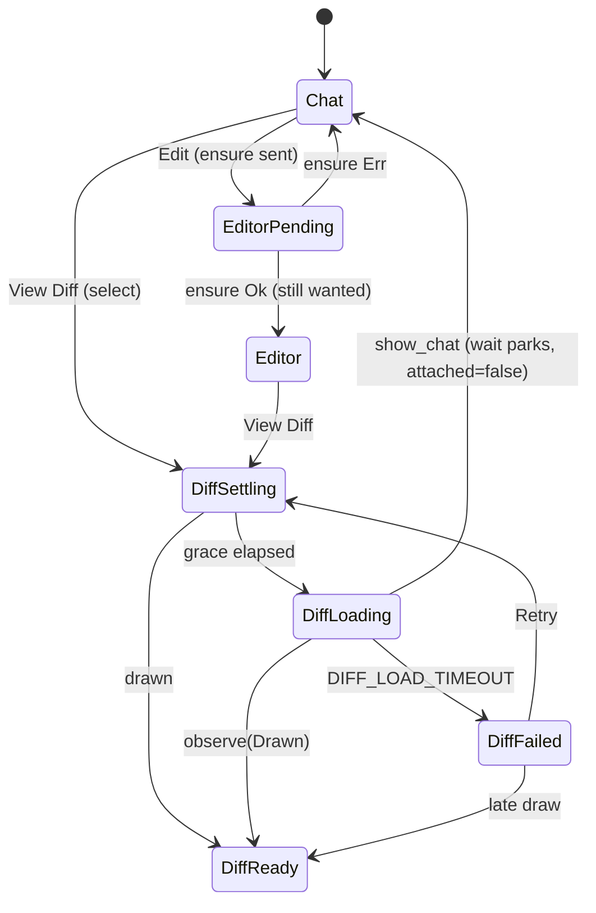

### How it is stored

- **Core** (`crates/shelbi-app/src/review/diff_load.rs:91-102`): `started`, a private `enum Ensure {InFlight, RetryAt, Stopped, Done}`, `failures`, the bools `attached`/`drawn`/`timed_out`, and `cause`. `view()` derives the phase by priority. The struct holds no timers; the caller passes the time in.
- **TUI host** (`crates/shelbi-tui/src/shell/review.rs:103-129`): `diff_active`, `diff_load`, a per-interface `diff_answer` channel, `diff_drawn` and `retry_rect`. Nothing on the interface records an Editor request. The Editor answer arrives as `ReviewJobMsg::ContentReady` on the shell's single `review_rx` (`mod.rs:4453-4466`).
- **Desktop host** (`desktop/src/views/review.rs:286-51, 734-953`): `panel.active()` is the selected view, `run_op` drops results whose `generation` is stale, and the `still` check compares the requested view against the current one.

### Verified concerns

1. **(medium) A stale Editor answer takes the pane from Chat (TUI only).** `review.rs:242-253` guards only `!self.diff_active`. The sequence Edit, then Chat, then a late Ok runs `show_role(Editor)`; a late Err forces `show_chat()`. The desktop app checks `panel.active() == view && shown` (`desktop/src/views/review.rs:759-762`) and the generation (938-946). The TUI's only test covers the View Diff case (`review.rs:1184`).
2. **(low) The Editor answer travels through a shared, overwritable slot.** `mod.rs:4456` stores the receiver in `review_rx`, which `begin_review` (4263) and `start_review_load` also replace. If either runs before the answer arrives, the Edit request is lost with no feedback. The diff ensure got its own channel precisely to avoid this (comment at `review.rs:120-123`).
3. **(low) The DiffLoad phase is spread across bools.** The invariants hold (`observe(Drawn)` clears `timed_out`; `advance` never times out a drawn wait), but they are kept by convention, and three functions each re-derive the phase.

### Refuted

- **A cross-review late diff answer:** the TUI's receiver dies with the per-review interface, and the desktop app has a generation guard.
- **`retry()` reusing an in-flight answer:** this is intentional. The answer is for the same review's diff session.
- **`drawn && timed_out` and `Done && !attached`** are not reachable as bad states. The second is the intended "parked behind another view" state.

### Recommendation

Add an explicit `ContentView { Chat, Editor{pending}, Diff }` to the TUI `ReviewInterface`. Accept an Editor answer only while the view is still `Editor{pending}`, and give that answer its own channel. Better still, put the "is this answer still wanted" rule in `shelbi-app` beside `DiffLoad` so both clients share one implementation. Collapsing DiffLoad's bools into one phase enum is optional tidying.


### Verified concerns

- **medium**: In the TUI, a late Editor ensure answer takes the pane from Chat. editor_ready only checks diff_active. If the user picks Edit and then Chat before the daemon answers, Ok(()) calls show_role(Editor) and rebinds the content pane to the editor. If the answer is Err, it calls show_chat() even when the user had already moved on. The only test covers the View Diff case. The desktop app guards correctly: it checks that the panel's active view still equals the requested view, and that the generation still matches. This is TUI/desktop parity drift.
  - Evidence: crates/shelbi-tui/src/shell/review.rs:242-253 (`Ok(()) if !self.diff_active => self.show_role(ReviewRole::Editor)`). Test at review.rs:1184-1192 covers diff only. desktop/src/views/review.rs:759-762 (`let still = this.panel().is_some_and(|p| p.active() == view) && this.shown`) plus run_op generation check at 938-946.
- **low**: The two content roles get their ensure answers in different ways. The TUI editor ensure answer travels through the shell's single shared review_rx slot, which begin_review and start_review_load also overwrite. Any later review job therefore silently drops a pending Editor answer. The pane then never switches, and no status message appears. The diff ensure was deliberately given its own channel for exactly this reason.
  - Evidence: crates/shelbi-tui/src/shell/mod.rs:4455-4456 (`self.review_rx = Some(rx)` for ContentReady), also assigned at mod.rs:4263 and in start_review_load (~4364). The comment at review.rs:120-123 explains why the diff ensure avoids the shared slot.
- **low**: DiffLoad keeps its phase as three bools plus the Ensure enum, and view()/failure_cause()/needs_tick() each re-derive the phase by priority. No reachable illegal combination was found. Still, the invariants (drawn implies !timed_out; Stopped implies timed_out) hold only by convention inside observe() and advance(), not by the type.
  - Evidence: crates/shelbi-app/src/review/diff_load.rs:91-102, 197-203 (observe(Drawn) clears timed_out), 211-219 (advance returns early once drawn), 222-239.


### Concerns that did not hold up

- A fresh select() after a review switch gets the old review's in-flight diff answer: refuted. In the TUI, diff_answer is a field of the per-review ReviewInterface, so switching reviews drops that interface and its Receiver (and project switch clears self.review, mod.rs:2270-2280). In the desktop app, run_op drops any result whose generation is stale (review.rs:938-946), and generation is bumped whenever the shown review changes (452, 506).
- retry() while an ensure is InFlight adopts the outstanding answer: this is intentional and correct. The ensure targets the same review's diff session, so its answer is valid for the new wait. The doc comment at diff_load.rs:139-140 states this, and it avoids sending a duplicate ensure. If that answer arrives after the new wait has timed out, ensure_answered still applies it. A late Ok yields Done and then attach, which is the desired outcome.
- drawn && timed_out is a reachable illegal combination: refuted. observe(Drawn) clears timed_out (diff_load.rs:200-201), and advance() never sets timed_out once drawn (212).
- Done && !attached is illegal: refuted. It is the intended 'session up, view parked behind another view' state that needs_attach() relies on (diff_load.rs:180-194).


**Recommendation:** Give the TUI ReviewInterface an explicit selected-view field, `enum ContentView { Chat, Editor { pending: bool }, Diff }`, mirroring the desktop's panel.active(). Make editor_ready a no-op unless the selected view is still Editor { pending }, matching the desktop's `still` check. Move the editor ensure answer onto its own per-interface channel, as the diff ensure already has, instead of the shell's review_rx. Ideally the "is this ensure answer still wanted" rule lives once in shelbi-app, next to DiffLoad, so both clients call it. Optionally, collapse DiffLoad's drawn/timed_out bools into a single phase enum (Waiting, TimedOut, Drawn). This is tidying only; the current invariants hold.


## Zen probe: task-ref CAS advance, probe worktrees, shared target lock

**Verdict:** Worth tidying. The CAS, worktree-holder checks and lock ordering are careful and well tested, and no reachable correctness bug survived verification. The real issues are design-level and hygiene. First, a probe always mutates the durable task ref, and the 'local ahead of remote' state it creates is recorded nowhere (it already caused one bug). Second, cleanup is split across a normal path, a signal handler that only one entry point installs, and a pid sweep that is unsound across multiple hubs, with one temp ref no sweep covers. Making the probe lifecycle explicit would prevent likely future bugs, but nothing is broken today.

**Verified concerns:** 1 medium, 4 low

**Key files:**
- `crates/shelbi-orchestrator/src/zen.rs:7073-7208 (probe_in_workflow: sweep, cap, build lock, worktree add/remove)`
- `crates/shelbi-orchestrator/src/zen.rs:7210-7385 (probe_isolated_task_ref: rebase, checks, unconditional finalize)`
- `crates/shelbi-orchestrator/src/zen.rs:7790-8157 (worktree registry, pid sweep, target cap, add/remove)`
- `crates/shelbi-orchestrator/src/zen.rs:8159-8530 (finalize CAS, free/detach primary checkout, private probe-base fetch ref)`
- `crates/shelbi-orchestrator/src/workspace.rs:1615-1780 (push_workspace_branch_to_origin: provenance-gated force that absorbs the advanced local ref)`

### What it is
One Zen probe (`probe_in_workflow`, `crates/shelbi-orchestrator/src/zen.rs:7073`) moves three pieces of state through their lifecycles at once:

1. **The durable task ref** `refs/heads/<branch>` in the hub repo.
2. **A throwaway isolated worktree** `.shelbi-probe-<pid>-<task>-<seq>` next to the workspace anchor, plus a private fetch ref `refs/shelbi/probe-base/<pid>-<seq>`.
3. **The hub's shared cargo `target/`**, protected by flock files under `$SHELBI_HOME/locks`.

None of the three has an explicit state type. Their state lives in git refs, `git worktree list`, directory names, a process-global `Mutex<Vec<…>>`, and flock files.

```mermaid
stateDiagram-v2
    [*] --> AtInitial: read local ref, read remote as published_head
    AtInitial --> Refused: linked worktree holds branch (early check)
    AtInitial --> RebasedInTemp: RebaseOntoDefault, clean rebase
    AtInitial --> Conflict: rebase conflict (aborted)
    AtInitial --> AsIs: AsIs (dry-run), no rebase
    RebasedInTemp --> ChecksRun: integration commit + local checks (pass OR fail)
    ChecksRun --> PrimaryDetached: primary checkout held branch, clean
    ChecksRun --> Advanced: update-ref CAS
    PrimaryDetached --> Advanced: update-ref CAS
    ChecksRun --> Refused: linked holder / ref moved (under lock)
    Advanced --> AheadOfRemote: unrecorded; pr-create or worker push publishes later
    Conflict --> [*]: ref untouched
    AsIs --> [*]: ref untouched
```

### Transitions (verified)
- Early refusal: `ensure_no_linked_worktree_holds_branch` (zen.rs:7109). It is authoritative again under the lock at 8378-8411.
- `published_head` comes from the **remote** (zen.rs:7127-7133). The comment there explains that an earlier bug came from assuming it was equal to the local ref after a prior probe had advanced it.
- Sweep, then cap, then shared build lock, then worktree add (zen.rs:7138-7177).
- The rebase or conflict outcome decides whether `head_sha != initial_head` (zen.rs:7258-7293).
- Local checks are recorded, not raised (zen.rs:8625-8665). `finalize_probed_task_ref` is called **unconditionally** on the Ok path (zen.rs:7356).
- Finalize: under `lock_git_worktrees` it scans holders, refuses a linked holder, detaches a clean primary checkout, re-scans, then runs `update-ref ref new old` and verifies (zen.rs:8181-8262).
- Worktree removal always deregisters, even when git fails (zen.rs:8131-8157). Only `shelbi zen probe` installs the SIGINT/SIGTERM drain (shelbi-cli/src/commands/zen.rs:58-70, 324).

### Verified concerns
- **Medium: the ref advances regardless of the verdict, and the resulting state is unrecorded.** A probe whose checks fail, or whose squash-merge conflicts, still leaves the local ref on a rebased, unpushed head (zen.rs:7356). No live bug follows from this today. The worker-push path force-with-leases over Shelbi's own earlier remote tip (workspace.rs:1735-1766), and re-probes read the remote for `published_head`. But "local ahead of remote" is re-derived each time instead of stored, and the same implicit state already produced a pr-create dead-end once.
- **Low: the `refs/shelbi/probe-base/<pid>-<seq>` temp ref leaks** if the process is killed, or if the `?` at zen.rs:8512 fails, and no sweep covers it.
- **Low: the pid sweep is unsound across hubs.** The pid is the local hub's, but the sweep runs against a possibly remote anchor directory (zen.rs:7880-7955). Two hubs sharing a remote workspace machine could reap each other's live worktrees. On non-unix, nothing is ever swept.
- **Low: cleanup ownership is split three ways** (the normal path, a signal handler only on `zen probe`, and the next-probe sweep). The add-to-register window (8090-8109) and remove-failure-then-deregister (8147) both fall back to the delayed sweep. The dry-run loop has no signal handler.
- **Low: dry-run is not side-effect-free.** `dry_run_tick` (zen.rs:15012, AsIs) does not touch the ref, but it does sweep, may `rm -rf` an over-cap shared target, and runs full local checks.

### Refuted
- Dry-run rewriting the ref: AsIs means no rebase, so no update-ref.
- Build-lock `.ok()` exposing the target to a concurrent `rm -rf`: both locks use the same lock path, so a failure that breaks one also makes the cap error out rather than delete.
- Primary-checkout detach as a hazard: it is gated on the primary checkout being the sole holder and clean, rewrites HEAD only, re-scans, and runs under the lock.
- CAS race: scan, CAS and verify form one critical section under `lock_git_worktrees`, with a test hook for this race.

### Recommendation
Worth tidying, not urgent:
1. Decide whether a failing probe should advance the ref. Gate `finalize_probed_task_ref` on the verdict, or persist an explicit `ProbeAdvancedRef { local, published }` record and event so pr-create, bounce and re-probe read it instead of re-deriving it.
2. Replace the scattered cleanup with an RAII `ProbeSession` guard that owns the worktree, the probe-base ref and the build lock. Register before `worktree add`, have its sweep cover the temp refs too, and install signal cleanup for every probe entry point (including dry-run).
3. Put a hub identity in the worktree name, or skip sweeping remote anchors with an unknown owner.
4. Optionally skip the cap and the sweep in dry-run.


### Verified concerns

- **medium**: Under RebaseOntoDefault, the durable local task ref is CAS-advanced to the rebased head even when local checks failed or a merge conflict was found. The probe mutates durable state no matter what the verdict is, and the only record of the resulting 'local ahead of remote, unpublished' state is a fresh remote read on the next probe. The read-the-remote fix exists because this unrecorded state already caused a pr-create dead-end once.
  - Evidence: zen.rs:7334-7346: probe_local_checks returns results and does not raise. zen.rs:7356: finalize_probed_task_ref is called unconditionally on the Ok path. zen.rs:7114-7133: the comment describes the earlier pr-create bug from this state. The downstream push (workspace.rs:1735-1766) absorbs it only through the pushed_by_shelbi provenance check plus force-with-lease.
- **low**: The temporary fetch ref refs/shelbi/probe-base/<pid>-<seq> is deleted on the success path and on fetch failure. It leaks if the process is killed, or if probe_head_sha fails after the fetch. No sweep exists for it (the stale-worktree sweep only matches directory names).
  - Evidence: zen.rs:8483-8529: delete happens at 8496-8499 (fetch fail) and 8514-8526 (success). The `?` at 8512 skips the delete. No other reference to probe-base exists outside tests (zen.rs:11466).
- **low**: The pid-based sweep is unsound if more than one hub probes the same remote workspace machine. The pid in the directory name belongs to the local hub, so hub B checks hub A's pid locally, may find it dead, and removes A's live worktree. On non-unix, nothing is ever swept.
  - Evidence: zen.rs:7880-7903: liveness is always checked locally ('runs on the hub even when the worktree's anchor is a remote machine'). zen.rs:7930-7955: the sweep lists the remote parent directory and removes any entry whose pid is dead.
- **low**: Worktree cleanup is split across three places that each own part of the job: the normal path (remove_probe_worktree), the signal handler, which is installed only for `shelbi zen probe` and not for the dry-run loop or the in-process Zen tick, and the next-probe pid sweep. Small windows exist: between `worktree add` and register, and after a failed `worktree remove`, which deregisters but leaves the directory. In both cases cleanup is delayed until a later probe's sweep.
  - Evidence: zen.rs:8090-8109 (add, then register). zen.rs:8147-8149 (deregister before checking status). shelbi-cli/src/commands/zen.rs:324 (install_probe_signal_cleanup only on the probe subcommand). The dry_run_tick loop at shelbi-cli zen.rs:709 has no handler.
- **low**: The 'non-publishing' dry_run_tick still has hub side effects every tick: the stale-worktree sweep, a possible `rm -rf` of the shared cargo target when it is over the cap, an isolated worktree add/remove, and full local checks.
  - Evidence: zen.rs:15012 calls probe_in_workflow(..., RebasePolicy::AsIs). That reaches the sweep at 7138, the cap at 7145, and probe_local_checks at 7335. The task ref itself is safe because AsIs never rebases, so head_sha == initial_head and no update-ref runs.


### Concerns that did not hold up

- Dry-run rewrites the task ref: refuted. dry_run_tick uses RebasePolicy::AsIs, so head_sha == initial_head and finalize skips update-ref (zen.rs:8199). Only the verify step runs.
- The build-lock `.ok()` degrade lets a concurrent cap `rm -rf` a target mid-build: mostly refuted. Both locks share one lock path under $SHELBI_HOME/locks (shelbi-state/src/lib.rs:1170-1203). A failure that makes the shared lock fail (for example an unwritable locks dir) also makes try_lock_zen_target_cleanup return Err, which the cap logs and does not act on (zen.rs:8030-8033, 7152-7156). The window this leaves is only a transient, path-specific error, which is unlikely.
- The ref advance after failed checks breaks the bounced worker's next push: not a live bug. push_workspace_branch_to_origin force-with-leases a rewritten branch when the remote tip is Shelbi's own earlier push (workspace.rs:1735-1766). It blocks only on a foreign remote tip, a separate provenance issue.
- Silently detaching the hub's primary checkout is a dangerous side effect: refuted as a bug. It happens only when the primary checkout is the sole holder of the branch, it refuses on user-dirty status, it rewrites only HEAD's symref, it re-scans afterwards, and it runs under lock_git_worktrees (zen.rs:8378-8449). It is intentional and documented.
- Deregistering on a failed `worktree remove` leaks permanently: refuted. Once the owner process exits, its pid is dead and the next probe's sweep removes the directory. Cleanup is delayed, not lost.
- Race in the CAS between the scan and update-ref: refuted. Scan, CAS and verify all happen under lock_git_worktrees, which dispatch/resume also take, and a test hook (after_scan) covers this exact race (zen.rs:8181-8262).


**Recommendation:** (1) Decide, and write down, whether a probe should advance the durable ref when checks fail or the merge conflicts. Either gate finalize_probed_task_ref on a passing verdict, or persist an explicit `probe_advanced_ref {local, published}` record in the task's state (or emit it as an event) so pr-create, bounce and re-probe read it instead of re-deriving it from the remote. (2) Wrap the probe's resources (worktree, private probe-base ref, build lock) in one RAII `ProbeSession` guard: register before `worktree add`, Drop removes the worktree and the temp ref, and its sweep also reaps `refs/shelbi/probe-base/<deadpid>-*`. Install the signal cleanup for every probe entry point, including the dry-run loop. (3) Put a host or hub identifier in the worktree name, or skip sweeping on remote anchors whose owner is unknown, so multiple hubs cannot reap each other's live worktrees. (4) Optionally make dry-run truly side-effect-free by skipping the cap and the sweep.


## Scoped CI poll memory and CI verdict classification

**Verdict:** Worth tidying. The production machine is small. A pure classifier plus two maps with clear retain/clear rules makes emit/suppress/re-emit correct, and both settle clocks err on the side of delaying green. Nothing reachable produces a wrong verdict. Three things are worth fixing. ci_watch treats any transient snapshot error (including a COMPLETED/null-conclusion row) as fatal while the scoped poll retries. A whole superseded state machine is still compiled and tested, and its helpers are still pub. The CiVerdict docs describe the old model. These are cleanups and one robustness fix, not a design question.

**Verified concerns:** 1 medium, 4 low

**Key files:**
- `/Users/jlong/Workspaces/shelbi/.shelbi/wt-sm-audit/crates/shelbi-orchestrator/src/zen.rs:1008-1184 (ScopedCiState, scoped_ci_poll_at, ci_should_emit)`
- `/Users/jlong/Workspaces/shelbi/.shelbi/wt-sm-audit/crates/shelbi-orchestrator/src/zen.rs:960-1005 (ci_watch loop and its own settle clock)`
- `/Users/jlong/Workspaces/shelbi/.shelbi/wt-sm-audit/crates/shelbi-orchestrator/src/zen.rs:1846-1988 (parse_snapshot_check, classify_ci_snapshot)`
- `/Users/jlong/Workspaces/shelbi/.shelbi/wt-sm-audit/crates/shelbi-orchestrator/src/zen.rs:70-311 (CI_SETTLE_GRACE, CiVerdict, legacy test-only WatchMode/MergeReadiness/PollOutcome/classify_poll)`
- `/Users/jlong/Workspaces/shelbi/.shelbi/wt-sm-audit/crates/shelbi-orchestrator/src/poller.rs:254,680-716 (owner of ScopedCiState, cadence and online gating)`

### What it is
The hub decides when an in-review PR's CI has reached a terminal verdict and emits a `ci` line into `events.log`. The orchestrator merges on success and bounces on failure. A blocking CLI `shelbi zen ci-watch` uses the same classifier on its own loop.

### Storage
- `ScopedCiState` (`zen.rs:1017-1026`) holds `seen: task -> (head_sha, "success"|"failure")` (the last emitted verdict) and `first_seen: task -> (head_sha, Instant)` (the settle-grace clock). It lives only in memory and is owned by the poller loop (`poller.rs:254`), which runs every 30s while online (`poller.rs:697-716`).
- The verdict comes from `classify_ci_snapshot(snapshot, settle_satisfied) -> Option<CiVerdict>` (`zen.rs:1929-1988`), a pure function. Raw GitHub states map to `SnapshotCheckState{Pass,Pending,Fail}` (`zen.rs:1876-1893`). `mergeStateStatus` stays a string.
- Outputs are `shelbi_state::append_ci_event` (the event stream) and `pr_status::note_ci` (the task sheet).

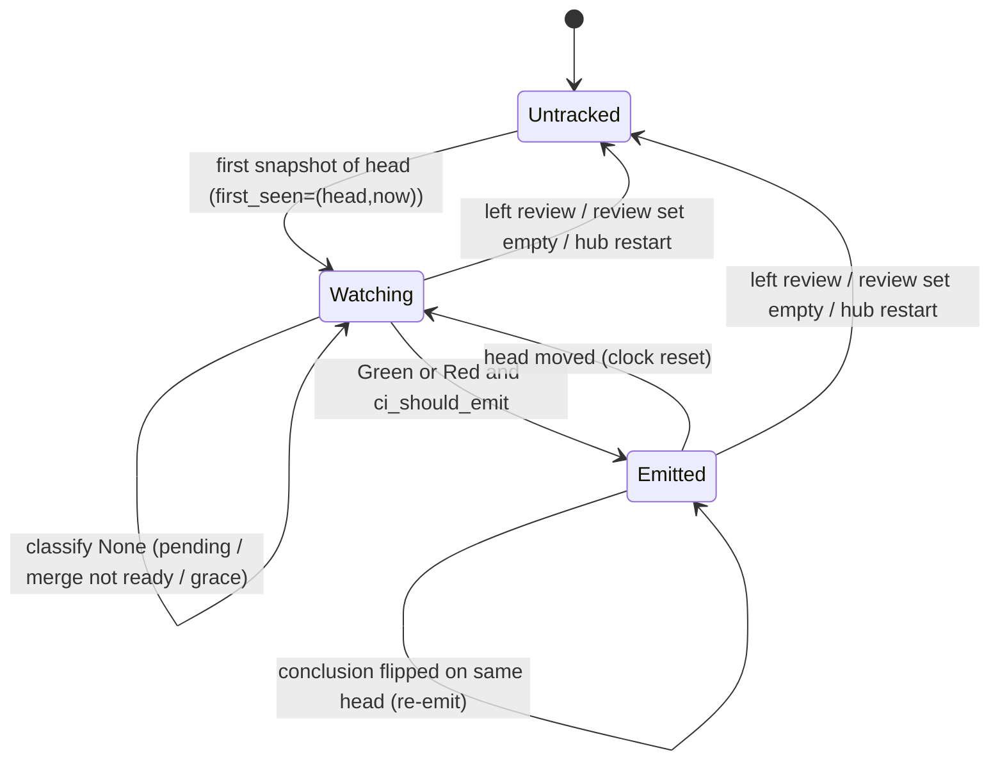

### Classification rules
- If any check is required, only the required set gates, and merge state must be CLEAN or UNSTABLE. The settle grace is ignored.
- If no check is required, every reported check gates and merge state must be CLEAN. Green also needs either an attached GitHub Actions run or an elapsed settle grace (`CI_SETTLE_GRACE`=60s), which guards against a premature green.
- Fail beats Pending, and Pending beats the merge-state check.

### Verified concerns
1. **ci_watch is fatal on any snapshot error (medium).** `zen.rs:986` uses `?` inside the poll loop. A transient gh/GraphQL error or 403 ends the watch. So does a CheckRun with `status=COMPLETED` and `conclusion=null`: `zen.rs:1866-1871` falls back to `status`, and `COMPLETED` is not matched at `zen.rs:1876-1889`, so it raises an unknown-state error. The scoped poll handles the same errors by skipping and retrying (`zen.rs:1114-1123`), so error semantics differ between the two consumers.
2. **The dead legacy machine is still compiled (low).** `WatchMode`, `MergeReadiness`, `PollOutcome`, `classify_poll` and `classify_merge_state` (`zen.rs:82-311`) are cfg(test) only and still tested (`zen.rs:3116-3190`). `is_no_required_checks_message` and `is_no_checks_reported_message` (`zen.rs:192,206`) are still `pub` and are not test-gated, but only that legacy code calls them.
3. **Stale `CiVerdict` docs (low).** `zen.rs:96-110` still describe `gh pr checks` output.
4. **Two settle clocks (low).** ci_watch measures from its own start (`zen.rs:981,991`). The scoped poll measures from the first tick that saw the head (`zen.rs:1121-1129`) and resets on hub restart. Both only delay green, but the blocking verdict and the event can differ by up to about one cadence plus the grace window on the no-required, no-Actions path.
5. **Merge-blocked PRs are indistinguishable from pending ones (low).** In fallback mode, DRAFT, BEHIND and DIRTY never become green. The scoped poll stays silent and ci_watch can only time out (`zen.rs:1958-1965`).

### Refuted
- The claim that UNSTABLE vs CLEAN grades an optional failure differently does not hold. In fallback mode every check gates, so a failure returns Red before merge state is read.
- Re-emitting after a restart is the documented at-least-once reconcile (`zen.rs:1013-1016`), and the event carries `head_sha`.
- Not pinning identity in the scoped poll is by design. A head move resets the clock and re-emits.
- Board-index lag only delays membership. It does not produce a wrong state.
- Map growth is bounded by `retain`/`clear`.

### Recommendation (worth-tidying)
- Delete the legacy machine and its tests, and drop or privatize the two pub text matchers.
- Fix the CiVerdict docs.
- Make ci_watch treat transport errors and COMPLETED/null-conclusion rows as Pending until the deadline, and keep identity-verification failures fatal.
- Optionally share a small `HeadClock` type between ci_watch and `ScopedCiState`.
- Optionally return a distinct merge-blocked reason so pr_status can show why a green-checks PR is not graded.


### Verified concerns

- **medium**: ci_watch gives up on the first failed snapshot. Any transient gh/GraphQL failure, a rate-limit 403, or a CheckRun that reports status COMPLETED with a null conclusion (parsed as raw `COMPLETED`, which is not in the match and becomes 'unknown state') returns Err from the whole watch instead of polling again. The scoped poll treats the same error as skip-and-retry next tick, so the two consumers of one classifier react differently to errors.
  - Evidence: zen.rs:986 `let snapshot = ci_snapshot(...)?;` inside the loop, with no retry. zen.rs:1866-1871: conclusion is null, so the code falls back to `state` (absent on CheckRun) and then `status`="COMPLETED". zen.rs:1876-1889: "COMPLETED" is not listed, so it hits the `unknown =>` Err arm. Contrast zen.rs:1114-1123, where the scoped poll logs and `continue`s.
- **low**: A legacy gh-pr-checks state machine (WatchMode, MergeReadiness, PollOutcome, classify_poll, classify_merge_state) is still compiled under #[cfg(test)] and has its own tests, but production no longer runs it. Its two text matchers is_no_required_checks_message and is_no_checks_reported_message are still `pub` and are not cfg(test), so they are dead public API. Readers and tests describe transitions that no longer govern behavior.
  - Evidence: zen.rs:82-311 cfg(test) items. zen.rs:192 and 206 are pub fns used only from classify_poll (zen.rs:287) and tests (zen.rs:2873-2883). Tests at zen.rs:3116-3190.
- **low**: The CiVerdict docs still describe the old `gh pr checks` model ('Outcome of a `gh pr checks` poll loop', 'short message the gh output gave us'). Red.summary is now the raw GitHub state string.
  - Evidence: zen.rs:96-110 doc comments, compared with classify_ci_snapshot at zen.rs:1946-1950, which sets summary = raw_state.
- **low**: The settle grace has two independent clocks. ci_watch measures from its own start (it assumes it was called right after pr-create). The scoped poll measures from the first 30s tick that saw the head, and that clock is cleared on hub restart. On the no-required-checks, no-Actions path, the blocking verdict and the `ci` event can disagree for up to roughly 60-90s. Both clocks only ever delay green, so this is a parity wrinkle, not a correctness bug.
  - Evidence: zen.rs:981,991 `settle_satisfied = started.elapsed() >= settle_grace`. zen.rs:1121-1129 first_seen entry per head. Both feed classify_ci_snapshot, which consults the flag only when no check is required (zen.rs:1966-1987).
- **low**: In the fallback (no-required) mode only CLEAN counts as merge-ready, so a PR that is DRAFT, BEHIND or DIRTY with all checks passing is never graded. The scoped poll stays silent on it indefinitely (it never emits success or failure), and ci_watch can only end in Timeout. This is intended, but it means the pending state has no 'blocked for a non-CI reason' exit that the orchestrator can see.
  - Evidence: zen.rs:1958-1965 `merge_ready = ... merge_state == "CLEAN"`, which returns None otherwise. zen.rs:1135-1142 shows None produces no event.


### Concerns that did not hold up

- 'Required mode accepts UNSTABLE but fallback requires CLEAN, so the same optional-check failure grades differently': in fallback mode every reported check is watched, so a failing check returns Red at zen.rs:1945-1950 before merge state is ever consulted. A Red outcome there is correct and consistent, because without required checks there is no 'optional' check. UNSTABLE with all checks passing is practically unreachable in fallback mode.
- 'Hub restart re-emits every in-review terminal ci event': true, but it is documented and deliberate as missed-event reconciliation (zen.rs:1013-1016). The emitted line carries head_sha, so at-least-once is the intended contract. It is not a defect.
- 'Scoped poll does not pin identity the way ci_watch does': by design it grades whatever head GitHub reports and records that head_sha in the event and in pr_status. A head move resets the settle clock and re-emits, so no stale verdict is attributed to a new head.
- 'Membership uses the cached board index so newly-reviewed tasks lag': the claim is accurate, but the result is only a delay bounded by the index refresh plus the 30s cadence, not a wrong state. It belongs to the board-index cache, not to this machine.
- Unbounded memory: retain() on the live set and clear() on an empty set bound both maps (zen.rs:1063-1080).


**Recommendation:** 1) Delete the cfg(test) legacy machine at zen.rs:82-311 (WatchMode, MergeReadiness, PollOutcome, classify_poll, classify_merge_state) along with its tests, and drop or privatize is_no_required_checks_message and is_no_checks_reported_message. 2) Rewrite the CiVerdict docs around the GraphQL snapshot. 3) In ci_watch, treat ci_snapshot transport errors as Pending until the deadline (verify_ci_watch_snapshot identity failures stay fatal), and map a CheckRun with status COMPLETED and a null conclusion to Pending rather than an unknown-state error. 4) Optionally pull the settle-grace bookkeeping into one small type, such as a HeadClock { head, first_seen } with settle_satisfied(now, grace), used by both ci_watch and ScopedCiState, so the two clocks share code even though their start events differ. 5) Optionally have classify return a distinct 'merge-blocked' reason (DRAFT/BEHIND/DIRTY) so the scoped poll can surface it in pr_status instead of looking like plain pending.


## PR status record and cache

**Verdict:** Worth tidying. The Merged->Open regression is real and the code clearly allows it. But it only affects display, the window is narrow (one gh snapshot round trip racing a merge in another process), and it self-heals on the next 15-minute listing sweep. A small change makes the rules explicit and closes it for good: terminal states only move through the GitHub listing, and CI is ignored once the PR is terminal.

**Verified concerns:** 3 low

**Key files:**
- `crates/shelbi-state/src/pr_status.rs:31-243`
- `crates/shelbi-orchestrator/src/pr_record.rs:27-132`
- `crates/shelbi-orchestrator/src/zen.rs:1056-1160`
- `crates/shelbi-core/src/model.rs:2228-2265`
- `crates/shelbi-orchestrator/src/actions.rs:609-650`

### What it is
A task's pull request is stored in two places:

- **Durable record** (`IssuePr{number,url}` on the task, `crates/shelbi-core/src/model.rs:2228-2265`). Written once by `record_durable` (`crates/shelbi-orchestrator/src/pr_record.rs:66-85`) and kept after the PR merges or closes.
- **Volatile cache** (`<project>/pr-status.json`, `crates/shelbi-state/src/pr_status.rs:31-75`). Holds `PrEntry{head,url,state,ci,ci_head,created_at}` per PR number, plus a cache-wide `history_loaded` latch. Writes are atomic read-modify-write under `pr-status.lock` (`pr_status.rs:159-172`).

Every board read combines the two with `fold`/`resolve` (`pr_status.rs:86-110, 233-243`). The TUI kanban, the desktop board and search, the sidebar, review_session and `issue show` all go through it, so both clients see the same thing.

### States and transitions
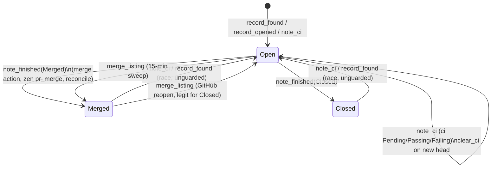
Writers:
- `note_state` (`pr_status.rs:175`): called by `record_found` (Open) and `note_finished` (Merged/Closed).
- `note_ci` (`pr_status.rs:198-219`): called by the scoped CI poll (`zen.rs:1132,1137`).
- `clear_ci` (`pr_status.rs:222`): called by `record_opened`.
- `merge_listing` (`pr_status.rs:114-127`): called by `pr_record::refresh` on the github-reconcile cadence (`poller.rs:734-779`, default 900s).

None of these writers checks which state it is overwriting.

### Verified concerns
1. **Merged/Closed -> Open regression (low).** `note_ci` always does `entry.state = Some(PrState::Open)` (`pr_status.rs:207`). The scoped poll in the daemon runs `lookup_open_pr_in_repository` (`zen.rs:1083`), then a `ci_snapshot` gh call (`zen.rs:1105`), then `note_ci`. A merge in another process during that gap calls `note_finished(Merged)` (`actions.rs:632`, `zen.rs:2041`), and the poll's note then overwrites it. The task has now left review, so the poll will not touch it again. The board shows "open · checks passing" on a Done card until the next listing sweep (up to 15 min, and only if the PR is in the 100 most recent). `record_found -> note_state(Open)` at `zen.rs:1093` has the same window.
2. **No monotonicity, so illegal combinations can be written (low).** `note_finished` leaves `ci`, so a merged PR keeps showing "checks failing" (`status_label`, `model.rs:2256`). `ci` without `ci_head` and an empty `head` can both be written too.
3. **Durable/display split by convention only (low, latent).** `IssuePr` serializes `state`/`ci` when they are Some, and `save_task_unlocked` (`crates/shelbi-state/src/lib.rs:3040-3051`) does not strip them. No current fold caller saves the folded copy back.

### Refuted
- Listing "lag" is GitHub's own answer, and the next sweep corrects it.
- Orchestration does not read this cache. Merge, transition, and Zen decisions query GitHub directly, so the impact is display only.
- No lost updates: the file lock serializes each write.

### Recommendation
Put the rules in one guard on `PrEntry`:
- CI notes never change `state` and are dropped for terminal PRs.
- `Open` from `record_found` never overwrites Merged/Closed.
- Only `merge_listing` (GitHub truth) may move a terminal state, which handles reopen.
- `note_finished` clears CI.

Add a regression test where `note_finished(Merged)` followed by `note_ci` stays Merged. Optionally split `IssuePr` into a record type and a view type so frontmatter can never carry state or CI.


### Verified concerns

- **low**: A terminal state can go back to Open. note_ci always sets state=Open. The scoped CI poll (daemon process) looks up the open PR and then takes a gh CI snapshot. If a merge in another process (CLI/TUI merge action, or zen pr-merge) calls note_finished(Merged) between that lookup and note_ci, the cache flips back to Open. After the merge the task leaves review, so the poll never corrects it. Only the next listing sweep does (default 15 min, and only for PRs among the most recent 100). record_found -> note_state(Open) has the same window, at zen.rs:1093.
  - Evidence: pr_status.rs:207 `entry.state = Some(PrState::Open);` with no guard. zen.rs:1083 lookup_open_pr_in_repository -> zen.rs:1105 ci_snapshot (gh round trip) -> zen.rs:1132/1137 note_pr_ci. Merge-side writers are actions.rs:632 and zen.rs:2041 in other processes. pr-status.lock serializes each write, not the read-then-decide in the poll.
- **low**: Nothing on the write path keeps states monotonic or enforces which moves are legal. Four writers overwrite fields independently. The merge rules (Merged/Closed are terminal, ci only matters while Open) are implicit. Illegal combinations can be written: ci set on a Merged/Closed PR (note_finished leaves ci alone), ci without ci_head, empty head.
  - Evidence: note_state pr_status.rs:175-191 sets any state. merge_listing pr_status.rs:114-127 replaces state with the row's. note_finished pr_record.rs:88-92 leaves ci in place, so a merged PR can still show 'checks failing' (status_label model.rs:2256-2262 shows both).
- **low**: The split between durable and display fields is a convention only. IssuePr serializes state/ci whenever they are Some, and the write chokepoint does not strip them. A folded copy that got saved back would persist volatile state into frontmatter. resolve prefers the cache's entry.state, so it would only show when the cache has no entry. No current path that saves a folded copy was found (fold callers are read and render paths).
  - Evidence: model.rs:2241-2245 skip_serializing_if only on None. lib.rs:3040-3051 save_task_unlocked writes the whole Issue. fold callers: shelbi-app board.rs:738,791, board_search.rs:81, tui kanban.rs:1181, cli issue.rs:726 (render only), review_session.rs:146, sidebar_model.rs:269.


### Concerns that did not hold up

- 'A lagging listing row wins' is mostly not a concern. The listing is GitHub's own `gh pr list --state all` (git.rs:323-372), so it is the authoritative source. The only staleness is a listing fetched before a merge and written just after note_finished. That shows Open for at most one more sweep interval, and the next sweep corrects it. Unlike note_ci, it is not a self-perpetuating regression.
- The impact is not a correctness risk for orchestration. PrState is read only for display (kanban.rs:3617 color, status_label) and by found_for_branch's Open-over-Merged preference for backfill (pr_status.rs:107-109). Merge, transition, and Zen decisions query GitHub directly (lookup_open_pr / lookup_merged_pr), not this cache.
- Concurrent writers do not lose updates. update() does its read-modify-write under pr-status.lock (pr_status.rs:159-172), so each note is atomic. The problem is that the notes are ordered by arrival, not that they get lost.


**Recommendation:** Give PrEntry a single `apply(&mut self, event)` (or keep the free functions but route them through one guard) that holds the rules. (1) note_ci never sets state, or sets Open only when state is None, and it is ignored once state is Merged/Closed. (2) note_state(Open) does not overwrite Merged/Closed. Only merge_listing (GitHub truth) may move a terminal state, which covers reopen. (3) note_finished clears ci/ci_head, or resolve drops ci for terminal states. Add a test where note_finished(Merged) is followed by note_ci and the result stays Merged. Optionally strip state/ci in the write path for IssuePr (or split the type into IssuePrRecord and IssuePrView) so the durable/display split is enforced by the type, not a doc comment.
