# Implicit state machines: sessions/panes

Part of the [implicit state machine audit](../implicit-state-machines.md). Audit of origin/main at b93c57c4, 2026-11-05. 17 machines in this area, most pressing first.


## Workspace observed pane state (title marker / screen scrape -> status.yaml -> badge)

**Verdict:** Needs further thought. Two problems are reachable today and are not just style. (1) status.yaml and the teardown/supervision markers are keyed only by slot name, which collides across projects; this hub has 7 projects with a `review` slot, so their review status rows overwrite and clear each other. (2) A board that is cold or errors while a usage-limit banner is on screen permanently latches that banner as suppressed. On top of that, a remote blip silently drops limit-resume state, and the transition triplet has been copy-pasted into drifted versions (Paused publishes no bus change).

**Verified concerns:** 1 high, 3 medium, 2 low

**Key files:**
- `crates/shelbi-orchestrator/src/poller.rs:1547-1990 (poll_one precedence chain)`
- `crates/shelbi-orchestrator/src/poller.rs:4495-4615, 2193-2260, 6532-6552 (decide/debounce/fold, pause+resume writers, current_task_for)`
- `crates/shelbi-state/src/workspace_status.rs:37-137, 188-204, 388-404 (enum, PaneMarker mapping, hub-global paths, clear)`
- `crates/shelbi-state/src/event_log.rs:1224-1333 (workspace/dialog/pause edge lines)`
- `crates/shelbi-orchestrator/src/sidebar_model.rs:236-262 + crates/shelbi-tui/src/app.rs:1642-1676 (duplicate badge derivation)`

### What it is
For every workspace slot, a poller thread works out a single observed pane state and writes it to `~/.shelbi/workspaces/<ws>/status.yaml` as `{state, current_task, last_transition, last_seen}`, logging edges to `events.log`. The value is an explicit `WorkspaceState` enum (`Working | AwaitingInput | Blocked | Paused | Serving`); a missing file means "not polled". The machine itself is implicit, though. Inputs come from three sources: hook-written OSC title markers (`shelbi:working|idle|background|review|blocked`), screen scrapes (busy footer, ready box, dialogs, usage-limit modal, agent-exited chrome) and the poller's own review probe. Precedence between them is just the order of the if-branches in `poll_one` (`crates/shelbi-orchestrator/src/poller.rs:1547-1990`):

1. pane dead / unreachable: reset latches, return (1629-1652)
2. orphaned live pane: reap, clear status (1665-1672)
3. agent-exited chrome + active task: Blocked (1717-1765)
4. usage-limit banner: Paused, or suppression latch (1781-1855)
5. persisted Paused with no recovery proof: hold (1858-1885)
6. dialog: Blocked if the screen is inconclusive (1890-1925)
7. live screen state, otherwise title marker (1912-1937)
8. `debounce_idle_edge` (2-tick Working→AwaitingInput), then `fold_review_serving`
9. `decide()` accepts any pair; save; append if changed

Per-thread latches (`last_known`, `last_dialog`, `unknown_dialog_streak`, `idle_debounce_streak`, `last_agent_exited`, `limit_resume`, `orphan_reap`) are threaded through by `&mut` and reset in hand-maintained blocks.

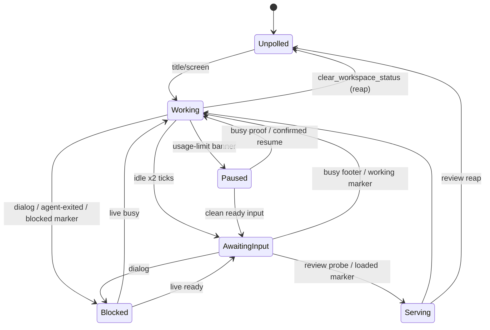

### Verified concerns
- **High: cross-project collision.** `workspace_status_path(ws)` = `~/.shelbi/workspaces/<ws>/status.yaml` (`workspace_status.rs:188-204`), with no project component. `event_log.rs:1217-1222` itself says names are only unique within a project. Same-named slots therefore overwrite each other's state, and one project's `clear_workspace_status` (a review reap) deletes another project's row. `.expected-teardown` and `<ws>.supervision` share the same flat namespace. Live in this hub: `review` is a slot in 7 projects and `vector` in 2.
- **Medium: cold board latches limit-banner suppression.** `current_task_for` (`poller.rs:6532`) is not warmth-gated; Cold gives an empty list, so it returns `None`. The limit branch then calls `suppress_limit_banner(..,"no-active-task")` (`1798-1804`), which sets `Resumed{banner}` (`2734-2751`). `suppresses_banner` (`2387`) keeps matching that same banner after the board warms, so the slot is never marked Paused or auto-resumed.
- **Medium: unreachable treated as dead.** The remote `enumerate_slots` returns `Ok(None)` when it cannot reach the machine (`session_process_backend.rs:396-399`), which becomes `Ok(false)` (`workspace.rs:2017-2025`). `poll_one` then wipes `limit_resume` and `orphan_reap` (`poller.rs:1643-1650`) on an SSH blip.
- **Medium: copy-pasted transition triplet has drifted.** decide+save+append appears at `1740-1760`, `1966-1990`, `2193-2230`, `2234-2257` and `6082-6110`. The pause path logs through `append_workspace_pause_event`, which does not `publish_change` (`event_log.rs:1308-1333` vs `1242`), so subscribed UIs get no push when a slot pauses.
- **Low: events.log from-states are fabricated.** The dialog lines hard-code `working -> blocked` and `blocked -> working` (`event_log.rs:1278-1290`), and pause defaults prev to `working` (`1322`). A dialog tick can emit both the advisory line and a real `<prev> -> blocked` line.
- **Low: badge derivation duplicated.** `derive_workspace_badge` exists identically in `shelbi-tui/src/app.rs:1642` and `sidebar_model.rs:239`, both live. The desktop guesses from the board with `column.category()` rather than the workflow-aware `task_is_active` (`view.rs:680-690`) and uses its own tones (`view.rs:1477-1487`; Paused is Magenta there, Yellow in the TUI). The wire default for a missing state is `AwaitingInput` (`wire.rs:68-71`).

### Refuted or downgraded
- The unwrap_or(false)/unwrap_or(true) asymmetry is mostly moot. Both paths see `Ok(false)` for an unreachable remote, and the supervisor is local-only, so a blip cannot trigger a relaunch.
- The latch-reset differences are not bugs. `orphan_reap` is self-managed, and the leftover debounce streak is harmless.
- The fragility of the Stop-hook sed is mitigated because the screen is the primary signal for Claude.
- Idle/Review collapsing to AwaitingInput and Background mapping differently per reader are both documented and intentional.

### Recommendation
1. Project-scope slot runtime state (status.yaml, teardown and supervision markers), with a migration and a config-upgrade sniffer. This is the fix with a live user impact.
2. Gate the "no active task" limit suppression on a Warm board.
3. Introduce `enum Observation { Dead, Unreachable, Orphaned, AgentExited, LimitBanner, Dialog, Live(state), Title(marker) }` and a single `observe()` that encodes precedence. Add a `PaneLatches` struct with `reset()` (which Unreachable does not call). Add one `commit()` that saves, writes the event line and publishes on the bus.
4. Keep one badge derivation (in sidebar_model) and have the TUI and desktop consume it.


### Verified concerns

- **high**: status.yaml, .expected-teardown and the supervision markers are keyed only by workspace name under the hub-global ~/.shelbi/workspaces/, even though event_log.rs itself documents that workspace names are unique only within a project. Same-named slots in different projects overwrite each other's state, and one project's clear_workspace_status (review reap) wipes the other's row. This is live: in this hub's project configs `review` is a slot name in 7 projects and `vector` in 2.
  - Evidence: workspace_status.rs:188-204 (workspaces_dir() = ~/.shelbi/workspaces, workspace_status_path(workspace) has no project component); event_log.rs:1217-1222 ('workspace names are only unique *within* a project, two projects can each own an `alpha`'); ~/.shelbi/projects/*.yaml: review x7, vector x2
- **medium**: current_task_for is deliberately not warmth-gated, and a Cold board (or a read error) returns None. In the usage-limit branch that None triggers suppress_limit_banner("no-active-task"), which latches LimitResumeState::Resumed{banner}. Once the board warms, suppresses_banner() still matches the same banner text, so a worker that hit the limit while the board index was cold (daemon boot, the known launchd-PATH outage) is never recorded Paused and never auto-resumed until the banner text changes.
  - Evidence: poller.rs:6532-6552 (read_board_with_cfg().ok()?.into_issues(); issue_store.rs:472-476 Cold => empty); poller.rs:1798-1804 (let Some(task_id)=active_task else suppress...; return); poller.rs:2734-2751 (*state = Resumed{banner}); poller.rs:2387 (suppresses_banner matches on banner)
- **medium**: On an SSH machine, a relay that cannot be reached is treated the same as a dead pane. poll_one then resets every latch, including a NeedsHuman/Scheduled limit_resume and the orphan grace clock, so a network blip silently drops a pending limit-resume schedule and restarts the orphan grace window.
  - Evidence: session_process_backend.rs:396-399 (remote enumerate returns None when it 'could not be asked'); workspace.rs:2017-2025 (None => Ok(false)); poller.rs:1629, 1635-1652 (latch wipe incl. *limit_resume = Idle)
- **medium**: The decide -> save_workspace_status -> append event triplet is copy-pasted in about five places, and they have already drifted. The pause path writes its edge with append_workspace_pause_event, which does not publish the ChangeNotification::Workspace that append_workspace_event does, so subscribed TUI/desktop clients get no push on entering Paused. Nothing guards legal edges, and precedence exists only as the order of the if-branches.
  - Evidence: poller.rs:1740-1760, 1966-1990, 2193-2230, 2234-2257, 6082-6110; event_log.rs:1242 (publish_change only in append_workspace_event) vs 1308-1333 (pause: no publish)
- **low**: Dialog edge lines hard-code 'working -> blocked' and 'blocked -> working' whatever the real previous state was, and the pause line defaults prev to 'working'. The same dialog incident can also produce a second '<prev> -> blocked' line from append_workspace_event. Replaying from/to pairs from events.log can therefore disagree with status.yaml.
  - Evidence: event_log.rs:1278-1290 (literal working/blocked), 1322 (unwrap_or("working")); poller.rs:1914-1925 + 1978 (dialog line plus regular Blocked edge in the same tick)
- **low**: Clients derive the badge four separate ways. derive_workspace_badge exists as two identical copies, both still called (TUI app.rs:1600 and sidebar_model.rs:223). The desktop has its own structural guess, which uses column.category()==Active instead of the workflow-aware task_is_active, and its own vocabulary (Paused is Magenta on desktop, Yellow in the TUI; 'blocked' vs AwaitingPermission). The wire default for a missing WorkspaceState is AwaitingInput, which makes up a state.
  - Evidence: app.rs:1642-1676 == sidebar_model.rs:239-262; view.rs:680-690, 1477-1487; wire.rs:68-71; activity.rs:140


### Concerns that did not hold up

- Concern: 'unwrap_or(false) in poll_one vs unwrap_or(true) in supervisor passes means an SSH blip is folded differently.' Mostly refuted. The local backend's enumerate cannot really fail, and an unreachable remote returns Ok(None), which is Ok(false), before unwrap_or ever runs. Both paths therefore see 'dead', and maybe_supervise_workspace returns early for non-local hosts, so a blip cannot trigger a supervisor relaunch. The real issue is the latch wipe, kept above.
- Concern: 'orphan branch does not reset orphan_reap; limit-stall branch only resets last_dialog.' Not a bug. orphan_reap is owned and updated by maybe_reconcile_orphaned_pane itself. A leftover idle_debounce_streak after Paused is harmless because debounce only fires when prior==Working, and any other commit resets it to 0. It is a maintenance smell (adding a new latch means touching every reset block), not a defect.
- Concern: 'the Stop-hook sed/grep background detection flips workers to idle on a payload format change and fires spurious workspace-free events.' Weak. For Claude runners the live screen is the primary signal and the title marker is used only when the screen is inconclusive (poller.rs:1912-1937). A missing or unreadable payload falls back to idle by design.
- Concern: 'Idle and Review both collapse to AwaitingInput so handoff is lost.' This is intentional and documented (workspace_status.rs:80-86, 113-117). Handoff is carried by the file-based ready marker, not by status.yaml.
- Concern: 'Background maps differently for workers vs orchestrator, so correctness depends on callers picking the right fn.' True but deliberate and documented. Each has one call site, and I found no misuse.


**Recommendation:** (a) Scope workspace runtime state by project: ~/.shelbi/projects/<p>/workspaces/<ws>/status.yaml, the teardown markers, and supervision keys. This needs a migration and a config_upgrade sniffer. (b) Add one fn observe(prior, Observation) -> (WorkspaceState, latches) that takes a single Observation enum (Dead/Unreachable/Orphaned/AgentExited/LimitBanner/Dialog/Live/Title) with precedence in one place, and one commit(outcome, reason) helper that does save + event line + bus publish. Treat Unreachable as distinct from Dead so it keeps the latches. Put the latches in one PaneLatches struct with a reset() method. (c) Make the limit-banner no-active-task suppression conditional on a Warm board (or don't latch it when the board is Cold or Stale). (d) Compute the badge in one place, sidebar_model, and delete the TUI app.rs copy. Desktop should consume the same derived badge.


## Orchestrator session continuity: open flag, greeting latch, Codex thread marker, handoff.md

**Verdict:** Needs further thought. Two reachable defects in the reload continuity contract. (1) The handoff is consumed by any ensure_dashboard, including the attach-only bootstrap of a TUI re-exec'd mid-reload, so reload can silently start the new orchestrator cold. (2) A refused Codex runner switch does not abort reload, which kills the orchestrator and then cannot respawn it. Both come from continuity state being mutated in places that don't know where the session is in its lifecycle.

**Verified concerns:** 1 high, 3 medium, 1 low

**Key files:**
- `crates/shelbi-orchestrator/src/lib.rs:240-380 (liveness probe, supervise_restart_orchestrator)`
- `crates/shelbi-orchestrator/src/lib.rs:438-650 (ensure_dashboard, relaunch, spawn_orchestrator_locked)`
- `crates/shelbi-orchestrator/src/lib.rs:1038-1090 (ensure_orchestrator_session, greeting claim/re-arm)`
- `crates/shelbi-orchestrator/src/handoff.rs:130-353 (request_orchestrator_handoff, validate_*_transition, Codex marker archive)`
- `crates/shelbi-cli/src/commands/reload_session.rs:55-127 (reload ordering) + crates/shelbi-state/src/agent_workspaces.rs:403-453 (handoff path/take)`

### What the machine is

The orchestrator's continuity across **open, reload, quit, crash and runner switch** depends on four separate pieces of persisted state plus live probes. No single type describes where a launch is in its lifecycle:

| Piece | Encoding | Owner(s) |
|---|---|---|
| Project open | `state.json` `open` bool | `ensure_dashboard` (lib.rs:509), quit |
| Liveness | backend `probe()` -> Alive / Dead / Unreachable (Unreachable treated as alive) | lib.rs:249-272, supervisor |
| First-project greeting | claim/arm latch in state | lib.rs:1060-1083, wizard, project_create |
| Codex native thread | `codex-thread.json` with `native_active`, renamed `.archived-<ts>` | wake.rs, handoff.rs:264-353 |
| Handoff | `agents/orchestrator/handoff.md`: written by the agent, polled 30s by Rust, taken in `deploy_agent_context` | handoff.rs:130-199, workspace.rs:4967, agent_workspaces.rs:436 |

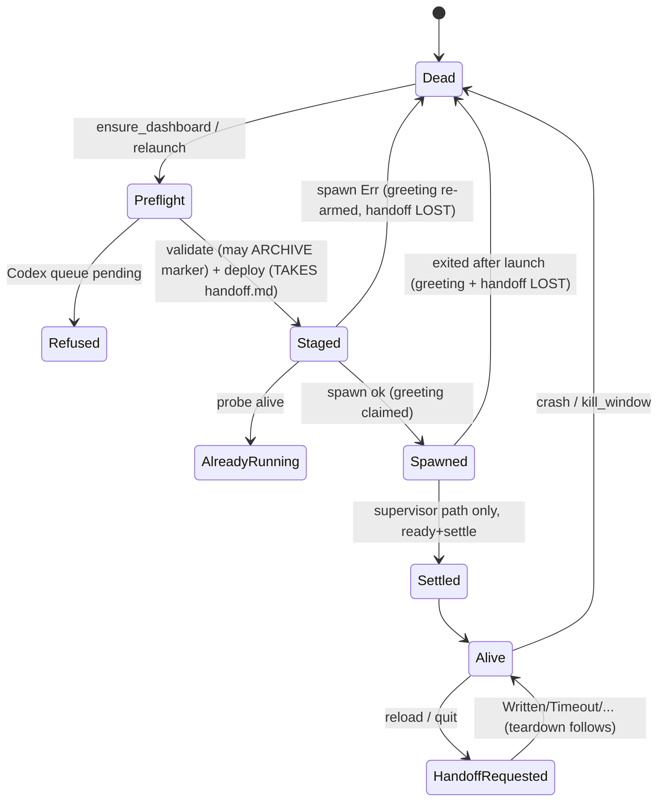

### Reload ordering (reload_session.rs:60-70)
1. `request_handoff`: runs `validate_configured_orchestrator_transition`, which may **archive** the Codex marker. Then it sweeps any stale handoff.md, sends the request, and polls up to 30s.
2. `signal_clients_reexec`: attached TUIs re-exec, and their bootstrap calls `ensure_dashboard`.
3. `restart_daemon`: can bail on a Refused stop.
4. `kill_window` + `ensure_dashboard`: starts the new orchestrator, which is expected to ingest the handoff.

### Verified concerns
- **High: an attach consumes the handoff.** `ensure_dashboard` always reaches `spawn_orchestrator_locked` (lib.rs:591). That function calls `deploy_agent_context` (lib.rs:638) -> `take_orchestrator_handoff` (workspace.rs:4968), which reads and deletes the file. Only after that does `ensure_orchestrator_session` notice the session is alive and return `AlreadyRunning` (lib.rs:1054). A TUI re-exec'd in step 2 can do this against the still-live old orchestrator, so step 4 launches cold. Any `shelbi orchestrate` or TUI open that lands during a quit/reload handoff window does the same.
- **Medium: reload ignores a refused runner switch.** handoff.rs:144-149 says a pending Codex queue is "a hard error so the caller aborts before tearing down the pane". reload_session.rs:83-87 swallows the Err into a string and continues. It kills the orchestrator, then `ensure_dashboard` re-validates and fails (lib.rs:467). The supervisor relaunch fails the same way (lib.rs:584). The result is no orchestrator, and no Codex orchestrator left to drain the queue.
- **Medium: a validate function with a side effect.** `validate_orchestrator_runner_transition` archives the marker (handoff.rs:345) before teardown has succeeded. If `restart_daemon` bails, the live Codex session keeps running against an archived marker. The archive is idempotent; the problem is when it happens.
- **Medium: the handoff is taken before the launch is proven.** A spawn error, or a session that exits immediately, loses the handoff. The spliced text only lives in `.claude/agent-instructions.md`, and the next deploy overwrites it.
- **Low: the greeting latch.** It is re-armed only when spawn returns Err (lib.rs:1071). A session that spawns and exits immediately consumes it. `ensure_dashboard` has no settle check, and the supervisor's settle failure (lib.rs:369) doesn't re-arm it.

### Not concerns
The open flag outliving a failed spawn is intentional (lib.rs:497-508). Unreachable being treated as alive is a deliberate, bounded choice. The handoff path constant is shared by the reader and the request text. Repeated archives are idempotent.

### Recommendation
Use one launch transition function with an explicit phase enum (`Preflighted -> Staged -> Spawned -> Settled -> Committed | RolledBack`):
- The attach path never stages context or touches handoff.md.
- At stage time, handoff.md is renamed to `.ingesting`. Commit deletes it; rollback restores it, together with the greeting re-arm.
- The runner-transition check becomes pure. The Codex marker archive moves to commit, after the old session is gone.
- Reload aborts before teardown on a preflight Err. It holds `lock_dashboard`, or signals clients only after the swap, so re-exec'd clients can't race it.


### Verified concerns

- **high**: handoff.md is taken (deleted) on every ensure_dashboard call, even when the orchestrator is already alive and nothing is launched. During `shelbi reload`, clients are told to re-exec (step 2) before the old orchestrator is replaced (step 4). A re-exec'd TUI runs DaemonBootstrap -> ensure_dashboard against the still-live old session. That consumes the freshly written handoff.md and returns AlreadyRunning, so the real replacement in step 4 starts cold.
  - Evidence: ensure_dashboard has no early return for a live session; it always calls spawn_orchestrator_locked (lib.rs:591). That calls deploy_agent_context (lib.rs:638-643) -> take_orchestrator_handoff (workspace.rs:4967-4969), which runs read+remove_file (agent_workspaces.rs:437-440). Only afterwards does ensure_orchestrator_session probe and return AlreadyRunning (lib.rs:1054-1056). reload_session.rs:60-70 orders request_handoff -> signal_clients_reexec -> restart_daemon -> replace_orchestrator_session. The TUI bootstrap calls ensure_dashboard (shelbi-tui/src/shell/mod.rs:1026). This is a timing race, not observed in the wild. The deletion on attach is certain.
- **medium**: Reload does not abort when the Codex runner-switch preflight refuses. handoff.rs says a pending durable queue 'surfaces here as a hard error so the caller aborts before tearing down the pane'. Reload turns that Err into a status string and carries on: it restarts the daemon, kills the Codex orchestrator, then ensure_dashboard re-runs validate and fails. The project is left open with no orchestrator, and no Codex orchestrator remains to drain the queue the error asks the user to drain. The supervisor's relaunch_orchestrator_session hits the same guard on every attempt.
  - Evidence: handoff.rs:144-151 propagates Err from validate_configured_orchestrator_transition. reload_session.rs:83-87 maps Err to the string "handoff request failed: ...", and run() continues (reload_session.rs:62-70). replace_orchestrator_session runs kill_window and then ensure_dashboard (reload_session.rs:116-125). That reaches validate again at lib.rs:467-474 and errors. relaunch_orchestrator_session calls the same guard (lib.rs:584-589).
- **medium**: A function named validate_* performs an irreversible side effect: it renames codex-thread.json to .archived-<ts>. It runs up to three times per bootstrap. On reload it runs in the handoff step while the old Codex orchestrator is still alive. If restart_daemon then bails (a Refused stop), the reload stops with the live Codex session still running against an archived marker.
  - Evidence: validate_orchestrator_runner_transition -> migrate_native_thread_to_legacy -> archive_persisted_codex_thread (handoff.rs:264-283, 345). It is called from request_orchestrator_handoff_inner (handoff.rs:150), ensure_dashboard (lib.rs:467, 488) and relaunch (lib.rs:584). restart_daemon can bail (reload_session.rs:105-107) before the orchestrator is replaced. The archive itself is idempotent (wake.rs rename + None on a second call), so repeated calls are safe. The problem is ordering against teardown.
- **medium**: The handoff is consumed before the launch is known to have succeeded. If the spawn fails, or the session exits immediately, the next launch re-deploys a fresh composition without the handoff, so the transferred state is lost. The doc comment says a failed *delete* degrades to a re-ingest, but a successful delete followed by a failed launch is unrecoverable.
  - Evidence: take_orchestrator_handoff runs in deploy_agent_context (workspace.rs:4968) before ensure_orchestrator_session spawns (lib.rs:649). The spliced text lives only in .claude/agent-instructions.md, which the next deploy overwrites.
- **low**: The one-shot first-project greeting is re-armed only when spawn returns Err. On a first launch whose session spawns and then exits at once (for example a missing runner binary), the greeting is consumed for good. ensure_dashboard has no settle check at all. Only the supervisor path checks settle, and it does not re-arm either.
  - Evidence: lib.rs:1060-1083 re-arms only inside `if let Err(error) = b.spawn_orchestrator_session(spec)`. supervise_restart_orchestrator detects 'exited right after launch' (lib.rs:369-377) but has no greeting handling.


### Concerns that did not hold up

- ensure_dashboard marks the project open before the spawn and leaves it open on failure. This is intentional and documented (lib.rs:497-508): 'open' records intent and deliberately outlives the orchestrator so supervision can restart it. A rejected runner transition happens before the flag is set, so it stays side-effect free.
- orchestrator_pane_alive maps Unreachable to alive. This is a deliberate conservative choice, documented at lib.rs:240-248 and bounded by probe_deadline so a wedged transport cannot freeze the heartbeat. Missing an 'unknown' surface is a UX nicety, not a correctness bug. Relaunching on an unreachable probe would risk duplicate orchestrators.
- Reader/writer drift on the handoff path. The request message interpolates the same shelbi_state::ORCHESTRATOR_HANDOFF_REL constant (handoff.rs:370-379) that orchestrator_handoff_path joins (agent_workspaces.rs:419). Only a user-customized instructions.md that names a different path could drift, and the request text overrides that.
- Repeated validate calls double-archive the marker. archive_persisted_codex_thread returns None once the file has been renamed (wake.rs tests at 4193-4214), so the repeats are idempotent. The ordering issue is listed separately.


**Recommendation:** Make the orchestrator launch an explicit two-phase operation with one owner of continuity state. Concretely: (a) Split ensure_dashboard so the attach path (session alive) never calls deploy_agent_context or take_orchestrator_handoff. Only the launch path stages context. (b) Replace take-then-launch with claim-then-commit. Rename handoff.md to handoff.md.ingesting at deploy time, and delete it only after the launch passes the same ready+settle check the supervisor uses, restoring it on failure. Fold the greeting re-arm into the same commit/rollback. (c) Split validate_orchestrator_runner_transition into a pure classify/preflight (no side effects, returns RunnerTransition plus pending ids) and an explicit `commit_runner_transition` that archives the marker only after the old session is torn down. (d) Make reload_session::run abort when the handoff preflight returns Err, before signalling clients or killing the session. Consider moving the client re-exec signal after replace_orchestrator_session, or have reload hold lock_dashboard across steps 1-4, so a re-exec'd TUI cannot race the swap. A small `OrchLaunch { Preflighted, Staged, Spawned, Settled, Committed, RolledBack }` enum in lib.rs would make this one transition function.


## Worker message delivery, ack and clarification questions

**Verdict:** Needs further thought. The tail/rename relay has a real, reachable delivery bug: every message after a session's first drain is silently lost while the CLI reports a live reader. On top of that, delivery state is split across five stores, and undeliverable or answered states get written before deliverability is known.

**Verified concerns:** 1 high, 2 medium, 3 low

**Key files:**
- `crates/shelbi-orchestrator/src/workspace.rs:4532-4671 (SessionStart tail + Stop drain scripts)`
- `crates/shelbi-cli/src/commands/message.rs:128-370 (run_status, run_send, wait_for_delivery, tail_pid_alive)`
- `crates/shelbi-cli/src/commands/daemon/serve.rs:160-221, 600-626, 1149-1180 (pending map, reaper, message-pushed/ack)`
- `crates/shelbi-state/src/event_log.rs:1338-1458 (push/ack events, message_delivery_status)`
- `crates/shelbi-state/src/questions.rs:141-276 (record_question dedupe, mark_question_answered)`

### What it is
A `shelbi message <task> <kind> <body>` push travels from the hub CLI into a worker's Claude Code session and is confirmed back. No single status record tracks it. The state is spread across these stores:

| Store | Writer | Meaning |
|---|---|---|
| `<worktree>/.shelbi/messages/<task>.log` | CLI (`message.rs:236`) | durable message record |
| `<task>.tail.d/pid` + watchdog | SessionStart hook (`workspace.rs:4538-4599`) | "a reader is live" |
| `<task>.unread.log` / `.processing` | tail / Stop hook (`workspace.rs:4569, 4613-4670`) | relayed but unread / draining |
| daemon `PendingMap` (in memory) | `message-pushed` / `message-ack` / reaper (`serve.rs:1149-1180, 604-626`) | ack timer |
| events.log `push=ok` / `ack=worker` / `ack=timeout` | CLI, daemon | derived status (`event_log.rs:1388-1458`) |
| `questions/<task>/<id>.md` answered_at | CLI reply (`message.rs:247`) | clarification answered |
| CLI exit code | `message.rs:276-299` | undeliverable (never persisted) |

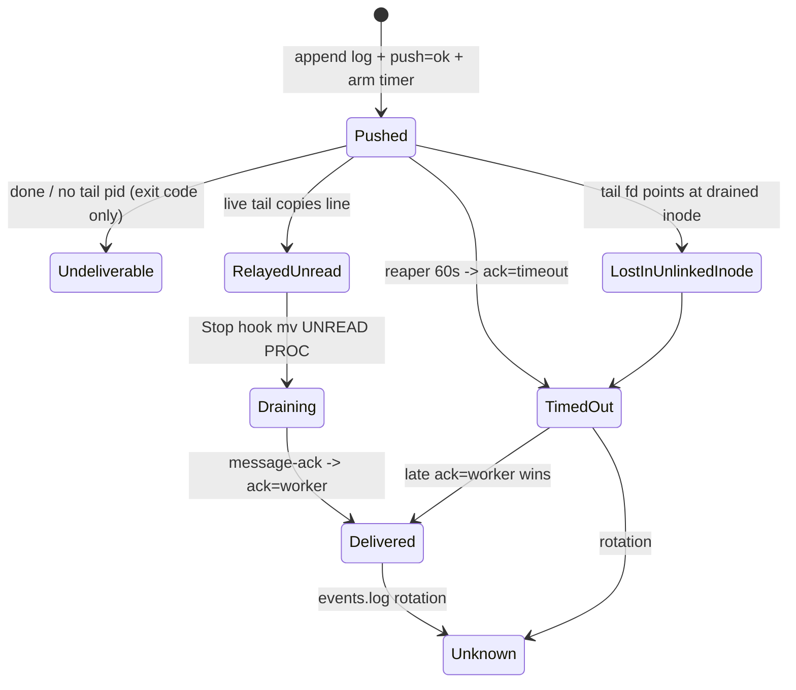

### Verified concerns
1. **High: messages after the first drain are lost.** `workspace.rs:4569` binds the tail's stdout to the `unread.log` inode once. The Stop hook does `mv "$UNREAD" "$PROC"; touch "$UNREAD"` (4618-4619) and later `rm "$PROC"` (4670). After that the tail keeps writing into the renamed, then unlinked, inode, and nothing ever reads it. The pid beacon still names a live tail, so the CLI says "queued" and the daemon emits `ack=timeout`. Delivery comes back only when SessionStart fires again (resume, clear or compact). No test covers a drain followed by a second message (the tests are at 10445-10456 and 10697-10811). This matches the observed behaviour where mid-task `shelbi message` directives time out and are not incorporated.
2. **Medium: the "would be drained on restart" promise is false.** The no-reader error (`message.rs:292-299`) says a restarted session would drain the message. SessionStart starts the tail at `wc -c + 1` (4565-4569), so earlier lines are never relayed (a test asserts this).
3. **Medium: side effects run before the deliverability decision.** `push=ok` (239), `mark_question_answered` (247-262) and the daemon timer (270) all run before the done/no-reader bail (276-299). Undeliverable is never recorded, so `message status` later says Queued and then TimedOut, and the question disappears from `question list` as answered.
4. **Low: the re-ask dedupe returns an answered record** (`questions.rs:156`). This hides a re-asked question from the open list, and a re-ask is most likely exactly when the answer was lost.
5. **Low:** status reads only the live events.log (`event_log.rs:1397`), so a message regresses to Unknown after rotation. Separately, `mv` overwrites a leftover `.processing` file (4618).

### Refuted
- A double `ack=timeout` + `ack=worker` pair is by design, and the precedence handles it.
- An ack after a daemon restart, and a timer refresh on re-push, are both documented and intended.
- The hub-level fallback question file is the same file that gets written back, so the answer lands in the right place.

### Recommendation
Replace the tail relay with a **persisted byte cursor**. SessionStart records the log's current size in `<task>.cursor`. The Stop hook reads `<task>.log` from the cursor, injects and acks those lines, then advances the cursor atomically. This removes the tail, watchdog, lockdir and sweep (about 300 lines of shell plus Rust), and with them the inode bug. Then make delivery one explicit record: persist `ack=undeliverable reason=…`, skip arming the timer for undeliverable pushes, stamp questions answered only on `ack=worker` (or after the deliverability check), and read `events.log.1` in status. As an interim minimal fix, the Stop hook can copy and truncate instead of `mv` (`cp`, then `: >` with the tail opened via `>>`), plus a drain-then-second-message regression test.


### Verified concerns

- **high**: Messages pushed after a session's first drain never reach the worker. The tail's stdout is bound once by `>` to the unread.log inode. The Stop hook renames that inode to .processing, creates a new empty unread.log, then unlinks .processing. From then on the live tail appends to the deleted inode. tail_pid_alive still reports a live reader, so the CLI prints 'queued' and the message ends in ack=timeout. Delivery resumes only when SessionStart fires again (resume, clear or compact). This matches the known behaviour where mid-task `shelbi message` directives time out and are not picked up.
  - Evidence: workspace.rs:4569 `tail -f -c +$START "$LOG" > .shelbi/messages/$TASK_ID.unread.log &`; workspace.rs:4618-4619 `mv "$UNREAD" "$PROC"; touch "$UNREAD"`; workspace.rs:4670 `rm "$PROC"`. The tests cover one live-tail relay (10445-10456) and one drain of a seeded file (10697-10811), but never a drain followed by a second message.
- **medium**: The 'no live reader' error says the message 'would be drained if this task's worker session restarts'. That is false: SessionStart pins the tail to the log's current end, so lines appended before the new session starts are never relayed. The same applies to every message that went into the unlinked inode.
  - Evidence: message.rs:292-299 error text; workspace.rs:4565-4569 `START=$(($(wc -c < "$LOG") + 1))`; the test at workspace.rs ~10530 asserts that lines already in the log must not be relayed
- **medium**: The undeliverable verdicts are never persisted, and the side effects run before them. push=ok is logged, the daemon ack timer is armed, and the question is marked Answered, all before the done/no-reader bail. A later `message status` reports Queued and then TimedOut, never undeliverable. `question list` drops a question whose answer will never be read.
  - Evidence: message.rs:239 (push=ok), 247-262 (mark_question_answered), 270 (notify daemon) all run before 276-299 (bail on is_done / !tail_pid_alive)
- **low**: record_question's same-text dedupe returns an already-answered record. A worker that re-asks because the answer never arrived (likely, given the first concern) still produces a clarification event, but `question list` shows the question as answered rather than open.
  - Evidence: questions.rs:156 `Some(existing) if existing.text == q.text => return Ok(existing)` (no answered_at check); serve.rs:1097-1118 emits the event using the returned record
- **low**: Delivery status reads only the live events.log, so a message regresses to Unknown once rotation moves its lines into .1. Each --wait poll re-reads and re-scans the whole file.
  - Evidence: event_log.rs:1396-1444 reads only events_log_path(); message.rs:332 polls it in a loop
- **low**: `mv "$UNREAD" "$PROC"` overwrites a .processing file left by an earlier Stop hook that was killed before `rm`. Those undrained messages are lost.
  - Evidence: workspace.rs:4618 has no check for an existing $PROC


### Concerns that did not hold up

- Concern: a late ack=worker after ack=timeout leaves both lines in events.log. This is deliberate. The doc comment at event_log.rs:1366-1371 says so, and message_delivery_status gives worker precedence, so TimedOut correctly upgrades to Delivered. Not a bug.
- Concern: an ack for a message the daemon never saw, e.g. after a restart, looks like a real ack. That is the intended behaviour: the in-memory map is documented as non-durable (serve.rs:86-91), and the worker's ack is the real evidence of delivery.
- Concern: a re-push silently resets the timeout clock. This is documented and intended for manual retries (serve.rs:1144-1148). The CLI mints a fresh msg_id per process (message.rs:220), so it never happens in normal use.
- Concern: the answer gets stamped on a different file than `question list --project` scans. load_question falls back to the hub-level file only when no project copy exists, and write_question writes back to that same path (q.path). The answer lands where the question actually lives.
- Concern: mark_question_answered is an unlocked read-modify-write. Two replies racing would at worst record the other msg_id as the first answer, which has no practical impact.
- Concern: message lines carry no project scope. msg_id is `m-<millis>-<pid>`, which is unique in practice.


**Recommendation:** Replace the tail + rename relay with a persisted read cursor. SessionStart writes `<task>.cursor` set to the log's current byte size. The Stop hook reads `<task>.log` from the cursor, injects and acks those lines, then advances the cursor with an atomic write. This removes the tail process, watchdog, lockdir and sweep_message_tails, and with them the inode bug and the .processing clobber. The 'live reader' beacon becomes a session-liveness marker instead of a tail pid. Then make delivery one explicit record: append `ack=undeliverable reason=done|no_reader` instead of only exiting non-zero, skip arming the daemon timer in that case, and move mark_question_answered to after the deliverability check (or stamp it on ack=worker). Have message_delivery_status consult the .1 rotation file as well. As an interim fix, have the Stop hook copy and truncate instead of mv (`cp UNREAD PROC; : > UNREAD` with the tail opened via `>>`), and add a test that drains and then relays a second message.


## Pane crash-loop supervision (daemon restart/resume budgets)

**Verdict:** Needs further thought. One input to the machine has silently gone dead: the no-restart marker lost its producer when the tmux wrapper was removed. Every non-crash death of a pane with active work now reads as a crash and triggers a context-clearing redispatch. Two smaller problems sit next to it: an ownership gap between the per-workspace supervisor and the dev resume pass, where a dead pane is resumed by neither, and three copies of the budget logic that have already drifted. Together they make this worth a design conversation rather than a tidy-up.

**Verified concerns:** 1 high, 2 medium, 2 low

**Key files:**
- `crates/shelbi-app/src/supervision.rs:56-230`
- `crates/shelbi-orchestrator/src/poller.rs:4719-4950 (maybe_supervise_workspace / maybe_supervise_orchestrator)`
- `crates/shelbi-orchestrator/src/poller.rs:5131-5420 (ReviewResumeState + review resume pass)`
- `crates/shelbi-orchestrator/src/poller.rs:5590-5905 (DevResumeState + dev resume pass)`
- `crates/shelbi-state/src/workspace_status.rs:220-260, 405-424 (expected-teardown + supervision_shutdown_key)`

### What it is
The daemon poller keeps a crash-loop budget for every Shelbi-managed pane: dev workspace agents, review slots and the orchestrator. A dead pane with work is relaunched with exponential backoff (0s, 5s, 10s, 20s, 40s). After 5 restarts inside a 5-minute window it gives up and leaves the pane for the user. A pane that stays up for 60s forgets its history. A TUI reopen drops a relaunch marker that re-arms the budget.

The logic exists in three places:

| Tracker | Where | Owns | Adopts a pane already dead at first sight? |
|---|---|---|---|
| `SupervisionState` | `shelbi-app/src/supervision.rs:80` (one per workspace poll thread, plus one for the orchestrator) | dev panes that crash after coming up; the orchestrator | no |
| `ReviewResumeState` | `poller.rs:5158` (supervisor tick) | review slots | yes |
| `DevResumeState` | `poller.rs:5606` (supervisor tick) | dev panes dead from first sight (quit and reopen) | yes, until `ever_alive` latches |

`RestartController` (`shelbi-app/src/session/restart.rs:43`) reuses `SupervisionState` on the client side for viewed panes. That is reuse, not a copy.

### States and transitions
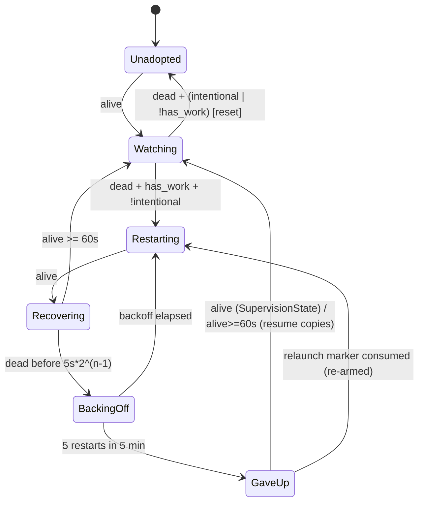
The resume copies add a `dead_streak` hysteresis: two confirmed-dead polls are required before deciding.

### Verified concerns
1. **High: the no-restart marker is never written.** `poller.rs:4735` consumes `supervision_shutdown_key(ws)`, but nothing produces it. Its only writer was the tmux pane wrapper (`shelbi-cli/src/commands/open/pane.rs`, which marked the key on an intentional teardown or `exit:0`), and remove-tmux commit `90960807` deleted that wrapper. `kill_workspace_pane` (`workspace.rs:2374`) still writes the plain expected-teardown key, but nothing consumes that key any more. So `intentional_shutdown` is always false, and any death of a pane whose task is still active on the board gets a fresh, context-clearing redispatch. That covers a user `/exit`, a reaper kill, and a ready handoff into an agent-owned active gate. In the gate case the card stays active and assigned to the dev slot (see `gate_task_is_served`, `poller.rs:5098`), so the per-workspace supervisor and `maybe_dispatch_parked_active_gates` can both launch onto it. That last consequence is inferred from the code; it should be reproduced.
2. **Medium: an ownership gap with `ever_alive`.** `DevResumeState::note_alive` latches on a sighting or on a fresh dispatch line (`poller.rs:5763`). The latch then never clears for the poller's lifetime, because `state.remove` (`:5790`) comes after `if entry.ever_alive { continue }` (`:5771`). `SupervisionState` drops its own `ever_alive` on an idle death (`supervision.rs:162`). A later dispatch onto the slot that dies before the 5s per-workspace poll sees it alive is then refused by both trackers, and the slot strands.
3. **Medium: the copies have drifted.** `decide_dead` is identical in both resume trackers, and both copy `SupervisionState::decide`. But `SupervisionState` un-latches give-up on any alive sighting (`supervision.rs:136`), while the copies wait 60s (`poller.rs:5179`, `5628`). A hand-relaunched slot that dies again within 60s stays given up in the resume passes. `request_relaunch` also differs across the three.
4. **Low: budgets live in memory only.** A daemon restart or project reopen re-seeds them. This is acknowledged in the code, and it is deliberate for the resume passes.
5. **Low: the phase is implicit.** It is derived from loose bools and a Vec, and illegal combinations are prevented only by statement order.

### Refuted
- *Races quit:* the poller manager drops and joins the project's poller as soon as the project closes, and waits on the cancel barrier (`shelbi-cli/src/commands/daemon/poller.rs:66-96`). That leaves only a reconcile window of up to 2s.
- *Client and daemon budgets disagree:* the client tracker supervises a different entity and reuses the core rather than copying it.
- *Double launch via the ever_alive handoff:* the two trackers' guards are mutually exclusive. The failure mode is a gap where neither acts, not a double launch.

### Recommendation
1. Re-wire the deliberate-versus-crash input from data the daemon already has (`pane_alive=false reason=exit:0`, intentional kills in `kill_workspace_pane`). Add a regression test covering a ready handoff into an active gate.
2. Replace the three trackers with one `PaneBudget` holding an explicit `Phase` enum and a single `decide()`. Express hysteresis and adopt-dead-on-first-sight as policy flags.
3. Give each dev slot one owner: the per-workspace supervisor resumes (`--continue`) on a first-sight death and restarts on a later crash. This removes the cross-thread `ever_alive` handoff.
4. Use one give-up un-latch rule in every path.


### Verified concerns

- **high**: The no-restart marker has a consumer but no producer. `supervision_shutdown_key` is only ever consumed (poller.rs:4735). The one writer, the tmux-era pane lifecycle wrapper in shelbi-cli/src/commands/open/pane.rs, marked it on an intentional teardown or a clean exit:0. Commit 90960807 (remove-tmux, #1418) deleted that wrapper, so intentional_shutdown is now always false for workspace panes. kill_workspace_pane (workspace.rs:2374) still writes the plain expected-teardown key, but nothing consumes that key any more. As a result, every death of a pane whose task the board still shows active is treated as a crash and redispatched with a fresh, context-clearing start. That includes a user /exit (exit:0), the stale-slot/orphan reaper, and a ready handoff into an agent-owned active gate. In the gate case the card stays active and assigned to the dev slot (gate_task_is_served, poller.rs:5098-5103), so the per-workspace supervisor and maybe_dispatch_parked_active_gates can both launch onto the slot. That last consequence is inferred from the code, not reproduced.
  - Evidence: grep across crates: supervision_shutdown_key( appears only at poller.rs:4736 and in its own definition and tests. `git show 90960807 -- crates/shelbi-cli/src/commands/open/pane.rs` shows the removed `if intentional_teardown || reason == "exit:0" { mark_expected_teardown(&supervision_shutdown_key(..)) }`. consume_expected_teardown has no other caller. The daemon still receives `pane_alive=false reason=exit:0` events (serve.rs:1760 test), but they are not wired to the supervisor.
- **medium**: Ownership of one dev pane is split between two trackers by `ever_alive`, and they can disagree, which leaves a dead pane resumed by neither. DevResumeState latches ever_alive on any alive sighting, and also on a fresh dispatch line even if the pane never comes up (poller.rs:5763-5766). The latch is permanent for the poller's lifetime because the only state.remove sits after the `if entry.ever_alive { continue; }` check (poller.rs:5771 vs 5790). SupervisionState resets its own ever_alive on an idle death (for example after a handoff closes the pane, supervision.rs:162-166) and only re-adopts on a fresh sighting by the 5s per-workspace poll. Suppose a later dispatch onto the same slot dies before that thread sees it alive (for example a crash at boot within one poll interval). Supervisor A refuses it as never-seen-alive, and resumer B stands down as already-adopted.
  - Evidence: poller.rs:5629 (note_alive sets ever_alive), 5763-5766 (dispatch grace -> note_alive), 5771-5773 (ever_alive -> continue), 5790 (state.remove, unreachable once latched). supervision.rs:154-166 (dead && !ever_alive -> None; !has_work -> reset clears ever_alive).
- **medium**: The backoff/cap/recovery algorithm is copy-pasted, and the copies have drifted. decide_dead is duplicated verbatim in ReviewResumeState and DevResumeState, and both copy SupervisionState::decide's dead branch. The give-up un-latch differs: SupervisionState clears gave_up on any alive sighting, on the reasoning that it never relaunches after giving up, so a live pane must be an external relaunch. The resume copies clear it only after 60s stable or when no restarts are recorded. So a slot relaunched by hand (issue resume, manual review load, which go through no relaunch marker) that dies again within 60s stays latched as given up in the resume passes but would restart under SupervisionState. request_relaunch also differs: one sets ever_alive, one leaves it alone, one has no ever_alive field.
  - Evidence: supervision.rs:136-140 vs poller.rs:5179-5190 and 5628-5640. decide_dead bodies at poller.rs:5230-5250 and 5652-5671 are identical. request_relaunch at supervision.rs:224-229, poller.rs:5222-5225, 5676-5679.
- **low**: All budgets live only in memory. A daemon restart or a project close and reopen re-seeds them, so a pane that crash-loops across poller restarts gets a fresh 5-restart budget each time. The code acknowledges this, and for the resume passes it is deliberate (they adopt on reopen). Impact is low because a poller restart is rare compared with the 5-min window.
  - Evidence: supervision.rs:76-79 doc comment; poller.rs:233-245 comments; poller manager drops/recreates WorkspacePoller on open-set change (shelbi-cli/src/commands/daemon/poller.rs:66-110).
- **low**: The phase is derived from three or four loose fields with no named enum. Combinations such as gave_up=true with ever_alive=false can be represented, and today they are kept unreachable only by the order of reset(), request_relaunch() and early returns, so each new caller has to re-derive the rules.
  - Evidence: supervision.rs:80-93, 194-203; DevResumeState can hold gave_up with ever_alive=true, where gave_up is then dead state that nothing reads.


### Concerns that did not hold up

- Supervision races a project quit because it doesn't check whether the project is open: largely refuted. The daemon poller manager drops the project's WorkspacePoller (which joins the supervisor) as soon as the project leaves list_open_projects, and waits on the quit_project cancel barrier (shelbi-cli/src/commands/daemon/poller.rs:66-96). What remains is a reconcile window of up to MANAGER_TICK=2s, which is narrow and belongs to the Project quit machine rather than to this one.
- Daemon and client RestartController budgets can disagree for related panes: not a defect. RestartController (session/restart.rs:43-115) reuses the shared SupervisionState core for a different entity, the client's viewed content pane, which it reconnects or relaunches itself. It is reuse, not a drifted copy. `begin(false)` resetting to Default versus `begin(true)` calling request_relaunch is the intended fresh-binding versus reopen distinction.
- The ever_alive handoff can make the two dev trackers double-launch one slot: refuted. DevResumeState acts only while its own ever_alive is false, and SupervisionState acts only while its own is true. The dev pass latches on the first alive sighting and on any fresh dispatch line, and it re-probes before resuming (poller.rs:5826-5831). The real failure mode is the opposite one, a gap where neither acts (see verified concerns).


**Recommendation:** 1) Restore the "deliberate versus crash" input first, from the daemon's own data rather than a marker file. The daemon already sees `pane_alive=false reason=exit:0|signal:*` from the session host, and kill_workspace_pane already knows the kill is intentional. Have kill_workspace_pane write the supervision key, or better, record an in-process intentional-teardown flag the poller reads, and treat exit:0 as stand-down. Add a test that a ready handoff into an active gate does not redispatch the dev slot. 2) Fold the three trackers into one `PaneBudget` type in shelbi-app/src/supervision.rs. Give it an explicit `enum Phase { Unadopted, Watching, Recovering{since}, BackingOff{until}, GaveUp }`, one `decide(inputs, now)`, an optional hysteresis (dead_streak), and an `adopt_if_dead_on_first_sight` policy flag, so dev and review resume become configuration rather than copies. 3) Make one tracker own each dev slot. Merge DevResumeState into the per-workspace SupervisionState as a "first sighting dead with active task -> resume (--continue), later crash -> restart (fresh)" branch, which removes the cross-thread ever_alive handoff and its gap. 4) Unify the give-up un-latch rule: un-latch on an external relaunch, detected as alive without our own pending restart, in all paths.


## Live-output VT splitter and query responder

**Verdict:** Needs further thought. A single OSC interrupted by an ESC (plausible from a program killed mid-hyperlink or mid-title, or from cat on binary data) permanently stops query answering and kitty tracking for that session, and residual memory grows without limit. The same input stalls live output until a terminator arrives. Both bugs come from two hand-rolled parsers that drift from the real emulator.

**Verified concerns:** 1 high, 2 medium, 1 low

**Key files:**
- `crates/shelbi-session/src/output_split.rs:26-133`
- `crates/shelbi-session/src/responder.rs:129-345`
- `crates/shelbi-session/src/session.rs:718-775`
- `crates/shelbi-session/src/emulator.rs:80-95`

### What it is
Every session reader thread (`session.rs:718-745`) sends PTY bytes through **RestSplitter**, which emits only prefixes that end at Ground, so frame edges and the replay/live split never fall inside a sequence. Each emitted piece then goes to `process_output`, which feeds the alacritty emulator, emits the frame, and runs **Responder::scan**. The responder answers DSR/DA/XTVERSION/OSC 10-11/kitty queries and tracks the kitty keyboard flag stack that input encoders read.

That makes three VT parsers in a row (splitter, emulator, responder), and they share no state.

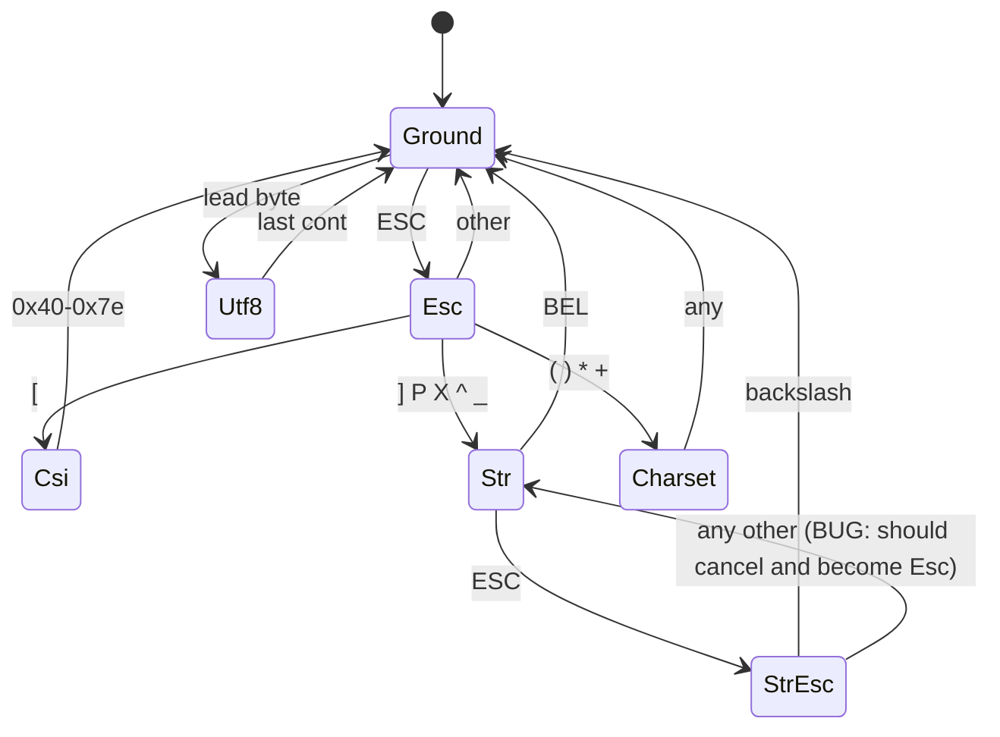

### Verified concerns
1. **Responder gets stuck for good (high).** `responder.rs:305-308`: `match_osc` returns `Incomplete` for any ESC inside an OSC that is not ESC-backslash, even when more bytes follow. `scan` (`172-176`) stashes `buf[i..]` from the OSC start into `residual`, and on the next scan (`158`) the same ESC is hit again. `residual` therefore grows by every later output byte for the session's lifetime, each scan re-walks it, and no DSR-6/DA/color/kitty query is answered again. Kitty push/pop is not tracked either, so the input encoder's flags go stale.
2. **Splitter stalls output (medium).** `output_split.rs:107-112`: `Str(true)` followed by any non-backslash byte goes back to `Str(false)` instead of cancelling the string. After `ESC ] ... ESC [31m`, the splitter holds all output (screen, frames, ring, log, responder) until a BEL or ST arrives or 1 MiB builds up. CAN/SUB are not handled.
3. **Parsers drift apart (medium).** The splitter and responder use separate grammars, and the emulator is a third. Aborted strings are one case where they already disagree, and any future change to one will not reach the others.
4. **Repeated rescans (low).** `rest_cut` rescans the whole pending buffer on every push while a sequence is held (bounded at 1 MiB).

### Refuted
- The "Resync does not carry the responder's kitty stack" concern is not a bug. The responder is session-scoped and is not reset by client resync. Kitty mode is tracked twice, but the two copies agree unless the responder stalls.
- The splitter itself is bounded by MAX_HELD. Only the responder's `residual` is unbounded.

### Recommendation
- **Quick fixes:**
  - `match_osc` should drop the aborted string (`Consumed(j)`) when ESC is followed by a non-backslash byte.
  - In `step`, `Str(true)` plus a non-backslash byte should become `step(Esc, b)`.
  - Add a CAN/SUB-to-Ground rule.
  - Cap `residual`.
  - Add regression tests for an aborted OSC followed by DSR-6.
- **Structural fix:** derive both from one incremental tokenizer (vte, or one shared state enum that yields whole tokens). Then "at rest" has a single definition and the responder matches complete tokens with no residual of its own.


### Verified concerns

- **high**: The responder gets stuck for good on an OSC that an ESC interrupts. match_osc returns Incomplete for any ESC that is not immediately followed by '\\', even when more bytes follow. scan() then stashes buf[i..] (from the OSC start) into residual. The next scan prepends that residual and hits the same ESC, so it returns Incomplete again, every time. Nothing ever clears residual and there is no size cap. From then on, residual grows by every byte the child writes for the rest of the session, each scan re-walks it (quadratic CPU), and no later DSR-6/DA/OSC 10-11/kitty query is answered. Kitty push/pop is not tracked either, so the input encoder's KittyFlags go stale. A child waiting on a cursor-position reply hangs or times out.
  - Evidence: responder.rs:305-308 `if s[j] == ESC { return Match::Incomplete; }` comes after the ESC-backslash check, which needs j+1<len. Line 172-176: `self.residual = buf[i..].to_vec(); return answers;`. Line 158: `let mut buf = std::mem::take(&mut self.residual); buf.extend_from_slice(chunk);`. No other code writes or caps residual.
- **medium**: The splitter does not let ESC cancel an OSC/DCS/APC/PM/SOS string. In Str(true), any byte other than '\\' goes back to Str(false), so `ESC ] 8;;url ESC [ 0 m ...` stays in Str. The splitter then holds every later byte until a BEL or ESC-backslash happens to arrive, or 1 MiB builds up. Held bytes also feed nothing downstream: the emulator, the client frames, the ring buffer, the raw log and the responder all sit behind the splitter, so the live screen freezes. CAN (0x18) and SUB (0x1a), which also abort a sequence in a real VT parser, are not handled either. The emulator, once it finally gets the bytes, parses them correctly, so the splitter's idea of Ground differs from the emulator's.
  - Evidence: output_split.rs:107-112: `St::Str(seen_esc) => match b { 0x07 => Ground, b'\\' if seen_esc => Ground, 0x1b => Str(true), _ => Str(false) }`. session.rs:733-736: only `piece` (the cut prefix) reaches process_output, which runs emit_and_feed, responder.scan, ring and raw_log.
- **medium**: The splitter and the responder are separate hand-written VT parsers with different rules, and the emulator is a third. They already disagree on aborted strings. The responder also treats an ESC inside a CSI as part of the parameters. There is no shared tokenizer, so a fix to one will not reach the other. The splitter's output always ends at its own idea of Ground, but the responder does not trust that and keeps its own residual. Each new divergence like this one becomes a stall.
  - Evidence: output_split.rs:63-114 (step) and responder.rs:179-337 (match_at/match_csi/match_osc) implement separate grammars, and session.rs:722-735 chains them.
- **low**: rest_cut rescans the whole pending buffer from Ground on every push. While a sequence is held (up to MAX_HELD = 1 MiB), each 8 KiB read re-walks the full buffer, roughly 128 x 1 MiB of byte steps before the forced flush. This is bounded, but it is wasted work that the aborted-OSC case above makes reachable.
  - Evidence: output_split.rs:45-52 calls rest_cut(&self.pending) on the whole buffer, and rest_cut (120-133) starts at St::Ground each time.


### Concerns that did not hold up

- 'The Resync replay does not carry the responder's kitty stack.' This is not a defect. The Responder belongs to the session (one per reader thread, session.rs:722) and lives as long as the session. Client resync and replay never reset it, so there is nothing to carry. Kitty mode is tracked twice (KittyFlags for the input encoder, the emulator's own kitty mode for replay), and that duplication is real but small. The two stay consistent unless the responder stalls (see the high-severity concern).
- The splitter does not grow without bound: MAX_HELD (1 MiB) forces a flush. Only the responder's residual is unbounded.


**Recommendation:** Short term: (1) in match_osc, when ESC is followed by any byte other than '\\\\', return Consumed(j) to drop the aborted string and resume scanning at the ESC; return Incomplete only when ESC is the last byte. (2) In step(), make Str(true) plus a non-'\\\\' byte re-step as Esc (`step(St::Esc, b)`), and make CAN/SUB return to Ground from every state. (3) Cap residual (e.g. 4 KiB, then drop it) as a backstop. (4) Add tests for `ESC ] 0;x ESC [ 31m` followed by a DSR-6, checking both modules. Longer term: build both on one shared incremental tokenizer (for example the vte crate the emulator already depends on, or one St enum that yields complete tokens). The splitter would cut at token ends and the responder would match whole tokens with no residual of its own, so there is a single definition of 'at rest'.


## Expected-teardown and relaunch-request marker files

**Verdict:** Needs further thought. The machine's main transition (deliberate death -> stay down) has no writer, so the supervisor can't distinguish a stop or clean exit from a crash. It falls back on a possibly stale board read, which leaves a reachable race where a just-stopped workspace is re-dispatched. Whether a clean agent exit with an assigned task should be restarted is also a product decision the code currently answers by accident.

**Verified concerns:** 1 high, 1 medium, 2 low

**Key files:**
- `crates/shelbi-state/src/workspace_status.rs:206-280, 405-424`
- `crates/shelbi-state/src/supervision_relaunch.rs:1-112`
- `crates/shelbi-orchestrator/src/poller.rs:4719-4800, 4855-4875, 5354-5366, 5831-5843, 6532-6551`
- `crates/shelbi-orchestrator/src/workspace.rs:2355-2385`
- `crates/shelbi-orchestrator/src/state_write.rs:50-63`

### What it is
Three supervision passes run in the daemon poller: the per-workspace supervisor, the stranded dev resume and the stranded review resume, plus the orchestrator supervisor. Each keeps an in-memory crash-loop budget. Two pieces of intent must reach those passes from other code paths or processes:
1. **"This death was deliberate, stay down"**: the no-restart marker.
2. **"The user reopened this pane, reset the budget"**: the relaunch request.

Both are empty files whose existence and mtime carry the meaning. A fresh file (30s window for teardown, 60s for relaunch) is consumed by deleting it on read.

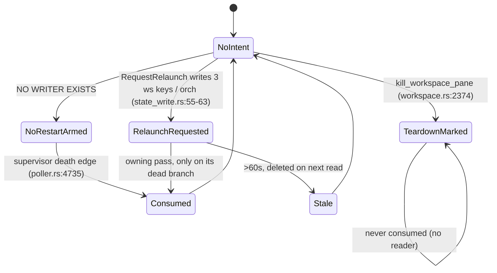

### Storage
| Marker | Path | Writer | Reader |
|---|---|---|---|
| teardown | `~/.shelbi/workspaces/<ws>/.expected-teardown` | `kill_workspace_pane` (workspace.rs:2374) | none (tests only) |
| no-restart | `~/.shelbi/workspaces/<ws>.supervision/.expected-teardown` | **none** | poller.rs:4735 |
| relaunch | `<project>/supervision-relaunch/{orch,ws-sup-<ws>,ws-resume-<ws>,review-resume-<ws>}` | daemon `state_write::request_relaunch` | poller.rs:4743, 4869, 5359, 5836 |
| status | `<project>/supervision-status/orch` | poller (4930/4949) | sidebar_model.rs:58 |

### Verified concerns
1. **High: the no-restart key is never written.** `intentional_shutdown` is always false for workspaces (poller.rs:4730-4738). The docs at workspace_status.rs:405-421 and app/supervision.rs:41-44 credit "the pane lifecycle wrapper" with writing it, but that wrapper went away with tmux. In practice, any death with an active assigned task is restarted, including a clean exit or a user `/exit`.
2. **Medium: race on `workspace stop`.** The CLI releases the task, then kills the pane (cli/commands/workspace.rs:528-556). The supervisor decides `has_work` from `current_task_for`, which reads the daemon-published board-index.json and may be stale (poller.rs:6532-6551). `redispatch_workspace` (4816-4840) does not re-check the assignment. A lagging index can therefore relaunch the slot onto a task that was just released to todo. This is exactly the window the no-restart marker was meant to close. The review path has an `is_task_parked` guard; the dev supervisor path has none.
3. **Low: dead teardown marker.** It is written on every kill and never consumed or cleared, and its docs describe tmux kill-window/SIGHUP flows that no longer exist.
4. **Low: over-broad, conditionally consumed relaunch keys.** A reopen fires when the client slot is in Failed, GaveUp or AwaitingRestart (tui/shell/session.rs:184-189), even if the daemon never gave up and the pane is alive. ws-sup and orch are consumed only while the pane is dead, so the marker lingers. A crash within 60s then wipes the crash-loop history. Unused keys (review-resume for a dev slot, and so on) are never read, so the claim that they "age out" really means they stay on disk forever.

### Refuted
- The "two markers race" concern is moot: one side is write-only and the other read-only.
- Clock skew counting as fresh is intentional and harmless.
- The free-text orchestrator status is display-only and needs no branching.

### Recommendation
First decide the policy for clean exits and stops that happen while a task is still assigned. Then replace the marker pair with a daemon-owned, typed teardown reason that `kill_workspace_pane` records (Stop, Redispatch, Reap, Quit) and the supervisor reads on the death edge. Add an assignment and parked re-check inside `redispatch_workspace`. Write only the relaunch key for the pass that governs the pane, and consume it regardless of liveness. Delete the dead plain marker and its tmux-era docs.


### Verified concerns

- **high**: Nothing writes the supervisor's no-restart key, so `intentional_shutdown` is always false for workspace panes. Crash-vs-deliberate detection is unwired. The only thing that stops a restart is `has_work` (an active task is assigned). An agent that exits cleanly (exit:0 or a user /exit) while a task is assigned is restarted and re-dispatched as if it had crashed. The module docs say exactly the opposite.
  - Evidence: The only production read is poller.rs:4735-4738: consume_expected_teardown(supervision_shutdown_key(ws)). A grep finds no mark_expected_teardown(supervision_shutdown_key(..)) anywhere. The only writer is workspace.rs:2374, and it uses the plain workspace name. The docs at workspace_status.rs:418-421 and app/supervision.rs:41-44 say 'the pane lifecycle wrapper marks it', but no such wrapper call exists.
- **medium**: Without the no-restart marker, `shelbi workspace stop` depends on the supervisor's board read seeing the release. current_task_for reads the daemon-published board-index.json, which can lag and is documented as best-effort. The CLI releases the task in the issue store and then kills the pane. If the index still shows the old assignment, the supervisor sees 'dead + has work' and calls redispatch_workspace. That function loads the issue fresh but never re-checks the assignment, so it can relaunch a slot on a task the user just released. This is the race the marker was designed to close.
  - Evidence: cli/commands/workspace.rs:528-556 releases or parks the task, then calls kill_workspace_pane. poller.rs:6532-6551 has current_task_for reading read_board_with_cfg (the index, 'serves the last-known board even when stale'). poller.rs:4816-4840 has redispatch_workspace calling start_workspace_on_task with no assignment guard. The review path guards with is_task_parked (5350), but the dev supervisor path has no equivalent check.
- **low**: The plain .expected-teardown marker is dead state. kill_workspace_pane writes it on every kill, but nothing in production consumes or clears it. Its documented purpose (suppressing a spurious pane_alive=false on dispatch) depends on a tmux-era lifecycle wrapper that no longer exists. The docs describe a mark -> kill-window -> SIGHUP -> consume chain that does not happen.
  - Evidence: workspace.rs:2374 is the only call to mark_expected_teardown. consume_expected_teardown(<plain ws>) and clear_expected_teardown appear only in tests (workspace_status.rs:719-834). The docs at workspace_status.rs:206-212, 216-222, 268-271 and 2357-2359 mention tmux kill-window and the wrapper.
- **low**: Relaunch markers are over-broad and consumed only in certain states, so a leftover marker can reset a budget the user didn't ask to reset. A reopen also fires when the client slot is Failed or AwaitingRestart, not only when the daemon has given up, and that can happen while the pane is alive. In that case ws-sup or orch stays unconsumed because both are read only on the dead branch. A crash within the next 60s then clears the crash-loop history, which adds one extra budget's worth of restarts. Every workspace reopen also writes review-resume for a dev slot and ws-sup/ws-resume for a review slot. Those keys are only deleted when a reader runs, so a key that no pass ever reads stays on disk indefinitely.
  - Evidence: state_write.rs:58-62 writes all three keys. tui/shell/session.rs:184-189 sets reopen = same target && Slot::{Failed,GaveUp,AwaitingRestart}. poller.rs:4730/4742 (ws-sup) and 4868 (orch) consume only when !alive. supervision_relaunch.rs:96-111 removes a file only inside consume. The module doc's claim that 'a key no pass reads simply ages out' is wrong: nothing reads it, so it is never removed.


### Concerns that did not hold up

- 'Two parallel no-restart markers race over one file' no longer describes anything real. Only one of the two is ever written (the plain one) and only the other is ever read (the .supervision one), so the race the split was meant to avoid cannot happen. The real problem is that the handoff is broken, which is concern 1.
- Clock skew counting as fresh is a deliberate, documented, conservative choice in both modules, with a harmless effect (one extra re-arm, or one suppressed event). It is not a live bug.
- The orchestrator supervision status being free text is fine. It is display-only by design (sidebar_model.rs:58), it has one writer (the poller) and clear points that make sense, and nothing needs to branch on it.
- The extra review-resume key for a dev slot cannot misfire into a dev budget reset. The review pass only consumes it for a slot with an assigned review-column task, so for a dev slot it is just litter, not a wrong transition.


**Recommendation:** Decide the intended policy first: should a clean exit or a `workspace stop` with an assigned task stay down? Then make the intent explicit and owned by the daemon. Instead of empty files, give kill_workspace_pane an explicit `TeardownReason { Stop, Redispatch, Reap, Quit }`. The daemon owns both the kill path and the supervisor, so it can record the reason in a per-workspace in-memory or state-file entry that the supervisor reads on the death edge. If cross-process files are still needed, have one module write a single typed `supervision-intent/<ws>` file (`stay-down` or `relaunch`, plus a timestamp in the body) and drop the `.supervision` pseudo-workspace trick. Also make redispatch_workspace re-check the authoritative assignment and parked state before starting. For relaunch requests, write only the key for the pass that governs the pane: the daemon can see the slot's tags and whether it is review or dev. Consume ws-sup and orch regardless of liveness so a reopen of a live pane never lingers. Delete the dead plain .expected-teardown write and its tmux-era docs, or wire it to the session backend's exit event if suppressing pane_alive is still wanted.


## Client terminal session binding (connect, restart, reconnect)

**Verdict:** Needs further thought. The shared decision core (RestartController/SupervisionState) is sound and well tested. Around it there are two real problems. First, the remote attach classifies an exited orchestrator as terminal, which reopens on remote windows the relaunch-gap bug the local path explicitly fixed, and it can use up the client restart budget. Second, the view-side transition logic is written twice (TUI and desktop) and has already drifted: reconnect-from-Live and budget reset on stale retry. Both are cross-surface design questions worth a conversation, not just local tidying.

**Verified concerns:** 2 medium, 3 low

**Key files:**
- `crates/shelbi-app/src/session/restart.rs:22-142`
- `crates/shelbi-tui/src/shell/session.rs:56-94,172-484`
- `desktop/src/views/session_view.rs:529-968`
- `crates/shelbi-app/src/session/mod.rs:292-445`
- `crates/shelbi-app/src/session/remote.rs:135-265`

### What it is
Every client terminal view binds one session (orchestrator, workspace agent, review/content pane, user shell, remote ssh terminal) and moves it through a lifecycle. The TUI (`SessionManager`) and the desktop (`SessionView`) each have an explicit `Slot` enum. The decisions come from two shared controllers in `shelbi-app`:

- **RestartController** (`crates/shelbi-app/src/session/restart.rs:43-142`) wraps the daemon's `SupervisionState` (restart window, exponential backoff, `gave_up` latch, `ever_alive`) and adds a `deliberate_close` one-shot. It returns a `DeathAction`: Restart / Backoff / GiveUp / StandDown / Leave.
- **ReconnectController** (`session/reconnect.rs:63-153`) has the phases Connected / Waiting / Trying, with no cap. Only the desktop uses it.
- **Connect classification** (`session/mod.rs:292-426`, `session/remote.rs:135-265`) turns a missing or unbound session into Idle / Starting / Awaiting / Unreachable / Message. `retry_connect` retries Starting and Awaiting for 15 s.

```mermaid
stateDiagram-v2
    [*] --> Empty
    Empty --> Connecting: show / reconnect
    Connecting --> Live: Ok
    Connecting --> Idle: ConnectFailure::Idle
    Connecting --> Failed: Message (Leave on first open)
    Connecting --> Reconnecting: Unreachable (desktop)
    Failed --> Connecting: dead()=Restart / retry_if_stale
    Failed --> AwaitingRestart: dead()=Backoff
    Live --> Connecting: exited, dead()=Restart
    Live --> AwaitingRestart: exited, dead()=Backoff
    Live --> GaveUp: exited, dead()=GiveUp
    Live --> Empty: dead()=StandDown / OnDeath::Close
    Live --> Reconnecting: link lost (desktop remote)
    AwaitingRestart --> Connecting: backoff elapsed
    Reconnecting --> Connecting: reconnect due
    Idle --> Connecting: retry_if_stale / retry_if_idle
    GaveUp --> Connecting: re-select (reopen, budget reset)
```

### Verified concerns
1. **Remote orchestrator relaunch gap (medium).** Locally, an exited orchestrator is `Awaiting` and is retried until the relaunched session binds (`mod.rs:315,337-339`, `should_await_session` at 439-445). Over the relay, `attach_over` checks `exited` before the orchestrator arm, so it returns a terminal `Message` (`remote.rs:234-243`). The relay session-service mapping does the same (`remote.rs:197-199`). When a remote window's orchestrator restarts, the reattach can fail at once, the view counts another death, and backoff/restart repeats toward GiveUp while the far daemon is still relaunching it. This is the `rt-tui-shows-a-permanent-attach-error-when-the-orchestrator-is-relaunched` bug again, on remote windows.
2. **Other local/remote miss drift (low).** A missing Review/WorkspaceContent session is a terminal Message locally (`mod.rs:340`) but Starting (retried for 15 s) remotely (`remote.rs:244-246`, `259-262`). Remote exits drop the final.txt last line (`remote.rs:198,237`).
3. **View machine written twice, already drifted (medium).** The TUI's `reconnect()` clears even a Live slot and reattaches (`session.rs:477-484`, called after startup at `shell/mod.rs:3934`); the desktop skips Live (`session_view.rs:585-593`). The TUI's `retry_if_stale` resets the restart budget through `begin(false)`; the desktop's `retry_if_idle` does not (`session_view.rs:599-605`). Each `act_on_death` maps DeathAction to Slot by hand (TUI `379-425`, desktop `884-925`). Reconnecting and hide/reopen memory exist only on the desktop.
4. **GiveUp not latched at the controller API (low).** After GiveUp, `dead()` returns `Backoff{MAX+1}` (`restart.rs:127-129`, pinned by the test at `196-201`). Only the view's `Slot::GaveUp` remembers the give-up. Neither client re-asks today, so this is latent.
5. **Superseded connects aren't cancelled (low).** The `retry_connect` sleep loop (`mod.rs:398-424`) runs to its 15 s deadline after the TUI drops its JoinHandle or the desktop drops its Task.

### Refuted
- The TUI reconnect bypassing reopen does not reset a live crash budget: a Failed slot with crash history becomes Restart/Backoff in the same poll, so only a never-alive Failed persists.
- Repeated `dead()` on a first-open Failed slot is idempotent: `decide` returns None when `!ever_alive`.
- The shared desktop `_tick` and the Slot-vs-controller "two truths" for Reconnecting are kept consistent by `start_connect`/`clear` resets and lockstep updates. No reachable desync was found.

### Recommendation
- Share one miss classifier between local and remote, so a relaunching orchestrator is Awaiting everywhere and the far side carries the last line.
- Lift the view-side machine into `shelbi-app` as a `BindingMachine` that takes events and returns effects. The TUI and desktop then only execute effects and render.
- Make `RestartController` return GiveUp once it has given up.
- Optionally add a cancel flag to `retry_connect`.


### Verified concerns

- **medium**: Local and remote classify a missing orchestrator in opposite ways, and the remote one removes the protection added for the relaunch gap. Locally, an exited orchestrator is Awaiting and is retried for 15 s until the relaunched session binds. Over the relay, an exited orchestrator is checked first and becomes a terminal Message. On a remote window, an orchestrator restart can therefore land in the gap, fail at once, and go Failed -> Backoff -> Restart repeatedly, using up the client restart budget (and reaching GaveUp) while the far daemon is still relaunching it.
  - Evidence: mod.rs:315,337-339 (should_await_session(target, exited, ..) means exited orchestrator => Awaiting) vs remote.rs:234-243 (`_ if exited => Message` is matched before the `SessionRef::Orchestrator => Awaiting` arm). The relay session-service path at remote.rs:197-199 does the same (NoSession{exited:true} => Message for every target). The view then takes this Message as another death: desktop session_view.rs:773-779, TUI session.rs:301-306 followed by drive_supervision 347-350.
- **medium**: The view-side state machine is written twice, and the two copies have already drifted. (a) The TUI's reconnect() runs even when the slot is Live: it clears the slot and reattaches, so a startup that finishes after the main area attached drops a live connection. The desktop's reconnect() skips Live. (b) The TUI's retry_if_stale resets the restart budget (through reconnect -> show -> begin(false)); the desktop's retry_if_idle does not call begin. (c) Only the desktop has Reconnecting / Unreachable handling and hide/reopen_on_show memory; the TUI shows Unreachable as Failed. (d) How dead() gets re-asked differs: a per-poll observation in the TUI, a timer task in the desktop. Each act_on_death maps DeathAction to slots by hand, with the same 'already showing this attempt' dedupe.
  - Evidence: TUI session.rs:477-484 vs desktop session_view.rs:585-593; TUI session.rs:433-440 vs desktop 599-605; TUI act_on_death 379-425 vs desktop 884-925; desktop-only connected() Unreachable branch 708-720 and hide() 566-578
- **low**: Review/WorkspaceContent misses are also classified differently. Locally, a content session that is not there is a terminal Message. Remotely (attach_over and attach_named_over), a never-seen name is Starting and retried for 15 s. Remote exits also drop the final.txt 'why it died' line that local connects show.
  - Evidence: mod.rs:327-340 (non-orchestrator miss => Message, carrying last_final_line) vs remote.rs:244-246 and 259-262 (=> Starting) and remote.rs:198,237,260 (no_live_session_error(&want, None))
- **low**: GiveUp is latched in SupervisionState.gave_up, but RestartController maps the core's later None to Backoff{next_attempt: MAX+1}. So dead() after a give-up returns 'Backoff' and not GiveUp. Neither client re-asks after GaveUp today (TUI: GaveUp => Observed::Nothing; desktop: _tick cleared and no connect in flight), so this is not a live bug. It is a misleading API that a future caller could hit, overwriting GaveUp with AwaitingRestart.
  - Evidence: supervision.rs:171-175 (gave_up => None); restart.rs:127-129 (None with ever_alive => Backoff); restart.rs test 196-201 pins this behavior; TUI session.rs:357; desktop session_view.rs:898-902
- **low**: A superseded connect keeps running. The TUI drops the Connecting JoinHandle, and the desktop drops the gpui Task, but the blocking retry_connect loop has no cancellation and sleeps until its 15 s deadline. Rapid target switches leave several workers polling stale targets (bounded, but wasted work, and any relaunch step they started still runs).
  - Evidence: mod.rs:398-424 (std::thread::sleep loop, no cancel token); TUI session.rs:217-226; desktop session_view.rs:670-694 (background_executor closure is blocking)


### Concerns that did not hold up

- Claim: the TUI's reconnect() bypasses the reopen path, so retry_if_stale on a crash-looping Failed target silently resets the crash budget. Refuted in practice: a Failed slot that has crash history never lasts past one poll. poll_at runs poll_connect and then drive_supervision in the same tick, so dead() turns it into Restart/Backoff/GiveUp at once. Only a never-alive first-open failure (DeathAction::Leave) stays Failed, and its budget is already clean. The relaunch-step difference (reopen marker vs plain connect) is intended: retry_if_stale fires because a session just appeared.
- Claim: drive_supervision calls dead() about every 16 ms on a Failed slot, which could break Leave. Refuted: SupervisionState::decide returns None immediately when !ever_alive (supervision.rs:155-158) with no side effects, so repeated observations are idempotent and stay Leave.
- Claim: the desktop's single `_tick` shared by the restart backoff and the reconnect wait can collide. Not reachable: start_connect and clear() both reset _tick (session_view.rs:657, 640), connected() runs only after start_connect, and the two timers run in mutually exclusive slots (AwaitingRestart vs Reconnecting), each re-checking the slot before acting (937, 960).
- Claim: Slot::Reconnecting and ReconnectController.is_reconnecting() are two sources of truth that can disagree. They are redundant but kept in lockstep: every entry sets both (link_lost 851-853, connected() Unreachable 708-717), and every exit calls reconnect.connected() before changing the slot (show 545, hide 576, reconnect 589, connected 723). No reachable desync was found.
- Claim: deliberate_close is a one-shot that can wrongly stand down a later crash. Partly refuted: the desktop exposes clear_deliberate_close for the failed-quit case (session_view.rs:613-616), and begin() clears it on every show. The TUI has no clear path, but its note_deliberate_close precedes q/Close/quit, which always tear the view down. This is low risk, so it is not kept.


**Recommendation:** (1) Make connect-miss classification one shared function, for example `classify_miss(target, exited: bool, declared: impl FnOnce() -> bool, last_line) -> ConnectFailure`, and call it from both mod.rs::connect and remote.rs (attach_over, attach_named_over, and the relay session-service NoSession mapping), so the orchestrator relaunch gap is Awaiting everywhere and content misses agree. Have the far side carry final.txt's last line on NoSession{exited:true}. (2) Move the view-side machine into shelbi-app as a UI-agnostic `BindingMachine { slot: BindingSlot<P>, restart: RestartController, reconnect: ReconnectController }`, with event methods (show/reopen, connect_result, pane_exited, link_lost, tick, retry_if_stale, reconnect_after_startup) that return effects (StartConnect{relaunch, attempt}, ScheduleTick(d), Emit(Ended), LogSupervision). The TUI and desktop then only run effects and render, which fixes the reconnect-from-Live and budget-reset drift by construction. (3) Have RestartController latch GiveUp: return GiveUp (or a distinct GivenUp) when the core has gave_up set, not Backoff{MAX+1}. (4) Optionally give retry_connect a cancellation flag (an AtomicBool checked between sleeps) so superseded connects exit early.


## Codex native bridge: process lifecycle, delivery gate, thread phase, RPC health

**Verdict:** Needs further thought. Two real robustness gaps are missing timeouts that can leave the bridge stuck or churning. First, ThreadPhase::Unknown blocks both bootstrap and delivery and has no timer or forced rehydrate. Second, native restarts (including a TUI that never subscribes) loop forever at a fixed interval with no cap or escalation. The RPC-health concerns do not hold in practice, because the bridge discards the client on every non-Remote error.

**Verified concerns:** 2 medium, 3 low

**Key files:**
- `crates/shelbi-orchestrator/src/wake.rs:139-282 (NativeStartupError, retry_native_start)`
- `crates/shelbi-orchestrator/src/wake.rs:345-506 (bridge process loop, run_standalone)`
- `crates/shelbi-orchestrator/src/wake.rs:528-1139 (NativeBridge fields, run, reconnect, bootstrap and delivery gates)`
- `crates/shelbi-orchestrator/src/wake.rs:2330-2520 (ThreadPhase, ThreadRuntime, DeliveryCall::for_batch)`
- `crates/shelbi-orchestrator/src/codex_rpc.rs:60-320 (CodexRpcClient health flags)`

### What it is
The Codex orchestrator pane runs `run_codex_bridge_until_shutdown` (wake.rs:345-462). The pane process owns an app-server, a TUI relay, and a remote TUI, and delivers queued Shelbi events into one owned Codex thread. Four implicit machines are layered here:

1. **Process lifecycle**: loop control flow plus `NativeStartupError{protocol_unsupported, cancelled, reason}`, `bridge.protocol_unsupported`, `bootstrap_sent`, and a local `first_launch_pending`.
2. **Delivery/bootstrap gate**: about 10 loose `NativeBridge` fields (wake.rs:528-554), re-derived as boolean guards in `maybe_send_bootstrap` (925) and `maybe_deliver_event` (1006).
3. **ThreadPhase**: an explicit enum `Unknown | Idle | Active(id)` with a single `set_phase` that bumps `generation` (wake.rs:2330-2468).
4. **RPC health**: `closed` / `desynchronized` bools on `CodexRpcClient` (codex_rpc.rs:60-330).

```mermaid
stateDiagram-v2
    [*] --> StartingNative
    StartingNative --> StartingNative: transient error (500ms, no cap)
    StartingNative --> Standalone: protocol_unsupported
    StartingNative --> NativeRunning: NativeBridge::start Ok
    NativeRunning --> StartingNative: app-server exit / relay fail / 15s TUI timeout / Err
    NativeRunning --> Standalone: relay Unsupported / incompatible turn rejection
    NativeRunning --> [*]: TUI exits Ok
    StartingNative --> [*]: signal
    NativeRunning --> [*]: signal
    Standalone --> [*]
    state NativeRunning {
        Unknown --> Idle: idle status / turn completed
        Unknown --> Active: turn/started
        Idle --> Active: turn/started / accept_started_turn
        Active --> Idle: matching turn/completed / idle status
        Idle --> Unknown: status active, notLoaded, systemError
        Active --> Unknown: notLoaded, systemError
    }
```

### Gate semantics (derived)
Delivery requires all of the following: `tui_ready`, `rpc.is_some()`, `now >= retry_not_before`, `blocked_generation != generation`, not awaiting a non-steerable turn, not (bootstrap unsent and phase Idle), and a phase other than Unknown. Bootstrap requires the analogous set plus `phase == Idle`. A non-steerable rejection or any other non-overload rejection drops the RPC client on purpose (`rehydrate_after_rejection`, wake.rs:1128), so the next `maybe_reconnect` resumes the exact thread and clears the latches.

### Verified concerns
- **Unknown can stall delivery (medium).** wake.rs:2446, 2452-2458, and 2398-2402 enter Unknown. While Unknown, `DeliveryCall::for_batch` returns None (2516) and bootstrap needs Idle (943). No RPC is attempted, so no rejection triggers a rehydrate. `maybe_reconnect` only runs when `rpc` is None (868). Unless Codex later emits turn/started, turn/completed, or idle, queued events wait until some unrelated transport error.
- **Unbounded restart loop (medium).** `retry_native_start` (252-270) has no attempt cap. A TUI that never subscribes makes every cycle end in the 15s timeout (698-701), which respawns the app-server and the visible TUI forever (446-454), with no backoff or escalation to standalone.
- **Duplicated rejection ladders (low).** 977-1001 vs 1072-1104 write parallel field pairs, and the two guards already differ in shape.
- **blocked_generation cleared in six places (low).** 819, 837, 857, 864, 912-914, 1053.
- **NativeStartupError bools (low).** Both can be set at once in the type, but no constructor does so.

### Refuted
- The RPC poison gaps (codex_rpc.rs:177, 184-189, 261, 296-300) cannot bite, because the bridge calls `disconnect()` on every non-Remote error (742-754, 1002, 1105-1110). Only tests construct other clients.
- "Degraded -> Degraded loses the edge": the two arguments of `append_integration_event` are (wake, messages), not (from, to) (event_log.rs:1958-1971).
- One-way fallback is by design, and the next pane start re-engages native and logs `native-bridge-reengaged` (2005-2021).

### Recommendation
Add an Unknown-with-pending-work deadline that forces a rehydrate. Add backoff and an attempt policy for native restarts: escalate to standalone, or emit a supervision event, after K TUI-ready timeouts. Fold the bootstrap and delivery gates into one `GateState` struct with shared `admit` and `on_rejection` methods. Optionally make `NativeStartupError` an enum.


### Verified concerns

- **medium**: ThreadPhase::Unknown has no timeout and no proactive rehydrate. While Unknown, DeliveryCall::for_batch returns None and bootstrap requires Idle, so no RPC is attempted. That means no rejection fires, so rehydrate_after_rejection is never triggered either. Only a later turn/started, turn/completed, idle status, or an unrelated transport error clears it. A systemError/notLoaded status, an accept_started_turn response without a turn id, or a resume snapshot that is neither one-in-progress nor idle can all leave queued events undelivered indefinitely.
  - Evidence: wake.rs:2446 (notLoaded|systemError -> Unknown), 2452-2458 (accept_started_turn None -> Unknown), 2398-2402 (hydrate fallback Unknown), 2516 (Unknown -> None), 943-945 (bootstrap needs Idle), 1023-1030 (delivery returns Ok(()) without action). maybe_reconnect (868) only runs when rpc is None, and no code path forces it from Unknown.
- **medium**: Native restarts are unbounded with a fixed 500ms delay. Transient startup errors retry forever. A remote TUI that never subscribes ends every cycle with the 15s TUI_READY_TIMEOUT, which kills and respawns the app-server and the visible TUI in the pane each time, again with no cap, backoff, or escalation to standalone.
  - Evidence: wake.rs:252-270 (loop with no attempt count), 53 RECONNECT_INTERVAL=500ms, 55 TUI_READY_TIMEOUT=15s, 698-701 (timeout Err), 446-454 (Err without protocol_unsupported -> warn + wait_for_reconnect + loop).
- **low**: maybe_send_bootstrap and maybe_deliver_event each re-derive the gate and duplicate the same 4-branch rejection ladder (non-steerable, incompatible, -32001 overload, other). They write parallel field pairs (bootstrap_blocked_generation vs blocked_generation, bootstrap_retry_not_before vs retry_not_before). The two guards already differ in shape, and any change to rejection semantics has to be made twice.
  - Evidence: wake.rs:925-1004 vs 1006-1116; guards at 926-933 and 1007-1015; ladders at 977-1001 and 1072-1104.
- **low**: blocked_generation is cleared in six places under different conditions: a non-steerable notification clear, three snapshot-reconcile branches, a reconnect when not awaiting, and a delivery success. No single rule says when a blocked delivery may resume.
  - Evidence: wake.rs:819, 837, 857, 864, 912-914, 1053.
- **low**: NativeStartupError can represent protocol_unsupported and cancelled both true, and reason is a placeholder (SocketError) on the transient and cancelled paths. No current constructor sets both, and retry_native_start checks shutdown first, so this is not reachable today. It is a tidy-up candidate, not a bug.
  - Evidence: wake.rs:139-210; retry_native_start 257-268.


### Concerns that did not hold up

- RPC client errors that do not poison (a mismatched response id at codex_rpc.rs:184-189, generic tungstenite errors at 177/261, an unsolicited response in poll at 296-300): in production the bridge drops the client on every non-Remote error. poll_notifications calls disconnect() on any Err (wake.rs:742-754), the bootstrap and delivery paths call disconnect on non-Remote errors (1002, 1105-1110), and connect_until_ready/maybe_reconnect discard a failed client. The only other callers of CodexRpcClient::connect are tests. A broken socket is never reused, so the closed/desynchronized gaps are cosmetic API leakiness in the client.
- 'The fallback event is recorded as Degraded -> Degraded and the structured -> degraded edge is lost': append_integration_event's two IntegrationMode arguments are (wake, messages), not (from, to) (event_log.rs:1958-1971). Degraded/Degraded correctly says both channels are now degraded, and the reverse edge is recorded the same way as Structured/Structured 'native-bridge-reengaged' (wake.rs:2014-2021).
- 'Fallback is one-way and the reason lives only in codex-thread.json': one-way is deliberate for the process lifetime, because standalone mode hands the pane to a plain Codex process. The next pane start re-engages native and emits a native-bridge-reengaged event (wake.rs:2005-2021). The reason is also emitted on the event stream (wake.rs:480-486), not only in the JSON.
- 'Disconnected conflates transport loss with forced rehydrate': both mean 'resume the exact thread before acting', and maybe_reconnect handles them the same way on purpose (rehydrate_after_rejection comments at 996-1000, 1097-1101). No consumer needs to tell them apart.
- 'generation couples phase tracking and retry eligibility': this is the intended latch, block until the phase changes or a reconnect rehydrates. It is consistent, not a defect.


**Recommendation:** (1) Add an Unknown-phase deadline. If phase stays Unknown with pending work for N seconds, call rehydrate_after_rejection-style logic (set rpc=None) so maybe_reconnect resumes the thread and gets an authoritative snapshot. (2) Give the outer loop an attempt counter with exponential backoff, and decide on a policy: after K consecutive TUI-ready timeouts or startup failures, either fall back to standalone or raise a visible supervision event, instead of respawning every 15s. (3) Fold the gate fields into one per-target struct (for example `GateState { blocked_generation: Option<u64>, retry_not_before: Instant }`, instanced for bootstrap and delivery), with one `fn admit(&self, runtime, now) -> bool` and one `fn on_rejection(&mut self, kind) -> Action` shared by both senders. Clearing blocked_generation then becomes a single method. (4) Optionally make NativeStartupError an enum (Transient{reason} | Unsupported{reason} | Cancelled). Leave CodexRpcClient as is, or have it poison on any non-Remote error for library hygiene.


## Verified-submit pane injection and send verdicts

**Verdict:** Needs further thought. The verify core is clean and explicit. But the rule that StillInBox on an actively busy pane means queued lives only in the CLI, so the orchestrator handoff on reload and quit gives up early on a busy orchestrator and can lose the handoff. Whether the shared primitive should own a Queued verdict is a design question worth discussing.

**Verified concerns:** 1 medium, 4 low

**Key files:**
- `crates/shelbi-orchestrator/src/submit.rs:110-408 (baseline, SubmitStatus, deliver/verify core)`
- `crates/shelbi-orchestrator/src/submit.rs:444-499 (verify_seeded)`
- `crates/shelbi-cli/src/commands/send.rs:93-158 (send verdict to queued/stuck strings)`
- `crates/shelbi-orchestrator/src/handoff.rs:143-233 (orchestrator handoff treats StillInBox as fail-fast)`
- `crates/shelbi-orchestrator/src/workspace.rs:3240-3270, 3505-3530, 3620-3635 (dispatch and limit-resume mappings)`

### What it is
Every text injection into a runner pane uses the shared verified-submit primitive in `crates/shelbi-orchestrator/src/submit.rs`. That covers `shelbi send`, the dispatch paste fallback, limit-resume and the orchestrator handoff on reload or quit. The lifecycle runs in order: capture a baseline, paste, wait 300 ms, press Enter, wait, press Enter once more if needed, then return a verdict.

### How state is stored
- **Pre-delivery state:** `PaneBaseline { busy, actively_busy, title_working }` (submit.rs:114-133). These are three bools, captured from history, the visible screen and the pane title.
- **Verdict:** an explicit `SubmitStatus` enum (submit.rs:216-243) produced by a single pure core, `verify_submitted_with_profile` (submit.rs:375-408).
- **Serialization:** a per-target process-global injection mutex (session_backend.rs:506-520). The CLI also takes a cross-process `lock_workspace` file lock (send.rs:44-45).
- **Caller outcomes:** each caller re-maps the verdict to its own outcome type and event strings: SendDelivery plus `send status=... detail=...` events, HandoffOutcome, dispatch `confirmed`/`stalled`, and LimitResumeOutcome.

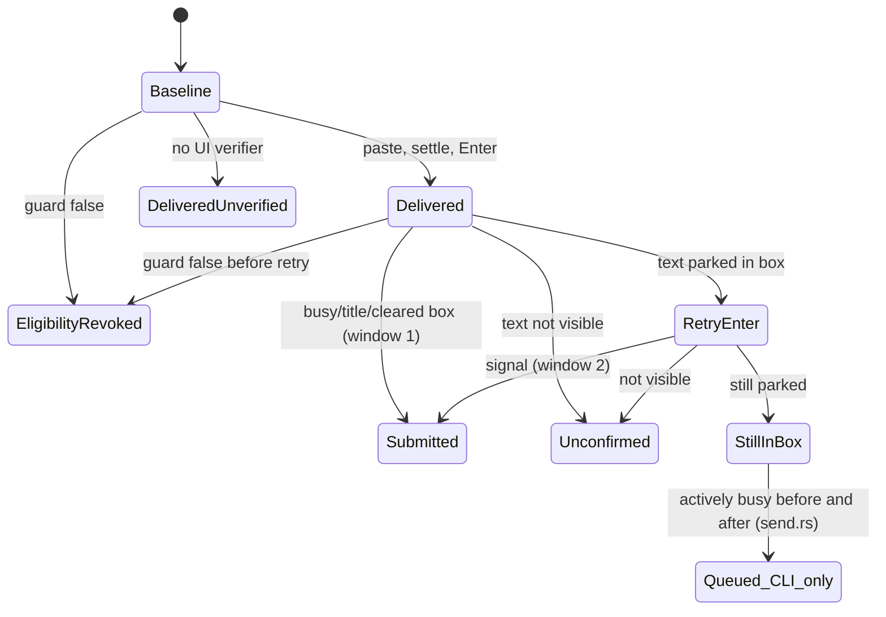

### Verified concerns
1. **(medium) The handoff gives up early on a busy orchestrator.** `request_orchestrator_handoff` (handoff.rs:180-189) delivers into the orch pane, which may be mid-turn. Claude keeps mid-turn input visible as a queue, so the verifier returns `StillInBox`. `classify_submit` (handoff.rs:221-223) maps that to `FailFast(SubmitUnconfirmed{still-in-box})`. Reload or quit then tears down without waiting for `handoff.md`, which the orchestrator would have written once its turn ended. Only `send.rs:120-123,150-154` knows the "busy before and after means queued" rule.
2. **(low) The guard semantics are fuzzy.** The guard is checked before delivery and before the retry Enter, but not between the paste and the first Enter (submit.rs:301-315, 274-282). `EligibilityRevoked` is also returned when nothing was delivered at all, yet the doc (submit.rs:225-226) and limit-resume's `PromptParkedIneligible` (workspace.rs:3628-3630) both say the prompt is parked.
3. **(low) The baseline docs contradict the code.** `actively_busy` is documented as "narrower than busy" but ORs in `title_working` and reads a different screen (submit.rs:123-128 vs 172-175). `actively_busy && !busy` is therefore reachable, and the bools act as an unnamed classification.
4. **(low) The event vocabulary is stringly typed.** Send verdict tokens live only in send.rs (139-157), and dispatch uses a different set (workspace.rs:3505-3530). Nothing ties them to `SubmitStatus`.
5. **(low) A stale module doc.** The send.rs:4-18 header describes a legacy agent-registry fallback that `resolve_target` (send.rs:171-201) no longer implements.

### Refuted
- verify_seeded is a deliberate, documented stricter loop, not drift (submit.rs:420-438).
- Dispatch and limit-resume treating StillInBox as a stall is correct: their panes are idle by construction.
- Interleaved injections are prevented by the per-target mutex and the CLI's workspace file lock.

### Recommendation
Move the queued decision into `submit.rs`, as a `SubmitStatus::Queued` or `StillInBox{pane_busy}` produced after a final re-capture, and make each caller match on it explicitly. The handoff would then poll for the file when the request is queued. Replace the three bools with a `BaselineActivity` enum, split `EligibilityRevoked` by phase, optionally re-check the guard after the settle, centralize the event tokens on the status type, and fix the stale send.rs doc.


### Verified concerns

- **medium**: Only send.rs owns the rule for when StillInBox means queued. The orchestrator handoff is the one other caller that delivers into a pane that may be busy, and it treats StillInBox as failure. On reload or quit, if the orchestrator is mid-turn, Claude parks the handoff request as visible queued input. The verifier returns StillInBox, and classify_submit fails fast with SubmitUnconfirmed{still-in-box}. Teardown then goes ahead without waiting for handoff.md, which the orchestrator would have written once its turn ended.
  - Evidence: handoff.rs:180-189 captures a baseline and calls send_verified. handoff.rs:221-223 maps StillInBox to FailFast. send.rs:120-123 and 150-154 add a second capture and accept actively-busy StillInBox as queued. The callers are reload_session.rs:84 and quit.rs:127.
- **low**: The guard is not checked between the paste and the first Enter, but the docs say it covers delivery. EligibilityRevoked is also returned before any delivery, while its doc and limit-resume's mapping (PromptParkedIneligible) say the prompt is parked. Here 'parked' means 'never sent'.
  - Evidence: submit.rs:301-315 checks the guard once, then deliver_text sends text, settle and Enter unconditionally (submit.rs:274-282). The doc at submit.rs:225-226 says 'after delivery'. workspace.rs:3628-3630 maps EligibilityRevoked to PromptParkedIneligible. The race window is the 300ms settle. Limit-resume re-checks is_eligible right before (workspace.rs:3624).
- **low**: The PaneBaseline docs contradict the code. actively_busy is described as 'intentionally narrower than busy', but it ORs in title_working and reads the visible screen rather than history. So actively_busy=true with busy=false is reachable. Since send.rs uses actively_busy to decide queued-vs-stuck, the three bools work as an unnamed classification, not independent facts.
  - Evidence: submit.rs:123-128 is the doc. submit.rs:172-175 computes title_working || claude_is_actively_processing(visible_screen) against claude_is_processing(screen history).
- **low**: Send verdicts cross processes as free-form status and detail strings ('submitted', 'queued', 'stuck' / 'still_in_input_after_retry', ...). They are defined only in send.rs, and dispatch has its own separate vocabulary ('confirmed', 'stalled', no_busy_signal_after_retry). No shared type ties SubmitStatus to the event tokens the orchestrator agent reacts to.
  - Evidence: send.rs:105, 139-157. workspace.rs:3505-3530. event_log.rs:2545 append_send_event(&str, &str).
- **low**: The module doc in send.rs still describes a fallback to the legacy `shelbi spawn` agent registry, but resolve_target no longer has one. It errors on any non-workspace name.
  - Evidence: send.rs:4-18 is the doc. send.rs:171-201 resolve_target only handles project.workspace(id).


### Concerns that did not hold up

- 'verify_seeded duplicates the submission-proof rules': it is a deliberate, documented stricter variant. A launch-seeded prompt never sits in the input box, so the cleared-box signal would give false positives (submit.rs:420-438). The two loops share signal helpers (title_signals_submit, claude_is_processing), and only the cleared-box branch differs on purpose.
- 'Dispatch and limit-resume wrongly treat StillInBox as failure': they type into a freshly launched or limit-cleared idle pane (limit-resume first waits for wait_for_claude_ready), so a parked prompt really is stuck there. The interpretation differs by context, but these callers are correct. Only handoff, which targets a possibly busy orchestrator, is affected.
- 'Concurrent injections can interleave': deliver_text holds a per-target process-global injection lock (session_backend.rs:506-520), and the CLI also holds the cross-process lock_workspace file lock (send.rs:44-45). Handoff targets the orch session, and the CLI cannot address that session.


**Recommendation:** Move the queued-vs-stuck decision into submit.rs. send_verified_guarded would do the final actively-busy re-capture itself and return a first-class SubmitStatus::Queued (or StillInBox{pane_busy: bool}), so every caller handles it explicitly through an exhaustive match. Handoff should treat Queued as PollForFile, and dispatch and limit-resume can keep treating it as a stall. Replace the three baseline bools with a small enum, for example BaselineActivity::{Idle, StaleBusyScrollback, ActivelyBusy{title_working}}, and fix the 'narrower' doc. Split EligibilityRevoked into RevokedBeforeDelivery and RevokedBeforeRetry. Optionally re-check the guard after the settle, before the first Enter. Give the send and dispatch event tokens a single as_event_token() on the status type, and delete the stale legacy-registry paragraph from the send.rs module doc.


## Session host process and on-disk session directory liveness

**Verdict:** Needs further thought. One reachable bug: live_session_names treats a lone zombie as live, so ensure_content_session can strand a review content session, and no other path breaks that because zombies_to_reap ignores lone candidates. Beyond that, the session lifecycle is spread across six marker files and three separately maintained liveness predicates, and they already disagree during the Exiting window. Each new reader adds another predicate to keep in sync.

**Verified concerns:** 1 medium, 4 low

**Key files:**
- `crates/shelbi-session/src/session.rs:60-100, 434-604, 677-713, 860-880`
- `crates/shelbi-client/src/discovery.rs:170-260, 285-410`
- `crates/shelbi-orchestrator/src/session_process_backend.rs:110-245, 357-395, 500-608`
- `crates/shelbi-orchestrator/src/review_session.rs:260-275 and crates/shelbi-orchestrator/src/workspace_session.rs:160-170 (ensure_content_session idempotency gate)`
- `crates/shelbi-session/src/lock.rs:30-80`

### What it is
Each Shelbi pane, whether a workspace slot, the orchestrator or a review editor/diff, is a `shelbi __session` host process. Its lifecycle is never stored as a value. Readers rebuild it on demand from marker files in `~/.shelbi/sessions/<id>/` plus a socket probe:

| marker | meaning |
|---|---|
| `lock` (flock EX, probed with SH\|NB) | process alive |
| `meta.json` | name, pid, launched_at (written right after the lock) |
| `sock` | listener bound (removed at teardown) |
| `exiting` | child gone, flushing `exited` to clients |
| `final.txt`, `exit.json` | final screen and exit record, written last |

Inside the host, `TERMINATE`/`TERM_SIGNAL`/`TERM_SENDER` statics (session.rs:68-80) form a one-shot shutdown latch. It is set by SIGTERM/SIGHUP (:82-95) or by a fatal accept error (:878).

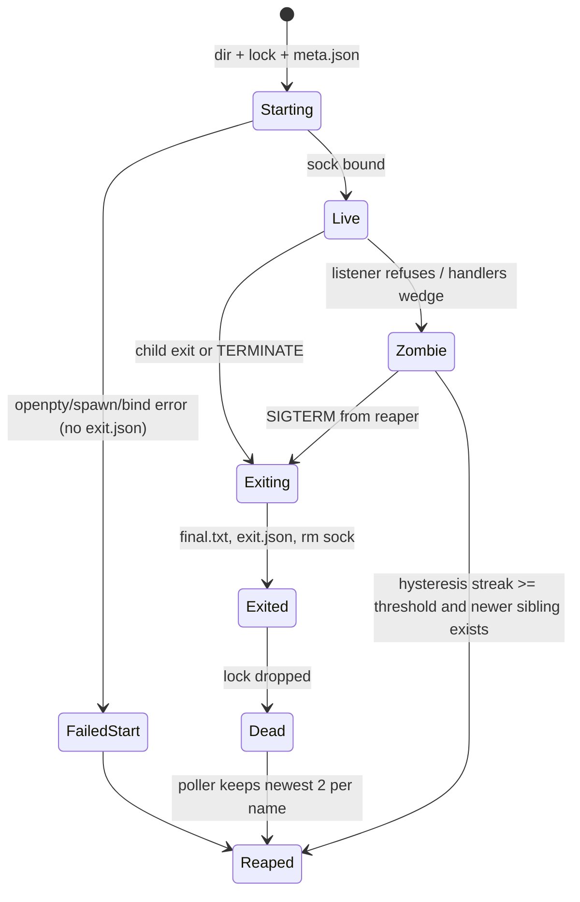

### Three liveness predicates
- `is_live` (discovery.rs:252): `!exit.json && lock held`. It ignores `exiting`.
- `exiting()` (discovery.rs:207): `exiting || exit.json`.
- `usable()`/`not_listening()` (discovery.rs:178-197): alive plus a hello probe.
- `choose_session` (discovery.rs:374-410) skips exiting sessions but trusts a **lone** candidate without probing. It probes only when there are 2+ candidates.
- Backend wrappers mix these: `find_any` falls back to any dir with the name (session_process_backend.rs:149-155), and `probe` = `find_any` + `usable` (:236-244).

### Verified concerns
1. **Lone zombie reads as live (medium).** `live_session_names` (session_process_backend.rs:516-533) relies on `choose_session(...).is_some()` and documents that this excludes zombies. Because of the lone-candidate shortcut, it does not. `ensure_content_session` (review_session.rs:268-273, workspace_session.rs:163-168) returns early on that answer, and `zombies_to_reap` never reaps a lone candidate. A wedged review editor/diff session is therefore reused instead of relaunched.
2. **Predicate drift in the Exiting window (low).** `probe` can say Alive while `find_live` returns None. Between `exiting` being written (session.rs:582) and `exit.json` (:602), the lock is held, the socket accepts, and `find_any` falls back to that dir. The window is short and self-correcting, but it shows the predicates drifting apart.
3. **Silent failed start (low).** `?` returns after the lock (session.rs:487-566) leave no exit record.
4. **Snapshot/request has no deadline (low).** Only the hello is bounded (connect.rs:74, 218-232). `request` blocks on `recv()` (:276-279). snapshot.rs:52-60 falls back to final.txt only when connect fails, not when the session dies mid-request.
5. **Reap streak is in-memory and caller-owned (low, design).** session_process_backend.rs:570-608.

### Refuted
- A reaper deleting a starting dir mid-acquire: the only production reaper keeps 2 per name, and an unnamed dir is its own group of 1 (poller.rs:4672, discovery.rs:322-327).
- A TERMINATE latch never resetting: only reachable through a real signal or an accept failure. Production calls run() once per process.
- Metadata no-ops and respawn failing: documented parity debt, already handled by callers. This belongs to the backend-abstraction machine.

### Recommendation
Add one `SessionState` classifier in discovery with an explicit probe depth, and define every reader (`is_live`, `exiting`, `usable`, `choose_session`, `find_any`, `probe`, `live_session_names`, `zombies_to_reap`) through it. Short-term fix: require `usable()` for the lone candidate in `live_session_names`, or have `ensure_content_session` check usability. Also add a drop guard that writes a startup-failure `exit.json`, and a request deadline with a final.txt fallback.


### Verified concerns

- **medium**: live_session_names reports a lone refusing or wedged zombie as live, which contradicts its own doc comment. ensure_content_session uses it as its idempotency gate, so a stranded editor or diff content session is reused indefinitely and never relaunched. zombies_to_reap also never reaps a lone candidate, so nothing else breaks the deadlock.
  - Evidence: session_process_backend.rs:516-533 filters names with `choose_session(&all, name).is_some()`. choose_session returns the single live candidate with no socket probe (discovery.rs:378-383). The doc comment at :521-525 claims 'a name whose only live candidates are refusing zombies is not really live'. The callers are review_session.rs:268-273 and workspace_session.rs:163-168, which `return Ok(())` when the name is present. zombies_to_reap returns empty unless there are 2+ live candidates (discovery.rs doc at ~412-420).
- **low**: Readers disagree on liveness. probe() can report Alive for a session that find_live (used by kill, send_text, title, history) refuses to return. The cause is that find_any falls back to an Exiting directory and usable() ignores exiting(), while is_live only checks exit.json, not the `exiting` marker.
  - Evidence: find_any (session_process_backend.rs:149-155) falls back to `all.into_iter().find(|s| s.meta.name == name)` after choose_session skips exiting sessions. probe (:236-244) then returns Alive if usable(), which is alive && !not_listening (discovery.rs:194-196). During the session.rs:582-603 window the lock is held, exit.json is absent and the socket still accepts, so usable() is true. The window is narrow (about 100ms flush grace plus the final.txt write), so supervision self-corrects on the next tick, but the three predicates (is_live, exiting, usable/choose_session) are maintained separately.
- **low**: A start failure after the lock is taken leaves a directory with only lock and meta.json and no exit record. Supervisors that read exit.json for a crash reason get nothing, and the error only reaches the detached process's stderr.
  - Evidence: session.rs:487-566: openpty, spawn_command, try_clone_reader, take_writer, RawLog::enabled and UnixListener::bind all use `?`/map_err and return before the teardown that writes exit.json (:598-603).
- **low**: shelbi_client::snapshot falls back to final.txt only when connect fails. If the session dies after the hello, the call returns ReaderGone instead of the final screen. A session that wedges after the hello blocks the request forever: the handshake is bounded at 10s, but Connection::request has no timeout.
  - Evidence: snapshot.rs:52-60 runs `conn.snapshot(history_lines)?` after a successful open. connect.rs:218-232 bounds only the hello read (HANDSHAKE_TIMEOUT 10s, :74) and clears the timeout. request (connect.rs:276-279) waits on rx.recv() with no deadline.
- **low**: The reap hysteresis streak is caller-owned in-memory state, so it resets when the owning process restarts. Each caller must also keep a separately scoped map.
  - Evidence: reap_zombies_with_hysteresis takes `streak: &mut HashMap<String,u32>` (session_process_backend.rs:570-608). A restart only delays a reap by `threshold` ticks, so this is a design note rather than a bug.


### Concerns that did not hold up

- Reaper deletes a starting session's dir in the window between lock file creation and flock (lock.rs:37-46): the window is microseconds, and the only production reaper is poller reap_dead_keeping_recent with keep_per_name = 2 (poller.rs:4672). A dir with no meta.json yet is grouped under its own '<unknown>/<short_id>' key (discovery.rs:322-327) as a group of one, so it is always kept. reap_dead (keep 0) is called only from a test (protocol_e2e.rs:802).
- TERMINATE is a never-reset global latch that breaks later in-process run() calls: true that it is never reset, but it is only set by a real SIGTERM/SIGHUP or a fatal accept error, and the production process runs run() once and exits. No in-process test was found that triggers it and then calls run() again, so this is theoretical.
- Backend metadata no-ops (get_metadata/set_metadata/get_env) and respawn always Failed as a lifecycle bug: these are documented, deliberate Phase 3/4 gaps whose callers treat None/Failed as 'rebuild' (session_process_backend.rs:357-395, 425-435). They are tmux-parity design debt that belongs to the backend-abstraction machine, not a liveness defect here.


**Recommendation:** Add one `SessionState` enum in shelbi-client discovery (Starting, Live, Refusing, Wedged, Exiting, Exited, Dead) and one `DiscoveredSession::state(probe: ProbeDepth)` classifier that reads the lock, exiting, exit.json and (optionally) the socket in a fixed order. Then define is_live, exiting, usable, choose_session, find_any, probe, live_session_names and zombies_to_reap in terms of it, so 'alive' means one thing everywhere. Immediate fix: make live_session_names (or choose_session behind a flag) require usable() for a lone candidate, or have ensure_content_session check probe()/usable before reusing. Secondary: write a minimal exit.json (reason "startup failed: ...") on the post-lock error path via a drop guard, and add a request deadline to Connection::request/snapshot with a final.txt fallback on ReaderGone.


## Usage-limit auto-resume (LimitResumeState)

**Verdict:** Needs further thought. The enum and its pure advance function are well built. But NeedsHuman, the state that means 'stop touching this pane', is the one state that is not durable. Both a process restart and a single liveness-probe Err (possible on remote hosts) silently reset it to Idle. With the banner still showing, auto-resume then re-arms and nudges again. The impact is bounded, but it is a reachable path that contradicts the state's own meaning.

**Verified concerns:** 1 medium, 2 low

**Key files:**
- `crates/shelbi-orchestrator/src/poller.rs:2329-2530 (enum, pure advance fn, without-banner fn)`
- `crates/shelbi-orchestrator/src/poller.rs:2540-2768 (handle_limit_stall I/O outcomes, suppress_limit_banner, eligibility)`
- `crates/shelbi-orchestrator/src/poller.rs:1625-1672, 1771-1880 (reset sites and call sites in poll_one)`
- `crates/shelbi-orchestrator/src/poller.rs:2193-2304 (durable Paused half in status.yaml)`
- `crates/shelbi-orchestrator/src/workspace.rs:2017-2026 (workspace_pane_alive returns Err on backend I/O failure)`

**What it is.** This is per-workspace auto-resume for a Claude pane stalled on a usage or session-limit modal. Each poll thread keeps one `LimitResumeState` in memory (`poller.rs:531`, defined at `poller.rs:2357`). The durable half is `WorkspaceState::Paused` in status.yaml, written by `record_usage_limit_pause` (`poller.rs:2193`) and cleared by `record_limit_resume_state` / `record_limit_recovery_from_screen` (`poller.rs:2234-2304`). There is also an audit trail of `supervision=limit-resume` lines in events.log.

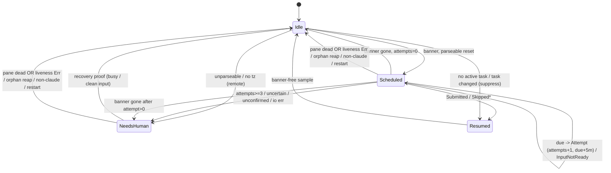

**Where transitions live.**
- `advance_limit_resume` (`poller.rs:2457-2530`) is pure and unit-tested. It handles fresh-banner scheduling, the due check, backoff and exhaustion.
- `handle_limit_stall` (`poller.rs:2540-2712`) maps each `LimitResumeOutcome` to a new state inline. This mapping is not pure.
- `advance_limit_resume_without_banner` (`poller.rs:2414-2437`) handles banner-free samples.
- `suppress_limit_banner` (`poller.rs:2734-2752`) handles the no-task and task-changed cases.
- Resets to Idle happen in `poll_one` at `poller.rs:1649` (pane not alive), `1670` (orphan reap) and `1782` (non-Claude runner).

**Verified concern (medium): the NeedsHuman latch is not durable.**
- `poller.rs:1629` computes `alive = workspace_pane_alive(..).unwrap_or(false)`. `workspace_pane_alive` (`workspace.rs:2017-2026`) returns Err on a backend I/O failure, for example an ssh hiccup to a remote host. That single tick resets `limit_resume` to Idle at `poller.rs:1649`.
- A daemon restart does the same, because the state is only in memory.
- On the next tick with the banner still visible, `Idle` counts as a fresh banner (`poller.rs:2465`). The reset is recomputed from the persisted Paused `last_transition`, so `due` is already in the past. The poller then fires up to 3 more resume attempts (Esc plus a typed prompt) into a pane where it had already emitted `needs-human` (for example `resume-attempts-exhausted`).
- For an unparseable reset, it just re-emits a duplicate `needs-human` event.
- Cross-task leakage is already prevented by `paused_status_belongs_to_other_task` (`poller.rs:2725`).

**Low concerns.**
- About 20 scattered `*state =` writes. The outcome-to-state table in `handle_limit_stall` is untested.
- `Resumed` means both "delivered" and "suppressed". The events.log lines (`sent` vs `skipped`) disambiguate, so diagnostics are not actually lost.

**Recommendation.**
1. Treat a liveness `Err` as unknown and skip the tick instead of resetting.
2. Persist the NeedsHuman latch (reason plus banner key) beside the Paused status in status.yaml, and rehydrate it in `advance_limit_resume`.
3. Optionally, extract a pure `on_outcome` mapping next to `advance_limit_resume` and split `Resumed` into `Delivered` and `Suppressed{reason}`.


### Verified concerns

- **medium**: NeedsHuman lives only in memory and is dropped to Idle on a poller restart, or on any tick where the liveness probe errors. If the banner is still visible on the next sample, Idle counts as a fresh banner and auto-resume re-arms. The resume needs-human line is emitted again, and for a parseable reset the poller schedules and fires up to 3 more nudges (Esc/typing into the pane) that a human was told to handle.
  - Evidence: poller.rs:1629 `workspace_pane_alive(..).unwrap_or(false)`, where workspace.rs:2021 maps backend I/O errors (such as an ssh hiccup on a remote host) to Err. poller.rs:1649 then resets `*limit_resume = Idle`. poller.rs:2465 treats `Idle => fresh_banner = true`. stalled_at comes from the persisted Paused last_transition (record_usage_limit_pause, poller.rs:2193-2227), so the recomputed due is already in the past and the next tick goes straight to Attempt with attempts=0. Example path: NeedsHuman 'resume-attempts-exhausted' with the banner still up -> one Err liveness tick or a daemon restart -> 3 more attempts. The unparseable-reset case re-emits a duplicate needs-human event.
- **low**: Transitions are split between the pure advance function and roughly 20 direct `*state = ...` writes across three I/O functions and three reset sites in poll_one. The legality rules (which outcomes latch, which retry, which go to NeedsHuman) are therefore spread across call sites, not held in one table.
  - Evidence: Writes at poller.rs:1649, 1670, 1782, 2419, 2427, 2433, 2482, 2490, 2517, 2588, 2599, 2625, 2639, 2648, 2654, 2670, 2680, 2690, 2700, 2751. Only advance_limit_resume (poller.rs:2457) is pure and unit-tested (tests at about poller.rs:7805). The outcome-to-state mapping in handle_limit_stall is not.
- **low**: Resumed covers two meanings: a prompt was actually submitted, and suppress or skip this banner (no task, task changed, ineligible, banner gone). The state cannot tell them apart. This is harmless today because both behave the same, but the name invites a future reader to read Resumed as a successful delivery.
  - Evidence: The doc comment at poller.rs:2372-2375 calls it 'already resumed or invalidated'. The variant is assigned at 2599, 2625 (sent), 2639, 2648, 2654 and 2751 (suppress). The events.log status (sent vs skipped) does keep them apart for diagnostics.


### Concerns that did not hold up

- The 'Resumed overloaded, so diagnostics are lost' part of the auditor's concern does not hold. Every write to Resumed is paired with a distinct events.log line (status=sent vs status=skipped with a reason). Only the in-memory value is ambiguous, and no code path branches on the difference.
- A transient Err tick does not cause a duplicate nudge into a pane whose prompt might be parked. SubmitUnconfirmed, DeliveryUncertain and PromptParkedIneligible usually come after the modal has been dismissed. After the reset to Idle, a banner-free screen leaves Idle inert (poller.rs:2431), so re-arming needs the banner itself to still be visible.
- Cross-task leakage after a restart is already guarded. paused_status_belongs_to_other_task (poller.rs:2725) reads the persisted Paused current_task, so a lost in-memory tracked_task cannot seed a schedule for a replacement task.


**Recommendation:** (1) Treat an Err from workspace_pane_alive as 'unknown, skip this tick', not as dead, at least for the limit-resume and dialog resets. (2) Persist the terminal latch next to the durable Paused status: for example, a status.yaml field with the NeedsHuman reason and banner key, or a check of the last events.log needs-human line for the same banner key. advance_limit_resume would then rehydrate NeedsHuman instead of rescheduling. (3) Optionally, move the outcome-to-state mapping from handle_limit_stall into a pure `fn on_outcome(state, LimitResumeOutcome) -> (LimitResumeState, event)` beside advance_limit_resume so it can be unit-tested. Split Resumed into Delivered and Suppressed{reason} for clarity.


## Codex durable event queue and thread ownership file

**Verdict:** Worth tidying. The delivery machine is careful: the in-flight record is persisted before the RPC, message ids stay stable once sent, transport errors are reconciled against the thread on reconnect, and the cursor decides when a batch is applied. I found no reachable delivery bug. The live defects are in what the two persisted files report: a first-launch fallback shows as conventional, and the queue count ignores the cursor so it can show a false stuck queue. Add the duplicated revert predicate and the silent orphaning of a thread, and the cleanup is clearly worth doing, but nothing here is a correctness or race risk.

**Verified concerns:** 2 medium, 3 low

**Key files:**
- `crates/shelbi-orchestrator/src/wake.rs:2521-2843 (DeliveryStatus, QueuedBatch, DurableQueue refresh/enqueue/next_pending/reconcile_thread)`
- `crates/shelbi-orchestrator/src/wake.rs:1006-1116 (maybe_deliver_event delivery transitions)`
- `crates/shelbi-orchestrator/src/wake.rs:1888-2096, 2131-2300 (PersistedThread, open_owned_thread, load_thread_state, health, mark inactive, archive)`
- `crates/shelbi-orchestrator/src/wake.rs:455-475, 578-583 (run_standalone fallback; verify_remote_tui_support before any thread file exists)`
- `crates/shelbi-cli/src/commands/status.rs:505-540 (orchestrator_integration_line reads None as conventional)`

### What it is

The Codex native bridge keeps two persisted state machines in the project state dir.

**1. Durable event queue (`codex-event-queue.json`).** Each `QueuedBatch` covers an events.log range `[from, through)`. Its lifecycle is the `DeliveryStatus` enum (Pending / InFlight{thread} / Delivered{thread}, wake.rs:2521-2532) plus an `attempted` bool (wake.rs:2556). Batches are only retired by the **applied event cursor**, which the orchestrator agent's drain advances. That cursor lives in another process, so RPC acceptance never counts as application.

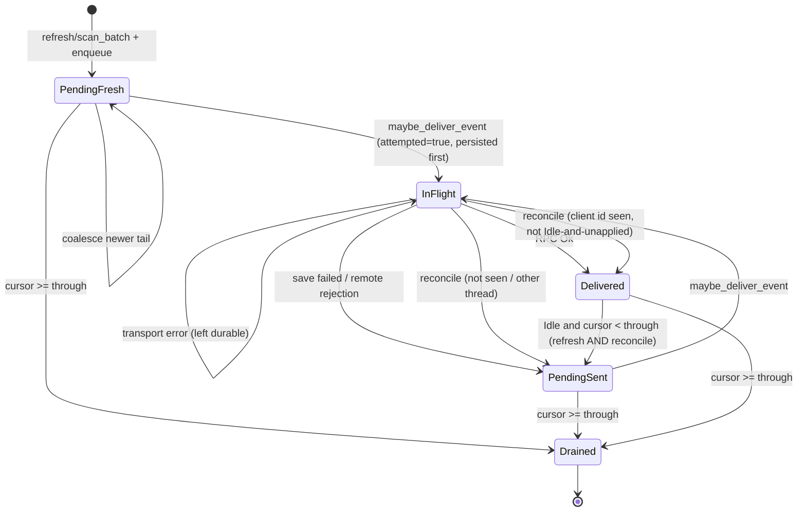

`PendingSent` means Pending with attempted=true. Its message id has been sent to Codex and must not change, so it is never coalesced again.

**2. Thread ownership (`codex-thread.json`).** `PersistedThread { native_active, native_inactive_reason, bootstrap_generation, ... }` (wake.rs:1888-1906). The states are Absent/Invalid, Active, Inactive(reason), legacy Inactive(unknown) and Archived (a rename). Successful resume moves it to Active (generation+1; the re-engaged event fires only from Inactive). Standalone fallback moves Active to Inactive(reason). A runner switch archives it. A missing remote thread replaces the thread only if it was inactive; an active one retries as transient.

### Verified concerns

- **Medium: a first-launch fallback shows as `conventional`.** `verify_remote_tui_support` (wake.rs:583) runs before any thread file exists. `mark_persisted_codex_thread_inactive` then does nothing (wake.rs:2247-2249), health returns `None` (wake.rs:2215-2217), and `status.rs:524-526` prints `integration=conventional`. The degraded integration event is still in events.log (wake.rs:476-480).
- **Medium: the health check ignores the cursor.** `read_codex_integration_health` counts every non-Delivered batch (wake.rs:2220-2224). Batches are popped only in `refresh`, which runs only while the native bridge runs. A degraded (standalone) orchestrator therefore shows `pending_batches=N oldest=<old>` even after its drain has passed them, which is the documented "stuck queue" signature (wake.rs:2178-2181). `pending_delivery_ids` already filters by cursor (wake.rs:2783-2789), so the two readers of this file disagree.
- **Low: the revert rule appears in three places** (wake.rs:2716-2732, 2811-2812, 2821-2828).
- **Low: a thread file that fails to load is treated as Absent and overwritten.** `load_thread_state` (wake.rs:2131-2153) returns None, logging only on a parse error, and `open_owned_thread` starts a new thread and overwrites the file. The old conversation is lost without any event. A future `STATE_VERSION` bump would do this to every project.
- **Low: `attempted` is an unnamed latch.** It is set before the durable save and not undone when the save fails (wake.rs:1028, 1037). This is harmless, since it only blocks coalescing.

### Refuted

- "attempted never reset" is intentional. The sent `message_id` is the Codex `clientUserMessageId` that `reconcile_thread` matches on, and coalescing would rewrite it (wake.rs:2614-2616).
- "Unknown phase stalls the queue" is not a queue issue. Nothing can be delivered in Unknown (wake.rs:2516), and the phase recovers via notifications or reconnect hydration (wake.rs:2380-2446).
- The legacy `native_active=false` with no reason is deliberate and rendered as `reason=unknown` (status.rs:532-534).
- The wire-string wake classification (wake.rs:3094-3153) is shared events.log coupling and not part of this machine.

### Recommendation

1. Write an inactive marker on a first-launch fallback, or fall back to the last integration event, so status reports degraded.
2. Filter health by `through > applied_cursor`.
3. Move the revert rule into a single `QueuedBatch::needs_redelivery(thread, phase, cursor)` method.
4. Rename `attempted` to `message_id_published` (keep a serde alias), or fold it into `Pending { published }`.
5. Replace `native_active` + reason with an `Ownership` enum. Archive the file and emit an event before replacing an unreadable or mismatched one instead of overwriting it.

Verdict: **worth-tidying.** The delivery logic is sound; the defects are in what gets reported and in the encoding.


### Verified concerns

- **medium**: A degraded first launch shows as 'conventional' in `shelbi status --full`. If the version gate fails before any thread file exists, run_standalone's mark-inactive does nothing, the health read returns None, and status prints integration=conventional instead of degraded.
  - Evidence: wake.rs:583 runs verify_remote_tui_support before open_owned_thread. NativeStartupError::incompatible sets reason VersionGate (wake.rs:198). mark_persisted_codex_thread_inactive returns Ok without writing when load_thread_state is None (wake.rs:2247-2249). read_codex_integration_health returns None (wake.rs:2215-2217). status.rs:524-526 maps None to Conventional. The integration event is still appended (wake.rs:476-480), so the event log does record it; only the status line is wrong.
- **medium**: The health snapshot ignores the applied cursor, so it can report a stuck queue that isn't stuck. Batches are popped only by DurableQueue::refresh, which runs only while the native bridge runs. In standalone (degraded) mode the agent's drain moves the cursor past the queued batches, but the file is never refreshed, so status shows pending_batches=N and an old oldest= timestamp indefinitely. That is exactly the 'stuck queue' signature the field documents. pending_delivery_ids does filter by cursor, so the two readers of the same file have already diverged.
  - Evidence: read_codex_integration_health filters only on !Delivered (wake.rs:2220-2224) and never reads the cursor; pending_delivery_ids filters on through > applied_cursor (wake.rs:2783-2789, 2296-2302); the field doc says a non-zero count with native_active=false is a stuck queue (wake.rs:2178-2181).
- **low**: The Delivered -> Pending revert rule (Idle && through > cursor && delivered to this thread) is written twice, and a third copy is the negated guard in the InFlight arm. If someone changes one copy and not the others, redelivery behaviour changes depending on whether the batch goes through refresh or reconnect.
  - Evidence: refresh wake.rs:2716-2732; reconcile_thread Delivered arm wake.rs:2821-2828 and InFlight arm wake.rs:2811-2812.
- **low**: A corrupt, version-mismatched or wrong-project codex-thread.json is treated as Absent, and the next start overwrites it with a brand-new thread. The old conversation is orphaned with no Shelbi event; a parse failure gets only a tracing warn, and a version or project mismatch is not logged at all. A future STATE_VERSION bump would therefore orphan every project's thread silently.
  - Evidence: load_thread_state wake.rs:2131-2153 returns Ok(None) on a parse error (warn only) and on version/project mismatch (no log); open_owned_thread then calls thread/start and save_json_atomic overwrites the path (wake.rs:2063-2096).
- **low**: `attempted` is a second, unnamed lifecycle bit beside DeliveryStatus, and only enqueue reads it. It is set before the durable save and is not undone when the save fails and the status goes back to Pending.
  - Evidence: Set at wake.rs:1028, read only at wake.rs:2752; the save-failure revert at wake.rs:1037 resets status but not attempted. This is harmless (it only blocks coalescing), but the encoding hides what the bit means.


### Concerns that did not hold up

- 'attempted is never reset, even after Delivered -> Pending' is intentional, not a bug. Once a batch has been sent, its message_id (used as Codex clientUserMessageId and matched against seen_client_ids in reconcile_thread) must not change. Coalescing would rewrite message_id (try_coalesce wake.rs:2614-2616), so the latch has to outlive the status revert. The only defect is naming and encoding.
- 'ThreadPhase::Unknown never reverts Delivered, so the queue stalls with no timeout' is not a queue-specific stall. DeliveryCall::for_batch returns None in Unknown (wake.rs:2516), so nothing can be delivered in that phase anyway. Unknown exits on turn/completed, on a status change to idle, or when rehydrate/reconnect sets the phase again (wake.rs:2380-2446). Any stall comes from the phase tracker, not the queue.
- 'native_active=false with no reason is a distinct unknown-cause state' is real but deliberate and documented. status.rs:532-534 renders it as reason=unknown, and resume clears both fields together (wake.rs:2004-2006).
- 'Wake classification depends on wire strings from other machines' is true (wake.rs:3094-3153), but it is the shared events.log key=value coupling rather than part of this machine. It belongs with the event-log schema discussion and is not a queue defect.


**Recommendation:** (1) Write codex-thread.json, or a minimal 'inactive, no thread' marker, on a first-launch fallback, or have health fall back to the latest integration event, so status reports degraded/version-gate. (2) Make read_codex_integration_health filter batches by `through > applied_cursor` (reuse the pending_delivery_ids predicate), so a degraded bridge doesn't show a stuck queue that isn't stuck. (3) Move the 'should revert to Pending' rule into one method on QueuedBatch, e.g. `fn needs_redelivery(&self, thread_id, phase, cursor) -> bool`, called from both refresh and reconcile_thread. (4) Rename `attempted` to something like `message_id_published` (keeping a serde alias), or fold it into the status as Pending{published: bool}, and document that it freezes coalescing. (5) Replace the native_active + reason pair with a serde enum Ownership { Active, Inactive { reason: Option<String> } }. On a version, project or parse mismatch, archive the old file (the existing archive path does this) and emit an event before starting a new thread, instead of overwriting it.


## Orphaned-pane reaper (dev + review slots)

**Verdict:** Worth tidying. I found no reachable mis-reap under default settings: the 180s launch-age guard and the per-tick overlay re-fold cover a fresh dispatch. But two reapers that do the same job have drifted apart. They resolve ownership from different sources (index vs live overlay), use different guards (grace, launch-age and backoff on dev only), and the grace constant is still tied to a cache layer the poller no longer reads. Mis-reaping booting panes has bitten this project repeatedly, so putting both behind one ownership resolver and one guard sequence would remove the drift risk cheaply.

**Verified concerns:** 2 medium, 2 low

**Key files:**
- `crates/shelbi-orchestrator/src/poller.rs:6211-6270 (maybe_reap_orphaned_review_slot)`
- `crates/shelbi-orchestrator/src/poller.rs:6272-6531 (ORPHAN_REAP_* constants, OrphanReap, maybe_reconcile_orphaned_pane, workspace_orphaned_by_board)`
- `crates/shelbi-orchestrator/src/poller.rs:1491-1496, 1636-1670 (warm_board; dead-pane reset and call site)`
- `crates/shelbi-orchestrator/src/poller.rs:5503-5588 (assigned_review_task_for reads the overlay; assigned_dev_task_for reads the index)`
- `crates/shelbi-state/src/board_index.rs:540-600 (read_board_with_cfg does not fold the overlay; fold_assignment_overlay; Warm threshold max(90s, 3 x interval))`

**Entity:** a live agent pane in a workspace slot whose board assignment has gone away (for example after a manual `task move`, an accept or bounce, or a rolled-back dispatch).

There are **two reapers**:

1. **Dev reaper** `maybe_reconcile_orphaned_pane` (crates/shelbi-orchestrator/src/poller.rs:6373-6511). It keeps per-poll-thread state `OrphanReap { since, failures, retry_at }` (6300). Guards, in order:
   - a warm board is required; a non-warm read holds the clock without resetting it (6390)
   - the orphan check (6393)
   - a 60s grace (6408)
   - the backoff (6415)
   - a launch-age < 180s guard (6432)
   - the live / non-user-shell probe (6440)
   
   Then it kills the pane, or backs off 60s doubling to 30m.
2. **Review reaper** `maybe_reap_orphaned_review_slot` (6211-6270). It is stateless and is reached from `handle_review_slot` when `assigned_review_task_for` returns `None` (6024). It clears the review-loaded marker and kills right away if the probe passes. It has no grace, launch-age guard or backoff.

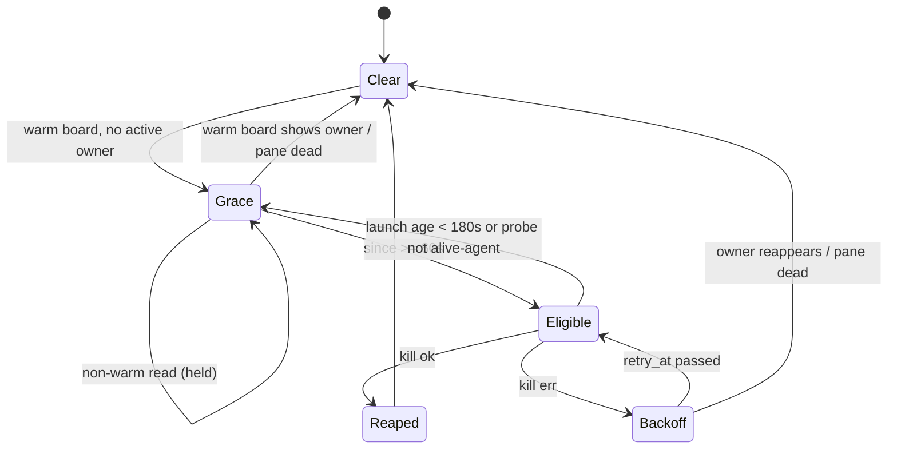

**Verified concerns**
- *Ownership source differs.* The dev reaper reads `assigned_to` from the daemon index without folding the overlay (poller.rs:6527, board_index.rs:540-548). The review reaper reads the live overlay (poller.rs:5524-5535). Every UI and CLI consumer folds the overlay (`fold_assignment_overlay`, board_index.rs:564). The daemon re-folds on every tick (github_store.rs:925-928), so the lag is bounded to one tick, but the dev reaper is the outlier.
- *Grace constant drifted from its data source.* `ORPHAN_REAP_GRACE = 3 x BOARD_CACHE_TTL = 60s` (6286) is justified by the process-local 20s cache. The poller now reads the daemon index, which stays Warm for up to max(90s, 3 x refresh_interval) (board_index.rs:589-605). The 180s launch-age guard covers fresh dispatches, but not slots without a launch stamp, and not a governor-throttled hub with interval > 60s.
- *No backoff on review reap failure.* The Err branch (6266-6269) logs at warn and returns `true` on every tick, which skips pane observation indefinitely.
- *Stale comment* at 5516-5518 says the index can lag 'indefinitely'. That is no longer true.

**Refuted:** The claim that a review dispatch racing a stale board is unprotected does not hold. Overlay-before-spawn plus the live overlay read cover it (6201-6210). The claim that a GitHub dev-slot overlay lag is unbounded does not hold either: the delta read re-folds every issue on each tick.

**Recommendation:** Share one owner resolver that applies the overlay fold over the warm board. Make the reap state an enum with one `step` function, used by both dev and review slots. Base the grace on the index Warm threshold. Fix the stale comment.


### Verified concerns

- **medium**: Each reaper works out who owns a slot from a different source. The dev reaper trusts the `assigned_to` in the daemon index, which is a snapshot of the assignment overlay taken at publish time. The review reaper reads the overlay live. Every other consumer (TUI, app, CLI workspace list, load, pool_admin, sidebar/machines models) calls `fold_assignment_overlay`. The dev reaper does not, so an overlay-only change takes at least one daemon tick to reach it.
  - Evidence: poller.rs:6527 `tf.task.assigned_to` comes from `warm_board` -> board_index.rs:540-548 `read_board_with_cfg`, which returns the index unfolded. poller.rs:5524-5535 reads `task_assignments` directly. The fold callers are listed in board_index.rs:564 plus shelbi-tui/src/app.rs:675, load.rs:62/529, pool_admin.rs:968 and others.
- **medium**: ORPHAN_REAP_GRACE is still worked out from the old process-local board cache TTL (3 x 20s = 60s). The poller now reads the daemon-published index, and that index still counts as Warm until it is max(90s, 3 x refresh_interval) old. So a board up to 90s+ stale can drive a reap after the 60s grace. Today the 180s launch-age guard covers a fresh dispatch. A slot with no launch stamp, or a hub whose governor stretches the interval past 60s, is covered only by the shorter grace.
  - Evidence: poller.rs:6272-6287 (the rationale cites BOARD_CACHE_TTL and the 'process-local cache'); issue_cache.rs:82 TTL=20s; board_index.rs:589-605 index_stale_threshold = max(90s, 3 x interval), default interval 30s (model.rs:1020); launch guard poller.rs:6432-6436 is skipped when workspace_launch_age is None
- **low**: The two reapers do not share the same guards. The review reaper has no failure backoff. A kill that keeps failing is retried and logged at warn on every poll tick, and the function returns true each time, so the rest of the tick's pane observation is skipped indefinitely. The dev path has 60s to 30m doubling backoff, an orphan_reap_failed event and a launch-age guard.
  - Evidence: poller.rs:6266-6269: Err branch only does tracing::warn and then `true`. Compare poller.rs:6485-6510.
- **low**: A stale comment in assigned_review_task_for says the index can lag the overlay 'indefinitely, since a delta tick only re-reads issues GitHub reports as touched'. The delta path now re-folds the overlay onto every issue on each tick, so the lag is bounded by one successful daemon tick. The comment overstates the risk, and it is the rationale that keeps the two ownership paths different.
  - Evidence: poller.rs:5516-5518 vs github_store.rs:925-928 (`by_id.into_values().map(|tf| fold_assignment(tf, &assignments))`)


### Concerns that did not hold up

- 'A dispatch racing a stale board snapshot is protected on dev slots only.' Mostly refuted. The review reaper needs no time-based grace for a fresh load: review dispatch writes the overlay before it spawns the pane, and assigned_review_task_for reads the overlay live (poller.rs:6201-6210, 5524-5535), so a booting review slot resolves to Assigned right away. Review loads also require the card to already be in the `review` column (load.rs:316), so a lagging index column does not open a window either. The real asymmetry is the missing backoff, recorded above.
- 'On GitHub a dev slot whose assignment lives only in the overlay could read as orphaned' indefinitely. Only partly true. The daemon re-folds the overlay onto the whole board on every tick (github_store.rs:880, 925-928), so the lag is one tick, not unbounded. A fresh dev dispatch is further protected by the 60s grace and the 180s launch-age guard. What remains is the narrower exposure described in the verified concerns.
- The review reaper does use the same live / non-user-shell probe guard as the dev reaper (poller.rs:6233-6243), so it cannot kill a sidebar user shell.


**Recommendation:** Steps, in order: (1) Add one `slot_owner(project, ws) -> Owner{Assigned(id)|None|Unknown}` helper that runs `fold_assignment_overlay` over `warm_board` (or reads `task_assignments` directly for remote backends), and use it in workspace_orphaned_by_board, assigned_dev_task_for and assigned_review_task_for so all three agree with the TUI and CLI. (2) Make OrphanReap a small enum (Clear | Grace{since} | Backoff{since, failures, retry_at}) with a single `step(observation) -> Action` function, and keep one per slot for review slots as well, so review reaps get the same backoff and a failed-reap event. (3) Base ORPHAN_REAP_GRACE on the index's Warm threshold (index_stale_threshold(interval)) rather than BOARD_CACHE_TTL, and correct the stale 'indefinitely' comment at poller.rs:5516.


## Workspace content and user-shell sessions (ensure/close)

**Verdict:** Worth tidying. The races are real: per-request daemon threads, unordered client background ops, and check-then-spawn with no lock. But SessionView's OnDeath handling makes the UI recover from them. The one lasting effect is an occasional orphan duplicate shell, editor or diff process. The fixes are mechanical and contained, and there is no design question to discuss. Two copies of the same bool-pair shell logic (WorkspaceView and ReviewView) are a clear candidate for a shared type.

**Verified concerns:** 1 medium, 4 low

**Key files:**
- `crates/shelbi-orchestrator/src/workspace_session.rs:145-362`
- `crates/shelbi-cli/src/commands/daemon/control.rs:490-500,735-760`
- `desktop/src/views/workspace.rs:233-240,286-299,588-614,695-810`
- `desktop/src/views/review.rs:318-322,355-362,1096-1163`
- `crates/shelbi-orchestrator/src/session_process_backend.rs:463-535`

### What it is
Dev workspaces have three daemon-owned auxiliary sessions: **editor**, **diff** and the **user shell**. Each is named `<project>/ws/<ws>/<role>`. Clients (the desktop WorkspaceView and ReviewView, the TUI sidebar, and the session relauncher) send `WorkspaceSessionOp::{Ensure, Close, EnsureShell, CloseShell}` over the daemon control socket. The daemon runs each request on its **own thread** (`control.rs:497` -> `run_workspace_session_job`, `control.rs:735`).

### How state is stored
- **Daemon:** nothing is recorded. Whether a session is "live" is worked out each time from `live_session_names` (filesystem discovery plus `choose_session`). Duplicate names are allowed. Ensure is check-then-spawn with no lock (`workspace_session.rs:160-211`, `297-342`). Close is a fire-and-forget SIGTERM (content) or SIGHUP (shell) sent to the one session `find_live` picks (`session_process_backend.rs:487-497`).
- **Desktop:** `shell_open` and `shell_starting` bools, duplicated in `workspace.rs:233-237` and `review.rs:318-321`. A `generation` guard drops results only when the shown workspace or review has changed (`workspace.rs:606`, `review.rs:1155`). `panel.active()` is set optimistically before an Ensure completes (`workspace.rs:701`). Recovery depends on `SessionView` `OnDeath` (Restart for content, Close for the shell).

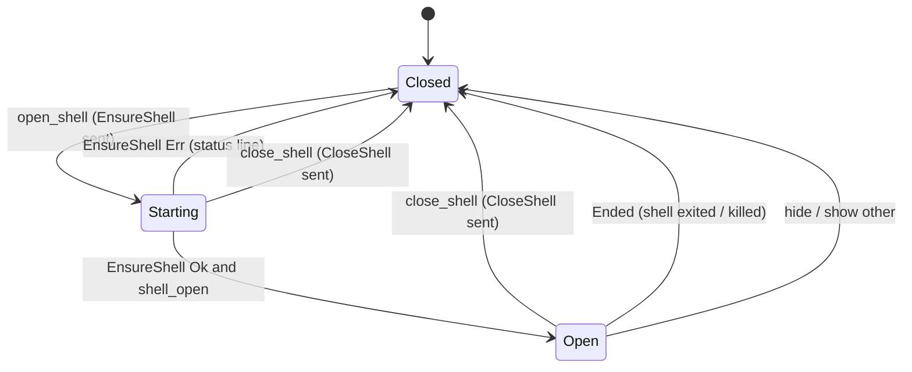

### Verified concerns
1. **Close and Ensure are not ordered** (low). Client ops go to the background thread pool (`workspace.rs:600-602`), and the daemon threads each request. Off, then on quickly, can let `EnsureShell` reuse the old live shell before `CloseShell`'s SIGHUP lands, so the shell the UI just attached dies. `close_content` followed by re-selecting Diff races the same way. Impact is bounded: the shell split closes through `Ended` (`workspace.rs:294-298`), and diff or editor views restart through `OnDeath::Restart`.
2. **Duplicate spawn from concurrent ensures** (medium). The TUI, the desktop and the relauncher (`relaunch.rs:155-167`) can all ensure the same name. Spawn does not reject a name that already exists, and close signals only `choose_session`'s pick, so an orphan duplicate login shell, editor or diff can keep running. The reaper only kills duplicates that are not listening.
3. **Callbacks not tied to a request** (low). The `open_shell` callback checks only `shell_open` (`workspace.rs:780`, `review.rs:1104`), so a stale attempt's Err can close a newer open. In `select_view`, an earlier Diff Err runs `show_agent` (`workspace.rs:714-717`), and the later Ok is then ignored.
4. **Illegal bool combination** `shell_starting && !shell_open` can be represented. It is avoided only by hand-pairing the writes at six sites across two files.
5. `unwrap_or(false)` on the live-name check (`workspace_session.rs:166, 311`) counts a failed SSH list as absent and spawns.

### Refuted
- The UI does not get stuck: the OnDeath handling resets it.
- `close_content` does not kill the attached pane, because `select_view(Agent)` re-attaches to the agent synchronously first.
- A local `live_session_names` call does not return Err.

### Recommendation (worth tidying)
- **Daemon:** add a per-name mutex around ensure and close in `workspace_session.rs`, and have close signal every live session with the name.
- **Desktop:** add a shared `ShellState { Closed, Starting { req }, Open }` used by both views, and tag requests (shell and select_view) with an id so stale answers are dropped. Optionally send ops through a serial queue per view so Close always reaches the daemon before a later Ensure.


### Verified concerns

- **medium**: Two concurrent ensures check, then spawn, under the same name with no lock. The result is an orphan duplicate session that close does not reliably reap.
  - Evidence: workspace_session.rs:162-168 and 308-314 check live_session_names, then spawn. The daemon threads requests (control.rs:497), and the TUI (shell/mod.rs ~5007-5021), the desktop, and the relauncher (shelbi-app/src/session/relaunch.rs:155-167) can all send Ensure for the same workspace. Spawning does not reject a name that already exists (session_process_backend.rs:463-467, shelbi_client::spawn), and names can repeat (choose_session picks one). signal_by_name only signals find_live, which is a single session (488-497). The cleanup in session_process_backend only kills same-named sessions that are 'alive but not listening', so a healthy duplicate login shell, editor or diff process stays running until a later close.
- **low**: Nothing orders Close and Ensure ops end to end, so a quick toggle can kill the session the UI just attached to.
  - Evidence: desktop/src/views/workspace.rs:600-602 and review.rs:1150-1152 send each op through cx.background_executor().spawn, a thread pool. The daemon then runs each WorkspaceSession request on a new thread (control.rs:497). A close_shell followed by open_shell can therefore run in either order. If EnsureShell finds the old shell still live, it returns Ok (workspace_session.rs:308-314), the UI attaches, and CloseShell's SIGHUP (349-362) then ends that shell. The same applies to close_content (workspace.rs:732-739) followed by re-selecting Diff. Impact is bounded: the shell's OnDeath::Close emits Ended and the split just closes (workspace.rs:294-298), and content views use OnDeath::Restart (session_view.rs:345), so a killed diff or editor is re-ensured.
- **low**: Client callbacks are guarded by generation, not by request, so an older attempt's answer is applied to a newer one.
  - Evidence: workspace.rs:606 and review.rs:1155 check only this.generation. The open_shell callback checks only this.shell_open (workspace.rs:780, review.rs:1104). After open, close, open, the first EnsureShell's result clears shell_starting and attaches early. If the first attempt returns Err, it sets shell_open=false and an error status even if the second attempt would succeed. In select_view, an Err from an earlier Diff request runs show_agent (workspace.rs:714-717) while a later Diff request is still in flight. The later Ok is then ignored because panel.active() is now Agent.
- **low**: shell_starting=true with shell_open=false can be represented, and is avoided only by convention.
  - Evidence: workspace.rs:235-237 and review.rs:319-321 are two independent bools. Every write site (workspace.rs:295-296, 776-777, 801-802; review.rs:359-360, 1100-1101, 1125-1126) sets the pair by hand. This is duplicated in both views with no shared type.
- **low**: A transport error from live_session_names counts as absent and leads to a spawn.
  - Evidence: workspace_session.rs:166 and 311 use .unwrap_or(false). On a remote host, a transient SSH failure on the list call followed by a successful spawn would create a duplicate. Locally, discover() does not fail (it returns Ok).


### Concerns that did not hold up

- The claim that a close-then-reopen race leaves the UI stuck showing a dead shell or diff does not hold. The shell's OnDeath::Close emits Ended, which resets shell_open and shell_starting (workspace.rs:294-298, review.rs:358-362). Content views use OnDeath::Restart, which re-ensures through WorkspaceContentRelauncher. The race causes a visible blip or a closed split, not a wedged state.
- The claim that close_content races its own select_view(Agent) does not hold. select_view(Agent) runs show_agent synchronously and re-attaches the content view to the agent before the Close op is sent (workspace.rs:697-700, 732-734), so the kill never hits the attached pane.
- A failed live_session_names check on local hosts is mostly theoretical: the local path wraps discover() in Ok (session_process_backend.rs:516-534). Only the SSH path can return Err.


**Recommendation:** (1) In the daemon, serialize ensure and close per session name with a keyed mutex (e.g. a Mutex<HashSet<String>> or per-name lock in run_workspace_session_job, or inside workspace_session.rs). This makes check-then-spawn atomic and puts Ensure and Close in a fixed order. Have close kill every live session with that name, not only choose_session's pick, so leftover duplicates get reaped. Optionally have close_user_shell wait for the shell to exit, or have ensure treat a session that was signalled recently as absent. (2) In the desktop, replace shell_open plus shell_starting in both views with one shared enum, e.g. `enum ShellState { Closed, Starting { req: u64 }, Open }`, plus a small shared helper. Have each callback carry its request id and drop answers for any id other than the current one. Do the same for select_view by tagging Ensure with a sequence number instead of comparing panel.active(). (3) Optionally run each view's session ops through a single serial queue, so Close always reaches the daemon before a later Ensure.


## Session wire connection (server outbox, client request/reply, attach)

**Verdict:** Worth tidying. The drop-on-clear defect is real in the code: enqueue_priority's 'must not be dropped' promise is broken by three clear paths. Combined with the client's request() having no timeout, it is a wedge waiting to happen. Today it is latent, because all callers query before attaching, and the reachable symptom (Exited downgraded to EOF) degrades gracefully. The fix is small and contained: split priority and output queues, and add a request timeout.

**Verified concerns:** 1 medium, 3 low

**Key files:**
- `crates/shelbi-session/src/transport.rs:110-230 (Outbox, enqueue/enqueue_priority/clear)`
- `crates/shelbi-session/src/transport.rs:380-440 (client_writer resync branch)`
- `crates/shelbi-session/src/session.rs:258-284 (attach/detach)`
- `crates/shelbi-client/src/connect.rs:200-290, 334-351 (handshake, request FIFO)`
- `crates/shelbi-client/src/reader.rs:100-150 (reply/event routing)`

### What it is
This covers one wire connection between a client (TUI, desktop app, orchestrator, `shelbi attach`) and a session host. There are two halves: a server-side per-client channel and a client-side `Connection`.

**Server (`ClientChannel`, transport.rs:110-230)**
- `hello_seen`: a local in `read_loop`. Before the Hello arrives, reads are bounded by a 5s absolute deadline (transport.rs:458-511).
- `attached`: an `AtomicBool` outside the outbox lock.
- `Outbox { queue, resync, closed }`: guarded by Mutex+Condvar. `enqueue` applies backpressure at 2048 frames. `enqueue_priority` skips the limit and is documented as "must not be dropped".

**Client (`Connection`, connect.rs:200-351)**
- The handshake is bounded by a socket read timeout. Over a relay that timeout is a no-op.
- Requests are matched to replies by position: `request()` holds `Mutex<Receiver<Reply>>` across send and `recv()`, with no timeout.
- When the reader thread exits, the senders are dropped and blocked receivers wake.

```mermaid
stateDiagram-v2
    [*] --> PreHello
    PreHello --> Handshaken: Hello
    PreHello --> Closed: 5s deadline / EOF / bad frame
    Handshaken --> Attached: Attach (priority Resync, attached=true)
    Attached --> ResyncPending: overflow + resync cap (queue.clear)
    Attached --> Closed: overflow, no resync cap
    ResyncPending --> Attached: writer sends fresh Resync (queue.clear)
    Attached --> Detached: Detach (attached=false; clear)
    Detached --> Attached: Attach
    Handshaken --> Closed: EOF / write fail / close_all
    Attached --> Closed: EOF / write fail / close_all
    Closed --> [*]
```

### Verified concerns
1. **Priority frames are cleared (medium, latent).** Three paths call `queue.clear()`: overflow at transport.rs:176-178, the writer's resync branch at transport.rs:404-407, and `detach()`'s `clear()` at transport.rs:205-209. The queue they clear also holds the priority frames: SnapshotData/InfoData/Pong replies, the Hello reply and Exited. `enqueue_priority` (transport.rs:191-198) does not check `resync`, so a reply queued while a resync is pending is always wiped. On the client, `request()` (connect.rs:276-280) then blocks forever, and because it holds the replies mutex, every later request blocks behind it. **Why it is latent today:** every caller checked runs `info()`/`snapshot()` before `attach()` (app `session/mod.rs:370`, `session/remote.rs:281`, orchestrator `remote_session.rs:512/523/682`, `session_process_backend.rs:352`, client `snapshot.rs:54`, cli `session_attach.rs:187`). With nothing attached, no output is queued and overflow cannot occur. Nothing enforces that ordering, though.
2. **An attached client can lose Exited (low, reachable).** Take a lagging client with `resync=true` when the child exits. `broadcast_exited` queues Exited, the writer's resync branch clears it, and the client sees EOF. `shelbi attach` then prints "session X ended" instead of the exit status (session_attach.rs:266-273).
3. **Detach race / non-idempotent Attach (low).** `detach()` stores `attached=false`, then clears (session.rs:279-283), and broadcasters test `is_attached()` without the outbox lock (transport.rs:268-273). An Output frame can slip in after the clear. A repeated Attach queues a second Resync behind live frames.
4. **Relay handshake has no bound (low).** `RelayStreamReader::set_read_timeout` is a no-op (relay.rs:477-486). The channel keepalive does not cover a session that is wedged behind a healthy relay. The `probe_handshake` liveness check in discovery.rs:145 narrows the window but does not close it.

### Refuted
- **Pre-hello Input/Kill:** a local peer can just send Hello first, so a gate adds nothing.
- **Ignored `conn.detach()` in the CLI:** the connection is dropped right after, and server EOF cleanup releases the sizing slot.
- **Panic-hook chaining:** one attach per process, so it does not matter.
- **Stray reply desync:** requests are serialized and each gets exactly one reply, so the only failure mode is a dropped reply.

### Recommendation
- **Split the outbox queues.** Keep `priority: VecDeque` (never cleared except on close) separate from `output: VecDeque` (subject to backpressure, resync and detach). The writer drains priority first, so the "must not drop" promise holds.
- **Move `attached` under the outbox mutex** as `enum Sub { Detached, Live, ResyncPending }`, so attach, detach and enqueue are atomic and Attach is idempotent.
- **Bound the client.** `request()` should use `recv_timeout` and mark the Connection poisoned on timeout. Add an explicit handshake timer for relay streams.

**Verdict: worth tidying.** Nothing is broken in production today beyond the Exited→EOF downgrade, but the first caller to query an attached connection would hang it.


### Verified concerns

- **medium**: Priority frames that the code documents as 'must not be dropped' are lost whenever the queue is cleared. This covers request replies (SnapshotData, InfoData, Pong, the Hello reply) and the Exited broadcast. Three paths clear the queue: enqueue overflow, the writer's resync branch, and detach(). enqueue_priority skips the resync check, so a reply queued while a resync is pending gets wiped by the writer's queue.clear(). The client's request() then blocks in rx.recv() with no timeout while holding the replies mutex, so every later request on that Connection hangs too.
  - Evidence: transport.rs:176-178 (st.queue.clear() on overflow), transport.rs:191-198 (enqueue_priority pushes even when resync=true), transport.rs:404-407 (writer clears queue on resync), transport.rs:205-209 (clear() on detach); connect.rs:276-280 (recv() with no timeout). Latent: every caller found (app session/mod.rs:370, session/remote.rs:281, orchestrator remote_session.rs:512/523/682, session_process_backend.rs:352, client snapshot.rs:54, cli session_attach.rs:187, session_cli.rs:198) calls info()/snapshot() BEFORE attach, so no output is queued yet and overflow cannot happen. It wedges the first time anyone queries an attached connection.
- **low**: A lagging attached client can lose the Exited event. Suppose the client has a pending resync when the child exits. broadcast_exited queues Exited as a priority frame. The writer then takes the resync branch, clears the queue, sends a Resync, sees closed, and breaks. The client gets EOF instead of Exited, so the exit code and status are lost. For example, `shelbi attach` prints 'session X ended' instead of 'exited (code N)'.
  - Evidence: transport.rs:313-318 broadcast_exited -> enqueue_priority; transport.rs:399-407 resync branch clears queue regardless of closed; reader.rs:118-121 only Frame::Exited yields SessionEvent::Exited; session_attach.rs:266-273 message choice.
- **low**: attached is an AtomicBool outside the Outbox mutex. detach() stores false and only then clears the queue. A broadcaster that read is_attached()==true just before that can enqueue an Output frame after clear(), so stale output reaches a detached client. A second Attach also queues another Resync behind whatever live frames are already queued, because Attach is not idempotent.
  - Evidence: session.rs:279-283 (mark_attached(false); clear()); transport.rs:268-273 enqueue_output checks is_attached() then enqueue() without a shared lock; session.rs:265-276.
- **low**: Over a relay, the hello handshake has no bound. RelayStreamReader::set_read_timeout is a no-op, and the relay keepalive only proves the channel is alive, not the session behind it. A session that accepts the connection and then wedges keeps the client in 'Connecting' indefinitely. discovery.rs:145 probe_handshake narrows this window but does not close it.
  - Evidence: relay.rs:477-486 (no-op set_read_timeout); connect.rs:221-232 relies on it; discovery.rs:145 liveness probe uses a separate throwaway connection.


### Concerns that did not hold up

- The pre-hello gate is missing (Input/Kill/Attach/SetMeta are accepted before Hello). This is true but not a meaningful risk. The peer is a local Unix-socket client that can send Hello first anyway, so a hello gate would add no access control. It is a protocol-tidiness nit only.
- The ignored conn.detach() result in session_attach.rs:220 leaves the server thinking a client is still attached. Refuted: the CLI breaks out and drops the Connection right after, the server's read_loop sees EOF, and serve_client runs close/deregister/forget_client (transport.rs:363-372). The sizing slot is released either way.
- The panic hook chains on every RawGuard::enter. This is true (session_attach.rs:706-710) but `shelbi attach` attaches once per process, so it is immaterial.
- A positional reply desync from one stray reply. No stray replies are possible today. Requests are serialized under the replies mutex, and each request frame gets exactly one reply, so the only failure mode is a dropped reply (the first concern), not an extra one.


**Recommendation:** Give the Outbox two queues: a priority deque (replies, Hello, Pong, Exited) that overflow, resync and detach never clear, and an output deque that backpressure may drop. The writer drains priority first. Fold `attached` into the Outbox mutex, as an enum OutputSub { Detached, Live, ResyncPending }, so attach/detach/enqueue transition under one lock and Attach becomes idempotent. On the client, give request() a timeout using recv_timeout, and poison the Connection on timeout so later requests fail fast instead of desyncing. Optionally bound the relay hello with a timer, since set_read_timeout is a no-op there.


## PTY size arbitration (session) and resize debounce/hold (desktop pane)

**Verdict:** Worth tidying. Both halves are small, lock-protected, and correct for the paths they handle today. The debouncer's generation check and the pane's hold/debounce logic hold up under scrutiny. The one reachable defect is narrow: the PTY stays sized for a departed active client, and the fix is a small policy change in forget_client. The pane's three-Option encoding works but relies on an inferred 'hold released' combination, which an explicit enum would make obvious.

**Verified concerns:** 1 medium, 2 low

**Key files:**
- `crates/shelbi-session/src/session.rs:151-167 (Sizing)`
- `crates/shelbi-session/src/session.rs:285-345 (on_input/on_resize/forget_client/apply_resize)`
- `crates/shelbi-session/src/session.rs:419-431, 779-828 (request_resize, debouncer, keepalive)`
- `desktop/src/elements/terminal/mod.rs:126-152, 737-778, 990-1033 (ResizeHold, attached/claim_size, note_viewer_size)`
- `desktop/src/app.rs:5885 (ResizeHold driven by sidebar reveal)`

### What it is
There are two cooperating machines that decide what size a session's PTY has.

**Session side (`crates/shelbi-session/src/session.rs`).** `Sizing` (151-167) holds `active: Option<u64>` (the last client to send Input; the PTY follows it), `per_client` sizes, `target: Option<size>`, a `generation` counter, `applied`, and `closed`. `request_resize` (423-430) sets the target and bumps the generation. The debouncer thread (781-816) waits for a target, sleeps `RESIZE_DEBOUNCE`, re-debounces if the generation moved, and otherwise applies the size. `apply_resize` (316-345) resizes the PTY and emulator and emits a sequenced in-band `Resized` under the output gate. While `active` is None, any client's Resize drives the size (299-305). A client becomes active through any Input, including the empty "claim" Input (transport.rs:543-544, shelbi-client connect.rs:323).

**Desktop pane (`desktop/src/elements/terminal/mod.rs`).** `reported_size`, `pending_size` and `resize_task` (372-374), together with the global `ResizeHold(HashSet<WindowId>)` (131-152) that the sidebar reveal animation sets each frame (app.rs:5885), are interpreted in `note_viewer_size` (990-1033). Focus gain calls `claim_size` (768-778), which flushes any pending size and sends a claim.

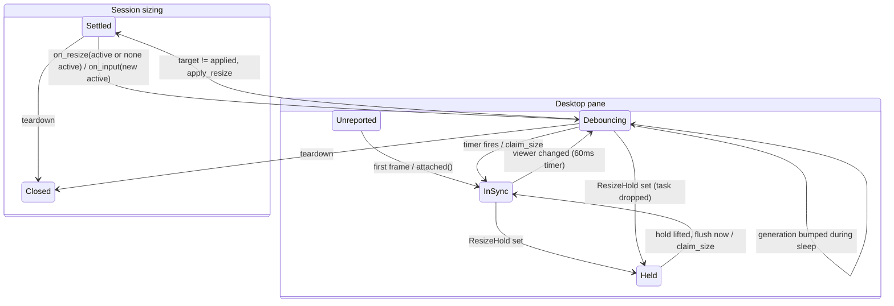

### Verified concerns
1. **Medium: the PTY keeps a departed active client's size** (session.rs:308-314). `forget_client` clears `active` without re-targeting, even though `per_client` still holds the remaining viewers' sizes. Remaining viewers see the wrong dimensions until they type, re-focus, or resize. An already-focused desktop pane does not re-claim, because claim fires only on a focus change (mod.rs:1211-1217).
2. **Low: "hold lifted" is an inferred combination** (mod.rs:1014). `pending.is_some() && task.is_none()` means "flush now", and only the held branch produces it today. A future path that sets pending without a task would bypass the debounce. The timer path also leaves `resize_task` as a completed `Some` (1023-1030), which is harmless only because pending is cleared.
3. **Low: the keepalive thread stops on `Sizing.closed`** (821-826). It borrows the debouncer's flag as a general shutdown signal.

### Refuted
- **"Idle viewers ping-pong the size":** refuted. Resizes are sent only when a viewport actually changes, so the policy is last-writer-wins with no loop.
- **"Stale ResizeHold entry":** true, but harmless. It is a tiny leak, and gpui's versioned window ids are not reused.
- **TUI/desktop claim parity:** refuted. The desktop, the TUI (shell/mod.rs:5655) and `session attach` (session_attach.rs:361) all claim on focus via the same client call.
- **Pending stranded after a hold lifts:** refuted. The same frame that clears the hold runs prepaint, which flushes the pending size.

### Recommendation
Worth tidying, not urgent:
- **Session:** re-target the PTY in `forget_client`, to the most recent remaining client or any remaining one. Give the keepalive thread its own shutdown flag.
- **Pane:** fold the three Options into `enum ResizeReport { Unreported, InSync(Size), Debouncing{size, task}, Held(Size) }` with a single transition function. `claim_size` and `offscreen_flush_resize` then share one `flush()`.


### Verified concerns

- **medium**: When the active (sizing) client disconnects, the PTY keeps that client's size. forget_client clears `active` but never re-targets to a remaining client's known size, even though per_client still holds those sizes. The remaining viewers see the session at the departed client's dimensions (clipped or letterboxed) until one of them types, regains focus (claim), or changes its own viewport. Example: a large `shelbi session attach` terminal that typed last exits while a desktop pane, already focused, stays on the session.
  - Evidence: crates/shelbi-session/src/session.rs:308-314. forget_client only removes the per_client entry and sets active = None, with no request_resize. A focus claim from desktop or TUI (mod.rs:1216-1217, shelbi-tui shell/mod.rs:5655) only fires on a focus *change*, so an already-focused pane does not re-claim.
- **low**: The pane's 'hold just lifted' state is inferred, not named. `pending_size.is_some() && resize_task.is_none()` means 'a hold ended, flush now' (mod.rs:1014). Today only the held branch produces that combination: claim_size and offscreen_flush_resize take pending, so they never leave it. Any future path that sets pending without a task would be misread as a released hold and reported immediately, which silently bypasses the debounce. The timer-fire path also leaves resize_task as Some(completed task) (mod.rs:1023-1030). That is harmless only because pending is None afterwards.
  - Evidence: desktop/src/elements/terminal/mod.rs:996, 1008-1020, 1023-1030
- **low**: The keepalive thread's lifetime is tied to `Sizing.closed`, a flag that belongs to the resize debouncer. This is a coupling smell, not a bug: teardown sets it once and both threads exit.
  - Evidence: crates/shelbi-session/src/session.rs:821-826 polls shared.sizing.lock().closed; it is set only at session.rs:593-597


### Concerns that did not hold up

- 'Two idle viewers of different sizes ping-pong the child's size' while active is None: on_resize only runs when a client's own viewport changes (the desktop sends only on change, mod.rs:991; the TUI on terminal resize). There is no feedback loop. The last client to resize simply wins, and the debouncer collapses bursts. This is a last-writer-wins policy, not oscillation.
- 'ResizeHold leaves a stale entry when a window closes mid-motion': that is true, but harmless. The entry is a single WindowId in a set that is only queried for live windows. gpui window ids come from a versioned slotmap, so a new window does not inherit the hold, and the sidebar animation is short. At most a few bytes leak.
- TUI/desktop parity drift on claiming: both clients claim on focus. The desktop does it in focus_changed (mod.rs:1216), the TUI in shell/mod.rs:5655, and `session attach` in session_attach.rs:361. All go through shelbi-client claim_size, an empty Input.
- Held -> unheld with no repaint stranding pending: ResizeHold::set runs in the window's render, and the element reads it in prepaint, so the frame that clears the hold also runs note_viewer_size for every painted pane and flushes it. A pane that is not painted has no viewer size to report anyway, and it flushes on its next paint or on focus.


**Recommendation:** Session side: in forget_client, when the departing client was active, re-target the PTY. Pick the most recently heard-from remaining client, which needs a last-seen ordering, or any remaining per_client entry, and call request_resize. Alternatively, record that the PTY waits for the next claim on purpose and document it. Give the keepalive thread its own stop flag, or rename `closed` to a session-wide shutdown flag outside Sizing. Pane side: replace reported/pending/resize_task with `enum ResizeReport { Unreported, InSync(Size), Debouncing { size, task }, Held(Size) }` plus one `note_viewer_size(viewer, held)` transition function. claim_size and offscreen_flush_resize then become one explicit `flush()`. The 'hold lifted' rule becomes the `Held(_) + !held` arm instead of `pending.is_some() && task.is_none()`. No urgency; do it when the code is next touched.


## Terminal pane session flags (desktop PaneStatus vs io, TUI exited/bell)

**Verdict:** Fine as is. The desktop side already has an explicit 4-state enum, and its transitions sit in two places in one file (connect error and apply_events/pump end). Closed vs Exited is exclusive on purpose and the supervisor handles it correctly. The TUI latches are correct: bell has one clearing consumer, and exited lasts one pane, which is rebuilt on every connect. What's left is cosmetic (writes after exit, a silent writer exit that the reader ending already covers).

**Verified concerns:** 2 low

**Key files:**
- `desktop/src/elements/terminal/mod.rs:185-215,395-460,737-760,800-870,1036-1047,1210-1225`
- `desktop/src/elements/terminal/session.rs:121-247`
- `crates/shelbi-tui/src/shell/terminal_view.rs:43-120`
- `crates/shelbi-tui/src/shell/session.rs:270-280,330-350,445-456`
- `desktop/src/views/session_view.rs:786-809`

### What it is
**Desktop** `TerminalPane` (desktop/src/elements/terminal/mod.rs) tracks its session in an explicit `PaneStatus` enum (`Connecting | Live | Exited(String) | Failed(String)`, mod.rs:185-194). Alongside it sit an `io: Option<Box<dyn SessionIo>>` (the writer link) and the `_pump` task. `session::wire` (session.rs:200-247) starts two threads: a forwarder that moves the reader's events onto an async channel, and a writer that owns the connection.

**TUI** `TerminalPane` (crates/shelbi-tui/src/shell/terminal_view.rs:43-53) has two pub latches, `bell: bool` and `exited: Option<Exited>`. `SessionManager` builds a new pane for every connection (shell/session.rs:278).

```mermaid
stateDiagram-v2
    [*] --> Connecting: connect()
    [*] --> Live: attached_to / canned
    Connecting --> Connecting: Transient (< 5s)
    Connecting --> Live: connect Ok
    Connecting --> Failed: connect Err
    Live --> Exited: SessionEvent::Exited / emit Exited
    Live --> Failed: stream end / emit Closed, io=None
    Exited --> Exited: stream end / io=None (no Closed)
```

### Transitions
- connect Ok goes through `attached()` (mod.rs:737-760). An Err sets Failed (mod.rs:420-425). Transient errors are retried for 5s (session.rs:144-153).
- `apply_events` handles `Exited`: it sets the status and emits `PaneEvent::Exited` (mod.rs:861-868).
- When the pump ends it emits `Closed` only if the pane is still `Live`, then clears `io` (mod.rs:825-831).
- TUI: `apply_event` sets `bell` and `exited` (terminal_view.rs:111-118). `pump_output` clears `bell` (shell/session.rs:453-456). Supervision reads `exited` (shell/session.rs:342-345).

### Verified concerns (both low)
- **Input after exit**: `send_input` and focus reports only check whether `io` is Some (mod.rs:1036-1047, 1219-1224), and `io` outlives the Exited status. Harmless: the host has no child to deliver the bytes to.
- **Silent writer exit**: the writer thread breaks on the first send error (session.rs:242-244) and nothing reports it. In practice a broken socket also ends the reader, so the pane still reaches Failed/Closed.

### Refuted
- "bell never cleared": `pump_output` clears it on every pump.
- "exited never cleared": the pane is rebuilt for each connection, so the latch only ever lasts one connection.
- "Exited never reports Closed": this is on purpose, so each death sends exactly one signal. `session_view.rs:786-809` sends Exited to `live_pane_died` (or `link_lost` for an SSH connection-lost exit), and Closed to `link_lost` (remote) or `live_pane_died`.

### Recommendation
Leave it as is. Optional tidy-ups: put `io` inside `Live`, or add a status check to input; replace the pub `bell` with `take_bell()`; add a comment saying Exited and Closed are mutually exclusive.


### Verified concerns

- **low**: A failed write isn't reported. The writer thread exits on the first send error and later SessionLink sends are silently dropped. The pane only changes status if the reader also ends.
  - Evidence: session.rs:242-244 breaks out of the writer loop when conn.input/paste/resize/claim fails. Nothing reports this, and the pane's status only changes on stream end (mod.rs:825-831). In practice a write fails because the socket broke, and that also ends the reader, so the pane reaches Failed/Closed anyway. This is a theoretical gap, not a reproduced one.
- **low**: Input still goes to the session after it exits. The Exited status doesn't block send_input or focus reports.
  - Evidence: mod.rs:1036-1047 and 1219-1224 only check whether io is Some. io stays Some after Exited (mod.rs:861-868) until the stream ends. The bytes reach a host whose child has exited and do no harm. At worst they're thrown away.


### Concerns that did not hold up

- 'bell is a latch that is never cleared': wrong. shell/session.rs:453-456 (pump_output) reads it and resets it to false on every pump. It's a correct one-shot latch with one producer and one consumer.
- 'TUI exited is never cleared, so Output/Resync after Exited leaves the pane not Alive': a pane is bound to one connection, and after the child exits nothing more comes from it. A restart or reconnect creates a new TerminalPane (shell/session.rs:278), so the latch dies with the pane. Supervision (session.rs:342-345) is right to treat an exited pane as Dead.
- 'An Exited pane never reports Closed, so supervisors must handle both signals': this is deliberate. mod.rs:826 emits Closed only when the stream ends while Live, so each pane death produces exactly one signal (Exited or Closed). session_view.rs:786-809 handles both and sends each to live_pane_died or link_lost. Emitting Closed after Exited as well would restart the pane twice.
- 'status and io are independent': true, but io is just the transport handle. It only goes from Some to None when the stream ends, and every write path already checks for that. The only mismatch is the harmless write after exit listed under verified concerns.


**Recommendation:** No change needed. If someone is already in this code, two small tidy-ups would help. In the desktop pane, put io inside the Live state, or add a status == Live check to send_input and focus_changed so an exited session gets no input. In the TUI pane, swap the pub bell field for a take_bell() method so the latch has an owner. A comment on PaneStatus saying Exited and Closed are mutually exclusive by design would stop future readers from "fixing" it.
