# Implicit state machines: shared app model

Part of the [implicit state machine audit](../implicit-state-machines.md). Audit of origin/main at b93c57c4, 2026-11-05. 16 machines in this area, most pressing first.


## Board read load state and done-history paging

**Verdict:** Needs further thought. There is a live, user-visible bug: the TUI cannot page done-history past page 2, because the 750ms closed fold rewinds the cursor and keeps the extra pages. Desktop has a weaker form of the same flaw. The fold logic exists twice (shelbi-app BoardInput and KanbanApp) and has already drifted, including a blocking network call on the TUI UI thread.

**Verified concerns:** 1 high, 3 medium, 2 low

**Key files:**
- `crates/shelbi-app/src/board.rs:655-960`
- `crates/shelbi-tui/src/kanban.rs:922-1060`
- `crates/shelbi-tui/src/kanban.rs:1150-1211`
- `desktop/src/views/issues.rs:740-870, 1034-1056, 2347-2354`
- `crates/shelbi-tui/src/shell/mod.rs:550-580`

### What it is
Each board client builds up an Issues board input from two independent refreshers: the **open board** (from the daemon's board-index file, an outcome of `Cold | Warm | Failed`) and the **first done-history page** (served from a 10-minute cache). An explicit "load more" fetches later history pages live. The outcome enum exists (`BoardOutcome`, `crates/shelbi-app/src/board.rs:659`), but every client flattens it back into loose fields.

There are two copies of the fold:
- **shelbi-app `BoardInput`**, used by desktop: `loading`, `error`, `banner`, `open`, `closed_first`, `closed_more`, `closed_next_cursor`, `closed_loaded` (`board.rs:806-838`), plus `apply_open`, `apply_closed` and `apply_more` (`board.rs:880-956`).
- **TUI `KanbanApp`**, a hand-written parallel copy: `board_loading`, `open_tasks`, `closed_first_page`, `closed_more`, `closed_next_cursor`, `board_banner`, `status_line`, `refresh_errors` (`crates/shelbi-tui/src/kanban.rs:60-221`), plus `apply_board_data`, `apply_closed_page` and `load_more_done` (`kanban.rs:922-1211`).

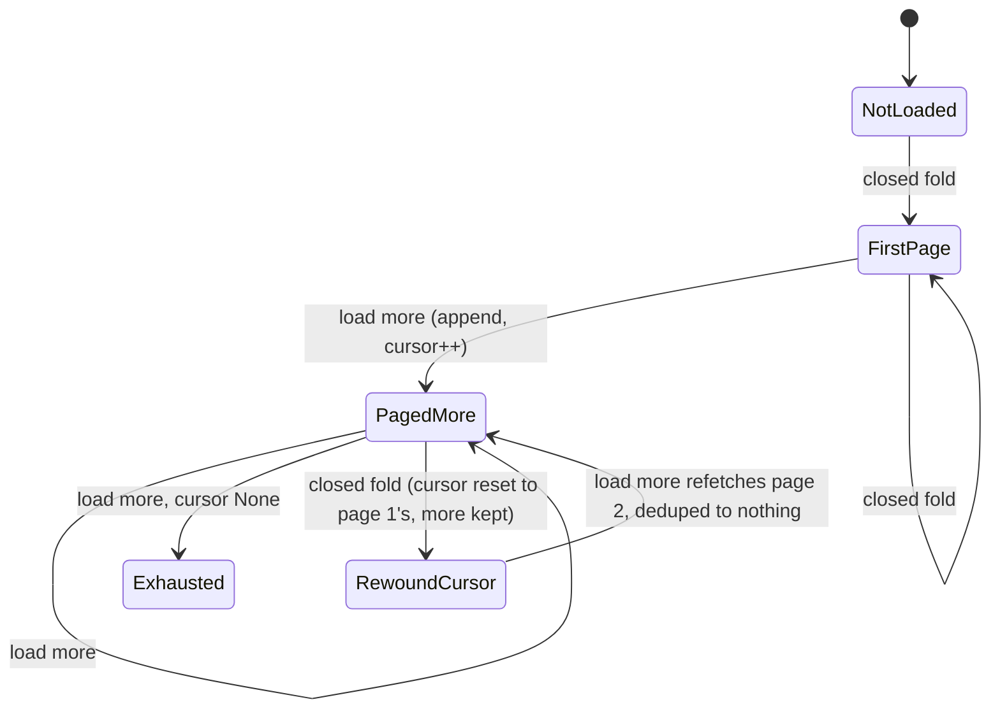

### Verified concerns
1. **High: TUI history paging stops at page 2.** The shell calls `request_refresh` every 750ms (`shell/mod.rs:554-561`), and that includes `closed_refresher` (`:2154`). Each result is folded unconditionally (`:576-578`), and `apply_closed_page` sets `closed_next_cursor` back to page 1's cursor (`kanban.rs:1019-1021`) while keeping `closed_more`. The next `m` (`handlers/kanban.rs:104`) fetches page 2 again, and the id dedup (`kanban.rs:1187-1197`) discards all of it, so the press looks like it did nothing.
2. **Medium: desktop has the same rewind, less often.** `to_fold` (`desktop/src/views/issues.rs:2347-2354`) skips a closed read whose fingerprint matches, but it folds whenever a mutation is pending or page 1 changed. Each such fold rewinds the cursor through `BoardInput::apply_closed` (`board.rs:934-940`).
3. **Medium: TUI load more blocks the UI thread** on a live GitHub fetch (`kanban.rs:1170-1177`). Desktop spawns a thread and guards it with `load_more_in_flight` (`issues.rs:1045-1056`).
4. **Medium: the two fold copies have drifted.** The initial loading flag differs: `kanban.rs:492` starts `false`, `board.rs:858` starts `true`. Fingerprint skipping exists only on desktop. Error coalescing and status-line handling exist only in the TUI.
5. **Low: mixed states can be represented.** `Failed` never clears `loading`, and `Cold` after `Warm` sets `loading=true` while the old cards still show (`board.rs:915-922`). Desktop paints "Loading board…" or a Loading detail pane in that case (`issues.rs:681, 1835, 2304`).
6. **Low: stale TUI status line after recovery.** `clear_refresh_error` logs "recovered" but leaves the "refresh failed" text on `status_line` (`kanban.rs:559-563`).

### Refuted
- **"Retry every tick, no backoff."** `KanbanApp::maybe_refresh` is dead code. Both hosts re-read on a fixed cadence whatever the outcome, and the open read is a local file read.
- **"Search load-more has no in-flight guard."** `BoardSearch::load_more` guards on `in_flight` (`board_search.rs:347-350`).
- **"Duplicate LoadMore on repeated desktop presses."** `issues.rs:1045` returns early while one is in flight.

### Recommendation
Model the history as one explicit type in shelbi-app, `History::{NotLoaded, Loaded{first, more, cursor}}`, with a single rule: a first-page refresh moves the cursor only while `more` is empty, or resets `more` and the cursor together when page 1 really changed. Model the open read as `OpenBoard::{Loading, Ready, Failed{last, msg}}`. Then have the TUI use `BoardInput` instead of its own copy, and give it the same off-thread load-more with an in-flight flag. The quickest patch for the live bug is to leave `closed_next_cursor` alone in `apply_closed` / `apply_closed_page` when `closed_more` is non-empty.


### Verified concerns

- **high**: TUI 'load more' effectively can't get past page 2: every closed-page fold resets the cursor to page 1's next cursor, and the shell folds one every ~750ms.
  - Evidence: shell/mod.rs:554-561 calls request_refresh every REFRESH_INTERVAL (750ms, :380). That requests closed_refresher (:2154), and the result is folded unconditionally at :576-578 into kanban.apply_closed_page, which sets closed_next_cursor = page.next_cursor (kanban.rs:1019-1021) while keeping closed_more. A later 'm' (handlers/kanban.rs:104 -> kanban.rs:1169) re-fetches page 2, and the id dedup (kanban.rs:1187-1197) throws it all away, so pressing 'm' looks like it did nothing (only a second press inside the same 750ms window gets further)
- **medium**: Desktop has the same cursor rewind, but less often: the closed fold is skipped when the read's fingerprint matches and nothing is pending, so it rewinds whenever page 1 changes or a mutation is in flight.
  - Evidence: to_fold (issues.rs:2347-2354) folds when print differs OR has_pending(). The fold then reaches BoardInput::apply_closed (board.rs:934-940), which resets closed_next_cursor and keeps closed_more
- **medium**: The TUI's load more runs a live, uncached GitHub page fetch on the UI thread, so the TUI hangs for the length of the network call. Desktop does the same fetch on a thread with an in-flight guard.
  - Evidence: kanban.rs:1170-1177 runs issue_store_for + store.closed_page(Some(cursor)) synchronously from the key handler. Compare desktop issues.rs:1045-1056 (std::thread::spawn + load_more_in_flight)
- **medium**: The fold logic is duplicated: KanbanApp re-implements BoardInput's apply_open/apply_closed/apply_more instead of using it, and the two copies have already drifted.
  - Evidence: kanban.rs:922-1060,1158-1211 against board.rs:880-956. Drift: TUI board_loading starts false (kanban.rs:492) while BoardInput.loading starts true (board.rs:858). Desktop folds closed reads behind a fingerprint and the TUI doesn't. Only the TUI has an error coalescer and status_line handling
- **low**: loading/error/banner are independent fields, so mixed states can exist: Failed leaves loading=true (desktop's first read fails -> 'Loading board…' plus an error), and Cold after Warm sets loading=true while the old cards still show.
  - Evidence: board.rs:915-922. Desktop shows 'Loading board…' in empty columns and a Loading detail pane whenever model.loading is set (issues.rs:681, 1835, 2304). TUI board_loading=true with old tasks (kanban.rs:982) only suppresses the overlay because the overlay is gated on tasks.is_empty() (kanban.rs:2085)
- **low**: After recovery, the TUI's status line still shows the 'refresh failed' text. The coalescer logs 'recovered' but clear_refresh_error never touches status_line, so the UI and the error log disagree.
  - Evidence: kanban.rs:559-563 only appends the recover() line. fail_refresh set status_line at kanban.rs:554


### Concerns that did not hold up

- 'Failed refreshes retry every tick with no backoff' does not hold. KanbanApp::maybe_refresh (kanban.rs:1539) has no non-test caller. The shell and desktop re-read on a fixed cadence whatever the outcome (shell/mod.rs:554, issues.rs:823), and the open read is a local board-index file read that spends no GitHub budget (board.rs:705-712). Failed gets the same cadence as success, not a faster one.
- 'Search load-more has no in-flight guard' (desktop issues.rs:1037-1042) does not hold. BoardSearch::load_more returns None while in_flight or due_since is set (board_search.rs:347-350).
- 'Desktop load_more() only checks has_more_done, so repeated presses send duplicate LoadMore' does not hold. The Intent goes to issues.rs:1034, which returns early while load_more_in_flight is set (:1045-1047).
- 'A changing error text defeats the coalescer' cannot be confirmed. Refresh failures are formatted 'refresh failed: {e}' from issue_store_for/read_board_report errors (board.rs:726-728), and none of the code read here puts a counter or timestamp into them. It could still happen if a gh error carries a reset time, so the bound is only as good as the message is stable.
- 'Desktop load-more thread hangs forever' was not verified. Whether more_closed can block with no timeout depends on the store's gh client timeouts, which this audit did not trace. The single spawn per press is guarded, so the worst case is a stuck 'loading more history…' status, not duplicate requests.


**Recommendation:** Make history paging one explicit type in shelbi-app, for example `enum History { NotLoaded, Loaded { first: Vec, more: Vec, cursor: Option<String> } }`, with one rule. A first-page refresh only moves the cursor while `more` is empty (or when page 1 actually changed, in which case it resets both `more` and the cursor together). load-more advances from the last fetched page's cursor. Keep the open read as `enum OpenBoard { Loading, Ready{..}, Failed{last: Option<Ready>, msg} }` instead of loading/error/banner fields. Then switch KanbanApp to use BoardInput (and the same off-thread load-more with an in-flight flag), so the TUI and desktop share one fold. In the short term, the smallest fix is in apply_closed/apply_closed_page: skip overwriting closed_next_cursor when closed_more is non-empty. Separately, move the TUI's load_more_done off the UI thread.


## Issue in-place edit autosave (draft + write lane)

**Verdict:** Needs further thought. A reachable stuck state exists. The board-move WriteTicket lives in a per-view map, but the lane it locks lives in a process-global store. If the project is switched while a move is in flight, end_write is never called, and that issue can no longer autosave or take board commands until the app restarts. A hung daemon mutation, which has no timeout, causes the same stuck lane. The rest of the machine is careful and well tested, but the spread-out, derived state makes this kind of ownership gap easy to miss.

**Verified concerns:** 1 high, 2 medium, 1 low

**Key files:**
- `crates/shelbi-app/src/issue_edit.rs:121-300 (FieldDraft/Draft/Lane fields, settled(), shared store)`
- `crates/shelbi-app/src/issue_edit.rs:441-632 (poll/take_job/finish/begin_write/end_write: the lane transitions)`
- `crates/shelbi-app/src/issue_edit.rs:666-838 (apply_read, status() derivation, collect())`
- `desktop/src/views/board_state.rs:1776-1960 (begin_mutation holds commands on busy lane; WriteTicket kept in per-view tickets map; finish_mutation calls end_write)`
- `desktop/src/views/issues.rs:460-475, 749-760, 904-940 (stop_workers on project switch; Done::Mutation drained only by this view's tick; run_save records into shared store directly)`

### What it is
This is the desktop's per-issue in-place editor autosave. A **Draft** holds the title and body text plus a pending workflow change. A per-issue **Lane** serializes every write to that issue: autosaves and board moves/reorders. There is one `IssueEdits` per project in a process-global `OnceLock` map (`issue_edit.rs:295`), shared by all windows of that project and by the save worker threads, and guarded by a single `Mutex`.

### How the state is stored
`SaveStatus` is never stored. `status()` (`issue_edit.rs:746-778`) works it out from about 12 fields using this precedence: conflict, then failure, then invalid, then sent/awaiting, then dirty, then saved.
- `Draft` (151-171): `last_edit`, `due`, `failure`, `awaiting`, `stale_refusals`, `saved`, `open`, `workflow`, `sent_workflow`, `base_state`
- `FieldDraft` (121-135), one per field: `base`, `local`, `sent`, `superseded`, `theirs`, `set_aside`
- `Lane` (226-240): `in_flight: Option<u64>`, `sent_from`, `known`, `own_from`, `held`

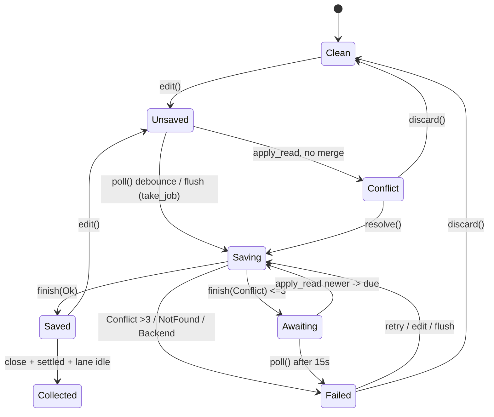

The lane has its own small machine. It is **Idle** until `take_job` (a save) or `begin_write` (a move) makes it **Busy(seq)**. Only `finish` or `end_write` with the same seq makes it **Idle** again, and that also replays any `held` read.

### Verified concerns
1. **High: a lane stranded by a project switch during a board move.** The move's `WriteTicket` is kept in the per-view `BoardState.tickets` (`board_state.rs:1906`). Its result returns through the view's own `done_rx` (`issues.rs:904-914`, `753-757`), and only that path calls `end_write` (`board_state.rs:1944-1946`). On a project switch, `app.rs:2331` takes and drops the view, so the result is lost. The shared store survives, so when the project is shown again `busy(id)` is true for good:
   - edits never save, because `take_job` refuses (`issue_edit.rs:463`)
   - every command on the card is held as "waiting for the save in progress" (`board_state.rs:1853-1858`)
   - reads are parked in `lane.held` and never applied (669-673)

   Saves do not have this problem because `run_save` writes the result into the shared store from the worker thread (`issues.rs:928-940`).
2. **Medium: no in-flight timeout.** `mutate_done` (`shelbi-client/src/control.rs:126-160`) reads without a timeout. A daemon that hangs (as opposed to disconnecting) pins the lane, and the UI shows "Saving…" forever. `STALE_WAIT` covers only the awaiting-a-fresh-read state.
3. **Medium (structural):** lane ownership is split between the shared store and a per-view map. That split is the root cause of item 1.
4. **Low:** the legal flag combinations are encoded five times, in `take_job`, `settled`, `status`, `discard` and `collect`, and the copies are already slightly inconsistent. For example, `discard()` leaves `sent` and `stale_refusals` alone, and `edit()` clears `failure` but not `awaiting`. No live bug was found.

### Refuted
- **Second-resolution revisions:** local stores use sub-second `Utc::now()`. Equal-second reads are accepted, which is the safe direction. Content guards (`superseded`, `expect_title`, `expect_body`) catch same-second races.
- **awaiting together with failure:** not reachable.
- **Closed failed drafts never collected:** intended, so `unsaved()` can show them when the project returns.
- **TUI parity:** there is no TUI copy of this machine.

### Recommendation
- Settle board-move tickets in the shared store from the worker thread (mirror `record_save`), or keep tickets inside `IssueEdits`.
- Add a started-at time to `in_flight` and expire it in `poll()` to a `Failed` state.
- Optionally, fold `in_flight`/`sent`/`awaiting`/`failure` into one per-draft `Phase` enum, so `take_job`, `settled` and `status` all match on a single value.


### Verified concerns

- **high**: Switching projects while a board move is in flight leaves that issue's lane in flight for the rest of the process. After that, no edit to the issue saves, and every later command on it waits behind 'the save in progress'.
  - Evidence: board_state.rs:1906-1907 keeps the WriteTicket in the per-view BoardState.tickets map. issues.rs:904-914 has the mutation thread send Done::Mutation to this view's done_tx, and only this view's tick drains it (issues.rs:753-757 -> finish_mutation -> end_write at board_state.rs:1944-1946). On a project switch, app.rs:2331-2332 takes the IssuesView and calls stop_workers, so the result goes to a dropped receiver and end_write never runs. issue_edit::shared (issue_edit.rs:295) keeps the store alive, so when the project is shown again the new BoardState sees busy(id)==true (issue_edit.rs:596). begin_mutation then holds every command (board_state.rs:1853-1858), take_job refuses (issue_edit.rs:463), and every read for the issue is held instead of applied (669-673). Saves avoid this because run_save writes into the shared store from the worker thread (issues.rs:928-940). Board moves do not.
- **medium**: Nothing times out lane.in_flight. A daemon that accepts a mutation and never answers leaves the issue on 'Saving…' with the lane locked. The 15s STALE_WAIT covers only the awaiting state.
  - Evidence: issue_edit.rs:535-538 and 623-626 clear in_flight only for the matching seq. ControlClient::mutate_done (shelbi-client/src/control.rs:126-160) loops on read_frame with no read timeout (connect.rs:232 clears the handshake timeout). A closed socket returns EOF and recovers. A hung daemon does not.
- **medium**: A busy lane is held by one per-view map (tickets) and one shared store, so lane ownership has two owners with different lifetimes. This is the structural cause of the high-severity concern above.
  - Evidence: IssueEdits.lanes is in the shared store (issue_edit.rs:274-275). BoardState.tickets is per view (board_state.rs:373, 418).
- **low**: The state is a cross product of about 12 Option, bool and counter fields, with no single place that says which combinations are legal. Every new field must be threaded by hand through settled(), take_job's refusal list, status() precedence, discard() and collect(), and they are already slightly inconsistent.
  - Evidence: take_job refuses on in_flight|awaiting|failure|conflict (463-466). settled() checks dirty|conflict|failure|awaiting|sent_workflow|sent (214-221). status() orders conflict>failure>invalid>sent|awaiting>dirty>saved (746-778). discard() clears failure/awaiting/due/workflow but leaves sent/sent_workflow/stale_refusals alone (419-437). edit() clears failure but not awaiting (353-355). No live bug was found, but the rules are spread across five functions.


### Concerns that did not hold up

- Second-resolution revisions (mostly refuted). Local stores stamp Utc::now() (shelbi-state lib.rs:3568 and others), and to_rfc3339 keeps sub-second digits, so only the GitHub store is second-resolution. Lane::read accepts equal-second reads (>=), which is the safe direction because nothing is dropped. apply_read then decides on content: the superseded check catches a pre-save copy, and any other text difference is treated as their change. Saves also carry the expect_title/expect_body text guards (take_job 510-517), so a same-second remote edit is still refused by content. What remains is a precision limit of updated_at as a revision, not a fault in this machine.
- 'awaiting=Some together with failure=Some' is not reachable. take_job refuses while failure is Some, so failure is None when a job is out. finish sets awaiting or failure, never both (574-578). poll clears awaiting before it sets failure (446-451). retry clears both.
- A closed draft with failure=Some never being collected is intended. It is the documented 'kept for when the project is back' behaviour (shared() docs at 291-294, flush_all_edits/stop_workers comments), and unsaved() lists it. It is not a leak.
- TUI/desktop parity drift does not apply. Only the desktop and the CLI/exec paths use issue_edit. The TUI kanban has no in-place autosave, so there is no second copy of this machine to drift.
- A shared store across windows of one project with no owner is intentional and guarded by a single Mutex (lock() recovers poisoning). All transitions happen under that lock, so there is no intra-process race. The real ownership problem is the per-view tickets map, recorded above.


**Recommendation:** 1) Fix the ticket ownership. Either have the mutation worker thread call issue_edit::lock(&edits).end_write(...) directly, as run_save already does with record_save, and only notify the view afterwards, or keep the WriteTicket inside IssueEdits keyed by id so any view can settle it. 2) Give Lane an in-flight deadline. Store in_flight as Some((seq, started: Instant)) and have poll() expire writes past a bound (for example 60s) into Failed("no answer from the daemon"), dropping the held read. A read timeout on mutate_done would also help. 3) Optional tidy: replace in_flight/sent/sent_workflow/awaiting/failure with one per-draft phase enum, e.g. enum Phase { Idle, Sending{seq}, Awaiting{since}, Failed(String) }, while conflict and dirty stay per field. take_job, settled() and status() can then match on it instead of re-listing the same flag checks in five places.


## Board optimistic mutation lifecycle (desktop Pending / TUI PendingMove)

**Verdict:** Needs further thought. Two clients implement the same optimistic-move idea with different settle rules and different conflict semantics. One of them (the TUI's fresh-read guard plus its settled overlay with no timeout) can silently apply a change over another client's edit, or hide the card's real status indefinitely. That is a parity and design question, not just a cleanup.

**Verified concerns:** 2 medium, 3 low

**Key files:**
- `desktop/src/views/board_state.rs:246-283, 532-616, 1776-2028, 2078-2118`
- `crates/shelbi-tui/src/kanban.rs:345-363, 1735-1986, 2024-2035`
- `crates/shelbi-tui/src/kanban.rs:295-321 (ExecutorMovePersister)`
- `crates/shelbi-app/src/exec_daemon.rs:24-60, 404-413`
- `desktop/src/views/issues.rs:748-760, 895-918`

### What it is
Both boards show a card at its *intended* position while a daemon mutation is in flight, and only stop overlaying once a read confirms the change. The two implementations do this independently.

- **Desktop** (`desktop/src/views/board_state.rs`): `pending: BTreeMap<String, Pending>`, where `Pending` holds `acked`, `landed: Option<ExpectedState>`, `prev: Option<Box<Pending>>` (the rollback chain), `to_status` / `to_slot` / `to_workflow`, and `renumbers`. Supporting maps: `held` (commands waiting on the issue_edit save lane), `tickets`, `notices`, plus an `ADD_KEY` sentinel entry for AddIssue.
- **TUI** (`crates/shelbi-tui/src/kanban.rs`): `pending_moves: HashMap<String, PendingMove>` where `PendingMove { confirmed, shown_status_id, rx: Option<(Column, Receiver)>, queue: VecDeque<Column> }`. Nothing names the state; it is inferred from `rx` and `queue`.
- **Daemon guard** (`crates/shelbi-app/src/exec_daemon.rs`): `execute_mutation` re-reads the expected state at send time (lines 30-40, 404-411). `execute_mutation_expecting` takes the caller's snapshot (lines 45-60). The desktop uses the snapshot; the TUI uses the fresh read.

```mermaid
stateDiagram-v2
    [*] --> Idle
    Idle --> Held: lane busy (desktop)
    Held --> Sent: release_held
    Idle --> Sent: begin_mutation / move_card
    Sent --> Queued: repeat move (TUI)
    Queued --> Sent: hop landed, next hop
    Sent --> Acked: Ok(landed?)
    Acked --> Sent: follow-up (desktop: landed known; TUI: settled re-move)
    Sent --> Failed: Err / Disconnected
    Failed --> Idle: restore prev / confirmed
    Acked --> Idle: read confirms (settle_pending / reconcile)
```

### Settle rules differ
- Desktop (`settle_pending`, board_state.rs:589-616): if the daemon reported `landed`, the entry settles once the read revision is at or past it. Otherwise a move settles when the card sits in its target column, a reorder when the card is at its slot or its revision changed, and anything else when the revision changed. A missing card drops the entry.
- TUI (`reconcile_pending_moves`, kanban.rs:1949-1961): an entry settles only when `resolved_status_id == shown_status_id` or the card is gone. There is no revision check and no timeout.

### Verified concerns
1. **TUI settled overlay with no timeout** (kanban.rs:1951-1970, 2032). If another client moves the card after our hop lands, or the index never agrees, the card stays shown in the optimistic column and reorder is refused indefinitely. Medium.
2. **The two clients have different conflict semantics** (exec_daemon.rs:30-40 vs 45-60; kanban.rs:309, 322; issues.rs:908-912). The TUI's guard is a read taken milliseconds before sending, so it essentially never detects a stale view, and it discards the landed state the daemon returns. The desktop refuses with a Conflict. The doc comment "the app last saw" describes the desktop path only. Medium.
3. **Keyboard vs drag on the desktop** (board_state.rs:1839-1846 vs 2078-2081, 2111-2113). An acked card with landed state can be moved by key but not dragged. Side effect: the "(gated merge)" label for a follow-up move is computed via `drop_target_status`, which returns Refused, so the label is wrong (1780-1783). Low.
4. **No deadline on in-flight writes.** The desktop mutation thread (issues.rs:908-917) sends `Done::Mutation` only on return. A hang or panic leaves `acked=false`, which blocks the card's mutations and drags. The TUI fails only on a dropped sender. Gated merges are legitimately slow, so a timeout would need progress-awareness. Low.
5. **Pending field combinations are undefined.** A follow-up reorder after an acked move yields `to_status` and `to_slot` both `Some` (board_state.rs:1897-1899). `overlay_pending` prefers `to_status` (545-575), so the reorder gets no optimistic overlay. Low.

### Refuted
- `acked=false && landed=Some` and an acked entry with `prev=Some` are not reachable (1913, 1942).
- The early drop of the ADD_KEY entry only re-enables the add guard; nothing visible flickers.
- Held commands waiting on another window's save are delayed, not lost. That belongs to the issue_edit lane machine.

### Recommendation
Build one shared tracker in shelbi-app: an explicit `PendingState` enum (Held / Sent{expected} / Acked{landed}), one `settle(read)` function, and one `may_follow_up()` predicate. Both clients would use it, so drag and keyboard ask the same question. Move the TUI to `execute_mutation_expecting`: first hop sends what was rendered, and each queued hop sends the previous hop's landed state. Then the TUI settles by revision, the same way the desktop does, which also fixes the stuck overlay. Add a progress-aware deadline for in-flight writes, and have the desktop thread turn a panic into an error.


### Verified concerns

- **medium**: The TUI's settled entry has no timeout. If disk ends up in a status other than shown_status_id (another client moves the card, or the index lags or never agrees), the overlay keeps showing the optimistic column indefinitely, and reorder stays blocked with 'move in progress'.
  - Evidence: kanban.rs:1951-1956: a settled entry resolves only when resolved_status_id == shown_status_id or the card is missing. kanban.rs:1963-1970 overlays every remaining entry onto refreshed tasks. kanban.rs:2032-2035 refuses reorder while any entry exists.
- **medium**: The TUI's optimistic-concurrency guard is read at send time, so the TUI and the desktop handle conflicts differently for the same command. The TUI sends the (status, revision) it reads off the store milliseconds before sending, not what the user saw, so a change another client made between the render and the keypress is applied without complaint. The desktop sends its snapshot and gets a Conflict. The doc comment ('the app last saw') overstates what the TUI path does. The TUI also throws away the landed state the daemon returns.
  - Evidence: exec_daemon.rs:30-40 execute_mutation calls read_expected (exec_daemon.rs:404-411, a fresh store read). kanban.rs:309 and 322 (ExecutorMovePersister) call execute_mutation and map the result to (). Desktop issues.rs:908-912 calls link.mutate with job.expected, which goes to execute_mutation_expecting (source.rs:~418).
- **low**: On the desktop, keyboard and drag disagree on whether a card with a pending entry can move. The keyboard path allows a follow-up once the entry is acked with a known landed state. begin_drag and drop_target_status refuse any pending entry. A related cosmetic bug: begin_mutation builds the '(gated merge)' label from drop_target_status, which returns Refused for a follow-up, so a follow-up merge move is labelled as a plain move.
  - Evidence: board_state.rs:1839-1846 refuses only !acked || landed.is_none(). board_state.rs:2078-2081 (begin_drag) and 2111-2113 (drop_target_status) refuse when pending.contains_key(id). board_state.rs:1780-1783 uses drop_target_status for the merge label.
- **low**: Neither board puts a deadline on an in-flight write. Desktop: if the mutation thread hangs or panics, Done::Mutation is never sent, and the entry stays acked=false. That blocks further mutations and drags of the card until the view is recreated (unlike the TUI, which treats a dropped sender as failure). TUI: a hung daemon call pins the card. A gated merge can legitimately take minutes, so a timeout would have to be generous or come from progress signals.
  - Evidence: issues.rs:908-917 runs the mutation in a plain thread and sends Done::Mutation only on return; done_tx is shared, so nothing reports a disconnect. board_state.rs:592-594 never settles an unacked entry. kanban.rs:1868-1872 fails only on Disconnected.
- **low**: Three places read the same Pending fields with no single definition of which combinations are legal (overlay_pending, settle_pending, own_expected/begin_mutation). One illegal-looking combination is reachable: an acked move with landed state, followed by a reorder, produces an entry with to_status and to_slot both Some. overlay_pending then honours only to_status, so the reorder gets no optimistic slot overlay until a read arrives.
  - Evidence: board_state.rs:1897-1899: to_slot = to_slot.or(p.to_slot) when the new kind has no to_status, while to_status = to_status.or(p.to_status) keeps the prev move's target. board_state.rs:545-575: overlay_pending's if/else-if prefers to_status.


### Concerns that did not hold up

- Desktop acked=false with landed=Some is not reachable. A follow-up always inserts landed: None (board_state.rs:1913), and landed is only set together with acked=true in finish_mutation.
- Desktop prev=Some on an acked entry is not reachable. finish_mutation clears prev at ack (board_state.rs:1942).
- The ADD_KEY early drop (any read after the ack drops it, board_state.rs:600-602) is real but harmless. The add has no card overlay, so dropping it only re-enables the 'already being added' guard slightly early. There is no visible flicker or lost state.
- The cross-window lane sharing (held commands replay only on this board's finish_save/finish_mutation) is real but minor. A save started from another window ends with that window's finish_save, while this board's held queue waits for its own next finish event or refresh. The held kind is not lost, only delayed, and this belongs to the issue_edit lane machine more than to this one.


**Recommendation:** Extract one shared optimistic-mutation tracker (in shelbi-app, next to ExpectedState) with an explicit enum, e.g. Pending{Held, Sent{expected}, Acked{landed: Option<ExpectedState>}}, plus one settle(read) function and one may_follow_up() predicate. The desktop and the TUI would both use it, and drag and keyboard would ask the same predicate. Move the TUI onto execute_mutation_expecting: pass the card's rendered state for the first hop and the previous hop's landed state for queued hops. That gives the TUI the desktop's conflict semantics and lets it settle by revision instead of by exact-status match. Settle a TUI entry when the read revision reaches the landed revision, or when the read shows a revision newer than landed (another actor moved it), rather than waiting forever on an exact status match. Replace the desktop's ADD_KEY sentinel with a separate add slot. For in-flight writes, use a progress-aware deadline: fail as Backend after N minutes without streamed lines, and have the desktop mutation thread report a panic as an error.


## New Task dialog: create in flight and write-up handoff

**Verdict:** Needs further thought. In the TUI, a create that is still running can outlive its dialog because the palette chord replaces any overlay. Its result is then applied to an unrelated, newer New Task dialog, or dropped when a second create overwrites the receiver. Creating also has no timeout on either the daemon add or the orchestrator connect, even though Esc is blocked. A hung write-up can therefore leave the user unable to tell whether the issue exists, and a retry makes a duplicate. Both are reachable, and both cross the shared-form and per-client boundary.

**Verified concerns:** 2 medium, 2 low

**Key files:**
- `crates/shelbi-app/src/new_task.rs:186-595 (NewTaskForm flags and gates, submit/finished)`
- `crates/shelbi-app/src/new_task.rs:600-764 (create, WriteUp, paste_then_return, SETTLE, SessionMessenger)`
- `crates/shelbi-tui/src/shell/mod.rs:3686-3746 (create_new_task, poll_new_task_job, new_task_landed)`
- `crates/shelbi-tui/src/shell/mod.rs:2687-2706, 2808-2821 (palette chord replaces any overlay)`
- `desktop/src/views/new_task.rs:114-291 (desktop inputs, dismiss, create/created)`

### What it is
The New Task dialog's create request and the optional "Let Orchestrator write this up" handoff. The pure form logic is shared between the TUI and the desktop in `NewTaskForm` (`crates/shelbi-app/src/new_task.rs`). Each client owns the async job itself: the TUI keeps a `new_task_job: Option<Receiver>` on the shell, and the desktop runs a detached gpui task that holds a weak handle to the dialog entity.

### States and storage
| State | Encoding |
|---|---|
| Editing | `creating=false, menu=None` |
| MenuOpen(menu, cursor) | `menu=Some((Menu, usize))` |
| Creating | `creating=true`; TUI `new_task_job=Some(rx)`; desktop detached task |
| Failed | `creating=false, error=Some(msg)`, draft kept |
| Closed | overlay `None` / entity dropped |
| Orphaned create (TUI) | overlay replaced while `new_task_job` still pending |
| Write-up | `WriteUp::{NotAsked, Requested, NotRunning, Failed}` computed once after the add |

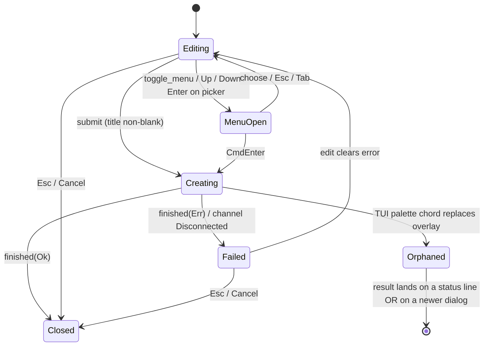

### Transitions (code)
- `submit()` at new_task.rs:552-579 is the only way into Creating. `finished()` at 582-593 is the only way out.
- `close()` at 542-548 refuses while creating, and so does desktop `dismiss()` at views/new_task.rs:212-216.
- TUI: `create_new_task` at shell/mod.rs:3696-3713 spawns a thread. `poll_new_task_job` at 3716-3729 runs try_recv every tick. `new_task_landed` at 3732-3746 applies the result to whichever `ActiveOverlay::NewTask` is current.
- Write-up: `create()` at 671-696 runs the add and then `messenger.send`. Both the local and relay messengers end in `paste_then_return` at 732-737, which is a paste, `sleep(300ms)`, then `\r`.

### Verified concerns
1. **TUI result misrouting (medium).** `handle_key` opens the palette before any overlay check (shell/mod.rs:2702-2706), and `open_palette` overwrites `self.overlay` unconditionally (2820). That lets a dialog that is still Creating be dropped. From the palette the user can open New Task again, which goes through `open_new_task` with no pending-job check. When the first create lands, `new_task_landed` calls `finished` on the *new* dialog. An Ok closes the user's fresh draft, and an Err shows a stale error. If the user submits the second dialog first, `self.new_task_job = Some(rx)` (3709) drops the first receiver and its result, including the write-up outcome, disappears. The desktop does not have this problem because `open_new_task` refuses while `new_task.is_some()` (app.rs:3105-3109) and the result is tied to its own entity.
2. **No timeout on Creating (medium).** `ControlClient::mutate_done` loops on `read_frame` with no read timeout (shelbi-client/src/control.rs:126-153). `SessionMessenger` opens the orchestrator connection with `handshake_timeout = None` (new_task.rs:757), so connect.rs:222-232 does not bound the hello. Esc/Cancel are refused while this runs. The orchestrator hang matters most, because it happens *after* the issue is created. The UI still shows "Creating…", and a user who escapes and retries makes a duplicate.
3. **Write-up "Requested" is unconfirmed (low).** It is paste + 300ms + Return, and `Ok(())` maps straight to `Requested` and the message "the Orchestrator is writing it up". A busy pane or a slow paste can swallow the Return. This matches known pane-nudge submission flakiness elsewhere in Shelbi.
4. **TUI/desktop gate drift (low).** `set_title`/`set_description` are not gated. The TUI blocks edits while creating in `field()` (overlay/new_task.rs:182-185). The desktop forwards `InputEvent::Change` straight to the setters (views/new_task.rs:143-160) and never disables the inputs, so edits made during a create are silently dropped on success.

### Refuted
- Priority `choose` is gated, because it goes through `pick_position`.
- Ungated `close_menu` and `hover_menu` can't do anything while creating, because `submit` clears the menu and `toggle_menu` is gated.
- The one-way TextArea-to-form mirror has no reachable reset path today.
- The repeated `if self.creating` guards are consistent apart from the text setters.

### Recommendation
- Give the in-flight create a token. Have `new_task_landed` apply a result only to the dialog that carries that token. Refuse a second create or dialog while a job is pending, or keep the palette from replacing a creating New Task overlay.
- Add deadlines to the add (a control read timeout) and to the orchestrator connect (a handshake timeout). Report a write-up stall separately, so a created issue never leaves the modal stuck.
- Turn `creating`/`error` into a `CreateState` enum whose only transitions are `submit` and `finished`. Gate the text setters on it, or disable the desktop inputs, so the TUI and desktop behave the same.
- Either confirm write-up submission the way the session-send path does, or reword `Requested` to "sent".


### Verified concerns

- **medium**: In the TUI, a create result is not tied to the dialog that started it. The palette chord replaces the overlay even while a create is out, and the palette can open a new New Task dialog. When the old create lands, new_task_landed calls finished() on the new dialog. An Ok closes the user's new draft and throws it away, and an Err puts the old create's error under it. If the user submits the second dialog first, create_new_task overwrites new_task_job, which drops the first receiver, so the first result and its write-up status are lost without a message.
  - Evidence: shell/mod.rs:2702-2706 opens the palette before any overlay check. open_palette sets self.overlay = Some(palette) unconditionally (2820). create_new_task assigns self.new_task_job = Some(rx) without checking for a pending job (3709). new_task_landed matches any ActiveOverlay::NewTask with no request or instance id (3734-3740).
- **medium**: Creating has no timeout, and Esc/Cancel are refused while it lasts. The daemon mutate_done loop blocks on read_frame with no read timeout. SessionMessenger opens the orchestrator connection with handshake_timeout None. If the daemon add stalls, or the orchestrator session accepts the connection but never says hello, the modal sits at 'Creating…' indefinitely. The orch hang happens after the issue already exists, so a user who escapes (TUI palette, or closing the desktop window) and tries again creates a duplicate.
  - Evidence: shelbi-client/src/control.rs:126-153 (loop on read_frame, no timeout). connect.rs:222-232 only bounds the hello when handshake_timeout is Some. new_task.rs:757 calls Connection::open(&session.sock, None, ...). close() refuses while creating (new_task.rs:542-548), and so does desktop dismiss (views/new_task.rs:212-216).
- **low**: WriteUp::Requested only means a paste went out and a Return followed 300ms later. Nothing confirms the agent accepted it as a submitted prompt. If the pane is busy, in a menu, or slow to process the paste, the Return may be absorbed or arrive early, and the user is still told 'the Orchestrator is writing it up'. The same helper serves both local and relay paths, and the relay path adds latency, so the 300ms gap is less reliable there.
  - Evidence: new_task.rs:732-737 (paste, sleep(SETTLE), input \r). SETTLE=300ms at 746. Requested is mapped from Ok(()) at 686. Created::message at 640-654.
- **low**: The desktop and the TUI apply the creating gate differently. The TUI blocks text editing while creating (field() returns None). The desktop leaves its Input/Textarea live, and set_title/set_description are not gated, so typing during a create changes the form. On Ok the dialog closes and those edits are silently dropped, because the issue was created from the earlier snapshot. On Err they are kept.
  - Evidence: new_task.rs:323-335 (ungated setters). desktop/src/views/new_task.rs:143-160 forwards InputEvent::Change to set_title/set_description. tui overlay/new_task.rs:182-185 gates on form.creating().


### Concerns that did not hold up

- 'choose for Priority is not gated': choose(Menu::Priority) calls pick_position, which checks creating (new_task.rs:373-376, 436-440).
- 'close_menu/hover_menu ungated lets state change during a create': submit() sets menu=None and toggle_menu is gated, so no menu can be open while creating. hover_menu does nothing when menu is None, and close_menu is idempotent.
- 'If the overlay is gone when the result lands... nothing enforces it, but Esc is blocked so it should not happen': the overlay can be gone (palette chord). The fallback to a status line is fine, though. The real defect is the case where a different NewTask dialog is present, listed under verified concerns.
- 'Form can never push text back into the TUI TextAreas, so a form-side reset would not show': the form has no text-mutating path other than the setters the view drives. finished(Err) keeps the draft and Ok closes the dialog. The one-way mirror is a latent design note, not a reachable bug.
- 'The creating guard is repeated in ~10 methods': true, but every repeat is consistent and correct apart from the text setters. That is a tidiness point, not a correctness issue.


**Recommendation:** Give the in-flight create one owner and an identity. (1) In the TUI, store a job token (a request id or a dialog generation) with new_task_job, and in new_task_landed apply the result only to the dialog that carries that token. Otherwise show the result on the status line. Also refuse to start a second create, or to open a second dialog, while a job is pending, the way desktop open_new_task refuses while new_task is Some. A simpler alternative is to stop the palette chord from replacing an overlay whose form is creating. (2) Bound Creating with a deadline. Set a read timeout on the add's control client and a handshake timeout on the orchestrator Connection::open. Split the outcome so a stall after the add reports 'Created X; write-up timed out' and does not keep the modal up. (3) Consider replacing creating/error with a small enum, CreateState { Idle, Creating { token }, Failed(String) }, with submit and finished as its only transitions, and gate the text setters on it (or disable the desktop inputs while creating) so the two clients match. (4) For the write-up, reuse whatever submission confirmation the shelbi session send path uses (for example, watching for the awaiting_input->working transition), or at least word Requested as 'sent'.


## Activity feed reading, title hydration and tail

**Verdict:** Needs further thought. The desktop half is correct. But the shared per-id title cache has a reachable stuck state: a confirmed miss is frozen for the session and is never re-checked against the board index, which conflicts with the store layer's own design for newly created issues. The TUI half carries a dead second state machine and a write-only latch whose documented behaviour is missing.

**Verified concerns:** 1 medium, 3 low

**Key files:**
- `crates/shelbi-app/src/activity.rs:440-800 (entry_stale, ActivityMetaCache, backoff, resolve_task_meta)`
- `crates/shelbi-app/src/activity.rs:875-976 (read_activity_window / _staged, window echo)`
- `crates/shelbi-state/src/github_store.rs:2319-2342 (resolve_number: index-first, TTL'd recently_missing)`
- `desktop/src/views/activity_state.rs:141-322 and desktop/src/views/activity_reader.rs:36-176`
- `crates/shelbi-tui/src/activity.rs:73-128, 262-401 (dead refresh path, write-only auto_scroll)`

### What the machine is

Three linked lifecycles drive the Activity feed:

1. **Desktop feed and reader.** `ActivityState` (desktop/src/views/activity_state.rs:141-322) holds `loaded`, `window`, and the last read's `data.window`. "Load older in flight" is derived as `data.window < window`. `ActivityReader` (desktop/src/views/activity_reader.rs:36-176) runs a thread with a coalescing request channel, an `again` flag for batched title hydration, a stop flag, and mirrored `window`/`filter` cells.
2. **Shared per-id title cache.** `ActivityMetaCache` (crates/shelbi-app/src/activity.rs:489-552) is used by the TUI shell and, through `ProjectSource::activity_window`, by the desktop. `entry_stale` (:462) and `resolve_task_meta` (:648-800) carry the rules.
3. **TUI feed.** `ActivityApp` (crates/shelbi-tui/src/activity.rs:73-128) has an incremental tail (`log_offset`/`log_mtime`) and a scroll latch (`auto_scroll`).

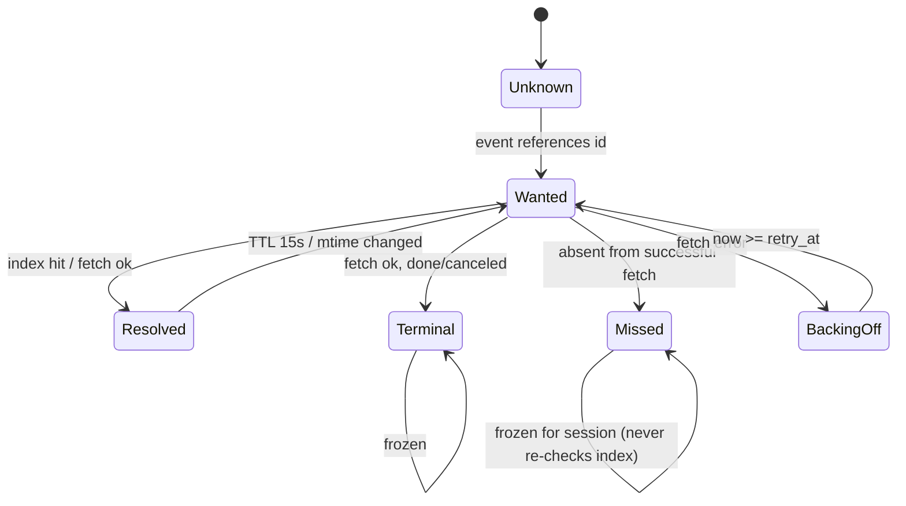

### Verified concerns

- **Medium: a miss is frozen forever, even after the index learns the id.** `entry_stale` returns `false` for `meta: None` (activity.rs:466-468). `serve_open_ids_from_index` (:563) only serves ids in `wanted`, so a missed id never gets another index lookup. In the GitHub store, `resolve_number` (github_store.rs:2319-2342) checks the index first and only caches misses "recently", so that a newly created task resolves once the daemon indexes it. The feed's own permanent negative cache defeats that. Passes run every 750ms, and the index and GitHub search both lag `issue add`, so a new issue can show its bare id until restart.
- **Low: the TUI tail path is dead.** `refresh`/`maybe_refresh`/`resolve_task_meta`/`meta_cache`/`log_offset` (crates/shelbi-tui/src/activity.rs:262-325, 412-416) have no non-test callers. The shell only uses `apply_activity_data` (shell/mod.rs:571, 1860). The module and field docs still describe the removed `shelbi __activity` process, and the shrink-only rotation detection lives in this dead code.
- **Low: `auto_scroll` is write-only.** It is set at :223 and :368-400, read only in tests. When new events are prepended, a scrolled-back user's view shifts, which contradicts the field doc at :97-100.
- **Low: backoff entries leak.** An id that leaves the window while backing off stays in `backoff`, so the "hydration complete" log at :691 never fires. `entries` is never evicted either.

### Refuted

- Desktop window/filter duplication: sync is one way and monotonic, and each read is tagged with the window and filter it was built under, so stale reads are detected (activity_state.rs:210-213, 305-307; activity.rs:135, 206, 652).
- In-flight inference: every successful read echoes `window: Some(window)` (shelbi-app activity.rs:888-890, 951-976).
- The hydration bools cannot reach finished-without-started in practice.

### Recommendation

- Collapse `entries` + `backoff` into one `HashMap<id, MetaState>`, with `MetaState::{Resolved, Missed, BackingOff}` and a single `wanted()` predicate.
- Let `Missed` ids be re-served from the board index (cheap, local) while keeping network re-search frozen.
- Make the hydration log latch an enum.
- Delete the TUI's dead tail path. Either implement scroll anchoring for the Pinned state or drop `auto_scroll`.
- Leave the desktop reader/state split as is.


### Verified concerns

- **medium**: The feed's negative cache freezes a confirmed miss for the whole session. It never consults the board index again, so a brand-new issue whose first event lands before the daemon has republished the index (and before GitHub search has indexed the id label) shows its bare id until the process restarts. This defeats the store layer, which deliberately keeps its miss cache short-lived and checks the index first so a new task 'resolves immediately'.
  - Evidence: crates/shelbi-app/src/activity.rs:466-468: entry_stale returns false when meta is None, so the id never re-enters `wanted`. serve_open_ids_from_index (:563) only looks at ids in `wanted`, so a later index that carries the id is never consulted. The miss is inserted at :785-797 after any successful fetch_many_partial in which resolve_number returned Ok(None) (crates/shelbi-state/src/github_store.rs:2333-2340). The store comment at :2327-2332 says its own miss cache is 'recent' precisely so newly indexed tasks resolve. Passes run every 750ms, so the window after `issue add` is reachable.
- **low**: The TUI's incremental tail path is dead code: refresh(), maybe_refresh(), resolve_task_meta(), meta_cache and log_offset/log_mtime. The standalone `shelbi __activity` process it served no longer exists, and the shell only calls apply_activity_data, which does a full re-read. That leaves two refresh state machines, and only one ever runs. The reported rotation bug (shrink-only detection) is real in that code but cannot be hit.
  - Evidence: crates/shelbi-tui/src/activity.rs:262-325 and :412-416. Grep finds no non-test caller of ActivityApp::refresh/maybe_refresh. lib.rs:135 only re-exports the type, and shell/mod.rs:571 and :1860 call apply_activity_data. The module doc at :11 and the field docs at :85-92 still describe the standalone process.
- **low**: auto_scroll is write-only. Its documented behaviour ('new events no longer chase the cursor') does not exist. scroll is an offset from the top, so when new events are prepended, a user who has scrolled back sees the content they were reading slide down.
  - Evidence: crates/shelbi-tui/src/activity.rs:97-100 declares it. It is assigned at :223, :368-400 and only asserted in tests (handlers/activity.rs:143-166, activity.rs:1396-1401). No read exists anywhere in crates/ or desktop/.
- **low**: Backoff entries are removed only on success or a miss for that same id. An id that drops out of the event window while backing off stays in `backoff` forever, so the `backoff.is_empty()` gate never passes and 'hydration complete' is never logged. This affects diagnostics only, plus a tiny leak. `entries` is also never evicted.
  - Evidence: crates/shelbi-app/src/activity.rs:549 (clear_backoff is called only at :584, :768, :790); the gate is at :691.


### Concerns that did not hold up

- The duplicated desktop window (ActivityState.window vs ActivityReader.window AtomicUsize) is not a drift risk. Sync runs one way only (state to reader), the window only grows, and it happens at exactly two sites (activity.rs:135 on construction, :206 on LoadWindow). The reader loads the atomic at the start of each read and echoes it back in data.window, so a stale in-flight read is correctly seen as 'still loading'. bench_window bypassing state is a bench-only path.
- The duplicated filter is not a bug. It works as a 'feed built under filter X' tag: set_filter copies the shown filter every render (activity.rs:652), and adopt rebuilds locally whenever read.filter != self.filter (activity_state.rs:210-213). A stale build is never installed.
- 'Load-older in flight is inferred' holds up. Every successful read path (read_activity_window, the early and final reads of read_activity_window_staged) sets window: Some(window). The only exception is a failed read, where has_older is false anyway, so load_older cannot fire twice.
- Rotation-skips-head in the TUI is real code but unreachable, because the incremental path never runs in production (see the dead-code concern).
- The hydration started/finished bools cannot actually reach finished && !started: finished is set only inside the started guard at :691. It is a representability nit, not a bug.


**Recommendation:** 1. Make the per-id lifecycle an explicit enum, e.g. `enum MetaState { Resolved { meta, mtime, fetched, terminal }, Missed { at }, BackingOff { attempts, retry_at } }`, in one map with a single `fn wanted(&self, now, mtime) -> bool`. This folds `backoff` into `entries`, so leaving the window can evict both.
2. Let a Missed id be served whenever the board index (or a filesystem task file) later carries it. Concretely, run the misses through serve_open_ids_from_index, or give Missed a long TTL instead of 'forever'. Network re-search stays frozen.
3. Replace the hydration bools with a 3-variant enum.
4. In the TUI, delete refresh/maybe_refresh/resolve_task_meta/meta_cache/log_offset/log_mtime. Then either delete auto_scroll or implement it: when Pinned, add the line count of newly prepended rows to scroll in apply_activity_data.
5. Leave the desktop reader/state window+filter duplication as is.


## Launch screen and Connect-to-Remote dialog flows

**Verdict:** Needs further thought. The shared ConnectFlow is a reasonably explicit, guarded machine, and the 'no timeout' fears are unfounded. But two reachable illegal states exist: the TUI launch screen can run a scaffold alongside an open or a second scaffold (create_job is not part of busy), and the stopped latch survives reselection and connects to the wrong session. Both are small fixes, not a design debate. The TUI launch screen's three independent Options are the part worth unifying.

**Verified concerns:** 1 medium, 3 low

**Key files:**
- `crates/shelbi-app/src/launch/connect.rs:39-300`
- `crates/shelbi-tui/src/launch/connect.rs:90-345`
- `crates/shelbi-tui/src/launch/mod.rs:150-320`
- `crates/shelbi-tui/src/launch/screen.rs:200-380`
- `desktop/src/views/launch.rs:270-470`

### What it is
Three nested machines run before any project opens:

1. **ConnectFlow** (shared by the TUI and desktop, `crates/shelbi-app/src/launch/connect.rs:39-300`). Encoded as `stage: Stage{Host,Choose}`, `busy: Option<Busy{Finding,Connecting,Starting}>`, `found: Option<Found>`, `error`, `selected`, and a `stopped: Option<RemoteSession>` latch. It has guarded transition methods (`find/found/change_host/connect/connected/start/started`), each early-returning on the wrong `busy`. This part is mostly explicit and correct.
2. **TUI launch app** (`crates/shelbi-tui/src/launch/mod.rs:99-320`, `screen.rs:145-380`). Encoded as three independent Options: `screen.job` (open/reconnect), `layer` (AddProject or Connect), and `create_job` (scaffold).
3. **Desktop LaunchView** (`desktop/src/views/launch.rs:270-470`). Encoded as `busy: Option<usize>` (a row index), `error`, `dialog`, and a `load` generation counter.

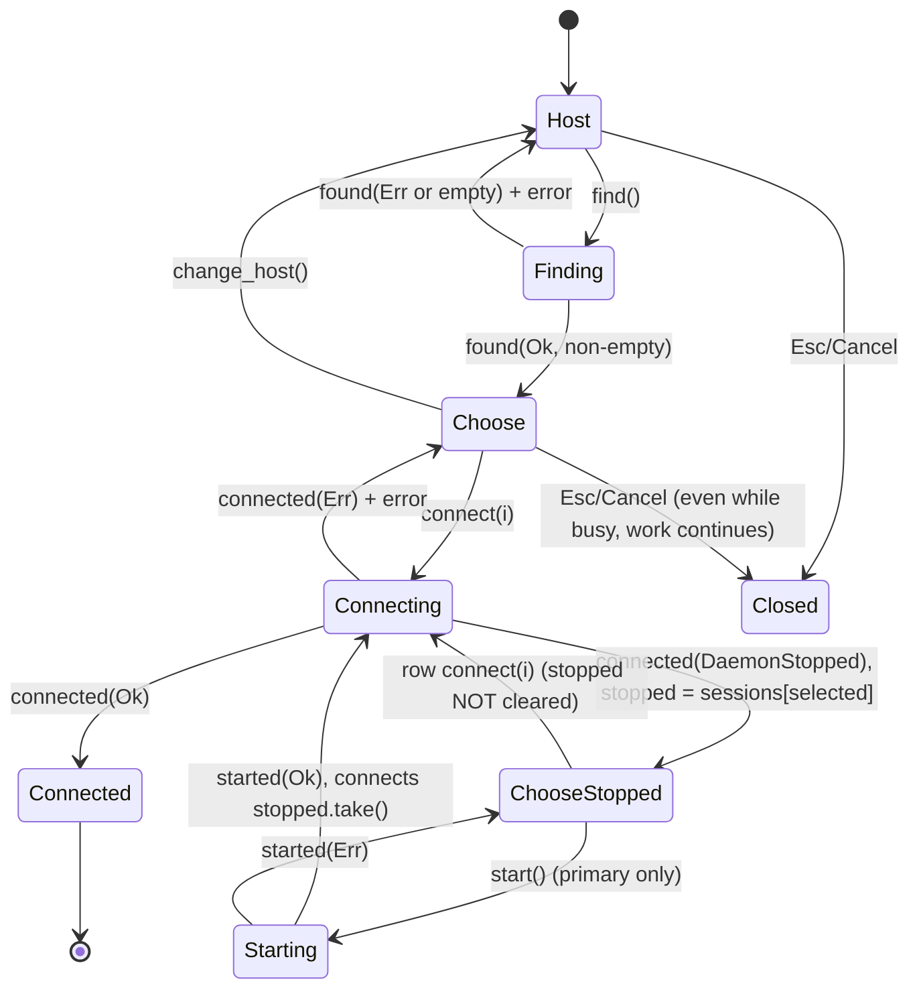

### Verified concerns
- **(medium) TUI create_job is not part of "busy".** `mod.rs:182` blocks only left clicks while `create_job` is set. Keys reach `screen.handle_key`, whose guard (`screen.rs:276`) checks only `screen.job`. Enter on a project therefore starts `open_project` alongside the scaffold, and "Add project" (`screen.rs:324`) reopens the form. A second Submit overwrites `create_job` (`mod.rs:298`), dropping the first result while its scaffold thread keeps writing.
- **(low) The `stopped` latch survives reselection.** `select()` (`connect.rs:152`) and `connect()` (`:225`) leave `stopped` alone. After "Shelbi isn't running" on session A, selecting B still shows Start Shelbi, and `started()` connects to A (`:286 stopped.take()`). The start itself is right because the daemon is per host. The bug is the connect target, and it affects both clients.
- **(low) Cancel isn't cancellation.** Esc/Cancel (TUI `connect.rs:183,228`; desktop `connect_remote.rs:140`) drops the receiver, but `connect_remote` still calls `recents.remember` (`shelbi-app launch.rs:308`), so an abandoned session lands in Recents. TUI `screen.rs:274` quits on Esc/q before the busy guard, so quitting mid-scaffold can leave a half-made project.
- **(low) The desktop's busy is a row index.** `open_connect` (`launch.rs:358`, called from the menu at `:190`) skips the busy guard. A dialog connect finishing during an open triggers `reload()` (`:464`), and the spinner (`:594`) can land on the wrong row.

### Refuted
- **"No timeout, stuck forever."** ssh steps are bounded: STEP_DEADLINE is 25s, START_DEADLINE is 45s, and ConnectTimeout plus ServerAlive are set (`ssh.rs:57-78`). The daemon start waits for its socket under a deadline. Only askpass time, which the user controls, is excluded.
- **Job vs Busy drift.** Every spawn-failure path routes back into the flow, so the two records cannot drift today.
- **`(Choose, found=None)`** is unreachable: Choose is entered only right after `found` is set.
- **Wrong host for Start.** All sessions in `Found` share one host.

### Recommendation
- **TUI launch app:** replace `screen.job` and `create_job` with one `job: Option<LaunchJob{Open, Reconnect, Create}>` that gates keys, mouse and `press`. Refuse Add project while it runs, and decide what Esc/q should do mid-create.
- **ConnectFlow:** clear `stopped` in `select()` (when the index changes) and in `connect()`, or have `started()` connect `sessions[selected]`. Optionally make it `Stage::Choose(Found)`.
- **Recents:** move `remember` out of `connect_remote` into the "Connected and still open" handler, or check a generation token first.
- **Desktop:** key `busy` by the `LaunchAction` rather than a row index, and guard `open_connect` with the busy check.


### Verified concerns

- **medium**: TUI add-project create_job gates only left mouse clicks on the launch screen. The keyboard path ignores it, so during a scaffold Enter on a project starts open_project concurrently. Pressing Add project reopens the form, and a second Submit overwrites create_job, dropping the first receiver while its scaffold thread keeps writing.
  - Evidence: crates/shelbi-tui/src/launch/mod.rs:182 checks create_job only for MouseEventKind::Down(Left). Keys go to screen.handle_key, whose guard `_ if self.busy()` (screen.rs:276) checks only screen.job (screen.rs:203). screen.press -> Target::AddProject => LaunchStep::AddProject (screen.rs:324) opens the form again. submit_project assigns self.create_job = Some(rx) unconditionally (mod.rs:298).
- **low**: The `stopped` latch is not cleared on select() or on a new connect(). After a DaemonStopped answer for session A, the user can select session B and press the primary button. It still says Start Shelbi, and after the start succeeds started() connects to A (stopped.take()), not to the selected B. The host is the same, so the start itself is right, but the follow-up connect target is wrong. If a row-click connect to B then fails with another error, the stale latch still offers Start Shelbi next to B's error.
  - Evidence: crates/shelbi-app/src/launch/connect.rs:152 select() only sets selected. connect() at :225 clears error but not stopped. connected() sets stopped from sessions[selected] at :251. started() does `let session = self.stopped.take()?` at :286. This affects TUI and desktop alike, since both use the shared flow.
- **low**: Cancel/Esc closes the Connect dialog without cancelling the in-flight call. A detached connect_remote still runs recents.remember(), so a session the user abandoned can show up in Recent sessions. The TUI launch screen's Esc/q also quits mid-job, which exits the process with any add-project scaffold half-written.
  - Evidence: TUI connect.rs:183 and :228 return Close and drop the job. Desktop connect_remote.rs:140 dismiss() emits Closed(None) while the background_executor task keeps running. shelbi-app launch.rs:308 connect_remote calls recents.remember after remote.connect. TUI screen.rs:274 handles Esc|q before the busy guard.
- **low**: Desktop busy is a row index, not the action. open_connect is reachable from the menu without the busy guard (launch.rs:190 calls open_connect directly; perform's guard is at :379). A dialog connect that finishes during an open runs connected() -> reload(), which can reorder rows, so the spinner moves to a different row.
  - Evidence: desktop/src/views/launch.rs:275 busy: Option<usize>; :402/:436 busy = row_of(...); :358 open_connect has no busy check; :464 connected() calls reload(); :594 renders the spinner by row equality.


### Concerns that did not hold up

- 'No timeout, so a hung ssh or daemon start leaves the dialog or screen stuck forever.' Refuted: every ssh step is bounded at the transport layer. STEP_DEADLINE is 25s and START_DEADLINE is 45s (ssh.rs:57-60), plus ConnectTimeout=10 and ServerAlive keepalives (ssh.rs:69-78). ensure_daemon_running waits for the socket under a deadline (shelbi-state daemon_lifecycle.rs:~181-195). A disconnected channel maps to 'stopped unexpectedly'. The only unbounded time is an askpass prompt, which the user controls.
- 'Two sources of truth for in-flight (TUI Job vs flow Busy) may drift.' Not a live bug: every spawn-failure path feeds the matching flow callback (connect.rs find/start/spawn_connect), and poll clears job before calling the flow. The desktop has no Job mirror at all. It is mild redundancy, not divergence.
- 'Stage::Choose with found=None is representable.' True in the type, but no transition reaches it: stage becomes Choose only inside found(Ok) right after found is set, and found is never cleared. Cosmetic.
- 'If row_of finds no row, busy is None and a second open can start concurrently.' Only reachable if the model reloads between perform() and row_of in the same synchronous call, which cannot happen. The realistic variant is the reorder-after-reload case kept above.
- 'Stopped daemon offers Start for the wrong host.' Refuted: start_daemon is per host and all sessions in Found share found.host, so the start target is correct. Only the post-start connect target is wrong.


**Recommendation:** 1) TUI launch: fold create_job into the screen's job, or make one LaunchApp-level `job: Option<LaunchJob{Open,Reconnect,Create}>` that both handle_event paths (key and mouse) and screen.press consult. Refuse Add project while any job runs, and decide whether Esc/q mid-create should be refused or warn. 2) ConnectFlow: clear `stopped` in select() when the index changes and in connect(). Or bind the latch to the host, have started() connect to sessions[selected], and carry Found inside Stage::Choose(Found) to drop the dead (Choose, None) combination. 3) Optionally make cancel real: hold a cancel token or generation in the dialog, and only remember a recent when the dialog is still open, or move remember() out of connect_remote into the Connected handler. 4) Desktop: key busy by LaunchAction (or slug/session) instead of a row index, and guard open_connect with the busy check.


## Workspace interface open, focus and panel view switch

**Verdict:** Worth tidying. Every confirmed issue is a small UX glitch: a late open taking over a view, details that stay stale until the next row change, an error message that lands on the wrong workspace, or a mismatch between the active chip and the selection. None loses data and none leaves the UI stuck. Making a few of these transitions explicit would close all of them cheaply. The TUI open flow is a hand copy of the review flow and has the same holes, which argues for one shared 'pending open' helper.

**Verified concerns:** 1 medium, 5 low

**Key files:**
- `desktop/src/views/workspace.rs:216-252,336-420,505-615,690-727`
- `crates/shelbi-tui/src/shell/mod.rs:1983-2058,4868-4984,5006-5095`
- `crates/shelbi-tui/src/shell/workspace.rs:231-335`
- `crates/shelbi-app/src/workspace_panel.rs:185-283`
- `crates/shelbi-tui/src/workspace_panel.rs:95-225`

### What it is
Two hosts render the same workspace interface (panel plus content pane), and each tracks its lifecycle with loose fields:

- **Desktop** (`desktop/src/views/workspace.rs:216-252`): `WorkspaceView` holds `workspace: Option`, `shown`, `row`, `details`, `details_pending`, `generation` (drops stale results), `hold` + `held` (an attach deferred while the window's push runs), `status_line`, `focus`, and `panel: WorkspacePanelState` (rows, selected, active switch).
- **TUI** (`crates/shelbi-tui/src/shell/mod.rs`): `workspace_opening: Option<String>`, a single `workspace_rx` slot shared by `Opened` and `ContentReady`, `workspace: Option<WorkspaceInterface>` and `main_view`. Inside the interface, `focus: WsFocus` and a hand-copied `WorkspacePanel { selected, active_view }`.

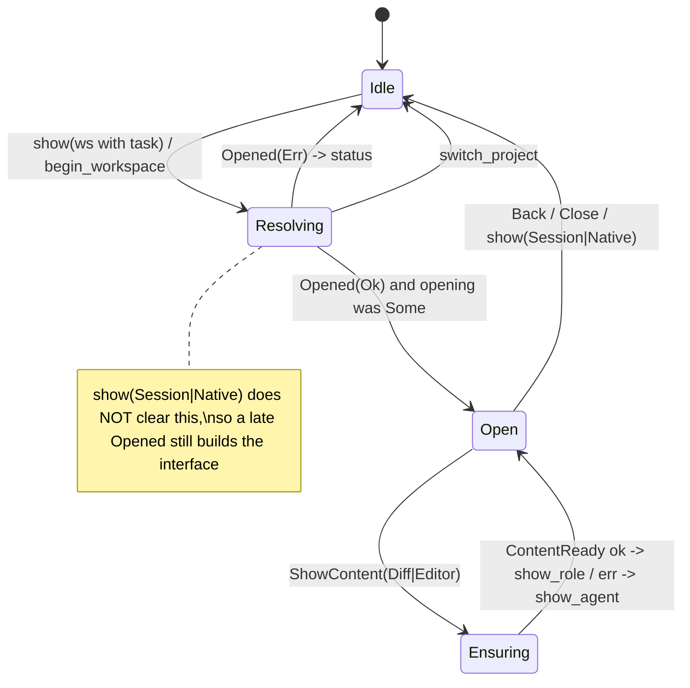

Desktop: Empty -> Shown(ws) via `show()` (336-354, which bumps generation and resets per-workspace fields). Shown <-> Hidden via `hide()` (392-400). The deferred attach is `hold_content(true)`, then `attach()` parks the target in `held`, then `release_content` attaches it. Details: `set_row` -> `request_details` (latch) -> the read completes (generation-checked).

### Verified concerns
1. **A late TUI open takes over a view the user left (medium).** `show()` to a Session or Native target (`mod.rs:2020-2058`) drops the interface but leaves `workspace_opening` and `workspace_rx` in place. `on_workspace_opened` (4938) checks only `is_some()`, then sets `main_view = Workspace` and moves focus to the main area. `review_opening` has the same gap. Only `switch_project` (2280-2286) clears these fields.
2. **One receiver slot (low).** `begin_workspace` (4880) and the `ShowContent` ensure (5009) both overwrite `workspace_rx`. Whichever result is still in flight is lost. A lost `Opened` leaves a stale "opening workspace…" status. A lost `ContentReady` leaves `active_view` saying Diff/Editor while the content stays on the agent.
3. **The desktop details latch has no re-check (low).** `request_details` returns early while a read is out (557-559). The completion (569-579) clears the latch but never re-checks `needs_details` (`shelbi-app/src/view.rs:361`). `update_row` ignores identical rows (406). So a task change during a read leaves stale details/apps until some other row field changes. `current_details()` hides a mismatched body, so the user sees missing info rather than wrong info.
4. **Ungated async status (low).** `open_in_app` and `reveal_folder` (866-874, 896-903) write `status_line` without the generation check that `session_op` and `request_details` use.
5. **`active` never resets (low).** `WorkspacePanelState::sync` (`shelbi-app/src/workspace_panel.rs:214-229`) remaps only the selection. After a task ends on Diff/Editor and a new one starts, the selection lands on Agent while `active`, the chip and the attached content stay on the old view.
6. **TUI focus not tied to liveness (low).** A left click outside the panel sets `Content` unconditionally (`shell/workspace.rs:324-330`), and nothing moves focus back when the content leaves Live. Keys other than Tab are then silently dropped (279-283). Tab still escapes.

### Refuted
- `hide()` leaving `hold` set is correct. `hold` belongs to the window ("push running") and `held` belongs to the view ("parked target"), so they should stay separate.
- The latch cannot stick forever: `show()` resets it together with the generation bump.
- The placeholder does not get stuck, because `main_view` changes only on a successful build. Only the status text goes stale.
- No selection drift in the TUI workspace panel: its row set is fixed for the panel's lifetime (`apps` never adds or removes rows, and has_task is always true).

### Recommendation
Worth tidying, nothing urgent. Replace the TUI's paired fields with a shared `PendingOpen { key, rx }` for both review and workspace, cleared in every `show()` branch that leaves the interface. Give content ensures their own slot. On the desktop, turn `details_pending` into "in flight + dirty" so a change mid-read triggers one more read, and put every async status write behind the generation guard. Reset `active` to Agent in `sync()` when the switches disappear. Add the Live check to the click-to-Content path. Consider having the TUI panel wrap `WorkspacePanelState` instead of copying it, for parity with the desktop.


### Verified concerns

- **medium**: TUI: a workspace open that finishes late can take over a view the user already left. show() to a Session or Native target drops self.workspace but never clears workspace_opening or workspace_rx. So an open that is still resolving and lands afterwards passes the take() guard and builds the interface over the session the user navigated to. review_opening has the same gap. Only switch_project clears these fields.
  - Evidence: crates/shelbi-tui/src/shell/mod.rs:2020-2058 set review/workspace=None and change main_view but leave workspace_opening/workspace_rx; on_workspace_opened (4938-4941) checks only that workspace_opening is Some, then build_workspace_interface sets main_view=Workspace and calls focus_main (4964-4965). The resolve can be slow for a remote workspace going through the relay.
- **low**: TUI: one receiver slot carries both Opened and ContentReady. A ShowContent ensure started while a different workspace's open is resolving replaces workspace_rx, so the Opened result is dropped. workspace_opening then stays Some and the status line stays on 'opening workspace X…'. The reverse is also possible: a new open replaces an in-flight ContentReady, so the panel's active_view says Diff/Editor while the content stays on the agent.
  - Evidence: mod.rs:4880 and 5009 both assign self.workspace_rx = Some(rx); poll_workspace reads the single slot (4906-4917). The window is narrow because opening another workspace normally goes through Back (which drops the interface), but a palette or other show() call can begin_workspace while one is open.
- **low**: Desktop: details_pending is a single in-flight latch and nothing re-checks after the read lands. If the row's current_task changes while a read is out, set_row's request_details returns early. The completion stores the old read and calls sync_panel but never re-evaluates needs_details. update_row then ignores identical rows, so the details stay stale until some unrelated row field changes. current_details() masks the wrong body by task-id match, but the panel loses More/body and the apps stay stale.
  - Evidence: desktop/src/views/workspace.rs:557-559 early return; the completion at 569-579 clears the latch but does not compare against WorkspaceHeader::needs_details (crates/shelbi-app/src/view.rs:361-364); update_row returns when row == self.row (406). The doc comment at 553-554 assumes 'the next refresh' will catch it, which only happens if the row changes again.
- **low**: Desktop: open_in_app and reveal_folder failures are not generation-guarded. An error from workspace A lands on the status line after the view has moved to workspace B.
  - Evidence: workspace.rs:866-874 and 896-903 write status_line without comparing generation, unlike session_op (595-604) and request_details (569).
- **low**: WorkspacePanelState.active is never reset when the view switches disappear. If a task ends while Diff/Editor is active, active stays Diff/Editor. When the next task starts, sync() moves the selection to Agent (gained_agent) while active, the sliding chip and the attached content stay on the old Diff/Editor session.
  - Evidence: crates/shelbi-app/src/workspace_panel.rs:214-229 remaps only `selected`; active changes only in activate_index (275-282) and set_active. The desktop resets it only in show() (workspace.rs:349) and show_agent (724).
- **low**: TUI focus can land on Content when the content session is not Live. A left click outside the panel sets Content unconditionally, and nothing moves focus back when the session drops out of Live. Keys other than Tab are then silently dropped. Tab still returns to the panel, so the user is not stuck.
  - Evidence: crates/shelbi-tui/src/shell/workspace.rs:324-330 has no Live check (unlike 246-251 and 290-295); handle_content_key's live_pane_mut() is None, so the keys are dropped (273-283).


### Concerns that did not hold up

- Desktop hide() leaving hold set is not a bug. hold belongs to the window and mirrors 'the window's push is running'. hide() only drops the parked target. release_content clears hold whatever the shown state, and a show() during the push correctly parks the new attach in held. The two fields have different owners (hold: the window; held: the view), so merging them would lose information.
- Desktop 'the latch would stick forever' is not reachable: show() for a different workspace resets details_pending=false at line 343 together with the generation bump, and a same-workspace read always completes with a matching generation.
- TUI dropped Opened leaving the 'opening workspace …' placeholder stuck is overstated. main_view becomes MainView::Workspace only inside build_workspace_interface, so the placeholder branch (mod.rs:5977-5982) is not entered. What sticks is the status-line text and a stale workspace_opening, and a retry clears both.
- TUI workspace panel selection drift on set_tools: apps change what Diff/Editor do, not which rows exist (panel_rows ignores apps), and the TUI WorkspacePanel always builds with has_task=true. description is fixed at construction. The row set is stable for the panel's lifetime, so `selected` cannot point at a different row. The duplication with WorkspacePanelState is real but causes no bug here. The review panel's version of this concern belongs to a separate machine.


**Recommendation:** (1) TUI: replace workspace_opening + workspace_rx with one pending-job slot per purpose: `opening: Option<(name, Receiver)>` and `ensure: Option<(role, Receiver)>`. Clear `opening` (and the review equivalent) in every show() branch that leaves the interface. Have the open result check the name, not just Some. A shared `PendingOpen<T>` used by both begin_review and begin_workspace would remove the hand copy. (2) Desktop: after a details read lands, re-run needs_details against the current row and request again if the task moved (a 'dirty' bit instead of a pure latch). Route open_in_app and reveal_folder through the generation guard that session_op already has. (3) WorkspacePanelState::sync: reset active to Agent when the switches disappear or reappear, and have the desktop re-attach the agent at that point. (4) TUI: guard the click-to-Content path with the Live check, or drop focus back to Panel when the content leaves Live. Keep hold and held as separate fields, because they have different owners. Optionally make the TUI WorkspacePanel wrap shelbi_app::WorkspacePanelState instead of copying its fields, for parity.


## Orchestrator onboarding wizard

**Verdict:** Worth tidying. The core wizard is well guarded: busy plus the step checks serialize jobs, and most auditor race concerns don't hold. What's left is one real but narrow gap: the never-read `finished` flag leaves the TUI page live after Launch, so a second Launch press starts a duplicate bootstrap. There are also a few low-severity non-atomic save sequences and a magic status sentinel. None of these is a high-impact correctness risk, but folding busy/finished into one phase enum would close the gap and remove the dead state.

**Verified concerns:** 1 medium, 4 low

**Key files:**
- `crates/shelbi-app/src/onboarding.rs:69-430`
- `crates/shelbi-tui/src/shell/mod.rs:3869-3976`
- `crates/shelbi-tui/src/shell/onboarding.rs:110-260`
- `desktop/src/views/onboarding.rs:65-210`
- `crates/shelbi-state/src/orchestrator_setup.rs:87-107`

### What it is
The first-run orchestrator setup for a project (Intro, then Harness, then Instructions, then Launch). The logic lives in `crates/shelbi-app/src/onboarding.rs` (`OnboardingState`) and is shared by the TUI page (`crates/shelbi-tui/src/shell/onboarding.rs`) and the desktop view (`desktop/src/views/onboarding.rs`). Off-thread jobs: `load`, `run_continue`, `run_launch`. The durable state is `shelbi_state::orchestrator_onboarded` (`orchestrator_setup.rs:87-99`).

### Encoding
- `step: OnboardingStep` is an explicit enum (Intro, Harness, Instructions).
- `setup: Option<Setup>` plus `load_error` give the load status (`None` means loading).
- `busy: bool` means a save is running. It does not record *which* save, but the step tells you.
- `finished: bool` is set on a successful Launch and **never read by either client** (only by tests).
- TUI shell: `startup_rx: Option<(project, Receiver)>`, with the `STARTUP_STATUS` status string as the "starting" sentinel.
- Persisted: `state.orchestrator_onboarded || state.open || deployed instructions file || legacy CLAUDE.md`, and a read error also counts as onboarded (fail-open).

```mermaid
stateDiagram-v2
    [*] --> Loading
    Loading --> Intro: loaded (Ok/Err)
    Intro --> Harness: get_started
    Harness --> Intro: back
    Harness --> SavingContinue: begin_continue (setup loaded)
    SavingContinue --> Harness: continued Err
    SavingContinue --> Instructions: continued Ok
    Instructions --> Harness: back
    Instructions --> SavingLaunch: begin_launch
    SavingLaunch --> Instructions: launched Err
    SavingLaunch --> Launched: launched Ok (marker written)
    Launched --> StartingOrch: client spawn_startup
    StartingOrch --> [*]: Started::Orchestrator (page dropped)
    StartingOrch --> Launched: Err (TUI, status=msg)
    Launched --> SavingLaunch: TUI re-press Launch (finished not checked)
```

### Verified concerns
1. **Medium: TUI double startup after Launch.** `finished` is never consulted. `begin_launch` (`shelbi-app onboarding.rs:395-397`) checks only `busy` and the step, so while the orchestrator bootstraps, the TUI page (still shown until `Started::Orchestrator`, `shell/mod.rs:3929`) accepts Launch again. That re-marks and calls `spawn_startup` again, which overwrites `startup_rx` (`mod.rs:3889`) while the first thread is still running: two concurrent bootstraps of one project. Instruction edits made in that window are dropped silently. The desktop avoids this because it drops the view immediately on `Launched` (`desktop/src/app.rs:3836-3843`).
2. **Low: run_launch is not atomic** (`onboarding.rs:148-154`). If the instructions save succeeds and the state.json mark fails, `setup.config` is stale, so every retry fails with the Conflict error until the wizard is reopened.
3. **Low: magic "starting" status.** Callers set `STARTUP_STATUS` before `spawn_startup` (`mod.rs:418, 2313, 3970`), and `spawn_startup` can return silently (`3870-3872`, `3876-3890`). The status line then shows "starting orchestrator…" forever.
4. **Low: OR-of-signals marker, fail-open** (`orchestrator_setup.rs:87-99`). This is a reasonable heuristic, but it is not a single source of truth.
5. **Low: run_continue is not atomic** (`onboarding.rs:123-133`). The runner is written before agent.yaml. A retry self-heals, but an abandoned wizard leaves the runner changed.

### Refuted
- A late `loaded()` clobbering the step-3 draft: load runs once per page, and step 3 requires setup to be loaded.
- A stale Continue landing on step 3: the step can't change while `busy`.
- Desktop editor and draft diverging: `launch()` and `back()` re-read the textarea first.
- TUI `menu`/`custom` exclusivity: it is enforced where the transition happens (`onboarding.rs:305-316`).
- Untickets job results: there is one channel per page, and the page is dropped on project switch.
- No retry after a TUI startup failure: re-pressing Launch is an idempotent retry.

### Recommendation
Fold `busy` and `finished` into `phase: Idle | Saving(Kind) | Launched`, refuse every mutator in `Launched`, and have `continued`/`launched` check the phase they expect. In the TUI, ignore `PageAction::Launch` while `startup_rx` is `Some`, and have `spawn_startup` own the status sentinel (or return whether it started). Optionally, make a retry after a partial `run_launch` failure safe by refreshing the config baseline, or by marking before saving.


### Verified concerns

- **medium**: `finished` is dead state: no client reads it, so after a successful Launch the TUI page stays fully interactive (step=Instructions, busy=false) until the orchestrator comes up. Pressing Launch again passes begin_launch, re-marks, and returns PageAction::Launch, which calls spawn_startup a second time and replaces startup_rx while the first bootstrap thread is still running. The result is two concurrent bootstraps of the same project, and any instruction edits made in that window are silently dropped when the page is cleared.
  - Evidence: shelbi-app onboarding.rs:219-221 and 420 (set, never read outside tests); begin_launch 395-397 checks only busy and step; TUI onboarding.rs press(Item::Launch) and poll() return Launch; shell/mod.rs:3966-3973 spawn_startup unconditionally; mod.rs:3889 overwrites startup_rx; the page is only cleared on Started::Orchestrator (mod.rs:3929)
- **low**: run_launch is not atomic. If the instructions save succeeds and mark_orchestrator_onboarded then fails, launched(Err) leaves setup.config at the pre-save version and saved_instructions unchanged. Every retry rebuilds from the stale config and fails with the Conflict error ('files changed on disk… nothing was saved'), so the wizard can't recover until it is reopened.
  - Evidence: shelbi-app onboarding.rs:148-154 (save then mark); 400-404 builds from setup.config; 423-425 leaves setup untouched on Err; AgentError::Conflict from config_write::WriteError::Changed (shelbi-state agents_config.rs:174,187)
- **low**: The TUI 'Starting' state is a magic status string. spawn_startup can return without starting anything (no current project, or thread spawn failure). Every caller sets status=STARTUP_STATUS first, so the status line then reads 'starting orchestrator…' indefinitely, with startup_rx=None.
  - Evidence: shell/mod.rs:385, 418, 2313, 3970 set the sentinel before spawn_startup; 3870-3872 and 3876-3890 return silently; 3925/3936 clear only by string comparison
- **low**: The persisted 'onboarded' predicate is an OR of five signals and fails open: a state.json read error or project_dir error counts as onboarded and skips the wizard. That is defensible, but the marker is not a single source of truth: deleting the flag does not re-run onboarding if instructions were deployed.
  - Evidence: shelbi-state orchestrator_setup.rs:87-99
- **low**: run_continue is not atomic. It writes orchestrator.runner to project config, then saves agent.yaml. If the agent save fails and the user abandons the wizard, the runner change persists while the project still shows as not onboarded. A retry self-heals because set_orchestrator_runner is a no-op when already set.
  - Evidence: shelbi-app onboarding.rs:123-133; orchestrator_setup.rs:127-133 no-op path


### Concerns that did not hold up

- Late or repeat loaded() overwriting a step-3 draft: each page issues load exactly once (desktop OnboardingView::new, TUI OnboardingPage::with_worker), and reaching Instructions requires begin_continue, which requires setup loaded (onboarding.rs:320). So no step-3 edit can exist before load lands. At most, a picker choice made while 'Loading…' is reset, which is cosmetic.
- Stale Continue outcome landing on step 3: while busy, back() is refused, get_started only fires from Intro, and begin_launch requires !busy. The step therefore cannot leave Harness while a Continue job is in flight, so continued() always lands on Harness.
- Desktop textarea and draft diverging while busy: launch() (desktop onboarding.rs:188-189) and back() (142-145) both re-read the textarea into state before acting, so the editor stays the source of truth.
- TUI menu/custom exclusivity held only by key-handler order: choosing 'Custom model…' sets menu=None before custom=Some (TUI onboarding.rs:305-316), and focus/click paths clear both (267-268, 433-436). Exclusivity is enforced at the transition, not just in dispatch order.
- Job results carry no ticket: each page owns its own channel, and the page (and its receiver) is dropped on project switch, so results from another page can't arrive. Within a page, busy plus the step guards serialize the jobs.
- TUI startup failure after Launch leaves no retry path: re-pressing Launch works as a retry, because instructions_changed() is false after a successful launch (no save), mark is idempotent, and spawn_startup runs again.


**Recommendation:** Replace `busy: bool` + `finished: bool` with a single `phase: Idle | Saving(Continue|Launch) | Launched` enum on OnboardingState. Make every mutator (begin_launch, back, type_instructions, select_*) refuse in Launched, and have continued()/launched() assert the phase they expect. In the TUI, make spawn_startup return bool (or set the status itself) so the STARTUP_STATUS sentinel is only shown when a job really started, and ignore PageAction::Launch while startup_rx is Some. Optionally, on a run_launch Err, refresh setup.config/saved_instructions when the save half succeeded (or mark before saving) so a retry doesn't hit Conflict.


## Machine reachability prober and background refresh workers

**Verdict:** Worth tidying. Nothing here is a correctness bug. Both the prober and the workers are single-owner and lock-protected, and their stop paths are correct. One real robustness issue remains: one failed read resets every host's reachability and backoff. The rest is dead duplicated code, a wrong doc comment, and per-host state spread across three maps. Each is cheap to fix and would prevent future drift.

**Verified concerns:** 1 medium, 3 low

**Key files:**
- `crates/shelbi-app/src/reachability.rs:45-248`
- `crates/shelbi-app/src/refresh.rs:42-317`
- `desktop/src/views/machines_state.rs:23-78`
- `desktop/src/views/machines.rs:96-157`
- `crates/shelbi-tui/src/machines.rs:120-160`

### What it is
Three cooperating lifecycles feed the Machines view (TUI and desktop):

1. **The per-host reachability prober** (`crates/shelbi-app/src/reachability.rs`). It runs one background thread with a Mutex<State> and a Condvar. Each remote host goes through these phases: *unscheduled* (no `next_due`, so it is probed immediately), then **Reachable** (re-check every 30s) or **Unreachable{error}** (interval doubles, capped at 300s). When a host leaves the target list, its entries are *pruned*. The phase is spread across three parallel maps, `results`, `next_due` and `interval` (lines 76-87). The view shows `Reachability::Unknown` ("checking...") until a host has its first result.
2. **The refresh workers** (`crates/shelbi-app/src/refresh.rs`). A worker is Idle (blocked on `recv`), then Reading after `request()` (queued requests coalesce into one read). It ends Stopped via `stop()`, which joins, or Detached via `stop_without_waiting()`.
3. **The Machines view's load state** (`desktop/src/views/machines_state.rs`). `loaded: bool` and `error: Option` together encode Loading, Loaded or Failed.

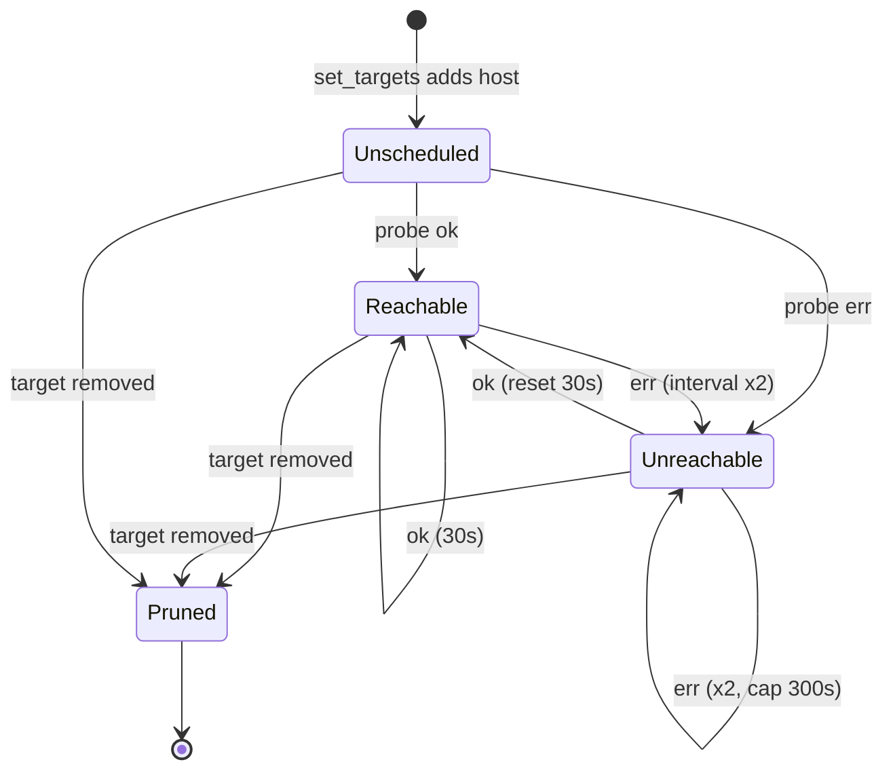

### Verified concerns
- **One failed read resets reachability (medium).** On `Err`, `MachinesState::apply` sets `model = MachinesModel::default()` (machines_state.rs:56-59). `tick` then calls `prober.set_targets(state.probe_targets())` with an empty list (desktop machines.rs:139-142). `prune()` then drops every host's result, `next_due` and backoff (reachability.rs:174-180). When reads recover, every remote flashes back to "checking..." and is re-probed at once, including down hosts that were backing off at 300s. The TUI does the same without telling anyone: `read_data` uses `unwrap_or_default()` (crates/shelbi-tui/src/machines.rs), so it shows an empty list with no error. The desktop at least shows the error.
- **Duplicated worker (low).** `RefreshHandle`/`spawn_refresher` (refresh.rs:42-163) is a verbatim copy of `Refresher<T>`/`spawn_worker` (165-317). It is only re-exported (lib.rs:124) and unused elsewhere.
- **Teardown semantics and docs disagree (low).** The prober's doc comment (reachability.rs:89-90) says dropping joins the thread, but its `Drop` (153-162) only detaches. `Refresher`'s `Drop` does join (refresh.rs:313-317). Desktop views avoid blocking by calling `stop_without_waiting` first (app.rs:2332-2344).
- **Three parallel maps (low).** A host's phase is implied by which keys exist. `prune` and the record step (236-245) must keep the maps in step. They are correct today.

### Refuted
- Unknown does not conflate "in flight" with anything harmful. A re-probe keeps the last result, so Unknown appears only before the first result.
- Unknown is never stored from the real probe sources. The remote source maps errors to `Unreachable` (source/remote.rs:369-376).
- The desktop's `stop_workers` not stopping the prober is fine, because the prober's `Drop` raises the stop flag.
- Stale names in the view's reachability map are harmless: `fold_reachability` loops over the current machines and looks each up by name (view.rs:1364-1374).
- `Refresher`'s joining Drop does not block the desktop UI thread, because `stop_without_waiting` takes the JoinHandle first.

### Recommendation (worth tidying)
1. Keep the last good model on a failed read and show the error beside it, in both the TUI and the desktop. Never push empty probe targets because a read failed.
2. Delete `RefreshHandle`/`spawn_refresher`, or alias them to `Refresher<Snapshot>`.
3. Replace the three prober maps with one `HashMap<String, HostProbe { result: Option<Reachability>, next_due: Instant, interval: Duration }>`.
4. Fix the prober's doc comment. Optionally make all workers detach on drop for consistent teardown.


### Verified concerns

- **medium**: A transient failed machines read wipes the view, and the wipe spreads into the prober. With an empty model, probe_targets() is empty, so set_targets([]) makes prune() drop every host's result, next_due and backoff interval. When reads recover, every remote shows 'checking...' again and is re-probed at once, including hosts that were backing off at 300s. The TUI does the same thing silently: read_data uses unwrap_or_default, so it shows an empty list with no error.
  - Evidence: desktop/src/views/machines_state.rs:56-59 sets model = MachinesModel::default() on Err; desktop/src/views/machines.rs:139-142 then calls prober.set_targets(state.probe_targets()); reachability.rs:126-134 and 174-180 replace the targets and prune all three maps; crates/shelbi-tui/src/machines.rs read_data uses read_machines_model(..).unwrap_or_default() followed by push_prober_targets() in apply_data
- **low**: RefreshHandle/spawn_refresher is a line-for-line copy of Refresher<T>/spawn_worker (same loop, same stop logic, same stop_without_waiting). Outside its own module it is only re-exported and never used, so the copy can only drift.
  - Evidence: crates/shelbi-app/src/refresh.rs:61-163 vs 191-317; grep finds no use outside refresh.rs except the re-export at crates/shelbi-app/src/lib.rs:124
- **low**: Workers stop in different ways. Refresher Drop joins (it can block whoever drops it), while ReachabilityProber Drop deliberately never joins. The prober's own doc comment says the opposite of what its Drop does.
  - Evidence: reachability.rs:89-90 doc says 'Dropping it stops the worker and joins its thread', but Drop at 153-162 only raises the flag and detaches; refresh.rs:313-317 Drop calls stop(), which joins
- **low**: Each host's phase is implied by which keys exist in three parallel maps (results, next_due, interval), and prune() has to keep them in step. That is correct today, but it would be cleaner as one HashMap<String, HostProbe{result, next_due, interval}>.
  - Evidence: reachability.rs:76-87, 174-180, 236-245


### Concerns that did not hold up

- 'Unknown conflates never-probed and probe-in-flight': a re-probe keeps the previous result in the map until the new one lands, so Unknown only means 'no result yet' (first probe pending or running). For a first probe those two are the same thing to the user. The view label 'checking...' is accurate.
- 'Prober backs off Unknown like Unreachable': the real probe sources never return Unknown. The remote source maps errors to Unreachable (source/remote.rs:369-376), and only the test/null source (source.rs:722) and a wire fixture return Unknown. The Unknown arm in next_interval exists only so the match is total.
- 'stop_workers stops the refresher but not the ReachabilityProber': the prober's Drop raises the stop flag and notifies the condvar without joining (reachability.rs:158-162), so dropping the view stops it. Only a probe already in flight finishes, on its own thread, and its result is discarded (stop is checked at 228).
- 'The reachability map is never pruned of removed machines on apply': the prober prunes removed targets itself, and fold_reachability (view.rs:1364-1374) loops over the current machines and looks each up by name, so a stale entry is never displayed.
- 'Refresher Drop can block the UI thread on a slow read': every desktop view calls stop_without_waiting before it is dropped (desktop/src/app.rs:2332-2344), which takes the JoinHandle so the later Drop has nothing to join. The TUI shell's refreshers drop only at shell teardown.


**Recommendation:** 1) On a failed read, keep the last good MachinesModel and show the error beside it. Desktop MachinesState.apply should leave model alone on Err. The TUI should stop calling unwrap_or_default and keep the previous model too. Never push an empty target set because a read failed. 2) Delete RefreshHandle/spawn_refresher, or make them aliases of Refresher<Snapshot>/spawn_worker. 3) Combine the prober's three maps into one HashMap<String, HostProbe{ result: Option<Reachability>, next_due: Instant, interval: Duration }>, so prune and record each touch one entry. 4) Fix the ReachabilityProber doc comment so it says Drop detaches and does not join. If you want consistent teardown everywhere, give Refresher a detach-on-drop option as well.


## Board text search lifecycle (BoardSearch + client latches)

**Verdict:** Worth tidying. The machine lives in one struct and one module, has a seq guard for stale responses, and derives its status. Nothing reachable is a correctness bug. The rough edges are no retry after a failed first-page search, a remote flag with two writers, and per-client latch duplication. These are small, but they will bite as soon as Unsupported or transient failures get a real path.

**Verified concerns:** 4 low

**Key files:**
- `crates/shelbi-app/src/board_search.rs:186-460`
- `crates/shelbi-tui/src/kanban.rs:1066-1170`
- `desktop/src/views/board_state.rs:480-490,1134-1200`
- `crates/shelbi-tui/src/handlers/kanban.rs:108-140`
- `crates/shelbi-state/src/github_store.rs:700-722`

### What it is
The Issues board's `/` text search, shared by the TUI kanban and the desktop board. `BoardSearch` (crates/shelbi-app/src/board_search.rs:186-460) is a pure, clock-injected state holder. `SearchWorker` runs requests on a thread and coalesces queued ones down to the newest. Each client calls `pump` on its tick.

### How state is stored
- `query`, `remote: bool`, `due_since: Option<Instant>` (debounce clock), `seq` plus `in_flight: Option<SearchRequest>` (only the newest response shows), `results`, `last` (previous query's results, kept on screen while the new one loads), `failed: Option<SearchFailure>`, and a 60s/32-entry `cache`.
- `status()` is derived: searching = due_since || in_flight, local_fallback = failed.
- Clients add `pre_search_selection` (TUI kanban.rs:252, desktop board_state.rs:346). The TUI also has `search_editing`, and both spawn the worker lazily.

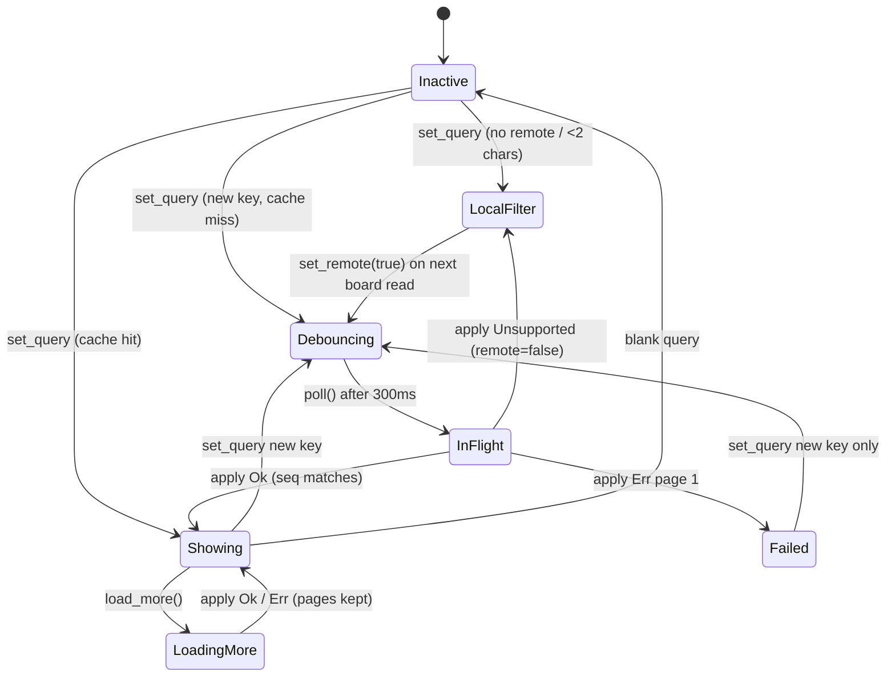

### Verified concerns
1. **No retry after a page-1 failure** (low). At board_search.rs:377-385 `failed` is set and `due_since` stays None. Only a new normalized key (set_query, 270-273) or a `set_remote` change re-arms it. After a rate-limit or network blip the board keeps saying "showing local results" until the user edits the query.
2. **`remote` has two writers** (low, latent). `apply(Unsupported)` sets remote=false (371-376), but both clients call `set_remote(config)` on every board read (kanban.rs:929, board_state.rs:487), which undoes it and re-searches. Nothing reaches it today. NotGithub requires a non-Github backend or a missing repo (github_store.rs:711-718), validation requires the repo (shelbi-core model.rs:1056), and remote relay errors map to Unreachable/Failed (source/remote.rs:289-290).
3. **A transient project read failure resets the search** (low). If the project YAML read fails, `project` is None, both clients call set_remote(false), results are cleared, and the next good read re-searches. The cache usually masks this.
4. **Client-side duplication** (low). The pre-search-selection latch, select-first-match and lazy worker spawn are written twice (kanban.rs:1083-1150 vs board_state.rs:1139-1188 and issues.rs:1017-1032), and the desktop keeps the query in both `filters.search` and `search.query`.

### Refuted
- The "one search per refresh loop" can't be reached (see 2).
- The stale `pre_search_selection` concern doesn't hold: the latch is rewritten on every inactive set_search and consumed with `take()`.
- Esc and empty-editing don't get stuck: handle_search_key handles Esc and Enter.
- No HTTP cancellation is fine: the seq guard drops stale responses, and stale page-1 responses only go into the cache.
- The page>1-as-first-page arm in apply can't be reached.

### Recommendation
Worth tidying, not rewriting.
- Make an Unsupported verdict a sticky latch separate from the config-derived flag.
- Add a retry for a failed first page (backoff, or the next refresh), and say so in the status.
- Treat a missing project read as "unknown" rather than remote=false.
- Optionally move the client latches into a shared shelbi-app helper so the TUI and desktop stay the same.

The field set doesn't need to become a single enum, because results, last and in_flight legitimately coexist.


### Verified concerns

- **low**: A page-1 failure (RateLimited/Unreachable/Failed) is never retried for the same query. The board says 'showing local results' until the query's normalized key changes. Adding a space or changing case doesn't count as a change. There is no retry after a backoff or a reconnect.
  - Evidence: board_search.rs:377-385 sets failed and leaves due_since None. poll() (322-330) only fires on due_since. set_query returns early when the key is unchanged (270-273). Only set_query with a new key or set_remote(changed) re-arms it.
- **low**: `remote` has two writers that disagree. apply(Unsupported) sets remote=false, but both clients call set_remote(config-derived bool) on every board read. The next refresh flips it back, clears results and re-issues the search. A 'not supported' verdict can't stick.
  - Evidence: board_search.rs:371-376 vs kanban.rs:929 and board_state.rs:487. remote_search comes from backend==Github (board.rs:717). Today it is latent: search_issues returns NotGithub only for a non-Github backend or a missing repo (github_store.rs:711-718), and config validation requires the repo (shelbi-core model.rs:1056). Remote version skew maps to Failed or Unreachable, not Unsupported (source/remote.rs:289-290).
- **low**: A transient project-config read failure flips remote off and back on. That drops the current results and last, and re-runs the search. Within 60s the cache usually hides it, but the board can flicker 'searching'.
  - Evidence: TUI kanban.rs:931-937 calls set_remote(false) when data.project is None. Desktop board.rs:883-889 sets remote_search=false in that case, and board_state.rs:487 then calls set_remote. set_remote clears results/last/in_flight (board_search.rs:252-258).
- **low**: The client latches are duplicated across TUI and desktop: pre_search_selection restore, select-first-match, and lazy worker spawn. The desktop also keeps a second copy of the query in filters.search. They match today, but they are parity code outside the shared state machine.
  - Evidence: kanban.rs:1083-1101 vs board_state.rs:1139-1175. Worker spawn: kanban.rs:1137-1150 vs desktop issues.rs:1017-1032.


### Concerns that did not hold up

- 'Unsupported loops one search per refresh': this needs a Github backend whose search returns NotGithub. That only happens with a missing repo, and config validation rejects that (model.rs:1056). The remote relay maps errors to Unreachable/Failed. The NOTHING source returns Unsupported, but its open_board has project=None, so remote is already false. The two-writer design is real, but nothing reaches the loop.
- 'pre_search_selection can be left stale when set_search returns early': it is rewritten on every set_search call while the search is inactive and consumed with take() on active->inactive (kanban.rs:1083-1100). An early return while inactive just records the current selection, and the next activation overwrites it. Nothing stale is ever restored.
- 'Esc only clears when is_active, so an empty Editing state is stuck': in editing mode every key goes to handle_search_key, where Esc calls clear_search and Enter ends editing (handlers/kanban.rs:120-131). An empty query left in editing exits normally.
- 'No cancellation of the in-flight HTTP call': this is correct by design. The worker coalesces queued requests (board_search.rs ~424) and apply drops non-current seqs except for caching page 1 (345-352). The cost is at most one wasted call.
- Possible page-2 response treated as a first page (apply's `_` arm when results.key != request.query): unreachable. results is only ever set for the current key, and set_query with a new key clears in_flight, so a later load-more response is never current.


**Recommendation:** Keep BoardSearch as the single owner and tighten it. (1) Split `remote` into config_remote (from set_remote) and a sticky `unsupported` latch keyed to the project/config. wants_remote = config_remote && !unsupported, so a refresh can't undo an Unsupported verdict. (2) Give Failed a retry path: re-arm due_since after a backoff (longer for RateLimited) or on the next set_remote/refresh tick, and optionally surface a failed load-more in the status. (3) Treat a missing project read as 'unknown' rather than remote=false, so a transient config read failure doesn't drop results. (4) Optionally move pre_search_selection, select-first-match and lazy worker spawn into a small shared helper in shelbi-app so the TUI and desktop can't drift. Converting the fields into one enum isn't needed: results/last/in_flight legitimately coexist.


## Changelog load/watch, reveal latch and paged load-more

**Verdict:** Worth tidying. No live correctness bug: whole-read failures recover via the stamp, paging is bounded by has_more, and the board's async guard is in the right place. But reveal and stamp gating are each written twice across the TUI and desktop with diverging rules. The reveal latch also has no expiry. Moving both into shelbi-app would prevent parity drift.

**Verified concerns:** 4 low

**Key files:**
- `crates/shelbi-app/src/changelog.rs:210-370,423-458`
- `crates/shelbi-tui/src/shell/changelog.rs:330-460,566-575,870-885`
- `desktop/src/views/changelog.rs:170-275,491-497,676-690`
- `crates/shelbi-tui/src/shell/mod.rs:1170-1176`
- `crates/shelbi-orchestrator/src/source.rs:236-242`

### What it is
The Changelog page has three small lifecycles.

1. **Load/watch.** `ChangelogModel.data: Option<ChangelogData>` is `None` until the first read lands (Loading), then `Some` with or without `error`.
   - Re-reads are stamp-gated, where the stamp is the entry count plus the newest mtime (`shelbi-state/src/changelog.rs:1013-1035`).
   - The TUI polls `ChangelogWatch::changed()` on a refresher (`crates/shelbi-tui/src/shell/mod.rs:1170-1176`).
   - The desktop keeps its own `Mutex<Option<stamp>>` and calls `Source::changelog(unless)` (`desktop/src/views/changelog.rs:188-194`, `crates/shelbi-orchestrator/src/source.rs:236-242`). That is the same machine written a second time.
2. **Paging.** `shown` grows by `PAGE_SIZE` while `matches.len() > shown`, and `set_query` resets it.
   - The desktop guards the deferred call with `loading_more: bool`, set in `render_item` (`desktop/src/views/changelog.rs:684-688`) and cleared in `load_more` (491-497).
   - The TUI pages synchronously in `load_ahead`, which runs from render and scroll (`shell/changelog.rs:566-575, 880`).
3. **Reveal latch.** `reveal: Option<String>` is set by the palette's Changelog result. It is applied once the entry exists, and in the TUI also once a real layout exists.

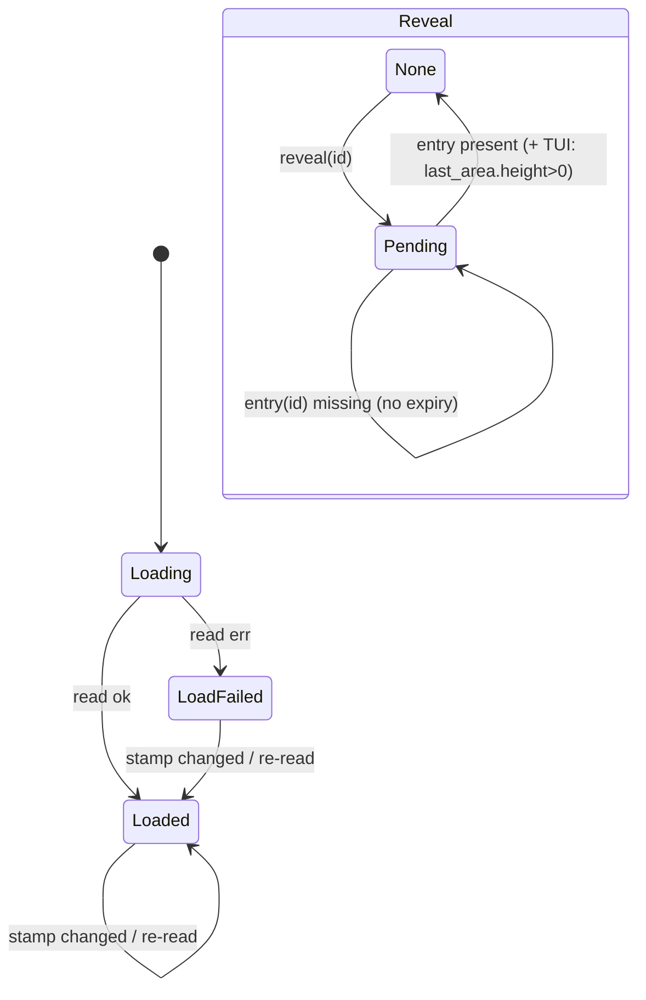

### Verified concerns (all low)
- **Reveal never expires.** `apply_reveal` returns early without clearing when the id is missing (`desktop/src/views/changelog.rs:261-268`, `shell/changelog.rs:418-424`). It is retried every tick, every set_data and every TUI render. Palette ids come from the page's own entries, so this mainly happens when an entry was deleted between the palette and the pick. A later reappearance would cause a surprise jump.
- **Reveal written twice with different rules.** The TUI also unfolds and focuses the entry and waits for the first layout. The desktop clears the latch as soon as the entry exists. Nothing is shared through `ChangelogModel`.
- **Stamp gate written twice.** Both versions commit the stamp even when the read was partial. Per-file failures (`skipped`) persist until the directory changes again.
- **TUI render mutates state.** `apply_reveal`, `load_ahead` and `keep_selection` all run in render (`shell/changelog.rs:878-884`).

### Refuted
- **"Errors stick forever."** A whole-read failure also makes `changelog_stamp_in` return the default stamp. When the directory recovers, the stamp differs and the client re-reads.
- **"Three inconsistent load-more guards."** Changelog paging is synchronous over an in-memory slice and bounded by `has_more`. The board's guard covers a real async fetch, sits in its single effectful owner (`desktop/src/views/issues.rs:1045-1048`), and is cleared unconditionally on completion (765). These are different mechanisms, not one lifecycle that has drifted.
- **"Latch set during render is a bug."** This is the standard gpui `defer_in` pattern.

### Recommendation
- Move the reveal latch (`request_reveal` / `take_reveal` with paging) into `shelbi_app::ChangelogModel`, with expiry on a read that lacks the id or on user navigation.
- Have both clients use one stamp gate (`ChangelogWatch` or `Source::changelog(unless)`).
- Optionally don't commit the stamp when `error`/`skipped` is set, so a partial read retries on the next tick.
- Leave the paging guards as they are.


### Verified concerns

- **low**: The reveal latch never expires. If the target id is missing from the data, both clients keep reveal=Some(id) indefinitely and re-check it on every tick (and every TUI render). If an entry with that id appears later, the page jumps to it long after the user moved on.
  - Evidence: desktop/src/views/changelog.rs:261-268 and crates/shelbi-tui/src/shell/changelog.rs:418-424 return early without clearing when model.entry(&id) is None. Re-attempted from desktop tick (238-241) and TUI set_data (453) and render (879). In practice the palette draws ids from the page's own entries (shell/mod.rs:2655, desktop/src/app.rs:4700) or a fresh read_corpus. So the case needs an entry deleted between palette and pick, or a view not yet loaded where waiting is intended.
- **low**: The reveal logic is written twice with different rules. The TUI also unfolds the entry, focuses it, and holds the latch until the first real layout. The desktop clears the latch as soon as the entry exists. Neither is in the shared ChangelogModel, so they can drift.
  - Evidence: crates/shelbi-tui/src/shell/changelog.rs:410-438 vs desktop/src/views/changelog.rs:255-280; ChangelogModel (shelbi-app/src/changelog.rs:254-370) has no reveal concept.
- **low**: Stamp gating is written twice. The TUI uses ChangelogWatch. The desktop uses its own Mutex<Option<stamp>> closure plus Source::changelog(unless). Both record the stamp even when the read failed, so a read that is only partly bad stays as it is until the directory changes again. One example is a file that fails to read or parse and ends up in skipped.
  - Evidence: shelbi-app/src/changelog.rs:448-457 (observe sets stamp before the read). shell/mod.rs:1171-1176 reads only when changed() is true. desktop/src/views/changelog.rs:188-194 stores data.stamp unconditionally. orchestrator/src/source.rs:236-242. read_entries_in puts per-file failures in skipped (shelbi-state/src/changelog.rs:513-519).
- **low**: TUI render() changes the model: apply_reveal, load_ahead and keep_selection run during draw. So paging and selection depend on draw frequency and viewport, not only on input.
  - Evidence: crates/shelbi-tui/src/shell/changelog.rs:878-884


### Concerns that did not hold up

- A transient read error sticks forever: mostly refuted. A whole-read failure means changelog_dir() errors or read_dir errors. In both cases changelog_stamp_in returns ChangelogStamp::default() (shelbi-state/src/changelog.rs:1013-1025), so when the directory recovers the stamp changes and the next poll re-reads. Only per-file 'skipped' failures can persist, and entry files are filtered so temp files are excluded (entry_id).
- The 'load more' in-flight guard is encoded three inconsistent ways (cross-view parity): not a real parity problem. Changelog paging is a synchronous growth of an in-memory window (ChangelogModel::load_more already checks has_more), so a duplicate call at worst adds one extra page. The board's LoadMore is an async network fetch, and its guard sits correctly in the one effectful owner that spawns the thread (desktop/src/views/issues.rs:1045-1048). The flag is cleared unconditionally on Done::More (765). BoardState emitting LoadMore without a guard is fine because the executor dedupes. These are different mechanisms, not one lifecycle drifting.
- Setting loading_more during render is a bug: it is the gpui idiom. render_item has &mut self, and the latch only collapses repeated defers within a frame before defer_in runs load_more. Even without it, extra calls would be bounded by has_more.


**Recommendation:** Move the reveal latch into ChangelogModel, e.g. a pending_reveal: Option<String> with request_reveal(id) and a take_reveal() -> Option<usize> that pages until the entry is visible and returns its index. Clients then only scroll and focus. Expire it on the next successful read that lacks the id, or on any user navigation. Have the desktop use ChangelogWatch, or have the TUI use Source::changelog(unless), so there is a single stamp gate. Optionally skip committing the stamp when data.error or skipped>0, so a partial read retries on the next tick. Leave the desktop loading_more latch and the board's load_more_in_flight as they are.


## Hub change subscription streams and desktop project feed

**Verdict:** Worth tidying. The scary concerns (lost changes on reconnect, missed review events, hammering a dead host) are covered by consumer-side polling, link-flip refresh, review reconcile and HostLink gating. What remains is three drifted copies of one reconnect loop, a link indicator that ignores two of the three remote streams, and a small replay gap for the orchestrator title in late desktop windows. Each is a future-bug magnet rather than a live correctness hole.

**Verified concerns:** 4 low

**Key files:**
- `crates/shelbi-app/src/changes.rs:78-215`
- `crates/shelbi-app/src/layout_sub.rs:68-192`
- `crates/shelbi-app/src/source/remote.rs:412-605`
- `desktop/src/refresh.rs:180-400`
- `desktop/src/feeds.rs:103-250`

### What it is
Clients learn about daemon changes over long-lived subscribe streams:
- **Local changes** (`crates/shelbi-app/src/changes.rs:78-215`): a hub-socket `subscribe` stream turned into `ChangeWake::{Board,Workspace}`. It optionally keeps a `connected` AtomicBool current.
- **Local layout** (`crates/shelbi-app/src/layout_sub.rs:68-192`): an almost verbatim copy that forwards `LayoutEvent`s (ReviewOpened/Closed).
- **Remote** (`crates/shelbi-app/src/source/remote.rs:412-605`): `line_loop` (changes/layout over the relay) and `control_loop` (far daemon `Changed` + `Reexec` -> `ChangeWake::Reload`). An `OpenStream` close latch interrupts relay reads that have no timeout.
- **Desktop** (`desktop/src/refresh.rs:180-400`): `feed_loop` merges wakes and layout events, derives `DaemonLink::{Live,Polling}` from `connected`, and polls the sidebar reader. `FeedHub` (`desktop/src/feeds.rs:103-250`) shares one feed per project across windows by refcount.

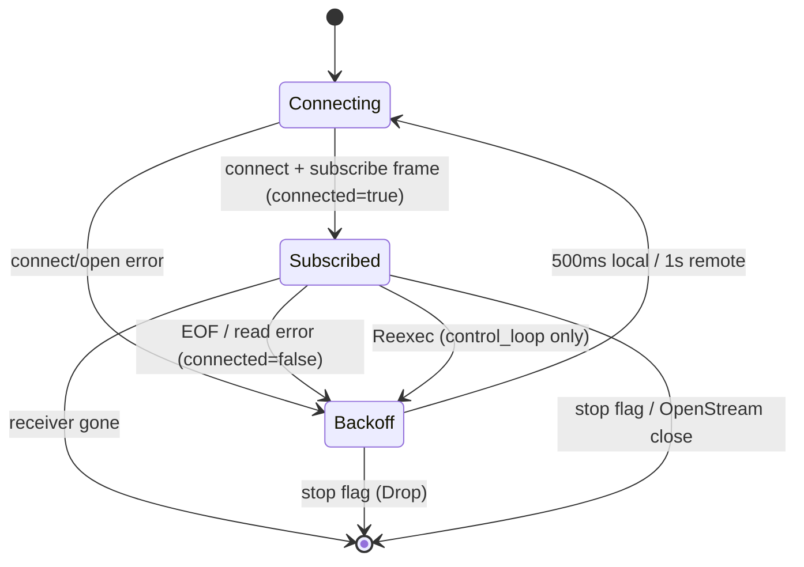

### Verified concerns
1. **Three drifted copies of the reconnect loop** (low). `changes.rs:112-215` and `layout_sub.rs:94-192` differ only in payload, sleep granularity (stop-aware 5x100ms vs one blocking 500ms sleep), and the `connected` write. `remote.rs` has two more variants with different exit rules: `line_loop` returns on receiver-gone, while `control_loop` breaks and reconnects after Reload.
2. **Late desktop windows miss the orchestrator title** (low). `feed_loop` emits the title only on change (`refresh.rs:363-372`). `Hub::broadcast` caches only Snapshot and Link (`feeds.rs:189-193`), and `subscribe` replays only those (`feeds.rs:145-147`). The second window's `notify::Tracker` starts at `None`, so its first Working->Awaiting transition only seeds the tracker and posts nothing (`notify.rs:192-220`). Visible when the first window has since closed.
3. **The remote link indicator follows only one of three streams** (low). `connected` is written only by `line_loop` for changes (`remote.rs:539,554`). The control stream has no link state, and `subscribe_layout` uses a throwaway `AtomicBool` (`remote.rs:490`).
4. **`connected` before any acknowledgement** (low). It is set right after writing the subscribe frame (`changes.rs:151`). The protocol has no ack, so a rejecting hub reads as Live until EOF.

### Refuted
- *No resync on reconnect*: the TUI polls every 750ms (`shell/mod.rs:380,554`). The desktop forces a refresh on every Polling->Live flip (`refresh.rs:337-338`) with a 25ms slice, and still polls every 5s/20s in Live mode.
- *Missed review events*: the TUI runs a ~1Hz close-reconcile against the board (`shell/mod.rs:4757-4766`). The desktop refreshes its snapshot on reconnect.
- *Fixed 1s retry hammers a dead remote*: `HostLink::channel()` gates channel re-establishment with its own pause (`launch/link.rs:388`).
- *FeedHub zero-subscriber entries*: the window drops its receiver and its FeedSubscription together, and the Drop removes the entry.

### Recommendation
Use one generic `resubscribe_loop` with an explicit `LinkState { Connecting, Subscribed, Backoff }`, a stop-aware (optionally capped exponential) backoff, and an `on_state` callback, shared by all four loops. Report an aggregate remote link state (changes and control both up). Cache and replay the last orchestrator `Title` notice in `FeedHub`.


### Verified concerns

- **low**: The reconnect skeleton is written three times and the copies have already drifted: different StreamEnd/sleep helpers, a 5x100ms stop-aware sleep in changes.rs vs a single non-interruptible 500ms sleep in layout_sub.rs, a 1s sliced pause in remote.rs, and different exit rules (line_loop returns on receiver-gone, control_loop breaks and reconnects on Reload). Any fix to reconnect or backoff behavior has to be made three times.
  - Evidence: changes.rs:112-215 vs layout_sub.rs:94-192 (near-verbatim copies, sleep_slice differs at changes.rs:200-207 vs layout_sub.rs:188-192); remote.rs:522-558 line_loop vs 562-605 control_loop
- **low**: A late desktop window on an already-running project feed never receives the orchestrator title. feed_loop sends the title only when it changes, and FeedHub replays only last_link and last_snapshot. The new window's notify::Tracker therefore starts with orchestrator=None, and its first observed transition (for example Working -> AwaitingInput) only sets a baseline and posts nothing. This matters when the first window closes and the late window is the only one left.
  - Evidence: refresh.rs:363-372 dedups the title; feeds.rs:145-147 replays only [last_link, last_snapshot]; feeds.rs:189-193 does not cache Session events; notify.rs:192-220 notifies only when `before` is Some(Working)
- **low**: The remote `connected` flag tracks only the changes stream. A dropped control stream, which carries Changed notes and Reexec/Reload, does not show in the link indicator. The remote layout subscription passes a throwaway local AtomicBool, so its link state is never observed.
  - Evidence: remote.rs:539/554 write connected only in line_loop; control_loop (562-605) has no connected; subscribe_layout uses `let connected = AtomicBool::new(false)` at remote.rs:490
- **low**: `connected` is set true as soon as the subscribe frame is written, before the hub acknowledges anything (the protocol has no ack). A hub that rejects the subscription reads as Live until it closes the socket.
  - Evidence: changes.rs:147-151; layout_sub.rs comment 'The connection then only reads, no ack'


### Concerns that did not hold up

- No resync on reconnect, so changes are lost until a fallback refresh: the TUI refreshes every 750ms no matter what (shell/mod.rs:380,554). The desktop feed forces a refresh whenever the link flips Polling->Live (refresh.rs:337-338), and with a 25ms slice it cannot miss a flip from an outage of 500ms or more. Live mode still polls every 5s locally and 20s remotely.
- A missed ReviewOpened/ReviewClosed with no fallback: the TUI runs a ~1Hz close-reconcile against the board (shell/mod.rs:4757-4766). The desktop gets a snapshot refresh on reconnect, and late windows get the cached snapshot. ReviewOpened is only awaited right after a client-initiated load that goes through the same daemon.
- Fixed 1s remote retry hammers an unreachable host: open_service goes through HostLink::channel(), which gates channel re-establishment with its own pause (launch/link.rs:388, with_pause). A failed attempt is a cheap error, not a new SSH session every second. The fixed 500ms local connect to a missing unix socket is also cheap.
- FeedHub pruning on send failure leaves a running feed with zero subscribers: each window holds its receiver and its FeedSubscription together, so dropping the window drops both, and FeedSubscription::drop removes the entry when the list empties (feeds.rs:225-248). A pruned-but-alive entry lasts at most until that drop.
- ControlWatcher wake senders linger: true, but they are pruned on the next Changed note for that project (refresh.rs:451-456). The leak is bounded by the number of feeds ever opened, so it is negligible.


**Recommendation:** Extract one generic `resubscribe_loop(open: impl FnMut() -> Result<Stream>, drain, stop, on_state: impl Fn(LinkState), backoff: Backoff)` in shelbi-app with an explicit `enum LinkState { Connecting, Subscribed, Backoff }`. Use it for changes, layout and both remote loops, with stop-aware sleeps everywhere and optionally a capped exponential backoff. Have the remote subscription report an aggregate link state, Live only when the changes and control streams are both up. In desktop FeedHub, cache the last orchestrator Title Session event alongside last_link/last_snapshot and replay it to late subscribers. A simpler alternative is to have Tracker treat the replayed title as its baseline.


## Command palette focus and async search

**Verdict:** Worth tidying. I found no live bug. Every illegal focus combination is either unreachable from the current hosts or hidden by a getter, and the TUI and desktop behave the same. Still, three fields together encode one focus enum, the guards differ from one mutator to the next (hover_project checks, click_project and focus_projects don't), and pending() keys on the query string rather than the request. Each of these is a small trap for the next change, such as a desktop keyboard path or a corpus-refresh spinner.

**Verified concerns:** 3 low

**Key files:**
- `crates/shelbi-app/src/overlay/palette.rs:74-556`
- `crates/shelbi-app/src/overlay/palette_search.rs:517-678`
- `crates/shelbi-tui/src/overlay/palette.rs:723-1037`
- `desktop/src/views/palette.rs:195-215,585-600`
- `desktop/src/app.rs:4685-4755`

**Entity:** the shared command palette (`shelbi-app::overlay::palette::Palette`) that the TUI wrapper and the desktop GPUI view both drive, plus its debounced issue/Changelog search (`PaletteSearch` / `SearchWorker`).

### States and encoding
- **Focus:** `focus: PaletteFocus {Commands, Projects}` + `filter_focus: bool`, read through the masking getters `filter_focused() = searching() && filter_focus` and `shows_projects() = !projects.is_empty() && !searching()` (crates/shelbi-app/src/overlay/palette.rs:160-179).
- **Mode:** `searching()` is derived from `query` and has no field of its own.
- **Search progress:** `PaletteSearch { asked, hits }`, where `pending() = hits.query != asked` (palette_search.rs:675-677). A worker thread debounces jobs on an mpsc channel and publishes `SearchHits`. `poll()` drains to the newest result and drops it if the query went blank.
- **TUI scroll:** `scroll: Cell<usize>`, plus a one-shot `follow: Cell<bool>` that keys arm and `scroll_for()` consumes during `render` (crates/shelbi-tui/src/overlay/palette.rs:723-737, 974-988).

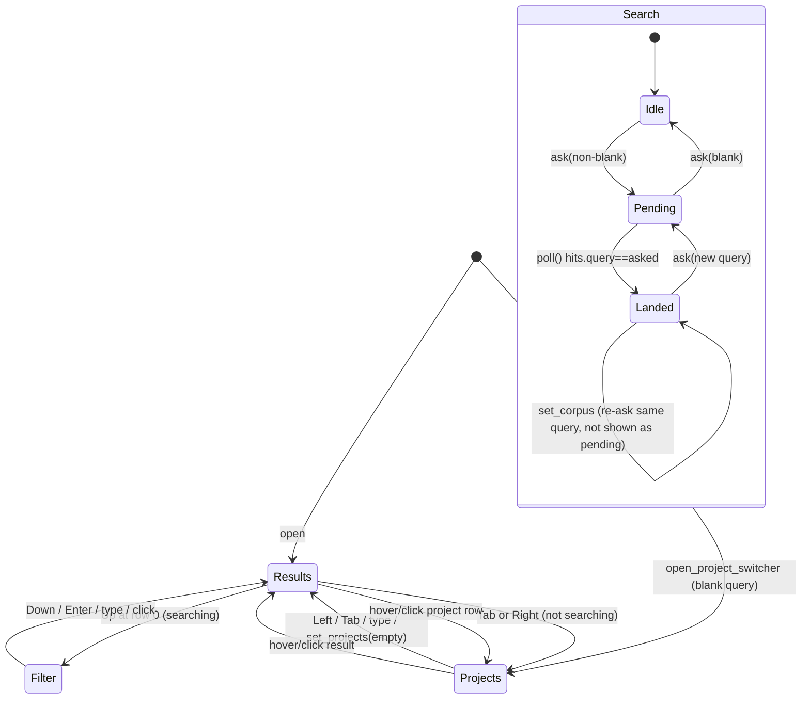

### Verified concerns (all low)
1. **A corpus refresh is never pending** (palette_search.rs:631-636, 675-677). After `set_corpus`, `pending()` is false while the re-search is still in flight, so old-corpus hits show as final for about one debounce. Harmless today. It does mean `pending()` tracks the query text, not the request.
2. **Focus split with uneven guards** (palette.rs:314-319, 521-537). `hover_project` checks `shows_projects()`, while `click_project`/`focus_projects` don't. Neither is reachable while searching today: the hosts only hit-test project rows when the column shows (tui palette.rs:879-890, desktop views/palette.rs:585-596), and `edited()` resets focus. Getters hide `filter_focus` lingering past a cleared query.
3. **TUI follow latch is consumed in render and not armed by data changes** (tui palette.rs:756-769, 974-988). Async hits landing don't re-follow the selection. This is benign because `edited()` already zeroed the selection.

### Refuted
- Projects focus can't actually be set while searching through a click (no hit target).
- The shared-channel race between `PaletteSearch` clones needs a clone, and nothing clones a palette.
- The filter-chip click not arming follow doesn't matter, because selected and scroll are both 0.
- The TUI and desktop highlight the selection the same way while the filter has focus; each computes it in its own layer (desktop palette.rs:200, tui palette.rs:221-222).
- Stale older-query hits keep `pending()` true, so they never look final.

### Recommendation
This is worth tidying but not urgent. Collapse focus into `enum Focus { Results, Filter, Projects }` behind one `set_focus()` that applies the searching and shows_projects guards. Optionally, add an ask generation to `SearchHits` so pending means "this request hasn't landed." Optionally, arm the TUI `follow` latch when hits land.


### Verified concerns

- **low**: A corpus refresh never shows as pending. set_corpus re-asks the same query, so hits.query == asked right away, pending() returns false, and the old corpus's hits show as final until the new search lands (about one debounce later). This is harmless in practice and avoids a 'Searching…' flicker. But pending() means 'landed for this query string', not 'landed for this ask', and that difference is easy to trip over later.
  - Evidence: palette_search.rs:631-636 (set_corpus takes asked and re-asks it); palette_search.rs:675-677 (pending = hits.query != asked). Callers: tui shell/mod.rs:2664, desktop app.rs:4730/6321.
- **low**: Focus is split across PaletteFocus, filter_focus and the derived searching() flag, and these can represent illegal combinations: filter_focus=true while not searching, and focus=Projects while searching. Getters hide them (filter_focused() ANDs with searching(); shows_projects() hides the column). Not every mutator checks its guard. click_project and focus_projects set Projects without checking searching(), while hover_project checks shows_projects(). Today neither path is reachable while searching: the TUI and desktop only hit-test project rows when the column shows, focus_projects runs only on open with a blank query, and every edit resets focus to Commands. So this is a latent API gap, not a live bug.
  - Evidence: app palette.rs:170-179 (masking getters), 521-523 (hover_project guard), 533-537 (click_project unguarded), 314-319 (focus_projects unguarded), 545-555 (edited resets focus); tui palette.rs:879-890 (project_at requires shows_projects).
- **low**: The TUI scroll-follow latch is consumed as a side effect of rendering through &self and a Cell. Data changes (set_entries, set_corpus, poll_search hits landing) do not arm it. After async hits land, scroll stays where it was rather than following the selection. Since edited() sets selected=0 and the band starts near the top, the selection almost always stays visible. Only a user who wheel-scrolled and then got new hits sees an off-band selection, and that is arguably what they wanted.
  - Evidence: tui palette.rs:974-988 (follow.replace(false) inside scroll_for, called from render at 1035); 756-769 (set_entries/set_corpus/poll_search do not touch follow); 813 (keys arm follow).


### Concerns that did not hold up

- click_project can set Projects focus while searching (column hidden): not reachable. The TUI's project_at returns None unless split_results got shows_projects()=true (tui palette.rs:879-890), and the desktop only builds the project rows, with their click handlers, when the column shows (desktop views/palette.rs:202, 585-596). It stays a latent API asymmetry only.
- Clones of PaletteSearch share one worker channel, so whichever clone polls first steals the hits: the type is Clone, but no Palette or PaletteSearch is ever cloned in the TUI or desktop. The TUI wrapper isn't Clone, ActiveOverlay isn't cloned, and each open builds its own PaletteSearch::background (tui shell/mod.rs:2819, desktop app.rs:4685-4690). The concern is theoretical.
- Filter-chip click resets scroll=0 without arming follow, unlike Show-all: click_filter sets selected=0 and scroll=0, so the selection is already in view and arming follow would change nothing.
- TUI/desktop parity drift in highlighting the results selection while the filter row has focus: the desktop computes focus==Commands && !filter_focused() (desktop palette.rs:200). The TUI applies the same && !filters.focused check in its renderer (tui palette.rs:221-222). They behave the same, but the logic is computed in two different places.
- Stale in-flight hits for an older query overwrite newer hits: they do replace hits, but pending() stays true because hits.query != asked, so the UI keeps saying 'Searching…' until the right query lands. Blank queries drop late hits (palette_search.rs:664-666).


**Recommendation:** Replace focus + filter_focus with a single enum Focus { Results, Filter, Projects }, and have one set_focus() that coerces illegal targets: Filter needs searching(), Projects needs shows_projects(). That makes click_project/hover_project/focus_projects behave consistently, and filter_focused() becomes a plain match. Optionally, give PaletteSearch a monotonically increasing ask generation (asked_gen: u64) and echo it in SearchHits, so pending() means 'this ask has not landed' and set_corpus can choose to show or hide a refresh. In the TUI, arming follow from poll_search/set_corpus when the selection is 0 is a one-line nicety. None of this is urgent.


## Markdown/doc editor interaction and IME composition

**Verdict:** Worth tidying. No live bug. Every production path keeps marked and composing aligned, and the desktop refuses outside merges mid-composition. But Editor::replace_from_outside is a public API that half-handles composition: it maps marked but not composing.0. A future caller, such as a TUI parity editor or a removed guard, would get a corrupt undo step or a panic. Folding the two Options into one composition struct removes the hazard cheaply. The desktop bools are small and correct.

**Verified concerns:** 2 low

**Key files:**
- `crates/shelbi-app/src/markdown_edit/editor.rs:45-60,1405-1521`
- `crates/shelbi-app/src/markdown_edit/history.rs:1-120`
- `desktop/src/views/doc_editor/mod.rs:75-201,488-535,592-620,781-870`
- `desktop/src/views/doc_editor/element.rs:205-230`
- `desktop/src/views/issues.rs:1094-1114`

### What it is
This machine has two layers.

1. **The shared `Editor`** (`crates/shelbi-app/src/markdown_edit/editor.rs`) tracks input-method composition with two Options:
   - `marked: Option<Range>` is the uncommitted IME text.
   - `composing: Option<(start, replaced_text)>` is where the composition began and what it replaced, used to record a single undo step.

   `History.last: Option<(Kind, Instant)>` is a separate 1.5s coalescing latch for Typing and Deleting runs.
2. **The desktop `DocEditor`** (`desktop/src/views/doc_editor/mod.rs`) tracks UI interaction with the bools `focused`, `caret_on`, `dragging` and `reveal`, plus `link: Option<LinkPrompt>` and a perpetual blink task.

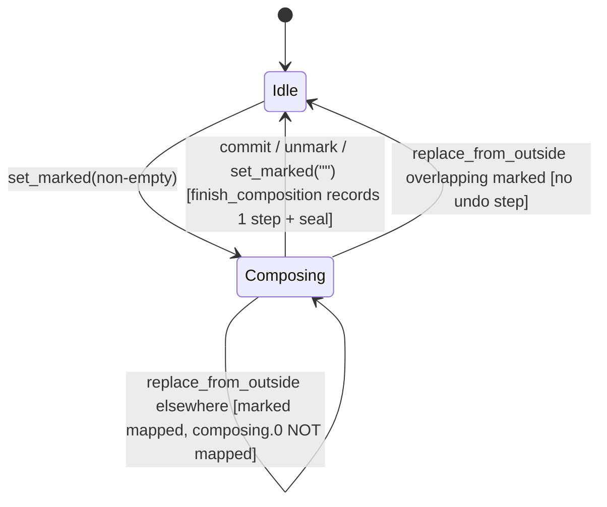

### Transitions
- **Start composing.** `set_marked` sets `composing` only on the first call (editor.rs:1450). It sets `marked` to the new range, or to None when the text is empty, and empty text finishes the composition at once (1455-1464).
- **Finish.** `commit` (1469-1495) and `unmark` (1498-1502) both call `finish_composition` (1505-1520). It slices `text[at..head]`, records one `Kind::Other` step and seals history.
- **Edits are refused while composing.** Edits, undo and redo all bail while `marked.is_some()` (342, 407, 472, 631, 1364, 1388).
- **History latch.** `record` coalesces when the kind matches and the gap is under 1.5s. `seal`, `undo`, `redo` and `rebase` clear `last` (history.rs:40-117).
- **Desktop focus.** `on_focus_in` and `on_focus_out` flip `focused`, and focus-out also clears `link` and `dragging` (mod.rs:118-132).
- **Desktop drag.** The drag ends on a window-level MouseUp (element.rs:221-226).
- **Desktop link prompt.** It closes on Enter, Escape, mouse-down-out or focus-out.

### Verified concerns
- **(low, latent) `composing.0` is not rebased on an outside splice.** `replace_from_outside` (editor.rs:1414-1426) maps `marked` but leaves `composing.0`. After a splice before the composition, `finish_composition` slices at a stale offset, which records a wrong undo step or panics on a non-char boundary. It is unreachable today because `DocEditor::set_from_outside` returns early while composing (mod.rs:194-197). The skipped merge is reapplied on the next `sync_pane_editors` (issues.rs:1107-1113).
- **(low) Two Options with an invariant nothing enforces.** The editor relies on `marked` Some implying `composing` Some. `is_composing()` reads only `marked` (135-137).

### Refuted
- **Drag stays active after a release outside the element.** It doesn't: the MouseUp handler is window-wide.
- **Opening the link prompt triggers focus-out and drops it.** The prompt is rendered inside the `track_focus` div, so it is a focus descendant.
- **Toolbar uses `is_focused(window)` instead of the `focused` mirror.** It only differs while the link prompt is open, and the toolbar is already hidden then.

### Recommendation
Make the editor enforce the rule itself instead of relying on its caller:
1. Merge the two fields into one `composition: Option<Composition { marked, start, replaced }>`.
2. In `replace_from_outside`, either map `start` or refuse to run while composing.
3. Add a regression test: compose, then an outside splice before the range, then commit.

Leave the History latch and the DocEditor bools as they are; they are contained and correct.


### Verified concerns

- **low**: replace_from_outside maps `marked` through the splice but not `composing.0`. If a splice lands entirely before a live composition, `composing.0` goes stale. finish_composition would then slice text[at..head] at the wrong offset, which records a corrupt undo step or panics on a non-char boundary. Latent only: the sole production caller (DocEditor::set_from_outside) returns early while composing, and the fuzz test never leaves a composition open across an outside merge.
  - Evidence: editor.rs:1414-1426 maps only self.marked; editor.rs:1451 sets composing=(range.start, ...); editor.rs:1506-1508 slices text[at..end] using the unmapped `at`; desktop/src/views/doc_editor/mod.rs:194-197 guards with is_composing().
- **low**: `marked` and `composing` are two Options with an unenforced invariant (marked Some implies composing Some, and composing.0 == marked.start). is_composing() reads only `marked`. The invariant holds by construction in set_marked, commit, unmark and replace_from_outside, but no type enforces it.
  - Evidence: editor.rs:52-55 field decls; editor.rs:135-137 is_composing reads marked; editor.rs:1416-1417 clears both together; editor.rs:1455 and 1462 keep them aligned.


### Concerns that did not hold up

- A mouse release outside the element leaves drag-select active: refuted. The MouseUp listener is a window-level on_mouse_event with no hitbox or hover check (element.rs:221-226), so any release clears dragging. mouse_drag also requires pressed_button == Left (element.rs:216-219).
- open_link's focus move to the prompt input fires on_focus_out and drops the prompt: unlikely. The prompt is rendered as a child (deferred/anchored) of the div that track_focus(&self.focus) (mod.rs:851, 869), so it is a focus descendant, and gpui's on_focus_out only fires when focus leaves the handle's subtree. The Enter handler then refocuses the editor (mod.rs:609). Not runtime-verified, but nothing in the code supports the drop.
- Toolbar uses focus.is_focused(window) instead of the `focused` mirror: true, but harmless. It only differs while a descendant (the link input) holds focus, and the toolbar is already suppressed by link.is_some() (mod.rs:637-638). Using real focus is arguably more correct.
- An outside merge during composition loses the remote edit: refuted. set_from_outside skips while composing, but sync_pane_editors re-reads the draft and calls it again on the next sync (issues.rs:1107-1113).


**Recommendation:** Replace `marked` and `composing` with one field, `composition: Option<Composition { marked: Range<usize>, start: usize, replaced: String }>`. Make is_composing() be composition.is_some(). In replace_from_outside, either map `start` along with `marked` or refuse (debug_assert or no-op) while composing, so the editor itself enforces what the desktop caller enforces today. Add a test: set_marked, then a non-overlapping outside splice before the range, then commit; assert a valid undo step. Leave History's time latch and the desktop DocEditor bools as they are.


## Add Project wizard screens and creation progress

**Verdict:** Fine as is. One small struct owns every transition, each event handler is guarded (creating(), screen+opening checks, key-matched checks), and the tests cover retry, stale checks, open failure and closing mid-creation. The host's run counter supplies the attempt id the core lacks. The illegal combination (failed while running) can occur, but only for the gap between two consecutive engine calls. The only open question is that closing the window mid-creation does not cancel the engine, which is a product decision, not a state-machine defect.

**Verified concerns:** 3 low

**Key files:**
- `crates/shelbi-app/src/add_project_wizard.rs:459-528 (Progress + Wizard fields)`
- `crates/shelbi-app/src/add_project_wizard.rs:618-740 (row/opening/check machinery, primary_enabled)`
- `crates/shelbi-app/src/add_project_wizard.rs:857-1112 (back/primary/start/retry/stage events/creation results/Esc)`
- `desktop/src/views/add_project.rs:188-250 (OpenWizard global, show, opened, replace_root)`
- `desktop/src/views/add_project.rs:408-427,516-641 (act, create with run generation, open, report, finished)`

**What it is.** One Add Project wizard session in the desktop app: folder check, then agent defaults, settings, creation (engine run with a per-stage checklist), and opening the created project. The core model is `Wizard` in `crates/shelbi-app/src/add_project_wizard.rs`, driven by `AddProjectView` in `desktop/src/views/add_project.rs`. The TUI does **not** use this model. It has its own single-form overlay with no progress screens, so there is no shared machine to drift between the two.

**How state is stored.**
- `screen: Screen` is explicit (Folder / Defaults / Settings / Creating / Created).
- The Creating sub-state is `Progress { request, running, done, active, failed, warnings }` (lines 459-472).
- The Created sub-state is `created: Option<Created>`, `opening: bool` and `open_error: Option<String>`.
- The folder check is `check: Option<(CheckKey, FolderCheck)>` plus `in_flight: Option<CheckKey>`. An answer is valid only if its key matches the current text.
- The desktop host adds `run: u64`, a generation counter that drops stale engine reports and results, and an `OpenWizard(Option<AnyWindowHandle>)` global used to raise the open window or open a new one.

```mermaid
stateDiagram-v2
    [*] --> Folder
    Folder --> Defaults: Continue (check usable)
    Defaults --> Settings: Continue (runner not Generic)
    Defaults --> Folder: Back
    Settings --> Defaults: Back
    Settings --> Running: Create Project (Attempt::New)
    Running --> Running: stage_started/finished/warning
    Running --> Failed: creation_failed
    Failed --> Running: Try Again (Attempt::Retry)
    Running --> Created: creation_succeeded
    Created --> Opening: Okay
    Opening --> OpenFailed: open_failed
    OpenFailed --> Opening: Okay
    Opening --> [*]: on_created Ok (window removed)
    Folder --> [*]: Esc/Back/Close
    Failed --> [*]: Esc/Close
    Created --> [*]: Esc/Close
```

**Guards.** Each engine event is accepted only while `creating()` (`screen == Creating && running`, line 999). `retry()` is refused while running (948). `primary_enabled` disables Try Again while running and Okay while opening (731-740). `open_failed` requires `screen == Created && opening` (663). On the desktop, `report`/`finished` drop anything whose `run != self.run` (609-631).

**Verified concerns (all low).**
1. *Failed while running.* `stage_failed` (979) sets `failed` and leaves `running = true`, so Try Again stays disabled until `creation_failed` (1096). The gap is tiny: the engine's `stage` wrapper (`project_create.rs:980-993`) reports the failure and returns `Err` right away, and the host turns that into `creation_failed`. An engine panic is the only way to stay stuck there.
2. *No timeout on creation or open, and Esc is refused.* `handle_key` refuses Esc while `running || opening` (1063). A hung engine or hung `refresh()` (add_project.rs:529-551) shows a spinner indefinitely. The user can still close the window: `CloseWindow` and the titlebar close remove it unconditionally (add_project.rs:1230).
3. *Closing the window does not cancel creation.* The engine runs detached (516-540), and only its UI updates are dropped (the test at 1820-1835 confirms this). Reopening Add Project on the same folder starts a new `Attempt::New` alongside, or after, an orphaned half-finished scaffold. This is a product decision more than a state bug.

**Refuted concerns.**
- *A stale attempt leaks into a retry.* The host's `run` generation and per-run channel prevent it.
- *Trapped modal.* Only Esc is blocked; window close always works.
- *`OpenWizard` is never cleared.* It is only used to raise a window, and a dead handle's `update()` errs, so a new window opens. gpui handles are versioned, so a stale one can't alias a new window. Registering the setup window is intended.
- *`open()` lacks a generation.* The `opening` flag blocks a second Okay, `open_failed` is guarded, and the update goes through the window's own handle.

**Recommendation.** Fine as is. If Progress is touched, fold `running`/`active`/`failed` into `enum Run { Idle, Running { active }, Failed { stage, message } }`. Optionally, have `Wizard::start()` mint the attempt id so any future host gets stale-event protection for free. Separately decide whether close-during-Creating should warn the user or cancel the engine.


### Verified concerns

- **low**: Creating's sub-state is spread over four fields, so 'failed while still running' (failed=Some, running=true) can be represented. It does occur, but only for the moment between the engine's stage_failed report and its Err return.
  - Evidence: add_project_wizard.rs:979-985 stage_failed sets failed and leaves running=true. primary_enabled (737) needs !running, so Try Again stays disabled until creation_failed (1096). project_create.rs:980-993 calls stage_failed and then returns Err right away, and the desktop finished() (add_project.rs:623-641) turns that into creation_failed, so the window closes on its own unless the engine panics.
- **low**: Creation and open have no timeout, and Esc is refused while running||opening. A hung engine or hung catalog refresh leaves the wizard showing a spinner indefinitely.
  - Evidence: add_project_wizard.rs:1063-1067 refuses Esc. desktop add_project.rs:529-540 waits on the engine and 548-551 waits on refresh() with no deadline. This does not trap the user: CloseWindow and the titlebar close (add_project.rs:1230) remove the window unconditionally.
- **low**: Closing the window mid-creation does not stop the engine. The background create keeps writing files, and a newly opened wizard on the same folder starts a fresh Attempt::New with no knowledge of the orphaned run.
  - Evidence: desktop add_project.rs:516-540 spawns the engine detached and only the UI update is dropped through the weak handle. The test closing_mid_creation_drops_its_reports_and_opens_nothing (add_project.rs:1820-1835) confirms the reports are dropped, not the work. OpenWizard (192-231) then opens a new window because the old handle fails update().


### Concerns that did not hold up

- Late stage events from attempt 1 could be applied to attempt 2: the desktop host bumps self.run per create(). report() and finished() drop anything whose run != self.run (add_project.rs:516-518, 609-612, 629-631), and each run has its own channel. The shared Wizard itself has no attempt id, but its only host provides one. retry() is also refused while running, so attempts never overlap.
- The user is trapped in a modal if the host never reports: only Esc is refused. The window has titlebar traffic lights (about.rs:61-65) and an unconditional CloseWindow handler (add_project.rs:1230).
- The OpenWizard global is never cleared and is unsafe: show() uses it only to raise a window, and falls through to opening a new one when update() on a dead handle errs (add_project.rs:199-203). gpui window handles are versioned slot keys, so a stale handle cannot point at a new window. The setup window registering itself (cli_setup.rs:164) is documented intent ('the setup window the wizard follows'), and replace_root re-registers the same window (add_project.rs:249).
- open() needs a run generation: a second Okay is blocked by opening (primary_enabled line 738). open_failed is guarded by screen==Created && opening (663-664) and goes through the window's own handle, which fails harmlessly after close. Nothing can start a competing open.
- There is TUI/desktop drift in the wizard machine: the TUI does not use Wizard. It has its own single-form overlay (crates/shelbi-tui/src/overlay/add_project.rs, shelbi-app overlay/add_project.rs Form) with no creation-progress screens, so there is no shared machine to drift.


**Recommendation:** Leave it. If Progress is touched again, a cheap tidy-up would be to replace running/active/failed with `enum Run { Idle, Running { active: Option<Stage> }, Failed { stage: Stage, message: String } }` next to `done`. That makes 'failed while running' impossible to represent, and stage_failed would just record a pending failure that creation_failed takes over. Optionally, move the run generation into Wizard::start() (it returns an attempt id, and every event takes one) so a future second host can't forget it. Separately, decide whether closing the window during Creating should warn the user or cancel the engine.


## Contact Us feedback form send

**Verdict:** Fine as is. This is a small machine with one owner. All transitions live in one roughly 50-line impl in shelbi-app, and the TUI and desktop share it, so the two frontends cannot drift. It has guards against double submit and against closing mid-send, and the send is time-bounded. The only real finding is a cosmetic inconsistency: the text fields are not locked during a send while the other controls are.

**Verified concerns:** 1 low

**Key files:**
- `crates/shelbi-app/src/feedback/form.rs:101-330`
- `crates/shelbi-tui/src/overlay/feedback.rs:157-247`
- `crates/shelbi-tui/src/shell/mod.rs:3668-3775`
- `desktop/src/views/feedback.rs:120-145,260-282`
- `crates/shelbi-app/src/feedback.rs:390-400`

**Entity:** one Contact Us dialog's `FeedbackForm` (`crates/shelbi-app/src/feedback/form.rs:101-330`). The TUI (`crates/shelbi-tui/src/overlay/feedback.rs`) and the desktop (`desktop/src/views/feedback.rs`) share it.

**Encoding:** `sending: bool`, `sent: bool`, `error: Option<String>`, plus `focus`. `sending && sent` can be represented but is never produced. Closed is not stored. The form returns `Action::Close` and the host drops the view.

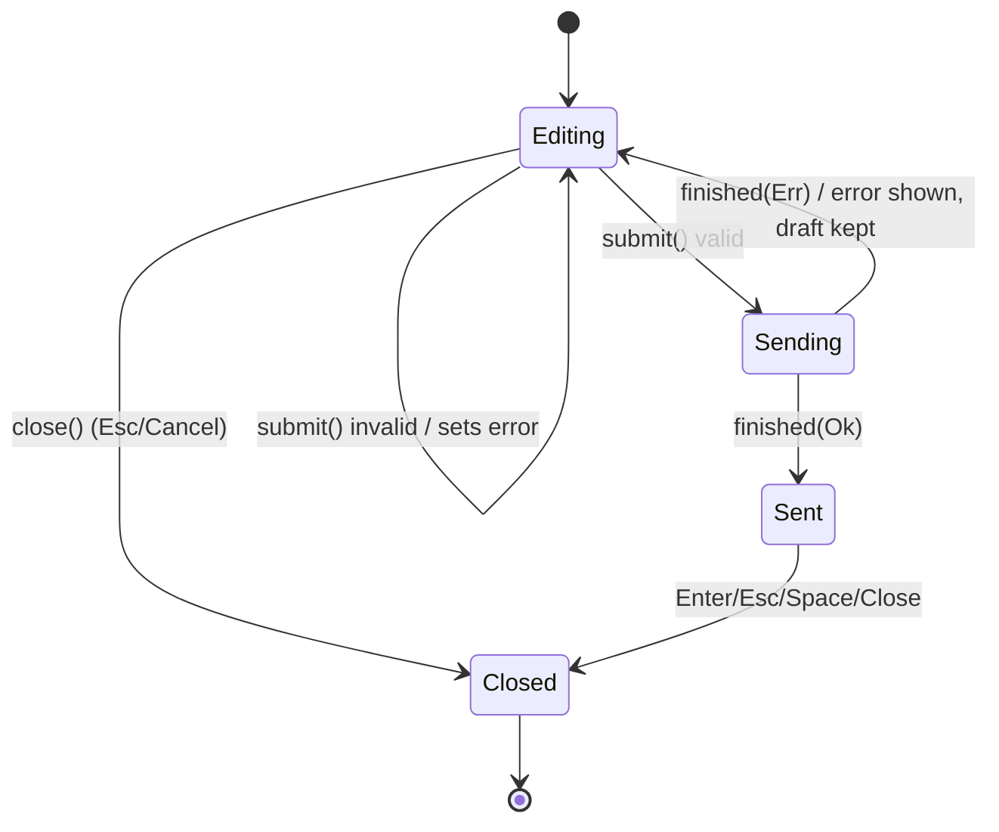

**Transitions**
- submit() (form.rs:288-315) refuses while sending or sent and validates email and message. On success it snapshots a trimmed `Submission` and sets `sending`.
- finished() (form.rs:319-329) clears `sending`, then sets `sent` on Ok or sets `error` on Err.
- close() (form.rs:278-284) is a no-op while sending.
- set_* (form.rs:180-199) clears the error when the text changes.

**The send path is bounded.** curl runs with `--max-time` (`crates/shelbi-app/src/feedback.rs:393`). The TUI polls a single `feedback_job` receiver and turns a disconnect into a Network error (`crates/shelbi-tui/src/shell/mod.rs:3751-3775`). The desktop spawns on the background executor and applies the result to the same view entity (`desktop/src/views/feedback.rs:262-279`).

**Verified concern (low):** the form is half-locked during a send. `pick`, `toggle_system_info` and Left/Right on Kind all check `!sending`. The three `set_*` text setters do not, and neither frontend blocks typing: TUI `in_text = !sent && focus.is_text()` (overlay/feedback.rs:176), and the desktop forwards `InputEvent::Change` unconditionally (views/feedback.rs:123-141). Impact is cosmetic. A retry sends whatever is visible, and a success drops the edits under the thank-you.

**Refuted:**
- The "retry sends a different message unknowingly" concern does not hold, because the retry sends the visible draft.
- The unguarded `finished()` has no reachable stale-delivery path. There is a single job, the TUI checks for a Feedback overlay, and close() is blocked mid-send.
- No hang is possible, because of `--max-time`.

**Recommendation:** fine as it is. Optionally, guard the `set_*` setters on `sending || sent` and make the frontends respect it. If the form is touched again, fold the two bools into `enum Phase { Editing, Sending, Sent }`.


### Verified concerns

- **low**: The text fields accept edits during a send, but the kind picker and the system-info checkbox do not. The form is half-locked while it sends, and this happens in both frontends.
  - Evidence: form.rs:180-199: set_name/set_email/set_message have no `sending` check. pick() and toggle_system_info() check `!self.sending` (form.rs:210, 218), and so do Left/Right on Kind (form.rs:267). TUI: overlay/feedback.rs:176 computes `in_text = !sent && focus.is_text()`, so typing during a send reaches sync(). Desktop: views/feedback.rs:123-141 forwards InputEvent::Change to set_* with no busy check, while render_kinds drops the click handler when busy (views/feedback.rs:455-470). Impact is cosmetic. On success the edits are dropped and the thank-you replaces the form. On failure the retry sends what the fields now show, which is what the user sees, so nothing is sent that the user did not see.


### Concerns that did not hold up

- Auditor concern: 'After a failure, the user retries a message that differs from the failed one without knowing it.' Refuted as a correctness issue. submit() rebuilds the Submission from the current fields (form.rs:304-311), so a retry sends exactly the visible draft. The edits are visible, so they are not hidden from the user.
- Auditor concern: 'finished() is unguarded, applies whether or not a send is in flight.' No reachable misuse was found. The TUI holds one feedback_job: Option<Receiver> and applies a result only when the current overlay is a Feedback dialog (shell/mod.rs:3751-3775). The desktop applies the result to the same view entity that spawned it, and a dialog that has been closed drops it (views/feedback.rs:262-279). close() refuses while sending, so a user cannot swap in a fresh dialog mid-send. A stale result could land on a new dialog only if some non-user path replaced the TUI overlay with a new Feedback dialog mid-send, and no such path was found.
- Auditor concern: 'sending && sent representable.' True but not reachable: finished() clears sending before it sets sent, and submit() refuses when sent is set.
- Auditor concern: 'Could hang.' Refuted. curl runs with --max-time (feedback.rs:393), and the TUI turns a dropped channel into a Network error (shell/mod.rs:3756-3758).


**Recommendation:** Leave the structure as it is. Optionally, add `if self.sending || self.sent { return; }` to set_name/set_email/set_message so the whole form locks during a send. Then have the TUI's in_text and the desktop's inputs check form.sending(), or set the desktop inputs to disabled while busy. If the form is ever touched again, folding sending/sent into `enum Phase { Editing, Sending, Sent }` is a cheap tidy, but on its own it is not worth a change.
