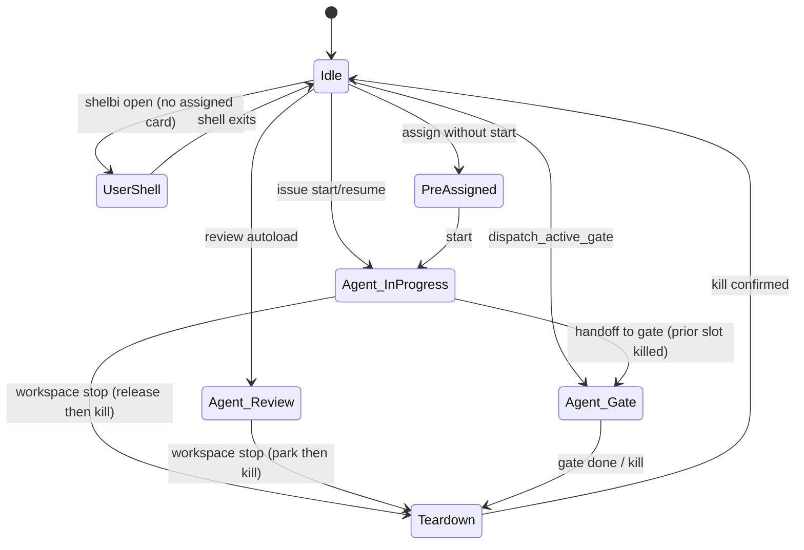
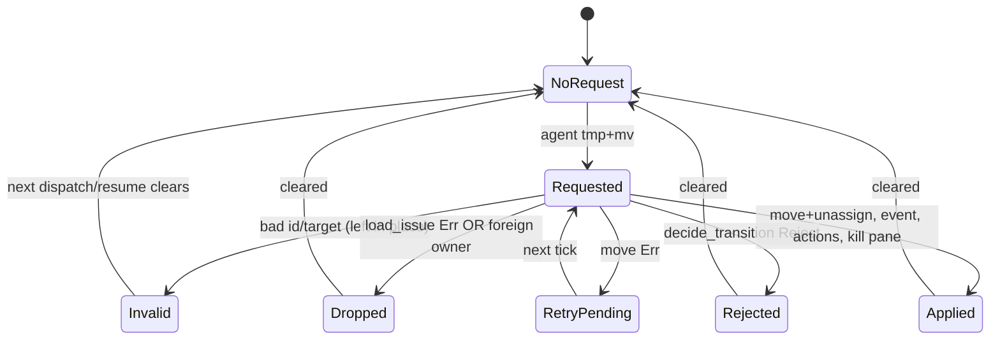
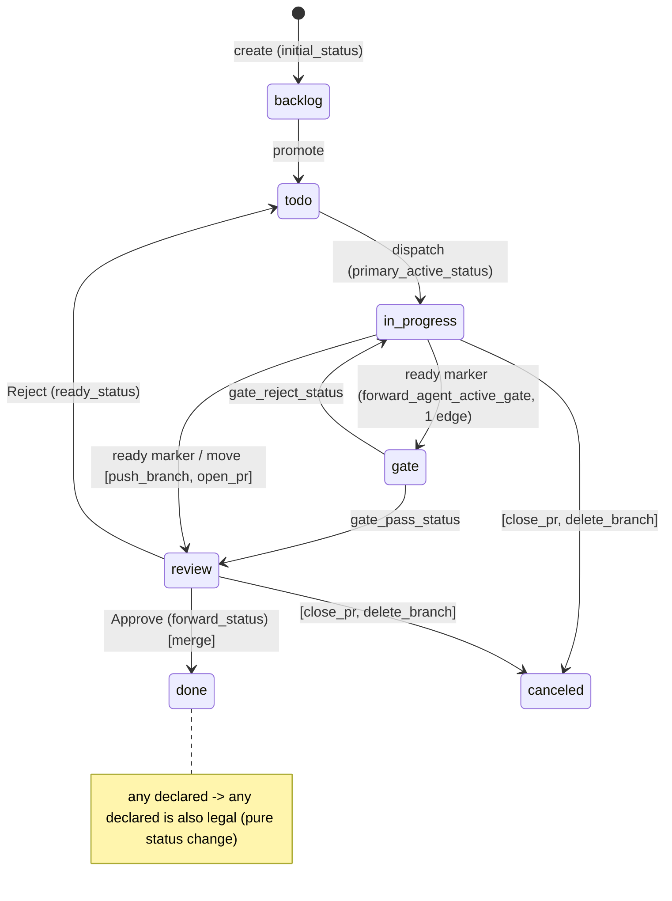
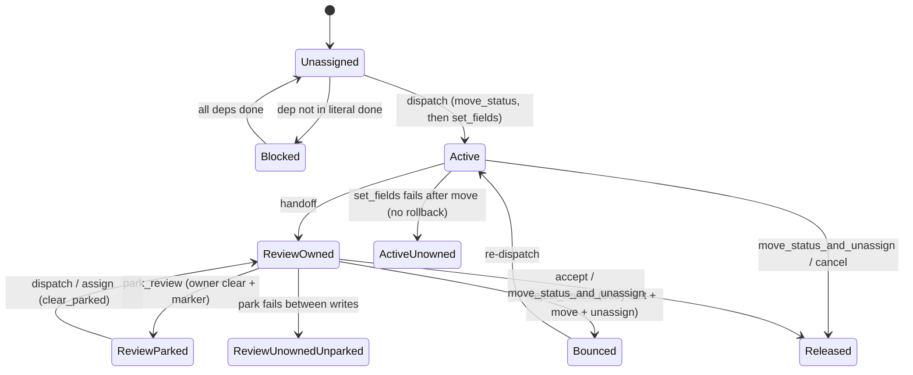
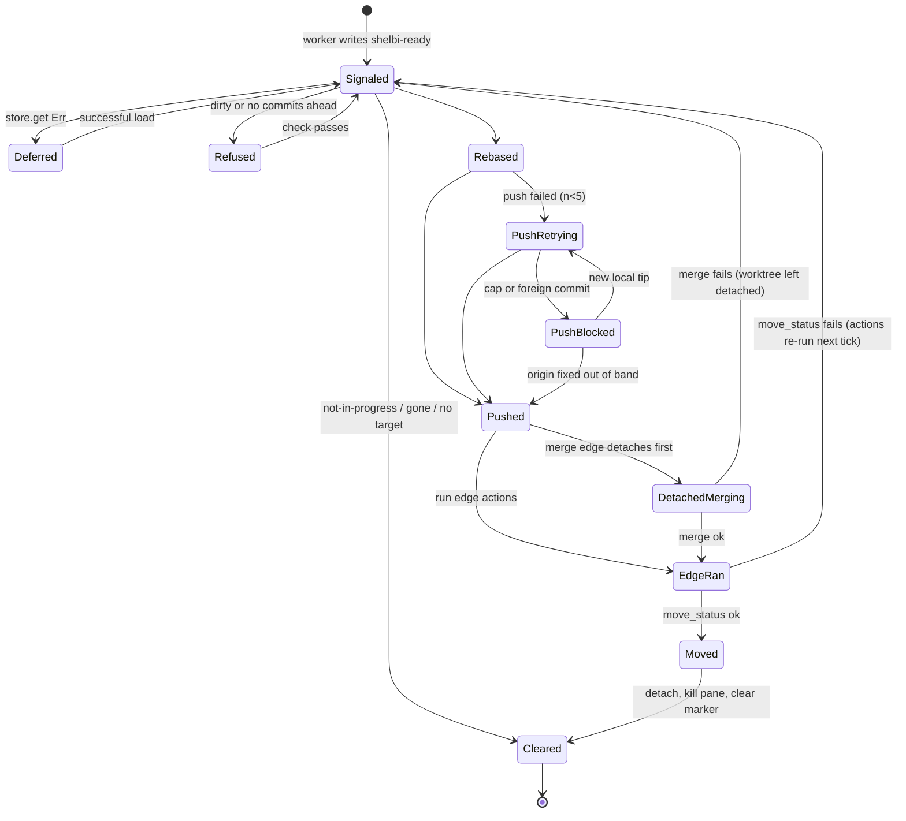
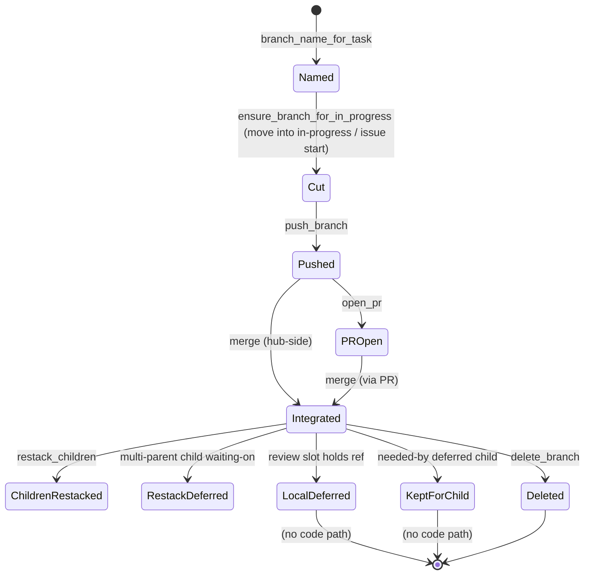
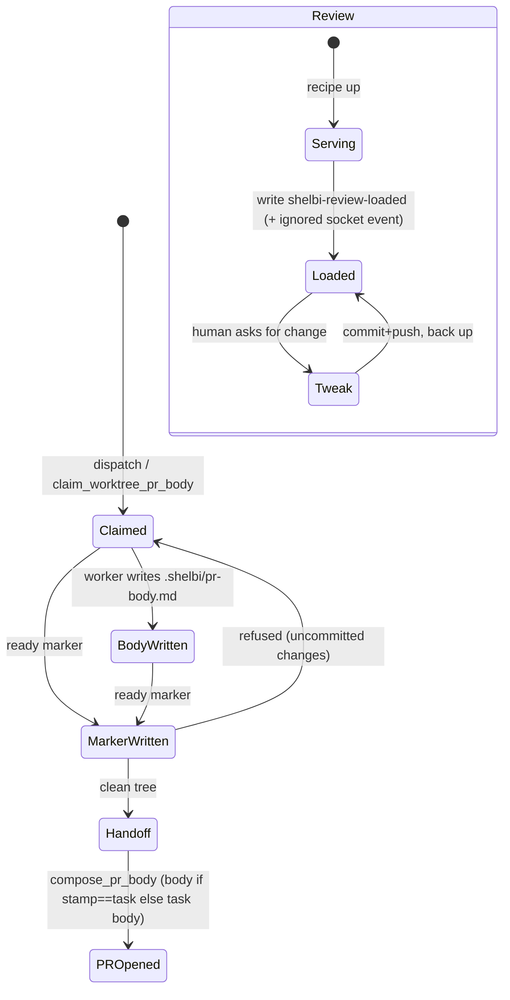

# Implicit state machines: task lifecycle

Part of the [implicit state machine audit](../implicit-state-machines.md). Audit of origin/main at b93c57c4, 2026-11-05. 10 machines in this area, most pressing first.


## Workspace slot occupancy (busy/idle derived inconsistently)

**Verdict:** Needs further thought. Two reachable paths can kill a live worker because their busy definition is narrower than the real one: the unguarded supplant kill in dispatch_active_gate, and the in_progress-only dispatch guard that lets issue start tear down a running custom-gate agent. These are the 'issue start kills prior assignee pane' class already seen in production. The cause is that the busy definition is scattered across about 7 predicates that have drifted apart.

**Verified concerns:** 2 high, 1 medium, 2 low

**Key files:**
- `crates/shelbi-orchestrator/src/mutate.rs:505-641 (workspace_occupied_by, workspace_busy_with_other, ensure_workspace_dispatchable)`
- `crates/shelbi-orchestrator/src/load.rs:34-38, 144-160, 471-487, 984-1155 (active_board, free_review_workspaces, review_slot_busy_with_other, occupied_workspaces, dispatch_active_gate, release_supplanted_workspace)`
- `crates/shelbi-orchestrator/src/mutate/start.rs:98-121, 340-372 (start guards and the guarded supplant release)`
- `crates/shelbi-cli/src/commands/issue.rs:445-482, status.rs:681-704, open.rs:36-56 (CLI duplicate predicates)`
- `crates/shelbi-orchestrator/src/workspace.rs:2090-2120, 2361-2385 (user-shell mark, kill_workspace_pane)`

### What it is
A workspace slot has no stored state. Each caller decides whether a slot is busy by combining some of these inputs:
- the board column, either as a literal (`in_progress`, `review`) or as a workflow `StatusCategory`
- `assigned_to`, taken from the daemon board index or from the authoritative local assignment overlay
- live session probes: slot alive, the `@shelbi-user-shell` metadata mark, unreachable
- the per-workspace `MigrationState`
- the expected-teardown marker file (a 30s latch)



### The predicates ("is this slot busy?")
| Site | Definition |
|---|---|
| `mutate.rs:506` `workspace_occupied_by` (dispatch guard) | literal `in_progress` + assigned |
| `cli issue.rs:445` (duplicate copy) | literal `in_progress` + assigned |
| `mutate.rs:554` `workspace_busy_with_other` | any open card (local) or overlay-routed open card (remote) |
| `load.rs:34/144/471` review loaders | literal `in_progress` or `review`, overlay-resolved |
| `load.rs:984` `occupied_workspaces` (gate picker) | category Active or Handoff |
| `status.rs:681` `workspace_idle_busy` (status + hub restart gate) | literal `in_progress` only |
| `open.rs:46` | any open card assigned, in any column |
| `machines_model.rs` | literal `in_progress` / `review` |

### Verified concerns
1. **High: the gate dispatch kills a re-dispatched dev slot.** At `load.rs:1112-1118`, `dispatch_active_gate` calls `release_supplanted_workspace` (`load.rs:1136-1155`). That function calls `kill_workspace_pane` with no busy check. The `issue start` path (`mutate/start.rs:341-371`) does check, using `workspace_busy_with_other`. Without the check, a swallowed-wake or manual-drag gate dispatch kills a worker the old dev slot has since picked up on another card.
2. **High: the dispatch guard ignores custom gates.** `ensure_workspace_dispatchable` (`mutate.rs:628-641`) treats a slot as occupied only when its card is literally `in_progress`. Gate agents such as adversarial-review run on non-review slots (`plan_active_gate_workspace`), so `issue start` onto that slot passes the guard. `start_workspace_on_task` then tears down the live pane.
3. **Medium: duplicated, drifted predicates.** There are 7 definitions, and the CLI copy still runs (`issue.rs:1164`). `shelbi open` refuses a slot that `status` reports idle. Status and machines views under-report gate occupancy.
4. **Low:** the hub auto-restart safety count (`hub_version.rs:146-157`) only counts `in_progress`.
5. **Low:** the desktop `<ws>/shell` session is separate from the slot's user-shell mark, so dispatch can switch branches under a user's open desktop shell. A dirty worktree makes dispatch bail, which limits the damage.

### Concerns that did not hold up
- **Expected-teardown latch sticking:** it is bounded to 30s, deleted when read, and cleared when the next pane wrapper starts.
- **Release before kill in `workspace stop`:** the order is deliberate and documented to prevent the resume churn loop, and a failed kill is reported as an error.
- **Migration-pending only shown in listings:** dispatch is gated at the `start_workspace_on_task` chokepoint, so this is display-only.

### Recommendation
Add one `slot_occupancy()` in shelbi-orchestrator that returns an enum: `Idle`, `Agent{issue, category}`, `PreAssigned`, `UserShell`, `Orphan`, `Unreachable` or `MigrationPending`. It should be computed from the overlay-resolved board plus workflow categories, never column literals. Each caller then chooses which variants count as busy for its purpose. Delete the CLI duplicate. Two fixes to do first:
- Guard `release_supplanted_workspace` with `workspace_busy_with_other`, the same check `issue start` already uses.
- Make the dispatch guard count the Active and Handoff categories, not just `in_progress`.


### Verified concerns

- **high**: A gate dispatch kills the prior dev slot without checking whether it is busy. dispatch_active_gate tears down the card's previous assignee with release_supplanted_workspace, which calls kill_workspace_pane unconditionally. The equivalent path in issue start first asks workspace_busy_with_other and skips the kill when the slot has moved on to another card (the fix for the 2026-10-04 incident). Failure case: a dev slot hands off, gets re-dispatched to card B, and the gate pass for card A (a swallowed wake or a manual drag) then kills B's live worker.
  - Evidence: load.rs:1112-1118 `if prev != chosen.name { release_supplanted_workspace(&project, &prev) }`; load.rs:1136-1155 kills with no busy check; compare mutate/start.rs:341-371, which matches on workspace_busy_with_other and records a `skipped` event
- **high**: The dispatch guard only treats an in_progress card as occupying a slot. ensure_workspace_dispatchable (used by issue start/assign/resume) asks workspace_occupied_by, which checks for the literal Column::in_progress() only. A slot running an agent-owned custom gate (such as adversarial-review, which plan_active_gate_workspace puts on non-review dev slots) or a workflow-renamed active status reads as free. start_workspace_on_task then tears down the existing pane and kills the gate agent. occupied_workspaces in load.rs already uses the category-based definition (Active or Handoff), so the two dispatch paths disagree.
  - Evidence: mutate.rs:517-519 `task.column == Column::in_progress()`; mutate.rs:628-641; load.rs:984-1012 uses `StatusCategory::Active | Handoff`; workspace.rs:2546 doc: start_workspace_on_task 'Tear down the workspace's pane'
- **medium**: The predicates have been duplicated and have drifted. The CLI keeps its own copy of workspace_occupied_by and ensure_workspace_dispatchable (issue.rs:445-482, still called at issue.rs:1164), separate from the orchestrator's mutate.rs. shelbi open counts any assigned open card, including a pre-assigned ready card. status/hub_version counts in_progress only. Review loaders count in_progress plus review through the overlay. machines_model counts in_progress plus review. The gate picker counts the Active and Handoff categories. Result: shelbi open refuses a slot that status reports as idle, and status/machines views under-report slots running a gate.
  - Evidence: issue.rs:450-459; open.rs:46-56; status.rs:681-704; load.rs:34-38, 471-487, 984-1012; machines_model.rs filters on in_progress()/review() literals
- **low**: The hub auto-restart gate counts busy workspaces with workspace_idle_busy, which counts in_progress only. It ignores review agents and custom-gate agents. Impact is limited because worker hosts are setsid and usually survive a daemon restart, but this is the wrong definition for a safety check.
  - Evidence: hub_version.rs:146-157 busy_workspaces() -> status::workspace_idle_busy; status.rs:690-695 filters on Column::in_progress()
- **low**: There are two encodings of 'user shell'. The slot mark @shelbi-user-shell blocks dispatch. The desktop Workspace view's '<ws>/shell' session is documented as something dispatch ignores. A dispatch can therefore switch branches in the worktree under an open desktop shell. A dirty worktree makes dispatch bail, so data loss is limited and this is mostly a UX/design question.
  - Evidence: workspace_session.rs:25-30 ('never occupies the workspace's slot ... so dispatch ignores it'); workspace.rs:2093-2117; mutate/start.rs:98-111


### Concerns that did not hold up

- The expected-teardown latch can stick and hide a real crash. It cannot stick for long. The marker has a 30s maximum age (EXPECTED_TEARDOWN_MAX_AGE, workspace_status.rs:224), is deleted whenever it is read (consume_expected_teardown), and is cleared unconditionally when the next pane wrapper starts (clear_expected_teardown). The only exposure is a crash within 30s of a failed kill.
- `workspace stop` releases the card before killing the pane, so a failed kill leaves the board free while the agent runs. This order is intentional and documented (it prevents a stranded-slot resume churn loop, workspace.rs CLI:526-531). A kill failure propagates as an error to the user, and the orphan reaper picks up the unassigned live session.
- Migration-pending missing from per-row state is only a display issue. Dispatch is gated by migration::ensure_workspace_dispatchable at the start_workspace_on_task chokepoint (workspace.rs:2555), so correctness is not affected.
- workspace_user_shell_open and probe_workspace_slot read the same mark with different degradation rules. Both treat 'cannot tell' conservatively for their own callers (dispatch is best-effort and listing is bounded). I found no case where they produce a wrong decision.


**Recommendation:** Add one occupancy function in shelbi-orchestrator, e.g. `fn slot_occupancy(project, ws, exclude_id) -> Result<SlotOccupancy, Unknown>` returning an enum {Idle, Agent{issue, category: Active|Handoff}, PreAssigned{issue}, UserShell, Orphan, Unreachable, MigrationPending}. It should read the overlay-resolved board and key off workflow StatusCategory, never column literals. Route ensure_workspace_dispatchable (both copies; delete the CLI duplicate), workspace_busy_with_other, occupied_workspaces, active_board/free_review_workspaces, status/hub_version counts, open.rs, and the machines/sidebar models through it, each choosing which variants count as busy for its purpose. Fix first: guard release_supplanted_workspace with the same busy-with-other check start.rs uses, and make the dispatch guard count Active and Handoff categories rather than only in_progress.


## Agent transition marker (gate pass/reject/bounce)

**Verdict:** Needs further thought. A reachable correctness bug. During any GitHub outage or rate-limit window (frequent on this hub), a gate's one-shot pass or reject is deleted without a trace on the event bus, and the card stays parked in the gate. The ready marker already received the deferral fix, and the transition marker has drifted from it: two hand-written consume loops with the same one-shot contract and different error semantics.

**Verified concerns:** 1 high, 1 medium, 2 low

**Key files:**
- `crates/shelbi-orchestrator/src/poller.rs:3370-3617 (decide_transition, maybe_apply_transition)`
- `crates/shelbi-orchestrator/src/poller.rs:2801-2870 (maybe_apply_ready_handoff: deferral contrast)`
- `crates/shelbi-orchestrator/src/workspace.rs:884-1040 (marker paths, TransitionRequest, read/clear)`
- `crates/shelbi-orchestrator/src/workspace.rs:5964-6045, 6156-6200 (HandoffPlan::Gate, classify_handoff, compose_gate_prompt)`
- `crates/shelbi-core/src/workflow.rs:426-460 (gate_pass_status / gate_reject_status)`

### What it is
A gate agent (for example `adversarial-review`) records a verdict by atomically writing `<worktree>/.shelbi/shelbi-transition`. The fallback path is `.claude/shelbi-transition`. The file holds two lines: the task id, then a target status id or the verb `reject`/`bounce`. On every tick the poller runs `maybe_apply_transition` for each workspace, right after `maybe_apply_ready_handoff` (poller.rs:1597-1605). Both a pass and a reject from a gate go through this marker. The ready marker fires only from `in-progress`.

### States and transitions


How each state is stored:
- File presence and contents on the worker host.
- `decide_transition` returns an explicit `Apply`/`Reject` enum (poller.rs:3370-3428).
- The remaining outcomes are match arms in `maybe_apply_transition` (poller.rs:3454-3617) that all reach a single `clear_transition_marker` at 3615. The only exceptions are the move-error `return` at 3602 and the invalid-body early return at 3482-3487.

### Verified concerns
1. **High: a load error clears the marker** (poller.rs:3489, 3609-3615). `load_issue` folds "not found" and "read failed" into one `Err`, so a 403, rate limit or network blip deletes the gate's one-shot verdict. The card stays in the gate status, assigned to a gate pane that thinks it is done. `maybe_apply_ready_handoff` was explicitly fixed for this (poller.rs:2836-2858). It reads `store.get` directly, defers on `Err` with a deferred sidecar, and clears only on `Ok(None)`. The two consume loops have drifted.
2. **Medium: no events.log trace for reject, drop or foreign.** These outcomes only reach tracing (poller.rs:3497-3505, 3606-3612), so the orchestrator's event follower cannot notice a lost or refused verdict. The ready path logs `handoff ... status=refused` and sends the worker a directive.
3. **Low: edge actions run after the move and failures are only logged** (poller.rs:3507-3550). This is latent. The canonical gate edges declare no actions (workflow.rs:2009-2011), but a custom workflow with `open_pr` or `merge` on a gate's pass edge would bring back the "moved with nothing done" failure that the ready path guards against (poller.rs:2981-2989).
4. **Low: an invalid body persists until dispatch** (workspace.rs:998-1011; poller.rs:3482-3487) and warns every tick. Writes are atomic, so this is mostly log noise.

### Refuted
- Prompt and poller target drift: both sides use `gate_pass_status` and `gate_reject_status` (workspace.rs:6025-6030, poller.rs:3385-3392).
- No rebase or push in the gate path: this is by design (#1311, workspace.rs:6080-6086).
- A move error loses the request: it does not, because the marker is kept (poller.rs:3598-3602).

### Recommendation
- **Immediate fix:** in `maybe_apply_transition`, replace `load_issue` with `issue_store_for_project(..).get(..)`. Treat `Err` as deferred: keep the marker and add a dedupe sidecar mirroring `workspace_ready_deferred_marker`. Clear only on `Ok(None)` or a foreign owner.
- **Events:** emit an events.log line for rejected, dropped and deferred outcomes.
- **Longer term:** extract a shared one-shot marker consumer that returns a `MarkerOutcome` enum, with a single table of which outcomes clear, defer or retry. Use it for both the ready and transition markers so their error semantics cannot drift again.
- **Config:** validate or warn when an agent-gate outgoing edge declares git actions, or run those actions before the move.


### Verified concerns

- **high**: A transient store read failure drops a one-shot verdict. maybe_apply_transition calls load_issue, which folds 'not found' and 'read failed' into one Err. On any Err it falls through to clear_transition_marker. A gate pass or reject written while GitHub returns 403, is rate-limited or the network fails is deleted. The gate agent wrote it once, the card stays in the gate status assigned to the gate slot, and nothing retries. The ready-handoff path was deliberately fixed for this exact failure: it calls store.get directly, tells Ok(None) apart from Err, defers on Err and keeps a deferred sidecar. The fix never reached the transition path.
  - Evidence: poller.rs:3489 `let task_file = load_issue(project, &req.task_id);`. poller.rs:3609-3612: the Err arm logs 'transition marker names unloadable task; clearing' and falls through to the clear at 3615. The contrast is at poller.rs:2836-2858 (comment: 'clearing the marker here strands a finished task in-progress forever ... defer, and retry next tick'). load_issue at poller.rs:1502-1506 maps a missing issue to Err.
- **medium**: Dropped and rejected requests are invisible to the orchestrator. A refusal from decide_transition, a foreign or unowned task, and a load-error drop each emit only a tracing warn or debug line. Nothing is written to events.log, so an orchestrator following events cannot see that a gate verdict was lost or refused. The card just sits in the gate. The ready path records `handoff ... status=refused` events and sends a directive back to the worker.
  - Evidence: poller.rs:3497-3505 (Reject: tracing::warn only), 3606-3612 (foreign or unloadable: tracing only). append_task_event runs only in the Ok(Some(mv)) arm (poller.rs:3509-3518).
- **low**: Edge actions run after the move and failures are only logged. If a workflow attaches git actions (open_pr, push_branch, merge) to a gate's pass edge, a failed action leaves the card in the new status with the side effect missing. The pane has already been killed. The ready path gates push and merge before the move (the 'silent-no-op merge' fix). The shipped canonical gate edges (adversarial-review -> review/in-progress) declare `actions: []`, and gate_pass_status targets a handoff status, so this is latent and depends on custom workflow config.
  - Evidence: poller.rs:3507-3550: move_status_and_unassign, then execute_transition with an Err arm that does tracing::warn ('the move already happened, so an action failure logs but doesn't roll it back'). Contrast poller.rs:2981-2989 (merge gated before move). Canonical edges are at workflow.rs:2009-2011.
- **low**: An invalid marker body is never cleared by the poller. Only dispatch or resume clears it, so a torn or hostile file on a gate slot logs a warn every tick until the next dispatch. Writes are tmp+mv atomic, so a real torn write is unlikely. The effect is log noise, not a stuck card.
  - Evidence: workspace.rs:998-1011 returns Err with 'leaving it in place'. poller.rs:3482-3487 returns without clearing. The only other clears are workspace.rs:2618-2625 and 2871-2878.


### Concerns that did not hold up

- 'Prompt targets and poller validation are two drifting derivations': the gate prompt's reject target uses workflow.gate_reject_status (workspace.rs:6025-6030), and decide_transition resolves the reject/bounce verb through the same helper (poller.rs:3385-3392). The pass id in the prompt comes from gate_pass_status and is validated against the transitions block as a literal edge. Both sides read the same Workflow helpers, so there is no independent second derivation.
- 'Does no detach, rebase, push or verify gate' as a bug: by design, a gate only inspects and must not rebase or push (workspace.rs:6080-6086, #1311). The developer already pushed at the in-progress -> gate edge. The missing push or verify gate matters only through the post-move actions concern, which is kept above at low severity.
- 'Store move error loses the request': it does not. The Err arm returns before the clear (poller.rs:3598-3602), so the marker is retried.


**Recommendation:** Put the ready and transition markers behind one consume routine, for example `consume_marker(read, load, decide, apply) -> MarkerOutcome {Absent, Invalid, Deferred(LoadErr), Dropped(reason), Rejected(reason), Applied, RetryMove}`, with one table of which outcomes clear the marker. The immediate fix is to swap load_issue for store.get in maybe_apply_transition, treat Err as deferred (keep the marker, use a dedupe sidecar like workspace_ready_deferred_marker), and clear only on Ok(None) or a foreign owner. Also emit an events.log line for Rejected, Dropped and Deferred so orchestrators see lost or refused verdicts. Separately, either reject or warn when loading a workflow whose agent-gate outgoing edges declare git actions, or run those actions before the move as the ready path does.


## Issue status lifecycle and move legality

**Verdict:** Needs further thought. Any-to-any moves are a deliberate design choice, but the side-effects of a move (merge, branch cut, detach, event, rollback) are implemented twice and keyed inconsistently (stock id vs category vs declared order). The documented display-only category fallback drives Zen reconcile, and several mutation paths bypass the daemon's optimistic-concurrency check. These are reachable today, on custom workflows and on concurrent CLI and daemon use.

**Verified concerns:** 4 medium, 5 low

**Key files:**
- `crates/shelbi-core/src/workflow.rs:184-532 (next-status helpers, transition_allowed, fires_merge_bar)`
- `crates/shelbi-orchestrator/src/transition_move.rs:283-564 (move_issue pipeline)`
- `crates/shelbi-orchestrator/src/review_ui.rs:371-432 (approve_review_task, the second move path)`
- `crates/shelbi-core/src/model.rs:2104-2127 (Column::category hardcoded fallback)`
- `crates/shelbi-cli/src/commands/issue.rs:891-900, 1190-1265 (start_destination_status copy, in-process resume)`

### What it is
An issue's status is `Issue.column: Column(String)`, an open status id resolved against the issue's workflow (`statuses.yaml`). By design (Plans/workflows.md §11) **legality is any-to-any**: `transition_allowed` only checks that both ids are declared (`workflow.rs:275`). The `transitions:` table declares *side-effects* (push_branch, open_pr, merge, close_pr, delete_branch), not which moves are legal. So the real state machine is "which status comes *next* for a given intent" plus "which side-effects fire on an edge". Neither has a single owner.

### Encoding
- Status id: `Column(String)`, with alias normalization in `normalize_status_id` (`model.rs:2144`).
- Category: authoritative from the workflow. A **second hardcoded table**, `Column::category` (`model.rs:2115-2126`), maps any unknown id to `Backlog`.
- Next-status rules: `resolved_initial_status`, `forward_status`, `ready_status`, `forward_agent_active_gate`, `primary_active_status`, `gate_pass_status`, `gate_reject_status` (`workflow.rs:184-507`), plus two copy-pasted `start_destination_status` (`issue.rs:891`, `mutate/start.rs:673`).
- Wire: plain strings plus `ExpectedState{status, revision}` for the daemon's stale check.



### Two move implementations
| | `move_issue` (transition_move.rs:292) | `approve_review_task` (review_ui.rs:371) |
|---|---|---|
| Used by | CLI `issue move`, board drag | daemon `apply_approve` (mutate.rs:474) |
| Target | explicit `to` | `forward_status` (declared order) |
| Gated merge before move | yes | yes |
| Event append failure | rollback (:403-419) | ignored (`let _ =`, :408) |
| Active->handoff worktree detach | yes (:432) | no |
| Workflow load failure | warn + default | silent default |

### Verified concerns
1. **Drifted duplicate move path** (medium): see the table above.
2. **The Column::category fallback drives behavior** (medium): `zen.rs:1440` decides "terminal" with the hardcoded table, so a custom done-category id never auto-reconciles after a GitHub merge. `board.rs:89` buckets undeclared ids through it as well. This contradicts the doc at `model.rs:2110-2114`.
3. **Merge-then-move is not atomic** (medium): `transition_move.rs:362-392`. When the status write fails, or the event append fails and the card is rolled back, the PR is merged but the card stays in review. Which actions already ran is not persisted.
4. **In-process mutations bypass ExpectedState** (medium): resume (`issue.rs:1199-1215`), workspace stop, rm and prio. In `mutate_client.rs:33`, a failed `current_state` read becomes `expected=None` and the request proceeds unchecked.
5. **Resume reassignment leaks on failure** (low): `set_fields(assigned_to)` runs unconditionally, but rollback runs only `if moved_into_progress` (`issue.rs:1206-1234`).
6. **Dispatch-target rule triplicated** (low): `workflow.rs:368`, `issue.rs:891` and `mutate/start.rs:673` have identical bodies.
7. **Side-effects keyed inconsistently** (low): the branch cut uses the literal `in-progress` (`transition_move.rs:349`), the detach uses categories (`:521`), and dispatch falls back to the first Active status. A custom primary active status never gets a branch cut on a manual move.
8. **fires_merge_bar has two semantics, and forward_status ignores edges** (low): `workflow.rs:524-531` and `:206-209`.
9. **File-backend raw `$EDITOR`** (low): `issue.rs:1393-1397` lets a user rewrite `column:`/`assigned_to:` with no event or actions.

### Refuted or downgraded
- No legality checks in the state mutators: this is the any-to-any design choice, not a bug.
- reject_review_task resolving the ready column outside the lock: documented and harmless.
- Wire strings in proto, and the client-side picker inconsistency: the daemon enforces the real rules.
- Gate fallbacks: documented and deliberate; validation is where a misdeclared gate belongs.

### Recommendation
Keep any-to-any moves. Make the *move* one owned operation:
1. Send Approve through `move_issue` with a resolved target and delete the duplicate move half of `approve_review_task`.
2. Add `Workflow::next(from, Intent)`, with Intent = Dispatch, Handoff, GatePass, GateReject, Approve or Reject, to replace the seven helpers and the two CLI/orchestrator copies.
3. Key every side-effect on workflow categories. Restrict `Column::category` to display and the events log, and fix zen.rs:1440 and board.rs:89.
4. Route resume, workspace stop, rm and prio through the daemon with ExpectedState, and make a failed state read fail closed.
5. Make accept retry-safe, either by persisting the actions that ran or by treating an already-integrated branch as success.


### Verified concerns

- **medium**: There are two implementations of a user status move, and they have drifted. move_issue claims to be the one function behind every user-driven move, but the daemon Approve path calls review_ui::approve_review_task instead. That path ignores event-append failure with no rollback, never detaches the worker worktree on an active->handoff edge, and chooses its target with forward_status (declared order) rather than an explicit target.
  - Evidence: transition_move.rs:393-420 rolls back when the event append fails. review_ui.rs:408-417 uses `let _ = append_task_event(...)`. Only transition_move.rs:432-437 calls detach_worktree_on_handoff. mutate.rs:474 apply_approve -> approve_review_task.
- **medium**: Column::category, documented as 'behaviour-driving code ... never this fallback', is used to drive behavior. The Zen GitHub-merge reconcile decides 'terminal' with it, so a workflow whose done-category status is not literally `done` (for example `shipped`) never auto-reconciles. Board bucketing also uses it for undeclared ids.
  - Evidence: model.rs:2110-2126 maps an unknown id to Backlog. zen.rs:1440 `(to_column.category() == StatusCategory::Done)`. shelbi-app/src/board.rs:89 `task.column.category()` picks the fallback column.
- **medium**: The accept move is not atomic. The merge lands before the status write. If move_status fails, or the event append fails and move_issue rolls the card back, the PR is merged but the card still shows the old status. Which actions already ran is not persisted, so a retry re-runs the gated merge. skip_transition_actions is the manual escape hatch.
  - Evidence: transition_move.rs:362-392 (gated_merge then store.move_status), :403-419 (rollback to mv.from after the merge has landed).
- **medium**: Some mutations skip the daemon's stale-state (ExpectedState) check. `issue resume`, `workspace stop` release/park, rm and prio mutate in-process. The daemon client also turns a failed current_state read into `expected = None`, which silently disables the check instead of failing.
  - Evidence: issue.rs:1199-1215 calls store.move_status/set_fields directly. mutate_client.rs:31-34 `_ => mutate::current_state(project, id).ok()`.
- **low**: `issue resume` reassigns the card before the launch but only rolls back when the card was moved. A failed resume of an already-in-progress card onto a different workspace leaves assigned_to pointing at a workspace that never launched.
  - Evidence: issue.rs:1206-1215 set_fields(assigned_to=workspace) runs unconditionally. issue.rs:1234 rollback is gated on `if moved_into_progress`.
- **low**: The dispatch-target rule exists three times with identical bodies. The core helper's doc says it 'mirrors' the CLI copy rather than being called by it. All three hardcode the stock `in-progress` id ahead of the category.
  - Evidence: workflow.rs:368-374, shelbi-cli issue.rs:891-900, shelbi-orchestrator mutate/start.rs:673-682.
- **low**: Lifecycle side-effects key on different things. The branch cut fires only on the literal stock in-progress id, while the handoff detach and dispatch use workflow categories. A workflow whose primary active status is a custom id (for example `design`) is dispatched into it, but a manual move into it never cuts a branch.
  - Evidence: transition_move.rs:349 `column == Column::in_progress()` vs is_active_to_handoff transition_move.rs:521-524 (categories) and primary_active_status falling back to the first Active status.
- **low**: fires_merge_bar has two semantics. With transitions None it is category-based (Handoff). With Some it is purely action-based. Adding any transitions block to a legacy workflow therefore drops the Handoff-category merge bar unless a merge edge is also declared. forward_status ignores the transitions table, so a status inserted between review and done makes Approve land there and skip the review->done merge edge.
  - Evidence: workflow.rs:524-531, workflow.rs:206-209.
- **low**: On the file backend, `issue edit` with no flags opens the raw task file in $EDITOR. column:/assigned_to: can then change with no actions, no event and no daemon involvement, while the remote-backend editor forbids exactly those keys.
  - Evidence: issue.rs:1393-1397 launch_editor(&path) vs issue_editor.rs:24-33.


### Concerns that did not hold up

- Mutators in shelbi-state (move_task etc.) don't check move legality: true, but by design. Plans/workflows.md §11 makes moves any-to-any (workflow.rs:269-277), so this is a deliberate design choice, not drift.
- reject_review_task resolves the ready column outside the lock: acknowledged in the code (lib.rs:4022-4027). A race can only change which ready column is chosen, and the locked helper applies the move atomically. A status deleted mid-race is a far-fetched edge case.
- forward_status from `done` returns `canceled`: only Approve calls it, and the daemon's apply_approve rechecks the expected state first, so in practice Approve comes from a handoff card. Not a live bug.
- Issue status is a loosely typed wire string in shelbi-proto: expected for a protocol type. The daemon validates against the workflow (resolve_move_target errors on undeclared ids). That is not drift.
- Client-side task_properties guard reads the resolved vs stored status inconsistently: low confidence and advisory only. The daemon enforces the real rules, and the divergence only matters for a card whose stored id is undeclared in its workflow (a rare case already covered by the Column::category concern).
- gate_reject_status/gate_pass_status silently fall back on a misdeclared gate: the fallbacks are documented and deliberate. Validation (statuses.rs category_warnings) is the place to catch misdeclaration, so this is not a correctness bug.


**Recommendation:** Keep any-to-any legality, but make the move one owned operation. (1) Route the daemon Approve through move_issue with an explicit target (`forward` resolved once) so event-append rollback, detach and cleanup are shared, and delete the move half of approve_review_task. (2) Add one `Workflow::next(from, Intent) -> Option<&Status>`, where Intent is Dispatch | Handoff | GatePass | GateReject | Approve | Reject, replacing the seven helpers plus the two copy-pasted start_destination_status. Key every side-effect (branch cut, detach, Done check) on workflow categories, never Column::in_progress() or Column::category(). Then restrict Column::category to display and the events log, or remove it from zen.rs:1440 and board.rs:89. (3) Send resume, workspace stop, rm and prio through the daemon mutation executor with ExpectedState, and make a failed current_state read fail closed. (4) Persist the actions already run on an accept (or make the gated merge treat an already-integrated branch as success) so the merge-then-move gap is retry-safe.


## Dispatch / launch lifecycle (issue start, resume, rollback)

**Verdict:** Needs further thought. Two reachable races come from the lack of a per-attempt identity. First, the late-completion check reads a confirmed line from an earlier dispatch of the same task on the same slot as success for a hung re-dispatch, so the cancel bump is skipped. Second, cancellation is not checked inside deploy_and_spawn, so an abandoned thread can still kill and spawn a pane after rollback. Both are cross-thread and cross-process timing hazards, and the stringly-typed outcome log that several readers parse independently makes them easy to reintroduce.

**Verified concerns:** 3 medium, 6 low

**Key files:**
- `crates/shelbi-orchestrator/src/mutate/start.rs:137-444 (start mutation, await_launch, rollback)`
- `crates/shelbi-orchestrator/src/mutate/start.rs:534-640 (LaunchWait, progress token, launch_appears_complete, count_dispatch_events)`
- `crates/shelbi-orchestrator/src/workspace.rs:2548-2955 (start_workspace_on_task / resume_workspace_on_task, cancel checks)`
- `crates/shelbi-orchestrator/src/workspace.rs:3003-3540, 3684 (deploy_and_spawn, delivery outcomes, append_dispatch_status)`
- `crates/shelbi-state/src/event_log.rs:2274-2398 (append_dispatch_event, recent_dispatch_active)`

### What it is
A dispatch takes an issue from a ready column, or from an agent-owned active gate, to a live agent pane on a workspace slot. `issue start` and resume both drive it. Nothing models it as a type. It is spread across:

- **The card's fields in the issue store**: `column`, `assigned_to` and `branch`, which `start()` persists *before* spawning.
- **The parent (start mutation)**: an mpsc channel feeding a local `LaunchWait` enum, plus an idle clock that advances whenever the count of `dispatch task= workspace=` lines in the whole events.log changes.
- **The launch thread** (`start_workspace_on_task` / `resume_workspace_on_task` → `deploy_and_spawn`): straight-line code that records progress as free-form `status=` strings.
- **The cancel generation** (`crate::cancel`): tripped by `bump_workspace` when a launch times out.
- **The `@shelbi-launch-epoch` tmux stamp**: read by the poller's orphan reaper with the same 180s `launch_timeout()`.
- **The readiness handshake** (`ready.rs`): one-shot latches plus a deadline.

```mermaid
stateDiagram-v2
  [*] --> BranchCut: ensure_branch_for_in_progress
  BranchCut --> MovedPreSpawn: recheck + move_status/set_fields
  MovedPreSpawn --> Launching: spawn thread (cancel::register, lock_workspace)
  Launching --> Cancelled: generation bumped (pre-spawn checks only)
  Launching --> Spawning: message-channel logged, kill old pane, spawn, stamp epoch
  Spawning --> Delivered: confirmed / unverified
  Spawning --> DeliveryFailed: stuck / stalled / readiness_timeout
  Delivered --> Completed
  DeliveryFailed --> RolledBack: Err -> rollback_and_teardown
  Launching --> RolledBack: SpawnFailed / Panicked
  Launching --> CompletedLate: IdleTimeout && pane alive && any confirmed line ever
  Launching --> RolledBack: IdleTimeout -> bump_workspace
  Completed --> PriorReleased: prior assignee idle/on this card
  Completed --> PriorSkipped: prior assignee busy elsewhere
  CompletedLate --> PriorReleased
```

### Verified concerns
1. **The late-completion check can count a line from an earlier attempt (medium).** `launch_appears_complete` (mutate/start.rs:590-613) asks two things: is the pane alive and not a user shell, and is there *any* `confirmed`/`unverified` line for (task, workspace) anywhere in events.log (start.rs:616-635)? Take a same-slot re-dispatch, such as a bounce or rework, that hangs before `deploy_and_spawn` kills the old pane. Both conditions hold because of the PREVIOUS worker. The result is CompletedLate: no `bump_workspace`, the card stays active, and the hung thread can later kill and respawn the pane.
2. **There is a gap after the last cancel check (medium).** Generation checks run only at workspace.rs:2594/2764 (start) and 2856/2928 (resume). `deploy_and_spawn` (3003+) deploys settings and hooks, calls `kill_workspace_pane` (3114) and spawns without re-checking, and the launch has no `cancel::enter_scope`, so its subprocesses are not bounded. A stall at that point past the 180s idle deadline produces a rollback plus teardown, and the abandoned thread later spawns an agent on a card that was rolled back. Only the orphan reaper (poller.rs:6430, launch-epoch grace) recovers from it.
3. **Outcome statuses are free-form strings (medium).** About 12 `append_dispatch_status` sites write literal strings (workspace.rs:3042…3670), and start.rs adds failed/skipped/released. Three separate readers parse them: `count_dispatch_events`, `DISPATCH_ACTIVE_STATUSES` (event_log.rs:2314) and shelbi-app's activity.rs.
4. **A failure line does not end 'in flight' (low).** `recent_dispatch_active` skips non-active lines rather than taking the slot's newest line (event_log.rs:2384), so a `stalled` logged after `message-channel` still reads as in flight for up to 60s. It is also not task-scoped.
5. **The rollback guard does not mirror the forward move (low).** The forward path checks `prev != dest` (start.rs:178). Rollback checks `prev != Column::in_progress()` (start.rs:400), so a card parked in a gate gets a redundant same-column move during rollback.
6. **Rollback is not to the true pre-start state (low).** `original` is snapshotted after the branch is cut and persisted (start.rs:141-145 vs 176), so the cut branch and its hub ref survive rollback.
7. **The progress token reads the whole log (low).** start.rs:570-578 slurps the hub-global events.log every 2s, and lines that other processes write for the same pair reset the idle clock.
8. **Remote-board recheck (low).** `is_stale_change` (mutate.rs:198-208) ignores a revision bump when the status is unchanged. For a card in a gate (dest == prev), a second serialized `start` of the same card therefore passes recheck and supplants the first launch.
9. **The readiness latch is one-shot (low).** At ready.rs:124-130, a lost Enter on the trust dialog runs the handshake to its timeout.

### Refuted
- *"The pane is left running after a post-spawn error"*: on the start path, any Err goes through `rollback_and_teardown`, which kills the pane.
- *"start and resume have drifted"*: the duplication is real, but they share `deploy_and_spawn` and have matching pre-spawn cancel checks. Skipping the PR-body claim on resume looks intentional.
- *"The 64KiB tail drops in-flight lines"*: possible in theory but immaterial, since the later confirmed/unverified lines are also active.

### Recommendation
1. Introduce a **dispatch attempt id** and carry it in `StartSpec`. Stamp it on every `dispatch` line (`attempt=`) and, ideally, on the pane next to the launch epoch.
2. Scope `launch_appears_complete` and the progress token to that attempt, using a tail read instead of a full read.
3. Add a `DispatchStatus` enum in shelbi-state with `is_active()`/`is_terminal()`, and use it in every writer and reader. Have `recent_dispatch_active` judge by the slot's newest line.
4. Re-check the generation inside `deploy_and_spawn` immediately before `kill_workspace_pane` and the spawn, or run the launch under `cancel::enter_scope`.
5. Record `moved_column: bool` on the forward path and roll back from that instead of comparing against `Column::in_progress()`.


### Verified concerns

- **medium**: The late-completion check can match a dispatch line from an earlier attempt. On an idle timeout, launch_appears_complete counts confirmed/unverified lines for (task, workspace) across the entire events.log, with no bound by attempt or time. It also requires a live non-shell pane. Consider a re-dispatch of the same task onto the same slot (a bounce or rework) whose launch hangs before deploy_and_spawn kills the old pane. The PRIOR worker's pane is still alive and the prior attempt's `confirmed` line is still in the log, so the timeout is read as CompletedLate. The card stays in progress, the generation is NOT bumped, and the hung thread can later wake up and kill/respawn the pane.
  - Evidence: mutate/start.rs:267-271 takes the CompletedLate arm before the bump at :280. launch_appears_complete (start.rs:590-613) calls count_dispatch_events(&whole_log, ..., ["confirmed","unverified"]) > 0, which has no timestamp or attempt filter (start.rs:616-635).
- **medium**: Cancellation is not checked after the last pre-spawn check. Inside deploy_and_spawn the steps that touch git/ssh and the pane (settings/hook deploy, kill_workspace_pane, spawn, delivery) never re-check the generation, and start_workspace_on_task enters no cancel scope, so its subprocesses are not cancellation-bounded. Suppose the thread stalls in deploy_and_spawn for longer than the idle deadline after logging message-channel. The parent then bumps the generation, rolls the card back and tears down the pane, and the abandoned thread later kills/spawns an agent for a card that was rolled back. Only the orphan reaper's launch-epoch grace cleans this up.
  - Evidence: The cancel checks are only at workspace.rs:2594/2764 (start) and 2856/2928 (resume). deploy_and_spawn (workspace.rs:3003+) has no is_cancelled() call before kill_workspace_pane at :3114 or the spawn. cancel::enter_scope is used only in poller.rs:287,558.
- **medium**: The dispatch outcome vocabulary is free-form strings with no shared enum. About 12 writer sites in workspace.rs plus start.rs use their own literals. Readers re-parse the tokens independently: count_dispatch_events in start.rs, DISPATCH_ACTIVE_STATUSES in event_log.rs, and activity.rs in shelbi-app. Adding or renaming a status silently changes how in-flight and late-completion are judged.
  - Evidence: append_dispatch_status call sites at workspace.rs:3042,3066,3204,3223,3244,3254,3276,3419,3513,3517,3528,3670. append_dispatch_event with "failed"/"skipped"/"released" in start.rs:236,284,363,516. The const list at event_log.rs:2314.
- **low**: A later failure line does not cancel an earlier active line in the in-flight check. recent_dispatch_active skips non-active statuses instead of stopping at the slot's newest line. A `stalled`/`stuck` line logged after `message-channel` therefore still reads as 'launch in flight' for the rest of the 60s window. The check is also scoped by (project, workspace) only, not by task. The window is a 64KiB byte tail, not a time bound.
  - Evidence: event_log.rs:2384-2386 (`if !DISPATCH_ACTIVE_STATUSES.contains(&status) { continue; }`) and the workspace/project-only matching at :2372-2383. The impact is bounded: it only delays the stranded-slot resume / active-gate guard by up to 60s.
- **low**: The rollback guard does not mirror the forward move. The forward path moves only when prev != dest. Rollback moves whenever prev != Column::in_progress(). For a card parked in an agent-owned gate (dest == prev != in_progress), rollback issues a same-column move_status with reason rollback:start-failed. The two predicates encode the same fact in two different ways.
  - Evidence: mutate/start.rs:178 `if prev_column != dest_column` vs rollback_start start.rs:400 `if prev_column != Column::in_progress()`.
- **low**: Rollback does not restore the issue's pre-start shape. `original` is snapshotted after ensure_branch_for_in_progress has already persisted `branch:` and cut the hub ref, so rollback writes back the cut branch and the hub ref remains. This may be intentional (it is reused on retry), but 'rolled back' is not the true pre-start state.
  - Evidence: start.rs:141-145 (cut + persist) precedes `let original = tf.task.clone()` at :176. rollback_start restores branch from original (:410).
- **low**: Progress detection costs O(log size) and can count other writers' lines. Every 2s the parent reads the whole hub-global events.log to count dispatch lines for (task, workspace). Lines from another process for the same pair (for example a poller resume) reset the idle clock.
  - Evidence: dispatch_progress_token start.rs:570-578 uses read_to_string of the full log. LAUNCH_POLL_INTERVAL = 2s (start.rs:35).
- **low**: On a remote board the stale check lets a concurrent same-status change through. is_stale_change ignores a revision bump when the status is unchanged. When dest == prev (agent-owned gate), a second serialized `start` of the same card on another workspace passes recheck and then supplants and releases the first launch.
  - Evidence: mutate.rs:198-208 returns revision_is_authoritative(project), which is false for remote backends. The forward move is skipped when prev == dest (start.rs:178), so the status never changes to signal 'taken'.
- **low**: The readiness-dialog latches are one-shot. If the single Enter sent to the trust dialog is lost, the dialog is never answered again and the handshake runs to its deadline (then logs stuck/readiness_timeout).
  - Evidence: ready.rs:124-130 sets `trust_dismissed = true` after one send_enter and never re-arms it. This is deliberate (it avoids double-answering) but has no retry after N polls.


### Concerns that did not hold up

- The auditors said 'start and resume duplicate the lock/clear/sync/cancel sequence and resume skips claim_worktree_pr_body'. The duplication is real, but both paths share deploy_and_spawn (the irreversible tail), and both have matching pre-spawn cancel checks (2764 vs 2928). Skipping the PR-body claim on resume is consistent with resume replaying an existing worktree, so I found no live drift bug, only a maintenance cost.
- The auditors said 'an error after spawn leaves the agent pane running'. That is true inside start_workspace_on_task, but the start() caller treats any Err as SpawnFailed and runs rollback_and_teardown, which kills the pane (start.rs:231-241, 446-458). It is not left running on the start path; on other callers it relies on the orphan reaper, as designed.
- The auditors said 'the 64KiB tail can drop an in-flight message-channel line within 60s'. This is theoretically possible, but `confirmed`/`unverified` are also active statuses and are written later. Losing the line only affects a guard against a spurious resume, not correctness of the launch itself. It is not a material risk at realistic log rates.


**Recommendation:** Give each launch a dispatch attempt id (a ULID, or the cancel generation) that is generated in start()/resume, passed into StartSpec, and written on every `dispatch` line as `attempt=`. Then key launch_appears_complete and the progress token to that attempt id, which also lets them tail-read the log instead of slurping it. Replace the free-form status strings with a `DispatchStatus` enum in shelbi-state that has `as_str`/`parse` and an `is_active()`/`is_terminal()` classification. Have recent_dispatch_active use the newest line per slot (a terminal status ends 'in flight'). Re-check the generation inside deploy_and_spawn right before kill_workspace_pane and the spawn, or run the launch under cancel::enter_scope so subprocesses are bounded. Finally, make rollback symmetric by recording whether the forward move happened (a `moved: bool`) rather than re-deriving it from Column::in_progress().


## Card ownership: column x assigned_to (frontmatter or GitHub overlay) x parked marker x depends_on

**Verdict:** Needs further thought. Illegal combinations are reachable through ordinary error paths, not only crashes. Dispatch's second write can fail (for example on a GitHub 403) with no rollback, leaving an in-progress card unowned (FS) or owned without a branch (GitHub). The GitHub store implements a trait contract it documents as atomic using several writes, and is not idempotent on retry. Separately, is_blocked's literal `done` check makes a canceled dependency block its dependents forever, which is a semantics question worth deciding explicitly.

**Verified concerns:** 3 medium, 2 low

**Key files:**
- `crates/shelbi-state/src/github_store.rs:1477-1500, 1593-1698`
- `crates/shelbi-state/src/lib.rs:3595-3665, 3700-3765, 3915-3960, 4043-4070`
- `crates/shelbi-state/src/issue_store.rs:705-764`
- `crates/shelbi-orchestrator/src/mutate/start.rs:174-192, 393-440`
- `crates/shelbi-core/src/model.rs:2116-2128, 2416-2421`

### What the machine is

Who owns a card, and whether it can be dispatched, is never stored as a single value. It is derived from:

- **column**: the backend status (a GitHub label/state, or file frontmatter)
- **assigned_to**: frontmatter on the filesystem backend; on GitHub, a local marker file at `<project_dir>/assignments/<id>` (`lib.rs:3915-3960`)
- **parked**: a marker file at `<project_dir>/parked-review/<id>` (`lib.rs:3700-3745`), unrelated to the column
- **branch / pr**: Options written back at dispatch
- **depends_on**: resolved every time it is read by `Issue::is_blocked` against the literal `done` column (`model.rs:2416-2421`)

The `IssueStore` trait (`issue_store.rs:705-764`) is the closest thing to a transition API. Each backend implements it differently, and dispatch builds its own transition from two separate trait calls.



### Where each backend is atomic

| Transition | Filesystem | GitHub |
|---|---|---|
| move + unassign | one locked save (`lib.rs:3595-3622`) | remote move, then a separate overlay remove (`github_store.rs:1601-1613`) |
| reject | one locked save with body + column + owner (`lib.rs:4043-4070`) | body PATCH, then move + unassign (`github_store.rs:1663-1698`), not idempotent |
| park | locked save, then a separate marker write (`lib.rs:3756-3765`) | three unlocked steps (`github_store.rs:1648-1657`) |
| dispatch | `move_status` then `set_fields` (`mutate/start.rs:178-192`) | the same, plus the overlay is written before the PATCH (`github_store.rs:1486-1488`) |

### Verified concerns

1. **Dispatch gap (medium).** `mutate/start.rs:178-192` moves the card to the active column and then calls `set_fields{assigned_to, branch}`. If `set_fields` errors, the `?` returns before any `rollback_and_teardown` call (those are at :230/:252/:291). On FS this leaves an unowned in-progress card, the F18 state the `release_task_to_todo` doc says recovery scans skip. On GitHub the overlay was already written, so the card is owned, in-progress, and has no recorded branch. A 403 on the PATCH is enough to trigger this.
2. **GitHub reject is not atomic and not idempotent (medium).** The trait promises one atomic operation (`issue_store.rs:747-752`). The GitHub implementation is a feedback PATCH followed by move + unassign. If the move fails, the card stays in review, still owned, with feedback appended, and a retry appends the feedback again.
3. **is_blocked uses the literal `done` column (medium).** A canceled (Archived) dependency, or one in a custom done-category status, blocks its dependents forever. This affects `list_ready` (`lib.rs:3311`), the Zen scan (`zen.rs:14407`), the TUI and desktop badges, and the CLI.
4. **Park crash window (low).** Both backends clear the owner before writing the marker. A failure in between leaves an unowned, unparked review card, and the auto-loader reloads it. `clear_parked` results are ignored at `mutate.rs:430` and `load.rs:923`.
5. **GitHub move + unassign ordering (low).** The overlay is cleared only after the remote move, and without the tasks lock. A failure in between leaves a stale owner, which is the relaunch hazard the trait doc warns about.

### Refuted

- `release_task_to_todo` hardcoding `todo` is real but harmless: the function has no production callers (only tests and the seam-gate list). It is dead code. The same literal-column pattern remains live in `list_ready` and the Zen filters.
- The FS reject and move + unassign really are single locked writes.

### Recommendation

Give the store one transition API for ownership:
- **`dispatch`:** a single store call that moves, assigns and clears the parked marker, with a rollback on its error path.
- **Write order:** write the parked marker before clearing the owner, so a partial failure fails safe.
- **Locking:** take the lock on the GitHub overlay writes.
- **Idempotent GitHub reject:** skip the append when the same dated feedback section is already in the body.
- **Dependency check:** resolve dependency satisfaction by workflow-resolved category, after deciding explicitly what a canceled dependency means.
- **Cleanup:** delete `release_task_to_todo`.


### Verified concerns

- **medium**: Dispatch is two non-atomic writes, and the second one failing is not rolled back. The card is moved to the active column first and assigned second. If set_fields fails, the move is left in place. On the filesystem backend that leaves an unowned in-progress card, the same stuck state that release_task_to_todo's doc (F18) says recovery scans skip forever. On GitHub the overlay is written before the PATCH (github_store.rs:1486-1488), so a failed PATCH (403s are common on this hub) leaves the card in-progress, owned by the workspace, with no branch recorded, and nothing has launched.
  - Evidence: mutate/start.rs:178-192 calls move_status(...)? then set_fields(...).map_err(...)?. The `?` returns before any rollback_and_teardown call (those happen at :230/:252/:291, after launch). github_store.rs:1486-1488 writes the overlay before the remote PATCH.
- **medium**: GitHub reject_review breaks the trait's atomicity contract and is not idempotent. The body PATCH (feedback appended) and the move+unassign are separate. If the move fails, the card stays in review, still owned, with feedback already appended. A retry appends a second dated feedback section.
  - Evidence: issue_store.rs:747-752 promises 'all as one atomic operation'. github_store.rs:1687-1697 does api_send PATCH body, then move_status_and_unassign. The code comment acknowledges the two-call gap and orders feedback first on purpose.
- **medium**: Issue::is_blocked compares each dependency against the literal Column::done(), not the Done category. A dependency that was canceled (Archived) or that sits in a custom done-category status blocks its dependents forever. That gates list_ready, the Zen backlog scan, the TUI and desktop blocked badges, and the CLI listing.
  - Evidence: model.rs:2416-2421 does `columns.get(id) != Some(&Column::done())`. Callers: lib.rs:3311 (list_ready), zen.rs:14407 (zen candidates), app/view.rs:1092, tui/kanban.rs:2684,3563, cli/commands/issue.rs:707,786. Column::category (model.rs:2116) maps 'canceled' to Archived, which is not consulted here.
- **low**: Parking is a column-independent marker cleared by convention, and both park implementations leave a crash window. The FS park_review_task does a locked save, then writes the marker with a separate call (its doc says 'in one locked write'). The GitHub park does three unlocked steps. A failure after the owner is cleared but before the marker is written leaves an unowned, unparked review card, which the auto-loader reloads at once, undoing the operator's park. clear_parked results are discarded (`let _ =`) at both dispatch sites.
  - Evidence: lib.rs:3756-3765 (save_task_unlocked then set_task_parked), github_store.rs:1648-1657, mutate.rs:430 and load.rs:923 `let _ = store.clear_parked(...)`.
- **low**: GitHub move_status_and_unassign clears the overlay only after the remote move succeeds. A crash or IO error in between leaves the card in its new column with a stale owner. That is the relaunch-on-wrong-workspace hazard the trait doc (issue_store.rs:713-718) says the operation exists to prevent. The window is small, since the second step is a local remove_file.
  - Evidence: github_store.rs:1601-1613 runs move_status(...)? then set_task_assignment(None)?. The GitHub path takes no tasks lock, unlike FS move_task_and_unassign (lib.rs:3601).


### Concerns that did not hold up

- release_task_to_todo hardcodes Column::todo() instead of the workflow's ready_status. True, but the function has no production callers: its only references are its own tests (lib.rs:5003,5032,5036) and the board_seam_gate deny list (cli/tests/board_seam_gate.rs:52). It is dead code, not a live bug (candidate for deletion). The related literal-column pattern does live on in list_ready (lib.rs:3311, `column == Column::todo()`) and Zen's backlog/in-progress filters (zen.rs:14397-14406).
- The FS reject and move+unassign paths are atomic as claimed: reject_review_task_to (lib.rs:4043-4070) and move_task_and_unassign (lib.rs:3595-3622) each do a single save_task_unlocked under lock_tasks. The non-atomicity concerns apply only to the GitHub backend, to dispatch (both backends), and to park (both backends).


**Recommendation:** Treat ownership as one store-level transition API instead of letting callers compose move_status plus set_fields. (1) Add a single IssueStore::dispatch(id, dest, workspace, branch) that moves, assigns and clears the parked marker as one operation per backend. On GitHub, order the steps so any failure leaves a state recovery can see, and roll back on the error path. Then make start.rs use it, or at least run rollback_start when set_fields fails. (2) Make GitHub reject_review idempotent: skip the append when the same dated feedback section is already in the body, and fix the trait doc so it no longer claims atomicity for that backend. (3) Make the FS and GitHub park write the parked marker BEFORE clearing the owner, so a partial failure leaves the card parked and still owned, which is safe and can be retried, rather than unowned and auto-reloaded. Take the tasks lock on the GitHub overlay paths. (4) Decide what 'dependency satisfied' means. The likely answer is that a dependency counts as satisfied when its workflow-resolved category is Done, and counts as Archived/canceled either explicitly or via a 'blocked by canceled dep' badge. Route is_blocked through the workflow-resolved category instead of the literal `done` id. (5) Delete the dead release_task_to_todo, and replace the literal `Column::todo()` and `Column::backlog()` filters in list_ready and the Zen scan with category lookups.


## Ready-handoff marker saga and sidecar ledgers

**Verdict:** Needs further thought. Two reachable correctness problems come from the saga having no persisted progress. First, user run:/ready: commands re-fire every tick whenever the board move fails after the edge ran, and GitHub 403 windows are a known, recurring condition on this hub. Second, the merge edge detaches before merging, so a failed merge leaves later ticks rebasing a detached HEAD while pushing and merging the stale branch. Both come down to one design question that is worth a conversation: should the handoff record a step cursor, or should it reorder its steps so that retries are safe?

**Verified concerns:** 2 medium, 3 low

**Key files:**
- `/Users/jlong/Workspaces/shelbi/.shelbi/wt-sm-audit/crates/shelbi-orchestrator/src/poller.rs:2801-3275 (maybe_apply_ready_handoff)`
- `/Users/jlong/Workspaces/shelbi/.shelbi/wt-sm-audit/crates/shelbi-orchestrator/src/poller.rs:3647-3760 (verify_handoff_or_refuse)`
- `/Users/jlong/Workspaces/shelbi/.shelbi/wt-sm-audit/crates/shelbi-orchestrator/src/poller.rs:3800-4440 (rebase, PushRetryLedger, decide_push_failure, push, detach)`
- `/Users/jlong/Workspaces/shelbi/.shelbi/wt-sm-audit/crates/shelbi-orchestrator/src/workspace.rs:178-400 (marker paths + sidecar docs), 1203-1300 (HEAD-relative rebase), 1883-1925 (readiness), 2604-2625 (dispatch clears)`
- `/Users/jlong/Workspaces/shelbi/.shelbi/wt-sm-audit/crates/shelbi-orchestrator/src/transition.rs:310-369 (run_transition_actions: git actions then run:/ready:)`

### What it is
A dev worker finishes by atomically writing its task id to `<worktree>/.shelbi/shelbi-ready`. Every tick, the hub poller's `maybe_apply_ready_handoff` (poller.rs:2801-3275) walks a saga:

1. Read the marker, falling back to the legacy `.claude/shelbi-ready`.
2. Load the task. A failed load means **defer**, written to the `shelbi-ready-deferred` sidecar.
3. Require `column == in-progress` and `assigned_to == ws`. Otherwise **skip** (`marker-skipped` event) and clear.
4. Pick the target: an agent-owned active gate, else the first handoff status, else the outgoing merge edge (`is_merge_edge_advance`).
5. `verify_handoff_or_refuse` checks for a dirty tree or no commits ahead, giving **refused** (`shelbi-ready-refused` = `<task>:<reason>`).
6. Advisory rebase onto `origin/<base>`.
7. Push with force-provenance, giving **retry/blocked** (`shelbi-push-blocked` = `<tip> <n> retry|blocked`; `shelbi-pushed-tip` = `<branch> <sha>` lines).
8. Run the edge:
   - **Merge edge:** detach the worktree, then `execute_merge_action`.
   - **Otherwise:** `execute_transition_reporting` (git actions plus `run:`/`ready:`).
9. `move_status`.
10. Merge edge: the remaining actions. Otherwise: detach.
11. Kill the pane (non-review slot), then clear the marker.

No step records that it completed. Each tick re-derives progress from the board, git, and the sidecars.



### Verified concerns
1. **Edge side effects re-run on a failed move (medium).** In poller.rs:3066-3112, `execute_transition_reporting`, which also runs the transition's `run:`/`ready:` shell commands (transition.rs:362-365), runs *before* `move_status` (poller.rs:3108-3118). A move error returns with the marker in place (poller.rs:3137-3141), so every later tick re-runs the push, `open_pr`, and the user's shell commands until the move lands. On a github board, the move fails during any 403/rate-limit window.
2. **The merge edge detaches before merging (medium).** poller.rs:2997 detaches, then calls `execute_merge_action`. On failure (poller.rs:3027-3058) the task stays in-progress and the worktree stays detached. The next tick's rebase (workspace.rs:1292-1300, `git rebase <base>` on HEAD) rewrites the detached HEAD, not `refs/heads/<branch>`, but still logs a rebase event. Push and merge then use the stale branch ref (workspace.rs:1546-1557, 1680-1690). The live worker pane, if it commits, commits onto the detached HEAD. The `merge failed` event is appended every tick with no dedupe.
3. **Progress is spread across files (low).** Four sidecars with four grammars share the path-generic `read/write/clear_deferred_marker` trio (workspace.rs:330-400). The ledger schema lives in poller.rs:3945-4030.
4. **Quiet-blocked mode still hits the network every tick (low).** poller.rs:4258 and 4302-4314, plus the origin fetches in verify and rebase.
5. **Dispatch doesn't clear `shelbi-ready-deferred` (low).** workspace.rs:2604-2625 and 2866-2878. The class-only key can suppress the next task's first deferral log.

### Refuted
- **Merge re-entry after a failed move:** it is idempotent (`AlreadyMerged`/`AlreadyIntegrated`, actions.rs:563-582, 1238-1241).
- **Refusal dedupe leaking across tasks:** the token includes the task id (poller.rs:3723).
- **Push ledger leaking across tasks:** it is keyed on the tip (poller.rs:4042).
- **The literal `in-progress` check:** `issue start` always lands the card there, and gate agents use the transition marker.
- **Events.log provenance:** it fails closed, blocking rather than forcing.

### Recommendation
- **One handoff record per workspace,** for example `.shelbi/handoff.json`. It holds the task_id, a step cursor (`Verified → Pushed{sha} → EdgeActionsDone → Merged → Moved → Detached`) and the dedupe fields currently held in the deferred/refused/push-blocked sidecars, and it is reset at dispatch when the task_id changes.
- **One `advance` function** that skips completed steps, above all the `run:`/`ready:` commands once `EdgeActionsDone` is set.
- **Fix the merge edge** by detaching only after a successful merge, or by re-attaching the branch on merge failure, and dedupe the merge-failed event.
- **Keep `shelbi-pushed-tip`** as a separate cross-task provenance table.


### Verified concerns

- **medium**: On the non-merge (review/gate) edge, all of the edge's side effects run before the board move, and nothing records that they ran. If move_status fails (for example a GitHub 403 or rate-limit window on a github board), the marker stays and the next tick re-runs verify, fetch, rebase, push and the entire edge: push_branch, open_pr, and every run:/ready: shell command. This repeats each tick until the move lands. The code comment only argues that push_branch and open_pr are idempotent. User-defined run:/ready: commands get no such guarantee.
  - Evidence: poller.rs:3066-3112 runs execute_transition_reporting (which includes run_shell_commands, transition.rs:362-365) before move_status at poller.rs:3108-3118. The Err arm at poller.rs:3137-3141 returns with the marker in place.
- **medium**: On the merge edge, the worktree is detached before execute_merge_action. If the merge fails, the task stays in-progress with the marker in place, but the worktree is now on a detached HEAD. On the next tick, rebase_workspace_branch_onto_default runs `git rebase <base>` against HEAD, so it rewrites the detached HEAD and leaves refs/heads/<branch> where it was. It still logs a 'rebase ok' event. The push and merge then use the stale, un-rebased branch, so the auto-rebase that could fix a conflict lands on the wrong ref. The worker pane is also still alive (kill happens only on success), and any commits it makes land on the detached HEAD rather than the branch. Each failing tick also appends a fresh 'merge failed' event with no dedupe sidecar.
  - Evidence: poller.rs:2997 detaches before execute_merge_action at poller.rs:2998. The Err arm (poller.rs:3027-3058) appends a merge event and returns. workspace.rs:1292-1300 runs `git rebase --no-update-refs <base>` on HEAD, while push (workspace.rs:1680-1690) and local_branch_tip (workspace.rs:1546-1557) read refs/heads/<branch>.
- **low**: No single record of saga progress exists. Each tick re-derives where the handoff is from the column, git, and four sidecars. Each sidecar has its own grammar and its own dedupe rule, and they share one generic read/write/clear trio. The trio is named for 'deferred' but carries the refusal token, the push ledger and the pushed-tip table. The ledger schema lives in poller.rs while the path helpers live in workspace.rs.
  - Evidence: workspace.rs:330-400 defines four sidecar paths that reuse read/write/clear_deferred_marker. PushRetryLedger::parse/encode is at poller.rs:3945-3983 and parse_pushed_tip/upsert_pushed_tip at poller.rs:3993-4030.
- **low**: PushBlocked quiet mode still runs a real git push every tick for as long as the tip is unchanged. Each tick also runs the origin base fetches in verify and in rebase, so a terminally blocked handoff keeps generating network traffic indefinitely, even though it is quiet in events.
  - Evidence: poller.rs:4302-4314 returns false after a quiet re-attempt. push_workspace_branch_to_origin is called unconditionally at poller.rs:4258. fetch_origin_base_ref is called at poller.rs:3713 and in the rebase path.
- **low**: Dispatch and resume do not clear shelbi-ready-deferred. That sidecar is keyed only on the error class, so if a worktree is re-dispatched mid-outage (before any successful read), the next task's first deferral of the same class goes unlogged.
  - Evidence: workspace.rs:2604-2625 and 2866-2878 clear only the ready and transition markers. The dedupe comparison at poller.rs:3241-3246 compares the class alone.


### Concerns that did not hold up

- 'A merge that succeeded followed by a failed move re-enters execute_merge_action and fails': refuted. merge is idempotent now. MergeOutcome::AlreadyMerged (GitHub reports a MERGED PR) and HubMerge::AlreadyIntegrated (no commits beyond origin/<target>, or an empty squash) make a second merge a satisfied no-op (actions.rs:563-582, 1238-1241). The retry then proceeds to move_status.
- 'A refused sidecar from task A suppresses task B's identical refusal on the same worktree': refuted. The token is '<task_id>:<reason>' (poller.rs:3723-3727), so a different task always logs and nudges.
- 'The push-blocked ledger leaks across tasks': refuted. The ledger is keyed on the exact local tip, and decide_push_failure resets attempts for a different tip (poller.rs:4042). already_surfaced requires tip equality.
- 'Requiring the literal Column::in_progress() strands handoffs from other active statuses': refuted in practice. `issue start` always moves the card to Column::in_progress() (shelbi-cli issue.rs:885-903, 1203). Gate and review agents are deliberately not taught shelbi-ready and use the transition marker instead (prompt tests at workspace.rs:8443, 8498). The coupling is implicit but consistent.
- 'Force-push provenance from events.log is unsafe (two generations, no lock)': mostly refuted. The fallback fails closed: a missing line means it blocks rather than forces. The read is of an append-only file, where a torn tail line just doesn't parse. The worst case is a spurious push block that a human resolves, not data loss.


**Recommendation:** Introduce one handoff record per workspace, for example <worktree>/.shelbi/handoff.json or a hub-side ~/.shelbi/projects/<p>/handoffs/<ws>.json. It would hold {task_id, step: Verified|Rebased|Pushed{sha}|EdgeActionsDone|Merged|Moved|Detached, push_ledger, deferred_class, refused_reason}. It replaces the deferred, refused and push-blocked sidecars (pushed-tip can stay as the cross-task provenance table), and it is cleared or rewritten at dispatch whenever task_id changes. A single advance(record) -> record function should own the order, skip any step the record already marks done (above all the run:/ready: edge commands once EdgeActionsDone is set), and dedupe the merge-failed event the same way the others are deduped. Separately, on the merge edge either detach only after a successful merge, using a detached temp worktree for the delete_branch case, or re-attach the worktree to the branch on merge failure. Then the next tick's rebase lands on refs/heads/<branch>, and a live worker never commits onto a detached HEAD.


## Task branch lifecycle (cut, push, PR, merge, restack, delete)

**Verdict:** Needs further thought. There are two real, reachable gaps. First, deferred deletes can only be resolved by prompt prose, so branches leak on hub and origin. Second, every 'is this dep done/active' decision uses stock status ids, which contradicts the custom-workflow status model the codebase documents. With a renamed terminal status, multi-parent restacks stay deferred forever and parent branches are never deleted. Both are design questions (who owns deferred cleanup, where status-category resolution lives), not one-line fixes.

**Verified concerns:** 2 medium, 2 low

**Key files:**
- `crates/shelbi-orchestrator/src/actions.rs:60-240 (outcome enums + as_line)`
- `crates/shelbi-orchestrator/src/actions.rs:729-830 (restack_children, multi-parent deferral)`
- `crates/shelbi-orchestrator/src/actions.rs:1261-1340 (merge_hub_side)`
- `crates/shelbi-orchestrator/src/actions.rs:1706-1806 (delete_branch, deferred_multi_parent_child_needing_branch)`
- `crates/shelbi-orchestrator/src/lifecycle.rs:75-131, 300-355 (resolve_base_branch, ensure_branch_for_in_progress)`

### What it is
A task's feature branch has a lifecycle spread across the hub repo, origin and GitHub. No field records where a branch is in that lifecycle. Every action re-probes refs and PR state and works out what to do from those observations. That makes the forward path robust and idempotent: `merge` returns `AlreadyIntegrated` when the branch has no commits ahead of the target, and `delete_branch` returns `NotPresent` when the branch is already gone. The weak points are the side exits.



### Encoding
- `task.branch` frontmatter, plus git refs on the hub and origin (probed on every call), plus `gh` PR state.
- The dependency's state is the raw `Column` status-id string.
- Results are `DeleteOutcome` / `MergeOutcome` / `RestackOutcome` values, flattened by `as_line` into prefix strings such as `skipped:…restack-deferred:needed-by=<id>` and `remote-deleted-local-deferred`.

### Verified concerns
1. **Deferred deletes leak (medium).** See `actions.rs:1724-1728` and `actions.rs:1762-1768`. The doc comment says the local ref "is cleaned when the slot frees", but the only non-test `git branch -D` in the codebase is `actions.rs:1772`. A parent branch kept for a deferred multi-parent child is never deleted after that child restacks. The only cleanup is LLM prompt prose (`default_orchestrator.md.template:888-893`).
2. **Status checks use stock ids (medium).** See `actions.rs:535, 753, 821, 1797` (`Column::done()`), `transition_move.rs:349` (`Column::in_progress()`) and `lifecycle.rs:92` (`Column::category()`). `category()` is documented (`model.rs:2104-2115`) as a stock-only fallback that behavior must not depend on. With a custom terminal status, multi-parent children stay `restack-deferred` forever and parent branches are never deleted. With a custom active status, branch cuts are blocked or never fire.
3. **Cut before the move, with no rollback (low).** See `lifecycle.rs:336-354` and `start.rs:140-144`. A failed move leaves a todo card with a cut branch. The next attempt is idempotent, so this is cosmetic.
4. **Concurrent hub-side merge (low).** A non-fast-forward rejection aborts the move (`actions.rs:1256-1259`). The design is to re-run by hand, and there is no automatic retry.

### Refuted
- Temp worktree metadata leak: paths are unique per pid plus a counter, worktrees are `--detach`, and git prunes them itself.
- "Branch-cut is category-correct": it uses the same stock-only mapping, so it has the same gap.

### Recommendation
- Give deferred cleanup one durable owner: a recorded pending-delete plus a sweep on slot release or poller tick, or have the last deferred child's restack trigger the parent's delete.
- Route every lifecycle status check through one workflow-resolved `StatusCategory` helper, and forbid literal `Column::done()` / `in_progress()` comparisons in behavior code.


### Verified concerns

- **medium**: Deferred deletes have no owner and are never retried, so refs leak. RemoteDeletedLocalDeferred says the local ref 'is cleaned when the slot frees', but no non-test code runs `git branch -D` anywhere except delete_branch itself. Skipped{restack-deferred:needed-by=<child>} keeps the parent branch on hub and origin. Once the child restacks and the parent card is already done, nothing calls delete_branch for the parent again.
  - Evidence: actions.rs:1724-1728 returns Skipped(needed-by); actions.rs:1762-1768 returns RemoteDeletedLocalDeferred; grep for "branch", "-D" across crates finds only actions.rs:1772 plus tests (poller.rs:9701, workspace.rs:13772). Cleanup exists only as LLM prompt prose at default_orchestrator.md.template:888-893.
- **medium**: Lifecycle decisions key on the stock status ids rather than the workflow-resolved StatusCategory. Restack and delete compare against the literal Column::done() ("done"). The cut hook fires only when the destination == Column::in_progress(). resolve_base_branch calls Column::category(), and that function's own doc says it is a stock-only fallback that maps custom ids to Backlog and must not drive behavior. Under a workflow with a custom terminal or active status id: a finished dep looks unfinished, so a multi-parent child is deferred forever and the parent branch is never deleted. A dep in a custom active status blocks the branch cut. A move into a custom active status never cuts a branch.
  - Evidence: actions.rs:535, 753, 821, 1797 (`== / != Column::done()`); transition_move.rs:349 (`column == Column::in_progress()`); lifecycle.rs:92 `dep.task.column.category()`; model.rs:2104-2127 (the category() doc says custom ids fall back to Backlog and 'behaviour-driving code keys off the workflow-resolved category, never this fallback').
- **low**: Two-phase cut with no compensation. ensure_branch_for_in_progress creates the hub ref and persists branch: before the column flips. If the move then fails (recheck, move_status, event append, launch rollback in start.rs), the todo card is left with a cut branch and a branch: field. A retry is idempotent, so this is mostly harmless, but the board and the refs disagree until then.
  - Evidence: lifecycle.rs:336-354 runs cut_branch_on_hub then set_fields(branch); transition_move.rs:349-354 runs the cut before the gated merge and move_status at :390; start.rs:140-144 runs the cut before recheck() and move_status.
- **low**: A concurrent hub-side merge into the same target has no retry. The second push is rejected as non-fast-forward and the error aborts the move. The card stays in handoff until someone re-runs it. This is documented and intended, but nothing re-runs it automatically.
  - Evidence: actions.rs:1256-1259 (doc comment: 'push is rejected as a non-fast-forward, re-running the action re-fetches'); transition_move.rs:376-386 maps the error to MoveError::Merge.


### Concerns that did not hold up

- The 'stale worktree metadata from rm -rf without git worktree prune' concern does not hold up. Temp paths are unique per pid plus an atomic counter (actions.rs:1155-1164), so the pre-add rm -rf almost never fires. Both worktrees are `--detach`, so leftover admin entries lock no branch, and git gc prunes missing-path worktree entries by itself. It is cosmetic at most.
- The auditor implied that branch-cut is correct because it uses category() while restack/delete use the literal done id. That is wrong: Column::category() is itself a stock-id-only mapping (model.rs:2116-2127), so the cut path has the same custom-status gap. The concern was folded into the broader verified concern above.


**Recommendation:** (1) Give deferred cleanup a durable owner. Record pending deletes, for example a `branch_cleanup` list in project state or a `pending_delete` marker on the done card, and have one sweep (poller tick, or slot release in workspace.rs) retry delete_branch once the holder frees or the deferring child restacks. Alternatively, have restack_children call delete_branch on the cutoff parent when the last deferred child restacks. (2) Add a single helper, e.g. `fn dep_category(workflow_statuses, &Column) -> StatusCategory`, that resolves through statuses.yaml or the loaded Workflow. Use it everywhere in actions.rs and lifecycle.rs, and in the transition_move.rs cut trigger (check category == Active instead of == Column::in_progress()). Ban direct Column::done()/in_progress() comparisons in behavior code. (3) Optionally, make the outcome enums the event payload instead of `as_line` prefix strings, so downstream consumers can match on variants.


## Transition edge actions and merge-before-move ordering

**Verdict:** Needs further thought. One path still has the move-before-merge ordering the project has repeatedly fixed elsewhere (agent-transition marker), and an agent can reach it by writing a done target on a merge edge. The 'merge, then move, then run the remaining actions' sequence exists in five hand-written copies that have already drifted: skip lists, base labeling, event-append rollback and cleanup-failure reporting. Idempotent merge and push primitives keep most drift harmless today, which is why each individual finding is low. But the pattern will keep producing incidents.

**Verified concerns:** 1 medium, 5 low

**Key files:**
- `crates/shelbi-orchestrator/src/transition.rs:55-370`
- `crates/shelbi-orchestrator/src/transition_move.rs:292-430`
- `crates/shelbi-orchestrator/src/review_ui.rs:371-470`
- `crates/shelbi-orchestrator/src/poller.rs:2896-3170, 3454-3560`
- `crates/shelbi-orchestrator/src/zen.rs:1500-1540`

### What the machine is

Each workflow edge `from -> to` can declare ordered `actions:` (`push_branch`, `open_pr`, `close_pr`, `merge`, `delete_branch`), followed by `run:` shell commands and an optional `ready:` probe. Crossing an edge has a lifecycle. Nothing records that lifecycle: it lives in the call order of each caller, plus an in-memory skip list (`GatedMerge.ran`, `transition.rs:66`) and events.log lines.

```mermaid
stateDiagram-v2
    [*] --> NotStarted
    NotStarted --> PrefixRunning: gated accept
    PrefixRunning --> Merged: merge ok (event status=ok)
    PrefixRunning --> ShortCircuited: prefix/merge failed (event status=failed, card stays)
    Merged --> Moved: store.move_status
    Moved --> Remaining: execute_transition_except(skip)
    Remaining --> Shell: run:
    Shell --> ReadyPoll: ready:
    ReadyPoll --> Completed
    Remaining --> ShortCircuited: action failed (warn only)
    NotStarted --> Moved: agent marker / zen reconcile (move FIRST)
```

### The five sequencers

| Path | Where | Order | Skip after move |
|---|---|---|---|
| `move_issue_with` (CLI/TUI/daemon move) | transition_move.rs:292 | gated merge, then move (event-append rollback), then rest | `gm.ran` |
| `approve_review_task` (daemon approve) | review_ui.rs:371-470 | gated merge, then move (`let _ =` on event), then rest in a thread | `gm.ran` |
| Poller ready-handoff, merge edge | poller.rs:2990-3170 | detach, then `execute_merge_action` + own merge event, then move, then rest | `[Merge]` |
| Poller ready-handoff, review edge | poller.rs:3066 | all actions, then move | n/a |
| Poller agent-transition marker | poller.rs:3515-3560 | **move first**, then all actions incl. merge, best-effort | none |
| Zen GitHub reconcile | zen.rs:1505-1540 | move, then rest | `[Merge]` |
| `shelbi action apply-transition` | action.rs:189-213 | actions of any (from,to); no status check, no move | n/a |

### Verified concerns

1. **Agent marker moves before merging (medium).** `poller.rs:3518` moves the card, then `poller.rs:3543` runs `execute_transition`, merge included. A failure is only `tracing::warn` (`poller.rs:3560`). `decide_transition` (`poller.rs:3370-3410`) accepts any declared edge, so an agent writing `done` on the scaffold's `review -> done [push_branch, merge]` edge reaches it. That reproduces the "done with nothing merged" incident the other paths explicitly gate against.
2. **Skip list drift (low).** `poller.rs:3149` and `zen.rs:1527` skip only `[Merge]`, so a `[push_branch, merge, …]` edge re-runs `push_branch` after the merge. The fast path in `actions.rs:264-320` usually makes this a no-op. But a stale tracking ref against an origin branch that GitHub auto-deleted triggers a "first publish" that resurrects the merged branch. A push error would also skip `delete_branch`.
3. **Duplicate merge gating in the poller (low).** The poller calls `execute_merge_action` and emits its own merge events. Its `base=` comes from `git.base_branch` and ignores the edge `target:` that `resolve_effective_target` (`transition.rs:377`) honors. It also emits `status=ok` with `no-merge-action` on `None`.
4. **approve vs move_issue drift (low).** `review_ui.rs:411` ignores the event-append error. `transition_move.rs:395-420` rolls the status back and errors instead.
5. **Cleanup failures are not observable (low).** Post-move cleanup failures in approve, reconcile and poller are tracing-only. Nothing goes to events.log.
6. **`action apply-transition` is unguarded (low).** It never checks `task.column == from`, and it runs outside the daemon's per-issue mutate lock. This is a deliberate plumbing primitive.

### Refuted

- `execute_merge_action` is still called, by `poller.rs:2998`.
- Re-running an accept after a failed move is safe. `actions::merge` is idempotent (`AlreadyMerged` / `AlreadyIntegrated`, `actions.rs:555-680`, `1288`). The doc comments claiming "a second merge fails no commits beyond target" (`transition.rs:63`, `zen.rs:1503`) are stale.
- The `wait_ready` exit-vs-transport semantics are intentional and bounded by a timeout.
- Human moves are allowed to skip the declared-edge check by design (`transition_move.rs:305-309`).

### Recommendation

Collapse the sequencing into one `cross_edge(edge, mode)`, effectively promoting `move_issue_with`, with explicit modes:

- `Gated`: prefix + merge, then move, then the rest.
- `PreMoveAll`: run every action, then move.
- `MergeAlreadyLanded{pr, sha}`: skip the computed prefix + merge.
- `ActionsSkipped`: the escape hatch.

That one function owns merge, move and cleanup event emission, including an events.log line on cleanup failure. Route approve, both poller branches, the agent marker and zen reconcile through it. For agent markers, either gate the merge like every other path or refuse merge edges outright. Compute skip sets from the edge's `merge` position in one helper instead of literal `[Merge]`.


### Verified concerns

- **medium**: The agent-transition marker path inverts merge-before-move. If an agent writes a marker targeting a status along a merge edge (e.g. review -> done in the scaffold workflow, `actions: [push_branch, merge]`), the card moves to done first. The merge then runs best-effort, and a failure is only logged. This is the 'done with nothing merged' incident that every other path gates against.
  - Evidence: poller.rs:3515-3521 calls move_status_and_unassign first, then poller.rs:3543 calls execute_transition (which includes merge). On Err it only does tracing::warn at poller.rs:3560. decide_transition (poller.rs:3370-3410) allows any declared edge, and the marker target is any status id the agent writes (workspace.rs:920-960). The doc comment assumes 'a bounce edge typically declares none' but nothing enforces that.
- **low**: Two callers hard-code skip=[Merge] instead of the edge's pre-merge prefix, so `push_branch` re-runs AFTER the merge. `GatedMerge.ran` was introduced to prevent exactly this. It is mostly a no-op thanks to push_branch's same-tip fast path. But if local and tracking refs differ after GitHub auto-deleted the head branch, push_branch does a 'first publish' and resurrects the merged branch on origin. A push failure would also short-circuit the later delete_branch.
  - Evidence: poller.rs:3149-3157 and zen.rs:1527-1535 pass `&[TransitionAction::Merge]`. Compare review_ui.rs:458-466 / transition_move.rs:120, which pass gm.ran. The docs for run_gated_merge (transition.rs:156-163) describe the push-after-merge bug. push_branch (actions.rs:264-320) pushes when origin is Missing and a local ref exists.
- **low**: The poller merge-edge handoff duplicates run_gated_merge instead of calling it. It calls execute_merge_action and emits its own ok/failed merge events. It computes `base=` from workflow git.base_branch and ignores the edge's `target:` override that resolve_effective_target honors, so the event can mislabel the base. It also emits status=ok with detail 'no-merge-action' when the merge returns None.
  - Evidence: poller.rs:2990-3053 vs transition.rs:188-270 (resolve_effective_target at transition.rs:216). execute_merge_action's only external caller is poller.rs:2998.
- **low**: approve_review_task re-implements move_issue's merge->move->cleanup sequence and has already drifted. It swallows the task-event append error (`let _ =`), while move_issue rolls the status back and returns MoveError::EventAppend. It also lacks move_issue's workflow-fallback warning. Both are reached from the same daemon mutate layer.
  - Evidence: review_ui.rs:399-417 (`let _ = shelbi_state::append_task_event`) vs transition_move.rs:395-420 (rollback on append failure). Callers: mutate.rs:343 (move_issue) and mutate.rs:474 (approve_review_task).
- **low**: There is no persisted record of partial edge progress. Post-move cleanup failures (delete_branch, run:, ready:) in approve, reconcile and poller are tracing::warn only, with no events.log line. A stranded branch or a half-run serve edge is invisible to the board and the orchestrator.
  - Evidence: review_ui.rs:467-469, zen.rs:1536-1540, poller.rs:3163-3166 all log via tracing::warn only. Only move_issue surfaces it, as MoveWarning::PostMergeCleanup (transition_move.rs:183).
- **low**: `shelbi action apply-transition` fires an edge's side effects (merge, delete_branch) for any --from/--to, with no check that the task is in `from` and no status write. It runs in the CLI process outside the daemon's per-issue mutate lock/recheck. This is a deliberate plumbing escape hatch, but it is unguarded.
  - Evidence: action.rs:189-213 calls transition::execute_transition directly. It never reads tf.task.column and never calls move_status.


### Concerns that did not hold up

- 'execute_merge_action has no caller outside transition.rs' is false. poller.rs:2998 (the handoff-less merge-edge advance) still calls it. The real issue is that this caller skips only [Merge] afterward (see the verified concern).
- 'A retried accept after move_status fails re-runs the gated merge and may fail' does not hold. actions::merge is idempotent. It returns AlreadyMerged when GitHub has a MERGED PR for the branch, and AlreadyIntegrated when the branch has no commits beyond target (actions.rs:555-680, 1288). A retry succeeds. The 'second merge fails no commits beyond target' wording in the GatedMerge / reconcile doc comments (transition.rs:63, zen.rs:1503) is stale.
- 'wait_ready treating a non-zero exit as not-ready makes a wrong-path probe poll until timeout' is the intended semantics. A probe that never succeeds fails the edge at ready_timeout with a clear error, and a transport error fails fast (transition.rs:516-541). Not a defect.
- 'Accept/reject don't check the edge is declared in workflow.transitions' is by design for human moves. move_issue documents that ANY declared status is a valid human target (transition_move.rs:305-309). Only agent markers are edge-checked.


**Recommendation:** Make the edge crossing one function with an explicit mode, and route every caller through it. For example, `cross_edge(edge, mode) -> EdgeOutcome`, where mode is `Gated` (human/agent accept: prefix+merge, then move, then the remaining actions), `PreMoveAll` (review handoff: all actions, then move), `MergeAlreadyLanded{pr, sha}` (zen reconcile: skip the prefix+merge computed from the edge, not a hard-coded [Merge]) or `ActionsSkipped` (escape hatch). In practice: make move_issue_with that function, and have approve_review_task, the poller handoff (both branches), the agent-transition marker and zen reconcile call it with a move-reason. The marker path then automatically gates its merge before the move, or refuses merge edges outright for agent markers. Put the merge/cleanup event emission inside it, including an events.log line for post-move cleanup failure. Compute the skip set from the edge's position of `merge` in one helper. Optionally have apply-transition assert `task.status == from` unless `--force` is passed. Fix the stale 'second merge fails' doc comments.


## Workspace worktree attachment state

**Verdict:** Needs further thought. One real cross-process race: the unlocked handoff detach against a resume or dispatch reattaching the same worktree. It can leave a live worker on a detached HEAD, which is exactly the lost-commits bug the reattach code was built to fix. The window is narrow, but the code's own comment claims a workspace -> Git lock order 'everywhere' that the detach paths do not follow. The rest is duplication and inference-by-sha that is worth tidying but not a live bug.

**Verified concerns:** 1 medium, 3 low

**Key files:**
- `crates/shelbi-orchestrator/src/workspace.rs:6547-6925 (sync_worktree, prune_and_heal_worktree_dir, sync_review_worktree)`
- `crates/shelbi-orchestrator/src/workspace.rs:7039-7338 (sync_worktree_for_resume, reattach_detached_resume_head, ensure/materialize/remove)`
- `crates/shelbi-orchestrator/src/workspace.rs:7360-7705 (release_branch_from_workspace_worktrees, DetachOutcome, detach_*)`
- `crates/shelbi-orchestrator/src/poller.rs:2990-3000, 3182, 4387-4420 (ready-marker handoff detach)`
- `crates/shelbi-orchestrator/src/workspace.rs:2589-2702, 2854-2905 (dispatch/resume lock scopes)`

### What it is
Each workspace slot owns a git worktree at `workspace_worktree(machine, ws)`. Where the slot is in its lifecycle shows up only in git itself: whether `.git` exists, what HEAD points at, and the porcelain status. Shelbi stores no state for it. Every operation probes git and decides what to do from what it sees.

### States
- **missing**: no directory
- **invalid**: directory exists but has no `.git` gitlink (left by a dispatch killed mid-`worktree add`, the F5 bug)
- **attached(branch)**: HEAD is `ref: refs/heads/<branch>`
- **detached @ tip**: left by a handoff detach, or by `release_branch_from_workspace_worktrees`
- **detached @ review sha**: review slot (`sync_review_worktree`)
- **detached @ base**: idle slot from `workspace add` (`materialize_idle_worktree`)
- **dirty**: an orthogonal flag. It blocks sync, release and the guarded detach.
- **removed**

```mermaid
stateDiagram-v2
    [*] --> Missing
    Missing --> Attached: sync_worktree / resume / ensure (worktree add)
    Invalid --> Attached: heal + worktree add
    Missing --> DetachedBase: materialize_idle_worktree
    Missing --> DetachedReview: sync_review_worktree
    Attached --> DetachedTip: poller handoff detach (unguarded)
    Attached --> DetachedTip: non-marker handoff (guarded; Skipped if dirty/unpushed)
    Attached --> DetachedTip: release_branch (other ws dispatch)
    DetachedTip --> Attached: resume reattach (HEAD==tip) / dispatch checkout
    DetachedBase --> Attached: dispatch checkout
    DetachedReview --> DetachedReview: next review load
    Attached --> DetachedReview: review-slot dispatch
    Attached --> Removed: workspace rm
    DetachedTip --> Removed
    DetachedBase --> Removed
    Removed --> [*]
```



### Locks
- **Dispatch and resume:** take `lock_workspace` for the whole call, then `lock_git_worktrees` around sync+verify only. The Git lock is dropped before pane startup (`workspace.rs:2589/2633->2702`, `2854/2886->2905`).
- **`workspace add` / `workspace rm`:** take `lock_workspace` and then the Git lock (`pool_admin.rs:172, 388`; `workspace.rs:7262, 7326`).
- **`ensure_workspace_worktree`** (pane wrapper): takes only the Git lock (`workspace.rs:7235`).
- **Handoff detach** (`poller.rs:4387`, `transition_move.rs:437` -> `workspace.rs:7643`): takes **no lock**.

### Verified concerns
1. **Medium: the handoff detach is unlocked.** Take a poller ready-marker handoff (detach after push) or a non-marker `issue move`, running alongside a `task resume`/dispatch on the same workspace. The resume reattaches HEAD and drops the Git lock. The detach then lands and moves HEAD back to detached, and the relaunched worker commits on a detached HEAD that `push_branch` won't push. That reproduces bug-resume-leaves-detached-worktree. `verify_worktree_on_branch` only catches a detach that lands before the Git lock is dropped. The comment at `workspace.rs:2627` says the lock order is used "everywhere", but these paths don't use it.
2. **Low: the heal logic is copied three times.** `prune_and_heal_worktree_dir` (`6671`) is re-inlined in `sync_worktree_for_resume` (`7058-7085`) and `materialize_idle_worktree` (`7269-7292`).
3. **Low: the probe and detach primitives are inconsistent.** The `.git` presence check is `test -d||-f` in one place and `test -e` in another. `release_branch_from_workspace_worktrees` runs its own unbounded `checkout --detach` (`7408`) instead of the bounded `detach_workspace_worktree`. On disk, the three kinds of detached HEAD look the same, so `reattach_detached_resume_head` (`7155`) has to infer intent from HEAD==tip and refuses whenever the branch moved.
4. **Low:** `release_branch_from_workspace_worktrees` detaches another workspace's worktree without that workspace's lock. That's mostly harmless because issue start kills the prior assignee's pane.

### Refuted
- **"A concurrent `workspace rm` can delete the worktree mid-dispatch":** no. pool_admin takes `lock_workspace` before remove or materialize, and dispatch holds `lock_workspace` until it returns.

### Recommendation
1. Make both handoff detach entry points take `lock_workspace` then `lock_git_worktrees`, and re-check the assignment before detaching. Route release through `detach_workspace_worktree`.
2. Add a single `probe_worktree() -> WorktreeAttachment` value type and reuse `prune_and_heal_worktree_dir` everywhere.
3. Optionally, persist the reason HEAD was detached, so resume can reason from it instead of comparing shas.


### Verified concerns

- **medium**: The handoff detach paths take no lock at all, not the workspace lock and not the project Git-worktree lock. A resume or dispatch on the same workspace can reattach HEAD, and a handoff detach landing after that moves HEAD back to detached. The worker then commits on a detached HEAD and push_branch misses those commits. This is the failure reattach_detached_resume_head was written to prevent (bug-resume-leaves-detached-worktree). verify_worktree_on_branch only catches a detach that lands before the Git lock is dropped. Nothing checks after that.
  - Evidence: workspace.rs:7471 detach_workspace_worktree and 7547 _if_handoff_safe run `git checkout --detach` with no lock_* call. Callers: poller.rs:2997/3182 via 4387, and transition_move.rs:437 via workspace.rs:7643. grep finds no lock_workspace or lock_git_worktrees in poller.rs or transition_move.rs. Dispatch and resume hold lock_git_worktrees only around sync+verify and then drop it (workspace.rs:2633->2702, 2886->2905). The code comment at 2627 says "Lock order is workspace -> Git worktrees/refs everywhere", but the detach paths don't follow it.
- **low**: The prune + heal-invalid-dir sequence exists as prune_and_heal_worktree_dir, but sync_worktree_for_resume and materialize_idle_worktree each re-inline it nearly line for line. Their comments say "exactly as sync_worktree does". This is the F5 fix, so a future change to it has three places to land.
  - Evidence: workspace.rs:6671-6698 (helper), 7058-7085 (resume copy), 7269-7292 (materialize copy). The resume and materialize copies differ only in that they return early when has_git is true, which the helper's bool return already supports.
- **low**: The 'is a worktree present' probe and the 'detach' action each have more than one implementation. Heal checks `test -d .git || test -f .git`. Detach and release check `test -e .git`. release_branch_from_workspace_worktrees runs its own `checkout --detach` with an unbounded shelbi_ssh::run instead of calling detach_workspace_worktree, which bounds its commands with POLLER_GIT_DEADLINE. The detached-HEAD meanings (handoff tip, released-for-other-dispatch, review sha, idle base) look identical on disk. reattach has to guess by comparing HEAD to the branch tip, and it refuses on any difference. That includes the benign case where a branch tip moved (e.g. a hub rebase+push after the detach).
  - Evidence: workspace.rs:6674-6681 vs 7493 and 7375. Inline detach at 7408. Guess-by-sha at 7194-7210.
- **low**: release_branch_from_workspace_worktrees detaches another workspace's worktree while holding only the Git lock, not that workspace's lock. If a live agent is still working there, it keeps going on a detached HEAD. This is partly covered elsewhere: issue start tears down the prior assignee pane.
  - Evidence: workspace.rs:7360-7420 is called from sync_worktree:6627 under the target workspace's lock only.


### Concerns that did not hold up

- "remove_workspace_worktree / materialize_idle_worktree take only lock_git_worktrees, so a concurrent `workspace rm` can delete the worktree between sync and agent launch": refuted. Their only callers, pool_admin add_workspace_with (pool_admin.rs:172) and remove_workspace_with (pool_admin.rs:388), take lock_workspace for that workspace first. Dispatch and resume hold lock_workspace until they return, pane startup included (workspace.rs:2589, 2854). The two cannot interleave. Remove also refuses a workspace with an active task unless forced.


**Recommendation:** Fix the race first. Both handoff detach entry points (poller detach_workspace_worktree_after_handoff and detach_assigned_worktree_on_handoff) should take lock_workspace(project, ws) and then lock_git_worktrees, and re-check that the workspace is still assigned to the handed-off task before detaching. Release (release_branch_from_workspace_worktrees) should go through detach_workspace_worktree. Then consolidate: one `probe_worktree(host, wt) -> WorktreeAttachment { Missing, Invalid, Attached(branch), Detached(sha), plus dirty: bool }` used by sync, resume, review, materialize, detach and release, and prune_and_heal_worktree_dir reused in resume and materialize. Optionally, record why HEAD was detached (handoff/review/idle) in the workspace's state file, so resume doesn't have to infer intent from a sha comparison.


## Worker handoff signals and PR-body stamp (prompt-driven)

**Verdict:** Worth tidying. There is no live correctness bug. The file markers carry the real transitions, and the hub validates them (dirty-tree refusal, stamp match). But the prompt contract has drifted from the code: it tells agents to send two differently spelled socket events that nothing reads, makes false claims about their effect, and offers a fallback whose lines get filtered out. That costs agent effort, misleads anyone debugging, and leaves an easy trap for future code that trusts the event.

**Verified concerns:** 1 medium, 2 low

**Key files:**
- `crates/shelbi-state/src/default_review.md.template:120-220`
- `crates/shelbi-state/src/default_developer.md.template:15-228`
- `crates/shelbi-cli/src/commands/orchestrator.rs:1097-1130`
- `crates/shelbi-state/src/event_log.rs:140-150`
- `crates/shelbi-orchestrator/src/git.rs:1182-1295`

**What it is.** This is the handoff protocol between a dispatched LLM worker and the hub. It is defined almost entirely in prompt templates. The states advance through files the agent writes in its worktree, which the hub polls, plus optional socket events.

**States and storage**
- Ready marker in the worktree. This is the developer handoff. The poller validates it and refuses the handoff if the tree is dirty (poller.rs ~3668-3770).
- `.shelbi/pr-body.md` holds the worker-authored PR description. `.shelbi/pr-body-task` is an ownership stamp that only dispatch writes (git.rs:1182-1295).
- `.shelbi/shelbi-review-loaded` holds the task id plus the URL. It is the review agent's "serving" signal, read by the TUI (app.rs:1438-1537).
- The socket `event` verb (`review_ready=true` / `review_loaded=true`) is advisory, and in practice nothing reads it.
- The degraded fallback appends a raw line to `~/.shelbi/events.log`.



**Verified concerns**
1. *Socket review event is a dead letter (medium).* The template sends `review_ready=true` (default_review.md.template:193) and `review_loaded=true` (:203). The classifiers look for a `review-ready` field (orchestrator.rs:1116) or a `review-ready ` body prefix (event_log.rs:145). No Rust code reads the underscore spellings. The only references are tests asserting the template contains them (agent_workspaces.rs:2261-2262). The template's claim at :207 that the board "shows the task loaded" from this event is false. Only the file marker works.
2. *Two spellings for one state (low).* :193 and :203 use different keys for the same moment.
3. *Fallback lines are filtered out (low).* The developer template's degraded fallback (default_developer.md.template:170-182) writes `workspace=.. note=..` with no `project=`/`task=` to the global events.log. `line_belongs_to_project` (orchestrator.rs:1097-1110) intentionally drops workspace-only lines, so the orchestrator never sees them. The fallback also bypasses the daemon's single-writer property.

**Refuted**
- "Marker before commit is unenforced." The poller refuses the handoff on uncommitted changes (poller.rs:3770, test at :10109).
- "Forked templates point at a dead path." A config_upgrade sniffer covers the legacy `.claude/shelbi-review-loaded` path (config_upgrade.rs:508-541).
- "The PR-body stamp is never cleared." It is fail-safe by design: the body is used only when stamp == task, the stamp moves only after `rm -f` succeeds, and stickiness for the same task is intentional (rework and redispatch keep the body).

**Recommendation.** Make the file markers the single documented contract. Remove the socket-event section from the review template, or normalise it in the event verb to the canonical `review-ready` line with one spelling. If you keep it, add a test that feeds the template's exact line through `event_kind`. Drop the events.log fallback, or require `project=`/`task=` in it. Ship a config_upgrade sniffer for forked templates. Leave the stamp alone.


### Verified concerns

- **medium**: The review agent's socket events are never received. The template tells the agent to send `review_ready=true` (and, in the python fallback, `review_loaded=true`). Every classifier keys on a different shape: a `review-ready` field, or a body starting with `review-ready `. The template still claims the event makes 'the board show the task loaded but not serving', which is false. Only the .shelbi/shelbi-review-loaded marker works.
  - Evidence: default_review.md.template:193,203,207 emit `review_ready=true` / `review_loaded=true`; orchestrator.rs:1116 checks fields.contains_key("review-ready"); event_log.rs:145 checks body.starts_with("review-ready "); a grep finds no Rust consumer of `review_ready=` or `review_loaded=` (the only hits are tests asserting the template contains the words, agent_workspaces.rs:2261-2262)
- **low**: One template uses two spellings for one state. The nc recipe sends review_ready and the python recipe sends review_loaded for the same 'I'm up' moment, so an agent cannot tell which is canonical.
  - Evidence: default_review.md.template:193 vs :203
- **low**: The degraded-mode fallback line never reaches the orchestrator feed. It appends `<ts> workspace=<ws> note=..` to the global ~/.shelbi/events.log with no project= or task= field. The project-scoped event feed deliberately drops workspace-only lines. The fallback also bypasses the daemon's single-writer property. So the 'high-value event' path the template recommends is effectively a dead letter.
  - Evidence: default_developer.md.template:170-182; orchestrator.rs:1097-1110 line_belongs_to_project ('Workspace-only legacy lines are intentionally excluded'); event_log.rs:290 the path is the global shelbi_home/events.log


### Concerns that did not hold up

- 'Nothing enforces that the ready marker comes after the commit.' This is false. The poller refuses a ready marker when the worktree has uncommitted changes, logs a reason=uncommitted-changes event and tells the worker why (poller.rs:~2935, 3668-3770, test at poller.rs:10109). The memory note about uncommitted handoffs predates this guard.
- 'Forked templates silently point at a dead marker path.' Mitigated: config_upgrade.rs:508-541 sniffs forked review instructions for the legacy .claude/shelbi-review-loaded path and reports it with a fix.
- 'The PR-body stamp is never cleared, so correctness depends on every dispatch path claiming.' The design is fail-safe. compose_pr_body reads the file only when stamp == task id (git.rs:1229-1237). A missing or mismatched stamp falls back to the task body. The claim moves the stamp only after rm succeeds (git.rs:1271-1293). A stale stamp for the same task id is intentional, so a rework or redispatch keeps its body. The worst case for a path that skips the claim is a default body, never another task's body.


**Recommendation:** Make the file markers the single documented protocol. Either drop the review_ready/review_loaded socket-event section from default_review.md.template, or make the hub's event verb normalise it into the canonical `review-ready task=.. workspace=.. url=..` line. If you keep it, use one spelling and add a classifier test that feeds the template's exact line through event_kind. Remove the events.log degraded fallback from default_developer.md.template, or require it to include project= and task=. Pair the template change with a config_upgrade sniffer for forked copies, per the shipped-defaults rule. Leave the PR-body stamp as is, perhaps with a short comment noting it is intentionally sticky per task.
