# Implicit state machines: UI (desktop)

Part of the [implicit state machine audit](../implicit-state-machines.md). Audit of origin/main at b93c57c4, 2026-11-05. 14 machines in this area, most pressing first.

## Desktop window shown-project lifecycle (switch / chooser / quit)

**Verdict:** Needs further thought. There is a confirmed, untested live bug: a remote notification click retargets the window to the bogus project "host:proj". There are also reachable races: the quit completion moves the window off the project the user switched to, and the New task dialog survives a switch and files the task in the old project. All of these come from the same root cause. Async work and dialogs are bound to "whatever the window shows now" rather than to a captured project identity or epoch, and the state is spread across about six fields plus a 40-line reset list.

**Verified concerns:** 1 high, 2 medium, 2 low

**Key files:**
- `desktop/src/app.rs:380-399 (open_notice_tag)`
- `desktop/src/app.rs:2197-2271 (shows/shows_key/shows_id, switch_to)`
- `desktop/src/app.rs:2273-2370 (show_chooser, teardown_project)`
- `desktop/src/app.rs:2417-2575 (adopt_view_state, apply_pending_rows, finish_switch, after_quit_project)`
- `desktop/src/app.rs:4316-4398 (confirm_quit_project), 4899-4917 (toggle_zen)`

### What it is
Each `ShelbiWindow` (desktop/src/app.rs) is bound to one project at a time, or to none (the chooser). It can switch in place. A switch runs as a two-frame dance: first paint the prefetched sidebar, then build and attach the main view. Alongside it, a separate restore of the sidebar selection and scroll position waits until the saved row exists.

### Encoding
- `project: String`, `chooser: bool`, `project_handle` (key/source/link), `remote` (the window's host, if any)
- `switch_hold: Option<SwitchHold{rendered, review}>` holds the two-frame switch
- `pending_rows: Option<PendingRows>` holds the deferred scroll/selection restore
- `quiet_review`, plus the dialogs `new_task` / `connect` / `feedback` / `pool_dialog`
- `teardown_project` (app.rs:2305-2370) hand-resets about 40 fields
- Async completions re-check the binding only through `shows(&name)`, which compares bare names (app.rs:2200). There is no epoch.

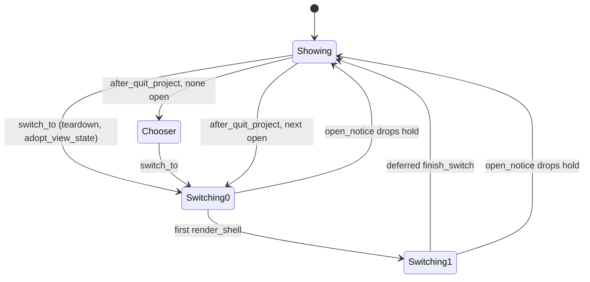
(`PendingRows` is an orthogonal sub-state. It is cleared by `apply_pending_rows` once the row is listed or the board finishes loading, and by `open_notice`.)

### Verified concerns
1. **Remote notice retargets to a bogus project (high, live bug).** `open_notice_tag` (app.rs:385-397) finds the remote window with `shows_id("host:proj")`, then calls `!this.shows("host:proj")`. That compares against the bare name, so it is always true and `switch_to("host:proj")` runs. It tears down the live project and calls `remote.handle_for("host:proj")` (app.rs:957). Tags carry `host:proj` because the notifier uses `key.to_string()` (app.rs:2242; Display at crates/shelbi-app/src/source.rs:150-155). The tests at app_window_tests.rs:330 and 345 cover local tags only.
2. **Quit completion is unbound (medium).** `confirm_quit_project` (app.rs:4316-4398) calls `after_quit_project` once the background quit finishes, without checking `shows_key(&quit_key)`. The user can switch while the quit runs, and then `leave_quit_project` (app.rs:2570) moves them off the project they chose. A notification click during the prompt also redirects `note_deliberate_close` and `clear_deliberate_close` to the new project's views.
3. **Dialogs survive a switch (medium).** `teardown_project` drops `pool_dialog` and the overlay but not `new_task`, `connect` or `feedback`. `NewTaskDialog` captured the old `project_handle.link` (app.rs:3124-3125). `open_notice_tag`, and a quit in another window (app.rs:4366-4372), call `switch_to` without consulting `modal_open()`. The result is a task created in the previous project.
4. **toggle_zen completion is unbound (low).** In app.rs:4899-4917 the callback acts on whatever `this.project` is at completion time, using an `intro_due` answer read from the old source. From the chooser, `project` still holds the stale name.
5. **The reset list drifts (low).** The 40-line `teardown_project` has already missed the dialogs above.

### Refuted
- **ABA on `open_project` / `load_keymaps` / `read_palette_corpus`:** a stale result can only land on the same project name on the same machine, and the data is valid for it.
- **A second switch between the deferred `finish_switch` and its run:** `defer_in` runs in the same effect flush, so input can't interleave.

### Recommendation
1. Fix #1 now: use `shows_id`, or pass the bare name to `switch_to`. Add a remote-window notice test.
2. Introduce a binding epoch, bumped by `switch_to` and `show_chooser`. Capture it in every async completion and in the quit flow, and bail on a mismatch.
3. Replace `chooser` + `project` with an enum (`Chooser | Project{key, handle, hold}`).
4. Group project-bound fields, including the three dialogs, into a `ProjectBound` struct that teardown drops wholesale. That turns the reset list into one assignment the compiler checks.

### Verified concerns

- **high**: Clicking a remote window's notification switches that window to a bogus project named "host:proj".
  - Evidence: app.rs:385-397: the window is found with shows_id("host:proj"). ProjectKey Display for a remote key is "host:name" (crates/shelbi-app/src/source.rs:150-155), and the notifier is built with key.to_string() (app.rs:2242), so tags carry "host:proj". The code then calls `if !this.shows(&project) { this.switch_to(&project, ...) }`. shows() compares the bare self.project (app.rs:2200-2202), so it is false. switch_to tears down the live project and calls remote.handle_for("host:proj") (app.rs:957-967), which sets session.project to "host:proj". The only tests (app_window_tests.rs:330, 345) use local tags.
- **medium**: After a quit succeeds, the window moves away from the project the user switched to while the quit was running. The deliberate-close flags can also land on the wrong project's views.
  - Evidence: app.rs:4316-4398: the prompt answer, then a background quit_project, then this.after_quit_project(quit_project) with no check that this.shows_key(&quit_key) still holds. While the background quit runs the dialog is gone, so the user can switch through the sidebar or switcher. leave_quit_project (app.rs:2570-2574) then switches to the next project or shows the chooser, regardless of what is on screen. A notification click can also switch the window while the prompt is up, and then note_deliberate_close / clear_deliberate_close (app.rs:4334-4346, 4378-4389) mark the new project's chat, workspace and review views. If the new orchestrator then exits, it may not be restarted.
- **medium**: A project switch leaves an open New task / Connect / Feedback dialog in place. The New task dialog keeps the old project's link, so it creates the task in the previous project.
  - Evidence: teardown_project clears pool_dialog and the overlay (app.rs:2314-2318) but not new_task, connect or feedback. NewTaskDialog::new captures project_handle.link (app.rs:3124-3125). modal_open() (app.rs:3200) gates keys and menus only. open_notice_tag (app.rs:394-396) and after_quit_project, deferred from another window's quit (app.rs:4366-4372), call switch_to without checking it.
- **low**: toggle_zen's completion has no project check, so a switch during the intro check toggles Zen on the new project.
  - Evidence: app.rs:4899-4917: the intro_due check reads the old project's source, then the callback reads this.project at completion time and calls run_zen or opens the zen_intro for whatever is shown. The window is a small-file read, so this is narrow, but Zen toggling has real consequences. From the chooser, self.project still holds the stale name, because show_chooser does not clear it.
- **low**: teardown_project is a hand-maintained reset of about 40 fields with no compiler help. The missed dialogs above show it has already drifted.
  - Evidence: app.rs:2305-2370 versus the struct fields around app.rs:1214-1267. new_task/connect/feedback were omitted while pool_dialog was included.

### Concerns that did not hold up

- ABA on open_project / load_keymaps / read_palette_corpus (app.rs:2160, 2021, 4721): a stale result can land only when the window shows the same project name again on the same machine (a remote window switches only among its own host's projects). All three results are valid for that project; at worst an older read of the same files is applied, then superseded. teardown clears the overlay, so the palette corpus lands only in a new palette for the same project. I found no real harm, so this is not a correctness issue.
- A race between the deferred finish_switch and a second switch: the hold is taken in render and finish_switch runs through defer_in in the same effect flush, so user input cannot get in between. I found no reachable interleaving.

**Recommendation:** Fix the remote notice bug now: in open_notice_tag, compare with shows_id (or strip the host and pass the bare name to switch_to). Add a remote-window test to app_window_tests or app_remote_tests. Structurally, give the window a monotonically increasing `binding: u64` epoch (or a `Bound { key: ProjectKey, epoch }`) that switch_to and show_chooser bump. Every async completion (open_project, keymaps, palette corpus, toggle_zen, confirm_quit_project's after-quit and deliberate-close calls) should capture it and bail on mismatch. Replace `chooser: bool + project: String` with an enum `Shown { Chooser, Project{key, handle} , }`, and keep switch_hold as a sub-state of Project. Move project-bound fields, including the new_task/connect/feedback dialogs, into a `ProjectBound` struct that is dropped wholesale on teardown. That replaces the hand-maintained reset list with a single `self.bound = ProjectBound::default()`, and the compiler then enforces it.

## Main-area route and view layering (TUI, desktop, shared nav)

**Verdict:** Needs further thought. The TUI can reach an illegal state where the review and the workspace interface are both Some. In that state, painting shows one interface and keys drive the other. It comes from scattered per-path clears with no single owner of "what occupies the main area". The desktop solved the same problem differently (a Route enum plus a column occupant), so the two clients have drifted on layering semantics.

**Verified concerns:** 2 medium, 3 low

**Key files:**
- `crates/shelbi-tui/src/shell/mod.rs:1983-2100 (show)`
- `crates/shelbi-tui/src/shell/mod.rs:4250-4323, 4868-4984 (begin/build review and workspace interfaces)`
- `crates/shelbi-tui/src/shell/mod.rs:5130-5270 (handle_main_key routing, search prompt)`
- `crates/shelbi-tui/src/shell/mod.rs:5940-6030 (draw_frame paint order)`
- `desktop/src/app.rs:685-694, 3544-3680, 4442-4566 (Route, column sync, settings latch)`

### What it is
The main area and leading column decide which view or interface paints and which one receives input. Each client encodes this differently.

- **TUI** (`crates/shelbi-tui/src/shell/mod.rs`): `main_view: MainView` plus the independent fields `review`, `workspace`, `onboarding`, `settings_return`, `acknowledgements`, `overlay`, `search_input` and `sidebar_dragging`. Input precedence lives in `handle_event`/`handle_key` (mod.rs:2436-2735). Paint precedence lives separately in `draw_frame` (mod.rs:5744-6086).
- **Desktop** (`desktop/src/app.rs`): `Route { View, Settings, Review }` plus `client.view()`, a `ColumnSwap` occupant with `column_moving`, the `settings_over_review` latch, `workspace_return`, `detail_over` and `onboarding_wanted`. Child views are reconciled on every render.
- **Shared** (`crates/shelbi-app/src/nav.rs`): both clients use `ClientState` for view, focus, project and sidebar state. Its `overlay` and `GlobalFlags` are used only by `tests/command_scenarios.rs`.

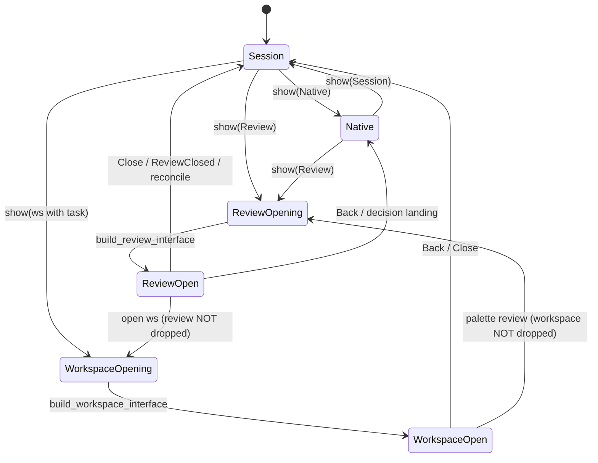

### Verified concerns
1. **Review and workspace both live (medium).** `build_review_interface` (mod.rs:4297-4323) and `build_workspace_interface` (mod.rs:4950-4984) set `main_view` without dropping the other interface. Only the Session/Native arms of `show` clear both (mod.rs:2026-2027, 2051-2052). `draw_frame` paints the review and then the workspace into the same rects, while `handle_main_key` routes keys by `main_view` (mod.rs:5133-5149). Result: the workspace panel is visible while keys drive the hidden review, and both content sessions stay attached.
2. **No single exit transition (medium).** Interfaces are dropped by hand at mod.rs:2026, 2051, 4520, 4569, 4810, 4825, 5052 and 5090, and each exit picks its own landing view and focus.
3. **search_input leaks across views (low).** It is cleared only by its own keys (mod.rs:5202-5224) and drawn on any non-panel view, so a prompt opened in a session follows you to the board.
4. **sidebar_dragging latch (low).** An overlay that opens mid-drag swallows the mouse Up (mod.rs:2436-2462), so the next click resizes the sidebar.
5. **Shared-model drift (low).** `ClientState::open_overlay` and `GlobalFlags` are test-only, so the clients' real overlay and layering logic is untested by the shared scenarios.

### Refuted
- "ClientState unused": both clients hold and use it. Only its overlay field and GlobalFlags are dead.
- Desktop `settings_over_review` dangling: `leave_settings` checks `review.info()` and falls back to the view (app.rs:4550-4560).
- ColumnSwap and desktop `column_moving`: contained and self-correcting each frame.

### Recommendation
Model the TUI main area as one enum that owns the interface (`Session | Native(View) | Review(Opening|Open) | Workspace(Opening|Open)`) with a single `set_main` transition that drops the previous occupant and clears per-view transients. Route every exit path through it. Cancel the divider drag when an overlay or Acknowledgements opens. Then decide whether the shared `ClientState.overlay` should be adopted by both clients or deleted.

### Verified concerns

- **medium**: TUI can have review and workspace interfaces live at the same time. Opening a review while a workspace interface is open, or the reverse, leaves the other one Some. draw_frame paints the review and then the workspace into the same rects, while keys route by main_view to the review underneath. Both content sessions stay attached.
  - Evidence: build_review_interface (mod.rs:4297-4323) never touches self.workspace. build_workspace_interface (mod.rs:4950-4984) never touches self.review. show(RowTarget::Review) (mod.rs:2059-2063) skips the clears done at 2026-2027 and 2051-2052. draw_frame renders `review` (mod.rs:~6006) and then `workspace` (~6015), both into content_rect/main_rect. handle_main_key routes on main_view (mod.rs:5133-5149).
- **medium**: There is no single 'leave interface' transition in the TUI. About seven exit paths each pick their own landing view and focus, and only some of them clear both interfaces, which is the root cause of the concern above.
  - Evidence: self.review = None at mod.rs:2026, 2051, 4520, 4569, 4810, 4825; self.workspace = None at 2027, 2052, 5052, 5090. Landing views differ: client.view(), Orchestrator, ended_review_return.
- **low**: TUI search_input survives navigation. With the prompt open in a session's scrollback, clicking Issues in the sidebar leaves the prompt drawn on the board while keys go to the board handler. Returning to a session resumes the stale prompt.
  - Evidence: search_input is cleared only inside its own key branch (mod.rs:5202-5224). The Native arms return before that branch (mod.rs:5155-5177). show() never clears it. draw_frame draws the search prompt on any non-panel view (mod.rs:~5991-5994).
- **low**: TUI sidebar_dragging is a latch that only a Left Up reaching handle_mouse releases. If an overlay or Acknowledgements opens mid-drag (for example an async review picker), the overlay branch swallows the Up, and the next left click after it closes resizes the sidebar instead of clicking.
  - Evidence: The overlay branch consumes every Mouse event (mod.rs:2436-2462). The drag branch treats a Left Down as update_sidebar_drag (mod.rs:5357-5364). end_sidebar_drag is the only clear (mod.rs:5482). The timing window is narrow.
- **low**: Parity and design drift: the shared nav model's overlay slot and GlobalFlags are dead outside tests. The TUI keeps its own overlay: Option<ActiveOverlay> plus several Option layers, and the desktop keeps Route plus latches, so the two clients encode the same layering differently and the command_scenarios tests exercise overlay behavior no client runs.
  - Evidence: open_overlay/close_overlay/overlay() and GlobalFlags appear only in nav.rs and crates/shelbi-app/tests/command_scenarios.rs (grep). The TUI field is overlay: Option<ActiveOverlay> (mod.rs ShellState). The desktop Route enum is at app.rs:685-694.

### Concerns that did not hold up

- 'Shared ClientState nav model is unused by both clients': false. Both hold `client: ClientState` (TUI mod.rs:69, 1231; desktop app.rs:1112) and use it for view, focus, project, last_view and sidebar width/selection. Only its overlay field and GlobalFlags are unused.
- Desktop settings_over_review pointing to a torn-down review: leave_settings takes the latch with mem::take and reopens only if review.read(cx).info() still resolves, otherwise it falls back to client.view() (app.rs:4550-4560). This is guarded, and project_added also clears the latch (app.rs:4997).
- apply_restored_view's RowTarget::Review arm (mod.rs:2338) being unreachable is dead code, not a bug. view_to_row_target maps Review to None (mod.rs:6193).
- ColumnSwap (desktop/src/views/column_swap.rs): small, toolkit-free, has its own tests. The pace-before-frame convention and settle-in-render are stylistic, not live bugs.
- Desktop column_moving lagging one frame: push_ahead reads the previous frame's value, but sync_column runs every render and corrects it. I found no stuck state.

**Recommendation:** In the TUI, replace main_view plus review/workspace Options with one enum that owns the interface: e.g. `enum Main { Session, Native(View), Review(ReviewSlot), Workspace(WorkspaceSlot) }`, where each slot is `Opening(id) | Open(Interface)`. Add one `set_main(next)` transition that drops the previous interface and clears per-view transients (search_input). Route every exit path (Back, Close, decision, ReviewClosed, reconcile, show, switch_project) through it. Have overlay/Acknowledgements opening also cancel sidebar_dragging. Then either delete ClientState's overlay field and GlobalFlags or make both clients use them, so the shared model's tests cover code that ships. The desktop can stay as is apart from consolidating its "is the main area showing X" predicates.

## Window modal/overlay layering and dialog focus (desktop)

**Verdict:** Needs further thought. Two cases are reachable with no keyboard involved. A notification click or a quit-project switch leaves a New Task dialog bound to the previous project's link. Async overlays (Zen intro, review slot prompt) open on top of a dialog and leave it without focus when they close. Both happen because the modal rule exists only as key and menu guards, not as state that the programmatic paths respect.

**Verified concerns:** 2 medium, 3 low

**Key files:**
- `desktop/src/app.rs:3011-3215 (dialog openers, modal_open, dismiss_dialog, close_*)`
- `desktop/src/app.rs:4619-4648, 4798-4868, 4950-4978 (open/close overlay, apply_overlay_event, open_error_log)`
- `desktop/src/app.rs:5237-5446 (menu_invoke and on_key_down precedence)`
- `desktop/src/app.rs:380-399, 2222-2320 (open_notice_tag -> switch_to -> teardown_project)`
- `desktop/src/views/overlay/mod.rs:37-235 (ActiveOverlay, OverlayEvent)`

### What it is
The desktop window (`ShelbiWindow` in `desktop/src/app.rs`) decides which layer gets keyboard and menu input from several separate pieces of state:

- `overlay: Option<ActiveOverlay>`: Palette, ErrorLog (`viewer: None` means loading), ReviewConfirm, RejectReason, ZenIntro. This is copied into `client.open_overlay/close_overlay`, and `overlay_opened` drives the entry animation.
- Four dialog fields: `feedback`, `new_task`, `connect` (each `(Entity, Subscription, Option<FocusHandle>)`) and `pool_dialog` (`(Entity, Subscription)`).
- `SettingsView.machine_form()`, `chooser: bool`, the switcher, and `client.focus()`.
- Precedence comes only from the order of early returns in `on_key_down` (app.rs:5340-5446): font zoom > overlay > any dialog (swallow) > new window > chooser > nav chord > palette > switcher > global > settings > sidebar. `menu_invoke` (5237-5310) follows the same order.

Inside each dialog, a form model `Focus` enum is reconciled with GPUI focus by `sync_focus`, and in feedback/new_task also by `follow_focus`. A `keyboard` bool latch turns the focus rings on.

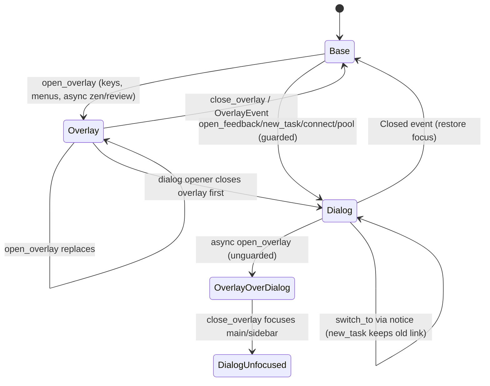

### Verified concerns
1. **New Task outlives a project switch (medium).** `teardown_project` (app.rs:2306-2316) clears `pool_dialog` and the overlay but not `new_task`. `open_notice_tag` (380-399) and `leave_quit_project` (2570) call `switch_to` without checking for an open dialog. `NewTaskDialog` captured the old `ProjectLink` (app.rs:3132, new_task.rs:166,268), so Create writes to project A while the window shows B, reloads B's board and flashes success.
2. **Async overlay over a dialog (medium).** `toggle_zen` (4898-4914) and the review-loader steps (5056-5071, which a notification click reaches via `open_notice -> open_task`) call `open_overlay` without checking `modal_open()`. `open_overlay` focuses the root. `close_overlay` refocuses main or sidebar, not the dialog, so the dialog is left on screen without focus, and a focused terminal behind it can take typing.
3. **Copied modality guards (low).** The guards differ: 3020 checks only pool_dialog||machine_form, 3085/3106/3161 check modal_open()||machine_form (plus chooser for new_task), and menu_invoke has its own predicate plus an identical pool branch (5242-5276). `dismiss_dialog` ignores the pool dialog.
4. **ErrorLog has no failed state (low).** app.rs:4959-4960: `errors().unwrap_or_default()` shows "no errors", and `MarkErrorsRead` is written even when the read failed.
5. **Dialog focus drift (low).** follow_focus exists only in feedback and new_task. Only machine_form resets its keyboard latch.

### Refuted
- The overlay copy in ClientState has not drifted: every writer pairs the two, and LoadReview's direct `self.overlay = None` is deliberate, to skip `abandon_pending_review`.
- Menu modality behaves the same for all four dialogs. Only the code is duplicated.
- The late error-log read race is harmless (same project, the second read overwrites).

### Recommendation
Use one `modal: Option<Modal>` enum with `open_modal`/`close_modal` owning focus restore. Decide in `teardown_project` what happens to each modal kind on a project switch. Make `open_overlay` respect an open modal (refuse, queue, or restore focus to it on close). Add an `ErrorLog` Failed state and mark errors read only after a successful read. Pull the dialog-focus sync/follow/latch pattern into a shared helper.

### Verified concerns

- **medium**: A New Task dialog stays open across a project switch, so a task can be created in the project the window just left. teardown_project clears pool_dialog but not new_task (or feedback/connect). The modal guards only gate keys and menus. A notification click (open_notice_tag -> switch_to) or leave_quit_project switches projects with the dialog still up. NewTaskDialog captured the old project's ProjectLink when it opened, and on Created the host reloads the NEW project's board and flashes the success message there.
  - Evidence: app.rs:3105-3141 (NewTaskDialog::new(link, ...) captures self.project_handle.link). views/new_task.rs:91,166,268-269 (create runs through the captured link). app.rs:2306-2316 (teardown clears only pool_dialog and the overlay). app.rs:380-399 (open_notice_tag calls switch_to with no modal check). app.rs:2570-2575 (leave_quit_project).
- **medium**: Async overlay openers ignore open dialogs, so an overlay can stack on top of a dialog. Focus then goes to the wrong place and is not restored. toggle_zen opens ZenIntro from a spawned task, and review-loader steps (including those started by a notification click via open_notice -> open_task) open ReviewConfirm. Neither checks modal_open(). open_overlay moves GPUI focus to the window root. close_overlay later focuses main or sidebar from client.focus(), not the dialog's control, so the dialog is left without focus. A focused terminal behind it could then take typing, because the root on_key_down only returns early.
  - Evidence: app.rs:4898-4914 (async zen intro -> open_overlay). app.rs:5056-5071 (AskSlot/NoSlots/Busy -> open_overlay). app.rs:4619-4629 (focus_handle.focus). app.rs:4631-4637 (refocus main or sidebar). app.rs:5354-5360 (overlay first, then modal_open returns). Render draws the overlay layer after the dialogs (6163 vs the children at ~6226-6230).
- **low**: Nothing in the types enforces 'one dialog at a time'. The rule is copied as four hand-written guards that already differ: open_new_task also checks chooser, open_pool_form checks only pool_dialog || machine_form (it can open over feedback, new_task or connect if routed from settings), and menu_invoke uses its own predicate (feedback||new_task||connect) followed by a pool_dialog branch with the same body. dismiss_dialog ignores pool_dialog. These are separate copies of the same rule, so they can drift further.
  - Evidence: app.rs:3020, 3085-3087, 3106-3108, 3161-3163 (guards). app.rs:3199-3201 (modal_open). app.rs:5242-5276 (menu_invoke's two identical branches). app.rs:3187-3195 (dismiss_dialog)
- **low**: ErrorLog has no failed state. A read error becomes unwrap_or_default(), which shows the 'no errors' empty text, and MarkErrorsRead is written anyway. A transient read failure therefore clears the unread badge while the user is told there are no errors.
  - Evidence: app.rs:4959-4960 (errors().unwrap_or_default(), then the MarkErrorsRead write regardless). views/overlay/error_log.rs:53-57 (empty rows render EMPTY)
- **low**: Dialog focus has two sources of truth, and each dialog wires them up in its own way. follow_focus (GPUI -> model) exists only in feedback.rs and new_task.rs, while connect_remote, add_project and workspace_dialog only push model -> GPUI. Only machine_form resets its keyboard-ring latch.
  - Evidence: views/feedback.rs:286-313,538. views/new_task.rs:293,308. views/connect_remote.rs:271 (sync only). views/machine_form.rs:314,322 (the only reset). add_project.rs:395, workspace_dialog.rs:334 (latch set, never reset)

### Concerns that did not hold up

- self.overlay and client.overlay() drifting apart: every writer pairs them (open_overlay 4620/4624, close_overlay 4632-4633, teardown 2314-2316). LoadReview's direct self.overlay=None is followed at once by close_overlay, which clears the client copy. The direct write is deliberate, so that ReviewConfirm closing does not abandon the review. The pairing is fragile but has not drifted.
- menu_invoke modality differing from modal_open(): pool_dialog has its own branch right after, with the same handling (CloseWindow dismisses, Minimize/Zoom, windowless commands, the rest wait). Menu behaviour is the same for all four dialogs. Only the code is duplicated.
- A late error-log read filling a reopened overlay: both reads are of the same project a moment apart. The first fills the viewer and the second overwrites it with fresher rows. Switching away tears the overlay down, so a different project's read cannot land, because the project name check rejects it. The effect is harmless.
- Overlay and dialog keys both being live: on_key_down routes to the overlay first, then returns early for any dialog, so a key never reaches two layers. The real problem is focus after the overlay closes (kept above), not key routing.

**Recommendation:** Replace the four dialog Options with one `modal: Option<Modal>` enum (Feedback, NewTask, Connect, Pool, maybe MachineForm), with one open_modal and one close_modal that own focus save and restore. modal_open, dismiss_dialog and menu_invoke's two branches then collapse into one each. Decide what a project switch does with a modal (dismiss a project-bound one like NewTask or Pool, keep Feedback and Connect) and do it in teardown_project. Make open_overlay refuse, or queue until the modal closes, when a modal is up, so async openers (toggle_zen, run_load_step) cannot stack on top of a dialog. If stacking stays allowed, close_overlay should restore focus to the modal. Give ErrorLog a Failed(String) viewer state and write MarkErrorsRead only after a successful read. A shared dialog-focus helper (sync + follow + ring latch) would cover the drift between the five dialogs.

## Desktop bootstrap pipeline and shared Ready cache

**Verdict:** Needs further thought. The bootstrap enum itself is sound. Who owns the post-Ready event stream is not. That ownership depends on which window happened to bootstrap, so Detach can be silently lost after a window closes, and a restored session runs N parallel bootstraps and N watchers under one client_id. This is a lifecycle question (app-wide singleton vs per-window) worth a design conversation.

**Verified concerns:** 2 medium, 3 low

**Key files:**
- `desktop/src/platform/bootstrap.rs:35-120,160-290,410-445`
- `desktop/src/app.rs:186-262,677-682,1300-1330,2040-2120`
- `desktop/src/views/cli_setup.rs:170-282`
- `desktop/src/views/launch.rs:120-127,400-430,735-753`
- `desktop/src/platform/control.rs:100-218`

### What it is
Bootstrap brings the desktop app from a bare launch to a version-checked control connection. The pipeline itself is an **explicit** linear machine: `BootstrapState` plus `run()` in `desktop/src/platform/bootstrap.rs:165-290`, which publishes each state over a channel from its own thread. After `Ready`, that thread starts `ControlHandle::watch_as` (`bootstrap.rs:420-445`, `control.rs:152-218`). The watcher stays alive for good and forwards `RelaunchRequired` (at most once; it also latches into the handle's shared `Arc`) and `Detach` events on the same channel.

The **implicit** part is everything around it:
- The per-window mirror `Boot::{InFlight(BootstrapState), Failed, Ready}` (`app.rs:677-682`).
- An app-wide cache `Shell.ready: Option<Ready>` that three places write: `apply_boot` at `app.rs:2071`, `share_ready` from cli_setup (`cli_setup.rs:247`), and the launch window (`views/launch.rs:416`).
- Three separate consumers of the event stream with different lifetimes:

| Entry path | Listener | Lifetime |
|---|---|---|
| Project window (`app.rs:2042-2094`) | `self._bootstrap` Task | dies with the window |
| First-launch setup (`cli_setup.rs:212-236`) | detached task | app lifetime |
| Launch window (`views/launch.rs:735-753`) | detached `listen()` | app lifetime |

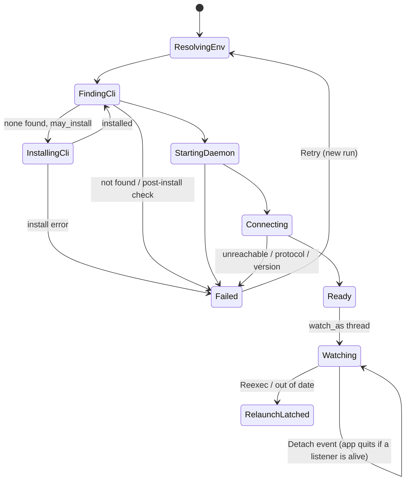

### Verified concerns
1. **Detach can be lost (medium).** A window that finds `Shell.ready` set calls `on_ready` and starts no listener (`app.rs:1306, 1327-1328`). Only the window that bootstrapped holds the receiver, inside `_bootstrap` (`app.rs:2050`). Scenario: window A bootstraps, the user opens project B (which reuses the cache), then closes A. The watch thread keeps running. `detach_tx.send_blocking` fails silently (`bootstrap.rs:439`), so B never quits on `shelbi detach` or on "Detach Other Clients". The cli_setup and launch paths deliberately detach their listeners ("The listener outlives the view", `cli_setup.rs:209-211`), so the project-window path has drifted from the other two. Relaunch still works, because the latch lives in the shared `ControlHandle` and the bar shows on the next repaint. Only `refresh_windows` is skipped.
2. **N concurrent bootstraps on session restore (medium).** `main.rs:347` → `open_launch_windows` builds every window synchronously (`app.rs:264-268`). Each sees `Shell.ready == None` and runs its own bootstrap: N login-env resolves, N daemon starts, N connects, and N watcher threads subscribed under the **same** `client_id`. Each window keeps its own `ControlHandle`. `Shell.ready` ends up as whichever finished last (`app.rs:2071`).
3. **Duplicated event handling (low).** The `RelaunchRequired`/`Detach` match arms are copied three times (`app.rs:2082-2091`, `cli_setup.rs:221-232`, `launch.rs:741-748`). Concern 1 came from that copying.
4. **Orphaned watcher on the launch path (low).** `BootstrapDaemon` parks `(Ready, events)` in a mutex (`platform/launch.rs:83`). The slot is `take()`n only on `Ok(OpenProject)` (`views/launch.rs:414-418`). In every other outcome it is dropped with a live watch thread, and the next attempt bootstraps again.
5. **Representable illegal state (low).** `Boot::InFlight(BootstrapState)` can hold `Ready`/`Failed`. Only the arm order in `apply_boot` prevents it.

### Refuted
- *Stale `Shell.ready` after relaunch or daemon restart:* the relaunch latch is shared through the handle's `Arc`, an actual relaunch quits the process, and requests and the watcher re-hello on every call/loop, so a daemon restart is transparent.
- *Ready → InFlight regression:* the channel is FIFO from one thread, and no `State` follows `Ready`.
- *cli_setup stale-run Relaunch/Detach:* Retry is only allowed from `Failed`, and failed runs never start a watcher.
- *cli_setup `advancing` never reset:* `advance` only runs after Ready, `go()` always leaves the window, and there is nothing to retry.

### Recommendation
Bootstrap should be an app-wide singleton, owned by `Shell`:
- Replace `Shell.ready` with `enum AppBoot { Idle, Running, Ready(Ready), Failed(Failure) }`.
- Add one `ensure_bootstrap(cx)` that starts a run only from `Idle`/`Failed`. Windows opened during `Running` wait on it.
- Add one app-lifetime listener (a single shared function) for `RelaunchRequired`/`Detach`.
- Make each window's `Boot` a projection of `AppBoot`, with `InFlight` carrying a narrowed progress type.
- On the launch path, hand the finished run to `Shell` as soon as `ensure_running` succeeds.

Together these fix concerns 1-5 and remove the three copies of the handling.

### Verified concerns

- **medium**: The post-Ready event stream (Detach and RelaunchRequired) belongs to the window that ran bootstrap. Later windows adopt Shell.ready with no listener. If the bootstrapping window closes, the watch thread keeps running but its sends fail silently, so a daemon Detach ('shelbi detach', another client's 'Detach Other Clients') never quits the app while the remaining windows stay attached.
  - Evidence: app.rs:2050 stores the receiver loop in self._bootstrap (dropped with the window). app.rs:1327-1328: windows with shared_ready call on_ready and start no listener. bootstrap.rs:439 `let _ = detach_tx.send_blocking(...)` ignores a closed channel. control.rs:212 keeps looping. cli_setup.rs:212-236 and launch.rs:735-753 deliberately detach their listeners so they outlive the view ('The listener outlives the view' comment), so the project-window path has drifted from the other two.
- **medium**: Restoring a multi-window session runs one full bootstrap per window at once (N login-env resolves, N daemon starts, N connects) and leaves N control-watch threads subscribed under the same client_id. Each window then holds a different ControlHandle, and Shell.ready ends up as whichever finished last.
  - Evidence: main.rs:347 calls open_launch_windows, which builds every ShelbiWindow synchronously (app.rs:264-268). Each sees Shell.ready None (app.rs:1306) and calls start_bootstrap (app.rs:1329). Each Ready spawns watch_as(client_id, ...) (bootstrap.rs:428). app.rs:2071 overwrites Shell.ready unconditionally.
- **low**: Relaunch and detach handling is copied into three consumers (app.rs apply_boot, cli_setup start, launch listen) with different listener lifetimes. That copying is how the window-lifetime bug above came about, and the next change can make them drift further.
  - Evidence: app.rs:2082-2091, cli_setup.rs:221-232, launch.rs:741-748 are near-identical match arms.
- **low**: On the launch-window path, if ensure_running reaches Ready but launch::open_project then fails (or returns a non-OpenProject outcome), the parked (Ready, events) slot is dropped. A live watch thread is orphaned, and the next attempt bootstraps again and adds another watcher.
  - Evidence: platform/launch.rs:83 parks the slot. views/launch.rs:414-425 calls take() only on Ok(OpenProject). A fresh BootstrapDaemon is built per attempt while running_cli is None (views/launch.rs:123-127).
- **low**: Boot::InFlight(BootstrapState) can represent InFlight(Ready) and InFlight(Failed). Only the arm order in apply_boot prevents that today.
  - Evidence: app.rs:677-682 and app.rs:2062-2079 (the catch-all `State(state) => InFlight(state)` comes after the Ready/Failed arms). It is a type-tidiness issue, not a live bug.

### Concerns that did not hold up

- 'Shell.ready is never invalidated after a relaunch or daemon restart': relaunch state lives inside ControlHandle's shared Arc (control.rs:106-118), so windows that reuse the cached Ready see relaunch_required and gate sends. An actual relaunch quits the process (app.rs:2118). Daemon restarts are covered because every request re-hellos the socket (control.rs:126-130) and the watch loop reconnects (control.rs:189-195). The cache staying valid is by design.
- 'Ready can regress to InFlight if the channel emits out of order': one thread publishes the states in order over a FIFO channel, and after Ready it emits only RelaunchRequired/Detach, never another State (bootstrap.rs:425-442).
- 'cli_setup: old runs' RelaunchRequired/Detach are not run-gated': Retry is only allowed from Failed (cli_setup.rs:288-290), and a Failed run never reaches watch_as, so its channel closes without emitting either event. An older run cannot be live when a newer one starts.
- 'cli_setup advancing is never reset, so a failed next() leaves the window stuck': advance only runs after Ready. go() either replaces the root or opens the restore windows and removes this one. handle.update fails only if the window is already gone. No retry path is needed after Ready.
- 'If BootstrapDaemon's slot is never take()n, RelaunchRequired is lost': for relaunch this doesn't matter, since nothing shares that Ready. The only real leak is the orphaned watcher, recorded above as low.

**Recommendation:** Make bootstrap an app-wide singleton owned by Shell. Replace Shell.ready with Shell.boot: enum AppBoot { Idle, Running { waiters }, Ready(Ready), Failed(Failure) } and add one ensure_bootstrap(cx) that starts a run only from Idle/Failed and makes concurrent callers wait. One app-lifetime detached listener (one function shared by app.rs, cli_setup and the launch window) would handle RelaunchRequired/Detach. Windows would then observe Shell's state instead of each running bootstrap. The per-window Boot could become a view of AppBoot, with InFlight carrying a narrowed Progress type so InFlight(Ready) cannot be represented. On the launch-window path, hand the run to Shell as soon as ensure_running succeeds, not only on OpenProject success.

## External / far editor session and reload-on-return

**Verdict:** Needs further thought. Two user-visible data issues are reachable with ordinary configurations. Saves from a non-blocking GUI editor are dropped silently while the status line says they are being sent. Saves are also based on the snapshot at save time, so they clobber concurrent edits. Both come from the watcher's lifecycle being implicit and having no notion of the session start, and fixing them requires deciding when a session ends and what base it holds.

**Verified concerns:** 2 medium, 3 low

**Key files:**
- `desktop/src/views/external_edit.rs:124-166 (spawn), 190-263 (scratch_path, open, run watcher loop)`
- `desktop/src/views/issues.rs:778-790, 1231-1244 (caller + event pump)`
- `desktop/src/views/board_state.rs:1724-1739 (save_external_edit)`
- `desktop/src/views/agents.rs:106-112, 305-330; desktop/src/views/workflows.rs:160-166, 387-450; desktop/src/views/agent_editor.rs:165-169, 441-470`
- `desktop/src/views/far_editor.rs:41-66, 131-176`

**Entity:** editing an issue body (or agent/workflow YAML) in the user's own editor from the desktop app.

**Encoding.** `external_edit::open` writes the body to `$TMPDIR/shelbi-desktop/<project>--<id>.md` and spawns a detached thread. The thread's locals are the state: `child: Option<Child>`, `last` mtime, `last_body` and `started`. Whether a child exists decides the end rule. A Direct-launched editor ends when the child exits. Terminal.app and `open -a` editors are watched for `WATCH_LIMIT` (4h). The YAML editors in the agents/workflows views don't use the watcher. They set a one-shot `reload_on_return: bool` that the next window activation consumes, and that code is copy-pasted into four views. Remote projects use `far_editor`, which is an explicit lifecycle: a SessionView with `OnDeath::Close` that removes the window on `Ended`.

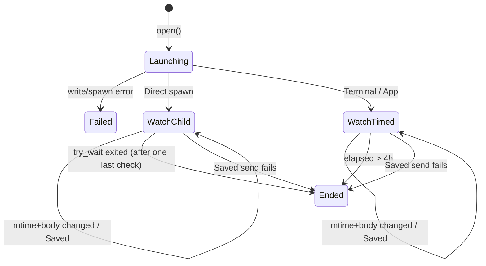

**Verified concerns**
1. **Non-blocking GUI editors drop saves (medium).** `external_edit.rs:237-238,259-260`: `zed` and `subl` (both named in the module doc at line 15) and `code` without `--wait` all exit immediately. The watcher stops after its first poll, but `issues.rs:1238-1242` still tells the user "saves are sent as you write".
2. **Lost update (medium).** `board_state.rs:1725-1737` opens the edit draft from the snapshot at *save* time. The scratch copy was written at open time, so a concurrent edit (agent, CLI, another window) is silently overwritten.
3. **Concurrent opens share one file (low).** `scratch_path` keys on project+id only (`external_edit.rs:191-200`), and `run` overwrites the file (228). Two watchers end up sending duplicate Saved events.
4. **No cancel or cleanup (low).** The detached thread notices a dropped receiver only when it tries to send (252-254), and the scratch file is never deleted. `open_file` (179-181) drops the `Child` without reaping it, so exited editors become zombies.
5. **reload_on_return fires on any activation (low).** `agents.rs:109-112`, `workflows.rs:162-166`, `agent_editor.rs:165-169` and `workflow_editor.rs:299` each have a copy. Returning before you save consumes the latch, so later saves aren't shown. The latch does work for the far editor, whose own window takes and returns activation.

**Refuted:** the claim that a second open makes the first watcher send a bogus body. `last_body` normally matches the body the second open writes, so the real harm is duplicate saves. The far editor itself is explicit and correct.

**Recommendation:** add an `ExternalEditSession { phase, base_body, cancel }` per (project, id), owned by the issues view. Dedupe re-opens, carry the base body with each Saved so the issue_edit conflict path applies, fall back to a timed watch when a Direct child exits within about 2s (or warn the user to add --wait), clean up on Ended, and replace the four reload latches with one helper.

### Verified concerns

- **medium**: Saves are silently dropped for a Direct GUI editor that does not block. Without --wait, `zed` or `subl` hand the file to the running app and exit. The watcher sees the exit on the first 500ms poll, does one last mtime check and stops. The status line still says "saves are sent as you write".
  - Evidence: external_edit.rs:237-238 treats try_wait Ok(Some) as exited, and 259-260 returns. The module doc (external_edit.rs:15) names `zed` and `subl` as directly spawned editors. launch_at (external_edit.rs:120) returns Direct for any non-terminal editor and never adds a wait flag. issues.rs:1238-1242 shows "saves are sent as you write".
- **medium**: Lost update. The edit's base snapshot is taken when the save arrives, not when the editor opens. A body edited from the stale scratch copy therefore overwrites any change made to the issue since the open (by an agent, the CLI or another window), with no conflict detection.
  - Evidence: board_state.rs:1725-1737: when no draft exists, edits.open(&snap) uses the snapshot at save time, then edit_from_elsewhere and close(id) produce a Save job. Nothing records the body as it was at external_edit::open (issues.rs:1243).
- **low**: Concurrent opens of the same issue share one scratch file and leave two watchers alive. The second open rewrites the file under the first editor, and after that every save is sent twice.
  - Evidence: scratch_path keys only on project+id (external_edit.rs:191-200). run() overwrites the file unconditionally (228). Nothing tracks or dedupes live sessions (open at 213-222 just spawns a thread). Because the duplicate Saved events carry the same body, the main effect is redundant EditIssue saves plus a possible reload prompt in the first editor.
- **low**: Watchers can't be cancelled and scratch files are never removed. A watcher outlives a closed view until its child exits or 4h pass, since a failed send is noticed only on a save. Separately, open_file drops the Child without reaping it, so an exited editor stays a zombie until the app quits.
  - Evidence: external_edit.rs:25 (4h limit), 252-254 (the only receiver-gone check, at save time). The thread is detached at 217 and nothing deletes the scratch file. open_file (external_edit.rs:179-181) discards spawn's Child.
- **low**: The reload_on_return latch fires on the window's first activation after Edit, not when editing ends. With a local GUI editor, switching back before saving consumes the latch, and later saves stay hidden until a manual reload. The same latch is copy-pasted in four views.
  - Evidence: agents.rs:109-112, workflows.rs:162-166, agent_editor.rs:165-169 and workflow_editor.rs:299 all take the bool on any activation. Arming happens at agents.rs:308, workflows.rs:390/448, agent_editor.rs:447 and workflow_editor.rs:662. For the far editor this works: its own window takes activation and closes on SessionViewEvent::Ended (far_editor.rs:159-163).

### Concerns that did not hold up

- "A second open makes the first watcher send a Saved with the overwritten body": the first watcher compares against last_body, which is normally equal to the board body the second open writes. So no spurious Saved fires unless the board body differs, and in that case the Saved just restates the current board body. What actually goes wrong is duplicated saves afterwards, not corruption.
- The far editor is not part of this problem. Its lifecycle is explicit: SessionView with OnDeath::Close, a SessionViewEvent::Ended subscription and remove_window (far_editor.rs:151-163). No watcher thread or scratch file is involved, and reload_on_return works for it because the far window itself takes and returns activation.
- Polling cost: one stat call every 500ms per live watcher, bounded at 4h. That is negligible.

**Recommendation:** Add an explicit ExternalEditSession owned by the issues view, kept in a map keyed by (project, id): `enum Phase { Launching, Watching { until: Deadline, child: Option<Child> }, Ended(Reason) }` plus a cancel flag (Arc<AtomicBool>) that the thread checks each poll. Re-opening a live issue reuses its session. Record the base body or snapshot at open and pass it with each Saved, so save_external_edit can use the issue_edit conflict path instead of the current snapshot. If a Direct child exits within about 2s, treat the editor as non-blocking and fall back to the time-limited watch used for Terminal/App editors, or tell the user to add --wait. Delete the scratch file on Ended and reap the child in open_file. For the four reload_on_return copies, make one small helper. Have it reload on every activation while an external edit is plausibly live, or watch the file's mtime, instead of a single-shot latch.

## Transient status line, banner and single off-thread job slot (desktop + TUI)

**Verdict:** Worth tidying. The concerns are real and reproducible, but the damage is limited to the UI: a lost failure message, a status note that disappears early, and a Zen band that lags until the next refresh. No persisted state is corrupted and nothing crosses a process boundary. Making the status a small owned type, and making the job slot a queue or a check for an existing job, removes every one of them cheaply.

**Verified concerns:** 1 medium, 3 low

**Key files:**
- `desktop/src/app.rs:4877-4895 (flash + generation timer)`
- `desktop/src/app.rs:5060-5106 (review load status writes that bypass the generation)`
- `desktop/src/app.rs:2138-2145, 2355-2365 (startup status, teardown)`
- `crates/shelbi-tui/src/shell/mod.rs:4188-4242 (spawn_job/start_job/poll_job single slot)`
- `crates/shelbi-tui/src/shell/mod.rs:2585-2643 (issue read + main_view_key staleness guard)`

### What it is
This machine has two halves, one per frontend, that both treat the status line as a lifecycle indicator.

**Desktop (desktop/src/app.rs)**: `status: Option<SharedString>`, `banner: Option<SharedString>`, `flash_generation: u64` (app.rs:1185).
- `flash()` (app.rs:4877-4895) bumps the generation, sets status and spawns a 4 s timer. The timer clears status only if the generation is unchanged.
- Persistent notes are written directly: `STARTUP_STATUS` (2144), `Loading {task} onto {slot}…` (5073) and `Loaded {task}; opening the review…` (5080). These do **not** bump the generation.
- The banner is last-writer-wins, with about 16 setters and about 6 clearers.

**TUI (crates/shelbi-tui/src/shell/mod.rs)**: `status: Option<String>` (1458, about 41 writers) and one `job: Option<Receiver<Option<String>>>` (1472).
- `spawn_job` writes `working…` and `spawn_quiet_job` writes nothing. Both go through `start_job`, which overwrites `self.job` (4216).
- `poll_job` (4225-4242) takes the result and sets status to it, or calls `request_refresh` for a quiet `None`.

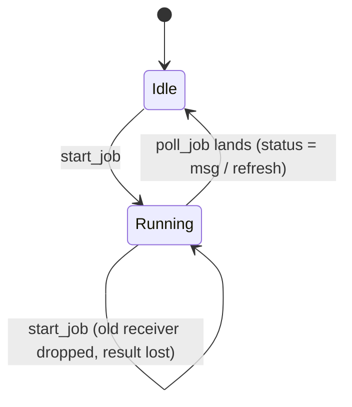

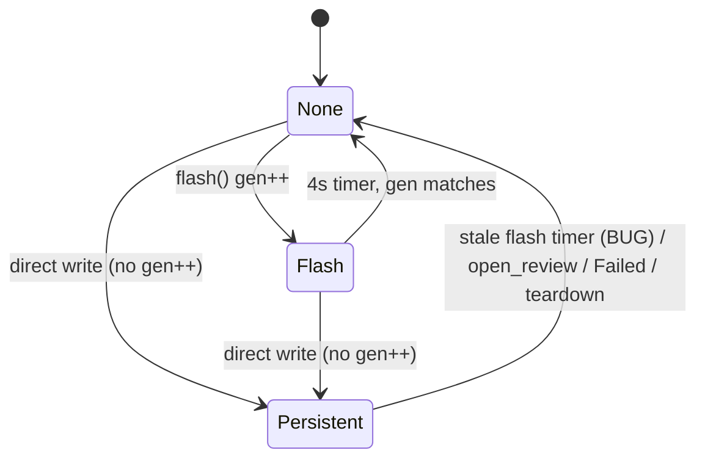

### Verified concerns
1. **Medium, the TUI job slot drops outcomes.** `start_job` replaces the receiver unconditionally (mod.rs:4216). `close_review` spawns a job whose error is `review close failed: …` (mod.rs:4562-4568). If any other job (reveal folder, open URL, open app, Zen toggle) starts before it lands, that error never shows. A superseded quiet Zen toggle also skips `request_refresh` (mod.rs:4239), so the Zen band stays stale until the next feed refresh.
2. **Low, a desktop flash clears a newer persistent note.** Example: `Review X closed.` flashes (3774), and within 4 s a load sets `Loading Y onto slot…` (5073). The old timer's generation still matches (4885), so the loading note disappears while the load is still running.
3. **Low, TUI `working…` is not bound to the job.** Any other status write hides it while the job is still running.
4. **Low, the desktop banner has no owner or priority.** Any failure overwrites the previous one, and view changes clear it whether or not it was read.

### Refuted or minor
- The issue-read guard's string key (mod.rs:2636-2643) is crude but correct. The case of an overlay opened meanwhile being replaced (2679-2685) is a minor UX nit.

### Recommendation
Desktop: use one `set_status(note)` that always bumps the generation, so only the latest writer's timer can clear the note. TUI: track a collection of in-flight jobs (each with id, quiet flag and receiver), drain them all in `poll_job`, and derive `working…` from "a non-quiet job is pending" instead of writing it once.

### Verified concerns

- **medium**: TUI start_job silently replaces a running job's receiver. The earlier job's outcome is lost: a close_review failure message is never shown, and a superseded quiet Zen toggle never runs its request_refresh (or shows its error string).
  - Evidence: mod.rs:4216 `self.job = Some(rx);` runs with no check for an existing job. close_review spawns a job returning `review close failed: {e}` (mod.rs:4562-4568) and then immediately calls self.show(...). Any reveal/open/URL job started before it lands drops that receiver, and the worker's tx.send fails silently (mod.rs:4212). Quiet jobs refresh only in poll_job's None arm (mod.rs:4239).
- **low**: Desktop direct status writes do not bump flash_generation, so a flash timer started up to 4 s earlier clears a later persistent status such as 'Loading X onto slot…' early.
  - Evidence: app.rs:5073 sets status with no generation bump. The pending timer from flash() (e.g. 'Review X closed.' at app.rs:3774) checks only `this.flash_generation == generation` (app.rs:4885) and sets status = None. The same applies to STARTUP_STATUS (2144) and the Loaded note (5080-5081).
- **low**: The TUI 'working…' status is not tied to the job that set it. Any of about 41 other status writers can overwrite it while the job is still running, so the progress indicator disappears with no sign that work is still in flight.
  - Evidence: spawn_job sets status = 'working…' (mod.rs:4194). The status field (mod.rs:1458) is written in about 41 places, and nothing restores the indicator while self.job is Some.
- **low**: The desktop banner has no owner or priority. About 16 failure sites write it and about 6 sites clear it, so a later failure overwrites an earlier one, and an unrelated view change clears a failure the user has not yet read.
  - Evidence: Setters at app.rs:1553, 2121, 2786, 2802, 2812, 2821, 2973, 3267, 3733, 4308, 4395, 4431, 4811, 4852, 5102, 5287. Clears at 2361, 2872, 3492, 3516, 4487, 5546.

### Concerns that did not hold up

- Issue-read staleness guard comparing formatted strings: the comparison is crude but correct for its purpose. main_view_key (mod.rs:2636-2643) captures the main view and session view deterministically, and a stale read is discarded (mod.rs:2624-2626). The overlay point only partly holds: a landed read sets self.overlay (mod.rs:2679-2685) and so replaces an overlay opened in the meantime. That is a minor UX nit, not a state-machine defect, and the read normally lands in milliseconds.
- Desktop flash/Loaded leaving status stuck forever: the Loaded note persists by design until open_review clears it (app.rs:3491/3515) or the load fails (5097). It is not a missing timeout.

**Recommendation:** Desktop: route every status write through one setter, e.g. set_status(StatusNote::{Persistent, Flash}), which always bumps flash_generation (only Flash arms the timer), so a stale timer can never clear a newer note. Optionally give the banner a single set_banner/clear_banner pair. TUI: replace `job: Option<Receiver>` with a Vec (or a small struct) of in-flight jobs, each carrying {id, quiet, receiver}. poll_job then drains all of them, so no outcome or refresh is dropped, and 'working…' shows whenever any non-quiet job is pending, not as a one-time write. Keep main_view_key, or switch it to a typed enum key if it gets touched anyway.

## Task pane open / slide-out / resize / session attach (desktop)

**Verdict:** Worth tidying. The pieces mostly hold together: the generation counter guards the slide timer, and session sync is idempotent and runs every frame. But the lifecycle is spread across BoardState and IssuesView flags, and render-time mutation makes it order-sensitive. That already lets one real (minor) bug through: a resize cut short by closing the pane is never saved. No high-severity issue survived verification.

**Verified concerns:** 1 medium, 2 low

**Key files:**
- `desktop/src/views/issues.rs:355-420 (session sync wiring)`
- `desktop/src/views/issues.rs:595-700 (resize, land, note_pane_close)`
- `desktop/src/views/issues.rs:2217-2310 (render + render_detail mutations)`
- `desktop/src/views/board_state.rs:718-740 (close_pane / take_closed latch)`
- `desktop/src/views/pane_session.rs:140-185 (attach reconcile)`

### What it is
The desktop Issues board's floating task pane. Its lifecycle is split between:
- **BoardState** (`board_state.rs:718-740`): `pane: Option<String>`, `mode: Mode::Detail{id, editing}`, and `closed: Option<String>`, a take-once latch set by `close_pane`.
- **IssuesView** (`issues.rs`):
  - `floating` (the pane draws over Review or Workspace)
  - `pane_closing: Option<ClosingPane{id, over, snapshot, close}>` plus a `pane_closes` generation counter for the slide-out
  - `pane_editors` (exist whenever a task shows)
  - `pane_resize`
  - the `needs_focus` one-shot
- **PaneSession** (`pane_session.rs`): `attached`, `shown` and `main_shows`, reconciled by `sync()`.

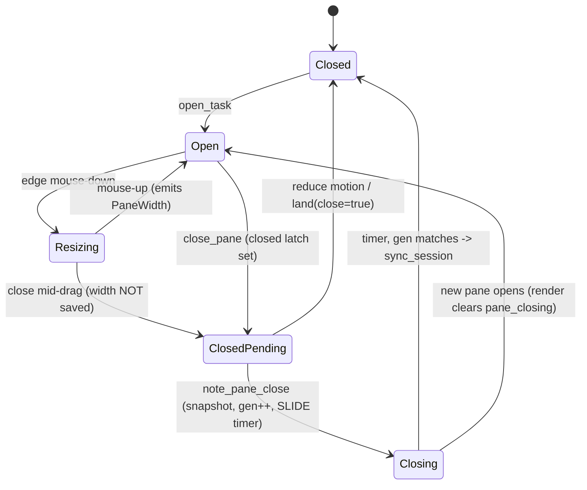
The session attach is a sub-machine (Detached, Attached(ws), Attached(review), Suppressed when already on screen, Hidden). `sync_session` drives it from render, `set_task_rows`, `set_shown`, the slide timer and `open_session_workspace`.

### Verified concerns
1. **Resize cut short by close is not saved (low).** `drag_pane_edge` (issues.rs:609-616) changes `pane_width.wanted` live. `end_pane_resize` (issues.rs:620-628) is the only `PaneWidth` emit, and it runs only from the window mouse-up that `resize_probe` registers while the pane is drawn (task_detail.rs:285-303). Esc or Close mid-drag means `render_detail` clears `pane_resize` (issues.rs:2292-2294). The in-memory width sticks, but the window never persists it. The test at issues.rs:3038-3048 only checks that the drag does not carry over.
2. **Transitions run in render (medium, design).** `render()` calls:
   - `sync_pane_editors`, which creates and drops editors
   - `sync_session`, which consumes the `closed` latch via `note_pane_close`, spawns the slide timer and attaches or detaches the session
   - `end_drag`

   `render_detail` also clears `pane_resize` and `pane_closing` (issues.rs:2219-2229, 2292-2300). This is correct today only because `sync_session` runs before `render_detail`, and because something calls notify after each state change.
3. **Content derivation duplicated (low).** issues.rs:679-686 (PaneSnapshot) and 2302-2309 (PaneContent) are the same Loading/Task/Missing/Failed match.

### Refuted
- *Stale session when a new pane opens mid-slide:* `sync_session` prefers the open pane's id, and a session only draws under `PaneContent::Task`.
- *Editing double-encoded:* `pane_editors` means "a task is shown", while `editing` means "the editor has the keys". They are different facts.
- *take_closed race:* there is a single UI thread and every caller does the same thing.
- *Keep mine vs Retry dispatch:* Keep mine goes through the debounced save tick. That is a cadence difference, not a lost save.
- *Duplicate visibility flags:* `sync` is called from every setter.

### Recommendation
Worth tidying, no urgent bug.
- End an in-flight resize through `end_pane_resize` from `close_pane`/`land`.
- Move the latch consumption and the `pane_closing`/`pane_resize` clears out of render and into the mutation paths.
- Share one content-derivation fn.
- Optionally replace `floating + pane_closing + pane_closes` with one `PaneLife` enum.

### Verified concerns

- **medium**: Lifecycle transitions run inside Render: render() calls sync_pane_editors (which creates and drops editors), sync_session (which consumes the closed latch, starts the slide timer and attaches or detaches the session), end_drag, and clears pane_resize and pane_closing. Correctness depends on a frame being drawn after each state change, and on the order of calls inside render (sync_session must run before render_detail clears pane_closing).
  - Evidence: issues.rs:2219-2229 and 2292-2300; issues.rs:401-405 sync_session -> note_pane_close
- **low**: Pane width changed by a drag that gets cut short by closing the pane (Esc / Close) is never saved. drag_pane_edge has already changed pane_width.wanted in memory, but render_detail clears pane_resize without the PaneWidth emit, and the mouse-up probe is no longer drawn, so end_pane_resize never runs. The new width applies to later panes for the rest of the session and is lost on restart.
  - Evidence: issues.rs:609-616 changes wanted mid-drag; issues.rs:620-628 is the only PaneWidth emit; issues.rs:2292-2294 sets self.pane_resize = None in render; task_detail.rs:285-303 registers the mouse-up only while resizing && drawn. The test at issues.rs:3038-3048 only checks that no drag carries over, not that the width was saved.
- **low**: The pane's content state (Loading/Task/Missing/Failed) is derived twice by identical match logic into two parallel enums (PaneSnapshot for the slide-out, PaneContent for the live pane). Edits to one copy can drift from the other.
  - Evidence: issues.rs:679-686 vs issues.rs:2302-2309

### Concerns that did not hold up

- 'When a new pane opens mid-slide, pane_closing is dropped without sync_session(false), so the session is left stale': render calls sync_session BEFORE render_detail (issues.rs:2228 vs 2230), and sync_session prefers the open pane's detail_model id over the closing pane's (issues.rs:411-416), so the session follows the new task. The only edge case is a new pane with no model (Loading/Missing), where the old task's session can stay attached for one frame. It is never drawn, because a session only renders under PaneContent::Task (task_detail.rs:165-172), and the next render detaches it.
- 'Editing is encoded twice (Mode::Detail{editing} vs pane_editors.is_some())': pane_editors exist whenever a pane shows a task (sync_pane_editors creates them on open, issues.rs:1093-1112), not only during editing; Mode's editing flag means the editor holds the keys. They are different facts, not a duplicate.
- 'The take_closed latch races between callers': every caller goes through note_pane_close, which does the same thing whoever gets there first, on one UI thread. land(close=true) deliberately calls take_closed a second time to skip the slide (issues.rs:648-652). No race.
- 'Keep mine waits for the poll_saves tick while Retry applies intents immediately': true, but resolve_conflict just re-queues the draft into issue_edit's debounced save path, which the tick drains. It is a short cadence difference, not a lost save.
- 'PaneSession.shown and SessionView.shown are separate flags': they are kept in step only through sync(), and sync is called from every setter that changes them (issues.rs:367-383) plus every render, so no reachable divergence was found.
- needs_focus one-shot set from 7 sites and consumed in render when no editor has focus: a benign deferred-focus latch.

**Recommendation:** Small, targeted tidy rather than a rewrite. (1) Fix the resize leak: have close_pane/land end an in-flight resize through end_pane_resize (emit PaneWidth if the width changed), instead of render_detail dropping pane_resize silently. (2) Move the transitions out of render: run the take_closed/note_pane_close step, the pane_closing clear and the pane_resize clear from the mutation paths (open_task, close_pane, land, tick), leaving render to draw. (3) Collapse PaneSnapshot/PaneContent derivation into one fn (owned snapshot + borrowed view) so Loading/Missing/Failed is decided in one place. Optionally fold pane_closing + pane_closes + floating into a `PaneLife { Closed, Open{floating}, Closing{id, over, snapshot, gen} }` enum on IssuesView.

## Desktop window slots and per-project view-state persistence

**Verdict:** Worth tidying. Slot lifecycle and session saves are correct and generation-guarded. The remaining issues are small, low-impact staleness windows: unordered view-state saves, a try_lock default, and quit dropping a pending frame save. Each affects only what the next launch restores. Sharing one versioned-save helper and adding a quit-time flush would remove all of them cheaply.

**Verified concerns:** 5 low

**Key files:**
- `desktop/src/app.rs:186-228 (Shell), 505-532 (open_window_with), 627-675 (window_closed, save_session), 1347-1356 (on_app_quit), 2215-2285 (switch_to/show_chooser), 2380-2412 (view_state_to_save, remember_view_state), 2505-2546 (record_frame/record_slot/close_window), 4594-4613 (schedule_save)`
- `desktop/src/window_state.rs:166-292 (Slot, WindowSession, launch_plan), 294-360 (ProjectViewState, write_json)`
- `desktop/src/projects.rs:38-170 (Catalog views/remembered/try_lock/reload)`
- `desktop/src/main.rs:296-303, 352-366 (quit-on-last-close, read_launch_plan)`

### What it is
Two related pieces of persistence in the desktop app:

1. **Window slots** (`~/.shelbi/desktop-windows.json`): `WindowSession { slots: Vec<Slot { project: Option<ProjectKey>, open: bool, state: WindowState }> }`. In memory, `Shell` holds the open windows (`Vec<OpenWindow{handle, slot}>`), the session, and `session_generation`. `save_session` writes off-thread, and a fn-local `static SAVED: Mutex<u64>` makes sure only the newest generation writes (app.rs:650-668). Frame changes are debounced 400 ms by a per-window `save_generation` (app.rs:4597-4613).
2. **Per-project view state** (`<state_dir>/desktop-view.json`): `ProjectViewState` with stringly view ids and row keys (`view:tasks`, `workspace:alpha`, `review:T-1`). `Catalog` keeps an in-memory map and a `remembered` latch: once this process sets a project's view, a `reload()` never overwrites it from disk (projects.rs:105-116, 163-169).

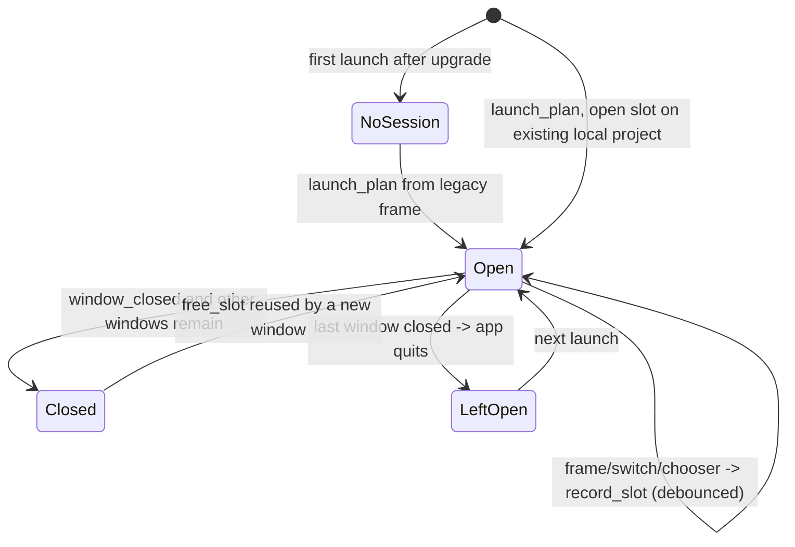

### Transitions
- Launch: `launch_plan` (window_state.rs:247-292) reopens open slots on existing local projects. A CLI-named project takes the first window.
- Open: `open_window_with` pushes `OpenWindow` and calls `record_slot` (app.rs:514-516).
- Frame/display/sidebar changes go through `schedule_save` to `record_slot` to `save_session`.
- Close: `window_closed` (app.rs:630-645) marks the slot closed **only if other windows remain**. Otherwise main.rs:298-303 quits and the slot stays `open=true`.
- View state: saved by `remember_view_state` on switch_to, show_chooser and collapse toggles (unguarded background save, app.rs:2395-2411). Saved synchronously on Cmd-W (app.rs:2532-2545) and on app quit (app.rs:1349-1356).

### Verified concerns (all low)
- **Unordered view-state saves**: app.rs:2404-2410 spawns detached saves with no generation. `write_json`'s mutex (window_state.rs:347-349) serializes the writes but does not order them, so rapid collapse toggles (app.rs:2690) can persist an older view. The quit-time synchronous save can also be overwritten by a still-queued older background save. In-process state stays correct; the stale view surfaces only on the next launch.
- **try_lock default**: `Catalog::view_state` and `first_frame_sidebar` (projects.rs:84-102) return the default when the lock is busy. A switch can then land on the orchestrator instead of the remembered view. It is silent and is not retried.
- **Quit drops a pending slot save**: on_app_quit does not flush the 400 ms debounce or the detached session save. A resize just before quitting is lost.
- **Implicit last-window rule**: the rule is encoded only by `!shell.windows.is_empty()` and depends on gpui not firing `on_window_closed` for each window during Cmd-Q, which only a comment asserts. No test covers `window_closed` slot handling.

### Refuted
- `SAVED` outliving Shell: there is one Shell per process, and test shells have persist=false, so they never reach SAVED.
- `remembered` never clearing: this is intentional. The desktop process is the only writer of desktop-view.json.
- The quit-project-to-chooser flow never closes the window; the chooser is recorded as `project: None`.

### Recommendation
Extract one newest-wins saver (generation plus high-water mark) and use it for both session and view-state saves. Flush the slot synchronously in on_app_quit. Use `lock()` rather than `try_lock` in `view_state`. Optionally, name the close outcome (`LastWindowQuits` vs `SlotClosed`) and add a test.

### Verified concerns

- **low**: ProjectViewState disk saves have no ordering guard. Each remember_view_state spawns an independent background save, and the background executor is a thread pool. write_json's WRITING mutex serializes the writes but does not order them, so two quick saves for one project (sidebar section toggles, switch then chooser) can land oldest-last and persist a stale view. The session saves have a generation guard for exactly this case. Only the next launch sees the stale file: in-process, the catalog's in-memory copy is authoritative.
  - Evidence: app.rs:2404-2410 spawns state.save(&project) with no generation. app.rs:2690 calls it on every collapse toggle. window_state.rs:347-349 has only a mutex. Compare app.rs:655-660 (SAVED generation check).
- **low**: A synchronous view save (on_app_quit, close_window) can be overwritten by an older background save. That background save was spawned earlier but has not yet taken the WRITING lock.
  - Evidence: app.rs:1349-1356 and 2536-2541 call state.save on the UI thread. An earlier detached background save from app.rs:2404 can still run afterwards, if the process has not exited yet.
- **low**: Catalog::view_state and first_frame_sidebar use try_lock and fall back to the default. If the lock is held at that moment (reload's final swap on the refresh thread), a project switch lands on the orchestrator instead of where it was left. The miss is silent and the result is not retried.
  - Evidence: projects.rs:84-102 try_lock().ok()...unwrap_or_default(). Called from switch_to at app.rs:2243 and 2253. reload's lock is held while it builds views (projects.rs:163-169).
- **low**: A frame change made in the 400 ms before quit (Cmd-Q, or closing the last window) is lost. Nothing flushes the debounce or the detached session save at quit: on_app_quit saves only the view state.
  - Evidence: schedule_save timer at app.rs:4597-4613. on_app_quit at app.rs:1349-1356 does not call record_slot/save_session. save_session is a detached background task (app.rs:657-668).
- **low**: The rule that closing the last window leaves its slot open is encoded only by `!shell.windows.is_empty()`, plus main.rs quitting when cx.windows() is empty. The multi-window Cmd-Q restore depends on gpui not firing on_window_closed for each window during quit; only a code comment says it doesn't, and no test covers window_closed slot handling.
  - Evidence: app.rs:641-644, main.rs:298-303, comment at app.rs:1347-1348. app_window_tests.rs has no close/slot test (only quitting_the_shown_project_keeps_the_window).

### Concerns that did not hold up

- `static SAVED` outliving Shell instances: production builds exactly one Shell per process (Shell::new). Test shells default to persist=false, so save_session returns before it touches SAVED (app.rs:651-653). The guard also holds the lock across save(), so the newest-wins ordering is correct.
- `remembered` never clearing, so disk is ignored for the rest of the process: this is intentional and documented (projects.rs:47-49). desktop-view.json is written only by this desktop process, so the in-memory copy really is the newest truth.
- A window closed by quit-project-to-chooser skips a separate state: after_quit_project never closes the window. It switches or shows the chooser (app.rs:2550-2575), and record_slot records project=None for the chooser (app.rs:2520), so no closed-state path is missing.
- Two windows on one project writing conflicting view states: last writer wins, which is acceptable for 'where it was left'. The in-memory catalog matches disk, apart from the ordering issue above.

**Recommendation:** Factor one `LatestWins` saver (a per-key generation plus a 'saved' high-water mark, the same pattern as save_session) and use it for both the WindowSession and the per-project ProjectViewState saves, so view saves are newest-wins too. In on_app_quit, flush the pending debounced slot by calling record_slot and saving the session synchronously. Replace try_lock in Catalog::view_state with lock(): reload holds the lock only for the swap, which costs microseconds. Optionally, turn the slot rule into a named method (Shell::on_window_closed -> ClosedKind::LastWindowQuits | SlotClosed) with a test. Typing the view/row keys is lower priority.

## Board keyboard mode and modal stack (desktop Mode + TUI kanban overlays)

**Verdict:** Worth tidying. Both machines behave correctly on today's paths. The desktop invariant holds inside board_state.rs, and the TUI layers are mutually exclusive in practice. The one live defect is small: in the TUI, a mouse click while typing a search leaves search_editing set. Even so, the duplicated pane/mode encoding, the pub mode field, and the TUI precedence written out three times (key, mouse, shell) are the kind of setup where the next feature brings in drift. A small refactor would remove that risk.

**Verified concerns:** 4 low

**Key files:**
- `desktop/src/views/board_state.rs:63-83 (Mode), 336-380 (fields), 685-808 (open/close/rest/take_closed/toggle_pane_menu), 1256-1500 (handle_key), 1560-1660 (edit transitions)`
- `desktop/src/views/issues.rs:636-655, 1318-1380, 2093-2190 (view readers of mode)`
- `crates/shelbi-tui/src/handlers/kanban.rs:26-118 (key precedence), 154-217 (mouse precedence)`
- `crates/shelbi-tui/src/kanban.rs:94-251 (fields), 688-720, 1071-1110, 1228-1365`
- `crates/shelbi-tui/src/shell/mod.rs:5588-5605 (third copy of overlay precedence for the New-issue click)`

### What it is
Two related input-mode machines decide which layer gets the keys on the issues board.

**Desktop (`desktop/src/views/board_state.rs`).** An explicit `pub enum Mode` (63-83) with Board, Detail{id, editing}, PaneMenu, PropertyPicker, Workspace/WorkflowDropdown and AssignPicker. Next to it sit `pane: Option<String>` (the task pane is non-modal, so it stays up under menus and pickers), a one-shot `closed: Option<String>` slide-out latch that the view takes, and `pane_focus`. `rest()` (735-743) works out where a closing overlay returns to from `pane`. There are 38 `self.mode =` assignments in the file.

**TUI (`crates/shelbi-tui`).** Four independent fields on `KanbanApp`: `popover`, `workspace_dropdown`, `workflow_dropdown` and `search_editing: bool`. Precedence is only the order of if-checks: key handler `handlers/kanban.rs:32-54`, mouse handler `154-217`, and the shell's New-issue click guard `shell/mod.rs:5592-5596`.

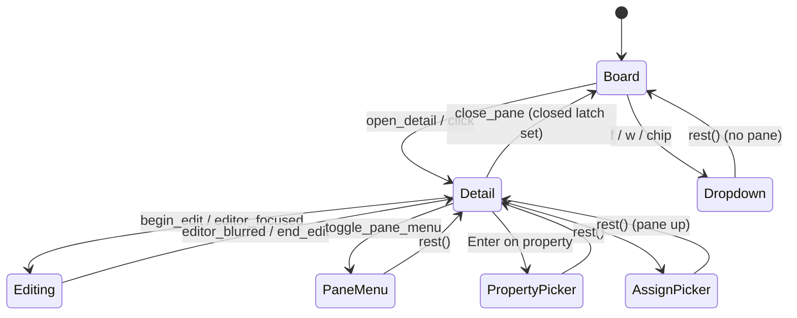

### Verified concerns
1. **TUI: a click while typing a search leaks search mode (low, live).** `handle_kanban_mouse` has no `search_editing` arm, and none of `open_popover` / `open_*_dropdown` clears it (the flag's only writers are kanban.rs:1072/1078/1107). Clicking a card or chip while typing `/query` opens that layer. When it closes, keys go back into the query, not the board. The shell's New-issue guard skips search too.
2. **TUI precedence is written out three times (low).** Today's opening order keeps popover and dropdowns apart, but nothing in the types does. Each new layer has to be added in three places.
3. **Desktop pane/mode duplication with a `pub mode` (low).** Inside the module the invariant holds: open_detail sets both, rest() comes from pane, the editor paths check the id, and close_pane clears both. The only outside writer is `visual_figma.rs:3290` (visual-check harness only, and pane is already None there). Readers are split: `issues.rs:1324/1354` read id and editing from `mode`, while `pane_actions` and `detail_id` read `pane`.
4. **Desktop editing toggles duplicated (low).** board_state.rs:1606-1613, 1619-1626, 1650-1657 and 1570-1573.

### Refuted
- The TUI popover for a vanished task is deliberate: it draws an "issue no longer exists" stub (kanban.rs:3378-3385).
- No path builds desktop mode/pane disagreement or a TUI popover plus dropdown at once.

### Recommendation
Worth tidying. TUI: one `KanbanOverlay` enum (or at least one accessor all three routers match on). Opening a layer replaces the current one, which fixes the search leak. Desktop: make `mode` private, keep the id in one place, merge the editing toggles into one `set_editing`, and have the harness call `close_overlay()`. The modal TUI popover vs the non-modal desktop pane is an intended parity difference. Write it down rather than "fix" it.

### Verified concerns

- **low**: In the TUI, mouse handling never checks search_editing. A card click while typing a search opens the popover, and a chip click opens a dropdown, with search_editing still true. Once that layer closes, the keys go back to the search query instead of the board, and the search cursor stays drawn. The shell's New-issue click guard skips search_editing too. Keyboard precedence (popover > dropdowns > search) and mouse precedence (popover > dropdowns > chips/cards, no search arm) differ.
  - Evidence: handlers/kanban.rs:154-217 has no search_editing branch, while the key path has one at 51-54. Nothing in open_popover (kanban.rs:708-717) or open_*_dropdown (1232-1236, 1349-1353) clears search_editing. Its only writers are kanban.rs:1072/1078/1107. shell/mod.rs:5592-5596 guards popover and dropdowns but not search_editing.
- **low**: The TUI types allow several modal layers at once (popover plus dropdown, dropdown plus search). The order of if-checks decides which one wins, and that order is repeated in three places: the key handler, the mouse handler and the shell's New-issue click guard. Today the opening paths keep popover and dropdown apart, because each opens only after the higher layers are checked. The search layer is the only combination actually reached (see above).
  - Evidence: handlers/kanban.rs:32-54 vs 154-217 vs shell/mod.rs:5592-5596. kanban.rs:94,118,167,251 are four independent fields.
- **low**: On the desktop, Mode::Detail{id} restates pane: Option<String>, and mode is pub. The invariant 'Detail/PaneMenu/PropertyPicker imply pane is Some, and Detail.id equals pane' depends on every writer cooperating. Inside board_state.rs every writer does: open_detail sets both, rest() works mode out from pane, the editor_* paths check the id first, and close_pane clears both. The one outside writer is visual_figma.rs:3290, a visual-check screenshot harness. It sets Mode::Board after opening a dropdown from the board, where pane is already None, so nothing breaks today. Readers are split, though: issues.rs:1324/1354 read the id and editing flag from mode, while pane_actions and detail_id read pane. A later outside writer could make them disagree.
  - Evidence: board_state.rs:356 `pub mode: Mode` next to the private `pane` field (360). There are 38 `self.mode =` assignments. visual_figma.rs:3290 writes `v.state_mut().mode = Mode::Board`. issues.rs:1324 vs board_state.rs:687,751.
- **low**: The desktop editing flag is cleared by two near-duplicate blocks (editor_blurred and end_edit). editor_focused and begin_edit each also build Detail{editing:true} their own way. It works today, but duplication like this tends to drift.
  - Evidence: board_state.rs:1606-1613, 1619-1626, 1650-1657, 1570-1573

### Concerns that did not hold up

- 'A TUI popover stays open with tf=None after its task vanishes, and its moves silently do nothing.' This is intended. popover_task's doc says it returns None when the task vanished, and render_task_popover_into draws an 'issue no longer exists' stub for tf=None (kanban.rs:697-703, 3378-3385). With no task, a move doing nothing is the right result.
- 'Desktop mode and pane can disagree (Detail{A} with pane B or None).' No path in board_state.rs produces that. Every Detail assignment goes through open_detail, rest(), or a check that the id matches. The only outside writer (visual_figma.rs:3290) is a visual-check harness, and it writes Board in a state where pane is already None.
- 'visual_figma.rs skips close_pane bookkeeping (closed/pane_focus).' It runs only under the visual-check feature, after opening a filter dropdown from a board with no pane, so there is no pane to close and no latch to set.
- 'TUI popover and a dropdown can both be open.' The types allow it, but no path reaches it: popover opens only after the dropdown checks in both handlers, and dropdowns open only when no popover is up.

**Recommendation:** TUI: replace the four fields with a single `enum KanbanOverlay { None, Popover(TaskPopover), WorkspaceDropdown(..), WorkflowDropdown(..), Search }`, or at least an `overlay()` accessor that the key handler, the mouse handler and the shell all match on. Opening any layer then replaces the current one, which fixes the search_editing leak for free (or clear search_editing explicitly in the open paths as a one-line patch). Desktop: make `mode` private and give read access through `mode()`. Have Detail carry only `editing` (take the id from pane), or derive pane from mode, so there is one source of truth. Fold editor_blurred and end_edit's clearing into one `set_editing(id, bool)`. Give visual_figma a close_overlay() call instead of a raw write. Keep the pane non-modal on the desktop, but write down that the popover is modal in the TUI and non-modal on the desktop. It's a deliberate parity difference, not drift.

## Terminal pointer, selection, find-bar and IME input modes

**Verdict:** Worth tidying. I found no reachable illegal state that breaks behavior. The mutual exclusions the auditors worried about are enforced by early returns, and search staleness is covered by the desktop debounce. Still, the pane's pointer mode is four loosely related fields, composition text lives in two places, and the input target is re-derived at four call sites. The DragState/selection split also leaves a quiet case where a drag 'selects' nothing. One enum each would make all of this easier to see.

**Verified concerns:** 4 low

**Key files:**
- `desktop/src/elements/terminal/mod.rs:300-380 (pane fields)`
- `desktop/src/elements/terminal/mod.rs:1109-1165,1237-1316 (key routing, find bar, search refresh debounce)`
- `desktop/src/elements/terminal/mod.rs:1490-1727 (scrollbar drag, mouse down/move/up, autoscroll)`
- `desktop/src/elements/terminal/mod.rs:2183-2240 (IME input handler)`
- `crates/shelbi-term/src/gesture.rs:58-245 and crates/shelbi-term/src/view.rs:81-99,180-283`

### What it is
This machine has three parts that interact in one desktop terminal pane:

1. **Pointer mode (desktop only)**, tracked by `left_down: bool`, `other_down: Option<MouseButton>`, `scrollbar_drag: Option<ScrollbarDrag>` and `autoscroll: Option<(bool, Task)>` (`desktop/src/elements/terminal/mod.rs:311-362`).
2. **Left-gesture ownership (shared TUI/desktop)**, an explicit `DragState { Idle, Pressed{..}, Selecting, Program }` in `crates/shelbi-term/src/gesture.rs:62-78`. It works next to `TerminalView.selection`, which is itself mirrored in alacritty's `Term::selection` and reconciled by `drop_selection_if_changed` (`view.rs:269-283`).
3. **Input target (desktop only)**: `search: Option<SearchBar>` × `composition: Option<Composition>`. The composition text is copied into `SearchBar.marked`, and a `search_refresh` debounce task re-scans after output.

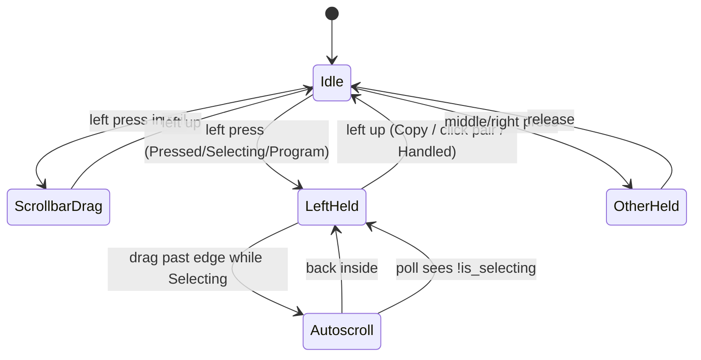

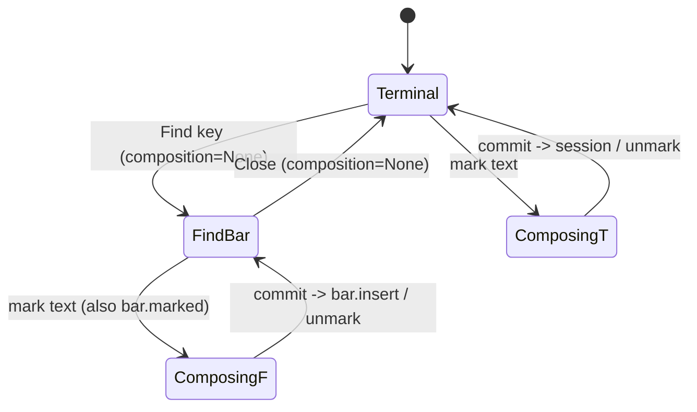

### Verified concerns (all low)
- **DragState vs selection drift**: `feed()` can drop the selection mid-drag (`view.rs:89`, `269-283`) while `DragState` stays `Selecting`. After that, `update_selection` does nothing (`view.rs:204-206`), autoscroll keeps scrolling because it checks only `is_selecting()` (`mod.rs:1691`, `1703`), and the release returns `Handled` without copying (`gesture.rs:254-263`). Nothing crashes, but the drag silently stops selecting.
- **Composition stored twice**: `mod.rs:2186-2189`, `2202`, `2224-2236` and `search_bar.rs:77` keep the copies in sync by hand. They are consistent today, but the arrangement is easy to break.
- **IME not told on find-bar toggle**: `open_search`/`close_search` (`mod.rs:1241`, `1250`) clear `composition` locally only. A commit the input method was still holding goes to whichever target is now active (`mod.rs:2203-2210`). This is an edge case.
- **Input target re-derived at 4 sites**: `search.is_none()` checks at `mod.rs:1114`, `1124`, `1157`, `2203`.

### Refuted
- `left_down && scrollbar_drag`: prevented by the early return in `mouse_down` (`mod.rs:1561-1563`) and the take-first in `mouse_up` (`mod.rs:1655`).
- `left_down && other_down`: a legitimate chord, not an illegal state.
- Autoscroll relying on mouse_up reaching the pane: the handlers are window listeners, and dropping the Task cancels it.
- Search never invalidated: the desktop (the only search user; the TUI `session_attach` never searches) schedules a 200 ms debounced `refresh_search` on every fed batch (`mod.rs:880`, `1300-1316`). The non-refresh is documented on `feed` (`view.rs:78-80`).
- Scrollback redundancy: rebuilt from `display_offset` on each feed. Only the `scrollback.rs:11-12` doc comment is stale.

### Recommendation
Worth tidying when someone next touches this code. Use a `LeftGesture` enum that owns the autoscroll Task, make `pane.composition` the one place composition text lives (the bar reads it at draw time), unmark the platform input method when the bar toggles, and let shelbi-term's `DragState` notice when its selection has disappeared (or gate autoscroll on `view.selection().is_some()`).

### Verified concerns

- **low**: DragState and the view's selection are separate machines. If output changes the selected text mid-drag, feed() drops the selection while DragState stays Selecting. Later drags then do nothing, autoscroll keeps scrolling (it gates only on is_selecting), and the release returns Handled without copying. Nothing crashes. The visible effect is that the drag silently stops selecting.
  - Evidence: view.rs:89 feed -> drop_selection_if_changed (269-283) clears self.selection. gesture.rs:224-228 Selecting -> update_selection returns early when selection is None (view.rs:204-206). Autoscroll gate at mod.rs:1691 and 1703 checks only gesture.is_selecting(). finish_selection (gesture.rs:254-263) returns Handled.
- **low**: The IME composition text is stored twice, in pane.composition and SearchBar.marked, and three input-handler methods keep the copies in sync by hand. They agree today, but any new path that edits one copy has to remember the other.
  - Evidence: mod.rs:2186-2189 (unmark), 2202 plus search_bar.rs:77 (commit clears marked through insert), 2224-2236 (mark sets both). open/close_search (mod.rs:1241, 1250) clear only pane.composition, which is safe because the bar is new or dropped.
- **low**: open_search and close_search reset composition without telling the platform input method. If the platform still holds marked text when the find bar toggles, its later commit goes to the new target (find bar or session). This needs Cmd+F to reach on_key_down mid-composition, which is an edge case.
  - Evidence: mod.rs:1241 and 1250 set self.composition = None. replace_text_in_range (mod.rs:2203-2210) routes by the current self.search, not by where the composition started.
- **low**: The question of whether keys reach the session is answered by search.is_none() checks repeated in on_key_down and replace_text_in_range, not by one input-target mode.
  - Evidence: mod.rs:1114, 1124, 1157, 2203

### Concerns that did not hold up

- Claim that left_down && scrollbar_drag can both be set: scrollbar_press returns before left_down is assigned (mod.rs:1561-1563), and mouse_up takes scrollbar_drag first and returns. The two cannot co-occur unless an earlier left up was lost.
- Claim that left_down && other_down together is an illegal state: holding two buttons at once is a real physical state, and each field tracks one button independently. A second non-left press overwriting other_down only affects chorded middle+right, and mouse_up still forwards the release when hovered (mod.rs:1670).
- Claim that the autoscroll task relies on mouse_up reaching this pane: mouse handlers are window listeners (mod.rs:1373-ish doc: 'called from the element's window listeners'), so a release outside the bounds is still delivered. The task also stops when the gesture leaves Selecting, and dropping the Task (autoscroll = None) cancels it.
- Claim that feed() never invalidates search, so highlights point at wrong lines: true in shelbi-term on its own, and documented on feed (view.rs:78-80). But the only search user (the desktop pane; the TUI session_attach never starts a search) calls schedule_search_refresh after every fed batch (mod.rs:880) and reruns 200 ms later (mod.rs:1300-1316). Staleness is limited to the debounce window.
- Claim that Scrollback is redundant state that contradicts its doc: it is rebuilt from emu.display_offset on feed (view.rs:84). The 'new output resets to bottom' line in scrollback.rs:11-12 is a stale doc comment, not a state-machine bug.

**Recommendation:** Low priority. (1) Replace left_down, scrollbar_drag and autoscroll with one enum, `enum LeftGesture { Idle, Scrollbar { grab }, Held { autoscroll: Option<(bool, Task)> } }`, so a stray left_down cannot exist alongside a scrollbar drag and the autoscroll task is owned by the Held state and dropped with it. Leave other_down as is. (2) Make pane.composition the single source of truth and have SearchBar::display take the marked text as a parameter instead of storing a copy. When the bar toggles during a composition, call the platform's unmark/discard so the input method and the pane stay in agreement. (3) In shelbi-term, either have update_selection/finish_selection drop DragState back to Pressed/Idle once the view's selection is gone, or expose `view.has_selection()` and gate autoscroll on it. (4) Fix the stale scrollback.rs:11-12 doc comment.

## Time-driven UI animations (fold, slide, reveal, switcher, closing pane)

**Verdict:** Worth tidying. Every tracker is small, local to one view, single-threaded and correct for its states, and the cross-cutting concerns (the owner/fold mismatch, the closing-pane timer) are guarded. The only visible defect is that the switcher does not reverse mid-flight. Five copies of the same eased-transition idea have already drifted on reversal, so pulling out one shared primitive would prevent more drift. This is not a correctness risk.

**Verified concerns:** 3 low

**Key files:**
- `desktop/src/views/sidebar.rs:483-557`
- `desktop/src/views/sidebar_reveal.rs:24-160`
- `desktop/src/theme/fold.rs:30-160`
- `desktop/src/theme/motion.rs:110-210`
- `desktop/src/views/issues.rs:640-700,2290-2325`

### What it is
The desktop app animates several in/out transitions. Each one stores a **target** (open or closed) and a **start instant**, then works out where it is from the clock on every frame.

| Tracker | Encoding | Reverses mid-way? | Reduce Motion |
|---|---|---|---|
| Project switcher (`views/sidebar.rs:483-557`) | `open: bool` + `changed: Option<Instant>`. "Fully closed" means `phase()` returns `None` | **No**: restarts from 0 or 1 | yes |
| Sidebar reveal (`views/sidebar_reveal.rs:24-160`) | `shown` + `Option<Transition{from, started, duration, paced, paced_at}>` | yes, with duration scaled to the distance left | yes |
| Disclosure folds (`theme/fold.rs:30-160`) | `BTreeMap<K, Fold{from, start, collapsing, duration}>`; the owner holds `collapsed` | yes, minimum 0.4 share | yes |
| Selection chip (`theme/motion.rs:110-210`) | `target` + `Option<Slide>`, spring-driven | yes, keeps velocity | yes |
| Closing task pane (`views/issues.rs:672-700`, `2290-2325`) | `Option<ClosingPane{close}>` + `pane_closes` counter + a spawned `SLIDE` timer | n/a: another pane opening cancels it | yes |

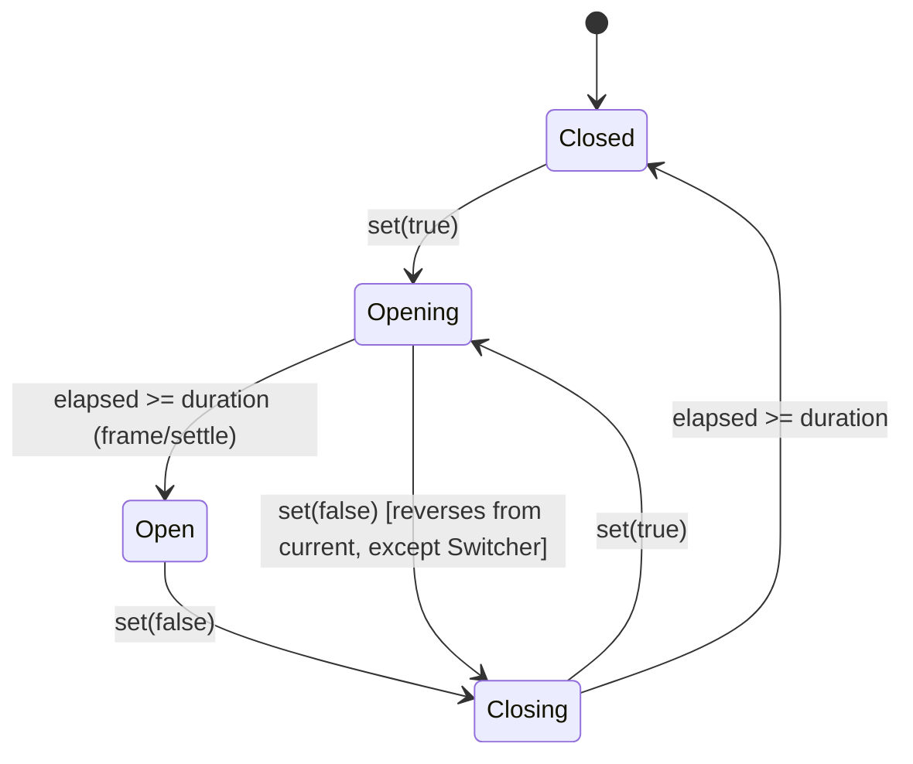

### Verified concerns
- **The switcher does not turn around mid-flight** (low). `Switcher::close`/`open` (sidebar.rs:507-517) restamp `changed`, and `phase()` (527-544) has no stored `from`. Closing during the 200ms open therefore jumps to fully shown and then fades out, and reopening during the close jumps to hidden. The other trackers reverse from their current value (sidebar_reveal.rs:82, fold.rs:99-102).
- **The same logic is written several times** (low). Elapsed/duration, clamped to 1 and passed through `ease_out_expo`, is reimplemented in fold.rs:72-75, sidebar_reveal.rs:154-160 and sidebar.rs:528-533. The copies have already drifted on reversal.
- **A transition happens as a side effect of rendering** (low). `render_detail` sets `pane_closing = None` (issues.rs:2300).

### Refuted
- **The owner and a fold can disagree.** `openness()` and `is_folding()` ignore a fold whose direction doesn't match the owner's `collapsed` and return the resting value (fold.rs:125-137). This is documented and intended.
- **"Closed" is derived from time.** Input routing uses the stored `open` bool, not `phase()`, so a menu that is still fading out can't take presses.
- **A stale close timer can drop the wrong pane.** It is guarded by the `close` generation id (issues.rs:693).

### Recommendation
**Worth tidying.** Add one `Tween` primitive in `theme/motion.rs` that handles `set` (reversing from the current value), `value`, `animating` and `settle`. Build Switcher, Fold and SidebarReveal on it; this also fixes the switcher's jump. Keep SidebarReveal's `pace()` as a wrapper. Leave SlideTrack (spring-based) and ClosingPane (it holds a snapshot) alone. None of this is urgent.

### Verified concerns

- **low**: The project switcher does not turn around mid-flight. Closing during the open (or reopening during the close) restarts phase from 1.0 (or 0.0) instead of from the current phase, so the menu visibly jumps. SidebarReveal, Folds and SlideTrack all reverse from their current position. Because ease_out_expo front-loads progress over 200ms, the jump is small.
  - Evidence: sidebar.rs:507-517: close() sets changed=now unconditionally on the flip. phase() at 527-544 computes 1.0 - eased(t) from that stamp, with no stored 'from'. Compare sidebar_reveal.rs:82 (from = self.position(now)) and fold.rs:99-102.
- **low**: The same idea (a target, a start time and an eased progress) is written five ways, and only some of the copies support reversal, pacing and the reduce_motion short-circuit. That makes behavior drift like the switcher gap likely.
  - Evidence: Fold::progress (fold.rs:72-75), the progress fn in sidebar_reveal.rs:154-160 and Switcher::phase (sidebar.rs:528-533) each reimplement elapsed/duration.min(1) followed by ease_out_expo.
- **low**: render_detail changes animation state during render: it clears pane_closing when a new pane is open, so a transition happens as a side effect of drawing.
  - Evidence: issues.rs:2300: `self.pane_closing = None;` inside render_detail(&mut self).

### Concerns that did not hold up

- Concern: Folds and the owner can disagree mid-fold when the owner changes collapsed without calling toggle. Folds::openness and is_folding only use a running fold if fold.collapsing == collapsed (fold.rs:125-137); otherwise they return rest(collapsed). Disagreement therefore resolves to the owner's truth with no animation, which is the documented and intended behavior (fold.rs:9-11, 'anything that wasn't a toggle ... is simply at its end state').
- Concern: deriving the switcher's fully-closed state from time at render is a hazard. phase() and animating() are pure functions of (open, changed, now). is_open() reads the stored bool, and only an open menu takes presses (the open field doc at sidebar.rs:476-478). A closing menu cannot take input, so no stale state can be acted on.
- Concern: the ClosingPane timer can drop the wrong pane. The pane_closes generation counter is checked before clearing (issues.rs:693), and a reopen or land clears it eagerly, so a stale timer is a no-op.

**Recommendation:** Extract a shared `theme::motion::Tween { target: bool, from: f32, start: Instant, duration: Duration }` with these methods: `set(target, now, reduce_motion)`, which reverses from the current value and scales duration by the distance left; `value(now)`; `animating(now)`; and `settle(now)`. Rebuild Switcher (fixing its mid-flight jump), Fold and SidebarReveal on it, keeping SidebarReveal's pace() as a wrapper. Leave SlideTrack, which is spring-based, and ClosingPane, which keeps a snapshot alive, as they are. Optionally, move the `pane_closing = None` out of render_detail into the code path that opens a pane. This is low priority.

## Desktop CLI install transaction (filesystem-encoded)

**Verdict:** Fine as is. The machine lives in two functions in one file and runs in a straight line. Guards and RAII clean up early exits, and the tests cover the busy, interrupted and rollback paths. The verified concerns are best-effort edge cases with low impact: losing a backup only matters in a narrow crash window, and the install only runs when no CLI is discoverable anyway. None of them can leave the machine stuck, because the next run sweeps and starts fresh.

**Verified concerns:** 3 low

**Key files:**
- `/Users/jlong/Workspaces/shelbi/.shelbi/wt-sm-audit/desktop/src/platform/install.rs:231-255 (install entry, guards, staging)`
- `/Users/jlong/Workspaces/shelbi/.shelbi/wt-sm-audit/desktop/src/platform/install.rs:394-465 (publish: swap + rollback)`
- `/Users/jlong/Workspaces/shelbi/.shelbi/wt-sm-audit/desktop/src/platform/install.rs:467-522 (sweep_leftovers, Staging RAII)`
- `/Users/jlong/Workspaces/shelbi/.shelbi/wt-sm-audit/desktop/src/platform/bootstrap.rs:176-210 (install runs only when no CLI is found)`

**Entity:** the desktop app's first-run install of the `shelbi` CLI (`~/bin/shelbi`) and its system plugin (`~/share/shelbi/plugins/update-shelbi-configuration`). Bootstrap triggers it only when discovery finds no usable CLI (`desktop/src/platform/bootstrap.rs:176-210`).

**How the state is stored:** mostly control flow in `install()`/`publish()` (`desktop/src/platform/install.rs:231-465`). Between processes, the lock file `~/share/shelbi/.desktop-install.lock` (File::try_lock) and the static `INSTALLING` mutex give one installer at a time. On disk, in-flight state exists only as names: a staging dir `.desktop-install-<pid>-<nanos>` (RAII, removed on drop), and `.new-<pid>`/`.old-<pid>` markers beside each destination. The `Step` enum is progress reporting only.

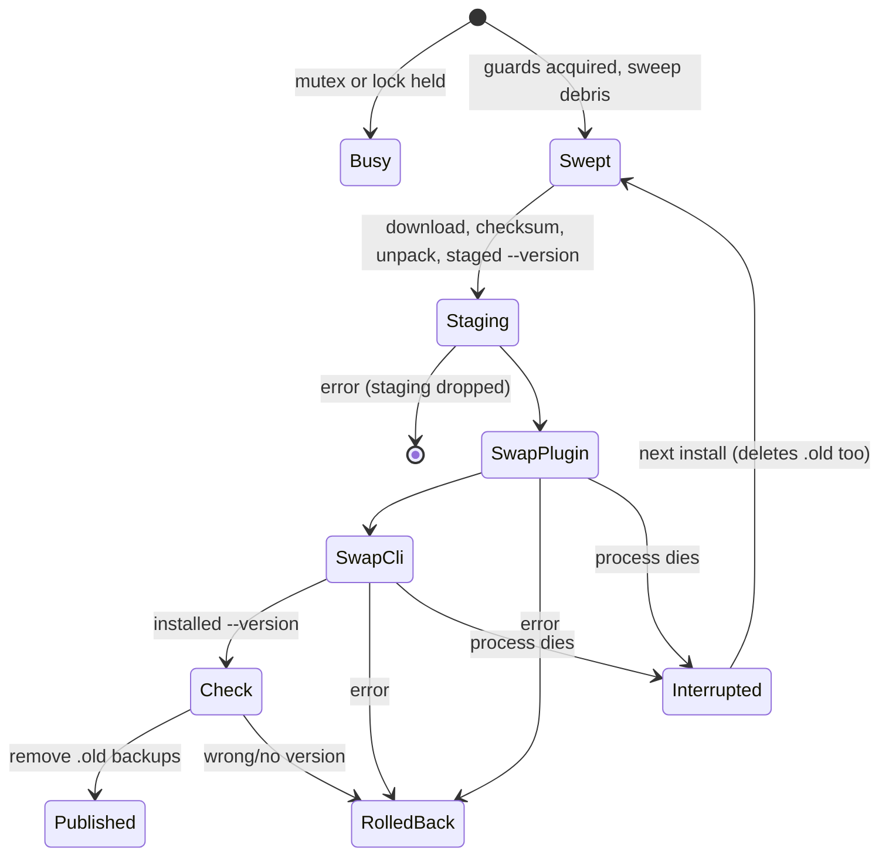

**Verified concerns (all low):**
- *The sweep deletes backups.* In `install.rs:408-421` the plugin swap is two renames (dest to `.old`, then `.new` to dest), with a gap between them. A crash in that gap, or a failed restore rename in `restore_plugin` (`:410-415`, errors ignored), leaves the plugin only in `.old-<pid>`. `sweep_leftovers` (`:487-490`) deletes that unconditionally at the start of the next install. If that install then fails, for example offline, the old plugin is gone. The comment at `:468-469` ("A published piece is never touched") doesn't mention this window.
- *A failed CLI hard-link backup turns rollback into a delete* (`:437`, `:447-451`).
- *Poisoned mutex looks like Busy forever* (`:233-235`): a panic while the guard is held means every later attempt in that process reports "another window is installing".

**Refuted:** the sweep cannot touch a live install's files, because it runs under the lock. Staging drops before the lock releases. There is no stuck state, since every run sweeps and starts over (test `install.rs:980-1005`). The impact is also limited because install only runs when no CLI is found, and a successful retry republishes everything.

**Recommendation:** fine as is. Optional hardening: make the sweep restore a `.old` whose destination is missing instead of deleting it, accept a poisoned mutex, and avoid delete-on-rollback when the hard-link backup failed.

### Verified concerns

- **low**: Two windows can lose the backup, and both leave the plugin directory absent. (1) The process dies between moving the plugin to .old and moving .new into place. (2) restore_plugin's rename back from .old fails, and the error is ignored. Either way the only copy is the .old-<pid> marker dir, and the next install's sweep deletes it unconditionally before it downloads anything. If that next install then fails (for example offline), the previous plugin is gone.
  - Evidence: install.rs:408-413 rename plugin->plugin_old then :419 rename plugin_new->plugin (non-atomic gap); :410-415 restore_plugin ignores both errors; :487-490 sweep removes .<PLUGIN>.old-* without trying to restore it. The module doc (:30-31) and the sweep doc (:468-469, 'A published piece is never touched') don't mention this window.
- **low**: If the CLI's hard-link backup fails, rollback deletes the existing ~/bin/shelbi instead of restoring it. When hard_link fails (cross-device symlink target, permissions, or a leftover name), had_cli becomes false. A failed post-install check then runs remove_file(cli) and the previous executable is gone.
  - Evidence: install.rs:437 `had_cli = symlink_metadata(&cli).is_ok() && hard_link(&cli,&cli_old).is_ok()`; :447-451 `else { remove_file(&cli) }`
- **low**: The process mutex is poisoned if anything panics while it is held, for example the caller's progress callback. After that, try_lock returns Err(Poisoned), which install maps to Busy, so every later attempt in that app process reports 'another window is installing' until restart.
  - Evidence: install.rs:233-235 `let Ok(_process) = INSTALLING.try_lock() else { return Err(busy()) }`. The match treats TryLockError::Poisoned the same as WouldBlock.

### Concerns that did not hold up

- The guess that the sweep could delete another live install's files does not hold. The sweep runs only while the lock file is held (:236-242), so any .new/.old/staging debris it finds belongs to a dead process. Staging is also dropped before the lock is released, because locals drop in reverse declaration order (staging, then lock, then _process).
- 'No recorded state' leaves no stuck state. Every run starts fresh: the sweep clears debris and a full install republishes both pieces. A failed run leaves nothing that blocks a retry (test at :980-1005 covers an interrupted install's debris).
- Treating rollback losses as high impact is overstated. Bootstrap only calls install when discovery finds no usable CLI (bootstrap.rs:180-190), so the 'previous install' being protected is usually absent or unusable. A successful retry republishes the plugin and the CLI, and a failed retry still ends in a clear InstallFailed screen.

**Recommendation:** Leave the structure as is. Three small optional hardening steps, none urgent. (1) In sweep_leftovers, restore a .old marker when its destination is missing before deleting it: if plugins/<PLUGIN> is absent and .<PLUGIN>.old-* exists, rename it back, and do the same for ~/bin/shelbi. (2) Treat a TryLockError::Poisoned on INSTALLING as acquired, using into_inner, rather than Busy. (3) If the hard-link backup fails while a CLI exists, fall back to a copy, or refuse to swap, rather than deleting on rollback. Also correct the 'A published piece is never touched' comment so it names the gap between the two renames.

## Desktop notification edge detector and cooldown

**Verdict:** Fine as is. The machine is pure (no clock, no gpui), lives in one module with documented edge rules, and has one owner per window plus a single-poster rule. All verified concerns are low severity: a stale notification left in the macOS notification list, or one extra ping. None can wedge or mislead the app. The vanished-workspace gap is a few-line bug fix, not a reason to restructure.

**Verified concerns:** 3 low

**Key files:**
- `desktop/src/notify.rs:95-320`
- `desktop/src/app.rs:1859-1906`
- `desktop/src/app.rs:1961-2004`
- `desktop/src/feeds.rs:140-150`
- `desktop/src/refresh.rs:355-375`

**Entity:** the per-window `notify::Tracker` (desktop/src/notify.rs). It turns sidebar snapshots and orchestrator title changes into notices (things to post) and cleared tags (stale notifications to dismiss). `decide()` then filters those notices.

**Storage:** `Option<HashMap<name, WorkspaceBadge>>`, `Option<HashSet<task_id>>` and `Option<WorkspaceState>`, where `None` means unprimed, plus `posted: HashMap<tag, Instant>` for the 120 s cooldown (notify.rs:100-107). An edge is found by diffing the previous snapshot against the next one. Each window owns one tracker. Only the first window showing the project posts (app.rs:1898-1905). The tracker is rebuilt on a project switch or `become_remote` (app.rs:1371, :2248).

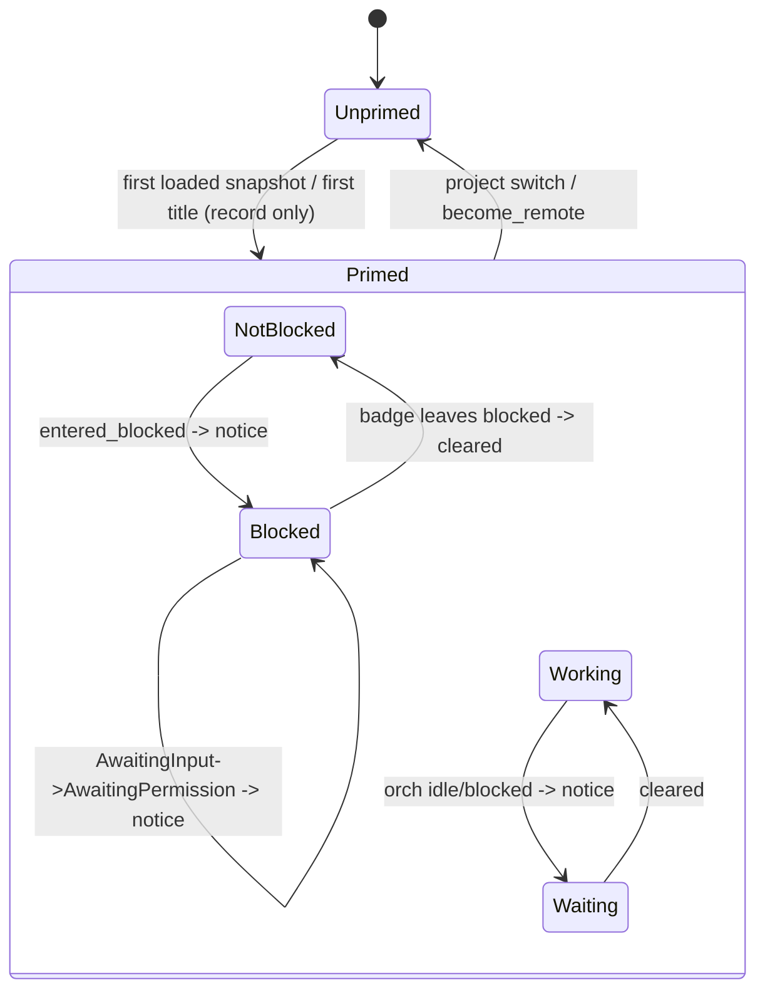

Each notice then goes through `decide`, which returns Disabled (the preference is off), OnScreen (the frontmost window already shows the item), Cooldown (the same tag was posted less than 120 s ago) or Post.

**Verified concerns (all low severity)**
- **A blocked workspace that vanishes is never cleared.** notify.rs:134-156 walks only `model.workspaces`. Reviews diff `prev.difference(&next)` (notify.rs:171) but workspaces do not, so a removed workspace's notification stays in Notification Center.
- **The cooldown is per window.** `posted` lives in each window's tracker, and only the posting window records into it (app.rs:1866-1891). If the posting window closes, the next window takes over with an empty cooldown map, so a flapping item can ping once more. The tag is the same, so the new notice replaces the old one rather than adding a second.
- **Late subscribers miss the orchestrator title.** feeds.rs:145 replays only `last_link` and `last_snapshot`, and refresh.rs:363 sends a title only when it changes. A window that joins an existing feed therefore primes on the next title change and misses that edge. This matters only if that window is or becomes the poster.

**Refuted:** resetting the cooldown on a project switch is correct, because the tags are namespaced by project. The worry that a switch could leave the tracker unprimed through the `model != self.model` guard does not hold: the seed is a loading skeleton, which `observe_sidebar` ignores.

**Verdict: fine-as-is.** The module is small, pure and tested, and none of the concerns can leave the app stuck or show the user something misleading. Recommended small fixes: emit cleared tags for blocked workspaces that disappear; optionally share the cooldown map per project and replay the last orchestrator title to late subscribers.

### Verified concerns

- **low**: A workspace that leaves the sidebar model while blocked is never cleared, so its notification stays in Notification Center and clicking it focuses a workspace that is gone. Reviews handle this case with prev.difference(&next); workspaces do not.
  - Evidence: notify.rs:134-156 loops only over model.workspaces (the next set). The cleared branch needs the workspace to still be present. Compare the reviews loop at notify.rs:171, `for gone in prev.difference(&next)`.
- **low**: The cooldown map is per window. When the posting window closes, posting moves to the next window's tracker, which has an empty posted map, so a flapping item can ping again inside the 120 s cooldown.
  - Evidence: Tracker.posted is per window (notify.rs:106). record_posted is only called by the posting window (app.rs:1866, :1891). posts_notices picks the first window showing the key (app.rs:1898-1905). The extra notice uses the same tag, so it replaces the old one rather than stacking, but it still pings.
- **low**: A window that subscribes to an already-running feed is not sent the current orchestrator title. Its orchestrator slot stays None, so the first title change only primes the slot and that edge is missed. This only matters if that window becomes the poster before the next change.
  - Evidence: feeds.rs:145 replays only last_link and last_snapshot to a late subscriber. refresh.rs:363 sends a Title only when it differs from the feed's own last-sent value. notify.rs:193-198 notifies only when before == Some(Working).

### Concerns that did not hold up

- 'Cooldown resets on project switch' is not a bug. The tracker is keyed to one project, so a switch to a new project starts a new item namespace, and the switch also re-primes so no stale state is replayed.
- Considered and rejected: the first real snapshot after a switch could be skipped by the `model != self.model` guard (app.rs:1964), leaving the tracker unprimed until a later diff swallows an edge. The seed model is a config skeleton or SidebarModel::skeleton (projects.rs:84-92, :147-152), and observe_sidebar ignores board_loading snapshots, so priming happens on the first loaded snapshot as intended.

**Recommendation:** Leave the structure as it is. Make two small fixes. (1) In observe_sidebar, after the workspace loop, emit cleared tags for every name in prev that was blocked and is missing from next, mirroring the reviews difference. (2) Optionally move the posted cooldown map into a per-project shared place (for example the feeds hub entry or a Catalog global) so a change of posting window keeps the cooldown, and have feeds.rs also replay the last orchestrator title to late subscribers. No enum refactor is needed.

## Drop file-promise countdown batch

**Verdict:** Fine as is. The latch is small, sits in one type, is mutex-guarded, fires once and has unit tests. A wrong count fails safe: one drop is lost, but no app or UI state is left stuck, and nothing else depends on the batch's lifecycle.

**Verified concerns:** 2 low

**Key files:**
- `desktop/src/drops/pasteboard.rs:186-322`
- `desktop/src/drops/mod.rs:91-143`
- `desktop/src/drops/macos.rs:175-192`

**Entity:** a non-Finder drag (for example from Photos, Mail or a browser) whose files arrive asynchronously through `NSFilePromiseReceiver` on a background `NSOperationQueue`.

**Encoding:** `PromiseBatch` (desktop/src/drops/pasteboard.rs:270-322) is a countdown latch: `Mutex<BatchState { slots, remaining, done: Option<FnOnce> }>`. `receive_promises` (pasteboard.rs:186-249) sets each receiver's expected count to `fileNames.count().max(1)`. For a modern promise, `fileNames` is nil until the files are received, so that receiver counts as 1.

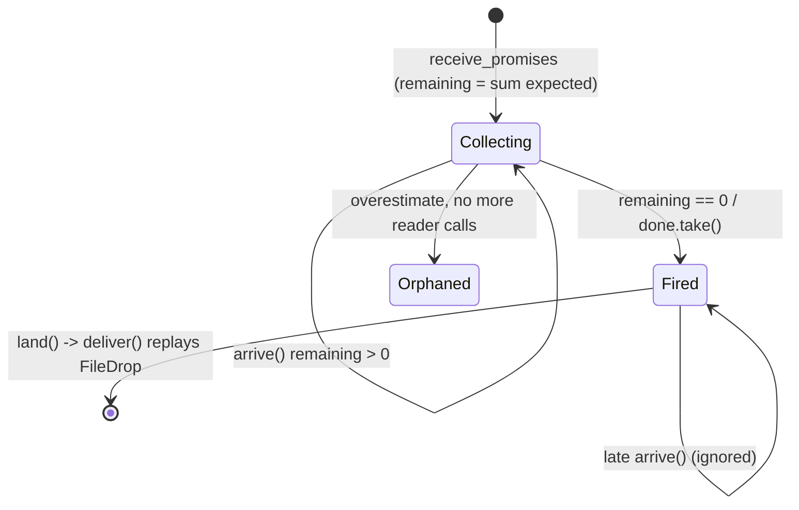

**Transitions**
- perform_drag_operation (macos.rs:180-192) -> materialise -> the batch is created.
- The reader block calls arrive(index, path|None) and decrements with saturating_sub (pasteboard.rs:294-306).
- When the count reaches 0, the slots are drained and filtered to existing files, and `done` fires once if the list is non-empty (pasteboard.rs:306-320).
- `land` sends the result over the LANDED channel, and `deliver` replays Entered/Submit/Exited into the matching NSWindow (mod.rs:91-143).

**Verified concerns (both low)**
1. *Overestimate, no timeout* (pasteboard.rs:303-306): if AppKit calls the reader fewer times than `fileNames.count`, for example once with an error for a multi-name legacy promise, `done` never runs and the drop vanishes silently. Nothing else is stuck, because AppKit was already told YES.
2. *Underestimate* (pasteboard.rs:210-212): files beyond the guessed count are dropped silently after the batch fires. This is unlikely in practice because modern providers promise one file each.

**Refuted**
- The concern about the synthetic replay clobbering a real in-progress drag. It needs a second drag overlapping a slow promise on the same window, and even then the only effect is a hover reset.
- Double-fire and race concerns. The mutex and the `Option::take` latch rule both out, and unit tests cover this (pasteboard.rs:500-540).

**Recommendation:** fine as is. Optionally, add a deadline flush with a warn log so an orphaned batch delivers what it has, and log late arrivals so a miscount is visible.

### Verified concerns

- **low**: If the expected count is too high, the batch never completes and nothing times out. The files that did arrive are written to the drops dir but never delivered, and no log line says so.
  - Evidence: pasteboard.rs:303-306 returns early while remaining > 0, and there is no deadline anywhere. The count is fileNames.count (pasteboard.rs:212, 252-257). If AppKit calls the reader once with an error for a legacy multi-name promise instead of once per name, the batch is orphaned. Impact is limited: perform_drag_operation has already returned YES (macos.rs:191), so no UI or drag state is held. The cost is one silently lost drop and a small leak.
- **low**: If the expected count is too low, files arriving after the batch fires are discarded silently.
  - Evidence: A modern promise reports no fileNames, so it counts as 1 (pasteboard.rs:210-212). Any later arrival hits saturating_sub with done already None (pasteboard.rs:303, 316). In practice an NSFilePromiseProvider promises one file per receiver, so this is a hedge more than a live bug.

### Concerns that did not hold up

- 'Delivery replays a synthetic drag without checking for a real drag in progress.' The drop this replays has already completed through perform_drag_operation (macos.rs:180-192). A second real Finder drag would have to be hovering the same window during the short window before a slow promise lands. That overlap is a rare edge, and Exited only clears gpui's active drag, so the worst case is a cosmetic hover reset, not corrupted state. It is not worth a guard.
- 'Done might fire twice or race.' All state is behind one Mutex, and done is Option::take'd inside the lock (pasteboard.rs:295-317), so it fires exactly once. Unit tests cover ordering, failures, missing files and the all-failed case (pasteboard.rs:500-540).

**Recommendation:** Leave the structure as it is. One optional hardening step, if lost drops are ever reported: add a deadline, for example 30 s, scheduled on the promise queue. The deadline would flush whatever has arrived (it calls the same take-done path) and log a warn naming the expected and received counts. That turns the orphaned state into a logged partial delivery. Late arrivals after the batch has fired could also log at debug, so an undercount shows up in the logs.
