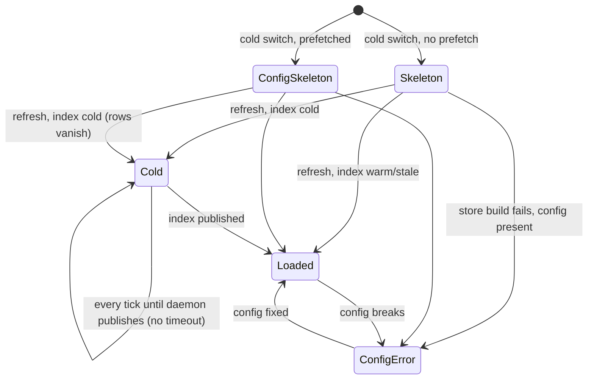
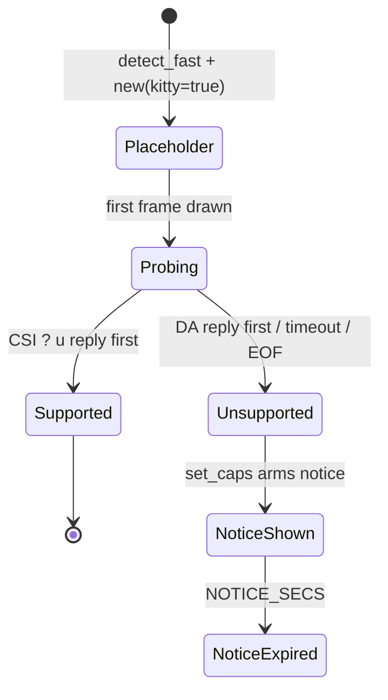
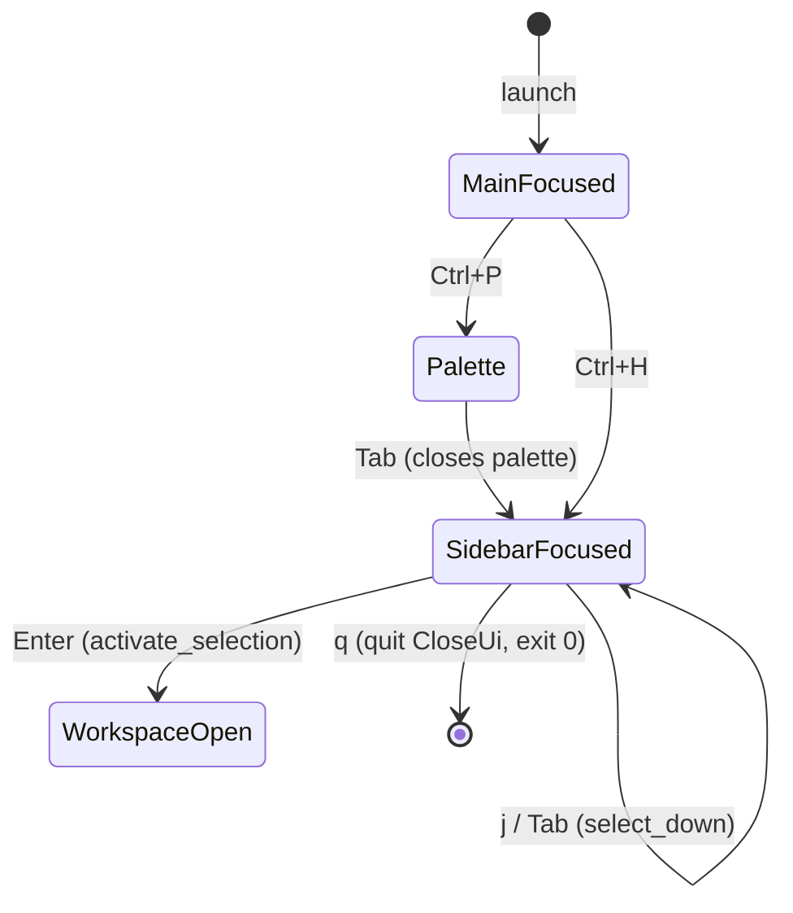

# Implicit state machines: UI (TUI)

Part of the [implicit state machine audit](../implicit-state-machines.md). Audit of origin/main at b93c57c4, 2026-11-05. 4 machines in this area, most pressing first.


## Sidebar load phase and footer status mode

**Verdict:** Needs further thought. The flag combinations the auditors flagged can't be reached. But the cold phase has no exit other than the daemon publishing an index, and while it waits it shows nothing useful: no reason, no workspace rows. That has already cost a real debugging session. How the sidebar should escalate a cold board that won't warm up is a design question. The footer-mode string check is worth tidying on its own.

**Verified concerns:** 1 medium, 4 low

**Key files:**
- `crates/shelbi-orchestrator/src/sidebar_model.rs:32-123,181-194`
- `crates/shelbi-app/src/view.rs:50-95,506-561`
- `crates/shelbi-tui/src/shell/sidebar.rs:219-256,331-343,808-815,1344-1363`
- `crates/shelbi-tui/src/shell/mod.rs:1576-1578,1815-1820,2128-2144`
- `desktop/src/views/sidebar.rs:1580-1615,1737-1760`

### What it is
`SidebarModel` (crates/shelbi-app/src/view.rs:50-95) carries the sidebar's load phase as loose fields: `board_loading: bool`, `config_error: Option<String>`, `daemon_version_line: Option<String>` + `daemon_version_mismatch: bool`, `orchestrator_status: Option<String>` and `status_line: String`. Three builders write them:

- `SidebarModel::skeleton` (view.rs:506-525): bare skeleton, `board_loading=true`.
- `read_config_skeleton` (crates/shelbi-orchestrator/src/sidebar_model.rs:138-176): config-only skeleton with workspace rows badged Loading, `board_loading=false`.
- `read_sidebar_model` (sidebar_model.rs:32-123): the per-tick refresh.

`rows()` (view.rs:543-561) decides what to show, in order: `board_loading` first, then `config_error`, then workspaces.

The footer mode is separate. The TUI computes `status_line` once at shell construction (shell/mod.rs:1578, `sidebar_startup_status_line` at sidebar.rs:1348-1363, which claims the persisted `first_run_seen` latch) and stamps it onto every snapshot (shell/mod.rs:1817-1820). `footer_status()` lets an orchestrator failure override it (view.rs:529-534). The TUI then gets height and colour back by comparing the string to `FIRST_RUN_HINT` (sidebar.rs:338, 812).



### Verified concerns
1. **Cold never escalates (medium).** sidebar_model.rs:71-75 sets `board_loading=true` and skips workspaces. view.rs:551-554 then shows only "Loading…". `BoardFreshness::banner()` returns None for `BoardSource::None` (board_index.rs:730-735), so neither client explains why. If the daemon never publishes the index, the sidebar spins forever. This matches the earlier "sidebar stuck on Loading…" outage, when the launchd PATH hid `gh`.
2. **Cold switch rows vanish (low).** The config skeleton paints workspace rows (shell/mod.rs:2136-2144). The first cold refresh replaces them with a bare Loading row.
3. **Footer mode by string equality (low).** sidebar.rs:338 and 812 compare the line to `FIRST_RUN_HINT`. Any change to the copy silently changes the layout and styling.
4. **Latch claimed on compute (low).** `claim_first_run_hint` (shelbi-state/src/lib.rs:2016-2024) persists the latch during shell setup, before the first frame is drawn.
5. **Parity (low).** Desktop never sets `status_line`, so the first-run hint and startup warnings exist only in the TUI.

### Refuted
- *Loading hides config error.* Unreachable: `board_loading=true` is set only on the cold branch, after the store built successfully, and that branch never sets `config_error`.
- *Mismatch without a line.* Unreachable: sidebar_model.rs:120-122 always sets both fields together.

### Recommendation
- Replace the two load flags with one enum: `enum SidebarLoad { Loading { since, workspaces }, ConfigError(String), Loaded }`.
- Keep the config-derived workspace rows during the cold phase instead of dropping them.
- Add an escalation (time-based, or based on freshness source and daemon reachability) that shows a dim reason row.
- Make the footer a typed `FooterStatus` enum built once, with style taken from the variant instead of from the text.
- Optionally move the latch claim to after the first frame is drawn.


### Verified concerns

- **medium**: A board that stays cold (index never published, e.g. the daemon can't run gh) leaves the sidebar on a bare 'Loading…' forever. There is no timeout, no escalation and no reason shown in either client: BoardSource::None gives no banner.
  - Evidence: sidebar_model.rs:71-75 sets board_loading=true and returns no workspaces; view.rs:551-554 returns only Loading; board_index.rs:730-735 banner() is None for BoardSource::None. This matches a past real outage ('sidebar stuck on Loading…', daemon PATH hid gh).
- **low**: Cold switch regresses. The prefetched config skeleton paints the workspace rows (Loading badges). If the first real refresh finds the board cold, it replaces them with a bare 'Loading…', so the rows appear and then vanish.
  - Evidence: shell/mod.rs:2136-2144 paints read_config_skeleton (sidebar_model.rs:138-176, board_loading=false, workspaces filled); the cold branch at sidebar_model.rs:71-75 skips apply_workspaces, and rows() short-circuits at view.rs:551.
- **low**: The footer mode is found by string equality with the hint copy, so changing the hint wording or wrapping it changes row height and colour without any error.
  - Evidence: sidebar.rs:338 (status_row_height) and sidebar.rs:812 (render_footer) both test self.status_line == FIRST_RUN_HINT; the mode information is lost when sidebar.rs:1351 returns a plain String.
- **low**: The one-time hint latch is persisted when the line is computed at shell construction, before the first frame is drawn. A crash or early exit uses up the hint unseen.
  - Evidence: shell/mod.rs:1578 calls sidebar_startup_status_line during setup; claim_first_run_hint (shelbi-state/src/lib.rs:2016-2024) writes first_run_seen=true before returning.
- **low**: Desktop/TUI parity: desktop never sets status_line, so the first-run hint and startup-warning count exist only in the TUI. The desktop footer only ever shows an orchestrator failure.
  - Evidence: There are no claim_first_run_hint or status_line writers under desktop/src; desktop/src/views/sidebar.rs:1750-1755 reads model.footer_status() and colours it by orchestrator_status.is_some().


### Concerns that did not hold up

- board_loading hiding config_error (view.rs:551-561): this precedence can't be reached. The only production builder, read_sidebar_model, sets board_loading=true only in the cold branch, after issue_store_for succeeded, and that branch never calls apply_workspaces. config_error is only set on the store-failure path or the warm path, and both leave board_loading=false. The two are mutually exclusive in practice.
- daemon_version_mismatch=true with daemon_version_line=None: read_sidebar_model always assigns both together from probe_daemon_version (sidebar_model.rs:120-122). Every other constructor (skeleton, config skeleton, from_board) sets mismatch=false, and both clients filter the line through the mismatch flag. The combination can be written down but is never produced.


**Recommendation:** Replace board_loading + config_error with `enum SidebarLoad { Loading { since, workspaces_from_config }, ConfigError(String), Loaded }`. Have the cold branch of read_sidebar_model keep the config-skeleton workspace rows instead of dropping them. After N seconds cold (or when the freshness source is None and the daemon is unreachable), show a dim reason row such as 'board not published yet; check `shelbi daemon`'. Make the footer status a typed `enum FooterStatus { None, FirstRunHint, StartupWarnings(usize), OrchestratorFailure(String) }` returned by sidebar_startup_status_line, with text and styling derived from the variant instead of string equality. Optionally claim the first-run latch after the first frame is drawn. The version pair can become `Option<DaemonVersion { line, mismatch }>`.


## Terminal ownership handoff (editor / remote ssh) and stderr redirect

**Verdict:** Fine as is. The machine is small, sits in one function, and is consumed in one place. Its blocking behaviour is intended and documented. The stderr global is idempotent, and the different lifetime of the retry sink is a feature, not a bug. The remaining concerns are low-severity edge cases (ignored re-entry errors, a Ctrl+C window while connect runs) rather than reachable illegal states.

**Verified concerns:** 4 low

**Key files:**
- `crates/shelbi-tui/src/shell/mod.rs:519-547 (latch consumption in the run loop)`
- `crates/shelbi-tui/src/shell/mod.rs:6437-6535 (restore_terminal / enter_terminal_modes / run_editor / RawGuard)`
- `crates/shelbi-tui/src/shell/remote_session.rs:23-97 (title push/pop, TerminalWait raw toggle)`
- `crates/shelbi-app/src/launch/terminal.rs:111-153 (ssh run + reconnect loop)`
- `crates/shelbi-tui/src/shell/stray_output.rs:23-97 (SAVED_STDERR, retry sink)`

**Entity:** who owns the physical tty: the shell's ratatui frame, the user's `$EDITOR`, or a remote Shelbi over `ssh -t` together with its reconnect loop. Alongside that, where fd 2 and GitHub retry notices are routed.

**Encoding**
- `ShellState.pending_editor: Option<PathBuf>` and `pending_remote: Option<RemoteSession>` (mod.rs:1476-1480) are one-shot latches. The run loop `take()`s them right after it handles input (mod.rs:524-546).
- Terminal modes are toggled by hand: `restore_terminal` / `enter_terminal_modes` (mod.rs:6440-6484), plus the `RawGuard` drop and the panic hook.
- `SAVED_STDERR: AtomicI32` (stray_output.rs:25) is -1 when stderr is not redirected and holds the saved terminal fd otherwise. It is idempotent both ways.
- The retry-notice sink is a global in `shelbi_state` and spans the whole run loop (mod.rs:421 to 706).
- The ssh reconnect/backoff loop lives in `shelbi_app::launch::terminal::run` (terminal.rs:111-153).

```mermaid
stateDiagram-v2
    [*] --> ShellOwns: RawGuard::enter
    ShellOwns --> EditorQueued: edit:* / EditFile / keys file
    EditorQueued --> EditorRunning: take(); restore_terminal
    EditorRunning --> ShellOwns: enter_terminal_modes (err ignored) + clear
    ShellOwns --> RemoteQueued: remote_connected
    RemoteQueued --> RemoteSsh: take(); restore_terminal; push title
    RemoteSsh --> ShellOwns: Closed / Failed (pop title, re-enter)
    RemoteSsh --> ReconnectWait: ConnectionLost
    ReconnectWait --> ShellOwns: Esc / Ctrl+C (Stopped)
    ReconnectWait --> Connecting: pause elapsed
    Connecting --> RemoteSsh: connected
    Connecting --> ReconnectWait: unreachable
    Connecting --> ShellOwns: Refused
    ShellOwns --> [*]: loop exit; uninstall sink; RawGuard drop
```

**Verified concerns (all low)**
1. *Ctrl+C window:* raw mode is on only inside `TerminalWait::wait` (remote_session.rs:61-72). `connector.connect` (terminal.rs:144) and the moment before ssh first sets raw mode both run in cooked mode, so Ctrl+C sends SIGINT to the TUI and kills it. The tty is already restored, so the screen is fine, but the local client is lost. Esc is also ignored while connect blocks.
2. *Ignored re-entry failure:* `let _ = enter_terminal_modes();` at mod.rs:543 and 6513. Its early `?` return also skips `redirect_stderr`, so a failure leaves the shell drawing in cooked mode on the main screen with nothing reported.
3. *Loop blocked for the whole handoff:* the detach and re-exec signals (mod.rs:504), layout events and startup results wait until the editor or ssh returns. This is intended, but a remote session can defer a daemon-requested detach or re-exec for hours.
4. *Duplicated handoff sequence:* the restore -> child -> re-enter -> clear steps appear at mod.rs:537-544 and again at 6509-6514.

**Refuted**
- *Retry sink outlives the stderr redirect:* this is intended. Notices must not draw over vim or the remote screen. They are queued in the channel and shown after the handoff, and they are logged to tui.log.
- *TerminalWait vs RawGuard raw-mode conflict:* there is none. TerminalWait only runs after `restore_terminal` and leaves raw mode off, as it found it.
- *stderr redirect drift:* the swap(-1) logic makes every restore and redirect order safe.

**Recommendation:** fine as it is. Optional: a `with_terminal_handed_off` helper that puts a re-entry error into the status line, and ignoring SIGINT (or keeping raw mode on) around `connector.connect` in the reconnect loop.


### Verified concerns

- **low**: Ctrl+C can kill the whole TUI during the remote handoff when ssh does not own the tty. Raw mode is off during connector.connect between reconnect waits and before ssh first sets raw. In that window Ctrl+C sends SIGINT to the TUI's process group, and the TUI dies without its normal exit path. The terminal is already restored, so the screen is fine, but the TUI client is lost. The doc comment only promises that Ctrl+C is safe inside the wait. Esc is also not seen while connect blocks.
  - Evidence: remote_session.rs:56-72 enables raw mode only inside wait(). terminal.rs:144 calls connector.connect after the wait has already disabled raw mode. mod.rs:537 calls restore_terminal() before remote_session::run.
- **low**: The return to ShellOwns ignores a failure to re-enter terminal modes. If enable_raw_mode or the EnterAlternateScreen execute fails, the early return also skips redirect_stderr. The shell then keeps drawing in cooked mode on the main screen, with stderr going to the terminal, and nothing reports it.
  - Evidence: mod.rs:543 and mod.rs:6513 both use `let _ = enter_terminal_modes();`. enter_terminal_modes (mod.rs:6466-6484) returns with ? before stray_output::redirect_stderr().
- **low**: The single event loop is blocked for the whole time the editor or the ssh session owns the tty. A daemon detach request, a re-exec request, layout events and startup results queue up until the handoff ends. For a remote session that can be hours, so a daemon-requested detach or re-exec of the local TUI is deferred that long. This is deliberate (the comment says nothing competes with the editor for keys), but it is a design limit worth knowing.
  - Evidence: mod.rs:504 checks detach_signal only at the top of the loop. mod.rs:524-546 runs run_editor / remote_session::run synchronously on the loop thread.
- **low**: The restore -> run child -> re-enter -> clear sequence is duplicated in two places: inline for the remote session and inside run_editor. A third handoff would copy it again.
  - Evidence: mod.rs:537-544 vs mod.rs:6509-6514


### Concerns that did not hold up

- 'The retry sink outlives the stderr redirect, so during run_editor notices go to the hidden status band instead of the visible terminal.' This is true but intended. Writing a gh retry notice to the terminal while vim or a remote Shelbi owns it would scribble over that program's screen, which is the bug stray_output exists to prevent. Queued notices go through the mpsc channel and poll_retry_notices shows them after the handoff (mod.rs:685, 1785-1795). They are also logged to tui.log.
- 'TerminalWait flips raw mode separately from RawGuard and conflicts with it.' It does not conflict. TerminalWait runs only after restore_terminal has turned raw mode off (remote_session.rs:24-26 states this precondition, mod.rs:537 enforces it). It enables raw mode and then disables it again, so it leaves the tty in the state it found it. RawGuard is a drop-only guard with no state to clash with.
- 'stderr redirect state can get out of sync.' SAVED_STDERR is idempotent in both directions. redirect only saves the original when the value is -1, and restore swaps in -1. The panic hook, RawGuard::drop and explicit restores can all run in any order safely (stray_output.rs:48-75).
- Both latches set at once or stale latch: each is take()n in the same tick it is consumed. remote_connected also closes the overlay, so it cannot fire alongside a Settings edit in a way that loses one of them.


**Recommendation:** Leave the latch design as it is. An optional tidy-up is one helper, `with_terminal_handed_off(term, f)`, that runs restore_terminal, then f(), then enter_terminal_modes and term.clear, and puts any re-entry error into the status line instead of dropping it. run_editor and the remote path would both use it. Separately, think about installing a SIGINT ignore, or keeping raw mode on, while connector.connect runs in the reconnect loop, so Ctrl+C cannot kill the local TUI between ssh attempts.


## Kitty keyboard capability probe

**Verdict:** Fine as is. One fixed linear sequence in run() (detect, placeholder, draw, probe, set_caps) with a single writer. The bool's double meaning ('unprobed' vs 'unsupported') is never visible because the unprobed value is replaced by a placeholder before anything reads it. The auditor's main concern does not match the code. What's left is a stale doc comment and a minor edge case with keystrokes typed during the probe.

**Verified concerns:** 2 low

**Key files:**
- `crates/shelbi-tui/src/shell/caps.rs:42-115,163-260`
- `crates/shelbi-tui/src/shell/mod.rs:396-489`
- `crates/shelbi-tui/src/shell/mod.rs:1538-1566,3852-3864`
- `crates/shelbi-tui/src/shell/keybindings.rs:101-118,150-183`

**What it is.** `Caps.kitty` (shell/caps.rs:42-53) records whether the kitty keyboard protocol works in this terminal. The only things that read it are the one-time startup keyboard notice (`Caps::keyboard_notice`, caps.rs:100-111) and the Keybindings page's "can't send this chord" notes (`chord_note`, keybindings.rs:104).

**How the states are stored.** There is a bool on `Caps`, an `Option<Notice { text, until }>` on `ShellState`, and a copy of the bool on `KeysPage`. The lifecycle comes from the order of the steps in `run()`, not from a type:

1. `Caps::detect_fast()` sets kitty=false, read from the environment only (mod.rs:400).
2. `ShellState::new(.., Caps { kitty: true, ..caps })` builds the state with a placeholder that suppresses the notice (mod.rs:409-414).
3. The first frame is drawn (mod.rs:476).
4. `probe_keyboard_enhancement(150ms)` runs synchronously in raw mode before the event loop reads stdin (mod.rs:488).
5. `set_caps` stores the real value, pushes it into KeysPage, and arms the notice if the probe said no (mod.rs:3856-3864).
6. The notice hides after `NOTICE_SECS` and never comes back (test at mod.rs:8851).



**Auditor concerns.**
- *Notice flashes on kitty terminals*: refuted. The placeholder `kitty: true` at mod.rs:414 is there to prevent exactly this, and its comment says so.
- *KeysPage pessimistic before the probe*: refuted. The page is seeded with the placeholder, which is optimistic, and no input is handled before `set_caps`.
- *No retry after 150ms*: true but harmless. The value is advisory only, and crossterm filters out late replies internally.

**What does hold up (low severity).**
- The `set_caps` doc comment (mod.rs:3852-3855) says construction starts from `detect_fast` with "no notice". In fact `detect_fast` would arm the notice. The placeholder at the call site is what prevents it, and `new_with` (mod.rs:1544) still arms from whatever caps it receives.
- `classify_kitty_reply` (caps.rs:255-263) reacts to any `u` or `c` byte, so a key typed during the 150ms probe can tip the result, and the probe swallows the keystroke.

**Recommendation.** Leave it as is. Fix the doc comment, and optionally match the terminator only after `ESC [ ?`.


### Verified concerns

- **low**: The set_caps doc comment is out of date. It says construction starts from detect_fast with no notice, but detect_fast returns kitty=false, which would arm the notice. The only thing that suppresses it is the kitty: true placeholder at the call site. new_with still arms the notice from whatever caps it is given (tests depend on this), so the guarantee depends on that one call site.
  - Evidence: mod.rs:3852-3855 (doc comment) versus mod.rs:409-414 (placeholder) and mod.rs:1544-1547 (new_with arms notice from caps.keyboard_notice())
- **low**: classify_kitty_reply checks for any 'u' or 'c' byte, not one inside a CSI ? sequence. Anything the user types during the 150ms probe gets swallowed. A typed 'u' could be read as kitty support, and a typed 'c' as no support.
  - Evidence: caps.rs:255-263 position() of any b'u' / b'c' in buf; read_kitty_reply drops all consumed bytes (caps.rs:192-240)


### Concerns that did not hold up

- 'A kitty-capable terminal flashes the warning before the probe lands': refuted. run() builds ShellState with Caps { kitty: true, ..caps } (mod.rs:414), so new_with arms no notice. The first frame (mod.rs:476) has no banner, and set_caps (mod.rs:489) arms it only when the probe returns false.
- 'KeysPage chord_note marks chords unsendable from the unprobed default before the probe lands': refuted, and it is the other way round. KeysPage is seeded with the placeholder kitty=true (mod.rs:1563), and the probe runs synchronously before the event loop starts (mod.rs:488-491). No input is handled before set_caps fixes it. At most the first frame of a restored Keybindings view could show optimistic notes for under 150ms.
- 'No re-probe after timeout leaves a slow terminal stuck Unsupported': technically true, but deliberate and harmless. The kitty bool only drives an advisory notice and the chord notes. Real key handling is unaffected. A late reply is a terminal response that crossterm parses internally and filters out, so it never shows up as a stray key. A retry would add complexity with nothing to show for it.


**Recommendation:** Leave it as is. An optional small cleanup: fix the set_caps doc comment so it names the kitty: true placeholder as what suppresses the notice. If more care is wanted, have classify_kitty_reply look for the u/c terminator only after an ESC [ ? prefix, so keystrokes typed during the 150ms probe can't decide the result. A Probed/Unprobed enum isn't worth it, because nothing ever observes the unprobed state.


## Scripted TUI focus walks in CI smoke and the desktop multiclient check

**Verdict:** Fine as is. These are test scripts that drive the TUI's focus and overlay states from outside. They are not a state machine inside the product. Every step they assume is pinned by a unit test, and when a step breaks the scripts fail loudly. What remains is a vague error message and a blind sleep in a local-only bench script, which is not worth restructuring.

**Verified concerns:** 2 low

**Key files:**
- `/Users/jlong/Workspaces/shelbi/.shelbi/wt-sm-audit/scripts/ci/tui-smoke.sh:17-23,111-146,220-226`
- `/Users/jlong/Workspaces/shelbi/.shelbi/wt-sm-audit/desktop/scripts/multiclient-check.sh:158-167`
- `/Users/jlong/Workspaces/shelbi/.shelbi/wt-sm-audit/crates/shelbi-tui/src/shell/mod.rs:5097-5127,6756-6785`
- `/Users/jlong/Workspaces/shelbi/.shelbi/wt-sm-audit/.github/workflows/app-ci.yml:89-115`

**What it is.** Two shell scripts drive the TUI's focus and overlay state from outside, using only keystrokes:

- `scripts/ci/tui-smoke.sh` (a required job in app-ci, `.github/workflows/app-ci.yml:89-115`, run under tmux and under GNU Screen): wait for the first painted frame, then send Ctrl+P, Tab, q with 0.3 s sleeps between them, then require the launcher's exit-status file to say `0` within 12 s (`:113-122`, `:142-146`, `:220-226`).
- `desktop/scripts/multiclient-check.sh` (a local desktop bench, `desktop/README.md:408`): `sleep 4`, then Ctrl+H, then `j j j`, then Enter, to open workspace `dev` (`:160-167`), then compare capture-pane output with the session snapshot.

**The states the scripts assume** (the real state is `ShellState.overlay` plus `client.focus()` in `crates/shelbi-tui/src/shell/mod.rs`):



**Checking the claims against the code.**
- *"Breaks silently"* does not hold. The smoke is a required CI check and fails unless it sees exit 0. The bench fails on a screen mismatch.
- Every assumed transition has a unit test:
  - Tab from the palette focuses the sidebar: `mod.rs:6756-6772`
  - Ctrl+H focuses the sidebar: `mod.rs:6775-6785`
  - Sidebar row order is Chat/Issues/Activity/workspaces: `mod.rs:7024-7029`, `8379`
  - q in the sidebar quits: `mod.rs:5124`
  - The default palette chord is ctrl-p: `shell/tests/keybindings.rs:160`
- Both scripts run in an isolated Shelbi home/root, so a user's custom keymap never applies.

**What does hold (low severity).**
- When the smoke fails, the message always says "quit key did not end the process" (`tui-smoke.sh:118`), even if the palette or Tab step was the one that broke.
- The bench waits a blind 4 s and assumes row 3 is the workspace, with no check in between (`multiclient-check.sh:162-166`). If either assumption goes wrong, the later screen comparison fails with an error that does not point at the cause.

**Recommendation.** Leave it as it is. If someone touches these scripts anyway, add capture-pane checks between steps: palette visible after Ctrl+P, sidebar or `Chat` row present before `j`, `dev` title visible after Enter. That way a failure names the step that broke. It is not worth adding a state-query API to the TUI.


### Verified concerns

- **low**: When the smoke walk breaks, the error blames the quit key. It cannot say which step failed (palette did not open, Tab did not focus the sidebar, or q was ignored), because the script never queries focus between steps.
  - Evidence: tui-smoke.sh:118 fails with 'quit key did not end the process within 12s' whatever went wrong earlier at :143-145. The only signal is the exit-status file.
- **low**: multiclient-check.sh waits a fixed 4 s for the TUI to start and assumes sidebar row 3 is the `dev` workspace. A slow startup, or a new nav row added above the workspaces, would open the wrong view. The later check would then fail with a screen mismatch that does not point at the cause.
  - Evidence: multiclient-check.sh:162-166 runs `sleep 4`, then C-h, then j j j, then Enter, with no capture-pane check that the sidebar row or the `dev` view is showing. This is a local desktop bench (desktop/README.md:408), not a CI job.


### Concerns that did not hold up

- 'A keymap change breaks them silently' is wrong. tui-smoke.sh runs as a required app-ci job (app-ci.yml:103-115) and needs exit 0 within 12 s, so a broken path fails the PR. multiclient-check.sh also fails when its screen comparison does not match. Both scripts can break, but neither breaks silently.
- The Rust tests already pin the exact assumptions the scripts make: Tab from the palette closes it and focuses the sidebar (mod.rs:6756-6772), Ctrl+H focuses the sidebar (mod.rs:6775-6785), the sidebar rows are 0 Chat, 1 Issues, 2 Activity, 3 first workspace (mod.rs:7024-7029, 8379), q in the sidebar closes the UI (mod.rs:5124, 9656), and the default palette chord is ctrl-p (tests/keybindings.rs:160, 346). A keymap change that breaks the scripts would most likely break those tests first.
- A user's keybinding config cannot interfere. Both scripts run in an isolated SHELBI_HOME/SHELBI_ROOT (tui-smoke.sh:68; multiclient-check.sh sandbox), so the default keymap is always the one in effect.
- Calling these two scripts 'two different paths through the same machine' is not drift. They test different things on purpose: the smoke tests clean quit, the bench tests opening a workspace. Both routes are supported and unit-tested.


**Recommendation:** Leave the structure as it is. Two optional low-cost hardening steps: (1) in tui-smoke.sh, after Ctrl+P, use capture-pane to check that the palette is showing, and after Tab check that it has closed, so a failure names the step that broke; (2) in multiclient-check.sh, swap `sleep 4` for a capture-pane poll that waits for the sidebar's 'Chat' row, and after Enter check that the `dev` workspace title is showing before running the comparisons. It is not worth adding a state-query API to the TUI just for these scripts.
